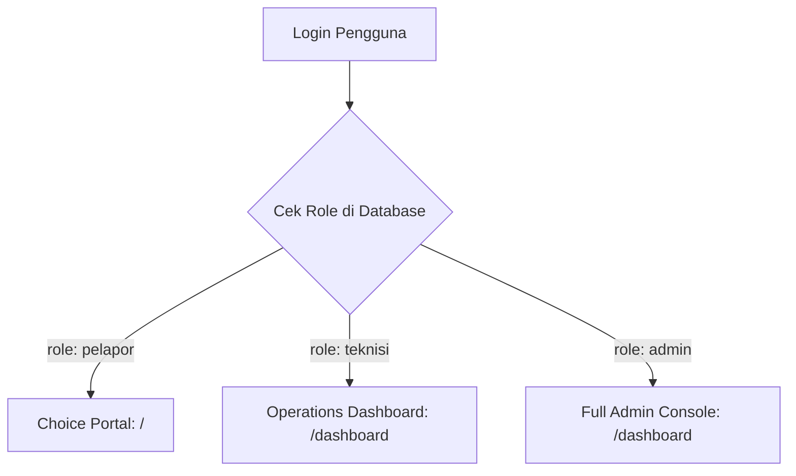
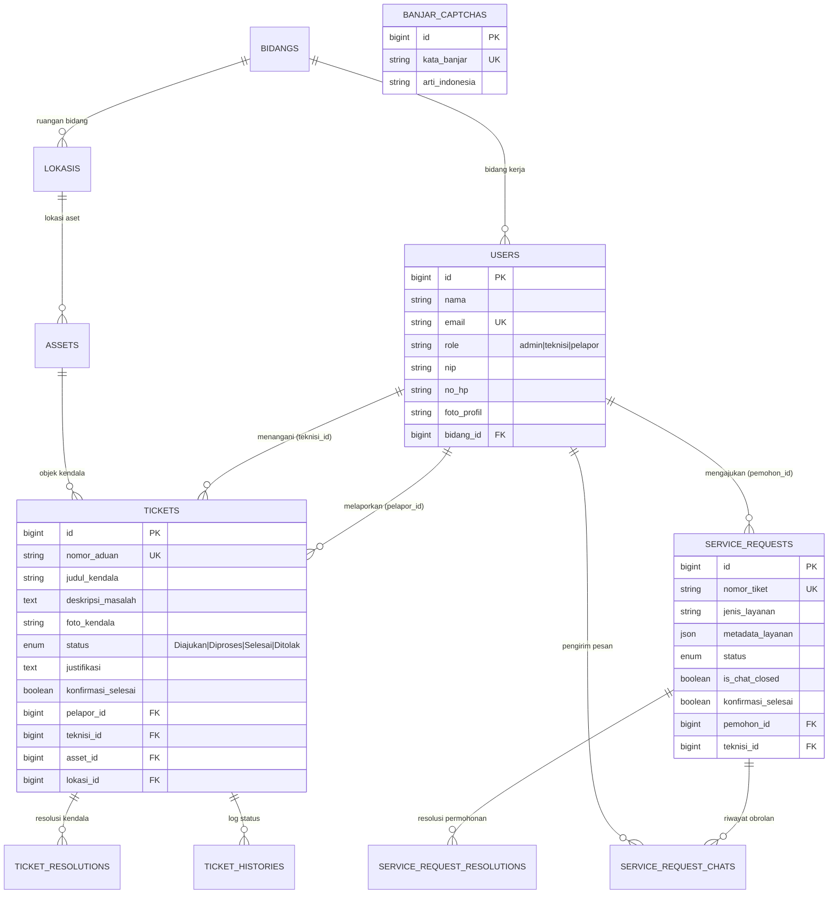

# 📘 Dokumentasi Proyek: ITSM BPOM

**Repository:** https://github.com/Sultan-ci90/itsm-bpom  
**Tech Stack:** Laravel 12 · PHP 8.4 · MySQL 8 · Tailwind CSS v4 (TailAdmin) · Alpine.js v3 · Vite 7 · Laravel Reverb · Fonnte WhatsApp Gateway · DomPDF · Maatwebsite Excel  
**Terakhir Diperbarui:** 9 November 2026  
**Status Proyek:** Aktif & Siap Operasional  

---

## 📑 Daftar Isi

1. [Ringkasan Proyek](#1-ringkasan-proyek)
2. [Arsitektur & Matriks Hak Akses (RBAC)](#2-arsitektur--matriks-hak-akses-rbac)
3. [Daftar Modul & Fitur Terverifikasi](#3-daftar-modul--fitur-terverifikasi)
   - 3.1 [Autentikasi & Captcha Bahasa Banjar](#31-autentikasi--captcha-bahasa-banjar)
   - 3.2 [Manajemen Insiden (Incident Management) & Cetak PDF BMN](#32-manajemen-insiden-incident-management--cetak-pdf-bmn)
   - 3.3 [Permintaan Layanan TI (Service Request Management)](#33-permintaan-layanan-ti-service-request-management)
   - 3.4 [Realtime Live Chat (Laravel Reverb & Echo)](#34-realtime-live-chat-laravel-reverb--echo)
   - 3.5 [Notifikasi Multi-Channel (In-App & WhatsApp Fonnte)](#35-notifikasi-multi-channel-in-app--whatsapp-fonnte)
   - 3.6 [Pusat Bantuan & Panduan (Knowledge Base)](#36-pusat-bantuan--panduan-knowledge-base)
   - 3.7 [Master Data & Pengaturan Sistem](#37-master-data--pengaturan-sistem)
   - 3.8 [Laporan & Rekapitulasi Excel](#38-laporan--rekapitulasi-excel)
4. [Skema Basis Data & Model Eloquent](#4-skema-basis-data--model-eloquent)
5. [Optimasi Performa Lokal & Laragon](#5-optimasi-performa-lokal--laragon)
6. [Panduan Instalasi & Menjalankan Proyek](#6-panduan-instalasi--menjalankan-proyek)
7. [Akun Pengujian Default](#7-akun-pengujian-default)
8. [Log Troubleshooting & Solusi Error](#8-log-troubleshooting--solusi-error)
9. [Konvensi Kode & Standar Pengembangan](#9-konvensi-kode--standar-pengembangan)

---

## 1. Ringkasan Proyek

**ITSM BPOM** adalah sistem informasi manajemen layanan teknologi informasi yang dirancang mengadopsi kerangka kerja **ITIL (Information Technology Infrastructure Library)** untuk **Balai Besar Pengawas Obat dan Makanan (BBPOM)**.

### Masalah Utama yang Diselesaikan:
- Menggantikan pelaporan kerusakan manual/lisan/chat WhatsApp personal menjadi sistem tiket digital satu pintu (*One-Stop Service Portal*).
- Menyediakan transparansi alur status tiket secara real-time dari pengajuan hingga penyelesaian.
- Merekam audit trail komprehensif (analisa akar masalah, tindakan perbaikan, petugas penanggung jawab).
- Memfasilitasi evaluasi berkala pimpinan melalui laporan rekapitulasi performa teknisi dan inventaris gangguan perangkat.

---

## 2. Arsitektur & Matriks Hak Akses (RBAC)

Sistem menggunakan middleware `App\Http\Middleware\RoleMiddleware` dengan 3 peran pengguna:



| Modul / Kemampuan | Pelapor (`pelapor`) | Teknisi (`teknisi`) | Administrator (`admin`) |
| :--- | :---: | :---: | :---: |
| Akses Choice Portal (`/`) | ✅ | ❌ | ❌ |
| Lapor Kendala TIK (Incident) | ✅ | ✅ | ✅ |
| Pengajuan Layanan TI (Service Request) | ✅ | ✅ | ✅ |
| Lacak Tiket & Riwayat Pribadi | ✅ | ✅ | ✅ |
| Live Chat pada Tiket Terkait | ✅ | ✅ | ✅ |
| Cetak Surat Permintaan Perbaikan BMN (PDF) | ✅ | ✅ | ✅ |
| Akses Dashboard Operasional TI (`/dashboard`) | ❌ | ✅ | ✅ |
| Kelola & Proses Antrean Semua Tiket | ❌ | ✅ | ✅ |
| Isi Analisa Teknis & Tindakan Resolusi | ❌ | ✅ | ✅ |
| Kontrol Buka/Tutup Sesi Live Chat | ❌ | ✅ | ✅ |
| Input Justifikasi Penolakan | ❌ | ✅ | ✅ |
| Manajemen Master Lokasi Ruangan | ❌ | ❌ | ✅ |
| Manajemen Akun Petugas & Hak Akses | ❌ | ❌ | ✅ |
| Konfigurasi WhatsApp & Pejabat Penandatangan | ❌ | ❌ | ✅ |
| Ekspor Laporan Rekapitulasi Excel | ❌ | ❌ | ✅ |

---

## 3. Daftar Modul & Fitur Terverifikasi

### 3.1 Autentikasi & Captcha Bahasa Banjar
- **Controller:** `App\Http\Controllers\Auth\LoginController`, `App\Http\Controllers\Auth\CaptchaController`
- **Model:** `App\Models\BanjarCaptcha`
- **Fitur Utama:**
  - Login manual terenkripsi dengan pembatasan percobaan login (throttling: 10 per menit).
  - Verifikasi bot unik menggunakan kamus lebih dari **130 kosakata asli Bahasa Banjar** (`database/seeders/BanjarCaptchaSeeder.php`).
  - Generator gambar PNG distorsi dinamis via pustaka GD (`App\Support\CaptchaImage`) dengan batas waktu kedaluwarsa 2 menit.
  - Validasi *case-insensitive* yang mencocokkan kata yang tertera pada gambar.
  - Pengalihan rute otomatis sesuai peran (*Role Redirection*).

### 3.2 Manajemen Insiden (Incident Management) & Cetak PDF BMN
- **Controller:** `App\Http\Controllers\IncidentController`
- **Request:** `App\Http\Requests\StoreIncidentRequest`, `App\Http\Requests\UpdateIncident`
- **Fitur Utama:**
  - Pembuatan nomor aduan otomatis berurutan per hari (`TIK-YYYYMMDD-XXXX`).
  - Deteksi dan auto-fill lokasi ruangan pelapor berdasarkan data bidang pengguna.
  - Dropdown searchable perangkat/aset TI terintegrasi data BMN.
  - Validasi unggah foto kendala (JPG/PNG maks. 2MB).
  - Pelacakan siklus hidup status: `Diajukan` ➔ `Diproses` ➔ `Selesai` / `Ditolak`.
  - Formulir tindakan resolusi petugas: pencatatan tanggal analisa, akar masalah (*root cause*), tanggal tindak lanjut, dan deskripsi tindakan perbaikan.
  - Catatan resmi justifikasi jika tiket ditolak.
  - Konfirmasi selesai oleh pelapor (`konfirmasi_selesai`).
  - **Cetak Surat Permintaan Perbaikan BMN:** Generate dokumen resmi format PDF siap cetak / tanda tangan menggunakan `barryvdh/laravel-dompdf`.

### 3.3 Permintaan Layanan TI (Service Request Management)
- **Controller:** `App\Http\Controllers\ServiceRequestController`
- **Fitur Utama:**
  - 5 kategori layanan dinas terintegrasi:
    1. **Permohonan Akun:** Pembuatan akun dinas baru atau reset password email/SIM instansi, dilengkapi form serah-terima kredensial (*generated username & password*) yang aman.
    2. **Akun Zoom Meeting:** Permohonan tautan rapat virtual dinas (judul kegiatan, tanggal mulai, jam, estimasi durasi).
    3. **Peminjaman Perangkat BMN:** Peminjaman proyektor LCD, laptop cadangan, atau kabel ekstensi, dilengkapi tanggal pinjam, rencana pengembalian, dan konfirmasi pengembalian alat fisik.
    4. **Konsultasi TI:** Permohonan pendampingan teknis perangkat lunak dinas.
    5. **Operator Kegiatan:** Permohonan teknisi sebagai operator multimedia/sound system kegiatan dinas.
  - Kemampuan pelapor untuk merevisi (*edit*) data permohonan selama tiket belum selesai diproses.
  - Konfirmasi penyelesaian oleh pemohon.

### 3.4 Realtime Live Chat (Laravel Reverb & Echo)
- **Controller:** `App\Http\Controllers\ServiceRequestController` (`chatMessages`, `sendChat`, `toggleChatStatus`)
- **Event:** `App\Events\ServiceRequestChatMessageSent`, `App\Events\ServiceRequestChatStatusChanged`
- **Fitur Utama:**
  - Komunikasi obrolan dua arah langsung di dalam halaman tiket permohonan.
  - Didukung server WebSocket **Laravel Reverb** (Port 8080) dan client **Laravel Echo**.
  - **Graceful Degradation:** Chat tetap berfungsi normal via fallback HTTP AJAX meskipun server Reverb sedang offline (tidak membebani thread browser).
  - Kontrol sesi chat: Teknisi/Admin dapat mengunci atau membuka kembali sesi obrolan saat tiket selesai.

### 3.5 Notifikasi Multi-Channel (In-App & WhatsApp Fonnte)
- **Notifikasi In-App:**
  - Lonceng notifikasi pada navbar atas dengan badge hitungan belum dibaca.
  - Memoized query dengan caching cerdas (`cache()->remember`) untuk kecepatan navigasi.
  - Opsi *Mark All as Read* dan *Delete All*.
- **WhatsApp Gateway:**
  - Service: `App\Services\FonnteService`
  - Job Asinkron: `App\Jobs\SendWhatsAppJob`
  - Mengirim notifikasi otomatis ke ponsel teknisi saat tiket masuk, dan ke pelapor saat tiket berstatus `Selesai` atau `Ditolak`.

### 3.6 Pusat Bantuan & Panduan (Knowledge Base)
- **Controller:** `App\Http\Controllers\KnowledgeBaseController`
- Menyediakan artikel panduan operasional alur aduan kendala, prosedur permohonan fasilitas, serta FAQ kendala teknis mandiri bagi seluruh pegawai.

### 3.7 Master Data & Pengaturan Sistem
- **Master Lokasi:** `App\Http\Controllers\LokasiController` — CRUD pemetaan ruangan fisik per unit kerja/bidang dan lantai gedung.
- **Master Petugas:** `App\Http\Controllers\PetugasController` — CRUD akun teknisi, pengelolaan nomor WhatsApp bot, dan pengaturan hak akses peran.
- **Pengaturan Sistem:** `App\Http\Controllers\SettingController` — Konfigurasi token WhatsApp Fonnte serta identitas Pejabat Penandatangan Surat (Kabag TU).

### 3.8 Laporan & Rekapitulasi Excel
- **Controller:** `App\Http\Controllers\ReportController`
- **Export Classes:** `App\Exports\IncidentExport`, `App\Exports\Sheets\IncidentSummarySheet`, `App\Exports\Sheets\IncidentDetailSheet`
- Filter fleksibel berdasarkan rentang tanggal awal - akhir dan status tiket.
- Menghasilkan berkas `.xlsx` multi-sheet yang memuat sheet ringkasan eksekutif dan sheet detail data komprehensif.

---

## 4. Skema Basis Data & Model Eloquent

### Entitas Kunci Basis Data (MySQL):



---

## 5. Optimasi Performa Lokal & Laragon

Pada pembaruan November 2026, telah diterapkan optimasi performa komprehensif untuk menghilangkan latensi pada lingkungan Windows & Laragon:

1. **Storage Driver Zero-Latency:**
   - `SESSION_DRIVER=file` dan `CACHE_STORE=file` di `.env` (menghilangkan *disk write lock* MySQL pada setiap request).
2. **Decoupled Echo / WebSocket:**
   - `echo.js` dimuat secara *lazy* hanya saat halaman chat dibuka, menghentikan *infinite reconnect loop* yang sebelumnya membebani CPU saat server Reverb offline.
3. **Vite Polling Removal:**
   - Mematikan `usePolling: true` pada Vite Windows untuk menghemat beban CPU latar belakang.
4. **Notification Query Memoization:**
   - Query unread notifications di-cache selama 30 detik per user (`cache()->remember`), mempercepat transisi halaman SPA.
5. **Skrip Optimasi Satu-Klik (`scripts/optimize-local.bat`):**
   - Menjalankan `optimize:clear`, `config:cache`, `route:cache`, `composer dump-autoload -o`, dan `storage:link`.
6. **Aktivasi PHP OPcache di Laragon:**
   - Klik kanan Laragon ➔ **PHP** ➔ **Quick Settings** ➔ aktifkan **`opcache`**. Memberikan percepatan *booting* Laravel hingga 300%-500%.

---

## 6. Panduan Instalasi & Menjalankan Proyek

### Prasyarat Sistem:
- **PHP** >= 8.3 (dengan ekstensi: `gd`, `zip`, `pdo_mysql`, `mbstring`, `fileinfo`, `curl`, `openssl`).
- **Composer** v2.x
- **Node.js** v18+ / v20+ LTS & **NPM**
- **MySQL** / MariaDB (via Laragon, XAMPP, atau Docker).

### Langkah Cepat Setup:
```bash
# 1. Clone repositori
git clone https://github.com/Sultan-ci90/itsm-bpom.git
cd itsm-bpom

# 2. Pasang dependensi
composer install
npm install

# 3. Konfigurasi .env & Key
cp .env.example .env
php artisan key:generate

# 4. Buat Database & Migrasi
# Pastikan database 'itsm_bpom' sudah dibuat di MySQL
php artisan migrate:fresh --seed
php artisan storage:link

# 5. Kompilasi Aset Frontend
npm run build

# 6. Jalankan Aplikasi (Satu Pintu)
composer run dev
```

---

## 7. Akun Pengujian Default

Setelah menjalankan `php artisan migrate:fresh --seed`, gunakan akun berikut:

| Peran (*Role*) | Alamat Email | Password | Fungsi Pengujian |
| :--- | :--- | :--- | :--- |
| **Administrator** | `admin@bpom.test` | `password` | Dashboard utama, Master Ruangan/Petugas, Pengaturan WA, Ekspor Excel. |
| **Teknisi IT** | `teknisi@bpom.test` | `password` | Antrean tiket, form analisa/tindakan resolusi, serah terima akun/BMN, kontrol chat. |
| **Pelapor (Pegawai)** | `pelapor@bpom.test` | `password` | Choice portal, lapor kendala, pengajuan 5 permohonan TI, live chat, cetak PDF BMN. |

---

## 8. Log Troubleshooting & Solusi Error

| # | Gejala Error | Penyebab Utama | Solusi Penanganan |
|---|---|---|---|
| 1 | `Call to undefined function imagecreatetruecolor()` | Ekstensi PHP `gd` belum aktif | Buka `php.ini`, hilangkan `;` pada `extension=gd`, lalu restart server PHP. |
| 2 | `Class "ZipArchive" not found` | Ekstensi PHP `zip` belum aktif | Buka `php.ini`, aktifkan `extension=zip`, lalu jalankan kembali `composer install`. |
| 3 | `SQLSTATE[HY000] [1049] Unknown database` | Database MySQL belum dibuat | Jalankan `CREATE DATABASE itsm_bpom;` di HeidiSQL / phpMyAdmin. |
| 4 | `Vite manifest not found` | Aset belum dikompilasi | Jalankan perintah `npm run build` atau `npm run dev`. |
| 5 | Foto kendala / avatar tidak muncul | Storage link belum dibuat | Jalankan perintah `php artisan storage:link`. |
| 6 | Chat tidak realtime tanpa reload | Reverb WebSocket belum hidup | Jalankan `php artisan reverb:start` (opsional, chat tetap masuk via AJAX). |
| 7 | Halaman web terasa lambat di lokal | Cache/OPcache belum optimal | Jalankan `scripts\optimize-local.bat` dan aktifkan OPcache di Laragon. |

---

## 9. Konvensi Kode & Standar Pengembangan

1. **Frontend Styling:** Menggunakan Tailwind CSS v4 dengan token tema `@theme` di `resources/css/app.css`. Jangan buat berkas `tailwind.config.js`.
2. **Dukungan RTL:** Gunakan *CSS Logical Properties* (`ms-*`, `me-*`, `ps-*`, `pe-*`, `text-start`, `text-end`).
3. **Komponen Modular:** Manfaatkan Blade Components `<x-ui.*>`, `<x-form.*>`, dan `<x-common.*>` dengan deklarasi `@props([...])`.
4. **Validasi Formulir:** Seluruh logika validasi dienkapsulasi dalam Form Request classes (`app/Http/Requests/`).
5. **Penanganan Error Background:** Broadcast WebSocket dan pengiriman pesan WhatsApp dibungkus blok `try-catch` agar kegagalan layanan eksternal tidak menghentikan transaksi database utama.
6. **Testing:** Pastikan `php artisan test` menghasilkan status `PASS` (lulus 100%) sebelum melakukan *commit* atau *merge*.
