# PROJECT SNAPSHOT

## Project Information

- Project Type: Laravel Web Application (ITSM BPOM)
- Framework: Laravel 12, Blade, Alpine.js, Tailwind CSS v4, template TailAdmin, ApexCharts, Reverb, Fonnte, DomPDF
- Snapshot Date: 2026-11-09
- Root Directory: itsm-bpom/
- Purpose: Complete source-code snapshot for AI analysis (PRD/handover acuan)

---

# FILE INDEX

| No | File | Status |
| -: | ---- | ------ |
| 1 | `.editorconfig` | Included |
| 2 | `.env.example` | Included |
| 3 | `.gitattributes` | Included |
| 4 | `.gitignore` | Included |
| 5 | `.nvmrc` | Included |
| 6 | `AGENTS.md` | Included |
| 7 | `app/Events/ServiceRequestChatMessageSent.php` | Included |
| 8 | `app/Events/ServiceRequestChatStatusChanged.php` | Included |
| 9 | `app/Exports/LaporanKerusakanExport.php` | Included |
| 10 | `app/Exports/LaporanLayananExport.php` | Included |
| 11 | `app/Exports/Sheets/DetailKerusakanSheet.php` | Included |
| 12 | `app/Exports/Sheets/DetailLayananSheet.php` | Included |
| 13 | `app/Exports/Sheets/RingkasanSheet.php` | Included |
| 14 | `app/Helpers/MenuHelper.php` | Included |
| 15 | `app/Http/Controllers/Api/UserSearchController.php` | Included |
| 16 | `app/Http/Controllers/Auth/CaptchaController.php` | Included |
| 17 | `app/Http/Controllers/Auth/LoginController.php` | Included |
| 18 | `app/Http/Controllers/Controller.php` | Included |
| 19 | `app/Http/Controllers/DashboardController.php` | Included |
| 20 | `app/Http/Controllers/IncidentController.php` | Included |
| 21 | `app/Http/Controllers/KnowledgeBaseController.php` | Included |
| 22 | `app/Http/Controllers/LocaleController.php` | Included |
| 23 | `app/Http/Controllers/LokasiController.php` | Included |
| 24 | `app/Http/Controllers/PetugasController.php` | Included |
| 25 | `app/Http/Controllers/ProfileController.php` | Included |
| 26 | `app/Http/Controllers/ReportController.php` | Included |
| 27 | `app/Http/Controllers/ServiceRequestController.php` | Included |
| 28 | `app/Http/Controllers/SettingController.php` | Included |
| 29 | `app/Http/Middleware/RoleMiddleware.php` | Included |
| 30 | `app/Http/Middleware/SetLocale.php` | Included |
| 31 | `app/Http/Requests/GenerateReportRequest.php` | Included |
| 32 | `app/Http/Requests/StoreIncidentRequest.php` | Included |
| 33 | `app/Http/Requests/StoreServiceRequestRequest.php` | Included |
| 34 | `app/Http/Requests/UpdateTicketRequest.php` | Included |
| 35 | `app/Jobs/SendWhatsAppJob.php` | Included |
| 36 | `app/Models/Asset.php` | Included |
| 37 | `app/Models/BanjarCaptcha.php` | Included |
| 38 | `app/Models/Bidang.php` | Included |
| 39 | `app/Models/Jabatan.php` | Included |
| 40 | `app/Models/KnowledgeBase.php` | Included |
| 41 | `app/Models/Lokasi.php` | Included |
| 42 | `app/Models/Panggol.php` | Included |
| 43 | `app/Models/ReqDetailAkun.php` | Included |
| 44 | `app/Models/ReqDetailZoom.php` | Included |
| 45 | `app/Models/ServiceRequest.php` | Included |
| 46 | `app/Models/ServiceRequestChat.php` | Included |
| 47 | `app/Models/ServiceRequestResolution.php` | Included |
| 48 | `app/Models/Setting.php` | Included |
| 49 | `app/Models/Ticket.php` | Included |
| 50 | `app/Models/TicketHistory.php` | Included |
| 51 | `app/Models/TicketResolution.php` | Included |
| 52 | `app/Models/User.php` | Included |
| 53 | `app/Notifications/NewTicketNotification.php` | Included |
| 54 | `app/Notifications/TicketStatusUpdatedNotification.php` | Included |
| 55 | `app/Providers/AppServiceProvider.php` | Included |
| 56 | `app/Services/FonnteService.php` | Included |
| 57 | `app/Services/PeriodeResolver.php` | Included |
| 58 | `app/Support/CaptchaImage.php` | Included |
| 59 | `app/View/Components/CalenderArea.php` | Included |
| 60 | `app/View/Components/common/CommonGridShape.php` | Included |
| 61 | `app/View/Components/common/ComponentCard.php` | Included |
| 62 | `app/View/Components/common/DropdownMenu.php` | Included |
| 63 | `app/View/Components/common/PageBreadcrumb.php` | Included |
| 64 | `app/View/Components/common/Preloader.php` | Included |
| 65 | `app/View/Components/common/TableDropdown.php` | Included |
| 66 | `app/View/Components/common/ThemeToggle.php` | Included |
| 67 | `app/View/Components/ecommerce/CustomerDemographic.php` | Included |
| 68 | `app/View/Components/ecommerce/EcommerceMetrics.php` | Included |
| 69 | `app/View/Components/ecommerce/MonthlySale.php` | Included |
| 70 | `app/View/Components/ecommerce/MonthlyTarget.php` | Included |
| 71 | `app/View/Components/ecommerce/RecentOrders.php` | Included |
| 72 | `app/View/Components/ecommerce/StatisticsChart.php` | Included |
| 73 | `app/View/Components/form/DatePicker.php` | Included |
| 74 | `app/View/Components/form/FormElements/CheckboxComponent.php` | Included |
| 75 | `app/View/Components/form/FormElements/DefaultInputs.php` | Included |
| 76 | `app/View/Components/form/FormElements/Dropzone.php` | Included |
| 77 | `app/View/Components/form/FormElements/FileInputExample.php` | Included |
| 78 | `app/View/Components/form/FormElements/InputGroup.php` | Included |
| 79 | `app/View/Components/form/FormElements/InputStates.php` | Included |
| 80 | `app/View/Components/form/FormElements/RadioButtons.php` | Included |
| 81 | `app/View/Components/form/FormElements/SelectInputs.php` | Included |
| 82 | `app/View/Components/form/FormElements/TextAreaInputs.php` | Included |
| 83 | `app/View/Components/form/FormElements/ToggleSwitch.php` | Included |
| 84 | `app/View/Components/form/input/Radio.php` | Included |
| 85 | `app/View/Components/form/select/MultipleSelect.php` | Included |
| 86 | `app/View/Components/header/NotificationDropdown.php` | Included |
| 87 | `app/View/Components/header/UserDropdown.php` | Included |
| 88 | `app/View/Components/profile/AddressCard.php` | Included |
| 89 | `app/View/Components/profile/PersonalInfoCard.php` | Included |
| 90 | `app/View/Components/profile/ProfileCard.php` | Included |
| 91 | `app/View/Components/tables/BasicTables/BasicTablesFive.php` | Included |
| 92 | `app/View/Components/tables/BasicTables/BasicTablesFour.php` | Included |
| 93 | `app/View/Components/tables/BasicTables/BasicTablesOne.php` | Included |
| 94 | `app/View/Components/tables/BasicTables/BasicTablesThree.php` | Included |
| 95 | `app/View/Components/tables/BasicTables/BasicTablesTwo.php` | Included |
| 96 | `app/View/Components/ui/Alert.php` | Included |
| 97 | `app/View/Components/ui/Avatar.php` | Included |
| 98 | `app/View/Components/ui/Badge.php` | Included |
| 99 | `app/View/Components/ui/Button.php` | Included |
| 100 | `app/View/Components/ui/Modal.php` | Included |
| 101 | `app/View/Components/ui/YoutubeEmbed.php` | Included |
| 102 | `artisan` | Included |
| 103 | `bootstrap/app.php` | Included |
| 104 | `bootstrap/providers.php` | Included |
| 105 | `composer.json` | Included |
| 106 | `config/app.php` | Included |
| 107 | `config/auth.php` | Included |
| 108 | `config/broadcasting.php` | Included |
| 109 | `config/cache.php` | Included |
| 110 | `config/database.php` | Included |
| 111 | `config/filesystems.php` | Included |
| 112 | `config/fonnte.php` | Included |
| 113 | `config/itsm.php` | Included |
| 114 | `config/logging.php` | Included |
| 115 | `config/mail.php` | Included |
| 116 | `config/queue.php` | Included |
| 117 | `config/reverb.php` | Included |
| 118 | `config/services.php` | Included |
| 119 | `config/session.php` | Included |
| 120 | `database/.gitignore` | Included |
| 121 | `database/factories/AssetFactory.php` | Included |
| 122 | `database/factories/UserFactory.php` | Included |
| 123 | `database/migrations/0001_01_01_000001_create_cache_table.php` | Included |
| 124 | `database/migrations/2026_09_28_021525_create_sessions_table.php` | Included |
| 125 | `database/migrations/2026_09_30_000001_create_itsm_schema_tables.php` | Included |
| 126 | `database/migrations/2026_10_06_000000_add_soft_deletes_to_tickets_table.php` | Included |
| 127 | `database/migrations/2026_10_06_000001_create_service_request_resolutions_table.php` | Included |
| 128 | `database/migrations/2026_10_06_000002_add_foto_profil_to_users_table.php` | Included |
| 129 | `database/migrations/2026_10_06_000200_make_arti_indonesia_nullable_on_banjar_captchas.php` | Included |
| 130 | `database/migrations/2026_10_07_014633_create_notifications_table.php` | Included |
| 131 | `database/migrations/2026_10_11_164604_add_email_and_password_to_req_detail_akun_table.php` | Included |
| 132 | `database/migrations/2026_10_12_000001_create_service_request_chats_table.php` | Included |
| 133 | `database/migrations/2026_10_12_000002_add_chat_control_and_completion_to_service_requests_table.php` | Included |
| 134 | `database/migrations/2026_10_13_000001_create_lokasis_table.php` | Included |
| 135 | `database/migrations/2026_10_14_000001_add_reported_by_to_tickets_and_service_requests.php` | Included |
| 136 | `database/migrations/2026_10_19_000001_add_konfirmasi_selesai_to_service_requests_table.php` | Included |
| 137 | `database/migrations/2026_10_19_000002_update_jenis_penyelesaian_in_ticket_resolutions_table.php` | Included |
| 138 | `database/migrations/2026_10_20_000001_remove_vendor_and_estimasi_biaya_from_ticket_resolutions_table.php` | Included |
| 139 | `database/migrations/2026_10_20_000002_add_tgl_acara_to_req_detail_zoom_table.php` | Included |
| 140 | `database/migrations/2026_10_20_000003_cleanup_service_request_resolutions_columns_table.php` | Included |
| 141 | `database/migrations/2026_10_21_000001_create_knowledge_bases_table.php` | Included |
| 142 | `database/migrations/2026_10_21_042445_create_jobs_table.php` | Included |
| 143 | `database/migrations/2026_10_21_042719_create_failed_jobs_table.php` | Included |
| 144 | `database/migrations/2026_10_21_042725_create_settings_table.php` | Included |
| 145 | `database/migrations/2026_10_22_000001_add_jenis_kendala_and_make_asset_id_nullable_on_tickets_table.php` | Included |
| 146 | `database/migrations/2026_10_26_000001_drop_lokasi_from_service_requests_table.php` | Included |
| 147 | `database/migrations/2026_10_27_000001_drop_zoom_columns_from_service_request_resolutions_table.php` | Included |
| 148 | `database/migrations/2026_10_27_000002_update_service_requests_schema_and_clean_peminjaman.php` | Included |
| 149 | `database/migrations/2026_10_27_000003_add_konfirmasi_selesai_to_tickets_table.php` | Included |
| 150 | `database/migrations/2026_10_28_033610_drop_unused_columns_from_req_detail_akun_table.php` | Included |
| 151 | `database/migrations/2026_10_29_000001_add_completed_at_and_is_konfirmasi_otomatis.php` | Included |
| 152 | `database/seeders/BanjarCaptchaSeeder.php` | Included |
| 153 | `database/seeders/DatabaseSeeder.php` | Included |
| 154 | `database/seeders/DummyDataSeeder.php` | Included |
| 155 | `database/seeders/ItsmSeeder.php` | Included |
| 156 | `database/seeders/KnowledgeBaseSeeder.php` | Included |
| 157 | `database/seeders/LokasiSeeder.php` | Included |
| 158 | `database/seeders/PelaporanSeeder.php` | Included |
| 159 | `database/seeders/SettingSeeder.php` | Included |
| 160 | `database/sqlite.db` | Included |
| 161 | `docker-compose.yml` | Included |
| 162 | `LICENSE` | Included |
| 163 | `nixpacks.toml` | Included |
| 164 | `package.json` | Included |
| 165 | `phpunit.xml` | Included |
| 166 | `PROJECT_DOCUMENTATION.md` | Included |
| 167 | `public/.htaccess` | Included |
| 168 | `public/hot` | Included |
| 169 | `public/index.php` | Included |
| 170 | `public/robots.txt` | Included |
| 171 | `README.md` | Included |
| 172 | `resources/css/app.css` | Included |
| 173 | `resources/js/app.js` | Included |
| 174 | `resources/js/bootstrap.js` | Included |
| 175 | `resources/js/components/chart/ticket-charts.js` | Included |
| 176 | `resources/js/echo.js` | Included |
| 177 | `resources/js/live-table.js` | Included |
| 178 | `resources/js/spa-nav.js` | Included |
| 179 | `resources/views/components/common/common-grid-shape.blade.php` | Included |
| 180 | `resources/views/components/common/component-card.blade.php` | Included |
| 181 | `resources/views/components/common/page-breadcrumb.blade.php` | Included |
| 182 | `resources/views/components/form/date-picker.blade.php` | Included |
| 183 | `resources/views/components/form/time-range-picker.blade.php` | Included |
| 184 | `resources/views/components/header/notification-dropdown.blade.php` | Included |
| 185 | `resources/views/components/header/user-dropdown.blade.php` | Included |
| 186 | `resources/views/components/ui/alert.blade.php` | Included |
| 187 | `resources/views/components/ui/avatar.blade.php` | Included |
| 188 | `resources/views/components/ui/badge.blade.php` | Included |
| 189 | `resources/views/components/ui/button.blade.php` | Included |
| 190 | `resources/views/components/ui/modal.blade.php` | Included |
| 191 | `resources/views/incidents/all.blade.php` | Included |
| 192 | `resources/views/incidents/create.blade.php` | Included |
| 193 | `resources/views/incidents/edit-resolution.blade.php` | Included |
| 194 | `resources/views/incidents/edit.blade.php` | Included |
| 195 | `resources/views/incidents/index.blade.php` | Included |
| 196 | `resources/views/incidents/justifikasi.blade.php` | Included |
| 197 | `resources/views/incidents/show.blade.php` | Included |
| 198 | `resources/views/layouts/app-header.blade.php` | Included |
| 199 | `resources/views/layouts/app.blade.php` | Included |
| 200 | `resources/views/layouts/backdrop.blade.php` | Included |
| 201 | `resources/views/layouts/fullscreen-layout.blade.php` | Included |
| 202 | `resources/views/layouts/sidebar-widget.blade.php` | Included |
| 203 | `resources/views/layouts/sidebar.blade.php` | Included |
| 204 | `resources/views/master/lokasi/index.blade.php` | Included |
| 205 | `resources/views/master/petugas/index.blade.php` | Included |
| 206 | `resources/views/pages/auth/signin.blade.php` | Included |
| 207 | `resources/views/pages/choice/index.blade.php` | Included |
| 208 | `resources/views/pages/dashboard/index.blade.php` | Included |
| 209 | `resources/views/pages/errors/error-404.blade.php` | Included |
| 210 | `resources/views/pages/profile.blade.php` | Included |
| 211 | `resources/views/panduan/create.blade.php` | Included |
| 212 | `resources/views/panduan/edit.blade.php` | Included |
| 213 | `resources/views/panduan/index.blade.php` | Included |
| 214 | `resources/views/panduan/show.blade.php` | Included |
| 215 | `resources/views/pdf/surat-perbaikan-bmn.blade.php` | Included |
| 216 | `resources/views/reports/index.blade.php` | Included |
| 217 | `resources/views/requests/all.blade.php` | Included |
| 218 | `resources/views/requests/create.blade.php` | Included |
| 219 | `resources/views/requests/edit-resolution.blade.php` | Included |
| 220 | `resources/views/requests/edit.blade.php` | Included |
| 221 | `resources/views/requests/index.blade.php` | Included |
| 222 | `resources/views/requests/show.blade.php` | Included |
| 223 | `resources/views/settings/whatsapp.blade.php` | Included |
| 224 | `routes/channels.php` | Included |
| 225 | `routes/console.php` | Included |
| 226 | `routes/web.php` | Included |
| 227 | `scripts/optimize-local.bat` | Included |
| 228 | `skills-lock.json` | Included |
| 229 | `tests/Feature/ExampleTest.php` | Included |
| 230 | `tests/Pest.php` | Included |
| 231 | `tests/TestCase.php` | Included |
| 232 | `tests/Unit/ExampleTest.php` | Included |
| 233 | `vite.config.js` | Included |
| 234 | `.env` | Excluded - Sensitif (.env.example disertakan) |
| 235 | `vendor/` | Excluded - Dependency/Generated |
| 236 | `node_modules/` | Excluded - Dependency/Generated |
| 237 | `.git/` | Excluded - Dependency/Generated |
| 238 | `public/build/` | Excluded - Dependency/Generated |
| 239 | `public/images/` | Excluded - Binary Asset/Media |
| 240 | `bootstrap/cache/` | Excluded - Dependency/Generated |
| 241 | `storage/logs/` | Excluded - Dependency/Generated |
| 242 | `storage/framework/*` | Excluded - Dependency/Generated |
| 243 | `graphify-out/` | Excluded - Knowledge Graph Tool Output |
| 244 | `.agents/` | Excluded - Agent Config/Rules |
| 245 | `bahan laporan magang/` | Excluded - Berkas Pribadi/Magang |

---

# 1. PROJECT STRUCTURE

```text
itsm-bpom/
├── .editorconfig
├── .env.example
├── .gitattributes
├── .gitignore
├── .nvmrc
├── AGENTS.md
├── LICENSE
├── PROJECT_DOCUMENTATION.md
├── README.md
├── app/
│   ├── Events/
│   │   ├── ServiceRequestChatMessageSent.php
│   │   └── ServiceRequestChatStatusChanged.php
│   ├── Exports/
│   │   ├── LaporanKerusakanExport.php
│   │   ├── LaporanLayananExport.php
│   │   └── Sheets/
│   │       ├── DetailKerusakanSheet.php
│   │       ├── DetailLayananSheet.php
│   │       └── RingkasanSheet.php
│   ├── Helpers/
│   │   └── MenuHelper.php
│   ├── Http/
│   │   ├── Controllers/
│   │   │   ├── Api/
│   │   │   │   └── UserSearchController.php
│   │   │   ├── Auth/
│   │   │   │   ├── CaptchaController.php
│   │   │   │   └── LoginController.php
│   │   │   ├── Controller.php
│   │   │   ├── DashboardController.php
│   │   │   ├── IncidentController.php
│   │   │   ├── KnowledgeBaseController.php
│   │   │   ├── LocaleController.php
│   │   │   ├── LokasiController.php
│   │   │   ├── PetugasController.php
│   │   │   ├── ProfileController.php
│   │   │   ├── ReportController.php
│   │   │   ├── ServiceRequestController.php
│   │   │   └── SettingController.php
│   │   ├── Middleware/
│   │   │   ├── RoleMiddleware.php
│   │   │   └── SetLocale.php
│   │   └── Requests/
│   │       ├── GenerateReportRequest.php
│   │       ├── StoreIncidentRequest.php
│   │       ├── StoreServiceRequestRequest.php
│   │       └── UpdateTicketRequest.php
│   ├── Jobs/
│   │   └── SendWhatsAppJob.php
│   ├── Models/
│   │   ├── Asset.php
│   │   ├── BanjarCaptcha.php
│   │   ├── Bidang.php
│   │   ├── Jabatan.php
│   │   ├── KnowledgeBase.php
│   │   ├── Lokasi.php
│   │   ├── Panggol.php
│   │   ├── ReqDetailAkun.php
│   │   ├── ReqDetailZoom.php
│   │   ├── ServiceRequest.php
│   │   ├── ServiceRequestChat.php
│   │   ├── ServiceRequestResolution.php
│   │   ├── Setting.php
│   │   ├── Ticket.php
│   │   ├── TicketHistory.php
│   │   ├── TicketResolution.php
│   │   └── User.php
│   ├── Notifications/
│   │   ├── NewTicketNotification.php
│   │   └── TicketStatusUpdatedNotification.php
│   ├── Providers/
│   │   └── AppServiceProvider.php
│   ├── Services/
│   │   ├── FonnteService.php
│   │   └── PeriodeResolver.php
│   ├── Support/
│   │   └── CaptchaImage.php
│   └── View/
│       └── Components/
│           ├── CalenderArea.php
│           ├── common/
│           │   ├── CommonGridShape.php
│           │   ├── ComponentCard.php
│           │   ├── DropdownMenu.php
│           │   ├── PageBreadcrumb.php
│           │   ├── Preloader.php
│           │   ├── TableDropdown.php
│           │   └── ThemeToggle.php
│           ├── ecommerce/
│           │   ├── CustomerDemographic.php
│           │   ├── EcommerceMetrics.php
│           │   ├── MonthlySale.php
│           │   ├── MonthlyTarget.php
│           │   ├── RecentOrders.php
│           │   └── StatisticsChart.php
│           ├── form/
│           │   ├── DatePicker.php
│           │   ├── FormElements/
│           │   │   ├── CheckboxComponent.php
│           │   │   ├── DefaultInputs.php
│           │   │   ├── Dropzone.php
│           │   │   ├── FileInputExample.php
│           │   │   ├── InputGroup.php
│           │   │   ├── InputStates.php
│           │   │   ├── RadioButtons.php
│           │   │   ├── SelectInputs.php
│           │   │   ├── TextAreaInputs.php
│           │   │   └── ToggleSwitch.php
│           │   ├── input/
│           │   │   └── Radio.php
│           │   └── select/
│           │       └── MultipleSelect.php
│           ├── header/
│           │   ├── NotificationDropdown.php
│           │   └── UserDropdown.php
│           ├── profile/
│           │   ├── AddressCard.php
│           │   ├── PersonalInfoCard.php
│           │   └── ProfileCard.php
│           ├── tables/
│           │   └── BasicTables/
│           │       ├── BasicTablesFive.php
│           │       ├── BasicTablesFour.php
│           │       ├── BasicTablesOne.php
│           │       ├── BasicTablesThree.php
│           │       └── BasicTablesTwo.php
│           └── ui/
│               ├── Alert.php
│               ├── Avatar.php
│               ├── Badge.php
│               ├── Button.php
│               ├── Modal.php
│               └── YoutubeEmbed.php
├── artisan
├── bootstrap/
│   ├── app.php
│   └── providers.php
├── composer.json
├── config/
│   ├── app.php
│   ├── auth.php
│   ├── broadcasting.php
│   ├── cache.php
│   ├── database.php
│   ├── filesystems.php
│   ├── fonnte.php
│   ├── itsm.php
│   ├── logging.php
│   ├── mail.php
│   ├── queue.php
│   ├── reverb.php
│   ├── services.php
│   └── session.php
├── database/
│   ├── .gitignore
│   ├── factories/
│   │   ├── AssetFactory.php
│   │   └── UserFactory.php
│   ├── migrations/
│   │   ├── 0001_01_01_000001_create_cache_table.php
│   │   ├── 2026_09_28_021525_create_sessions_table.php
│   │   ├── 2026_09_30_000001_create_itsm_schema_tables.php
│   │   ├── 2026_10_06_000000_add_soft_deletes_to_tickets_table.php
│   │   ├── 2026_10_06_000001_create_service_request_resolutions_table.php
│   │   ├── 2026_10_06_000002_add_foto_profil_to_users_table.php
│   │   ├── 2026_10_06_000200_make_arti_indonesia_nullable_on_banjar_captchas.php
│   │   ├── 2026_10_07_014633_create_notifications_table.php
│   │   ├── 2026_10_11_164604_add_email_and_password_to_req_detail_akun_table.php
│   │   ├── 2026_10_12_000001_create_service_request_chats_table.php
│   │   ├── 2026_10_12_000002_add_chat_control_and_completion_to_service_requests_table.php
│   │   ├── 2026_10_13_000001_create_lokasis_table.php
│   │   ├── 2026_10_14_000001_add_reported_by_to_tickets_and_service_requests.php
│   │   ├── 2026_10_19_000001_add_konfirmasi_selesai_to_service_requests_table.php
│   │   ├── 2026_10_19_000002_update_jenis_penyelesaian_in_ticket_resolutions_table.php
│   │   ├── 2026_10_20_000001_remove_vendor_and_estimasi_biaya_from_ticket_resolutions_table.php
│   │   ├── 2026_10_20_000002_add_tgl_acara_to_req_detail_zoom_table.php
│   │   ├── 2026_10_20_000003_cleanup_service_request_resolutions_columns_table.php
│   │   ├── 2026_10_21_000001_create_knowledge_bases_table.php
│   │   ├── 2026_10_21_042445_create_jobs_table.php
│   │   ├── 2026_10_21_042719_create_failed_jobs_table.php
│   │   ├── 2026_10_21_042725_create_settings_table.php
│   │   ├── 2026_10_22_000001_add_jenis_kendala_and_make_asset_id_nullable_on_tickets_table.php
│   │   ├── 2026_10_26_000001_drop_lokasi_from_service_requests_table.php
│   │   ├── 2026_10_27_000001_drop_zoom_columns_from_service_request_resolutions_table.php
│   │   ├── 2026_10_27_000002_update_service_requests_schema_and_clean_peminjaman.php
│   │   ├── 2026_10_27_000003_add_konfirmasi_selesai_to_tickets_table.php
│   │   ├── 2026_10_28_033610_drop_unused_columns_from_req_detail_akun_table.php
│   │   └── 2026_10_29_000001_add_completed_at_and_is_konfirmasi_otomatis.php
│   ├── seeders/
│   │   ├── BanjarCaptchaSeeder.php
│   │   ├── DatabaseSeeder.php
│   │   ├── DummyDataSeeder.php
│   │   ├── ItsmSeeder.php
│   │   ├── KnowledgeBaseSeeder.php
│   │   ├── LokasiSeeder.php
│   │   ├── PelaporanSeeder.php
│   │   └── SettingSeeder.php
│   └── sqlite.db
├── docker-compose.yml
├── nixpacks.toml
├── package.json
├── phpunit.xml
├── public/
│   ├── .htaccess
│   ├── hot
│   ├── index.php
│   └── robots.txt
├── resources/
│   ├── css/
│   │   └── app.css
│   ├── js/
│   │   ├── app.js
│   │   ├── bootstrap.js
│   │   ├── components/
│   │   │   └── chart/
│   │   │       └── ticket-charts.js
│   │   ├── echo.js
│   │   ├── live-table.js
│   │   └── spa-nav.js
│   └── views/
│       ├── components/
│       │   ├── common/
│       │   │   ├── common-grid-shape.blade.php
│       │   │   ├── component-card.blade.php
│       │   │   └── page-breadcrumb.blade.php
│       │   ├── form/
│       │   │   ├── date-picker.blade.php
│       │   │   └── time-range-picker.blade.php
│       │   ├── header/
│       │   │   ├── notification-dropdown.blade.php
│       │   │   └── user-dropdown.blade.php
│       │   └── ui/
│       │       ├── alert.blade.php
│       │       ├── avatar.blade.php
│       │       ├── badge.blade.php
│       │       ├── button.blade.php
│       │       └── modal.blade.php
│       ├── incidents/
│       │   ├── all.blade.php
│       │   ├── create.blade.php
│       │   ├── edit-resolution.blade.php
│       │   ├── edit.blade.php
│       │   ├── index.blade.php
│       │   ├── justifikasi.blade.php
│       │   └── show.blade.php
│       ├── layouts/
│       │   ├── app-header.blade.php
│       │   ├── app.blade.php
│       │   ├── backdrop.blade.php
│       │   ├── fullscreen-layout.blade.php
│       │   ├── sidebar-widget.blade.php
│       │   └── sidebar.blade.php
│       ├── master/
│       │   ├── lokasi/
│       │   │   └── index.blade.php
│       │   └── petugas/
│       │       └── index.blade.php
│       ├── pages/
│       │   ├── auth/
│       │   │   └── signin.blade.php
│       │   ├── choice/
│       │   │   └── index.blade.php
│       │   ├── dashboard/
│       │   │   └── index.blade.php
│       │   ├── errors/
│       │   │   └── error-404.blade.php
│       │   └── profile.blade.php
│       ├── panduan/
│       │   ├── create.blade.php
│       │   ├── edit.blade.php
│       │   ├── index.blade.php
│       │   └── show.blade.php
│       ├── pdf/
│       │   └── surat-perbaikan-bmn.blade.php
│       ├── reports/
│       │   └── index.blade.php
│       ├── requests/
│       │   ├── all.blade.php
│       │   ├── create.blade.php
│       │   ├── edit-resolution.blade.php
│       │   ├── edit.blade.php
│       │   ├── index.blade.php
│       │   └── show.blade.php
│       └── settings/
│           └── whatsapp.blade.php
├── routes/
│   ├── channels.php
│   ├── console.php
│   └── web.php
├── scripts/
│   └── optimize-local.bat
├── skills-lock.json
├── tests/
│   ├── Feature/
│   │   └── ExampleTest.php
│   ├── Pest.php
│   ├── TestCase.php
│   └── Unit/
│       └── ExampleTest.php
└── vite.config.js
```

---

# 2. SOURCE CODE

## File: `.editorconfig`

```text
root = true

[*]
charset = utf-8
end_of_line = lf
indent_size = 4
indent_style = space
insert_final_newline = true
trim_trailing_whitespace = true

[*.md]
trim_trailing_whitespace = false

[*.{yml,yaml}]
indent_size = 2

[docker-compose.yml]
indent_size = 4

```

---

## File: `.env.example`

```text
APP_NAME=Laravel
APP_ENV=local
APP_KEY=
APP_DEBUG=true
APP_URL=http://localhost

APP_LOCALE=en
APP_FALLBACK_LOCALE=en
APP_FAKER_LOCALE=en_US

APP_MAINTENANCE_DRIVER=file
# APP_MAINTENANCE_STORE=database

PHP_CLI_SERVER_WORKERS=4

BCRYPT_ROUNDS=12

LOG_CHANNEL=stack
LOG_STACK=single
LOG_DEPRECATIONS_CHANNEL=null
LOG_LEVEL=debug

# Database Settings
# For local development without Docker: DB_HOST=127.0.0.1
# For Docker / Laravel Sail: DB_HOST=mysql
DB_CONNECTION=mysql
DB_HOST=127.0.0.1
DB_PORT=3306
DB_DATABASE=itsm_bpom
DB_USERNAME=root
DB_PASSWORD=

SESSION_DRIVER=file
SESSION_LIFETIME=120
SESSION_ENCRYPT=false
SESSION_PATH=/
SESSION_DOMAIN=null

BROADCAST_CONNECTION=reverb
FILESYSTEM_DISK=local
QUEUE_CONNECTION=database

CACHE_STORE=file
# CACHE_PREFIX=

MEMCACHED_HOST=127.0.0.1

# Redis Settings
# For local development without Docker: REDIS_HOST=127.0.0.1
# For Docker / Laravel Sail: REDIS_HOST=redis
REDIS_CLIENT=phpredis
REDIS_HOST=127.0.0.1
REDIS_PASSWORD=null
REDIS_PORT=6379

# Mail Settings (For Docker / Sail: MAIL_MAILER=smtp, MAIL_HOST=mailpit, MAIL_PORT=1025)
MAIL_MAILER=log
MAIL_SCHEME=null
MAIL_HOST=127.0.0.1
MAIL_PORT=2525
MAIL_USERNAME=null
MAIL_PASSWORD=null
MAIL_FROM_ADDRESS="hello@example.com"
MAIL_FROM_NAME="${APP_NAME}"

AWS_ACCESS_KEY_ID=
AWS_SECRET_ACCESS_KEY=
AWS_DEFAULT_REGION=us-east-1
AWS_BUCKET=
AWS_USE_PATH_STYLE_ENDPOINT=false

VITE_APP_NAME="${APP_NAME}"

# Docker / Laravel Sail Port Overrides (Optional)
# APP_PORT=80
# FORWARD_DB_PORT=3306
# FORWARD_REDIS_PORT=6379
# FORWARD_MAILPIT_PORT=1025
# FORWARD_MAILPIT_DASHBOARD_PORT=8025
# VITE_PORT=5173

# Laravel Reverb (WebSocket — Fitur Opsional, tidak wajib aktif)
REVERB_APP_ID=681459
REVERB_APP_KEY=nxviddclkp8ymhxwmfor
REVERB_APP_SECRET=1hypjxft40kymwmvfel4
REVERB_HOST="localhost"
REVERB_PORT=8080
REVERB_SCHEME=http

VITE_REVERB_APP_KEY="${REVERB_APP_KEY}"
VITE_REVERB_HOST="${REVERB_HOST}"
VITE_REVERB_PORT="${REVERB_PORT}"
VITE_REVERB_SCHEME="${REVERB_SCHEME}"

# Konfigurasi Pejabat Penandatangan Surat BPOM
KABAG_TU_NAMA="Kepala Bagian Tata Usaha"
KABAG_TU_NIP="19750101 200003 1 001"

# WhatsApp Gateway Fonnte
FONNTE_TOKEN=[REDACTED]
FONNTE_ENABLED=true
FONNTE_TARGET_ADMIN=
FONNTE_URL=https://api.fonnte.com


```

---

## File: `.gitattributes`

```text
* text=auto eol=lf

*.blade.php diff=html
*.css diff=css
*.html diff=html
*.md diff=markdown
*.php diff=php

/.github export-ignore
CHANGELOG.md export-ignore
.styleci.yml export-ignore

```

---

## File: `.gitignore`

```text
# Dependency directories
node_modules/
vendor/

# Build artifacts and compiled files
public/build/
*.log
.env

# Database & backup files
tailadmin_laravel
*.sqlite~
backup_db.sqlite*
*~

mintty*.png
public/hot

# Local development & tool outputs
graphify-out/
scratch/
.commandcode/
.agents/
untitled-project/

# Internship materials & agent lock
bahan laporan magang/
skills-lock.json


```

---

## File: `.nvmrc`

```text
22

```

---

## File: `AGENTS.md`

```markdown
# AGENTS.md — ITSM BPOM (TailAdmin Laravel 12)

> Aplikasi IT Service Management (ITSM) Balai Besar Pengawas Obat dan Makanan (BBPOM) · Laravel 12 · Tailwind CSS v4 · Alpine.js v3 · Vite 7 · ApexCharts · Reverb WebSocket · Fonnte WhatsApp Gateway · DomPDF · Maatwebsite Excel

## Repo Map

```
app/
├── Events/                   # WebSocket broadcast events (ServiceRequestChatMessageSent, dsb.)
├── Exports/                  # Export spreadsheets Excel multi-sheet (IncidentExport, Sheets/*)
├── Helpers/                  # MenuHelper (generator menu sidebar dinamis per role)
├── Http/
│   ├── Controllers/          # IncidentController, ServiceRequestController, DashboardController
│   │   ├── Api/              # UserSearchController, AJAX endpoints
│   │   └── Auth/             # LoginController, CaptchaController (Kamus Banjar)
│   ├── Middleware/           # RoleMiddleware (RBAC pelapor|teknisi|admin), SetLocale
│   └── Requests/             # Form validation requests (StoreIncidentRequest, UpdateIncident)
├── Jobs/                     # Asynchronous Queue Jobs (SendWhatsAppJob)
├── Models/                   # 18 Eloquent Models (Ticket, ServiceRequest, User, Lokasi, dsb.)
├── Notifications/            # Database in-app notifications
├── Services/                 # FonnteService (WA API), PeriodeResolver
└── Support/                  # CaptchaImage (PHP GD PNG generator)
bootstrap/
├── app.php                   # Laravel application configuration & middleware setup
public/
├── images/                   # Static images, screenshots, logo BPOM, favicon
resources/
├── css/
│   └── app.css               # Tailwind CSS v4 theme (@theme), global utilities & overrides
├── js/
│   ├── app.js                # Main JS entry point (Alpine.js, component dynamic imports)
│   ├── bootstrap.js          # Axios & HTTP setup
│   ├── echo.js               # Lazy Laravel Echo & Reverb WebSocket listener
│   └── components/           # ApexCharts, FullCalendar, Map modules
└── views/
    ├── components/           # Reusable Blade components (<x-ui.*>, <x-form.*>, <x-common.*>)
    ├── incidents/            # Tampilan Aduan Kendala TIK (index, create, show, edit, all)
    ├── requests/             # Tampilan Permohonan Layanan TI (index, create, show, edit, all)
    ├── panduan/              # Tampilan Pusat Bantuan & FAQ (Knowledge Base)
    ├── master/               # Tampilan Master Lokasi Ruangan & Data Petugas
    ├── reports/              # Tampilan Ekspor Laporan Excel
    ├── settings/             # Tampilan Pengaturan WhatsApp Fonnte & Pejabat
    ├── pdf/                  # Template Surat Permintaan Perbaikan BMN (DomPDF)
    ├── layouts/              # Master layouts (app.blade.php, fullscreen-layout.blade.php, sidebar.blade.php)
    └── pages/                # Route views (choice/index.blade.php, dashboard/index.blade.php, auth/)
routes/
├── web.php                   # Web application routes & RBAC protection
├── channels.php              # WebSocket private channel authorization (Reverb)
├── api.php                   # API routes
└── console.php               # Console commands
scripts/
└── optimize-local.bat        # Skrip akselerasi performa lokal Windows/Laragon
```

## Stack

- **Laravel 12** with **PHP >= 8.2**.
- **Blade Template Engine** using modular, component-driven architecture (`<x-component-name />`).
- **Tailwind CSS v4** configured with `@tailwindcss/vite` and `@theme` tokens in `resources/css/app.css`.
- **Alpine.js v3** for reactive UI interactions, toggles, dropdowns, and global store management (`Alpine.store('theme')`).
- **Vite 7** with `laravel-vite-plugin` for lightning-fast asset compilation.
- **Third-Party Libraries**: ApexCharts, FullCalendar, Swiper, Flatpickr, jsVectorMap, Leaflet, MapLibre GL, Prism.js.
- Scripts:
  - `composer run dev` — runs `php artisan serve`, `npm run dev`, `php artisan pail` concurrently.
  - `npm run dev` / `npm run build` — Vite development and production asset bundling.
  - `composer test` — runs test suite via Pest PHP.

## Conventions

- **New Page**:
  - Add route in `routes/web.php`.
  - Create Blade view in `resources/views/pages/<category>/<page-name>.blade.php`.
  - Extend the appropriate layout: `@extends('layouts.app')` for dashboard pages or `@extends('layouts.fullscreen-layout')` for auth/error/utility pages.
- **New Reusable Component**:
  - Domain-specific component: `resources/views/components/<feature>/<component-name>.blade.php`.
  - Generic UI primitive: `resources/views/components/ui/<component-name>.blade.php`.
  - Form component: `resources/views/components/form/<component-name>.blade.php`.
  - Shared wrapper: `resources/views/components/common/<component-name>.blade.php`.
  - Always use `@props([...])` to declare default values and expected component properties.
- **Icons**:
  - Drop reusable SVGs in `resources/views/components/svg/<icon-name>.blade.php` and invoke via `<x-svg.icon-name />`.
  - For inline SVG icons in components, always use `fill-current` / `stroke-current` and size with `w-*` / `h-*` tokens.
- **Layout Structure**:
  - Dashboard pages: Wrapped in `@extends('layouts.app')` with `<x-common.page-breadcrumb>` at the top and content sections inside `<x-common.component-card>`.
  - Full-width / Auth pages: Wrapped in `@extends('layouts.fullscreen-layout')`.
- **State Management**:
  - Component-level state: Use `x-data="{ ... }"` in Alpine.js.
  - Global theme state: Managed via `Alpine.store('theme')` (handles `light`, `dark`, and system preference synced to `localStorage`).

## RTL Layout Architecture (Free Version Rules)

- **No Multi-Language Dictionaries**:
  - The Free version does not include translation dictionaries or localized routing.
  - UI copy remains in English.
  - RTL mode is a layout-direction feature toggled between English (LTR) and Arabic (RTL).
- **RTL State & Toggle**:
  - Toggled via the user dropdown Language menu (`user-dropdown.blade.php`).
  - Persisted in `localStorage.setItem("dir", "rtl" | "ltr")`.
  - Dynamically updates `document.documentElement.setAttribute("dir", ...)`.
  - Automatically closes the user dropdown upon language/direction selection.
  - Immediate execution script in `<head>` of `app.blade.php` and `fullscreen-layout.blade.php` prevents flash of unstyled LTR content.
- **CSS Logical Properties & RTL Spacing**:
  - **Margins & Paddings**: Use `ms-*` / `me-*`, `ps-*` / `pe-*` or explicit `ltr:ml-* rtl:mr-*` variants.
  - **Positioning**: Use `start-*` / `end-*` or `ltr:left-* rtl:right-*`.
  - **Borders**: Use `ltr:border-r rtl:border-l` or `border-s-*` / `border-e-*`.
  - **Border Radius**: Use `rounded-s-*` / `rounded-e-*`.
  - **Text Alignment**: Use `text-start` / `text-end` instead of `text-left` / `text-right`.
  - **Directional Glyphs**: Chevrons, back arrows, breadcrumb separators, and pagination arrows must flip in RTL using `rtl:rotate-180` or `rtl:-scale-x-100`.
  - **Off-Canvas Drawers**: Always scope mobile off-canvas drawer translation with `max-xl:-translate-x-full max-xl:rtl:translate-x-full` to prevent attribute specificity collision with `xl:translate-x-0` on desktop.

## Styling Rules

- Tailwind CSS **v4** — configured via `resources/css/app.css` using `@theme`. There is **no** `tailwind.config.js`.
- **Theme Tokens**: Always use predefined theme tokens:
  - Colors: `brand` (`50`–`950`), `gray` (`25`–`950`), `success`, `error`, `warning`, `blue-light`, `orange`, `theme-pink-500`, `theme-purple-500`.
  - Typography: `font-outfit`, `text-theme-xs/sm/xl`, `text-title-sm/md/lg/xl/2xl`.
  - Shadows: `shadow-theme-xs/sm/md/lg/xl`, `shadow-focus-ring`, `shadow-datepicker`, `shadow-tooltip`.
  - Z-Index: `z-1`, `z-9`, `z-99`, `z-999`, … `z-999999`.
- **Dark Mode**:
  - Dark mode is class-driven (`.dark` on `<html>`).
  - Every styled element must include its corresponding `dark:` variant (e.g. `bg-white dark:bg-gray-800 text-gray-800 dark:text-white/90 border-gray-200 dark:border-gray-800`).
- **Reusable Utility Classes**:
  - Check `resources/css/app.css` before writing custom styles (`custom-scrollbar`, `no-scrollbar`, `menu-item-*`, `menu-dropdown-*`, `input-placeholder-*`).
  - Third-party library overrides (ApexCharts, Flatpickr, FullCalendar, Swiper, SimpleBar) are maintained at the bottom of `resources/css/app.css`.
- **No Hardcoded Hex**: Never hardcode hex colors directly in Blade `class=""` attributes. Use Tailwind theme tokens.

## Component & Interactive UI Rules

- **Single Responsibility**: Keep sub-components modular and focused (e.g. `MonthlySalesChart.blade.php`, `RecentOrders.blade.php`).
- **Alpine.js Event Handling**:
  - Do NOT attach redundant `@click` handlers to decorative spans inside `<label :for="...">` elements when `<input x-model="...">` is present, as this causes double-toggle event conflicts.
  - Use `x-cloak` alongside `[x-cloak] { display: none !important; }` to prevent flash of unstyled content during Alpine initialization.
- **Modals & Drawers**:
  - Implement using Alpine `x-data="{ isOpen: false }"` with `@keydown.escape.window="isOpen = false"`, overlay backdrop, and focus management.
- **Charts & Dataviz**:
  - Initialize ApexCharts instances in client-side scripts inside `resources/js/components/` or Alpine `x-init` hooks.
  - Synchronize chart theme colors dynamically on the `'theme-changed'` custom window event.

## Don'ts

- Don't install new Composer packages or NPM dependencies without asking the user.
- Don't hardcode physical directional utilities (`ml-*`, `mr-*`, `pl-*`, `pr-*`, `left-*`, `right-*`, `border-l-*`, `border-r-*`, `rounded-l-*`, `rounded-r-*`, `text-left`, `text-right`) without providing proper RTL support (`ltr:` / `rtl:` or CSS logical equivalents).
- Don't create a `tailwind.config.js` file — Tailwind v4 configuration belongs in `resources/css/app.css`.
- Don't hardcode user-facing strings in Blade files without adding corresponding keys to `lang/<locale>.json`.
- Don't write inline CSS styles (`style="..."`) when Tailwind theme tokens and utility classes are available.

```

---

## File: `app/Events/ServiceRequestChatMessageSent.php`

```php
<?php

namespace App\Events;

use App\Models\ServiceRequestChat;
use Illuminate\Broadcasting\Channel;
use Illuminate\Broadcasting\InteractsWithSockets;
use Illuminate\Broadcasting\PrivateChannel;
use Illuminate\Contracts\Broadcasting\ShouldBroadcastNow;
use Illuminate\Foundation\Events\Dispatchable;
use Illuminate\Queue\SerializesModels;

class ServiceRequestChatMessageSent implements ShouldBroadcastNow
{
    use Dispatchable, InteractsWithSockets, SerializesModels;

    public function __construct(
        public ServiceRequestChat $chat,
        public bool $wasReopened = false,
        public ?string $newTicketStatus = null
    ) {}

    public function broadcastOn(): Channel
    {
        return new PrivateChannel('service-request.' . $this->chat->request_id);
    }

    public function broadcastWith(): array
    {
        return [
            'id' => $this->chat->id,
            'request_id' => $this->chat->request_id,
            'user_id' => $this->chat->user_id,
            'user_nama' => $this->chat->user?->nama ?? 'Sistem',
            'user_avatar' => $this->chat->user?->foto_profil ? asset('storage/' . $this->chat->user->foto_profil) : null,
            'is_staff' => $this->chat->user ? ($this->chat->user->isTeknisi() || $this->chat->user->isAdmin()) : false,
            'is_system' => (bool) $this->chat->is_system,
            'pesan' => $this->chat->pesan,
            'created_time' => $this->chat->created_at?->format('H:i') ?? now()->format('H:i'),
            'created_datetime' => $this->chat->created_at?->format('H:i, d M') ?? now()->format('H:i, d M'),
            'was_reopened' => $this->wasReopened,
            'new_ticket_status' => $this->newTicketStatus,
        ];
    }
}

```

---

## File: `app/Events/ServiceRequestChatStatusChanged.php`

```php
<?php

namespace App\Events;

use Illuminate\Broadcasting\Channel;
use Illuminate\Broadcasting\InteractsWithSockets;
use Illuminate\Broadcasting\PrivateChannel;
use Illuminate\Contracts\Broadcasting\ShouldBroadcastNow;
use Illuminate\Foundation\Events\Dispatchable;
use Illuminate\Queue\SerializesModels;

class ServiceRequestChatStatusChanged implements ShouldBroadcastNow
{
    use Dispatchable, InteractsWithSockets, SerializesModels;

    public function __construct(
        public int $requestId,
        public bool $isChatClosed,
        public bool $isChatActive,
        public ?string $closedByName = null,
        public ?string $notice = null
    ) {}

    public function broadcastOn(): Channel
    {
        return new PrivateChannel('service-request.' . $this->requestId);
    }

    public function broadcastWith(): array
    {
        return [
            'request_id' => $this->requestId,
            'is_chat_closed' => $this->isChatClosed,
            'is_chat_active' => $this->isChatActive,
            'closed_by_name' => $this->closedByName,
            'notice' => $this->notice,
        ];
    }
}

```

---

## File: `app/Exports/LaporanKerusakanExport.php`

```php
<?php

namespace App\Exports;

use App\Exports\Sheets\DetailKerusakanSheet;
use App\Exports\Sheets\RingkasanSheet;
use Maatwebsite\Excel\Concerns\Export;
use Maatwebsite\Excel\Concerns\Exportable;
use Maatwebsite\Excel\Concerns\WithMultipleSheets;

class LaporanKerusakanExport implements Export, WithMultipleSheets
{
    use Exportable;
    protected array $ringkasanData;
    protected string $startDate;
    protected string $endDate;

    public function __construct(array $ringkasanData, string $startDate, string $endDate)
    {
        $this->ringkasanData = $ringkasanData;
        $this->startDate = $startDate;
        $this->endDate = $endDate;
    }

    public function sheets(): array
    {
        return [
            new RingkasanSheet($this->ringkasanData),
            new DetailKerusakanSheet($this->startDate, $this->endDate),
        ];
    }
}

```

---

## File: `app/Exports/LaporanLayananExport.php`

```php
<?php

namespace App\Exports;

use App\Exports\Sheets\DetailLayananSheet;
use App\Exports\Sheets\RingkasanSheet;
use Maatwebsite\Excel\Concerns\Export;
use Maatwebsite\Excel\Concerns\Exportable;
use Maatwebsite\Excel\Concerns\WithMultipleSheets;

class LaporanLayananExport implements Export, WithMultipleSheets
{
    use Exportable;
    protected array $ringkasanData;
    protected string $startDate;
    protected string $endDate;

    public function __construct(array $ringkasanData, string $startDate, string $endDate)
    {
        $this->ringkasanData = $ringkasanData;
        $this->startDate = $startDate;
        $this->endDate = $endDate;
    }

    public function sheets(): array
    {
        return [
            new RingkasanSheet($this->ringkasanData),
            new DetailLayananSheet($this->startDate, $this->endDate),
        ];
    }
}

```

---

## File: `app/Exports/Sheets/DetailKerusakanSheet.php`

```php
<?php

namespace App\Exports\Sheets;

use App\Models\Ticket;
use Carbon\Carbon;
use Illuminate\Database\Eloquent\Builder as EloquentBuilder;
use Maatwebsite\Excel\Concerns\FromQuery;
use Maatwebsite\Excel\Concerns\ShouldAutoSize;
use Maatwebsite\Excel\Concerns\WithCustomChunkSize;
use Maatwebsite\Excel\Concerns\WithFreezePane;
use Maatwebsite\Excel\Concerns\WithHeadings;
use Maatwebsite\Excel\Concerns\WithMapping;
use Maatwebsite\Excel\Concerns\WithStyles;
use Maatwebsite\Excel\Concerns\WithTitle;
use PhpOffice\PhpSpreadsheet\Style\Alignment;
use PhpOffice\PhpSpreadsheet\Style\Border;
use PhpOffice\PhpSpreadsheet\Style\Fill;
use PhpOffice\PhpSpreadsheet\Worksheet\Worksheet;

class DetailKerusakanSheet implements FromQuery, WithTitle, WithHeadings, WithMapping, ShouldAutoSize, WithStyles, WithFreezePane, WithCustomChunkSize
{
    protected string $startDate;
    protected string $endDate;
    protected int $rowNumber = 0;

    public function __construct(string $startDate, string $endDate)
    {
        $this->startDate = $startDate;
        $this->endDate = $endDate;
    }

    public function title(): string
    {
        return 'Detail';
    }

    public function query(): EloquentBuilder
    {
        return Ticket::query()
            ->with(['asset', 'pelapor.bidang', 'resolution.pemeriksa'])
            ->whereBetween('tgl_pelaporan', [$this->startDate, $this->endDate])
            ->orderBy('tgl_pelaporan', 'asc')
            ->orderBy('id', 'asc');
    }

    public function chunkSize(): int
    {
        return 500;
    }

    public function freezePane(): string
    {
        return 'A2';
    }

    public function headings(): array
    {
        return [
            'No',
            'Nomor Aduan',
            'Tanggal Pelaporan',
            'Nama Pelapor',
            'Jenis Kendala',
            'Kode Barang',
            'Nama Barang',
            'Deskripsi Masalah',
            'Status',
            'Tgl Analisa',
            'Petugas Pemeriksa',
            'Jenis Penyelesaian',
            'Hasil Akhir',
        ];
    }

    /**
     * @param Ticket $ticket
     */
    public function map($ticket): array
    {
        $this->rowNumber++;

        $res = $ticket->resolution;
        $isAset = ($ticket->jenis_kendala ?? ($ticket->asset_id ? 'aset' : 'lainnya')) === 'aset';
        $jenisKendalaLabel = $isAset ? 'Aset / Perangkat TIK' : 'Lainnya (Non-Aset)';

        return [
            $this->rowNumber,
            $ticket->nomor_aduan,
            $ticket->tgl_pelaporan ? Carbon::parse($ticket->tgl_pelaporan)->translatedFormat('d/m/Y') : '-',
            $ticket->pelapor->nama ?? '-',
            $jenisKendalaLabel,
            $isAset ? ($ticket->asset?->kode_barang ?? '-') : '-',
            $isAset ? ($ticket->asset?->nama_barang ?? '-') : '-',
            $ticket->deskripsi_masalah ?? '-',
            $ticket->status,
            $res?->tgl_analisa ? Carbon::parse($res->tgl_analisa)->translatedFormat('d/m/Y') : '-',
            $res?->pemeriksa->nama ?? '-',
            $res?->jenis_penyelesaian ?? '-',
            $res?->hasil ?? '-',
        ];
    }

    public function styles(Worksheet $sheet): ?array
    {
        // Style header row (Row 1)
        $sheet->getStyle('A1:M1')->applyFromArray([
            'font' => [
                'bold' => true,
                'color' => ['rgb' => 'FFFFFF'],
                'size' => 11,
            ],
            'fill' => [
                'fillType' => Fill::FILL_SOLID,
                'startColor' => ['rgb' => '0F766E'], // Deep teal
            ],
            'alignment' => [
                'horizontal' => Alignment::HORIZONTAL_CENTER,
                'vertical' => Alignment::VERTICAL_CENTER,
                'wrapText' => true,
            ],
        ]);

        $sheet->getRowDimension(1)->setRowHeight(28);

        return [];
    }
}

```

---

## File: `app/Exports/Sheets/DetailLayananSheet.php`

```php
<?php

namespace App\Exports\Sheets;

use App\Models\ServiceRequest;
use Carbon\Carbon;
use Illuminate\Database\Eloquent\Builder as EloquentBuilder;
use Maatwebsite\Excel\Concerns\FromQuery;
use Maatwebsite\Excel\Concerns\ShouldAutoSize;
use Maatwebsite\Excel\Concerns\WithCustomChunkSize;
use Maatwebsite\Excel\Concerns\WithFreezePane;
use Maatwebsite\Excel\Concerns\WithHeadings;
use Maatwebsite\Excel\Concerns\WithMapping;
use Maatwebsite\Excel\Concerns\WithStyles;
use Maatwebsite\Excel\Concerns\WithTitle;
use PhpOffice\PhpSpreadsheet\Style\Alignment;
use PhpOffice\PhpSpreadsheet\Style\Fill;
use PhpOffice\PhpSpreadsheet\Worksheet\Worksheet;

class DetailLayananSheet implements FromQuery, WithTitle, WithHeadings, WithMapping, ShouldAutoSize, WithStyles, WithFreezePane, WithCustomChunkSize
{
    protected string $startDate;
    protected string $endDate;
    protected int $rowNumber = 0;

    public function __construct(string $startDate, string $endDate)
    {
        $this->startDate = $startDate;
        $this->endDate = $endDate;
    }

    public function title(): string
    {
        return 'Detail';
    }

    public function query(): EloquentBuilder
    {
        return ServiceRequest::query()
            ->with(['user.bidang', 'resolution.petugas'])
            ->whereBetween('tgl_request', [$this->startDate, $this->endDate])
            ->orderBy('tgl_request', 'asc')
            ->orderBy('id', 'asc');
    }

    public function chunkSize(): int
    {
        return 500;
    }

    public function freezePane(): string
    {
        return 'A2';
    }

    public function headings(): array
    {
        return [
            'No',
            'Nomor Request',
            'Tanggal Request',
            'Nama Pemohon',
            'Jenis Layanan',
            'Deskripsi / Keperluan',
            'Status',
            'Petugas Penangan',
            'Tgl Tindak Lanjut',
            'Tindak Lanjut / Solusi',
            'Alasan Penolakan',
        ];
    }

    /**
     * @param ServiceRequest $req
     */
    public function map($req): array
    {
        $this->rowNumber++;

        $res = $req->resolution;
        $layananText = match ($req->layanan) {
            'reset_password' => 'Reset Password',
            'tambah_akun'    => 'Tambah Akun',
            'zoom'           => 'Fasilitasi Zoom',
            'peminjaman'     => 'Peminjaman Perangkat',
            'konsultasi'     => 'Konsultasi TI',
            'operator'       => 'Bantuan Operator',
            default          => ucwords(str_replace('_', ' ', $req->layanan ?? '-')),
        };

        return [
            $this->rowNumber,
            $req->nomor_request,
            $req->tgl_request ? Carbon::parse($req->tgl_request)->translatedFormat('d/m/Y') : '-',
            $req->user->nama ?? '-',
            $layananText,
            $req->deskripsi ?? '-',
            $req->status,
            $res?->petugas->nama ?? '-',
            $res?->tgl_tindak_lanjut ? Carbon::parse($res->tgl_tindak_lanjut)->translatedFormat('d/m/Y') : '-',
            $res?->tindak_lanjut ?? '-',
            $res?->alasan_penolakan ?? '-',
        ];
    }

    public function styles(Worksheet $sheet): ?array
    {
        // Style header row (Row 1)
        $sheet->getStyle('A1:K1')->applyFromArray([
            'font' => [
                'bold' => true,
                'color' => ['rgb' => 'FFFFFF'],
                'size' => 11,
            ],
            'fill' => [
                'fillType' => Fill::FILL_SOLID,
                'startColor' => ['rgb' => '1D4ED8'], // Deep Blue
            ],
            'alignment' => [
                'horizontal' => Alignment::HORIZONTAL_CENTER,
                'vertical' => Alignment::VERTICAL_CENTER,
                'wrapText' => true,
            ],
        ]);

        $sheet->getRowDimension(1)->setRowHeight(28);

        return [];
    }
}

```

---

## File: `app/Exports/Sheets/RingkasanSheet.php`

```php
<?php

namespace App\Exports\Sheets;

use Maatwebsite\Excel\Concerns\FromArray;
use Maatwebsite\Excel\Concerns\ShouldAutoSize;
use Maatwebsite\Excel\Concerns\WithStyles;
use Maatwebsite\Excel\Concerns\WithTitle;
use PhpOffice\PhpSpreadsheet\Style\Alignment;
use PhpOffice\PhpSpreadsheet\Style\Border;
use PhpOffice\PhpSpreadsheet\Style\Fill;
use PhpOffice\PhpSpreadsheet\Worksheet\Worksheet;

class RingkasanSheet implements FromArray, WithTitle, WithStyles, ShouldAutoSize
{
    protected array $data;
    protected array $styleRanges = [];

    public function __construct(array $summaryData)
    {
        $this->data = $summaryData;
    }

    public function title(): string
    {
        return 'Ringkasan';
    }

    public function array(): array
    {
        $rows = [];

        // 1. Header Judul
        $rows[] = [$this->data['judul'] ?? 'RINGKASAN LAPORAN ITSM'];
        $rows[] = ['Jenis Laporan', $this->data['jenis_label'] ?? '-'];
        $rows[] = ['Periode', $this->data['periode_label'] ?? '-'];
        $rows[] = ['Tanggal Cetak', $this->data['tgl_cetak'] ?? '-'];
        $rows[] = ['Dicetak Oleh', $this->data['dicetak_oleh'] ?? '-'];
        $rows[] = ['Total Laporan', (string) ($this->data['total_laporan'] ?? 0)];
        $rows[] = ['']; // Empty row

        // 2. Rekapitulasi Berdasarkan Status
        $startRowStatus = count($rows) + 1;
        $rows[] = ['REKAPITULASI BERDASARKAN STATUS', ''];
        $rows[] = ['Status', 'Jumlah Laporan'];

        $totalStatus = 0;
        foreach ($this->data['rekap_status'] as $status => $count) {
            $rows[] = [(string) $status, (int) $count];
            $totalStatus += (int) $count;
        }
        $rows[] = ['TOTAL', $totalStatus];
        $endRowStatus = count($rows);

        $this->styleRanges['status'] = [
            'title' => $startRowStatus,
            'header' => $startRowStatus + 1,
            'start' => $startRowStatus + 2,
            'end' => $endRowStatus,
        ];

        $rows[] = ['']; // Empty row

        // 3. Rekapitulasi Berdasarkan Kategori
        $startRowKategori = count($rows) + 1;
        $labelKategori = $this->data['kategori_header'] ?? 'Kategori';
        $rows[] = ["REKAPITULASI BERDASARKAN {$labelKategori}", ''];
        $rows[] = [$labelKategori, 'Jumlah Laporan'];

        $totalKategori = 0;
        foreach ($this->data['rekap_kategori'] as $kategori => $count) {
            $rows[] = [(string) $kategori, (int) $count];
            $totalKategori += (int) $count;
        }
        $rows[] = ['TOTAL', $totalKategori];
        $endRowKategori = count($rows);

        $this->styleRanges['kategori'] = [
            'title' => $startRowKategori,
            'header' => $startRowKategori + 1,
            'start' => $startRowKategori + 2,
            'end' => $endRowKategori,
        ];

        // 4. Rekapitulasi Bulanan (jika ada)
        if (!empty($this->data['rekap_bulanan'])) {
            $rows[] = ['']; // Empty row
            $startRowBulan = count($rows) + 1;
            $rows[] = ['REKAPITULASI LAPORAN PER BULAN', ''];
            $rows[] = ['Bulan / Periode', 'Jumlah Laporan'];

            $totalBulan = 0;
            foreach ($this->data['rekap_bulanan'] as $bln => $count) {
                $rows[] = [(string) $bln, (int) $count];
                $totalBulan += (int) $count;
            }
            $rows[] = ['TOTAL', $totalBulan];
            $endRowBulan = count($rows);

            $this->styleRanges['bulanan'] = [
                'title' => $startRowBulan,
                'header' => $startRowBulan + 1,
                'start' => $startRowBulan + 2,
                'end' => $endRowBulan,
            ];
        }

        return $rows;
    }

    public function styles(Worksheet $sheet): ?array
    {
        // 1. Judul Utama
        $sheet->mergeCells('A1:B1');
        $sheet->getStyle('A1')->getFont()->setBold(true)->setSize(14)->setColor(new \PhpOffice\PhpSpreadsheet\Style\Color('FF0F172A'));
        $sheet->getRowDimension(1)->setRowHeight(26);

        // 2. Info Metadata (Baris 2 - 6)
        $sheet->getStyle('A2:A6')->getFont()->setBold(true);
        $sheet->getStyle('B2:B6')->getAlignment()->setHorizontal(Alignment::HORIZONTAL_LEFT);

        // Styling untuk tiap blok tabel
        foreach ($this->styleRanges as $table) {
            $titleRow = $table['title'];
            $headerRow = $table['header'];
            $endRow = $table['end'];

            // Title banner
            $sheet->mergeCells("A{$titleRow}:B{$titleRow}");
            $sheet->getStyle("A{$titleRow}")->getFont()->setBold(true)->setSize(11);

            // Table headers
            $sheet->getStyle("A{$headerRow}:B{$headerRow}")->applyFromArray([
                'font' => ['bold' => true, 'color' => ['rgb' => 'FFFFFF']],
                'fill' => [
                    'fillType' => Fill::FILL_SOLID,
                    'startColor' => ['rgb' => '1E293B'], // Dark slate
                ],
                'alignment' => ['vertical' => Alignment::VERTICAL_CENTER],
            ]);

            // Table borders and total row
            $sheet->getStyle("A{$headerRow}:B{$endRow}")->applyFromArray([
                'borders' => [
                    'allBorders' => [
                        'borderStyle' => Border::BORDER_THIN,
                        'color' => ['rgb' => 'CBD5E1'],
                    ],
                ],
            ]);

            // Total row bold
            $sheet->getStyle("A{$endRow}:B{$endRow}")->applyFromArray([
                'font' => ['bold' => true],
                'fill' => [
                    'fillType' => Fill::FILL_SOLID,
                    'startColor' => ['rgb' => 'F1F5F9'],
                ],
            ]);

            // Column B numbers align right
            $sheet->getStyle("B{$headerRow}:B{$endRow}")->getAlignment()->setHorizontal(Alignment::HORIZONTAL_RIGHT);
        }

        return [];
    }
}

```

---

## File: `app/Helpers/MenuHelper.php`

```php
<?php

namespace App\Helpers;

class MenuHelper
{
    public static function getMenuGroups()
    {
        $user = auth()->user();
        $isStaff = $user && ($user->isTeknisi() || $user->isAdmin());

        $mainItems = [
            // =========================
            // DASHBOARD (Hanya Staff)
            // =========================
        ];

        if ($isStaff) {
            // =========================
            // MENU ADMIN & TEKNISI (STAFF)
            // =========================
            $mainItems[] = [
                'icon' => 'dashboard',
                'name' => 'Dashboard',
                'path' => '/',
            ];

            $mainItems[] = [
                'icon' => 'forms',
                'name' => 'Semua Permintaan Layanan TIK',
                'path' => '/requests/all',
            ];

            $mainItems[] = [
                'icon' => 'support-ticket',
                'name' => 'Semua Aduan Kendala TIK',
                'path' => '/incidents/all',
            ];

            $mainItems[] = [
                'icon' => 'master-data',
                'name' => 'Master Data',
                'subItems' => [
                    [
                        'name' => 'Setup Lokasi',
                        'path' => '/master/lokasi',
                        'pro' => false,
                    ],
                    [
                        'name' => 'Setup Petugas',
                        'path' => '/master/petugas',
                        'pro' => false,
                    ],
                ],
            ];

            $mainItems[] = [
                'icon' => 'report',
                'name' => 'Laporan & Rekap',
                'path' => '/reports',
            ];

            $mainItems[] = [
                'icon' => 'book',
                'name' => 'Panduan & FAQ',
                'path' => '/panduan',
            ];

            $mainItems[] = [
                'icon' => 'settings',
                'name' => 'Pengaturan WA',
                'path' => '/settings/whatsapp',
            ];
        } else {
            // =========================
            // MENU PELAPOR (USER BIASA)
            // =========================
            $mainItems[] = [
                'icon' => 'forms',
                'name' => 'Permintaan Layanan Saya',
                'path' => '/requests',
            ];

            $mainItems[] = [
                'icon' => 'support-ticket',
                'name' => 'Aduan Kendala Saya',
                'path' => '/incidents',
            ];

            $mainItems[] = [
                'icon' => 'book',
                'name' => 'Panduan & FAQ',
                'path' => '/panduan',
            ];
        }

        return [
            [
                'title' => 'Menu',
                'items' => $mainItems
            ]
        ];
    }

    public static function isActive($path)
    {
        $clean = ltrim($path, '/');
        if ($clean === '') {
            return request()->is('/');
        }
        return request()->is($clean) || request()->is($clean . '/*');
    }

    public static function getIconSvg($iconName)
    {
        $icons = [
            'dashboard' => '<svg width="24" height="24" viewBox="0 0 24 24" fill="none" xmlns="http://www.w3.org/2000/svg"><path fill-rule="evenodd" clip-rule="evenodd" d="M5.5 3.25C4.25736 3.25 3.25 4.25736 3.25 5.5V8.99998C3.25 10.2426 4.25736 11.25 5.5 11.25H9C10.2426 11.25 11.25 10.2426 11.25 8.99998V5.5C11.25 4.25736 10.2426 3.25 9 3.25H5.5ZM4.75 5.5C4.75 5.08579 5.08579 4.75 5.5 4.75H9C9.41421 4.75 9.75 5.08579 9.75 5.5V8.99998C9.75 9.41419 9.41421 9.74998 9 9.74998H5.5C5.08579 9.74998 4.75 9.41419 4.75 8.99998V5.5ZM5.5 12.75C4.25736 12.75 3.25 13.7574 3.25 15V18.5C3.25 19.7426 4.25736 20.75 5.5 20.75H9C10.2426 20.75 11.25 19.7427 11.25 18.5V15C11.25 13.7574 10.2426 12.75 9 12.75H5.5ZM4.75 15C4.75 14.5858 5.08579 14.25 5.5 14.25H9C9.41421 14.25 9.75 14.5858 9.75 15V18.5C9.75 18.9142 9.41421 19.25 9 19.25H5.5C5.08579 19.25 4.75 18.9142 4.75 18.5V15ZM12.75 5.5C12.75 4.25736 13.7574 3.25 15 3.25H18.5C19.7426 3.25 20.75 4.25736 20.75 5.5V8.99998C20.75 10.2426 19.7426 11.25 18.5 11.25H15C13.7574 11.25 12.75 10.2426 12.75 8.99998V5.5ZM15 4.75C14.5858 4.75 14.25 5.08579 14.25 5.5V8.99998C14.25 9.41419 14.5858 9.74998 15 9.74998H18.5C18.9142 9.74998 19.25 9.41419 19.25 8.99998V5.5C19.25 5.08579 18.9142 4.75 18.5 4.75H15ZM15 12.75C13.7574 12.75 12.75 13.7574 12.75 15V18.5C12.75 19.7426 13.7574 20.75 15 20.75H18.5C19.7426 20.75 20.75 19.7427 20.75 18.5V15C20.75 13.7574 19.7426 12.75 18.5 12.75H15ZM14.25 15C14.25 14.5858 14.5858 14.25 15 14.25H18.5C18.9142 14.25 19.25 14.5858 19.25 15V18.5C19.25 18.9142 18.9142 19.25 18.5 19.25H15C14.5858 19.25 14.25 18.9142 14.25 18.5V15Z" fill="currentColor"></path></svg>',

            'ai-assistant' => '<svg width="24" height="24" viewBox="0 0 24 24" fill="none" xmlns="http://www.w3.org/2000/svg"><path d="M18.75 2.42969V7.70424M9.42261 13.673C10.0259 14.4307 10.9562 14.9164 12 14.9164C13.0438 14.9164 13.9742 14.4307 14.5775 13.673M20 12V18.5C20 19.3284 19.3284 20 18.5 20H5.5C4.67157 20 4 19.3284 4 18.5V12C4 7.58172 7.58172 4 12 4C16.4183 4 20 7.58172 20 12Z" stroke="currentColor" stroke-width="1.5" stroke-linecap="round" stroke-linejoin="round"></path><path d="M18.75 2.42969V2.43969M9.50391 9.875L9.50391 9.885M14.4961 9.875V9.885" stroke="currentColor" stroke-width="2.5" stroke-linecap="round" stroke-linejoin="round"></path></svg>',

            'ecommerce' => '<svg width="24" height="24" viewBox="0 0 24 24" fill="none" xmlns="http://www.w3.org/2000/svg"><path d="M2.31641 4H3.49696C4.24468 4 4.87822 4.55068 4.98234 5.29112L5.13429 6.37161M5.13429 6.37161L6.23641 14.2089C6.34053 14.9493 6.97407 15.5 7.72179 15.5L17.0833 15.5C17.6803 15.5 18.2205 15.146 18.4587 14.5986L21.126 8.47023C21.5572 7.4795 20.8312 6.37161 19.7507 6.37161H5.13429Z" stroke="currentColor" stroke-width="1.5" stroke-linecap="round" stroke-linejoin="round"></path><path d="M7.7832 19.5H7.7932M16.3203 19.5H16.3303" stroke="currentColor" stroke-width="3.5" stroke-linecap="round" stroke-linejoin="round"></path></svg>',

            'calendar' => '<svg xmlns="http://www.w3.org/2000/svg" width="24" height="24" viewBox="0 0 24 24" fill="none"><path fill-rule="evenodd" clip-rule="evenodd" d="M8 2C8.41421 2 8.75 2.33579 8.75 2.75V3.75H15.25V2.75C15.25 2.33579 15.5858 2 16 2C16.4142 2 16.75 2.33579 16.75 2.75V3.75H18.5C19.7426 3.75 20.75 4.75736 20.75 6V9V19C20.75 20.2426 19.7426 21.25 18.5 21.25H5.5C4.25736 21.25 3.25 20.2426 3.25 19V9V6C3.25 4.75736 4.25736 3.75 5.5 3.75H7.25V2.75C7.25 2.33579 7.58579 2 8 2ZM8 5.25H5.5C5.08579 5.25 4.75 5.58579 4.75 6V8.25H19.25V6C19.25 5.58579 18.9142 5.25 18.5 5.25H16H8ZM19.25 9.75H4.75V19C4.75 19.4142 5.08579 19.75 5.5 19.75H18.5C18.9142 19.75 19.25 19.4142 19.25 19V9.75Z" fill="currentColor"></path></svg>',

            'user-profile' => '<svg width="24" height="24" viewBox="0 0 24 24" fill="none" xmlns="http://www.w3.org/2000/svg"><path fill-rule="evenodd" clip-rule="evenodd" d="M12 3.5C7.30558 3.5 3.5 7.30558 3.5 12C3.5 14.1526 4.3002 16.1184 5.61936 17.616C6.17279 15.3096 8.24852 13.5955 10.7246 13.5955H13.2746C15.7509 13.5955 17.8268 15.31 18.38 17.6167C19.6996 16.119 20.5 14.153 20.5 12C20.5 7.30558 16.6944 3.5 12 3.5ZM17.0246 18.8566V18.8455C17.0246 16.7744 15.3457 15.0955 13.2746 15.0955H10.7246C8.65354 15.0955 6.97461 16.7744 6.97461 18.8455V18.856C8.38223 19.8895 10.1198 20.5 12 20.5C13.8798 20.5 15.6171 19.8898 17.0246 18.8566ZM2 12C2 6.47715 6.47715 2 12 2C17.5228 2 22 6.47715 22 12C22 17.5228 17.5228 22 12 22C6.47715 22 2 17.5228 2 12ZM11.9991 7.25C10.8847 7.25 9.98126 8.15342 9.98126 9.26784C9.98126 10.3823 10.8847 11.2857 11.9991 11.2857C13.1135 11.2857 14.0169 10.3823 14.0169 9.26784C14.0169 8.15342 13.1135 7.25 11.9991 7.25ZM8.48126 9.26784C8.48126 7.32499 10.0563 5.75 11.9991 5.75C13.9419 5.75 15.5169 7.32499 15.5169 9.26784C15.5169 11.2107 13.9419 12.7857 11.9991 12.7857C10.0563 12.7857 8.48126 11.2107 8.48126 9.26784Z" fill="currentColor"></path></svg>',

            'task' => '<svg width="24" height="24" viewBox="0 0 24 24" fill="none" xmlns="http://www.w3.org/2000/svg"><path fill-rule="evenodd" clip-rule="evenodd" d="M7.75586 5.50098C7.75586 5.08676 8.09165 4.75098 8.50586 4.75098H18.4985C18.9127 4.75098 19.2485 5.08676 19.2485 5.50098L19.2485 15.4956C19.2485 15.9098 18.9127 16.2456 18.4985 16.2456H8.50586C8.09165 16.2456 7.75586 15.9098 7.75586 15.4956V5.50098ZM8.50586 3.25098C7.26322 3.25098 6.25586 4.25834 6.25586 5.50098V6.26318H5.50195C4.25931 6.26318 3.25195 7.27054 3.25195 8.51318V18.4995C3.25195 19.7422 4.25931 20.7495 5.50195 20.7495H15.4883C16.7309 20.7495 17.7383 19.7421 17.7383 18.4995L17.7383 17.7456H18.4985C19.7411 17.7456 20.7485 16.7382 20.7485 15.4956L20.7485 5.50097C20.7485 4.25833 19.7411 3.25098 18.4985 3.25098H8.50586ZM16.2383 17.7456H8.50586C7.26322 17.7456 6.25586 16.7382 6.25586 15.4956V7.76318H5.50195C5.08774 7.76318 4.75195 8.09897 4.75195 8.51318V18.4995C4.75195 18.9137 5.08774 19.2495 5.50195 19.2495H15.4883C15.9025 19.2495 16.2383 18.9137 16.2383 18.4995L16.2383 17.7456Z" fill="currentColor"></path></svg>',

            'forms' => '<svg width="24" height="24" viewBox="0 0 24 24" fill="none" xmlns="http://www.w3.org/2000/svg"><path fill-rule="evenodd" clip-rule="evenodd" d="M5.5 3.25C4.25736 3.25 3.25 4.25736 3.25 5.5V18.5C3.25 19.7426 4.25736 20.75 5.5 20.75H18.5001C19.7427 20.75 20.7501 19.7426 20.7501 18.5V5.5C20.7501 4.25736 19.7427 3.25 18.5001 3.25H5.5ZM4.75 5.5C4.75 5.08579 5.08579 4.75 5.5 4.75H18.5001C18.9143 4.75 19.2501 5.08579 19.2501 5.5V18.5C19.2501 18.9142 18.9143 19.25 18.5001 19.25H5.5C5.08579 19.25 4.75 18.9142 4.75 18.5V5.5ZM6.25005 9.7143C6.25005 9.30008 6.58583 8.9643 7.00005 8.9643L17 8.96429C17.4143 8.96429 17.75 9.30008 17.75 9.71429C17.75 10.1285 17.4143 10.4643 17 10.4643L7.00005 10.4643C6.58583 10.4643 6.25005 10.1285 6.25005 9.7143ZM6.25005 14.2857C6.25005 13.8715 6.58583 13.5357 7.00005 13.5357H17C17.4143 13.5357 17.75 13.8715 17.75 14.2857C17.75 14.6999 17.4143 15.0357 17 15.0357H7.00005C6.58583 15.0357 6.25005 14.6999 6.25005 14.2857Z" fill="currentColor"></path></svg>',

            'tables' => '<svg width="24" height="24" viewBox="0 0 24 24" fill="none" xmlns="http://www.w3.org/2000/svg"><path fill-rule="evenodd" clip-rule="evenodd" d="M3.25 5.5C3.25 4.25736 4.25736 3.25 5.5 3.25H18.5C19.7426 3.25 20.75 4.25736 20.75 5.5V18.5C20.75 19.7426 19.7426 20.75 18.5 20.75H5.5C4.25736 20.75 3.25 19.7426 3.25 18.5V5.5ZM5.5 4.75C5.08579 4.75 4.75 5.08579 4.75 5.5V8.58325L19.25 8.58325V5.5C19.25 5.08579 18.9142 4.75 18.5 4.75H5.5ZM19.25 10.0833H15.416V13.9165H19.25V10.0833ZM13.916 10.0833L10.083 10.0833V13.9165L13.916 13.9165V10.0833ZM8.58301 10.0833H4.75V13.9165H8.58301V10.0833ZM4.75 18.5V15.4165H8.58301V19.25H5.5C5.08579 19.25 4.75 18.9142 4.75 18.5ZM10.083 19.25V15.4165L13.916 15.4165V19.25H10.083ZM15.416 19.25V15.4165H19.25V18.5C19.25 18.9142 18.9142 19.25 18.5 19.25H15.416Z" fill="currentColor"></path></svg>',

            'pages' => '<svg width="24" height="24" viewBox="0 0 24 24" fill="none" xmlns="http://www.w3.org/2000/svg"><path fill-rule="evenodd" clip-rule="evenodd" d="M8.50391 4.25C8.50391 3.83579 8.83969 3.5 9.25391 3.5H15.2777C15.4766 3.5 15.6674 3.57902 15.8081 3.71967L18.2807 6.19234C18.4214 6.333 18.5004 6.52376 18.5004 6.72268V16.75C18.5004 17.1642 18.1646 17.5 17.7504 17.5H16.248V17.4993H14.748V17.5H9.25391C8.83969 17.5 8.50391 17.1642 8.50391 16.75V4.25ZM14.748 19H9.25391C8.01126 19 7.00391 17.9926 7.00391 16.75V6.49854H6.24805C5.83383 6.49854 5.49805 6.83432 5.49805 7.24854V19.75C5.49805 20.1642 5.83383 20.5 6.24805 20.5H13.998C14.4123 20.5 14.748 20.1642 14.748 19.75L14.748 19ZM7.00391 4.99854V4.25C7.00391 3.00736 8.01127 2 9.25391 2H15.2777C15.8745 2 16.4468 2.23705 16.8687 2.659L19.3414 5.13168C19.7634 5.55364 20.0004 6.12594 20.0004 6.72268V16.75C20.0004 17.9926 18.9931 19 17.7504 19H16.248L16.248 19.75C16.248 20.9926 15.2407 22 13.998 22H6.24805C5.00541 22 3.99805 20.9926 3.99805 19.75V7.24854C3.99805 6.00589 5.00541 4.99854 6.24805 4.99854H7.00391Z" fill="currentColor"></path></svg>',

            'charts' => '<svg width="24" height="24" viewBox="0 0 24 24" fill="none" xmlns="http://www.w3.org/2000/svg"><path fill-rule="evenodd" clip-rule="evenodd" d="M4.00002 12.0957C4.00002 7.67742 7.58174 4.0957 12 4.0957C16.4183 4.0957 20 7.67742 20 12.0957C20 16.514 16.4183 20.0957 12 20.0957H5.06068L6.34317 18.8132C6.48382 18.6726 6.56284 18.4818 6.56284 18.2829C6.56284 18.084 6.48382 17.8932 6.34317 17.7526C4.89463 16.304 4.00002 14.305 4.00002 12.0957ZM12 2.5957C6.75332 2.5957 2.50002 6.849 2.50002 12.0957C2.50002 14.4488 3.35633 16.603 4.77303 18.262L2.71969 20.3154C2.50519 20.5299 2.44103 20.8525 2.55711 21.1327C2.6732 21.413 2.94668 21.5957 3.25002 21.5957H12C17.2467 21.5957 21.5 17.3424 21.5 12.0957C21.5 6.849 17.2467 2.5957 12 2.5957ZM7.62502 10.8467C6.93467 10.8467 6.37502 11.4063 6.37502 12.0967C6.37502 12.787 6.93467 13.3467 7.62502 13.3467H7.62512C8.31548 13.3467 8.87512 12.787 8.87512 12.0967C8.87512 11.4063 8.31548 10.8467 7.62512 10.8467H7.62502ZM10.75 12.0967C10.75 11.4063 11.3097 10.8467 12 10.8467H12.0001C12.6905 10.8467 13.2501 11.4063 13.2501 12.0967C13.2501 12.787 12.6905 13.3467 12.0001 13.3467H12C11.3097 13.3467 10.75 12.787 10.75 12.0967ZM16.375 10.8467C15.6847 10.8467 15.125 11.4063 15.125 12.0967C15.125 12.787 15.6847 13.3467 16.375 13.3467H16.3751C17.0655 13.3467 17.6251 12.787 17.6251 12.0967C17.6251 11.4063 17.0655 10.8467 16.3751 10.8467H16.375Z" fill="currentColor"></path></svg>',

            'ui-elements' => '<svg width="24" height="24" viewBox="0 0 24 24" fill="none" xmlns="http://www.w3.org/2000/svg"><path fill-rule="evenodd" clip-rule="evenodd" d="M11.665 3.75618C11.8762 3.65061 12.1247 3.65061 12.3358 3.75618L18.7807 6.97853L12.3358 10.2009C12.1247 10.3064 11.8762 10.3064 11.665 10.2009L5.22014 6.97853L11.665 3.75618ZM4.29297 8.19199V16.0946C4.29297 16.3787 4.45347 16.6384 4.70757 16.7654L11.25 20.0365V11.6512C11.1631 11.6205 11.0777 11.5843 10.9942 11.5425L4.29297 8.19199ZM12.75 20.037L19.2933 16.7654C19.5474 16.6384 19.7079 16.3787 19.7079 16.0946V8.19199L13.0066 11.5425C12.9229 11.5844 12.8372 11.6207 12.75 11.6515V20.037ZM13.0066 2.41453C12.3732 2.09783 11.6277 2.09783 10.9942 2.41453L4.03676 5.89316C3.27449 6.27429 2.79297 7.05339 2.79297 7.90563V16.0946C2.79297 16.9468 3.27448 17.7259 4.03676 18.1071L10.9942 21.5857L11.3296 20.9149L10.9942 21.5857C11.6277 21.9024 12.3732 21.9024 13.0066 21.5857L19.9641 18.1071C20.7264 17.7259 21.2079 16.9468 21.2079 16.0946V7.90563C21.2079 7.05339 20.7264 6.27429 19.9641 5.89316L13.0066 2.41453Z" fill="currentColor"></path></svg>',

            'authentication' => '<svg width="24" height="24" viewBox="0 0 24 24" fill="none" xmlns="http://www.w3.org/2000/svg"><path fill-rule="evenodd" clip-rule="evenodd" d="M14 2.75C14 2.33579 14.3358 2 14.75 2C15.1642 2 15.5 2.33579 15.5 2.75V5.73291L17.75 5.73291H19C19.4142 5.73291 19.75 6.0687 19.75 6.48291C19.75 6.89712 19.4142 7.23291 19 7.23291H18.5L18.5 12.2329C18.5 15.5691 15.9866 18.3183 12.75 18.6901V21.25C12.75 21.6642 12.4142 22 12 22C11.5858 22 11.25 21.6642 11.25 21.25V18.6901C8.01342 18.3183 5.5 15.5691 5.5 12.2329L5.5 7.23291H5C4.58579 7.23291 4.25 6.89712 4.25 6.48291C4.25 6.0687 4.58579 5.73291 5 5.73291L6.25 5.73291L8.5 5.73291L8.5 2.75C8.5 2.33579 8.83579 2 9.25 2C9.66421 2 10 2.33579 10 2.75L10 5.73291L14 5.73291V2.75ZM7 7.23291L7 12.2329C7 14.9943 9.23858 17.2329 12 17.2329C14.7614 17.2329 17 14.9943 17 12.2329L17 7.23291L7 7.23291Z" fill="currentColor"></path></svg>',

            'chat' => '<svg width="24" height="24" viewBox="0 0 24 24" fill="none" xmlns="http://www.w3.org/2000/svg"><path fill-rule="evenodd" clip-rule="evenodd" d="M4.00002 12.0957C4.00002 7.67742 7.58174 4.0957 12 4.0957C16.4183 4.0957 20 7.67742 20 12.0957C20 16.514 16.4183 20.0957 12 20.0957H5.06068L6.34317 18.8132C6.48382 18.6726 6.56284 18.4818 6.56284 18.2829C6.56284 18.084 6.48382 17.8932 6.34317 17.7526C4.89463 16.304 4.00002 14.305 4.00002 12.0957ZM12 2.5957C6.75332 2.5957 2.50002 6.849 2.50002 12.0957C2.50002 14.4488 3.35633 16.603 4.77303 18.262L2.71969 20.3154C2.50519 20.5299 2.44103 20.8525 2.55711 21.1327C2.6732 21.413 2.94668 21.5957 3.25002 21.5957H12C17.2467 21.5957 21.5 17.3424 21.5 12.0957C21.5 6.849 17.2467 2.5957 12 2.5957ZM7.62502 10.8467C6.93467 10.8467 6.37502 11.4063 6.37502 12.0967C6.37502 12.787 6.93467 13.3467 7.62502 13.3467H7.62512C8.31548 13.3467 8.87512 12.787 8.87512 12.0967C8.87512 11.4063 8.31548 10.8467 7.62512 10.8467H7.62502ZM10.75 12.0967C10.75 11.4063 11.3097 10.8467 12 10.8467H12.0001C12.6905 10.8467 13.2501 11.4063 13.2501 12.0967C13.2501 12.787 12.6905 13.3467 12.0001 13.3467H12C11.3097 13.3467 10.75 12.787 10.75 12.0967ZM16.375 10.8467C15.6847 10.8467 15.125 11.4063 15.125 12.0967C15.125 12.787 15.6847 13.3467 16.375 13.3467H16.3751C17.0655 13.3467 17.6251 12.787 17.6251 12.0967C17.6251 11.4063 17.0655 10.8467 16.3751 10.8467H16.375Z" fill="currentColor"></path></svg>',

            'support-ticket' => '<svg width="24" height="24" viewBox="0 0 24 24" fill="none" xmlns="http://www.w3.org/2000/svg"><path d="M20 17.0518V12C20 7.58174 16.4183 4 12 4C7.58168 4 3.99994 7.58174 3.99994 12V17.0518M19.9998 14.041V19.75C19.9998 20.5784 19.3282 21.25 18.4998 21.25H13.9998M6.5 18.75H5.5C4.67157 18.75 4 18.0784 4 17.25V13.75C4 12.9216 4.67157 12.25 5.5 12.25H6.5C7.32843 12.25 8 12.9216 8 13.75V17.25C8 18.0784 7.32843 18.75 6.5 18.75ZM17.4999 18.75H18.4999C19.3284 18.75 19.9999 18.0784 19.9999 17.25V13.75C19.9999 12.9216 19.3284 12.25 18.4999 12.25H17.4999C16.6715 12.25 15.9999 12.9216 15.9999 13.75V17.25C15.9999 18.0784 16.6715 18.75 17.4999 18.75Z" stroke="currentColor" stroke-width="1.5" stroke-linecap="round" stroke-linejoin="round"></path></svg>',

            'email' => '<svg width="24" height="24" viewBox="0 0 24 24" fill="none" xmlns="http://www.w3.org/2000/svg"><path fill-rule="evenodd" clip-rule="evenodd" d="M3.5 8.187V17.25C3.5 17.6642 3.83579 18 4.25 18H19.75C20.1642 18 20.5 17.6642 20.5 17.25V8.18747L13.2873 13.2171C12.5141 13.7563 11.4866 13.7563 10.7134 13.2171L3.5 8.187ZM20.5 6.2286C20.5 6.23039 20.5 6.23218 20.5 6.23398V6.24336C20.4976 6.31753 20.4604 6.38643 20.3992 6.42905L12.4293 11.9867C12.1716 12.1664 11.8291 12.1664 11.5713 11.9867L3.60116 6.42885C3.538 6.38481 3.50035 6.31268 3.50032 6.23568C3.50028 6.10553 3.60577 6 3.73592 6H20.2644C20.3922 6 20.4963 6.10171 20.5 6.2286ZM22 6.25648V17.25C22 18.4926 20.9926 19.5 19.75 19.5H4.25C3.00736 19.5 2 18.4926 2 17.25V6.23398C2 6.22371 2.00021 6.2135 2.00061 6.20333C2.01781 5.25971 2.78812 4.5 3.73592 4.5H20.2644C21.2229 4.5 22 5.27697 22.0001 6.23549C22.0001 6.24249 22.0001 6.24949 22 6.25648Z" fill="currentColor"></path></svg>',
            'master-data' => '<svg width="24" height="24" viewBox="0 0 24 24" fill="none" stroke="currentColor" stroke-width="1.5" stroke-linecap="round" stroke-linejoin="round" xmlns="http://www.w3.org/2000/svg"><path d="M4 7v10c0 2.21 3.582 4 8 4s8-1.79 8-4V7M4 7c0 2.21 3.582 4 8 4s8-1.79 8-4M4 7c0-2.21 3.582-4 8-4s8 1.79 8 4m0 5c0 2.21-3.582 4-8 4s-8-1.79-8-4"/></svg>',
            'report' => '<svg width="24" height="24" viewBox="0 0 24 24" fill="none" stroke="currentColor" stroke-width="1.5" stroke-linecap="round" stroke-linejoin="round" xmlns="http://www.w3.org/2000/svg"><path d="M14 2H6a2 2 0 0 0-2 2v16a2 2 0 0 0 2 2h12a2 2 0 0 0 2-2V8z"></path><polyline points="14 2 14 8 20 8"></polyline><line x1="16" y1="13" x2="8" y2="13"></line><line x1="16" y1="17" x2="8" y2="17"></line><polyline points="10 9 9 9 8 9"></polyline></svg>',
            'book' => '<svg width="24" height="24" viewBox="0 0 24 24" fill="none" stroke="currentColor" stroke-width="1.8" stroke-linecap="round" stroke-linejoin="round" xmlns="http://www.w3.org/2000/svg"><path d="M4 19.5A2.5 2.5 0 0 1 6.5 17H20"/><path d="M6.5 2H20v20H6.5A2.5 2.5 0 0 1 4 19.5v-15A2.5 2.5 0 0 1 6.5 2z"/><path d="M8 7h8"/><path d="M8 11h6"/></svg>',
            'settings' => '<svg width="24" height="24" viewBox="0 0 24 24" fill="none" stroke="currentColor" stroke-width="1.8" stroke-linecap="round" stroke-linejoin="round" xmlns="http://www.w3.org/2000/svg"><circle cx="12" cy="12" r="3"></circle><path d="M19.4 15a1.65 1.65 0 0 0 .33 1.82l.06.06a2 2 0 0 1 0 2.83 2 2 0 0 1-2.83 0l-.06-.06a1.65 1.65 0 0 0-1.82-.33 1.65 1.65 0 0 0-1 1.51V21a2 2 0 0 1-2 2 2 2 0 0 1-2-2v-.09A1.65 1.65 0 0 0 9 19.4a1.65 1.65 0 0 0-1.82.33l-.06.06a2 2 0 0 1-2.83 0 2 2 0 0 1 0-2.83l.06-.06a1.65 1.65 0 0 0 .33-1.82 1.65 1.65 0 0 0-1.51-1H3a2 2 0 0 1-2-2 2 2 0 0 1 2-2h.09A1.65 1.65 0 0 0 4.6 9a1.65 1.65 0 0 0-.33-1.82l-.06-.06a2 2 0 0 1 0-2.83 2 2 0 0 1 2.83 0l.06.06a1.65 1.65 0 0 0 1.82.33H9a1.65 1.65 0 0 0 1-1.51V3a2 2 0 0 1 2-2 2 2 0 0 1 2 2v.09a1.65 1.65 0 0 0 1 1.51 1.65 1.65 0 0 0 1.82-.33l.06-.06a2 2 0 0 1 2.83 0 2 2 0 0 1 0 2.83l-.06.06a1.65 1.65 0 0 0-.33 1.82V9a1.65 1.65 0 0 0 1.51 1H21a2 2 0 0 1 2 2 2 2 0 0 1-2 2h-.09a1.65 1.65 0 0 0-1.51 1z"></path></svg>',
            'whatsapp' => '<svg width="24" height="24" viewBox="0 0 24 24" fill="none" stroke="currentColor" stroke-width="1.8" stroke-linecap="round" stroke-linejoin="round" xmlns="http://www.w3.org/2000/svg"><path d="M21 11.5a8.38 8.38 0 0 1-.9 3.8 8.5 8.5 0 0 1-7.6 4.7 8.38 8.38 0 0 1-3.8-.9L3 21l1.9-5.7a8.38 8.38 0 0 1-.9-3.8 8.5 8.5 0 0 1 4.7-7.6 8.38 8.38 0 0 1 3.8-.9h.5a8.48 8.48 0 0 1 8 8v.5z"/></svg>',
        ];

        return $icons[$iconName] ?? '<svg width="1em" height="1em" viewBox="0 0 24 24" fill="none" xmlns="http://www.w3.org/2000/svg"><path d="M12 2l3.09 6.26L22 9.27l-5 4.87 1.18 6.88L12 17.77l-6.18 3.25L7 14.14 2 9.27l6.91-1.01L12 2z" fill="currentColor"/></svg>';
    }
}

```

---

## File: `app/Http/Controllers/Api/UserSearchController.php`

```php
<?php

namespace App\Http\Controllers\Api;

use App\Http\Controllers\Controller;
use App\Models\User;
use Illuminate\Http\JsonResponse;
use Illuminate\Http\Request;

class UserSearchController extends Controller
{
    /**
     * Cari pegawai berdasarkan nama atau NIP untuk searchable dropdown.
     */
    public function search(Request $request): JsonResponse
    {
        $keyword = trim($request->input('q', ''));

        $query = User::with('bidang')
            ->select('id', 'nama', 'nip', 'bidang_id', 'role');

        if ($keyword !== '') {
            $query->where(function ($q) use ($keyword) {
                $q->where('nama', 'like', "%{$keyword}%")
                  ->orWhere('nip', 'like', "%{$keyword}%");
            });
        }

        $users = $query->orderBy('nama', 'asc')
            ->limit(20)
            ->get()
            ->map(function ($user) {
                $bidangName = $user->bidang->nama_bidang ?? 'Umum';
                return [
                    'id' => $user->id,
                    'nama' => $user->nama,
                    'nip' => $user->nip,
                    'bidang_id' => $user->bidang_id,
                    'bidang_nama' => $bidangName,
                    'role' => $user->role,
                    'label' => "{$user->nama} ({$user->nip} - {$bidangName})",
                ];
            });

        return response()->json($users);
    }
}

```

---

## File: `app/Http/Controllers/Auth/CaptchaController.php`

```php
<?php

namespace App\Http\Controllers\Auth;

use App\Http\Controllers\Controller;
use App\Models\BanjarCaptcha;
use App\Support\CaptchaImage;
use Illuminate\Http\Request;
use Illuminate\Support\Facades\Log;

class CaptchaController extends Controller
{
    /**
     * Pilih satu kata Banjar secara acak, simpan jawabannya di session
     * (bukan di gambar/HTML), lalu kirim gambar PNG-nya.
     * Jika gagal, penyebabnya dicatat di storage/logs/laravel.log.
     */
    public function image(Request $request)
    {
        $word = BanjarCaptcha::inRandomOrder()->value('kata_banjar');

        if (!$word) {
            Log::warning('Captcha: tabel banjar_captchas kosong.');
            abort(503, 'Data captcha belum tersedia.');
        }

        try {
            $png = CaptchaImage::render($word, resource_path('fonts/captcha.ttf'));
        } catch (\Throwable $e) {
            Log::error('Captcha gagal dibuat: ' . $e->getMessage(), [
                'at' => $e->getFile() . ':' . $e->getLine(),
            ]);
            abort(500, 'Captcha gagal dibuat: ' . $e->getMessage());
        }

        // Jawaban baru disimpan hanya jika gambar berhasil dibuat (berlaku 2 menit)
        $request->session()->put('captcha_answer', CaptchaImage::normalize($word));
        $request->session()->put('captcha_expires_at', now()->addMinutes(2)->timestamp);

        return response($png, 200, [
            'Content-Type'  => 'image/png',
            'Cache-Control' => 'no-store, no-cache, must-revalidate, max-age=0',
            'Pragma'        => 'no-cache',
        ]);
    }
}
```

---

## File: `app/Http/Controllers/Auth/LoginController.php`

```php
<?php

namespace App\Http\Controllers\Auth;

use App\Http\Controllers\Controller;
use App\Support\CaptchaImage;
use Illuminate\Http\Request;
use Illuminate\Support\Facades\Auth;

class LoginController extends Controller
{
    public function showLoginForm()
    {
        return view('pages.auth.signin', [
            'title' => 'Sign In',
        ]);
    }

    public function login(Request $request)
    {
        $credentials = $request->validate([
            'email' => ['required', 'email'],
            'password' => ['required', 'string'],
            'captcha' => ['required', 'string', 'max:50'],
        ], [
            'captcha.required' => 'Ketik kata yang tampil pada gambar.',
        ]);

        // Captcha sekali pakai & memiliki batas waktu 2 menit
        $expected  = $request->session()->pull('captcha_answer');
        $expiresAt = $request->session()->pull('captcha_expires_at');
        $given     = CaptchaImage::normalize($credentials['captcha']);

        if ($expiresAt && now()->timestamp > $expiresAt) {
            return back()
                ->withErrors(['captcha' => 'Captcha telah kedaluwarsa (lebih dari 2 menit). Silakan ketik kata dari gambar baru.'])
                ->onlyInput('email');
        }

        if (!$expected || !hash_equals($expected, $given)) {
            return back()
                ->withErrors(['captcha' => 'Kata pada gambar salah. Silakan coba lagi.'])
                ->onlyInput('email');
        }

        $remember = $request->boolean('remember');

        if (Auth::attempt(
            [
                'email' => $credentials['email'],
                'password' => $credentials['password'],
            ],
            $remember
        )) {
            $request->session()->regenerate();
            $request->session()->forget('url.intended');

            $user = Auth::user();
            if ($user && $user->isPelapor()) {
                return redirect()->route('home');
            }

            return redirect()->route('dashboard');
        }

        return back()
            ->withErrors([
                'email' => 'Email atau password salah.',
            ])
            ->onlyInput('email');
    }

    public function logout(Request $request)
    {
        Auth::logout();

        $request->session()->invalidate();
        $request->session()->regenerateToken();

        return redirect()
            ->route('signin')
            ->with('success', 'Berhasil logout.');
    }
}
```

---

## File: `app/Http/Controllers/Controller.php`

```php
<?php

namespace App\Http\Controllers;

abstract class Controller
{
    //
}

```

---

## File: `app/Http/Controllers/DashboardController.php`

```php
<?php

namespace App\Http\Controllers;

use App\Models\Ticket;
use App\Models\TicketResolution;
use App\Models\ServiceRequest;
use Carbon\Carbon;
use Illuminate\Http\Request;
use Illuminate\Support\Facades\Cache;

class DashboardController extends Controller
{
    /** Label layanan request (urutan tetap, 0 jika belum ada data). */
    private const LAYANAN_LABELS = [
        'lainnya'        => 'Lainnya',
        'konsultasi'     => 'Konsultasi IT',
        'zoom'           => 'Zoom Meeting',
        'rapat'          => 'Operator Rapat',
        'reset_password' => 'Reset Password',
        'tambah_akun'    => 'Tambah Akun',
        'akun'           => 'Akun Aplikasi',
    ];

    /** Urutan tetap supaya warna di chart selalu cocok dengan labelnya. */
    private const JENIS_PENYELESAIAN = ['mandiri', 'Pihak ke-3'];
    private const STATUS_REQUEST     = ['Diajukan', 'Diproses', 'Selesai', 'Ditolak'];

    public function index()
    {
        if (auth()->user()?->isPelapor()) {
            return redirect()->route('home');
        }

        $metrics = Cache::remember('dashboard_admin_metrics', 600, function () {
            // 1. STATISTIK KARTU
            $totalIncident = Ticket::count();
            $totalRequest  = ServiceRequest::count();

            $statsDelta = [
                'incident' => $this->monthDelta(Ticket::query()),
                'request'  => $this->monthDelta(ServiceRequest::query()),
            ];

            $incidentStatusCounts = Ticket::selectRaw('status, COUNT(*) as total')
                ->groupBy('status')
                ->pluck('total', 'status');

            $statusIncident = [
                'Belum diperiksa' => $incidentStatusCounts['Belum diperiksa'] ?? 0,
                'Sedang diproses' => $incidentStatusCounts['Sedang diproses'] ?? 0,
                'Selesai'         => $incidentStatusCounts['Selesai'] ?? 0,
                'Ditolak'         => $incidentStatusCounts['Ditolak'] ?? 0,
            ];

            // 2. DATA CHART
            // Chart 1: Tren aduan kendala & permintaan layanan 6 bulan terakhir (dioptimasi menjadi query GROUP BY)
            $startDate = Carbon::now()->startOfMonth()->subMonths(5);
            $endDate   = Carbon::now()->endOfMonth();

            $rawIncidentTrend = Ticket::whereBetween('created_at', [$startDate, $endDate])
                ->selectRaw('DATE_FORMAT(created_at, "%Y-%m") as ym, COUNT(*) as total')
                ->groupBy('ym')
                ->pluck('total', 'ym');

            $rawRequestTrend = ServiceRequest::whereBetween('created_at', [$startDate, $endDate])
                ->selectRaw('DATE_FORMAT(created_at, "%Y-%m") as ym, COUNT(*) as total')
                ->groupBy('ym')
                ->pluck('total', 'ym');

            $last6Months   = [];
            $incidentTrend = [];
            $requestTrend  = [];
            for ($i = 5; $i >= 0; $i--) {
                $date = Carbon::now()->startOfMonth()->subMonths($i);
                $ym = $date->format('Y-m');
                $last6Months[]   = $date->copy()->locale('id')->translatedFormat('M Y');
                $incidentTrend[] = (int) ($rawIncidentTrend[$ym] ?? 0);
                $requestTrend[]  = (int) ($rawRequestTrend[$ym] ?? 0);
            }

            // Chart 2: Metode penyelesaian — hanya tiket yang belum dihapus (soft delete)
            $resolutionStats = TicketResolution::whereHas('ticket')
                ->selectRaw('jenis_penyelesaian, COUNT(*) as total')
                ->groupBy('jenis_penyelesaian')
                ->pluck('total', 'jenis_penyelesaian');

            $resolutionData = [
                'labels' => self::JENIS_PENYELESAIAN,
                'data'   => array_map(fn ($j) => (int) ($resolutionStats[$j] ?? 0), self::JENIS_PENYELESAIAN),
            ];

            // Chart 3: Request per jenis layanan (label ramah dibaca)
            $requestByLayanan = ServiceRequest::selectRaw('layanan, COUNT(*) as total')
                ->groupBy('layanan')
                ->pluck('total', 'layanan');

            $layananLabels = [];
            $layananValues = [];
            foreach (self::LAYANAN_LABELS as $key => $label) {
                $layananLabels[] = $label;
                $layananValues[] = (int) ($requestByLayanan[$key] ?? 0);
            }
            foreach ($requestByLayanan as $key => $total) {
                if (!array_key_exists($key, self::LAYANAN_LABELS)) {
                    $layananLabels[] = ucfirst($key);
                    $layananValues[] = (int) $total;
                }
            }
            $layananData = ['labels' => $layananLabels, 'data' => $layananValues];

            // Chart 4: Status request — urutan tetap agar warna cocok dengan status
            $requestByStatus = ServiceRequest::selectRaw('status, COUNT(*) as total')
                ->groupBy('status')
                ->pluck('total', 'status');

            $requestStatusData = [
                'labels' => self::STATUS_REQUEST,
                'data'   => array_map(fn ($s) => (int) ($requestByStatus[$s] ?? 0), self::STATUS_REQUEST),
            ];

            // Chart 5: Jenis Kendala (Aset TIK vs Lainnya)
            $kendalaCounts = Ticket::selectRaw('jenis_kendala, COUNT(*) as total')
                ->groupBy('jenis_kendala')
                ->pluck('total', 'jenis_kendala');

            $jenisKendalaData = [
                'labels' => ['Aset / Barang TIK', 'Lainnya (Non-Aset)'],
                'data'   => [
                    (int) ($kendalaCounts['aset'] ?? 0),
                    (int) ($kendalaCounts['lainnya'] ?? 0),
                ],
            ];

            // Daftar tahun untuk filter tren
            $currentYear = (int) Carbon::now()->year;
            $minTicket = Ticket::min('created_at');
            $minRequest = ServiceRequest::min('created_at');
            $minTicketYear = $minTicket ? (int) Carbon::parse($minTicket)->year : $currentYear;
            $minRequestYear = $minRequest ? (int) Carbon::parse($minRequest)->year : $currentYear;
            $minYear = min($minTicketYear, $minRequestYear, $currentYear - 2);
            $availableYears = range($currentYear, $minYear);

            // Kartu "Sudah Selesai": incident + request yang berstatus Selesai
            $selesaiIncident = (int) $statusIncident['Selesai'];
            $selesaiRequest  = (int) ($requestByStatus['Selesai'] ?? 0);
            $totalSelesai    = $selesaiIncident + $selesaiRequest;

            return compact(
                'totalIncident', 'totalRequest', 'statusIncident', 'statsDelta',
                'totalSelesai', 'selesaiIncident', 'selesaiRequest',
                'last6Months', 'incidentTrend', 'requestTrend',
                'resolutionData', 'layananData', 'requestStatusData', 'jenisKendalaData',
                'availableYears'
            );
        });

        // 3. DATA TABEL (5 terbaru)
        $recentIncidents = Ticket::with(['asset', 'pelapor'])
            ->latest('created_at')
            ->take(5)
            ->get();

        $recentRequests = ServiceRequest::with(['user'])
            ->latest('created_at')
            ->take(5)
            ->get();

        return view('pages.dashboard.index', array_merge($metrics, compact('recentIncidents', 'recentRequests')));
    }

    /**
     * Endpoint API untuk data tren aduan & permintaan (filter 6 bulan / tahunan).
     */
    public function trendData(Request $request)
    {
        $period = $request->input('period', '6months');
        $year = (int) $request->input('year', Carbon::now()->year);

        $categories = [];
        $incidentTrend = [];
        $requestTrend = [];

        if ($period === 'yearly') {
            for ($month = 1; $month <= 12; $month++) {
                $startOfMonth = Carbon::create($year, $month, 1)->startOfMonth();
                $endOfMonth   = $startOfMonth->copy()->endOfMonth();

                $categories[]    = $startOfMonth->locale('id')->translatedFormat('M');
                $incidentTrend[] = Ticket::whereBetween('created_at', [$startOfMonth, $endOfMonth])->count();
                $requestTrend[]  = ServiceRequest::whereBetween('created_at', [$startOfMonth, $endOfMonth])->count();
            }
        } else {
            // 6 bulan terakhir dinamis
            for ($i = 5; $i >= 0; $i--) {
                $date         = Carbon::now()->startOfMonth()->subMonths($i);
                $startOfMonth = $date->copy()->startOfMonth();
                $endOfMonth   = $date->copy()->endOfMonth();

                $categories[]    = $date->copy()->locale('id')->translatedFormat('M Y');
                $incidentTrend[] = Ticket::whereBetween('created_at', [$startOfMonth, $endOfMonth])->count();
                $requestTrend[]  = ServiceRequest::whereBetween('created_at', [$startOfMonth, $endOfMonth])->count();
            }
        }

        return response()->json([
            'categories'    => $categories,
            'incidentTrend' => $incidentTrend,
            'requestTrend'  => $requestTrend,
        ]);
    }

    /**
     * Jumlah bulan ini vs PERIODE YANG SAMA bulan lalu.
     * Contoh: hari ini tgl 7 → tgl 1-7 bulan ini dibanding tgl 1-7 bulan lalu.
     * (Dibanding satu bulan penuh, awal bulan hampir selalu tampak turun.)
     */
    private function monthDelta($query): array
    {
        $now = Carbon::now();

        $curStart  = $now->copy()->startOfMonth();
        $curEnd    = $now->copy()->endOfDay();

        $prevStart = $now->copy()->subMonthNoOverflow()->startOfMonth();
        $prevEnd      = $prevStart->copy()->addDays($now->day - 1)->endOfDay();
        $prevMonthEnd = $prevStart->copy()->endOfMonth();
        if ($prevEnd->gt($prevMonthEnd)) {   // mis. hari ini tgl 31, bulan lalu hanya 28/30 hari
            $prevEnd = $prevMonthEnd;
        }

        $current  = (clone $query)->whereBetween('created_at', [$curStart, $curEnd])->count();
        $previous = (clone $query)->whereBetween('created_at', [$prevStart, $prevEnd])->count();

        if ($previous === 0) {
            $delta = $current > 0 ? 100.0 : 0.0;
        } else {
            $delta = round((($current - $previous) / $previous) * 100, 1);
        }

        return ['value' => $current, 'delta' => $delta];
    }
}
```

---

## File: `app/Http/Controllers/IncidentController.php`

```php
<?php

namespace App\Http\Controllers;

use App\Http\Requests\StoreIncidentRequest;
use App\Http\Requests\UpdateTicketRequest;
use App\Models\Asset;
use App\Models\Ticket;
use App\Models\TicketHistory;
use App\Models\User;
use Carbon\Carbon;
use Illuminate\Http\Request;
use Illuminate\Support\Facades\DB;
use Illuminate\Support\Facades\Log;
use Illuminate\Support\Facades\Storage;
use Illuminate\Support\Str;
use App\Notifications\NewTicketNotification;
use App\Notifications\TicketStatusUpdatedNotification;
use Illuminate\Support\Facades\Notification;
use Barryvdh\DomPDF\Facade\Pdf;
use App\Services\FonnteService;

class IncidentController extends Controller
{
    public function index(Request $request)
    {
        // Admin & Teknisi selalu diarahkan ke Semua Aduan Kendala TIK
        if (auth()->user()->isTeknisi() || auth()->user()->isAdmin()) {
            return redirect()->route('incidents.all', $request->query());
        }

        $query = Ticket::with(['asset', 'pelapor.bidang', 'resolution']);
        $query->where('pelapor_id', auth()->id());

        if ($request->filled('q')) {
            $term = $request->string('q')->toString();
            $query->where(function ($q) use ($term) {
                $q->where('nomor_aduan', 'like', "%{$term}%")
                  ->orWhere('deskripsi_masalah', 'like', "%{$term}%");
            });
        }

        if ($request->filled('status')) {
            $validStatuses = ['Belum diperiksa', 'Sedang diproses', 'Selesai', 'Ditolak'];
            $status = $request->string('status')->toString();
            if (in_array($status, $validStatuses, true)) {
                $query->where('status', $status);
            }
        }

        if ($request->filled('jenis_penyelesaian')) {
            $validJenis = ['mandiri', 'Pihak ke-3'];
            $jenis = $request->string('jenis_penyelesaian')->toString();
            if (in_array($jenis, $validJenis, true)) {
                $query->whereHas('resolution', function ($q) use ($jenis) {
                    $q->where('jenis_penyelesaian', $jenis);
                });
            }
        }

        $tickets = $query->latest('created_at')->paginate(15)->withQueryString();

        return view('incidents.index', compact('tickets'));
    }

    public function all(Request $request)
    {
        $query = Ticket::with(['asset', 'pelapor.bidang', 'resolution']);

        if ($request->filled('q')) {
            $term = $request->string('q')->toString();
            $query->where(function ($q) use ($term) {
                $q->where('nomor_aduan', 'like', "%{$term}%")
                  ->orWhere('deskripsi_masalah', 'like', "%{$term}%");
            });
        }

        if ($request->filled('status')) {
            $validStatuses = ['Belum diperiksa', 'Sedang diproses', 'Selesai', 'Ditolak'];
            $status = $request->string('status')->toString();
            if (in_array($status, $validStatuses, true)) {
                $query->where('status', $status);
            }
        }

        if ($request->filled('jenis_penyelesaian')) {
            $validJenis = ['mandiri', 'Pihak ke-3'];
            $jenis = $request->string('jenis_penyelesaian')->toString();
            if (in_array($jenis, $validJenis, true)) {
                $query->whereHas('resolution', function ($q) use ($jenis) {
                    $q->where('jenis_penyelesaian', $jenis);
                });
            }
        }

        $tickets = $query->latest('created_at')->paginate(15)->withQueryString();

        return view('incidents.all', compact('tickets'));
    }

    public function create()
    {
        $assets = Asset::select('id', 'kode_barang', 'nama_barang', 'nup', 'lokasi')
                       ->orderBy('nama_barang')
                       ->get();

        $user = auth()->user();
        $isStaff = $user->isTeknisi() || $user->isAdmin();

        $users = $isStaff
            ? User::with('bidang')->select('id', 'nama', 'nip', 'bidang_id')->orderBy('nama')->get()
            : collect();

        return view('incidents.create', compact('assets', 'isStaff', 'users'));
    }

    public function store(StoreIncidentRequest $request)
    {
        DB::beginTransaction();
        try {
            $currentUser = auth()->user();
            $isStaff = $currentUser->isTeknisi() || $currentUser->isAdmin();

            // Tentukan siapa pemilik laporan (pelapor_id) dan siapa yang men-submit (reported_by)
            $targetPelaporId = $currentUser->id;
            $reportedById = null;

            if ($isStaff && $request->filled('pelapor_id')) {
                $inputPelaporId = (int) $request->pelapor_id;
                if ($inputPelaporId !== $currentUser->id) {
                    $targetPelaporId = $inputPelaporId;
                    $reportedById = $currentUser->id;
                }
            }

            $date = Carbon::now()->format('Ymd');
            $lastTicket = Ticket::withTrashed()->where('nomor_aduan', 'like', "TIK-{$date}-%")
                                ->lockForUpdate()
                                ->latest('id')
                                ->first();
            $sequence = $lastTicket ? (int) Str::afterLast($lastTicket->nomor_aduan, '-') + 1 : 1;
            $nomorAduan = 'TIK-' . $date . '-' . str_pad($sequence, 4, '0', STR_PAD_LEFT);

            $fotoPath = null;
            if ($request->hasFile('foto_kendala')) {
                $fotoPath = $request->file('foto_kendala')->store('kendala_photos', 'public');
            }

            $jenisKendala = $request->input('jenis_kendala', 'lainnya');
            $assetId = ($jenisKendala === 'aset') ? $request->asset_id : null;

            $ticket = Ticket::create([
                'nomor_aduan' => $nomorAduan,
                'jenis_kendala' => $jenisKendala,
                'asset_id' => $assetId,
                'pelapor_id' => $targetPelaporId,
                'reported_by' => $reportedById,
                'tgl_pelaporan' => Carbon::now(),
                'deskripsi_masalah' => $request->deskripsi_masalah,
                'foto_kendala' => $fotoPath,
                'status' => 'Belum diperiksa',
            ]);

            $pelaporUser = User::find($targetPelaporId);
            $keteranganHistory = $reportedById
                ? 'Tiket dibuat oleh ' . $currentUser->nama . ' atas nama ' . ($pelaporUser->nama ?? 'Pegawai lain') . '.'
                : 'Tiket dibuat oleh ' . $currentUser->nama . '.';

            TicketHistory::create([
                'ticket_id' => $ticket->id,
                'status_label' => 'aduan dibuat',
                'keterangan' => $keteranganHistory,
            ]);

            // Notify Admin & Teknisi
            $staffs = User::whereIn('role', ['teknisi', 'admin'])->get();
            $avatar = auth()->user()->foto_profil ? asset('storage/' . auth()->user()->foto_profil) : asset('images/user/owner.png');
            Notification::send($staffs, new NewTicketNotification(
                'Aduan Kendala Baru',
                auth()->user()->nama . ' membuat aduan kendala baru (' . $nomorAduan . ').',
                route('incidents.show', $ticket->id),
                auth()->user()->nama,
                $avatar
            ));

            DB::commit();

            // WhatsApp Notification via Fonnte
            try {
                app(FonnteService::class)->sendNewTicketNotification($ticket);
            } catch (\Throwable $e) {
                Log::warning('Fonnte sendNewTicketNotification error: ' . $e->getMessage());
            }

            $targetRoute = (auth()->user()->isTeknisi() || auth()->user()->isAdmin()) ? 'incidents.all' : 'incidents.index';
            return redirect()
                ->route($targetRoute)
                ->with('success', 'Aduan kendala berhasil dibuat dengan Nomor Aduan: ' . $nomorAduan);

        } catch (\Illuminate\Database\QueryException $e) {
            DB::rollBack();
            if ($e->getCode() === '23000') {
                return back()->withInput()->with('error', 'Terjadi konflik nomor aduan. Silakan coba submit ulang.');
            }
            Log::error('Gagal membuat tiket', ['message' => $e->getMessage()]);
            return back()->withInput()->with('error', 'Gagal membuat laporan: ' . $e->getMessage());
        } catch (\Exception $e) {
            DB::rollBack();
            Log::error('Gagal membuat tiket', ['message' => $e->getMessage()]);
            return back()->withInput()->with('error', 'Gagal membuat laporan: ' . $e->getMessage());
        }
    }

    public function show(Ticket $ticket)
    {
        // Pelapor hanya boleh melihat tiket miliknya sendiri
        if (auth()->user()->isPelapor() && $ticket->pelapor_id !== auth()->id()) {
            abort(403, 'Anda tidak memiliki akses ke tiket ini.');
        }

        $ticket->load([
            'asset.penanggungJawab',
            'pelapor.bidang',
            'resolution.pemeriksa',
            'histories' => fn($q) => $q->latest('created_at'),
        ]);

        // Cek dan simpan konfirmasi otomatis jika batas waktu 2 hari telah terlampaui
        $ticket->autoConfirmIfExpired();

        // Daftar pemeriksa (dropdown) hanya dibutuhkan oleh teknisi/admin
        $pemeriksas = (auth()->user()->isTeknisi() || auth()->user()->isAdmin())
            ? User::whereIn('role', ['teknisi', 'admin'])->orderBy('nama')->get(['id', 'nip', 'nama'])
            : collect();

        return view('incidents.show', compact('ticket', 'pemeriksas'));
    }

    /**
     * Ambil (take) tiket aduan untuk ditangani langsung oleh teknisi yang login.
     */
    public function take(Ticket $ticket)
    {
        if (!auth()->user()->isTeknisi() && !auth()->user()->isAdmin()) {
            abort(403);
        }

        if ($ticket->status !== 'Belum diperiksa' || !empty($ticket->resolution?->pemeriksa_id)) {
            return redirect()->route('incidents.show', $ticket)
                ->with('error', 'Tiket ini sudah diambil atau sedang diproses oleh teknisi lain.');
        }

        DB::beginTransaction();
        try {
            $ticket->update(['status' => 'Sedang diproses']);

            $ticket->resolution()->updateOrCreate(
                ['ticket_id' => $ticket->id],
                [
                    'pemeriksa_id' => auth()->id(),
                    'tgl_tindak_lanjut' => Carbon::now(),
                ]
            );

            TicketHistory::create([
                'ticket_id' => $ticket->id,
                'status_label' => 'status diubah',
                'keterangan' => 'Tiket diambil dan mulai ditangani oleh ' . auth()->user()->nama . '.',
            ]);

            DB::commit();

            return redirect()->route('incidents.show', $ticket)
                ->with('success', 'Tiket aduan berhasil diambil. Anda ditugaskan sebagai pemeriksa.');

        } catch (\Throwable $e) {
            DB::rollBack();
            Log::error('Gagal mengambil tiket', ['ticket_id' => $ticket->id, 'message' => $e->getMessage()]);
            return redirect()->route('incidents.show', $ticket)
                ->with('error', 'Gagal mengambil tiket: ' . $e->getMessage());
        }
    }

    public function update(UpdateTicketRequest $request, Ticket $ticket)
    {
        if (!auth()->user()->isTeknisi() && !auth()->user()->isAdmin()) {
            abort(403);
        }

        $res = $ticket->resolution;
        if ($res && !empty($res->pemeriksa_id) && $res->pemeriksa_id !== auth()->id()) {
            abort(403, 'Tiket ini sedang ditangani oleh teknisi lain.');
        }

        DB::beginTransaction();
        try {
            $isDraft = $request->input('action_type') === 'draft';
            $newStatus = $isDraft ? 'Sedang diproses' : 'Selesai';

            // 1. Simpan data resolusi (pemeriksa terkunci permanen)
            $resolutionData = [
                'pemeriksa_id' => $res?->pemeriksa_id ?? auth()->id(),
                'tgl_analisa' => $request->tgl_analisa,
                'analisa_teknis' => $request->analisa_teknis,
                'tgl_tindak_lanjut' => $request->tgl_tindak_lanjut,
                'tindak_lanjut_teknis' => $request->tindak_lanjut_teknis,
            ];

            if (!$isDraft) {
                $resolutionData['jenis_penyelesaian'] = $request->jenis_penyelesaian ?? 'mandiri';
                $resolutionData['tgl_hasil'] = $request->tgl_hasil;
                $resolutionData['hasil'] = $request->hasil;
            } else {
                $resolutionData['jenis_penyelesaian'] = $request->input('jenis_penyelesaian', $ticket->resolution?->jenis_penyelesaian ?? 'mandiri');
                if ($request->filled('tgl_hasil')) $resolutionData['tgl_hasil'] = $request->tgl_hasil;
                if ($request->filled('hasil')) $resolutionData['hasil'] = $request->hasil;
            }

            $ticket->resolution()->updateOrCreate(
                ['ticket_id' => $ticket->id],
                $resolutionData
            );

            // 2. Update status sesuai pilihan aksi
            $oldStatus = $ticket->status;
            $ticketUpdate = ['status' => $newStatus];
            if ($newStatus === 'Selesai' && !$ticket->completed_at) {
                $ticketUpdate['completed_at'] = now();
            }
            $ticket->update($ticketUpdate);

            // 3. Catat history
            if ($oldStatus !== $newStatus) {
                TicketHistory::create([
                    'ticket_id' => $ticket->id,
                    'status_label' => 'status diubah',
                    'keterangan' => 'Status diubah dari "' . $oldStatus . '" menjadi "' . $newStatus . '" oleh ' . auth()->user()->nama . '.',
                ]);

                // Notify Pelapor
                if ($ticket->pelapor) {
                    $avatar = auth()->user()->foto_profil ? asset('storage/' . auth()->user()->foto_profil) : asset('images/user/owner.png');
                    $ticket->pelapor->notify(new TicketStatusUpdatedNotification(
                        'Status Aduan Diperbarui',
                        'Aduan Anda (' . $ticket->nomor_aduan . ') kini berstatus: ' . $newStatus,
                        route('incidents.show', $ticket->id),
                        auth()->user()->nama,
                        $avatar
                    ));
                }
            } else {
                TicketHistory::create([
                    'ticket_id' => $ticket->id,
                    'status_label' => 'tindak lanjut diperbarui',
                    'keterangan' => 'Data analisa dan tindak lanjut diperbarui oleh ' . auth()->user()->nama . '.',
                ]);
            }

            DB::commit();

            // WhatsApp Notification via Fonnte saat tiket diselesaikan
            if ($newStatus === 'Selesai') {
                try {
                    app(FonnteService::class)->sendTicketCompletedNotification($ticket);
                } catch (\Throwable $e) {
                    Log::warning('Fonnte sendTicketCompletedNotification error: ' . $e->getMessage());
                }
            }

            $msg = $isDraft 
                ? 'Draft penanganan aduan berhasil disimpan. Tiket kini berstatus "Sedang diproses".' 
                : 'Aduan berhasil diselesaikan! Tiket kini berstatus "Selesai".';

            return redirect()->route('incidents.show', $ticket)->with('success', $msg);

        } catch (\Throwable $e) {
            DB::rollBack();
            Log::error('Gagal memproses tiket', ['ticket_id' => $ticket->id, 'message' => $e->getMessage()]);
            return back()->withInput()->with('error', 'Gagal memproses tiket: ' . $e->getMessage());
        }
    }

    public function edit(Ticket $ticket)
    {
        $user = auth()->user();

        if (!$user->isTeknisi() && !$user->isAdmin()) {
            if ($ticket->pelapor_id !== $user->id) {
                abort(403, 'Anda tidak memiliki akses untuk mengedit tiket ini.');
            }
            if ($ticket->status !== 'Belum diperiksa') {
                return redirect()->route('incidents.show', $ticket)
                                 ->with('error', 'Maaf, laporan sudah diproses dan tidak dapat diubah lagi.');
            }
        }

        $ticket->load(['asset', 'pelapor']);

        $assets = Asset::select('id', 'kode_barang', 'nama_barang', 'nup', 'lokasi')
                       ->orderBy('nama_barang')
                       ->get();

        return view('incidents.edit', compact('ticket', 'assets'));
    }

    public function updateData(Request $request, Ticket $ticket)
    {
        $user = auth()->user();

        if (!$user->isTeknisi() && !$user->isAdmin()) {
            if ($ticket->pelapor_id !== $user->id) {
                abort(403, 'Anda tidak memiliki akses untuk mengedit tiket ini.');
            }
            if ($ticket->status !== 'Belum diperiksa') {
                return redirect()->route('incidents.show', $ticket)
                                 ->with('error', 'Maaf, laporan sudah diproses dan tidak dapat diubah lagi.');
            }
        }

        $validated = $request->validate([
            'jenis_kendala' => 'required|in:aset,lainnya',
            'asset_id' => 'required_if:jenis_kendala,aset|nullable|exists:assets,id',
            'deskripsi_masalah' => 'required|string|min:10',
            'foto_kendala' => 'nullable|image|mimes:jpeg,png,jpg|max:2048',
        ], [
            'jenis_kendala.required' => 'Silakan pilih jenis kendala.',
            'asset_id.required_if' => 'Silakan pilih aset/barang TIK terlebih dahulu.',
            'deskripsi_masalah.required' => 'Deskripsi masalah wajib diisi.',
            'deskripsi_masalah.min' => 'Deskripsi masalah minimal 10 karakter.',
        ]);

        DB::beginTransaction();
        try {
            $fotoPath = $ticket->foto_kendala;
            if ($request->hasFile('foto_kendala')) {
                if ($fotoPath && Storage::disk('public')->exists($fotoPath)) {
                    Storage::disk('public')->delete($fotoPath);
                }
                $fotoPath = $request->file('foto_kendala')->store('kendala_photos', 'public');
            }

            $jenisKendala = $validated['jenis_kendala'];
            $assetId = ($jenisKendala === 'aset') ? $validated['asset_id'] : null;

            $ticket->update([
                'jenis_kendala' => $jenisKendala,
                'asset_id' => $assetId,
                'deskripsi_masalah' => $validated['deskripsi_masalah'],
                'foto_kendala' => $fotoPath,
            ]);

            TicketHistory::create([
                'ticket_id' => $ticket->id,
                'status_label' => 'data diperbarui',
                'keterangan' => 'Data aduan diperbarui oleh ' . auth()->user()->nama . '.',
            ]);

            DB::commit();
            return redirect()->route('incidents.show', $ticket)
                             ->with('success', 'Data aduan berhasil diperbarui.');

        } catch (\Throwable $e) {
            DB::rollBack();
            Log::error('Gagal memperbarui data aduan', ['ticket_id' => $ticket->id, 'message' => $e->getMessage()]);
            return back()->withInput()->with('error', 'Gagal memperbarui data: ' . $e->getMessage());
        }
    }

    /**
     * Hapus aduan (soft delete: data tetap ada di database sebagai arsip).
     */
    public function destroy(Ticket $ticket)
    {
        if (!auth()->user()->isTeknisi() && !auth()->user()->isAdmin()) {
            abort(403);
        }

        DB::beginTransaction();
        try {
            TicketHistory::create([
                'ticket_id' => $ticket->id,
                'status_label' => 'tiket dihapus',
                'keterangan' => 'Tiket dihapus oleh ' . auth()->user()->nama . '.',
            ]);

            $ticket->delete();

            DB::commit();
            return redirect()->route('incidents.all')
                             ->with('success', 'Aduan ' . $ticket->nomor_aduan . ' berhasil dihapus.');

        } catch (\Throwable $e) {
            DB::rollBack();
            Log::error('Gagal menghapus aduan', ['ticket_id' => $ticket->id, 'message' => $e->getMessage()]);
            return back()->with('error', 'Gagal menghapus aduan: ' . $e->getMessage());
        }
    }


    /**
     * Halaman edit tindak lanjut (khusus admin, tiket status Selesai).
     */
    public function editResolution(Ticket $ticket)
    {
        if (!auth()->user()->isTeknisi() && !auth()->user()->isAdmin()) {
            abort(403);
        }

        if ($ticket->resolution?->pemeriksa_id && $ticket->resolution->pemeriksa_id !== auth()->id()) {
            abort(403, 'Hanya teknisi yang menangani tiket ini yang dapat merevisi tindak lanjut.');
        }

        if ($ticket->status !== 'Selesai') {
            return redirect()->route('incidents.show', $ticket)
                ->with('error', 'Hanya tiket dengan status Selesai yang tindak lanjutnya dapat diedit melalui rute ini.');
        }

        $ticket->load(['asset.penanggungJawab', 'pelapor.bidang', 'resolution.pemeriksa']);
        
        $pemeriksas = User::whereIn('role', ['teknisi', 'admin'])->orderBy('nama')->get(['id', 'nip', 'nama']);

        return view('incidents.edit-resolution', compact('ticket', 'pemeriksas'));
    }

    /**
     * Proses update data resolusi (tindak lanjut).
     */
    public function updateResolution(Request $request, Ticket $ticket)
    {
        if (!auth()->user()->isTeknisi() && !auth()->user()->isAdmin()) {
            abort(403);
        }

        if ($ticket->resolution?->pemeriksa_id && $ticket->resolution->pemeriksa_id !== auth()->id()) {
            abort(403, 'Hanya teknisi yang menangani tiket ini yang dapat merevisi tindak lanjut.');
        }

        if ($ticket->status !== 'Selesai') {
            return redirect()->route('incidents.show', $ticket)
                ->with('error', 'Tindak lanjut hanya dapat diedit saat status Selesai.');
        }

        $validated = $request->validate([
            'pemeriksa_id' => 'nullable|exists:users,id',
            'jenis_penyelesaian' => 'required|in:mandiri,Pihak ke-3',
            'tgl_analisa' => 'nullable|date',
            'analisa_teknis' => 'nullable|string',
            'tgl_tindak_lanjut' => 'required|date',
            'tindak_lanjut_teknis' => 'required|string|min:5',
            'tgl_hasil' => 'nullable|date',
            'hasil' => 'nullable|string|min:10',
            'file_surat_justifikasi' => 'nullable|file|mimes:pdf,jpg,jpeg,png|max:4096',
        ], [
            'jenis_penyelesaian.required' => 'Jenis penyelesaian wajib dipilih.',
            'tgl_tindak_lanjut.required' => 'Tanggal tindak lanjut wajib diisi.',
            'tindak_lanjut_teknis.required' => 'Tindak lanjut teknis wajib diisi.',
            'tindak_lanjut_teknis.min' => 'Tindak lanjut teknis minimal 5 karakter.',
        ]);

        DB::beginTransaction();
        try {
            $ticket->resolution()->updateOrCreate(
                ['ticket_id' => $ticket->id],
                [
                    'pemeriksa_id' => $ticket->resolution?->pemeriksa_id ?? auth()->id(),
                    'jenis_penyelesaian' => $validated['jenis_penyelesaian'],
                    'tgl_analisa' => $validated['tgl_analisa'],
                    'analisa_teknis' => $validated['analisa_teknis'],
                    'tgl_tindak_lanjut' => $validated['tgl_tindak_lanjut'],
                    'tindak_lanjut_teknis' => $validated['tindak_lanjut_teknis'],
                    'tgl_hasil' => $validated['tgl_hasil'] ?? null,
                    'hasil' => $validated['hasil'] ?? null,
                ]
            );

            TicketHistory::create([
                'ticket_id' => $ticket->id,
                'status_label' => 'tindak lanjut direvisi',
                'keterangan' => 'Catatan tindak lanjut direvisi oleh ' . auth()->user()->nama . '.',
            ]);

            DB::commit();
            return redirect()->route('incidents.show', $ticket)
                             ->with('success', 'Catatan tindak lanjut berhasil direvisi.');

        } catch (\Throwable $e) {
            DB::rollBack();
            Log::error('Gagal merevisi tindak lanjut tiket', ['ticket_id' => $ticket->id, 'message' => $e->getMessage()]);
            return back()->withInput()->with('error', 'Gagal merevisi tindak lanjut: ' . $e->getMessage());
        }
    }

    /**
     * Cetak Surat Permintaan Perbaikan BMN (hanya untuk penyelesaian Pihak ke-3) dalam format PDF.
     */
    public function justifikasi(Ticket $ticket)
    {
        if (!auth()->user()->isTeknisi() && !auth()->user()->isAdmin()) {
            abort(403);
        }

        if (!$ticket->resolution || $ticket->resolution->jenis_penyelesaian !== 'Pihak ke-3') {
            return redirect()->route('incidents.show', $ticket)
                ->with('error', 'Surat Permohonan Perbaikan hanya dapat diunduh jika penanganan telah disimpan dengan jenis penyelesaian "Pihak ke-3".');
        }

        $ticket->load([
            'pelapor.bidang',
            'asset.penanggungJawab',
            'resolution.pemeriksa',
        ]);

        $kabag = (object) config('itsm.kabag_tu', [
            'nama' => 'Kepala Bagian Tata Usaha',
            'nip'  => '19750101 200003 1 001',
        ]);
        $pemeriksa = $ticket->resolution?->pemeriksa ?? auth()->user();

        $pdf = Pdf::loadView('pdf.surat-perbaikan-bmn', [
            'ticket'    => $ticket,
            'kabag'     => $kabag,
            'pemeriksa' => $pemeriksa,
        ])->setPaper('a4', 'portrait');

        return $pdf->stream("surat-perbaikan-{$ticket->nomor_aduan}.pdf");
    }

    /**
     * Alias method untuk cetak surat sesuai referensi fungsi cetakSurat.
     */
    public function cetakSurat(Ticket $ticket)
    {
        return $this->justifikasi($ticket);
    }

    /**
     * Konfirmasi penyelesaian kendala oleh Pelapor / Pembuat aduan.
     */
    public function confirmCompleted(Ticket $ticket)
    {
        $userId = auth()->id();

        // Hanya pelapor atau yang membuat tiket atas nama yang boleh mengonfirmasi
        if ($ticket->pelapor_id !== $userId && $ticket->reported_by !== $userId && !auth()->user()->isAdmin()) {
            abort(403, 'Hanya pelapor yang dapat mengonfirmasi penyelesaian aduan kendala.');
        }

        if ($ticket->status !== 'Selesai') {
            return back()->with('error', 'Konfirmasi penyelesaian hanya dapat dilakukan jika aduan berstatus Selesai.');
        }

        if ($ticket->isConfirmationExpired()) {
            $ticket->autoConfirmIfExpired();
            return redirect()->route('incidents.show', $ticket)
                             ->with('info', 'Batas waktu konfirmasi 2 hari telah berakhir. Aduan ini telah otomatis dikonfirmasi selesai oleh sistem.');
        }

        try {
            $ticket->update([
                'konfirmasi_selesai_at' => now(),
                'is_konfirmasi_otomatis' => false,
            ]);

            return redirect()->route('incidents.show', $ticket)
                             ->with('success', 'Terima kasih! Anda telah berhasil mengonfirmasi bahwa kendala telah selesai ditangani dengan baik.');
        } catch (\Throwable $e) {
            Log::error('Gagal konfirmasi selesai tiket incident', ['ticket_id' => $ticket->id, 'message' => $e->getMessage()]);
            return back()->with('error', 'Gagal memproses konfirmasi: ' . $e->getMessage());
        }
    }
}

```

---

## File: `app/Http/Controllers/KnowledgeBaseController.php`

```php
<?php

namespace App\Http\Controllers;

use App\Models\KnowledgeBase;
use Illuminate\Http\JsonResponse;
use Illuminate\Http\RedirectResponse;
use Illuminate\Http\Request;
use Illuminate\Support\Facades\Storage;
use Illuminate\View\View;

class KnowledgeBaseController extends Controller
{
    /**
     * Katalog Pusat Bantuan / Panduan Mandiri.
     */
    public function index(Request $request): View
    {
        $user = auth()->user();
        $isStaff = $user && ($user->isTeknisi() || $user->isAdmin());

        $query = KnowledgeBase::query()->with('author');

        // Jika pelapor biasa, hanya tampilkan yang sudah dipublikasikan
        if (!$isStaff) {
            $query->published();
        }

        // Filter kata kunci pencarian
        if ($request->filled('q')) {
            $query->search($request->string('q')->toString());
        }

        // Filter kategori
        if ($request->filled('kategori')) {
            $kategori = $request->string('kategori')->toString();
            if (array_key_exists($kategori, KnowledgeBase::KATEGORI_LIST)) {
                $query->where('kategori', $kategori);
            }
        }

        $panduans = $query->latest('created_at')->paginate(9)->withQueryString();

        // Hitung total per kategori untuk tab pills
        $categoryCounts = [];
        foreach (KnowledgeBase::KATEGORI_LIST as $k) {
            $catQuery = KnowledgeBase::where('kategori', $k);
            if (!$isStaff) {
                $catQuery->published();
            }
            $categoryCounts[$k] = $catQuery->count();
        }

        return view('panduan.index', [
            'panduans'        => $panduans,
            'kategoriList'    => KnowledgeBase::KATEGORI_LIST,
            'categoryCounts'  => $categoryCounts,
            'selectedCategory'=> $request->get('kategori', ''),
            'isStaff'         => $isStaff,
        ]);
    }

    /**
     * Baca artikel panduan solusi mandiri.
     */
    public function show(string $slug): View
    {
        $user = auth()->user();
        $isStaff = $user && ($user->isTeknisi() || $user->isAdmin());

        $query = KnowledgeBase::where('slug', $slug)->with('author');
        if (!$isStaff) {
            $query->published();
        }

        $panduan = $query->firstOrFail();
        $panduan->incrementViews();

        // Panduan terkait dalam kategori yang sama
        $related = KnowledgeBase::where('kategori', $panduan->kategori)
            ->where('id', '!=', $panduan->id)
            ->published()
            ->latest('views')
            ->take(3)
            ->get();

        return view('panduan.show', [
            'panduan' => $panduan,
            'related' => $related,
            'isStaff' => $isStaff,
        ]);
    }

    /**
     * Form tambah panduan baru (Khusus Staff / Admin).
     */
    public function create(): View
    {
        $this->authorizeStaff();

        return view('panduan.create', [
            'kategoriList' => KnowledgeBase::KATEGORI_LIST,
        ]);
    }

    /**
     * Simpan panduan baru.
     */
    public function store(Request $request): RedirectResponse
    {
        $this->authorizeStaff();

        $validated = $request->validate([
            'judul'        => 'required|string|max:255',
            'kategori'     => 'required|string|in:' . implode(',', array_keys(KnowledgeBase::KATEGORI_LIST)),
            'ringkasan'    => 'required|string|max:500',
            'solusi'       => 'required|string',
            'gambar'       => 'nullable|image|mimes:jpeg,png,jpg,webp|max:2048',
            'is_published' => 'nullable|boolean',
        ], [
            'judul.required'     => 'Judul panduan wajib diisi.',
            'kategori.required'  => 'Pilih salah satu kategori panduan.',
            'ringkasan.required' => 'Ringkasan singkat wajib diisi untuk pratinjau kartu.',
            'solusi.required'    => 'Langkah-langkah solusi wajib diisi.',
            'gambar.image'       => 'Berkas lampiran harus berupa gambar.',
            'gambar.max'         => 'Ukuran gambar maksimal 2MB.',
        ]);

        $gambarPath = null;
        if ($request->hasFile('gambar')) {
            $gambarPath = $request->file('gambar')->store('panduan', 'public');
        }

        $slug = KnowledgeBase::generateSlug($validated['judul']);

        $panduan = KnowledgeBase::create([
            'judul'        => $validated['judul'],
            'slug'         => $slug,
            'kategori'     => $validated['kategori'],
            'ringkasan'    => $validated['ringkasan'],
            'solusi'       => $validated['solusi'],
            'gambar'       => $gambarPath,
            'is_published' => $request->boolean('is_published', true),
            'created_by'   => auth()->id(),
        ]);

        return redirect()->route('panduan.show', $panduan->slug)
            ->with('success', 'Artikel panduan berhasil diterbitkan!');
    }

    /**
     * Form edit artikel panduan.
     */
    public function edit(KnowledgeBase $panduan): View
    {
        $this->authorizeStaff();

        return view('panduan.edit', [
            'panduan'      => $panduan,
            'kategoriList' => KnowledgeBase::KATEGORI_LIST,
        ]);
    }

    /**
     * Update artikel panduan.
     */
    public function update(Request $request, KnowledgeBase $panduan): RedirectResponse
    {
        $this->authorizeStaff();

        $validated = $request->validate([
            'judul'        => 'required|string|max:255',
            'kategori'     => 'required|string|in:' . implode(',', array_keys(KnowledgeBase::KATEGORI_LIST)),
            'ringkasan'    => 'required|string|max:500',
            'solusi'       => 'required|string',
            'gambar'       => 'nullable|image|mimes:jpeg,png,jpg,webp|max:2048',
            'hapus_gambar' => 'nullable|boolean',
            'is_published' => 'nullable|boolean',
        ]);

        $gambarPath = $panduan->gambar;

        // Jika user mencentang hapus gambar
        if ($request->boolean('hapus_gambar') && $gambarPath) {
            Storage::disk('public')->delete($gambarPath);
            $gambarPath = null;
        }

        // Jika user mengunggah gambar baru
        if ($request->hasFile('gambar')) {
            if ($gambarPath) {
                Storage::disk('public')->delete($gambarPath);
            }
            $gambarPath = $request->file('gambar')->store('panduan', 'public');
        }

        // Cek jika judul berubah untuk update slug
        if ($panduan->judul !== $validated['judul']) {
            $panduan->slug = KnowledgeBase::generateSlug($validated['judul'], $panduan->id);
        }

        $panduan->update([
            'judul'        => $validated['judul'],
            'kategori'     => $validated['kategori'],
            'ringkasan'    => $validated['ringkasan'],
            'solusi'       => $validated['solusi'],
            'gambar'       => $gambarPath,
            'is_published' => $request->boolean('is_published', true),
        ]);

        return redirect()->route('panduan.show', $panduan->slug)
            ->with('success', 'Artikel panduan berhasil diperbarui!');
    }

    /**
     * Hapus artikel panduan.
     */
    public function destroy(KnowledgeBase $panduan): RedirectResponse
    {
        $this->authorizeStaff();

        if ($panduan->gambar) {
            Storage::disk('public')->delete($panduan->gambar);
        }

        $panduan->delete();

        return redirect()->route('panduan.index')
            ->with('success', 'Artikel panduan berhasil dihapus.');
    }

    /**
     * Submit rating feedback pembaca (Apakah panduan ini membantu?).
     */
    public function feedback(Request $request, KnowledgeBase $panduan): JsonResponse
    {
        $request->validate([
            'helpful' => 'required|in:yes,no',
        ]);

        $panduan->rateHelpful($request->string('helpful')->toString() === 'yes');

        return response()->json([
            'success' => true,
            'yes'     => $panduan->helpful_yes,
            'no'      => $panduan->helpful_no,
        ]);
    }

    /**
     * Helper proteksi akses khusus Staf (Admin & Teknisi).
     */
    private function authorizeStaff(): void
    {
        $user = auth()->user();
        if (!$user || (!$user->isTeknisi() && !$user->isAdmin())) {
            abort(403, 'Anda tidak memiliki hak akses untuk mengelola panduan.');
        }
    }
}

```

---

## File: `app/Http/Controllers/LocaleController.php`

```php
<?php

namespace App\Http\Controllers;

use Illuminate\Http\RedirectResponse;
use Illuminate\Http\Request;

class LocaleController extends Controller
{
    /**
     * Supported locales with their metadata.
     */
    public const SUPPORTED_LOCALES = [
        "en" => [
            "name" => "English",
            "native" => "English (US)",
            "flag" => "us",
            "dir" => "ltr",
        ],
        "ar" => [
            "name" => "Arabic",
            "native" => "العربية",
            "flag" => "sa",
            "dir" => "rtl",
        ],
        "es" => [
            "name" => "Spanish",
            "native" => "Español",
            "flag" => "es",
            "dir" => "ltr",
        ],
        "de" => [
            "name" => "German",
            "native" => "Deutsch",
            "flag" => "de",
            "dir" => "ltr",
        ],
    ];

    /**
     * Switch application locale.
     */
    public function switch(string $locale, Request $request): RedirectResponse
    {
        if (array_key_exists($locale, self::SUPPORTED_LOCALES)) {
            session(["locale" => $locale]);
            cookie()->queue("locale", $locale, 60 * 24 * 365); // 1 year
            $dir = self::SUPPORTED_LOCALES[$locale]["dir"] ?? "ltr";
            session(["dir" => $dir]);
            cookie()->queue("dir", $dir, 60 * 24 * 365);
        }

        return redirect()->back();
    }
}

```

---

## File: `app/Http/Controllers/LokasiController.php`

```php
<?php

namespace App\Http\Controllers;

use Illuminate\Http\Request;
use App\Models\Lokasi;
use App\Models\Bidang;

class LokasiController extends Controller
{
    /**
     * Menampilkan daftar master lokasi
     */
    public function index(Request $request)
    {
        $search = $request->input('search');

        $query = Lokasi::orderBy('nama_lokasi', 'asc');

        if ($search) {
            $query->where('nama_lokasi', 'like', "%{$search}%");
        }

        $lokasis = $query->paginate(15)->withQueryString();

        return view('master.lokasi.index', compact('lokasis', 'search'));
    }

    /**
     * Menyimpan data lokasi baru
     */
    public function store(Request $request)
    {
        $validated = $request->validate([
            'nama_lokasi' => 'required|string|max:150|unique:lokasis,nama_lokasi',
        ], [
            'nama_lokasi.required' => 'Nama lokasi wajib diisi.',
            'nama_lokasi.unique' => 'Nama lokasi ini sudah terdaftar.',
        ]);

        Lokasi::create([
            'nama_lokasi' => trim($validated['nama_lokasi']),
            'bidang_id' => null,
        ]);

        return redirect()->route('master.lokasi.index')
            ->with('success', 'Lokasi baru berhasil ditambahkan.');
    }

    /**
     * Mengupdate data lokasi
     */
    public function update(Request $request, Lokasi $lokasi)
    {
        $validated = $request->validate([
            'nama_lokasi' => 'required|string|max:150|unique:lokasis,nama_lokasi,' . $lokasi->id,
        ], [
            'nama_lokasi.required' => 'Nama lokasi wajib diisi.',
            'nama_lokasi.unique' => 'Nama lokasi ini sudah digunakan.',
        ]);

        $lokasi->update([
            'nama_lokasi' => trim($validated['nama_lokasi']),
            'bidang_id' => null,
        ]);

        return redirect()->route('master.lokasi.index')
            ->with('success', 'Data lokasi berhasil diperbarui.');
    }

    /**
     * Menghapus data lokasi
     */
    public function destroy(Lokasi $lokasi)
    {
        $nama = $lokasi->nama_lokasi;
        $lokasi->delete();

        return redirect()->route('master.lokasi.index')
            ->with('success', "Lokasi '{$nama}' berhasil dihapus.");
    }

    /**
     * Ambil daftar lokasi terurut A-Z untuk AJAX
     */
    public function getByBidang(Request $request, $bidangId = null)
    {
        $lokasis = Lokasi::orderBy('nama_lokasi', 'asc')->pluck('nama_lokasi')->toArray();

        if (empty($lokasis)) {
            $lokasis = ['Ruang Staff Tata Usaha', 'Aula BPOM', 'Ruang Rapat Utama'];
        }

        return response()->json([
            'default_lokasi' => $lokasis[0] ?? '',
            'lokasis' => $lokasis,
        ]);
    }
}

```

---

## File: `app/Http/Controllers/PetugasController.php`

```php
<?php

namespace App\Http\Controllers;

use Illuminate\Http\Request;
use App\Models\User;
use App\Models\Bidang;
use Illuminate\Support\Facades\Hash;

class PetugasController extends Controller
{
    /**
     * Menampilkan daftar petugas (Tim IT & Admin) serta seluruh pegawai
     */
    public function index(Request $request)
    {
        $search = $request->input('search');
        $roleFilter = $request->input('role');

        $query = User::with('bidang')->orderBy('role', 'asc')->orderBy('nama', 'asc');

        // Default menampilkan Tim IT dan Admin jika tidak ada filter khusus
        if ($roleFilter) {
            $query->where('role', $roleFilter);
        } else {
            $query->whereIn('role', ['teknisi', 'admin']);
        }

        if ($search) {
            $query->where(function ($q) use ($search) {
                $q->where('nama', 'like', "%{$search}%")
                  ->orWhere('nip', 'like', "%{$search}%")
                  ->orWhere('email', 'like', "%{$search}%");
            });
        }

        $petugasList = $query->paginate(15)->withQueryString();

        // Pegawai biasa (pelapor) yang tersedia untuk diangkat menjadi Tim IT / Admin
        $availablePegawai = User::with('bidang')
            ->where('role', 'pelapor')
            ->orderBy('nama', 'asc')
            ->get();

        $bidangs = Bidang::orderBy('nama_bidang', 'asc')->get();

        // Hitung ringkasan
        $totalTeknisi = User::where('role', 'teknisi')->count();
        $totalAdmin = User::where('role', 'admin')->count();
        $totalPelapor = User::where('role', 'pelapor')->count();

        return view('master.petugas.index', compact(
            'petugasList',
            'availablePegawai',
            'bidangs',
            'search',
            'roleFilter',
            'totalTeknisi',
            'totalAdmin',
            'totalPelapor'
        ));
    }

    /**
     * Menambahkan / Mengangkat pegawai menjadi Tim IT atau Admin
     */
    public function store(Request $request)
    {
        $mode = $request->input('mode', 'new');

        // Mode 1: Pilih dari pegawai yang sudah terdaftar di sistem
        if ($mode === 'existing') {
            $validated = $request->validate([
                'user_id' => 'required|exists:users,id',
                'role' => 'required|in:pelapor,teknisi,admin',
            ], [
                'user_id.required' => 'Pilih pegawai yang akan ditugaskan.',
                'user_id.exists' => 'Data pegawai tidak ditemukan.',
                'role.required' => 'Pilih jenis petugas.',
                'role.in' => 'Jenis petugas tidak valid.',
            ]);

            $user = User::findOrFail($validated['user_id']);
            $user->update(['role' => $validated['role']]);

            $roleLabel = match($validated['role']) {
                'admin' => 'Administrator',
                'teknisi' => 'Tim IT (Teknisi)',
                default => 'Pegawai Biasa (Pelapor)',
            };

            return redirect()->route('master.petugas.index')
                ->with('success', "Pegawai {$user->nama} berhasil diatur perannya menjadi {$roleLabel}.");
        }

        // Mode 2: Daftarkan Pegawai / Petugas Baru dari Nol
        $validated = $request->validate([
            'nama' => 'required|string|max:150',
            'nip' => ['required', 'string', 'regex:/^[0-9]{8,18}$/', 'unique:users,nip'],
            'email' => 'nullable|email|max:150|unique:users,email',
            'bidang_id' => 'nullable|exists:bidang,id',
            'role' => 'required|in:pelapor,teknisi,admin',
        ], [
            'nama.required' => 'Nama pegawai wajib diisi.',
            'nip.required' => 'NIP pegawai wajib diisi.',
            'nip.regex' => 'NIP harus berupa angka antara 8 hingga 18 digit.',
            'nip.unique' => 'NIP ini sudah terdaftar di sistem.',
            'email.unique' => 'Email ini sudah terdaftar di sistem.',
            'role.required' => 'Pilih jenis petugas / peran.',
        ]);

        $email = (!empty($validated['email'])) ? $validated['email'] : ($validated['nip'] . '@bpom.go.id');

        $user = User::create([
            'nama' => trim($validated['nama']),
            'nip' => trim($validated['nip']),
            'email' => $email,
            'password' => Hash::make('password'),
            'bidang_id' => $validated['bidang_id'] ?? null,
            'role' => $validated['role'],
            'tempat_lahir' => 'Banjarmasin',
            'tanggal_lahir' => '1995-01-01',
            'jenkel' => 'L',
            'status_kepegawaian' => 'PNS',
            'status_pernikahan' => 'Belum Menikah',
            'no_telp' => '-',
            'alamat' => '-',
        ]);

        $roleLabel = match($validated['role']) {
            'admin' => 'Administrator',
            'teknisi' => 'Tim IT (Teknisi)',
            default => 'Pegawai Biasa (Pelapor)',
        };

        return redirect()->route('master.petugas.index')
            ->with('success', "Petugas baru {$user->nama} ({$roleLabel}) berhasil ditambahkan ke database.");
    }

    /**
     * Mengubah peran / role pegawai
     */
    public function update(Request $request, User $user)
    {
        $validated = $request->validate([
            'role' => 'required|in:pelapor,teknisi,admin',
        ], [
            'role.required' => 'Pilih peran baru untuk pegawai.',
            'role.in' => 'Peran tidak valid.',
        ]);

        // Cegah pengguna mencabut akses dirinya sendiri
        if ($user->id === auth()->id() && $validated['role'] === 'pelapor') {
            return back()->with('error', 'Anda tidak dapat mencabut akses petugas dari akun Anda sendiri saat sedang login.');
        }

        $user->update(['role' => $validated['role']]);

        $roleLabel = match($validated['role']) {
            'admin' => 'Administrator',
            'teknisi' => 'Tim IT (Teknisi)',
            default => 'Pegawai Biasa (Pelapor)',
        };

        return redirect()->route('master.petugas.index')
            ->with('success', "Peran untuk {$user->nama} berhasil diubah menjadi {$roleLabel}.");
    }

    /**
     * Mencabut status petugas dan mengembalikan ke Pegawai Biasa (pelapor)
     */
    public function destroy(User $user)
    {
        // Cegah mencabut akun sendiri
        if ($user->id === auth()->id()) {
            return back()->with('error', 'Anda tidak dapat mencabut peran akun Anda sendiri saat sedang login.');
        }

        $nama = $user->nama;
        $user->update(['role' => 'pelapor']);

        return redirect()->route('master.petugas.index')
            ->with('success', "Status petugas {$nama} telah dicabut dan dikembalikan ke Pegawai Biasa.");
    }
}

```

---

## File: `app/Http/Controllers/ProfileController.php`

```php
<?php

namespace App\Http\Controllers;

use Illuminate\Http\Request;
use Illuminate\Support\Facades\Auth;
use Illuminate\Support\Facades\Hash;
use Illuminate\Support\Facades\Storage;
use Illuminate\Support\Str;
use Illuminate\Validation\ValidationException;

class ProfileController extends Controller
{
    public function index()
    {
        return view('pages.profile', [
            'title' => 'Profile',
            'user'  => Auth::user()->load(['bidang', 'panggol']),
        ]);
    }

    public function update(Request $request)
    {
        $user = Auth::user();

        // Jika tombol simpan password diklik namun field password masih kosong
        if ($request->input('action') === 'update_password' && !$request->filled('password') && !$request->filled('current_password')) {
            return back()->withErrors([
                'current_password' => 'Silakan isi password lama dan password baru untuk mengubah password.',
            ]);
        }

        // Hanya no_telp dan alamat yang dapat diubah oleh pengguna.
        // Password diubah melalui verifikasi 3-field (password lama, password baru, password verif).
        $request->validate([
            'no_telp'               => ['required', 'string', 'regex:/^(\+62|62|0)[0-9]{8,13}$/'],
            'alamat'                => 'required|string|max:1000',
            'current_password'      => ['nullable', 'required_with:password', 'current_password'],
            'password'              => ['nullable', 'required_with:current_password', 'string', 'min:6', 'confirmed', 'different:current_password'],
            'password_confirmation' => ['nullable', 'required_with:password'],
            'foto_profil_base64'    => 'nullable|string|max:4000000',
            'hapus_foto'            => 'nullable|in:0,1',
        ], [
            'no_telp.regex'                    => 'Nomor telepon harus diawali 0, 62, atau +62 dan berisi 10 hingga 15 digit angka.',
            'current_password.required_with'   => 'Password lama wajib diisi untuk mengubah password.',
            'current_password.current_password'=> 'Password lama tidak sesuai.',
            'password.required_with'           => 'Password baru wajib diisi jika memasukkan password lama.',
            'password.confirmed'               => 'Konfirmasi password verifikasi tidak cocok dengan password baru.',
            'password.different'               => 'Password baru harus berbeda dari password lama.',
            'password.min'                     => 'Password baru minimal 6 karakter.',
        ]);

        $user->no_telp = $request->no_telp;
        $user->alamat  = $request->alamat;

        $passwordChanged = false;
        if ($request->filled('password')) {
            $user->password = Hash::make($request->password);
            $passwordChanged = true;
        }

        // Foto: hapus ATAU ganti (hasil crop dari browser, dikirim sebagai base64)
        $oldPhoto = $user->foto_profil;
        $replaced = false;

        if ($request->input('hapus_foto') === '1') {
            $user->foto_profil = null;
            $replaced = true;
        } elseif ($request->filled('foto_profil_base64')) {
            $user->foto_profil = $this->storeBase64Photo($request->foto_profil_base64);
            $replaced = true;
        }

        $user->save();

        // File lama baru dihapus setelah data berhasil disimpan
        if ($replaced && $oldPhoto && Storage::disk('public')->exists($oldPhoto)) {
            Storage::disk('public')->delete($oldPhoto);
        }

        $successMsg = $passwordChanged
            ? 'Password baru berhasil disimpan dan profil diperbarui!'
            : 'Profil berhasil diperbarui!';

        return redirect()->route('profile')->with('success', $successMsg);
    }

    /**
     * Validasi & simpan gambar base64 (JPG/PNG, maks 2 MB). Isi file diperiksa
     * sungguh-sungguh sebagai gambar, bukan hanya mengandalkan prefix data URI.
     */
    private function storeBase64Photo(string $dataUri): string
    {
        $invalid = fn () => ValidationException::withMessages([
            'foto_profil_base64' => 'Foto tidak valid. Gunakan gambar JPG atau PNG maksimal 2 MB.',
        ]);

        if (!preg_match('/^data:image\/(jpeg|jpg|png);base64,/i', $dataUri)) {
            throw $invalid();
        }

        $binary = base64_decode(substr($dataUri, strpos($dataUri, ',') + 1), true);

        if ($binary === false || strlen($binary) > 2 * 1024 * 1024) {
            throw $invalid();
        }

        $info = @getimagesizefromstring($binary);

        if (!$info || !in_array($info['mime'], ['image/jpeg', 'image/png'], true)) {
            throw $invalid();
        }

        $ext  = $info['mime'] === 'image/png' ? 'png' : 'jpg';
        $path = 'profiles/' . Str::random(30) . '.' . $ext;

        Storage::disk('public')->put($path, $binary);

        return $path;
    }
}
```

---

## File: `app/Http/Controllers/ReportController.php`

```php
<?php

namespace App\Http\Controllers;

use App\Exports\LaporanKerusakanExport;
use App\Exports\LaporanLayananExport;
use App\Http\Requests\GenerateReportRequest;
use App\Models\ServiceRequest;
use App\Models\Ticket;
use App\Services\PeriodeResolver;
use Carbon\Carbon;
use Illuminate\Http\Request;
use Illuminate\Support\Facades\DB;
use Maatwebsite\Excel\Facades\Excel;

class ReportController extends Controller
{
    /**
     * Tampilkan formulir pemilihan laporan dan periode.
     */
    public function index()
    {
        $currentYear = (int) date('Y');

        // Cari tahun paling awal dari database (Ticket & ServiceRequest)
        $earliestTicketDate = Ticket::min('tgl_pelaporan');
        $earliestReqDate = ServiceRequest::min('tgl_request');

        $years = [$currentYear];
        if ($earliestTicketDate) {
            $years[] = (int) date('Y', strtotime($earliestTicketDate));
        }
        if ($earliestReqDate) {
            $years[] = (int) date('Y', strtotime($earliestReqDate));
        }

        $minYear = min($years);
        // Jika data baru atau tahun min = tahun sekarang, sediakan minimal mundur 2 tahun
        if ($minYear > $currentYear - 2) {
            $minYear = $currentYear - 2;
        }

        // Urutkan tahun dari sekarang turun ke tahun paling awal
        $availableYears = range($currentYear, $minYear);

        return view('reports.index', compact('availableYears', 'currentYear'));
    }

    /**
     * Proses generate dan download file Excel laporan.
     */
    public function export(GenerateReportRequest $request)
    {
        $validated = $request->validated();
        $jenis = $validated['jenis'];

        // 1. Resolve periode menjadi start_date dan end_date
        $resolver = PeriodeResolver::resolve($validated);

        // 2. Cek apakah ada data pada rentang waktu yang dipilih
        if ($jenis === 'kerusakan') {
            $count = Ticket::whereBetween('tgl_pelaporan', [$resolver->startDate, $resolver->endDate])->count();
            if ($count === 0) {
                return back()->withInput()->with('error', 'Tidak ada data pada periode ini.');
            }

            $summaryData = $this->buildKerusakanSummary($resolver, $count);
            $fileName = "Laporan_Kerusakan_{$resolver->fileSlug}.xlsx";

            return Excel::download(
                new LaporanKerusakanExport($summaryData, $resolver->startDate, $resolver->endDate),
                $fileName
            );
        } else {
            $count = ServiceRequest::whereBetween('tgl_request', [$resolver->startDate, $resolver->endDate])->count();
            if ($count === 0) {
                return back()->withInput()->with('error', 'Tidak ada data pada periode ini.');
            }

            $summaryData = $this->buildLayananSummary($resolver, $count);
            $fileName = "Laporan_Layanan_{$resolver->fileSlug}.xlsx";

            return Excel::download(
                new LaporanLayananExport($summaryData, $resolver->startDate, $resolver->endDate),
                $fileName
            );
        }
    }

    /**
     * Susun data rekapitulasi untuk Laporan Kerusakan.
     */
    protected function buildKerusakanSummary(PeriodeResolver $resolver, int $total): array
    {
        // Rekap Status
        $defaultStatuses = [
            'Belum diperiksa' => 0,
            'Sedang diproses' => 0,
            'Selesai'         => 0,
            'Ditolak'         => 0,
        ];
        $statusCounts = Ticket::whereBetween('tgl_pelaporan', [$resolver->startDate, $resolver->endDate])
            ->selectRaw('status, count(*) as aggregate')
            ->groupBy('status')
            ->pluck('aggregate', 'status')
            ->toArray();
        $rekapStatus = array_merge($defaultStatuses, $statusCounts);

        // Rekap Kategori (Jenis Kendala)
        $rawKendala = Ticket::whereBetween('tgl_pelaporan', [$resolver->startDate, $resolver->endDate])
            ->selectRaw("COALESCE(jenis_kendala, 'lainnya') as jenis, count(*) as aggregate")
            ->groupBy('jenis')
            ->pluck('aggregate', 'jenis')
            ->toArray();

        $rekapKategori = [
            'Aset / Perangkat TIK' => (int) ($rawKendala['aset'] ?? 0),
            'Lainnya (Non-Aset)'   => (int) ($rawKendala['lainnya'] ?? 0),
        ];

        // Rekap Bulanan (jika periode lebih dari 1 bulan)
        $rekapBulanan = [];
        if ($resolver->hasMonthlyRecap) {
            $monthlyData = Ticket::whereBetween('tgl_pelaporan', [$resolver->startDate, $resolver->endDate])
                ->selectRaw("DATE_FORMAT(tgl_pelaporan, '%Y-%m') as ym, count(*) as aggregate")
                ->groupBy('ym')
                ->orderBy('ym')
                ->pluck('aggregate', 'ym')
                ->toArray();

            // Susun label bulan yang rapi
            foreach ($monthlyData as $ym => $val) {
                $monthLabel = Carbon::createFromFormat('Y-m', $ym)->translatedFormat('F Y');
                $rekapBulanan[$monthLabel] = $val;
            }
        }

        $user = auth()->user();

        return [
            'judul'           => 'LAPORAN ADUAN KENDALA TI & KERUSAKAN ASET (ITSM BPOM)',
            'jenis_label'     => 'Aduan Kendala TI & Kerusakan Aset',
            'periode_label'   => $resolver->label,
            'tgl_cetak'       => Carbon::now()->translatedFormat('d F Y H:i:s'),
            'dicetak_oleh'    => ($user->nama ?? 'Sistem') . ' (NIP: ' . ($user->nip ?? '-') . ')',
            'total_laporan'   => $total,
            'kategori_header' => 'Jenis Kendala',
            'rekap_status'    => $rekapStatus,
            'rekap_kategori'  => $rekapKategori,
            'rekap_bulanan'   => $rekapBulanan,
        ];
    }

    /**
     * Susun data rekapitulasi untuk Laporan Layanan TI.
     */
    protected function buildLayananSummary(PeriodeResolver $resolver, int $total): array
    {
        // Rekap Status
        $defaultStatuses = [
            'Diajukan' => 0,
            'Diproses' => 0,
            'Selesai'  => 0,
            'Ditolak'  => 0,
        ];
        $statusCounts = ServiceRequest::whereBetween('tgl_request', [$resolver->startDate, $resolver->endDate])
            ->selectRaw('status, count(*) as aggregate')
            ->groupBy('status')
            ->pluck('aggregate', 'status')
            ->toArray();
        $rekapStatus = array_merge($defaultStatuses, $statusCounts);

        // Rekap Kategori (Jenis Layanan)
        $rawKategori = ServiceRequest::whereBetween('tgl_request', [$resolver->startDate, $resolver->endDate])
            ->selectRaw('layanan, count(*) as aggregate')
            ->groupBy('layanan')
            ->orderByDesc('aggregate')
            ->pluck('aggregate', 'layanan')
            ->toArray();

        $rekapKategori = [];
        foreach ($rawKategori as $key => $count) {
            $formattedKey = match ($key) {
                'reset_password' => 'Reset Password',
                'tambah_akun'    => 'Tambah Akun',
                'zoom'           => 'Fasilitasi Zoom',
                'peminjaman'     => 'Peminjaman Perangkat',
                'konsultasi'     => 'Konsultasi TI',
                'operator'       => 'Bantuan Operator',
                default          => ucwords(str_replace('_', ' ', $key ?? 'Lainnya')),
            };
            $rekapKategori[$formattedKey] = $count;
        }

        // Rekap Bulanan
        $rekapBulanan = [];
        if ($resolver->hasMonthlyRecap) {
            $monthlyData = ServiceRequest::whereBetween('tgl_request', [$resolver->startDate, $resolver->endDate])
                ->selectRaw("DATE_FORMAT(tgl_request, '%Y-%m') as ym, count(*) as aggregate")
                ->groupBy('ym')
                ->orderBy('ym')
                ->pluck('aggregate', 'ym')
                ->toArray();

            foreach ($monthlyData as $ym => $val) {
                $monthLabel = Carbon::createFromFormat('Y-m', $ym)->translatedFormat('F Y');
                $rekapBulanan[$monthLabel] = $val;
            }
        }

        $user = auth()->user();

        return [
            'judul'           => 'LAPORAN PERMOHONAN LAYANAN TI (ITSM BPOM)',
            'jenis_label'     => 'Service Request / Permohonan Layanan TI',
            'periode_label'   => $resolver->label,
            'tgl_cetak'       => Carbon::now()->translatedFormat('d F Y H:i:s'),
            'dicetak_oleh'    => ($user->nama ?? 'Sistem') . ' (NIP: ' . ($user->nip ?? '-') . ')',
            'total_laporan'   => $total,
            'kategori_header' => 'Jenis Layanan TI',
            'rekap_status'    => $rekapStatus,
            'rekap_kategori'  => $rekapKategori,
            'rekap_bulanan'   => $rekapBulanan,
        ];
    }
}

```

---

## File: `app/Http/Controllers/ServiceRequestController.php`

```php
<?php

namespace App\Http\Controllers;

use App\Models\ServiceRequest;
use App\Models\ReqDetailZoom;
use App\Models\ReqDetailAkun;
use App\Models\Bidang;
use App\Models\Lokasi;
use Illuminate\Http\Request;
use Illuminate\Support\Facades\DB;
use Illuminate\Support\Facades\Log;
use Carbon\Carbon;
use App\Notifications\NewTicketNotification;
use App\Notifications\TicketStatusUpdatedNotification;
use Illuminate\Support\Facades\Notification;
use App\Models\User;
use App\Models\ServiceRequestChat;
use App\Events\ServiceRequestChatMessageSent;
use App\Events\ServiceRequestChatStatusChanged;
use App\Services\FonnteService;

class ServiceRequestController extends Controller
{
    /**
     * Menampilkan daftar request (index)
     */
    public function index(Request $request)
    {
        // Admin & Teknisi selalu diarahkan ke Semua Permintaan Layanan TIK
        if (auth()->user()->isTeknisi() || auth()->user()->isAdmin()) {
            return redirect()->route('requests.all', $request->query());
        }

        $query = ServiceRequest::with(['user']);

        // 'Request Saya' selalu menampilkan milik user yang sedang login
        $query->where('user_id', auth()->id());

        $validStatuses = ['Diajukan', 'Diproses', 'Selesai', 'Ditolak'];

        // Filter berdasarkan status
        if ($request->filled('status')) {
            $status = $request->string('status')->toString();
            if (in_array($status, $validStatuses, true)) {
                $query->where('status', $status);
            }
        }

        // Pencarian berdasarkan nomor request atau layanan
        if ($request->filled('q')) {
            $term = $request->string('q')->toString();
            $query->where(function ($q) use ($term) {
                $q->where('nomor_request', 'like', "%{$term}%")
                  ->orWhere('layanan', 'like', "%{$term}%");
            });
        }

        $requests = $query->latest('created_at')->paginate(10)->withQueryString();

        return view('requests.index', [
            'requests' => $requests,
            'statuses' => $validStatuses
        ]);
    }

    /**
     * Daftar semua request (untuk teknisi/admin)
     */
    public function all(Request $request)
    {
        $query = ServiceRequest::with(['user']);

        $validStatuses = ['Diajukan', 'Diproses', 'Selesai', 'Ditolak'];
        $layananOptions = [
            'lainnya'        => 'Lainnya (Permintaan Layanan Umum)',
            'konsultasi'     => 'Konsultasi / Asistensi IT',
            'zoom'           => 'Permintaan Link Zoom Meeting',
            'rapat'          => 'Permintaan Operator Rapat',
            'reset_password' => 'Reset Password Akun Aplikasi',
            'tambah_akun'    => 'Tambah / Pembuatan Akun Baru',
        ];

        if ($request->filled('status')) {
            $status = $request->string('status')->toString();
            if (in_array($status, $validStatuses, true)) {
                $query->where('status', $status);
            }
        }

        if ($request->filled('layanan')) {
            $layanan = $request->string('layanan')->toString();
            if (array_key_exists($layanan, $layananOptions)) {
                $query->where('layanan', $layanan);
            }
        }

        if ($request->filled('q')) {
            $term = $request->string('q')->toString();
            $query->where(function ($q) use ($term) {
                $q->where('nomor_request', 'like', "%{$term}%")
                  ->orWhere('layanan', 'like', "%{$term}%");
            });
        }

        $requests = $query->latest('created_at')->paginate(15)->withQueryString();

        return view('requests.all', [
            'requests' => $requests,
            'statuses' => $validStatuses,
            'layananOptions' => $layananOptions,
        ]);
    }

    /**
     * Menampilkan form create request
     */
    public function create()
    {
        $bidangs = Bidang::all();
        $user = auth()->user();
        $isStaff = $user->isTeknisi() || $user->isAdmin();

        $users = $isStaff
            ? User::with('bidang')->select('id', 'nama', 'nip', 'bidang_id')->orderBy('nama')->get()
            : collect();

        return view('requests.create', compact('bidangs', 'isStaff', 'users'));
    }

    /**
     * Menyimpan data request baru ke database
     */
    public function store(Request $request)
    {
        // Nama tabel diambil dari model supaya aturan exists selalu cocok
        $bidangTable = (new Bidang)->getTable();

        // 1. Validasi Bersyarat ('lainnya' adalah default layanan)
        $validated = $request->validate([
            'pelapor_id' => 'nullable|exists:users,id',
            'layanan' => 'required|in:lainnya,konsultasi,zoom,rapat,reset_password,tambah_akun,akun',
            'deskripsi' => 'required_if:layanan,lainnya,konsultasi|nullable|string',

            // Validasi khusus Zoom
            'bidang_id' => "required_if:layanan,zoom|nullable|exists:{$bidangTable},id",
            'nama_acara' => 'required_if:layanan,zoom|nullable|string|max:255',
            'tgl_acara' => 'required_if:layanan,zoom|nullable|date',
            'jam_mulai' => 'required_if:layanan,zoom|nullable|date_format:H:i',
            'jam_selesai' => 'required_if:layanan,zoom|nullable|date_format:H:i|after:jam_mulai',
            'butuh_operator' => 'required_if:layanan,zoom|nullable|in:Ya,Tidak',

            // Validasi khusus Akun (Reset Password / Tambah Akun)
            'sistem_tujuan' => 'required_if:layanan,reset_password,tambah_akun,akun|nullable|string|max:100',
        ], [
            'deskripsi.required_if' => 'Mohon jelaskan rincian topik konsultasi atau kebutuhan layanan Anda pada kolom deskripsi.',
            'layanan.required' => 'Jenis layanan wajib dipilih.',
            'sistem_tujuan.required_if' => 'Sistem / Aplikasi tujuan wajib dipilih.',
        ]);

        // 2. Database Transaction
        DB::beginTransaction();
        try {
            $currentUser = auth()->user();
            $isStaff = $currentUser->isTeknisi() || $currentUser->isAdmin();

            // Tentukan user pemilik request (user_id) dan user pen-submit (reported_by)
            $targetUserId = $currentUser->id;
            $reportedById = null;

            if ($isStaff && $request->filled('pelapor_id')) {
                $inputPelaporId = (int) $request->pelapor_id;
                if ($inputPelaporId !== $currentUser->id) {
                    $targetUserId = $inputPelaporId;
                    $reportedById = $currentUser->id;
                }
            }

            // Generate Nomor Request Otomatis (dikunci agar tidak bentrok saat submit bersamaan)
            $date = Carbon::now()->format('Ymd');
            $lastReq = ServiceRequest::where('nomor_request', 'like', "REQ-{$date}-%")
                ->orderBy('nomor_request', 'desc')
                ->lockForUpdate()
                ->first();
            $sequence = $lastReq ? ((int) substr($lastReq->nomor_request, -4)) + 1 : 1;
            $nomorRequest = 'REQ-' . $date . '-' . str_pad($sequence, 4, '0', STR_PAD_LEFT);

            // Insert ke tabel utama
            $serviceRequest = ServiceRequest::create([
                'nomor_request' => $nomorRequest,
                'user_id' => $targetUserId,
                'reported_by' => $reportedById,
                'layanan' => $validated['layanan'],
                'tgl_request' => Carbon::now(),
                'deskripsi' => $validated['deskripsi'] ?? null,
                'status' => 'Diajukan',
            ]);

            // 3. Insert ke tabel detail berdasarkan jenis layanan
            if ($validated['layanan'] === 'zoom') {
                ReqDetailZoom::create([
                    'request_id' => $serviceRequest->id,
                    'bidang_id' => $validated['bidang_id'],
                    'tgl_acara' => $validated['tgl_acara'] ?? null,
                    'nama_acara' => $validated['nama_acara'],
                    'jam_mulai' => $validated['jam_mulai'],
                    'jam_selesai' => $validated['jam_selesai'],
                    'butuh_operator' => $validated['butuh_operator'],
                ]);
            } elseif (in_array($validated['layanan'], ['reset_password', 'tambah_akun', 'akun'])) {
                $jenisPengajuan = match($validated['layanan']) {
                    'reset_password' => 'Reset Password',
                    'tambah_akun' => 'Tambah Akun Baru',
                    default => ($request->input('jenis_pengajuan') ?? 'Reset Password'),
                };

                ReqDetailAkun::create([
                    'request_id' => $serviceRequest->id,
                    'jenis_pengajuan' => $jenisPengajuan,
                    'sistem_tujuan' => $validated['sistem_tujuan'] ?? $request->input('sistem_tujuan'),
                ]);
            }

            // Notify Admin & Teknisi
            $staffs = User::whereIn('role', ['teknisi', 'admin'])->get();
            $targetUser = User::find($targetUserId);
            $namaPelaporText = $reportedById
                ? $currentUser->nama . ' (atas nama ' . ($targetUser->nama ?? 'Pegawai lain') . ')'
                : $currentUser->nama;

            $avatar = $currentUser->foto_profil ? asset('storage/' . $currentUser->foto_profil) : asset('images/user/owner.png');
            Notification::send($staffs, new NewTicketNotification(
                'Permintaan Layanan Baru',
                $namaPelaporText . ' mengajukan permintaan layanan baru (' . $nomorRequest . ').',
                route('requests.show', $serviceRequest->id),
                $currentUser->nama,
                $avatar
            ));

            DB::commit();

            // WhatsApp Notification via Fonnte
            try {
                app(FonnteService::class)->sendNewTicketNotification($serviceRequest);
            } catch (\Throwable $e) {
                Log::warning('Fonnte sendNewTicketNotification error: ' . $e->getMessage());
            }

            $targetRoute = (auth()->user()->isTeknisi() || auth()->user()->isAdmin()) ? 'requests.all' : 'requests.index';
            return redirect()->route($targetRoute)
                ->with('success', 'Permintaan layanan berhasil diajukan dengan Nomor: ' . $nomorRequest);

        } catch (\Throwable $e) {
            DB::rollBack();
            Log::error('Gagal membuat request layanan', [
                'user_id' => auth()->id(),
                'message' => $e->getMessage(),
                'file' => $e->getFile() . ':' . $e->getLine(),
            ]);

            // Pesan teknis tetap ditampilkan selama tahap debugging;
            // ganti ke pesan umum kalau sudah production.
            return back()->withInput()->with('error', 'Gagal membuat request: ' . $e->getMessage());
        }
    }

    /**
     * Tampilkan form edit request
     */
    public function edit(ServiceRequest $req)
    {
        $user = auth()->user();

        if (!$user->isTeknisi() && !$user->isAdmin()) {
            if ($req->user_id !== $user->id) {
                abort(403, 'Anda tidak memiliki akses untuk mengedit request ini.');
            }
            if ($req->status !== 'Diajukan') {
                return redirect()->route('requests.show', $req->id)
                                 ->with('error', 'Maaf, request sudah diproses dan tidak dapat diubah lagi.');
            }
        }

        $bidangs = \App\Models\Bidang::all();
        return view('requests.edit', compact('req', 'bidangs'));
    }

    /**
     * Proses update data request (oleh admin)
     */
    public function updateData(Request $request, ServiceRequest $req)
    {
        $user = auth()->user();

        if (!$user->isTeknisi() && !$user->isAdmin()) {
            if ($req->user_id !== $user->id) {
                abort(403, 'Anda tidak memiliki akses untuk mengedit request ini.');
            }
            if ($req->status !== 'Diajukan') {
                return redirect()->route('requests.show', $req->id)
                                 ->with('error', 'Maaf, request sudah diproses dan tidak dapat diubah lagi.');
            }
        }

        $validated = $request->validate([
            'layanan' => 'required|string',
            'deskripsi' => 'nullable|string',
        ]);

        DB::beginTransaction();
        try {
            // Update tabel utama
            $req->update($validated);

            // Update tabel relasi sesuai jenis layanan
            if ($validated['layanan'] === 'zoom') {
                $zoomData = $request->validate([
                    'nama_acara' => 'required|string|max:255',
                    'tgl_acara' => 'required|date',
                    'bidang_id' => 'required|exists:bidang,id',
                    'jam_mulai' => 'required',
                    'jam_selesai' => 'required',
                    'butuh_operator' => 'required|string',
                ]);
                if ($req->detailZoom) {
                    $req->detailZoom->update($zoomData);
                } else {
                    $req->detailZoom()->create($zoomData);
                }
            } elseif (in_array($validated['layanan'], ['reset_password', 'tambah_akun', 'akun'])) {
                $akunData = $request->validate([
                    'sistem_tujuan' => 'required|string|max:100',
                ], [
                    'sistem_tujuan.required' => 'Sistem / Aplikasi tujuan wajib dipilih.',
                ]);

                $akunData['jenis_pengajuan'] = match($validated['layanan']) {
                    'reset_password' => 'Reset Password',
                    'tambah_akun' => 'Tambah Akun Baru',
                    default => ($request->input('jenis_pengajuan') ?? 'Reset Password'),
                };

                if ($req->detailAkun) {
                    $req->detailAkun->update($akunData);
                } else {
                    $req->detailAkun()->create($akunData);
                }
            }

            DB::commit();
            return redirect()->route('requests.show', $req->id)->with('success', 'Data request berhasil diperbarui.');
        } catch (\Throwable $e) {
            DB::rollBack();
            Log::error('Gagal update request', ['request_id' => $req->id, 'message' => $e->getMessage()]);
            return back()->withInput()->with('error', 'Gagal memperbarui request: ' . $e->getMessage());
        }
    }

    /**
     * Menampilkan detail satu request
     */
    public function show($id)
    {
        $req = ServiceRequest::with([
            'user.bidang',
            'detailZoom.bidang',
            'detailAkun',
            'resolution.petugas',
            'chats.user.bidang',
            'closedByUser'
        ])->findOrFail($id);

        // Pelapor hanya boleh melihat request miliknya sendiri
        if (auth()->user()->isPelapor() && $req->user_id !== auth()->id()) {
            abort(403, 'Anda tidak memiliki akses ke request ini.');
        }

        // Cek dan simpan konfirmasi otomatis jika batas waktu 2 hari telah terlampaui
        $req->autoConfirmIfExpired();

        // Daftar teknisi/admin untuk dropdown petugas
        $petugasList = (auth()->user()->isTeknisi() || auth()->user()->isAdmin())
            ? \App\Models\User::whereIn('role', ['teknisi', 'admin'])->orderBy('nama')->get(['id', 'nip', 'nama'])
            : collect();

        return view('requests.show', compact('req', 'petugasList'));
    }

    /**
     * Ambil (take) permintaan layanan untuk ditangani langsung oleh staf IT / teknisi yang login.
     */
    public function take($id)
    {
        if (!auth()->user()->isTeknisi() && !auth()->user()->isAdmin()) {
            abort(403);
        }

        $req = ServiceRequest::findOrFail($id);

        if ($req->status !== 'Diajukan' || !empty($req->resolution?->petugas_id)) {
            return redirect()->route('requests.show', $req->id)
                ->with('error', 'Permintaan layanan ini sudah diambil atau sedang diproses oleh petugas lain.');
        }

        DB::beginTransaction();
        try {
            $req->update(['status' => 'Diproses']);

            $req->resolution()->updateOrCreate(
                ['request_id' => $req->id],
                [
                    'petugas_id' => auth()->id(),
                    'tgl_tindak_lanjut' => Carbon::now(),
                ]
            );

            DB::commit();

            return redirect()->route('requests.show', $req->id)
                ->with('success', 'Permintaan layanan berhasil diambil. Anda ditugaskan sebagai petugas penindak lanjut.');

        } catch (\Throwable $e) {
            DB::rollBack();
            Log::error('Gagal mengambil permintaan layanan', ['request_id' => $req->id, 'message' => $e->getMessage()]);
            return redirect()->route('requests.show', $req->id)
                ->with('error', 'Gagal mengambil permintaan layanan: ' . $e->getMessage());
        }
    }

    /**
     * Update status dan simpan data tindak lanjut service request (hanya teknisi/admin)
     */
    public function update(Request $request, $id)
    {
        if (!auth()->user()->isTeknisi() && !auth()->user()->isAdmin()) {
            abort(403, 'Anda tidak memiliki akses untuk memproses request ini.');
        }

        $req = ServiceRequest::findOrFail($id);
        $res = $req->resolution;

        if ($res && !empty($res->petugas_id) && $res->petugas_id !== auth()->id()) {
            abort(403, 'Permintaan layanan ini sedang ditangani oleh petugas lain.');
        }

        $validated = $request->validate([
            'status' => 'required|in:Diproses,Selesai,Ditolak',
            'petugas_id' => 'nullable|exists:users,id',
            'tgl_tindak_lanjut' => 'required|date',
            'tindak_lanjut' => 'required_unless:status,Ditolak|nullable|string',
            'alasan_penolakan' => 'required_if:status,Ditolak|nullable|string',
        ], [
            'tgl_tindak_lanjut.required' => 'Tanggal tindak lanjut wajib diisi.',
            'tindak_lanjut.required_unless' => 'Catatan tindakan tim IT wajib diisi jika tidak ditolak.',
            'alasan_penolakan.required_if' => 'Alasan penolakan wajib diisi jika status Ditolak.',
        ]);

        DB::beginTransaction();
        try {
            // 1. Simpan atau perbarui data resolusi tindak lanjut (petugas terkunci permanen)
            $req->resolution()->updateOrCreate(
                ['request_id' => $req->id],
                [
                    'petugas_id' => $res?->petugas_id ?? auth()->id(),
                    'tgl_tindak_lanjut' => $validated['tgl_tindak_lanjut'],
                    'tindak_lanjut' => $validated['tindak_lanjut'] ?? null,
                    'alasan_penolakan' => $validated['alasan_penolakan'] ?? null,
                ]
            );

            // 2. Perbarui status request & timestamp penyelesaian
            $oldStatus = $req->status;
            $statusUpdateData = ['status' => $validated['status']];
            if ($validated['status'] === 'Selesai' && !$req->completed_at) {
                $statusUpdateData['completed_at'] = now();
            } elseif ($validated['status'] !== 'Selesai') {
                $statusUpdateData['completed_at'] = null;
                $statusUpdateData['is_chat_closed'] = false;
            }
            $req->update($statusUpdateData);

            // Notify Pelapor
            if ($oldStatus !== $validated['status'] && $req->user) {
                $avatar = auth()->user()->foto_profil ? asset('storage/' . auth()->user()->foto_profil) : asset('images/user/owner.png');
                $req->user->notify(new TicketStatusUpdatedNotification(
                    'Status Request Diperbarui',
                    'Request Anda (' . $req->nomor_request . ') kini berstatus: ' . $validated['status'],
                    route('requests.show', $req->id),
                    auth()->user()->nama,
                    $avatar
                ));
            }

            DB::commit();

            // WhatsApp Notification via Fonnte saat request diselesaikan
            if ($validated['status'] === 'Selesai') {
                try {
                    app(FonnteService::class)->sendTicketCompletedNotification($req);
                } catch (\Throwable $e) {
                    Log::warning('Fonnte sendTicketCompletedNotification error: ' . $e->getMessage());
                }
            }

            Log::info('Service request ditindaklanjuti', [
                'request_id' => $req->id,
                'nomor_request' => $req->nomor_request,
                'old_status' => $oldStatus,
                'new_status' => $validated['status'],
                'petugas' => auth()->user()->nama,
            ]);

            return redirect()->route('requests.show', $req->id)
                ->with('success', 'Tindak lanjut request berhasil disimpan dengan status "' . $validated['status'] . '".');

        } catch (\Throwable $e) {
            DB::rollBack();
            Log::error('Gagal menyimpan tindak lanjut request', [
                'request_id' => $req->id,
                'message' => $e->getMessage(),
            ]);
            return back()->withInput()->with('error', 'Gagal menyimpan tindak lanjut: ' . $e->getMessage());
        }
    }

    /**
     * Halaman edit tindak lanjut untuk Service Request.
     */
    public function editResolution(ServiceRequest $req)
    {
        if (!auth()->user()->isTeknisi() && !auth()->user()->isAdmin()) {
            abort(403);
        }

        if ($req->resolution?->petugas_id && $req->resolution->petugas_id !== auth()->id()) {
            abort(403, 'Hanya petugas yang menangani request ini yang dapat merevisi tindak lanjut.');
        }

        if ($req->status !== 'Selesai') {
            return redirect()->route('requests.show', $req->id)
                ->with('error', 'Hanya request dengan status Selesai yang tindak lanjutnya dapat diedit melalui rute ini.');
        }

        $req->load(['user.bidang', 'detailZoom.bidang', 'detailAkun', 'resolution.petugas']);

        $petugasList = User::whereIn('role', ['teknisi', 'admin'])->orderBy('nama')->get(['id', 'nip', 'nama']);

        return view('requests.edit-resolution', compact('req', 'petugasList'));
    }

    /**
     * Proses update data resolusi (tindak lanjut) Service Request.
     */
    public function updateResolution(Request $request, ServiceRequest $req)
    {
        if (!auth()->user()->isTeknisi() && !auth()->user()->isAdmin()) {
            abort(403);
        }

        if ($req->resolution?->petugas_id && $req->resolution->petugas_id !== auth()->id()) {
            abort(403, 'Hanya petugas yang menangani request ini yang dapat merevisi tindak lanjut.');
        }

        if ($req->status !== 'Selesai') {
            return redirect()->route('requests.show', $req->id)
                ->with('error', 'Tindak lanjut hanya dapat diedit saat status Selesai.');
        }

        $validated = $request->validate([
            'petugas_id' => 'nullable|exists:users,id',
            'tgl_tindak_lanjut' => 'required|date',
            'tindak_lanjut' => 'required|string',
        ]);

        DB::beginTransaction();
        try {
            $req->resolution()->updateOrCreate(
                ['request_id' => $req->id],
                [
                    'petugas_id' => $req->resolution?->petugas_id ?? auth()->id(),
                    'tgl_tindak_lanjut' => $validated['tgl_tindak_lanjut'],
                    'tindak_lanjut' => $validated['tindak_lanjut'],
                ]
            );

            DB::commit();
            return redirect()->route('requests.show', $req->id)
                ->with('success', 'Catatan tindak lanjut berhasil direvisi.');

        } catch (\Throwable $e) {
            DB::rollBack();
            Log::error('Gagal merevisi tindak lanjut request', ['request_id' => $req->id, 'message' => $e->getMessage()]);
            return back()->withInput()->with('error', 'Gagal merevisi tindak lanjut: ' . $e->getMessage());
        }
    }

    /**
     * Menyimpan pesan chat / diskusi tiket request
     */
    public function storeChat(Request $request, $id)
    {
        $req = ServiceRequest::findOrFail($id);
        $user = auth()->user();

        // Otorisasi: hanya pelapor request ini atau staf IT (teknisi/admin) yang boleh chat
        if ($user->isPelapor() && $req->user_id !== $user->id) {
            if ($request->expectsJson() || $request->ajax()) {
                return response()->json(['success' => false, 'message' => 'Anda tidak berhak mengirim pesan pada request ini.'], 403);
            }
            abort(403, 'Anda tidak berhak mengirim pesan pada request ini.');
        }

        // Fitur chat hanya aktif jika status tiket sudah Selesai
        if ($req->status !== 'Selesai') {
            $statusMsg = 'Fitur diskusi hanya tersedia untuk permohonan layanan yang telah berstatus Selesai.';
            if ($request->expectsJson() || $request->ajax()) {
                return response()->json(['success' => false, 'message' => $statusMsg], 403);
            }
            return back()->with('error', $statusMsg);
        }

        // Cek apakah sesi chat masih aktif
        if (!$req->isChatActive()) {
            $reason = $req->is_chat_closed 
                ? 'Sesi diskusi telah dihentikan oleh operator.' 
                : 'Sesi diskusi telah berakhir (maksimal 2 hari setelah status tiket selesai).';
            
            if ($request->expectsJson() || $request->ajax()) {
                return response()->json(['success' => false, 'message' => $reason], 403);
            }
            return back()->with('error', $reason);
        }

        $validated = $request->validate([
            'pesan' => 'required|string|max:2000',
        ], [
            'pesan.required' => 'Pesan tidak boleh kosong.',
            'pesan.max' => 'Pesan maksimal 2000 karakter.',
        ]);

        DB::beginTransaction();
        try {
            // 1. Simpan pesan chat
            $chat = ServiceRequestChat::create([
                'request_id' => $req->id,
                'user_id' => $user->id,
                'pesan' => trim($validated['pesan']),
                'is_system' => false,
            ]);

            // Status tiket tetap 'Selesai' (chat murni pendampingan/asistensi pasca penyelesaian)
            $wasReopened = false;
            $sysChat = null;

            DB::commit();

            // Load user data untuk payload event
            $chat->load('user');

            // Broadcast via WebSocket Reverb (dibungkus try-catch agar jika server Reverb belum aktif, chat tetap tersimpan di DB)
            try {
                broadcast(new ServiceRequestChatMessageSent(
                    $chat, 
                    false, 
                    null
                ))->toOthers();
            } catch (\Throwable $bErr) {
                Log::warning('WebSocket broadcast failed (Reverb offline?): ' . $bErr->getMessage());
            }

            $msg = 'Pesan berhasil dikirim ke ruang diskusi.';

            if ($request->expectsJson() || $request->ajax()) {
                return response()->json([
                    'success' => true,
                    'message' => $msg,
                    'chat' => [
                        'id' => $chat->id,
                        'pesan' => $chat->pesan,
                        'user_id' => $user->id,
                        'user_nama' => $user->nama,
                        'user_avatar' => $user->foto_profil ? asset('storage/' . $user->foto_profil) : null,
                        'is_staff' => $user->isTeknisi() || $user->isAdmin(),
                        'is_me' => true,
                        'created_time' => $chat->created_at?->format('H:i') ?? now()->format('H:i'),
                        'created_datetime' => $chat->created_at?->format('H:i, d M') ?? now()->format('H:i, d M'),
                    ],
                    'sys_chat' => null,
                    'was_reopened' => false,
                ]);
            }

            return redirect()->to(route('requests.show', $req->id) . '#diskusi')
                             ->with('success', $msg);

        } catch (\Throwable $e) {
            DB::rollBack();
            Log::error('Gagal mengirim pesan chat request', ['request_id' => $req->id, 'message' => $e->getMessage()]);

            if ($request->expectsJson() || $request->ajax()) {
                return response()->json(['success' => false, 'message' => 'Gagal mengirim pesan: ' . $e->getMessage()], 500);
            }
            return back()->with('error', 'Gagal mengirim pesan: ' . $e->getMessage());
        }
    }

    /**
     * Mengunci atau membuka kembali sesi chat oleh operator (teknisi/admin)
     */
    public function toggleChatStatus(Request $request, $id)
    {
        $user = auth()->user();
        if (!$user->isTeknisi() && !$user->isAdmin()) {
            abort(403, 'Hanya tim IT (teknisi/admin) yang dapat mengubah status sesi diskusi.');
        }

        $req = ServiceRequest::findOrFail($id);

        if ($req->status !== 'Selesai') {
            if ($request->expectsJson() || $request->ajax()) {
                return response()->json(['success' => false, 'message' => 'Pengaturan sesi diskusi hanya dapat dilakukan untuk permohonan berstatus Selesai.'], 422);
            }
            return back()->with('error', 'Pengaturan sesi diskusi hanya dapat dilakukan untuk permohonan berstatus Selesai.');
        }

        $newClosedState = !$req->is_chat_closed;

        DB::beginTransaction();
        try {
            if ($newClosedState) {
                // Kunci chat
                $req->update([
                    'is_chat_closed' => true,
                    'chat_closed_at' => now(),
                    'chat_closed_by' => $user->id,
                ]);

                $sysNotice = 'Sesi diskusi telah dihentikan/dikunci oleh Operator (' . $user->nama . ').';
            } else {
                // Buka kembali chat
                $updateData = [
                    'is_chat_closed' => false,
                    'chat_closed_at' => null,
                    'chat_closed_by' => null,
                ];
                // Jika sebelumnya kadaluwarsa karena tiket Selesai > 2 hari, reset timer
                if ($req->isChatExpired()) {
                    $updateData['completed_at'] = now();
                }
                $req->update($updateData);

                $sysNotice = 'Sesi diskusi telah dibuka kembali oleh Operator (' . $user->nama . ').';
            }

            $sysChat = ServiceRequestChat::create([
                'request_id' => $req->id,
                'user_id' => null,
                'pesan' => $sysNotice,
                'is_system' => true,
            ]);

            DB::commit();

            // Broadcast status change & system message
            try {
                broadcast(new ServiceRequestChatStatusChanged(
                    $req->id,
                    $req->is_chat_closed,
                    $req->isChatActive(),
                    $user->nama,
                    $sysNotice
                ));

                broadcast(new ServiceRequestChatMessageSent($sysChat));
            } catch (\Throwable $bErr) {
                Log::warning('WebSocket broadcast failed (Reverb offline?): ' . $bErr->getMessage());
            }

            $msg = $newClosedState 
                ? 'Sesi diskusi berhasil dihentikan.' 
                : 'Sesi diskusi berhasil dibuka kembali.';

            if ($request->expectsJson() || $request->ajax()) {
                return response()->json([
                    'success' => true,
                    'message' => $msg,
                    'is_chat_closed' => $req->is_chat_closed,
                    'is_chat_active' => $req->isChatActive(),
                    'sys_chat' => [
                        'id' => $sysChat->id,
                        'pesan' => $sysChat->pesan,
                        'created_time' => $sysChat->created_at?->format('H:i') ?? now()->format('H:i'),
                    ]
                ]);
            }

            return redirect()->to(route('requests.show', $req->id) . '#diskusi')->with('success', $msg);

        } catch (\Throwable $e) {
            DB::rollBack();
            Log::error('Gagal mengubah status chat request', ['request_id' => $req->id, 'message' => $e->getMessage()]);

            if ($request->expectsJson() || $request->ajax()) {
                return response()->json(['success' => false, 'message' => 'Gagal mengubah status sesi: ' . $e->getMessage()], 500);
            }
            return back()->with('error', 'Gagal mengubah status sesi: ' . $e->getMessage());
        }
    }

    /**
     * Konfirmasi penerimaan layanan selesai oleh Pelapor / Pembuat request.
     */
    public function confirmCompleted(ServiceRequest $req)
    {
        $userId = auth()->id();

        // Hanya pelapor atau yang membuat request atas nama yang boleh mengonfirmasi
        if ($req->user_id !== $userId && $req->reported_by !== $userId && !auth()->user()->isAdmin()) {
            abort(403, 'Hanya pemohon layanan yang dapat mengonfirmasi penyelesaian.');
        }

        if ($req->status !== 'Selesai') {
            return back()->with('error', 'Konfirmasi penyelesaian hanya dapat dilakukan jika permohonan berstatus Selesai.');
        }

        if ($req->isConfirmationExpired()) {
            $req->autoConfirmIfExpired();
            return redirect()->route('requests.show', $req->id)
                             ->with('info', 'Batas waktu konfirmasi 2 hari telah berakhir. Permohonan ini telah otomatis dikonfirmasi selesai oleh sistem.');
        }

        try {
            $req->update([
                'konfirmasi_selesai_at' => now(),
                'is_konfirmasi_otomatis' => false,
            ]);

            return redirect()->route('requests.show', $req->id)
                             ->with('success', 'Terima kasih! Anda telah berhasil mengonfirmasi bahwa layanan TI telah selesai dan diterima dengan baik.');
        } catch (\Throwable $e) {
            Log::error('Gagal konfirmasi selesai request', ['request_id' => $req->id, 'message' => $e->getMessage()]);
            return back()->with('error', 'Gagal memproses konfirmasi: ' . $e->getMessage());
        }
    }

    /**
     * Hapus request (soft delete)
     */
    public function destroy($id)
    {
        if (!auth()->user()->isTeknisi() && !auth()->user()->isAdmin()) {
            abort(403);
        }

        DB::beginTransaction();
        try {
            $req = ServiceRequest::findOrFail($id);
            $req->delete();
            
            DB::commit();
            return redirect()->route('requests.all')
                             ->with('success', 'Request ' . $req->nomor_request . ' berhasil dihapus.');

        } catch (\Throwable $e) {
            DB::rollBack();
            Log::error('Gagal menghapus request', ['request_id' => $id, 'message' => $e->getMessage()]);
            return back()->with('error', 'Gagal menghapus request: ' . $e->getMessage());
        }
    }
}
```

---

## File: `app/Http/Controllers/SettingController.php`

```php
<?php

namespace App\Http\Controllers;

use App\Models\Setting;
use App\Services\FonnteService;
use Illuminate\Http\Request;

class SettingController extends Controller
{
    /**
     * Tampilkan halaman pengaturan WhatsApp Gateway & Notifikasi.
     */
    public function whatsapp(FonnteService $fonnte)
    {
        $settings = [
            'fonnte_token' => Setting::get('fonnte_token', config('fonnte.token', '')),
            'fonnte_enabled' => Setting::getBool('fonnte_enabled', config('fonnte.enabled', true)),
            'fonnte_target_admin' => Setting::get('fonnte_target_admin', config('fonnte.target_admin', '')),
            'fonnte_use_queue_worker' => Setting::getBool('fonnte_use_queue_worker', false),
            'email_notification_enabled' => Setting::getBool('email_notification_enabled', false),
        ];

        $deviceInfo = null;
        if (!empty($settings['fonnte_token'])) {
            $deviceInfo = $fonnte->checkDeviceStatus();
        }

        return view('settings.whatsapp', compact('settings', 'deviceInfo'));
    }

    /**
     * Perbarui konfigurasi WhatsApp Gateway.
     */
    public function updateWhatsapp(Request $request)
    {
        $validated = $request->validate([
            'fonnte_token' => 'nullable|string|max:255',
            'fonnte_target_admin' => 'nullable|string|max:500',
        ]);

        Setting::set(
            'fonnte_token',
            $validated['fonnte_token'] ?? '',
            'whatsapp',
            'string',
            'Token API akun Fonnte WhatsApp Gateway'
        );

        Setting::set(
            'fonnte_enabled',
            $request->has('fonnte_enabled') ? 'true' : 'false',
            'whatsapp',
            'boolean',
            'Status aktif integrasi WhatsApp Gateway'
        );

        Setting::set(
            'fonnte_target_admin',
            $validated['fonnte_target_admin'] ?? '',
            'whatsapp',
            'string',
            'Nomor WhatsApp tambahan atau ID grup Tim IT BPOM (dipisahkan koma)'
        );

        Setting::set(
            'fonnte_use_queue_worker',
            $request->has('fonnte_use_queue_worker') ? 'true' : 'false',
            'whatsapp',
            'boolean',
            'Gunakan antrean worker database (queue:work)'
        );

        Setting::set(
            'email_notification_enabled',
            $request->has('email_notification_enabled') ? 'true' : 'false',
            'notification',
            'boolean',
            'Status aktif notifikasi email saat status tiket selesai'
        );

        return redirect()->route('settings.whatsapp')
            ->with('success', 'Konfigurasi WhatsApp Gateway berhasil disimpan.');
    }

    /**
     * Kirim pesan uji coba (Test Send).
     */
    public function testSend(Request $request, FonnteService $fonnte)
    {
        $request->validate([
            'target' => 'required|string',
            'message' => 'required|string|max:1000',
        ], [
            'target.required' => 'Nomor HP tujuan uji coba wajib diisi.',
            'message.required' => 'Pesan uji coba wajib diisi.',
        ]);

        $result = $fonnte->sendRawMessage($request->target, $request->message);

        if ($result['status'] === true) {
            return redirect()->route('settings.whatsapp')
                ->with('success', 'Pesan uji coba berhasil dikirim ke ' . $request->target . '!');
        }

        return redirect()->route('settings.whatsapp')
            ->with('error', 'Gagal mengirim pesan uji coba: ' . ($result['reason'] ?? 'Periksa token atau koneksi WhatsApp.'));
    }
}

```

---

## File: `app/Http/Middleware/RoleMiddleware.php`

```php
<?php

namespace App\Http\Middleware;

use Closure;
use Illuminate\Http\Request;
use Symfony\Component\HttpFoundation\Response;

class RoleMiddleware
{
    /**
     * Pemakaian di route: ->middleware('role:teknisi,admin')
     * Kolom users.role bertipe string (pelapor|teknisi|admin), bukan relasi.
     */
    public function handle(Request $request, Closure $next, string ...$roles): Response
    {
        $user = $request->user();

        if (!$user || !in_array($user->role, $roles, true)) {
            abort(403, 'Anda tidak memiliki akses ke halaman ini.');
        }

        return $next($request);
    }
}
```

---

## File: `app/Http/Middleware/SetLocale.php`

```php
<?php

namespace App\Http\Middleware;

use App\Http\Controllers\LocaleController;
use Closure;
use Illuminate\Http\Request;
use Illuminate\Support\Facades\App;
use Symfony\Component\HttpFoundation\Response;

class SetLocale
{
    /**
     * Handle an incoming request.
     */
    public function handle(Request $request, Closure $next): Response
    {
        $locale = session("locale", $request->cookie("locale", config("app.locale", "en")));

        if (!array_key_exists($locale, LocaleController::SUPPORTED_LOCALES)) {
            $locale = config("app.locale", "en");
        }

        App::setLocale($locale);

        return $next($request);
    }
}

```

---

## File: `app/Http/Requests/GenerateReportRequest.php`

```php
<?php

namespace App\Http\Requests;

use Carbon\Carbon;
use Illuminate\Foundation\Http\FormRequest;

class GenerateReportRequest extends FormRequest
{
    /**
     * Determine if the user is authorized to make this request.
     */
    public function authorize(): bool
    {
        $user = auth()->user();
        return $user && ($user->isTeknisi() || $user->isAdmin());
    }

    /**
     * Get the validation rules that apply to the request.
     *
     * @return array<string, \Illuminate\Contracts\Validation\ValidationRule|array<mixed>|string>
     */
    public function rules(): array
    {
        return [
            'jenis'           => ['required', 'in:kerusakan,layanan'],
            'periode'         => ['required', 'in:triwulan,bulan,semester,tahun'],

            // Per Triwulan (Per 3 Bulan)
            'tahun_triwulan'  => ['required_if:periode,triwulan', 'nullable', 'integer', 'min:2020', 'max:2099'],
            'triwulan'        => ['required_if:periode,triwulan', 'nullable', 'in:1,2,3,4'],

            // Per Bulan
            'bulan_awal'      => ['required_if:periode,bulan', 'nullable', 'date_format:Y-m'],
            'bulan_akhir'     => ['required_if:periode,bulan', 'nullable', 'date_format:Y-m', 'after_or_equal:bulan_awal'],

            // Per Semester
            'tahun_semester'  => ['required_if:periode,semester', 'nullable', 'integer', 'min:2020', 'max:2099'],
            'semester'        => ['required_if:periode,semester', 'nullable', 'in:1,2'],

            // Per Tahun
            'tahun'           => ['required_if:periode,tahun', 'nullable', 'integer', 'min:2020', 'max:2099'],
        ];
    }

    /**
     * Custom validation rules and messages.
     */
    public function withValidator($validator)
    {
        $validator->after(function ($v) {
            $periode = $this->input('periode');

            // Validasi batas maksimal 2 tahun untuk periode bulan
            if ($periode === 'bulan' && $this->filled('bulan_awal') && $this->filled('bulan_akhir')) {
                try {
                    $start = Carbon::createFromFormat('Y-m', $this->input('bulan_awal'))->startOfMonth();
                    $end = Carbon::createFromFormat('Y-m', $this->input('bulan_akhir'))->startOfMonth();

                    if ($start->copy()->addMonths(24)->lt($end->copy()->addMonth())) {
                        $v->errors()->add('bulan_akhir', 'Rentang bulan maksimal tidak boleh melebihi 2 tahun (24 bulan).');
                    }
                } catch (\Exception $e) {
                    // Penanganan format bulan ditangani oleh rule 'date_format:Y-m'
                }
            }
        });
    }

    /**
     * Custom attribute names.
     */
    public function attributes(): array
    {
        return [
            'jenis'           => 'Jenis Laporan',
            'periode'         => 'Pilihan Periode',
            'tahun_triwulan'  => 'Tahun Triwulan',
            'triwulan'        => 'Pilihan Triwulan',
            'bulan_awal'      => 'Bulan Awal',
            'bulan_akhir'     => 'Bulan Akhir',
            'tahun_semester'  => 'Tahun Semester',
            'semester'        => 'Pilihan Semester',
            'tahun'           => 'Tahun Laporan',
        ];
    }

    /**
     * Custom validation messages.
     */
    public function messages(): array
    {
        return [
            'required'                      => ':attribute wajib dipilih atau diisi.',
            'required_if'                   => ':attribute wajib diisi untuk periode yang dipilih.',
            'in'                            => ':attribute tidak valid.',
            'date_format'                   => ':attribute harus berupa format YYYY-MM (Bulan-Tahun).',
            'after_or_equal'                => ':attribute tidak boleh lebih awal dari tanggal/bulan awal.',
            'bulan_akhir.after_or_equal'    => 'Bulan akhir tidak boleh lebih kecil dari bulan awal.',
        ];
    }
}

```

---

## File: `app/Http/Requests/StoreIncidentRequest.php`

```php
<?php

namespace App\Http\Requests;

use Illuminate\Foundation\Http\FormRequest;

class StoreIncidentRequest extends FormRequest
{
    public function authorize(): bool
    {
        return true; // Sesuaikan dengan policy jika ada
    }

    public function rules(): array
    {
        return [
            'pelapor_id' => 'nullable|exists:users,id',
            'jenis_kendala' => 'required|in:aset,lainnya',
            'asset_id' => 'required_if:jenis_kendala,aset|nullable|exists:assets,id',
            'deskripsi_masalah' => 'required|string|min:10',
            'foto_kendala' => 'nullable|image|mimes:jpeg,png,jpg|max:2048', // Max 2MB
        ];
    }

    public function messages(): array
    {
        return [
            'jenis_kendala.required' => 'Silakan pilih jenis kendala.',
            'jenis_kendala.in' => 'Pilihan jenis kendala tidak valid.',
            'asset_id.required_if' => 'Silakan pilih aset/barang TIK terlebih dahulu.',
            'asset_id.exists' => 'Aset tidak ditemukan.',
            'deskripsi_masalah.required' => 'Deskripsi masalah wajib diisi.',
            'deskripsi_masalah.min' => 'Deskripsi masalah minimal 10 karakter.',
            'foto_kendala.image' => 'File harus berupa gambar.',
            'foto_kendala.mimes' => 'Format gambar harus jpeg/png/jpg.',
            'foto_kendala.max' => 'Ukuran gambar maksimal 2MB.',
        ];
    }
}

```

---

## File: `app/Http/Requests/StoreServiceRequestRequest.php`

```php
<?php

namespace App\Http\Requests;

use Illuminate\Foundation\Http\FormRequest;

class StoreServiceRequestRequest extends FormRequest
{
    public function authorize(): bool
    {
        return true;
    }

    public function rules(): array
    {
        return [
            'layanan' => 'required|in:zoom,akun,reset_password,tambah_akun,peminjaman,konsultasi,operator,lainnya',
            'lokasi' => 'required|string|max:100',
            'deskripsi' => 'nullable|string',

            // --- Validasi Bersyarat untuk ZOOM ---
            'bidang_id' => 'required_if:layanan,zoom|nullable|exists:bidang,id',
            'nama_acara' => 'required_if:layanan,zoom|nullable|string|max:255',
            'tgl_acara' => 'required_if:layanan,zoom|nullable|date',
            'jam_mulai' => 'required_if:layanan,zoom|nullable|date_format:H:i',
            'jam_selesai' => 'required_if:layanan,zoom|nullable|date_format:H:i|after:jam_mulai',
            'jenis_acara' => 'required_if:layanan,zoom|nullable|string|max:50',
            'butuh_operator' => 'required_if:layanan,zoom|nullable|in:Ya,Tidak',

            // --- Validasi Bersyarat untuk AKUN ---
            'sistem_tujuan' => 'nullable|string|max:100',
            'jenis_pengajuan' => 'nullable|string|max:100',

            // --- Validasi Bersyarat untuk PEMINJAMAN ---
            'jenis_perangkat' => 'required_if:layanan,peminjaman|nullable|string|max:255',
            'tgl_mulai' => 'required_if:layanan,peminjaman|nullable|date',
            'tgl_kembali' => 'required_if:layanan,peminjaman|nullable|date|after_or_equal:tgl_mulai',
            'keperluan' => 'required_if:layanan,peminjaman|nullable|string',
            'lokasi_penggunaan' => 'required_if:layanan,peminjaman|nullable|string|max:100',
        ];
    }

    public function messages(): array
    {
        return [
            'jam_selesai.after' => 'Jam selesai harus lebih besar dari jam mulai.',
            'tgl_kembali.after_or_equal' => 'Tanggal kembali harus sama dengan atau setelah tanggal mulai.',
            'layanan.in' => 'Jenis layanan yang dipilih tidak valid.',
            'bidang_id.required_if' => 'Bidang wajib dipilih untuk permohonan Zoom.',
            'nama_acara.required_if' => 'Nama acara wajib diisi untuk permohonan Zoom.',
            'tgl_acara.required_if' => 'Tanggal acara wajib diisi untuk permohonan Zoom.',
            'jam_mulai.required_if' => 'Jam mulai wajib diisi untuk permohonan Zoom.',
            'jam_selesai.required_if' => 'Jam selesai wajib diisi untuk permohonan Zoom.',
        ];
    }
}

```

---

## File: `app/Http/Requests/UpdateTicketRequest.php`

```php
<?php

namespace App\Http\Requests;

use Illuminate\Foundation\Http\FormRequest;
use Illuminate\Validation\Rule;

class UpdateTicketRequest extends FormRequest
{
    public function authorize(): bool
    {
        // Hanya teknisi dan admin yang boleh memproses tiket
        return auth()->user()->isTeknisi() || auth()->user()->isAdmin();
    }

    protected function prepareForValidation(): void
    {
        $action = $this->input('action_type', 'selesai');
        $data = [];
        if ($action === 'draft') {
            $data['status'] = 'Sedang diproses';
            $data['action_type'] = 'draft';
        } else {
            $data['status'] = 'Selesai';
            $data['action_type'] = 'selesai';
        }

        // Kunci pemeriksa_id jika tiket sudah punya resolusi atau fallback ke user yang sedang login
        $ticket = $this->route('ticket');
        if ($ticket instanceof \App\Models\Ticket && $ticket->resolution?->pemeriksa_id) {
            $data['pemeriksa_id'] = $ticket->resolution->pemeriksa_id;
        } elseif (!$this->filled('pemeriksa_id')) {
            $data['pemeriksa_id'] = auth()->id();
        }

        $this->merge($data);
    }

    public function rules(): array
    {
        return [
            'action_type' => 'required|in:draft,selesai',
            'status' => 'required|in:Sedang diproses,Selesai',

            // Pemeriksa harus user dengan role teknisi/admin
            'pemeriksa_id' => [
                'required',
                Rule::exists('users', 'id')->whereIn('role', ['teknisi', 'admin']),
            ],

            // Analisa (opsional) & tindak lanjut (wajib)
            'tgl_analisa' => 'nullable|date',
            'analisa_teknis' => 'nullable|string',
            'tgl_tindak_lanjut' => 'required|date',
            'tindak_lanjut_teknis' => 'required|string|min:5',

            // Penyelesaian & Hasil (wajib hanya jika aksi Selesai)
            'jenis_penyelesaian' => 'required_if:action_type,selesai|nullable|in:mandiri,Pihak ke-3',
            'tgl_hasil' => 'required_if:action_type,selesai|nullable|date',
            'hasil' => 'required_if:action_type,selesai|nullable|string|min:5',
        ];
    }

    public function messages(): array
    {
        return [
            'pemeriksa_id.required' => 'Pemeriksa wajib dipilih.',
            'tgl_tindak_lanjut.required' => 'Tanggal tindak lanjut wajib diisi.',
            'tindak_lanjut_teknis.required' => 'Tindak lanjut tim teknis wajib diisi.',
            'tindak_lanjut_teknis.min' => 'Tindak lanjut tim teknis minimal 5 karakter.',
            'jenis_penyelesaian.required_if' => 'Jenis penyelesaian wajib dipilih untuk menyelesaikan tiket.',
            'tgl_hasil.required_if' => 'Tanggal hasil wajib diisi untuk menyelesaikan tiket.',
            'hasil.required_if' => 'Kolom hasil wajib diisi untuk menyelesaikan tiket.',
            'hasil.min' => 'Kolom hasil minimal 5 karakter.',
        ];
    }
}

```

---

## File: `app/Jobs/SendWhatsAppJob.php`

```php
<?php

namespace App\Jobs;

use App\Models\Setting;
use App\Services\FonnteService;
use Illuminate\Bus\Queueable;
use Illuminate\Contracts\Queue\ShouldQueue;
use Illuminate\Foundation\Bus\Dispatchable;
use Illuminate\Queue\InteractsWithQueue;
use Illuminate\Queue\SerializesModels;
use Illuminate\Support\Facades\Log;

class SendWhatsAppJob implements ShouldQueue
{
    use Dispatchable, InteractsWithQueue, Queueable, SerializesModels;

    /**
     * Jumlah percobaan saat gagal.
     */
    public int $tries = 3;

    /**
     * Timeout job dalam detik.
     */
    public int $timeout = 30;

    /**
     * Target nomor telepon atau array nomor.
     */
    public array|string $targets;

    /**
     * Teks pesan WhatsApp.
     */
    public string $message;

    /**
     * Create a new job instance.
     */
    public function __construct(array|string $targets, string $message)
    {
        $this->targets = $targets;
        $this->message = $message;
    }

    /**
     * Execute the job.
     */
    public function handle(FonnteService $fonnteService): void
    {
        try {
            $fonnteService->sendRawMessage($this->targets, $this->message);
        } catch (\Throwable $e) {
            Log::error('Gagal mengeksekusi SendWhatsAppJob', [
                'targets' => $this->targets,
                'error' => $e->getMessage(),
            ]);
            throw $e;
        }
    }

    /**
     * Dispatch job secara cerdas:
     * - Menggunakan afterResponse() secara default agar web 0 delay tanpa harus menjalankan worker queue:work
     * - Atau menggunakan antrean queue murni jika setting fonnte_use_queue_worker aktif.
     */
    public static function dispatchSmart(array|string $targets, string $message): void
    {
        if (empty($targets) || empty(trim($message))) {
            return;
        }

        $useWorker = Setting::getBool('fonnte_use_queue_worker', false);

        if ($useWorker) {
            static::dispatch($targets, $message);
        } else {
            static::dispatch($targets, $message)->afterResponse();
        }
    }
}

```

---

## File: `app/Models/Asset.php`

```php
<?php

namespace App\Models;

use Illuminate\Database\Eloquent\Model;
use Illuminate\Database\Eloquent\Relations\BelongsTo;
use Illuminate\Database\Eloquent\Relations\HasMany;

class Asset extends Model
{
    // KRITIK: Tabel assets tidak punya timestamps sama sekali
    public $timestamps = false;

    protected $fillable = [
        'kode_barang',
        'nama_barang',
        'merk_type',
        'nup',
        'tgl_terima',
        'jenis_barang',
        'satuan',
        'lokasi',
        'penanggung_jawab_id',
        'status_kondisi',
        'spesifikasi',
        'foto_barang',
    ];

    protected $casts = [
        'tgl_terima' => 'date',
    ];

    public function penanggungJawab(): BelongsTo
    {
        return $this->belongsTo(User::class, 'penanggung_jawab_id');
    }

    public function tickets(): HasMany
    {
        return $this->hasMany(Ticket::class, 'asset_id');
    }
}
```

---

## File: `app/Models/BanjarCaptcha.php`

```php
<?php

namespace App\Models;

use Illuminate\Database\Eloquent\Model;

class BanjarCaptcha extends Model
{
    protected $table = 'banjar_captchas';

    protected $fillable = ['kata_banjar', 'arti_indonesia'];
}
```

---

## File: `app/Models/Bidang.php`

```php
<?php

namespace App\Models;

use Illuminate\Database\Eloquent\Model;
use Illuminate\Database\Eloquent\Relations\HasMany;

class Bidang extends Model
{
    /**
     * Nama tabel yang terhubung dengan model ini.
     * KRITIK: Tabel di database Anda bernama 'bidang' (singular), 
     * padahal konvensi Laravel mengharapkan nama tabel plural ('bidangs').
     * Oleh karena itu, kita wajib mendefinisikan properti $table secara eksplisit.
     */
    protected $table = 'bidang';

    /**
     * Primary key tabel.
     */
    protected $primaryKey = 'id';

    /**
     * Tipe data primary key.
     */
    protected $keyType = 'int';

    /**
     * KRITIK: Tabel 'bidang' di skema SQL Anda tidak memiliki kolom 
     * 'created_at' dan 'updated_at'. Jika ini tidak diset false, 
     * Laravel akan melempar error SQL saat melakukan insert/update.
     */
    public $timestamps = false;

    /**
     * Kolom yang boleh diisi secara massal (Mass Assignment).
     * Ini penting untuk keamanan agar tidak ada kolom lain yang bisa disusupi.
     */
    protected $fillable = [
        'nama_bidang',
    ];

    /**
     * Casting tipe data.
     */
    protected $casts = [
        'id' => 'integer',
    ];

    // ==========================================
    // DEFINISI RELASI (RELATIONSHIPS)
    // ==========================================

    /**
     * Relasi One-to-Many: Satu Bidang memiliki banyak User (Pegawai).
     * Mengacu pada foreign key 'bidang_id' di tabel 'users'.
     */
    public function users(): HasMany
    {
        return $this->hasMany(User::class, 'bidang_id', 'id');
    }

    /**
     * Relasi One-to-Many: Satu Bidang memiliki banyak Request Detail Zoom.
     * Mengacu pada foreign key 'bidang_id' di tabel 'req_detail_zoom'.
     */
    public function reqDetailZooms(): HasMany
    {
        return $this->hasMany(ReqDetailZoom::class, 'bidang_id', 'id');
    }
}
```

---

## File: `app/Models/Jabatan.php`

```php
<?php
namespace App\Models;
use Illuminate\Database\Eloquent\Model;
class Jabatan extends Model
{
    protected $table = 'jabatan';
    public $timestamps = false;
    protected $fillable = ['nama_jabatan'];
}
```

---

## File: `app/Models/KnowledgeBase.php`

```php
<?php

namespace App\Models;

use Illuminate\Database\Eloquent\Factories\HasFactory;
use Illuminate\Database\Eloquent\Model;
use Illuminate\Database\Eloquent\Relations\BelongsTo;
use Illuminate\Support\Str;

class KnowledgeBase extends Model
{
    use HasFactory;

    protected $table = 'knowledge_bases';

    protected $fillable = [
        'judul',
        'slug',
        'kategori',
        'ringkasan',
        'solusi',
        'gambar',
        'is_published',
        'helpful_yes',
        'helpful_no',
        'views',
        'created_by',
    ];

    protected $casts = [
        'is_published' => 'boolean',
        'helpful_yes'  => 'integer',
        'helpful_no'   => 'integer',
        'views'        => 'integer',
    ];

    public const KATEGORI_LIST = [
        'Hardware & Printer'  => 'Hardware & Printer',
        'Jaringan & Internet' => 'Jaringan & Internet',
        'Akun & Akses'        => 'Akun & Akses',
        'Aplikasi BPOM'       => 'Aplikasi BPOM',
        'Lainnya'             => 'Lainnya',
    ];

    /**
     * Relasi ke pembuat artikel (Staf IT / Admin).
     */
    public function author(): BelongsTo
    {
        return $this->belongsTo(User::class, 'created_by');
    }

    /**
     * Scope artikel yang aktif dipublikasikan.
     */
    public function scopePublished($query)
    {
        return $query->where('is_published', true);
    }

    /**
     * Scope pencarian judul, ringkasan, atau solusi.
     */
    public function scopeSearch($query, ?string $term)
    {
        if (empty($term)) {
            return $query;
        }

        return $query->where(function ($q) use ($term) {
            $q->where('judul', 'like', "%{$term}%")
              ->orWhere('ringkasan', 'like', "%{$term}%")
              ->orWhere('solusi', 'like', "%{$term}%");
        });
    }

    /**
     * Generate unique slug otomatis.
     */
    public static function generateSlug(string $judul, ?int $ignoreId = null): string
    {
        $slug = Str::slug($judul);
        $original = $slug;
        $count = 1;

        while (static::where('slug', $slug)->when($ignoreId, fn($q) => $q->where('id', '!=', $ignoreId))->exists()) {
            $slug = "{$original}-{$count}";
            $count++;
        }

        return $slug;
    }

    /**
     * Tambah hit views artikel.
     */
    public function incrementViews(): void
    {
        $this->increment('views');
    }

    /**
     * Tambah vote helpfulness artikel.
     */
    public function rateHelpful(bool $isYes): void
    {
        if ($isYes) {
            $this->increment('helpful_yes');
        } else {
            $this->increment('helpful_no');
        }
    }

    /**
     * Warna badge kategori.
     */
    public function getKategoriBadgeAttribute(): string
    {
        return match ($this->kategori) {
            'Hardware & Printer'  => 'bg-amber-100 text-amber-800 dark:bg-amber-900/30 dark:text-amber-300 border-amber-200 dark:border-amber-800/40',
            'Jaringan & Internet' => 'bg-blue-100 text-blue-800 dark:bg-blue-900/30 dark:text-blue-300 border-blue-200 dark:border-blue-800/40',
            'Akun & Akses'        => 'bg-purple-100 text-purple-800 dark:bg-purple-900/30 dark:text-purple-300 border-purple-200 dark:border-purple-800/40',
            'Aplikasi BPOM'       => 'bg-emerald-100 text-emerald-800 dark:bg-emerald-900/30 dark:text-emerald-300 border-emerald-200 dark:border-emerald-800/40',
            default               => 'bg-gray-100 text-gray-800 dark:bg-gray-800 dark:text-gray-300 border-gray-200 dark:border-gray-700',
        };
    }
}

```

---

## File: `app/Models/Lokasi.php`

```php
<?php

namespace App\Models;

use Illuminate\Database\Eloquent\Factories\HasFactory;
use Illuminate\Database\Eloquent\Model;
use Illuminate\Database\Eloquent\Relations\BelongsTo;

class Lokasi extends Model
{
    use HasFactory;

    protected $table = 'lokasis';

    protected $fillable = [
        'nama_lokasi',
        'bidang_id',
    ];

    /**
     * Relasi ke master Bidang (jika terikat dengan bidang tertentu)
     */
    public function bidang(): BelongsTo
    {
        return $this->belongsTo(Bidang::class, 'bidang_id');
    }
}

```

---

## File: `app/Models/Panggol.php`

```php
<?php
namespace App\Models;
use Illuminate\Database\Eloquent\Model;
class Panggol extends Model
{
    protected $table = 'panggol';
    public $timestamps = false;
    protected $fillable = ['pangkat', 'golongan'];
}
```

---

## File: `app/Models/ReqDetailAkun.php`

```php
<?php
namespace App\Models;
use Illuminate\Database\Eloquent\Model;
use Illuminate\Database\Eloquent\Relations\BelongsTo;

class ReqDetailAkun extends Model
{
    protected $table = 'req_detail_akun';
    public $timestamps = false;

    protected $fillable = [
        'request_id',
        'jenis_pengajuan',
        'sistem_tujuan',
    ];

    public function serviceRequest(): BelongsTo
    {
        return $this->belongsTo(ServiceRequest::class, 'request_id');
    }
}

```

---

## File: `app/Models/ReqDetailZoom.php`

```php
<?php
namespace App\Models;
use Illuminate\Database\Eloquent\Model;
use Illuminate\Database\Eloquent\Relations\BelongsTo;

class ReqDetailZoom extends Model
{
    protected $table = 'req_detail_zoom';
    public $timestamps = false;

    protected $fillable = [
        'request_id', 'bidang_id', 'tgl_acara', 'nama_acara', 'jam_mulai',
        'jam_selesai', 'butuh_operator',
        'bentuk_ruangan', 'jumlah_kursi',
    ];

    protected $casts = [
        'tgl_acara' => 'date',
    ];

    public function serviceRequest(): BelongsTo
    {
        return $this->belongsTo(ServiceRequest::class, 'request_id');
    }

    public function bidang(): BelongsTo
    {
        return $this->belongsTo(Bidang::class, 'bidang_id');
    }
}
```

---

## File: `app/Models/ServiceRequest.php`

```php
<?php

namespace App\Models;

use Illuminate\Database\Eloquent\Model;
use Illuminate\Database\Eloquent\Relations\BelongsTo;
use Illuminate\Database\Eloquent\Relations\HasOne;

class ServiceRequest extends Model
{
    // KRITIK: Tabel service_requests hanya punya created_at
    const UPDATED_AT = null;

    protected $fillable = [
        'nomor_request',
        'user_id',
        'reported_by',
        'layanan',
        'tgl_request',
        'deskripsi',
        'status',
        'completed_at',
        'konfirmasi_selesai_at',
        'is_konfirmasi_otomatis',
        'is_chat_closed',
        'chat_closed_at',
        'chat_closed_by',
    ];

    protected $casts = [
        'tgl_request' => 'date',
        'created_at' => 'datetime',
        'completed_at' => 'datetime',
        'konfirmasi_selesai_at' => 'datetime',
        'is_konfirmasi_otomatis' => 'boolean',
        'is_chat_closed' => 'boolean',
        'chat_closed_at' => 'datetime',
    ];

    /**
     * Batas waktu konfirmasi (2 hari / 48 jam sejak completed_at atau created_at).
     */
    public function confirmationDeadline(): ?\Carbon\Carbon
    {
        $base = $this->completed_at ?? ($this->status === 'Selesai' ? $this->created_at : null);
        return $base ? $base->copy()->addDays(2) : null;
    }

    /**
     * Apakah batas waktu konfirmasi 2 hari telah berakhir?
     */
    public function isConfirmationExpired(): bool
    {
        if ($this->status !== 'Selesai') {
            return false;
        }

        $deadline = $this->confirmationDeadline();
        return $deadline ? $deadline->isPast() : false;
    }

    /**
     * Apakah permintaan sudah terkonfirmasi (baik manual maupun otomatis)?
     */
    public function isConfirmed(): bool
    {
        return !is_null($this->konfirmasi_selesai_at) || $this->isConfirmationExpired();
    }

    /**
     * Apakah permintaan terkonfirmasi secara otomatis oleh sistem (melewati 2 hari)?
     */
    public function isAutoConfirmed(): bool
    {
        return (bool) $this->is_konfirmasi_otomatis || ($this->status === 'Selesai' && is_null($this->konfirmasi_selesai_at) && $this->isConfirmationExpired());
    }

    /**
     * Apakah permintaan Selesai masih membutuhkan ikon alert (belum dikonfirmasi & belum kadaluarsa)?
     */
    public function needsConfirmationAlert(): bool
    {
        return $this->status === 'Selesai' && !$this->isConfirmed();
    }

    /**
     * Otomatis simpan konfirmasi selesai ke DB jika telah melewati batas waktu 2 hari.
     */
    public function autoConfirmIfExpired(): bool
    {
        if ($this->status === 'Selesai' && is_null($this->konfirmasi_selesai_at) && $this->isConfirmationExpired()) {
            $deadline = $this->confirmationDeadline() ?? now();
            $this->update([
                'konfirmasi_selesai_at' => $deadline,
                'is_konfirmasi_otomatis' => true,
            ]);
            return true;
        }
        return false;
    }

    public function user(): BelongsTo
    {
        return $this->belongsTo(User::class, 'user_id');
    }

    public function reportedBy(): BelongsTo
    {
        return $this->belongsTo(User::class, 'reported_by');
    }

    public function detailZoom(): HasOne
    {
        return $this->hasOne(ReqDetailZoom::class, 'request_id');
    }

    public function detailAkun(): HasOne
    {
        return $this->hasOne(ReqDetailAkun::class, 'request_id');
    }

    public function resolution(): HasOne
    {
        return $this->hasOne(ServiceRequestResolution::class, 'request_id');
    }

    public function chats()
    {
        return $this->hasMany(ServiceRequestChat::class, 'request_id')->orderBy('created_at', 'asc');
    }

    public function closedByUser(): BelongsTo
    {
        return $this->belongsTo(User::class, 'chat_closed_by');
    }

    /**
     * Memeriksa apakah chat telah kadaluwarsa (maksimal 2 hari setelah status Selesai).
     */
    public function isChatExpired(): bool
    {
        if ($this->status === 'Selesai') {
            $time = $this->completed_at ?? now();
            return $time->addDays(2)->isPast();
        }
        return false;
    }

    /**
     * Sisa waktu aktif chat dalam format manusia (jika status Selesai dan belum kadaluwarsa).
     */
    public function chatExpiryRemaining(): ?string
    {
        if ($this->status === 'Selesai' && !$this->isChatExpired()) {
            $time = $this->completed_at ?? now();
            return $time->addDays(2)->diffForHumans(['parts' => 2, 'syntax' => \Carbon\CarbonInterface::DIFF_RELATIVE_TO_NOW]);
        }
        return null;
    }

    /**
     * Memeriksa apakah sesi chat masih aktif (hanya untuk tiket Selesai, belum ditutup operator & belum kadaluwarsa 2 hari).
     */
    public function isChatActive(): bool
    {
        if ($this->status !== 'Selesai') {
            return false;
        }
        if ($this->is_chat_closed) {
            return false;
        }
        if ($this->isChatExpired()) {
            return false;
        }
        return true;
    }

    protected static function booted(): void
    {
        static::saved(function () {
            \Illuminate\Support\Facades\Cache::forget('dashboard_admin_metrics');
        });

        static::deleted(function () {
            \Illuminate\Support\Facades\Cache::forget('dashboard_admin_metrics');
        });
    }
}
```

---

## File: `app/Models/ServiceRequestChat.php`

```php
<?php

namespace App\Models;

use Illuminate\Database\Eloquent\Model;
use Illuminate\Database\Eloquent\Relations\BelongsTo;

class ServiceRequestChat extends Model
{
    protected $table = 'service_request_chats';
    const UPDATED_AT = null;
    const CREATED_AT = 'created_at';

    protected $fillable = [
        'request_id',
        'user_id',
        'pesan',
        'is_system',
    ];

    protected $casts = [
        'is_system' => 'boolean',
        'created_at' => 'datetime',
    ];

    public function request(): BelongsTo
    {
        return $this->belongsTo(ServiceRequest::class, 'request_id');
    }

    public function user(): BelongsTo
    {
        return $this->belongsTo(User::class, 'user_id');
    }
}

```

---

## File: `app/Models/ServiceRequestResolution.php`

```php
<?php

namespace App\Models;

use Illuminate\Database\Eloquent\Model;
use Illuminate\Database\Eloquent\Relations\BelongsTo;

class ServiceRequestResolution extends Model
{
    protected $table = 'service_request_resolutions';
    public $timestamps = false;

    protected $fillable = [
        'request_id',
        'petugas_id',
        'tgl_tindak_lanjut',
        'tindak_lanjut',
        'alasan_penolakan',
    ];

    protected $casts = [
        'tgl_tindak_lanjut' => 'date',
        'created_at' => 'datetime',
    ];

    public function request(): BelongsTo
    {
        return $this->belongsTo(ServiceRequest::class, 'request_id');
    }

    public function petugas(): BelongsTo
    {
        return $this->belongsTo(User::class, 'petugas_id');
    }
}

```

---

## File: `app/Models/Setting.php`

```php
<?php

namespace App\Models;

use Illuminate\Database\Eloquent\Model;

class Setting extends Model
{
    protected $fillable = [
        'key',
        'value',
        'group',
        'type',
        'description',
    ];

    /**
     * Ambil nilai setting berdasarkan key.
     * Fallback ke default jika tidak ditemukan atau null.
     */
    public static function get(string $key, mixed $default = null): mixed
    {
        $setting = static::where('key', $key)->first();
        if (!$setting || $setting->value === null) {
            return $default;
        }

        return match ($setting->type) {
            'boolean', 'bool' => filter_var($setting->value, FILTER_VALIDATE_BOOLEAN),
            'integer', 'int' => (int) $setting->value,
            'json', 'array' => json_decode($setting->value, true) ?? $default,
            default => $setting->value,
        };
    }

    /**
     * Ambil nilai boolean setting.
     */
    public static function getBool(string $key, bool $default = false): bool
    {
        $val = static::get($key, $default);
        return filter_var($val, FILTER_VALIDATE_BOOLEAN);
    }

    /**
     * Simpan atau perbarui nilai setting.
     */
    public static function set(string $key, mixed $value, string $group = 'general', string $type = 'string', ?string $description = null): self
    {
        $strValue = is_array($value) ? json_encode($value) : (string) $value;

        return static::updateOrCreate(
            ['key' => $key],
            [
                'value' => $strValue,
                'group' => $group,
                'type' => $type,
                'description' => $description,
            ]
        );
    }
}

```

---

## File: `app/Models/Ticket.php`

```php
<?php

namespace App\Models;

use Illuminate\Database\Eloquent\Model;
use Illuminate\Database\Eloquent\Relations\BelongsTo;
use Illuminate\Database\Eloquent\Relations\HasMany;
use Illuminate\Database\Eloquent\Relations\HasOne;
use Illuminate\Database\Eloquent\SoftDeletes;

class Ticket extends Model
{
    use SoftDeletes;

    // Tabel tickets hanya punya created_at (tanpa updated_at)
    const UPDATED_AT = null;

    protected $fillable = [
        'nomor_aduan',
        'jenis_kendala',
        'asset_id',
        'pelapor_id',
        'reported_by',
        'tgl_pelaporan',
        'deskripsi_masalah',
        'foto_kendala',
        'status',
        'completed_at',
        'konfirmasi_selesai_at',
        'is_konfirmasi_otomatis',
    ];

    protected $casts = [
        'tgl_pelaporan' => 'date',
        'completed_at' => 'datetime',
        'konfirmasi_selesai_at' => 'datetime',
        'is_konfirmasi_otomatis' => 'boolean',
        'created_at' => 'datetime',
    ];

    /**
     * Batas waktu konfirmasi (2 hari / 48 jam sejak completed_at atau created_at).
     */
    public function confirmationDeadline(): ?\Carbon\Carbon
    {
        $base = $this->completed_at ?? ($this->status === 'Selesai' ? $this->created_at : null);
        return $base ? $base->copy()->addDays(2) : null;
    }

    /**
     * Apakah batas waktu konfirmasi 2 hari telah berakhir?
     */
    public function isConfirmationExpired(): bool
    {
        if ($this->status !== 'Selesai') {
            return false;
        }

        $deadline = $this->confirmationDeadline();
        return $deadline ? $deadline->isPast() : false;
    }

    /**
     * Apakah tiket sudah terkonfirmasi (baik manual maupun otomatis)?
     */
    public function isConfirmed(): bool
    {
        return !is_null($this->konfirmasi_selesai_at) || $this->isConfirmationExpired();
    }

    /**
     * Apakah tiket terkonfirmasi secara otomatis oleh sistem (melewati 2 hari)?
     */
    public function isAutoConfirmed(): bool
    {
        return (bool) $this->is_konfirmasi_otomatis || ($this->status === 'Selesai' && is_null($this->konfirmasi_selesai_at) && $this->isConfirmationExpired());
    }

    /**
     * Apakah tiket Selesai masih membutuhkan ikon alert (belum dikonfirmasi & belum kadaluarsa)?
     */
    public function needsConfirmationAlert(): bool
    {
        return $this->status === 'Selesai' && !$this->isConfirmed();
    }

    /**
     * Otomatis simpan konfirmasi selesai ke DB jika telah melewati batas waktu 2 hari.
     */
    public function autoConfirmIfExpired(): bool
    {
        if ($this->status === 'Selesai' && is_null($this->konfirmasi_selesai_at) && $this->isConfirmationExpired()) {
            $deadline = $this->confirmationDeadline() ?? now();
            $this->update([
                'konfirmasi_selesai_at' => $deadline,
                'is_konfirmasi_otomatis' => true,
            ]);
            return true;
        }
        return false;
    }

    public function asset(): BelongsTo
    {
        return $this->belongsTo(Asset::class, 'asset_id');
    }

    public function pelapor(): BelongsTo
    {
        return $this->belongsTo(User::class, 'pelapor_id');
    }

    public function reportedBy(): BelongsTo
    {
        return $this->belongsTo(User::class, 'reported_by');
    }

    public function histories(): HasMany
    {
        return $this->hasMany(TicketHistory::class, 'ticket_id');
    }

    public function resolution(): HasOne
    {
        return $this->hasOne(TicketResolution::class, 'ticket_id');
    }

    protected static function booted(): void
    {
        static::saved(function () {
            \Illuminate\Support\Facades\Cache::forget('dashboard_admin_metrics');
        });

        static::deleted(function () {
            \Illuminate\Support\Facades\Cache::forget('dashboard_admin_metrics');
        });
    }
}
```

---

## File: `app/Models/TicketHistory.php`

```php
<?php

namespace App\Models;

use Illuminate\Database\Eloquent\Model;
use Illuminate\Database\Eloquent\Relations\BelongsTo;

class TicketHistory extends Model
{
    // KRITIK: Tabel ticket_histories hanya punya created_at
    const UPDATED_AT = null;

    protected $fillable = [
        'ticket_id',
        'status_label',
        'keterangan',
    ];

    protected $casts = [
        'created_at' => 'datetime',
    ];

    public function ticket(): BelongsTo
    {
        return $this->belongsTo(Ticket::class, 'ticket_id');
    }
}
```

---

## File: `app/Models/TicketResolution.php`

```php
<?php

namespace App\Models;

use Illuminate\Database\Eloquent\Model;
use Illuminate\Database\Eloquent\Relations\BelongsTo;

class TicketResolution extends Model
{
    // Nama tabel sesuai itsm.sql
    protected $table = 'ticket_resolutions';

    // KRITIK: Tabel ticket_resolutions di itsm.sql TIDAK memiliki kolom created_at/updated_at
    public $timestamps = false;

    protected $fillable = [
        'ticket_id',
        'pemeriksa_id',
        'jenis_penyelesaian',
        'tgl_analisa',
        'analisa_teknis',
        'tgl_tindak_lanjut',
        'tindak_lanjut_teknis',
        'tgl_hasil',
        'hasil',
        'file_surat_justifikasi',
    ];

    protected $casts = [
        'tgl_analisa' => 'date',
        'tgl_tindak_lanjut' => 'date',
        'tgl_hasil' => 'date',
    ];

    // Relasi ke tabel tickets
    public function ticket(): BelongsTo
    {
        return $this->belongsTo(Ticket::class, 'ticket_id');
    }

    // Relasi ke tabel users (teknisi yang memeriksa)
    public function pemeriksa(): BelongsTo
    {
        return $this->belongsTo(User::class, 'pemeriksa_id');
    }
}

```

---

## File: `app/Models/User.php`

```php
<?php

namespace App\Models;

use Illuminate\Database\Eloquent\Factories\HasFactory;
use Illuminate\Foundation\Auth\User as Authenticatable;
use Illuminate\Notifications\Notifiable;
use Illuminate\Database\Eloquent\Relations\BelongsTo;

class User extends Authenticatable
{
    use HasFactory, Notifiable;

    protected $table = 'users';

    protected $fillable = [
        'nip',
        'nama',
        'email',
        'password',
        'foto_profil',
        'tempat_lahir',
        'tanggal_lahir',
        'jenkel',
        'status_kepegawaian',
        'status_pernikahan',
        'no_telp',
        'alamat',
        'jabatan_fungsional',
        'bidang_id',
        'jabatan_id',
        'panggol_id',
        'role',
    ];

    protected $hidden = [
        'password',
        'remember_token',
    ];

    protected function casts(): array
    {
        return [
            'email_verified_at' => 'datetime',
            'password' => 'hashed',
        ];
    }

    // Relasi
    public function bidang(): BelongsTo { return $this->belongsTo(Bidang::class, 'bidang_id'); }
    public function jabatan(): BelongsTo { return $this->belongsTo(Jabatan::class, 'jabatan_id'); }
    public function panggol(): BelongsTo { return $this->belongsTo(Panggol::class, 'panggol_id'); }

    // Helper Role
    public function isPelapor(): bool { return $this->role === 'pelapor'; }
    public function isTeknisi(): bool { return $this->role === 'teknisi'; }
    public function isAdmin(): bool { return $this->role === 'admin'; }
}
```

---

## File: `app/Notifications/NewTicketNotification.php`

```php
<?php

namespace App\Notifications;

use Illuminate\Bus\Queueable;
use Illuminate\Notifications\Notification;
use Illuminate\Contracts\Queue\ShouldQueue;

class NewTicketNotification extends Notification
{
    use Queueable;

    public $title;
    public $message;
    public $url;
    public $userName;
    public $userAvatar;

    public function __construct($title, $message, $url, $userName, $userAvatar = null)
    {
        $this->title = $title;
        $this->message = $message;
        $this->url = $url;
        $this->userName = $userName;
        $this->userAvatar = $userAvatar;
    }

    public function via($notifiable)
    {
        return ['database'];
    }

    public function toDatabase($notifiable)
    {
        return [
            'title' => $this->title,
            'message' => $this->message,
            'url' => $this->url,
            'user_name' => $this->userName,
            'user_avatar' => $this->userAvatar,
            'type' => 'new_ticket'
        ];
    }
}

```

---

## File: `app/Notifications/TicketStatusUpdatedNotification.php`

```php
<?php

namespace App\Notifications;

use Illuminate\Bus\Queueable;
use Illuminate\Notifications\Notification;
use Illuminate\Contracts\Queue\ShouldQueue;

class TicketStatusUpdatedNotification extends Notification
{
    use Queueable;

    public $title;
    public $message;
    public $url;
    public $updaterName;
    public $updaterAvatar;

    public function __construct($title, $message, $url, $updaterName, $updaterAvatar = null)
    {
        $this->title = $title;
        $this->message = $message;
        $this->url = $url;
        $this->updaterName = $updaterName;
        $this->updaterAvatar = $updaterAvatar;
    }

    public function via($notifiable)
    {
        return ['database'];
    }

    public function toDatabase($notifiable)
    {
        return [
            'title' => $this->title,
            'message' => $this->message,
            'url' => $this->url,
            'user_name' => $this->updaterName,
            'user_avatar' => $this->updaterAvatar,
            'type' => 'status_update'
        ];
    }
}

```

---

## File: `app/Providers/AppServiceProvider.php`

```php
<?php

namespace App\Providers;

use Illuminate\Support\Facades\URL;
use Illuminate\Support\ServiceProvider;

class AppServiceProvider extends ServiceProvider
{
    /**
     * Register any application services.
     */
    public function register(): void
    {
        //
    }

    /**
     * Bootstrap any application services.
     */
    public function boot(): void
    {
        // Force HTTPS in production
        if (config('app.env') === 'production') {
            URL::forceScheme('https');
        }
    }
}

```

---

## File: `app/Services/FonnteService.php`

```php
<?php

namespace App\Services;

use App\Jobs\SendWhatsAppJob;
use App\Models\Setting;
use App\Models\Ticket;
use App\Models\ServiceRequest;
use App\Models\User;
use Illuminate\Support\Facades\Http;
use Illuminate\Support\Facades\Log;

class FonnteService
{
    /**
     * Ambil URL endpoint Fonnte API.
     */
    public function getApiUrl(): string
    {
        return rtrim((string) (Setting::get('fonnte_url', config('fonnte.url', 'https://api.fonnte.com'))), '/');
    }

    /**
     * Ambil Token Fonnte (prioritas tabel settings, fallback .env).
     */
    public function getToken(): string
    {
        return trim((string) (Setting::get('fonnte_token', config('fonnte.token', ''))));
    }

    /**
     * Cek apakah WhatsApp Gateway diaktifkan.
     */
    public function isEnabled(): bool
    {
        return Setting::getBool('fonnte_enabled', config('fonnte.enabled', true));
    }

    /**
     * Normalisasi nomor telepon ke format internasional Indonesia (628...).
     */
    public function normalizePhoneNumber(string $phone): string
    {
        // Bersihkan karakter non-digit kecuali tanda plus di awal
        $clean = preg_replace('/[^\d+]/', '', trim($phone));

        if (str_starts_with($clean, '+62')) {
            $clean = '62' . substr($clean, 3);
        } elseif (str_starts_with($clean, '08')) {
            $clean = '628' . substr($clean, 2);
        } elseif (str_starts_with($clean, '8')) {
            $clean = '628' . substr($clean, 1);
        }

        return $clean;
    }

    /**
     * Ambil nomor perangkat bot pengirim (untuk pencegahan self-messaging).
     */
    public function getSenderDeviceNumber(): ?string
    {
        $device = (string) Setting::get('fonnte_sender_device', '');
        return !empty($device) ? $this->normalizePhoneNumber($device) : null;
    }

    /**
     * Siapkan dan normalisasi sekumpulan target nomor menjadi string dipisah koma.
     */
    public function prepareTargets(array|string $targets, bool $allowSelf = false): string
    {
        $rawList = is_array($targets) ? $targets : explode(',', (string) $targets);
        $normalizedList = [];
        $senderDevice = $this->getSenderDeviceNumber();

        foreach ($rawList as $item) {
            $item = trim($item);
            if (!empty($item)) {
                $normalized = $this->normalizePhoneNumber($item);
                if (strlen($normalized) >= 9) { // Panjang valid nomor ponsel
                    if (!$allowSelf && $senderDevice && $normalized === $senderDevice) {
                        Log::info('Nomor ' . $normalized . ' diabaikan karena sama dengan nomor perangkat pengirim Fonnte (mencegah kegagalan self-messaging).');
                        continue;
                    }
                    $normalizedList[] = $normalized;
                }
            }
        }

        return implode(',', array_unique($normalizedList));
    }

    /**
     * Cek status koneksi perangkat WhatsApp di Fonnte.
     */
    public function checkDeviceStatus(): array
    {
        $token = $this->getToken();
        if (empty($token)) {
            return [
                'status' => false,
                'connected' => false,
                'reason' => 'Token API Fonnte belum dikonfigurasi.',
            ];
        }

        try {
            $response = Http::withHeaders([
                'Authorization' => $token,
            ])->timeout(10)->post($this->getApiUrl() . '/device');

            if ($response->successful()) {
                $data = $response->json();
                $deviceStatus = strtolower((string) ($data['device_status'] ?? ''));
                $isConnected = ($deviceStatus === 'connect' || $deviceStatus === 'connected');

                if (!empty($data['device'])) {
                    Setting::set('fonnte_sender_device', (string) $data['device'], 'whatsapp', 'string', 'Nomor WhatsApp perangkat pengirim');
                }

                return [
                    'status' => true,
                    'connected' => $isConnected,
                    'device' => $data['device'] ?? '-',
                    'device_status' => $data['device_status'] ?? 'disconnect',
                    'name' => $data['name'] ?? 'Akun Fonnte',
                    'quota' => $data['quota'] ?? ($data['messages'] ?? '-'),
                    'expired' => $data['expired'] ?? '-',
                    'raw' => $data,
                ];
            }

            return [
                'status' => false,
                'connected' => false,
                'reason' => 'Respon Fonnte error: HTTP ' . $response->status(),
                'raw' => $response->json(),
            ];
        } catch (\Throwable $e) {
            Log::warning('Fonnte checkDeviceStatus exception', ['error' => $e->getMessage()]);
            return [
                'status' => false,
                'connected' => false,
                'reason' => 'Koneksi ke server Fonnte gagal: ' . $e->getMessage(),
            ];
        }
    }

    /**
     * Kirim pesan mentah ke Fonnte WhatsApp API.
     */
    public function sendRawMessage(array|string $targets, string $message): array
    {
        if (!$this->isEnabled()) {
            Log::info('Fonnte WhatsApp Gateway dinonaktifkan di pengaturan.');
            return [
                'status' => false,
                'reason' => 'WhatsApp Gateway sedang dinonaktifkan di pengaturan sistem.',
            ];
        }

        $token = $this->getToken();
        if (empty($token)) {
            Log::warning('Fonnte token belum diisi saat mencoba kirim pesan.');
            return [
                'status' => false,
                'reason' => 'Token API Fonnte belum diatur.',
            ];
        }

        $preparedTargets = $this->prepareTargets($targets);
        if (empty($preparedTargets)) {
            return [
                'status' => false,
                'reason' => 'Tidak ada target nomor WhatsApp yang valid.',
            ];
        }

        try {
            $response = Http::withHeaders([
                'Authorization' => $token,
            ])->timeout(15)->post($this->getApiUrl() . '/send', [
                'target' => $preparedTargets,
                'message' => $message,
                'countryCode' => Setting::get('fonnte_country_code', config('fonnte.country_code', '62')),
            ]);

            $result = $response->json() ?? [];
            $isSuccess = $response->successful() && (($result['status'] ?? false) === true);

            Log::info('Fonnte WhatsApp API response', [
                'targets' => $preparedTargets,
                'http_status' => $response->status(),
                'response' => $result,
            ]);

            return [
                'status' => $isSuccess,
                'reason' => $result['reason'] ?? ($isSuccess ? 'Pesan berhasil diproses Fonnte' : 'Gagal mengirim pesan'),
                'raw' => $result,
            ];
        } catch (\Throwable $e) {
            Log::error('Fonnte sendRawMessage exception', [
                'targets' => $preparedTargets,
                'error' => $e->getMessage(),
            ]);

            return [
                'status' => false,
                'reason' => 'Terjadi kesalahan jaringan: ' . $e->getMessage(),
            ];
        }
    }

    /**
     * Kirim notifikasi tiket baru ke Tim IT (Teknisi & Admin).
     */
    public function sendNewTicketNotification(Ticket|ServiceRequest $ticket): void
    {
        // Kumpulkan nomor telepon staf IT & Admin
        $staffNumbers = User::whereIn('role', ['teknisi', 'admin'])
            ->whereNotNull('no_telp')
            ->where('no_telp', '!=', '')
            ->pluck('no_telp')
            ->toArray();

        // Tambahkan nomor broadcast tambahan dari pengaturan jika ada
        $extraTarget = (string) Setting::get('fonnte_target_admin', config('fonnte.target_admin', ''));
        if (!empty(trim($extraTarget))) {
            $staffNumbers[] = $extraTarget;
        }

        if (empty($staffNumbers)) {
            Log::info('Tidak ada nomor staf IT untuk dikirimi notifikasi tiket baru.');
            return;
        }

        if ($ticket instanceof Ticket) {
            $pelapor = $ticket->pelapor;
            $namaPelapor = $ticket->reported_by
                ? ($ticket->reported_by . ' (dilaporkan oleh ' . ($pelapor->nama ?? 'Pegawai') . ')')
                : ($pelapor->nama ?? 'Pegawai BPOM');

            $bidang = $pelapor?->bidang?->nama_bidang ?? 'Internal BPOM';
            $isAset = ($ticket->jenis_kendala ?? ($ticket->asset_id ? 'aset' : 'lainnya')) === 'aset';
            $kategori = $isAset ? 'Aset / Perangkat TIK' : 'Lainnya (Non-Aset / Aplikasi / Jaringan)';
            $assetNama = $isAset ? ($ticket->asset?->nama_barang ?? 'Aset TIK') : '-';
            $lokasi = $isAset ? ($ticket->asset?->lokasi ?? '-') : '-';
            $waktu = $ticket->tgl_pelaporan ? date('d-m-Y H:i', strtotime($ticket->tgl_pelaporan)) : date('d-m-Y H:i');
            $url = route('incidents.show', $ticket->id);

            $message = "🔔 *NOTIFIKASI ADUAN KENDALA BARU - ITSM BPOM*\n\n"
                . "Halo Tim IT BPOM, terdapat aduan kendala baru yang memerlukan penanganan:\n\n"
                . "📌 *No. Aduan*: {$ticket->nomor_aduan}\n"
                . "🏷️ *Jenis Kendala*: {$kategori}\n"
                . "👤 *Pelapor*: {$namaPelapor}\n"
                . "🏢 *Bidang/Unit*: {$bidang}\n";

            if ($isAset) {
                $message .= "💻 *Aset*: {$assetNama}\n"
                    . "📍 *Lokasi*: {$lokasi}\n";
            }

            $message .= "📝 *Deskripsi Kendala*:\n"
                . "\"{$ticket->deskripsi_masalah}\"\n"
                . "📅 *Waktu Lapor*: {$waktu}\n\n"
                . "Silakan periksa dan tindak lanjuti tiket melalui tautan berikut:\n"
                . "👉 {$url}\n\n"
                . "_Pesan otomatis Sistem Informasi Layanan IT BPOM_";

        } else {
            // ServiceRequest
            $pemohon = $ticket->user;
            $namaPemohon = $ticket->reported_by
                ? ($ticket->reported_by . ' (diajukan oleh ' . ($pemohon->nama ?? 'Pegawai') . ')')
                : ($pemohon->nama ?? 'Pegawai BPOM');

            $bidang = $pemohon?->bidang?->nama_bidang ?? 'Internal BPOM';
            $waktu = $ticket->tgl_request ? date('d-m-Y H:i', strtotime($ticket->tgl_request)) : date('d-m-Y H:i');
            $url = route('requests.show', $ticket->id);

            $message = "🔔 *PERMINTAAN LAYANAN BARU - ITSM BPOM*\n\n"
                . "Halo Tim IT BPOM, terdapat pengajuan permintaan layanan baru:\n\n"
                . "📌 *No. Request*: {$ticket->nomor_request}\n"
                . "👤 *Pemohon*: {$namaPemohon}\n"
                . "🏢 *Bidang/Unit*: {$bidang}\n"
                . "📋 *Jenis Layanan*: {$ticket->layanan}\n"
                . "📝 *Keterangan*:\n"
                . "\"{$ticket->deskripsi}\"\n"
                . "📅 *Waktu Pengajuan*: {$waktu}\n\n"
                . "Silakan periksa dan proses permohonan melalui tautan berikut:\n"
                . "👉 {$url}\n\n"
                . "_Pesan otomatis Sistem Informasi Layanan IT BPOM_";
        }

        SendWhatsAppJob::dispatchSmart($staffNumbers, $message);
    }

    /**
     * Kirim notifikasi tiket selesai beserta tindak lanjut solusi ke WhatsApp Pelapor.
     */
    public function sendTicketCompletedNotification(Ticket|ServiceRequest $ticket): void
    {
        $pelapor = ($ticket instanceof Ticket) ? $ticket->pelapor : $ticket->user;

        if (!$pelapor || empty($pelapor->no_telp)) {
            Log::info('Pelapor tidak memiliki nomor telepon terdaftar, notifikasi WA tiket selesai dilewati.', [
                'ticket_id' => $ticket->id,
                'user_id' => $pelapor?->id,
            ]);
            return;
        }

        $namaPelapor = $pelapor->nama ?? 'Bpk/Ibu Pegawai';

        if ($ticket instanceof Ticket) {
            $ticket->loadMissing(['resolution.pemeriksa', 'asset']);
            $resolution = $ticket->resolution;

            $nomorTiket = $ticket->nomor_aduan;
            $isAset = ($ticket->jenis_kendala ?? ($ticket->asset_id ? 'aset' : 'lainnya')) === 'aset';
            $perihal = 'Aduan Kendala IT (' . ($isAset ? ($ticket->asset?->nama_barang ?? 'Aset TIK') : 'Non-Aset / Aplikasi / Jaringan') . ')';
            $teknisi = $resolution?->pemeriksa?->nama ?? (auth()->user()->nama ?? 'Tim IT BPOM');
            $waktuSelesai = $resolution?->tgl_hasil ? date('d-m-Y H:i', strtotime($resolution->tgl_hasil)) : date('d-m-Y H:i');

            $solusi = $resolution?->tindak_lanjut_teknis 
                ?? $resolution?->hasil 
                ?? 'Kendala telah selesai diperiksa dan ditangani oleh teknisi IT.';

            $url = route('incidents.show', $ticket->id);
        } else {
            // ServiceRequest
            $ticket->loadMissing(['resolution.petugas']);
            $resolution = $ticket->resolution;
            $nomorTiket = $ticket->nomor_request ?? ('SR-' . $ticket->id);

            // Format perihal layanan
            $namaLayanan = match(strtolower($ticket->layanan)) {
                'zoom' => 'Fasilitasi Zoom Meeting',
                'reset_password' => 'Reset Password Akun',
                'tambah_akun' => 'Pembuatan Akun Baru',
                'konsultasi' => 'Konsultasi IT',
                'rapat', 'operator' => 'Permintaan Operator Rapat',
                default => 'Layanan IT Lainnya'
            };
            $perihal = 'Permintaan Layanan IT (' . $namaLayanan . ')';
            $teknisi = $resolution?->petugas?->nama ?? (auth()->user()->nama ?? 'Tim IT BPOM');
            $waktuSelesai = $ticket->completed_at ? date('d-m-Y H:i', strtotime($ticket->completed_at)) : date('d-m-Y H:i');

            $solusi = $resolution?->tindak_lanjut 
                ?? 'Permintaan layanan Anda telah selesai diproses oleh Tim IT.';

            $url = route('requests.show', $ticket->id);
        }

        $message = "✅ *TIKET TELAH SELESAI - ITSM BPOM*\n\n"
            . "Yth. Bpk/Ibu *{$namaPelapor}*,\n"
            . "Tiket pengajuan Anda telah selesai ditangani oleh Tim IT BPOM:\n\n"
            . "📌 *No. Tiket*: {$nomorTiket}\n"
            . "📋 *Perihal*: {$perihal}\n"
            . "📅 *Selesai Pada*: {$waktuSelesai}\n"
            . "👨‍💻 *Petugas/Teknisi*: {$teknisi}\n\n"
            . "🛠️ *Tindakan / Solusi*:\n"
            . "\"{$solusi}\"\n\n"
            . "Detail lengkap tiket dapat Anda akses di:\n"
            . "👉 {$url}\n\n"
            . "Terima kasih atas kerja sama Anda.\n"
            . "_Sistem Informasi Layanan IT BPOM_";

        SendWhatsAppJob::dispatchSmart($pelapor->no_telp, $message);
    }
}

```

---

## File: `app/Services/PeriodeResolver.php`

```php
<?php

namespace App\Services;

use Carbon\Carbon;
use InvalidArgumentException;

class PeriodeResolver
{
    public string $startDate;
    public string $endDate;
    public string $label;
    public string $fileSlug;
    public bool $hasMonthlyRecap = false;

    /**
     * Resolve incoming request parameters into unified start & end dates.
     *
     * @param array $params
     * @return self
     */
    public static function resolve(array $params): self
    {
        $instance = new self();
        $periode = $params['periode'] ?? null;

        switch ($periode) {
            case 'triwulan':
                $tahun = (int) $params['tahun_triwulan'];
                $triwulan = (int) $params['triwulan'];

                switch ($triwulan) {
                    case 1:
                        $start = Carbon::create($tahun, 1, 1)->startOfDay();
                        $end = Carbon::create($tahun, 3, 31)->endOfDay();
                        $instance->label = "Triwulan 1 Tahun {$tahun} (Januari - Maret)";
                        $instance->fileSlug = "Triwulan1_{$tahun}";
                        break;
                    case 2:
                        $start = Carbon::create($tahun, 4, 1)->startOfDay();
                        $end = Carbon::create($tahun, 6, 30)->endOfDay();
                        $instance->label = "Triwulan 2 Tahun {$tahun} (April - Juni)";
                        $instance->fileSlug = "Triwulan2_{$tahun}";
                        break;
                    case 3:
                        $start = Carbon::create($tahun, 7, 1)->startOfDay();
                        $end = Carbon::create($tahun, 9, 30)->endOfDay();
                        $instance->label = "Triwulan 3 Tahun {$tahun} (Juli - September)";
                        $instance->fileSlug = "Triwulan3_{$tahun}";
                        break;
                    case 4:
                    default:
                        $start = Carbon::create($tahun, 10, 1)->startOfDay();
                        $end = Carbon::create($tahun, 12, 31)->endOfDay();
                        $instance->label = "Triwulan 4 Tahun {$tahun} (Oktober - Desember)";
                        $instance->fileSlug = "Triwulan4_{$tahun}";
                        break;
                }

                $instance->startDate = $start->format('Y-m-d H:i:s');
                $instance->endDate = $end->format('Y-m-d H:i:s');
                $instance->hasMonthlyRecap = true;
                break;

            case 'bulan':
                $start = Carbon::createFromFormat('Y-m', $params['bulan_awal'])->startOfMonth()->startOfDay();
                $end = Carbon::createFromFormat('Y-m', $params['bulan_akhir'])->endOfMonth()->endOfDay();

                $instance->startDate = $start->format('Y-m-d H:i:s');
                $instance->endDate = $end->format('Y-m-d H:i:s');
                $instance->label = $start->translatedFormat('F Y') . ' s/d ' . $end->translatedFormat('F Y');
                $instance->fileSlug = $start->format('M_Y') . '_sd_' . $end->format('M_Y');
                $instance->hasMonthlyRecap = true;
                break;

            case 'semester':
                $tahun = (int) $params['tahun_semester'];
                $sem = (int) $params['semester'];

                if ($sem === 1) {
                    $start = Carbon::create($tahun, 1, 1)->startOfDay();
                    $end = Carbon::create($tahun, 6, 30)->endOfDay();
                    $instance->label = "Semester 1 Tahun {$tahun} (Jan - Jun)";
                    $instance->fileSlug = "Semester1_{$tahun}";
                } else {
                    $start = Carbon::create($tahun, 7, 1)->startOfDay();
                    $end = Carbon::create($tahun, 12, 31)->endOfDay();
                    $instance->label = "Semester 2 Tahun {$tahun} (Jul - Des)";
                    $instance->fileSlug = "Semester2_{$tahun}";
                }

                $instance->startDate = $start->format('Y-m-d H:i:s');
                $instance->endDate = $end->format('Y-m-d H:i:s');
                $instance->hasMonthlyRecap = true;
                break;

            case 'tahun':
                $tahun = (int) $params['tahun'];
                $start = Carbon::create($tahun, 1, 1)->startOfDay();
                $end = Carbon::create($tahun, 12, 31)->endOfDay();

                $instance->startDate = $start->format('Y-m-d H:i:s');
                $instance->endDate = $end->format('Y-m-d H:i:s');
                $instance->label = "Tahun {$tahun}";
                $instance->fileSlug = (string) $tahun;
                $instance->hasMonthlyRecap = true;
                break;

            default:
                throw new InvalidArgumentException("Periode '{$periode}' tidak valid.");
        }

        return $instance;
    }
}

```

---

## File: `app/Support/CaptchaImage.php`

```php
<?php

namespace App\Support;

/**
 * Membuat gambar captcha (PNG) dari sebuah kata memakai ekstensi GD:
 * huruf berwarna hijau dengan garis dasar rata dan stabil, sedikit kemiringan halus,
 * serta garis & titik pengganggu untuk keamanan.
 */
class CaptchaImage
{
    /** Samakan format kata (huruf kecil, spasi rapi) sebelum dibandingkan. */
    public static function normalize(string $text): string
    {
        return preg_replace('/\s+/u', ' ', mb_strtolower(trim($text)));
    }

    public static function render(string $text, string $fontPath, int $width = 240, int $height = 80): string
    {
        if (!function_exists('imagecreatetruecolor') || !function_exists('imagettftext')) {
            throw new \RuntimeException('Ekstensi PHP GD (dengan FreeType) belum aktif.');
        }
        if (!is_file($fontPath)) {
            throw new \RuntimeException("Font captcha tidak ditemukan: {$fontPath}");
        }

        $chars = mb_str_split(mb_strtolower(trim($text)));

        // 1. Kanvas
        $img = imagecreatetruecolor($width, $height);
        $bg  = imagecolorallocate($img, 244, 245, 247);
        imagefilledrectangle($img, 0, 0, $width, $height, $bg);

        // 2. Garis pengganggu (di belakang teks)
        for ($i = 0; $i < 5; $i++) {
            $c = imagecolorallocate($img, random_int(165, 205), random_int(205, 232), random_int(165, 205));
            imagesetthickness($img, random_int(1, 2));
            imageline($img, random_int(0, $width), random_int(0, $height), random_int(0, $width), random_int(0, $height), $c);
        }
        imagesetthickness($img, 1);

        // 3. Ukuran huruf disesuaikan agar kata panjang tetap muat
        $size = 38;
        do {
            $advances = [];
            foreach ($chars as $ch) {
                $box = imagettfbbox($size, 0, $fontPath, $ch);
                $advances[] = max(6, abs($box[2] - $box[0])) + 1;
            }
            $total = array_sum($advances);
            $size -= 2;
        } while ($total > $width - 36 && $size > 16);
        $size += 2;

        // 4. Gambar huruf satu per satu (sudut, posisi, dan warna acak)
        $greens = [
            imagecolorallocate($img, 28, 165, 40),
            imagecolorallocate($img, 18, 135, 34),
            imagecolorallocate($img, 44, 185, 62),
        ];

        $x = (int) (($width - $total) / 2);
        foreach ($chars as $i => $ch) {
            $box   = imagettfbbox($size, 0, $fontPath, $ch);
            $base  = (int) ($height * 0.5 + $size * 0.36);
            $angle = random_int(-6, 6);

            imagettftext($img, $size, $angle, $x - $box[0], $base, $greens[array_rand($greens)], $fontPath, $ch);
            $x += $advances[$i];
        }

        // 5. Titik pengganggu
        for ($i = 0; $i < 120; $i++) {
            $c = imagecolorallocate($img, random_int(170, 220), random_int(200, 235), random_int(170, 220));
            imagesetpixel($img, random_int(0, $width - 1), random_int(0, $height - 1), $c);
        }

        ob_start();
        imagepng($img, null, 6);
        $png = ob_get_clean();
        imagedestroy($img);

        return $png;
    }
}
```

---

## File: `app/View/Components/CalenderArea.php`

```php
<?php

namespace App\View\Components;

use Closure;
use Illuminate\Contracts\View\View;
use Illuminate\View\Component;

class CalenderArea extends Component
{
    /**
     * Create a new component instance.
     */
    public function __construct()
    {
        //
    }

    /**
     * Get the view / contents that represent the component.
     */
    public function render(): View|Closure|string
    {
        return view('components.calender-area');
    }
}

```

---

## File: `app/View/Components/common/CommonGridShape.php`

```php
<?php

namespace App\View\Components\common;

use Closure;
use Illuminate\Contracts\View\View;
use Illuminate\View\Component;

class CommonGridShape extends Component
{
    /**
     * Create a new component instance.
     */
    public function __construct()
    {
        //
    }

    /**
     * Get the view / contents that represent the component.
     */
    public function render(): View|Closure|string
    {
        return view('components.common.common-grid-shape');
    }
}

```

---

## File: `app/View/Components/common/ComponentCard.php`

```php
<?php

namespace App\View\Components\common;

use Closure;
use Illuminate\Contracts\View\View;
use Illuminate\View\Component;

class ComponentCard extends Component
{
    /**
     * Create a new component instance.
     */
    public function __construct()
    {
        //
    }

    /**
     * Get the view / contents that represent the component.
     */
    public function render(): View|Closure|string
    {
        return view('components.common.component-card');
    }
}

```

---

## File: `app/View/Components/common/DropdownMenu.php`

```php
<?php

namespace App\View\Components\common;

use Closure;
use Illuminate\Contracts\View\View;
use Illuminate\View\Component;

class DropdownMenu extends Component
{
    public function __construct()
    {
        //
    }

    public function render(): View|Closure|string
    {
        return view('components.common.dropdown-menu');
    }
}

```

---

## File: `app/View/Components/common/PageBreadcrumb.php`

```php
<?php

namespace App\View\Components\common;

use Closure;
use Illuminate\Contracts\View\View;
use Illuminate\View\Component;

class PageBreadcrumb extends Component
{
    /**
     * Create a new component instance.
     */
    public function __construct()
    {
        //
    }

    /**
     * Get the view / contents that represent the component.
     */
    public function render(): View|Closure|string
    {
        return view('components.common.page-breadcrumb');
    }
}

```

---

## File: `app/View/Components/common/Preloader.php`

```php
<?php

namespace App\View\Components\common;

use Closure;
use Illuminate\Contracts\View\View;
use Illuminate\View\Component;

class Preloader extends Component
{
    /**
     * Create a new component instance.
     */
    public function __construct()
    {
        //
    }

    /**
     * Get the view / contents that represent the component.
     */
    public function render(): View|Closure|string
    {
        return view('components.common.preloader');
    }
}

```

---

## File: `app/View/Components/common/TableDropdown.php`

```php
<?php

namespace App\View\Components\common;

use Closure;
use Illuminate\Contracts\View\View;
use Illuminate\View\Component;

class TableDropdown extends Component
{
    /**
     * Create a new component instance.
     */
    public function __construct()
    {
        //
    }

    /**
     * Get the view / contents that represent the component.
     */
    public function render(): View|Closure|string
    {
        return view('components.common.table-dropdown');
    }
}

```

---

## File: `app/View/Components/common/ThemeToggle.php`

```php
<?php

namespace App\View\Components\common;

use Closure;
use Illuminate\Contracts\View\View;
use Illuminate\View\Component;

class ThemeToggle extends Component
{
    /**
     * Create a new component instance.
     */
    public function __construct()
    {
        //
    }

    /**
     * Get the view / contents that represent the component.
     */
    public function render(): View|Closure|string
    {
        return view('components.common.theme-toggle');
    }
}

```

---

## File: `app/View/Components/ecommerce/CustomerDemographic.php`

```php
<?php

namespace App\View\Components\ecommerce;

use Closure;
use Illuminate\Contracts\View\View;
use Illuminate\View\Component;

class CustomerDemographic extends Component
{
    /**
     * Create a new component instance.
     */
    public function __construct()
    {
        //
    }

    /**
     * Get the view / contents that represent the component.
     */
    public function render(): View|Closure|string
    {
        return view('components.ecommerce.customer-demographic');
    }
}

```

---

## File: `app/View/Components/ecommerce/EcommerceMetrics.php`

```php
<?php

namespace App\View\Components\ecommerce;

use Closure;
use Illuminate\Contracts\View\View;
use Illuminate\View\Component;

class EcommerceMetrics extends Component
{
    public function __construct()
    {
        //
    }

    public function render(): View|Closure|string
    {
        return view('components.ecommerce.ecommerce-metrics');
    }
}

```

---

## File: `app/View/Components/ecommerce/MonthlySale.php`

```php
<?php

namespace App\View\Components\ecommerce;

use Closure;
use Illuminate\Contracts\View\View;
use Illuminate\View\Component;

class MonthlySale extends Component
{
    public function __construct()
    {
        //
    }

    public function render(): View|Closure|string
    {
        return view('components.ecommerce.monthly-sale');
    }
}

```

---

## File: `app/View/Components/ecommerce/MonthlyTarget.php`

```php
<?php

namespace App\View\Components\ecommerce;

use Closure;
use Illuminate\Contracts\View\View;
use Illuminate\View\Component;

class MonthlyTarget extends Component
{
    public function __construct()
    {
        //
    }

    public function render(): View|Closure|string
    {
        return view('components.ecommerce.monthly-target');
    }
}


```

---

## File: `app/View/Components/ecommerce/RecentOrders.php`

```php
<?php

namespace App\View\Components\ecommerce;

use Closure;
use Illuminate\Contracts\View\View;
use Illuminate\View\Component;

class RecentOrders extends Component
{
    /**
     * Create a new component instance.
     */
    public function __construct()
    {
        //
    }

    /**
     * Get the view / contents that represent the component.
     */
    public function render(): View|Closure|string
    {
        return view('components.ecommerce.recent-orders');
    }
}

```

---

## File: `app/View/Components/ecommerce/StatisticsChart.php`

```php
<?php

namespace App\View\Components\ecommerce;

use Closure;
use Illuminate\Contracts\View\View;
use Illuminate\View\Component;

class StatisticsChart extends Component
{
    /**
     * Create a new component instance.
     */
    public function __construct()
    {
        //
    }

    /**
     * Get the view / contents that represent the component.
     */
    public function render(): View|Closure|string
    {
        return view('components.ecommerce.statistics-chart');
    }
}

```

---

## File: `app/View/Components/form/DatePicker.php`

```php
<?php

namespace App\View\Components\form;

use Closure;
use Illuminate\Contracts\View\View;
use Illuminate\View\Component;

class DatePicker extends Component
{
    /**
     * Create a new component instance.
     */
    public function __construct()
    {
        //
    }

    /**
     * Get the view / contents that represent the component.
     */
    public function render(): View|Closure|string
    {
        return view('components.form.date-picker');
    }
}

```

---

## File: `app/View/Components/form/FormElements/CheckboxComponent.php`

```php
<?php

namespace App\View\Components\form\FormElements;

use Closure;
use Illuminate\Contracts\View\View;
use Illuminate\View\Component;

class CheckboxComponent extends Component
{
    /**
     * Create a new component instance.
     */
    public function __construct()
    {
        //
    }

    /**
     * Get the view / contents that represent the component.
     */
    public function render(): View|Closure|string
    {
        return view('components.form.form-elements.checkbox-component');
    }
}

```

---

## File: `app/View/Components/form/FormElements/DefaultInputs.php`

```php
<?php

namespace App\View\Components\form\FormElements;

use Closure;
use Illuminate\Contracts\View\View;
use Illuminate\View\Component;

class DefaultInputs extends Component
{
    /**
     * Create a new component instance.
     */
    public function __construct()
    {
        //
    }

    /**
     * Get the view / contents that represent the component.
     */
    public function render(): View|Closure|string
    {
        return view('components.form.form-elements.default-inputs');
    }
}

```

---

## File: `app/View/Components/form/FormElements/Dropzone.php`

```php
<?php

namespace App\View\Components\form\FormElements;

use Closure;
use Illuminate\Contracts\View\View;
use Illuminate\View\Component;

class Dropzone extends Component
{
    /**
     * Create a new component instance.
     */
    public function __construct()
    {
        //
    }

    /**
     * Get the view / contents that represent the component.
     */
    public function render(): View|Closure|string
    {
        return view('components.form.form-elements.dropzone');
    }
}

```

---

## File: `app/View/Components/form/FormElements/FileInputExample.php`

```php
<?php

namespace App\View\Components\form\FormElements;

use Closure;
use Illuminate\Contracts\View\View;
use Illuminate\View\Component;

class FileInputExample extends Component
{
    /**
     * Create a new component instance.
     */
    public function __construct()
    {
        //
    }

    /**
     * Get the view / contents that represent the component.
     */
    public function render(): View|Closure|string
    {
        return view('components.form.form-elements.file-input-example');
    }
}

```

---

## File: `app/View/Components/form/FormElements/InputGroup.php`

```php
<?php

namespace App\View\Components\form\FormElements;

use Closure;
use Illuminate\Contracts\View\View;
use Illuminate\View\Component;

class InputGroup extends Component
{
    /**
     * Create a new component instance.
     */
    public function __construct()
    {
        //
    }

    /**
     * Get the view / contents that represent the component.
     */
    public function render(): View|Closure|string
    {
        return view('components.form.form-elements.input-group');
    }
}

```

---

## File: `app/View/Components/form/FormElements/InputStates.php`

```php
<?php

namespace App\View\Components\form\FormElements;

use Closure;
use Illuminate\Contracts\View\View;
use Illuminate\View\Component;

class InputStates extends Component
{
    /**
     * Create a new component instance.
     */
    public function __construct()
    {
        //
    }

    /**
     * Get the view / contents that represent the component.
     */
    public function render(): View|Closure|string
    {
        return view('components.form.form-elements.input-states');
    }
}

```

---

## File: `app/View/Components/form/FormElements/RadioButtons.php`

```php
<?php

namespace App\View\Components\form\FormElements;

use Closure;
use Illuminate\Contracts\View\View;
use Illuminate\View\Component;

class RadioButtons extends Component
{
    /**
     * Create a new component instance.
     */
    public function __construct()
    {
        //
    }

    /**
     * Get the view / contents that represent the component.
     */
    public function render(): View|Closure|string
    {
        return view('components.form.form-elements.radio-buttons');
    }
}

```

---

## File: `app/View/Components/form/FormElements/SelectInputs.php`

```php
<?php

namespace App\View\Components\form\FormElements;

use Closure;
use Illuminate\Contracts\View\View;
use Illuminate\View\Component;

class SelectInputs extends Component
{
    /**
     * Create a new component instance.
     */
    public function __construct()
    {
        //
    }

    /**
     * Get the view / contents that represent the component.
     */
    public function render(): View|Closure|string
    {
        return view('components.form.form-elements.select-inputs');
    }
}

```

---

## File: `app/View/Components/form/FormElements/TextAreaInputs.php`

```php
<?php

namespace App\View\Components\form\FormElements;

use Closure;
use Illuminate\Contracts\View\View;
use Illuminate\View\Component;

class TextAreaInputs extends Component
{
    /**
     * Create a new component instance.
     */
    public function __construct()
    {
        //
    }

    /**
     * Get the view / contents that represent the component.
     */
    public function render(): View|Closure|string
    {
        return view('components.form.form-elements.text-area-inputs');
    }
}

```

---

## File: `app/View/Components/form/FormElements/ToggleSwitch.php`

```php
<?php

namespace App\View\Components\form\FormElements;

use Closure;
use Illuminate\Contracts\View\View;
use Illuminate\View\Component;

class ToggleSwitch extends Component
{
    /**
     * Create a new component instance.
     */
    public function __construct()
    {
        //
    }

    /**
     * Get the view / contents that represent the component.
     */
    public function render(): View|Closure|string
    {
        return view('components.form.form-elements.toggle-switch');
    }
}

```

---

## File: `app/View/Components/form/input/Radio.php`

```php
<?php

namespace App\View\Components\form\input;

use Closure;
use Illuminate\Contracts\View\View;
use Illuminate\View\Component;

class Radio extends Component
{
    /**
     * Create a new component instance.
     */
    public function __construct()
    {
        //
    }

    /**
     * Get the view / contents that represent the component.
     */
    public function render(): View|Closure|string
    {
        return view('components.form.input.radio');
    }
}

```

---

## File: `app/View/Components/form/select/MultipleSelect.php`

```php
<?php

namespace App\View\Components\form\select;

use Closure;
use Illuminate\Contracts\View\View;
use Illuminate\View\Component;

class MultipleSelect extends Component
{
    /**
     * Create a new component instance.
     */
    public function __construct()
    {
        //
    }

    /**
     * Get the view / contents that represent the component.
     */
    public function render(): View|Closure|string
    {
        return view('components.form.select.multiple-select');
    }
}

```

---

## File: `app/View/Components/header/NotificationDropdown.php`

```php
<?php

namespace App\View\Components\header;

use Closure;
use Illuminate\Contracts\View\View;
use Illuminate\View\Component;

class NotificationDropdown extends Component
{
    /**
     * Create a new component instance.
     */
    public function __construct()
    {
        //
    }

    /**
     * Get the view / contents that represent the component.
     */
    public function render(): View|Closure|string
    {
        return view('components.header.notification-dropdown');
    }
}

```

---

## File: `app/View/Components/header/UserDropdown.php`

```php
<?php

namespace App\View\Components\header;

use Closure;
use Illuminate\Contracts\View\View;
use Illuminate\View\Component;

class UserDropdown extends Component
{
    /**
     * Create a new component instance.
     */
    public function __construct()
    {
        //
    }

    /**
     * Get the view / contents that represent the component.
     */
    public function render(): View|Closure|string
    {
        return view('components.header.user-dropdown');
    }
}

```

---

## File: `app/View/Components/profile/AddressCard.php`

```php
<?php

namespace App\View\Components\profile;

use Closure;
use Illuminate\Contracts\View\View;
use Illuminate\View\Component;

class AddressCard extends Component
{
    /**
     * Create a new component instance.
     */
    public function __construct()
    {
        //
    }

    /**
     * Get the view / contents that represent the component.
     */
    public function render(): View|Closure|string
    {
        return view('components.profile.address-card');
    }
}

```

---

## File: `app/View/Components/profile/PersonalInfoCard.php`

```php
<?php

namespace App\View\Components\profile;

use Closure;
use Illuminate\Contracts\View\View;
use Illuminate\View\Component;

class PersonalInfoCard extends Component
{
    /**
     * Create a new component instance.
     */
    public function __construct()
    {
        //
    }

    /**
     * Get the view / contents that represent the component.
     */
    public function render(): View|Closure|string
    {
        return view('components.profile.personal-info-card');
    }
}

```

---

## File: `app/View/Components/profile/ProfileCard.php`

```php
<?php

namespace App\View\Components\profile;

use Closure;
use Illuminate\Contracts\View\View;
use Illuminate\View\Component;

class ProfileCard extends Component
{
    /**
     * Create a new component instance.
     */
    public function __construct()
    {
        //
    }

    /**
     * Get the view / contents that represent the component.
     */
    public function render(): View|Closure|string
    {
        return view('components.profile.profile-card');
    }
}

```

---

## File: `app/View/Components/tables/BasicTables/BasicTablesFive.php`

```php
<?php

namespace App\View\Components\tables\BasicTables;

use Closure;
use Illuminate\Contracts\View\View;
use Illuminate\View\Component;

class BasicTablesFive extends Component
{
    /**
     * Create a new component instance.
     */
    public function __construct()
    {
        //
    }

    /**
     * Get the view / contents that represent the component.
     */
    public function render(): View|Closure|string
    {
        return view('components.tables.basic-tables.basic-tables-five');
    }
}

```

---

## File: `app/View/Components/tables/BasicTables/BasicTablesFour.php`

```php
<?php

namespace App\View\Components\tables\BasicTables;

use Closure;
use Illuminate\Contracts\View\View;
use Illuminate\View\Component;

class BasicTablesFour extends Component
{
    /**
     * Create a new component instance.
     */
    public function __construct()
    {
        //
    }

    /**
     * Get the view / contents that represent the component.
     */
    public function render(): View|Closure|string
    {
        return view('components.tables.basic-tables.basic-tables-four');
    }
}

```

---

## File: `app/View/Components/tables/BasicTables/BasicTablesOne.php`

```php
<?php

namespace App\View\Components\tables\BasicTables;

use Closure;
use Illuminate\Contracts\View\View;
use Illuminate\View\Component;

class BasicTablesOne extends Component
{
    /**
     * Create a new component instance.
     */
    public function __construct()
    {
        //
    }

    /**
     * Get the view / contents that represent the component.
     */
    public function render(): View|Closure|string
    {
        return view('components.tables.basic-tables.basic-tables-one');
    }
}

```

---

## File: `app/View/Components/tables/BasicTables/BasicTablesThree.php`

```php
<?php

namespace App\View\Components\tables\BasicTables;

use Closure;
use Illuminate\Contracts\View\View;
use Illuminate\View\Component;

class BasicTablesThree extends Component
{
    /**
     * Create a new component instance.
     */
    public function __construct()
    {
        //
    }

    /**
     * Get the view / contents that represent the component.
     */
    public function render(): View|Closure|string
    {
        return view('components.tables.basic-tables.basic-tables-three');
    }
}

```

---

## File: `app/View/Components/tables/BasicTables/BasicTablesTwo.php`

```php
<?php

namespace App\View\Components\tables\BasicTables;

use Closure;
use Illuminate\Contracts\View\View;
use Illuminate\View\Component;

class BasicTablesTwo extends Component
{
    /**
     * Create a new component instance.
     */
    public function __construct()
    {
        //
    }

    /**
     * Get the view / contents that represent the component.
     */
    public function render(): View|Closure|string
    {
        return view('components.tables.basic-tables.basic-tables-two');
    }
}

```

---

## File: `app/View/Components/ui/Alert.php`

```php
<?php

namespace App\View\Components\ui;

use Closure;
use Illuminate\Contracts\View\View;
use Illuminate\View\Component;

class Alert extends Component
{
    /**
     * Create a new component instance.
     */
    public function __construct()
    {
        //
    }

    /**
     * Get the view / contents that represent the component.
     */
    public function render(): View|Closure|string
    {
        return view('components.ui.alert');
    }
}

```

---

## File: `app/View/Components/ui/Avatar.php`

```php
<?php

namespace App\View\Components\ui;

use Closure;
use Illuminate\Contracts\View\View;
use Illuminate\View\Component;

class Avatar extends Component
{
    /**
     * Create a new component instance.
     */
    public function __construct()
    {
        //
    }

    /**
     * Get the view / contents that represent the component.
     */
    public function render(): View|Closure|string
    {
        return view('components.ui.avatar');
    }
}

```

---

## File: `app/View/Components/ui/Badge.php`

```php
<?php

namespace App\View\Components\ui;

use Closure;
use Illuminate\Contracts\View\View;
use Illuminate\View\Component;

class Badge extends Component
{
    /**
     * Create a new component instance.
     */
    public function __construct()
    {
        //
    }

    /**
     * Get the view / contents that represent the component.
     */
    public function render(): View|Closure|string
    {
        return view('components.ui.badge');
    }
}

```

---

## File: `app/View/Components/ui/Button.php`

```php
<?php

namespace App\View\Components\ui;

use Closure;
use Illuminate\Contracts\View\View;
use Illuminate\View\Component;

class Button extends Component
{
    /**
     * Create a new component instance.
     */
    public function __construct()
    {
        //
    }

    /**
     * Get the view / contents that represent the component.
     */
    public function render(): View|Closure|string
    {
        return view('components.ui.button');
    }
}

```

---

## File: `app/View/Components/ui/Modal.php`

```php
<?php

namespace App\View\Components\ui;

use Closure;
use Illuminate\Contracts\View\View;
use Illuminate\View\Component;

class Modal extends Component
{
    // /**
    //  * Create a new component instance.
    //  */
    // public function __construct()
    // {
    //     //
    // }

    // /**
    //  * Get the view / contents that represent the component.
    //  */
    // public function render(): View|Closure|string
    // {
    //     return view('components.ui.modal');
    // }


        public $isOpen;
        public $showCloseButton;
        public $isFullscreen;
        public $modalId;
    
        /**
         * Create a new component instance.
         */
        public function __construct(
            $isOpen = false,
            $showCloseButton = true,
            $isFullscreen = false,
            $modalId = null
        ) {
            $this->isOpen = $isOpen;
            $this->showCloseButton = $showCloseButton;
            $this->isFullscreen = $isFullscreen;
            $this->modalId = $modalId ?? 'modal-' . uniqid();
        }
    
        /**
         * Get the view / contents that represent the component.
         */
        public function render(): View|Closure|string
        {
            return view('components.ui.modal');
        }
}

```

---

## File: `app/View/Components/ui/YoutubeEmbed.php`

```php
<?php

namespace App\View\Components\ui;

use Closure;
use Illuminate\Contracts\View\View;
use Illuminate\View\Component;

class YoutubeEmbed extends Component
{
    /**
     * Create a new component instance.
     */
    public function __construct()
    {
        //
    }

    /**
     * Get the view / contents that represent the component.
     */
    public function render(): View|Closure|string
    {
        return view('components.ui.youtube-embed');
    }
}

```

---

## File: `artisan`

```text
#!/usr/bin/env php
<?php

use Illuminate\Foundation\Application;
use Symfony\Component\Console\Input\ArgvInput;

define('LARAVEL_START', microtime(true));

// Register the Composer autoloader...
require __DIR__.'/vendor/autoload.php';

// Bootstrap Laravel and handle the command...
/** @var Application $app */
$app = require_once __DIR__.'/bootstrap/app.php';

$status = $app->handleCommand(new ArgvInput);

exit($status);

```

---

## File: `bootstrap/app.php`

```php
<?php

use Illuminate\Foundation\Application;
use Illuminate\Foundation\Configuration\Exceptions;
use Illuminate\Foundation\Configuration\Middleware;
use App\Http\Middleware\RoleMiddleware;


return Application::configure(basePath: dirname(__DIR__))
    ->withRouting(
        web: __DIR__.'/../routes/web.php',
        commands: __DIR__.'/../routes/console.php',
        channels: __DIR__.'/../routes/channels.php',
        health: '/up',
    )
    ->withMiddleware(function (Middleware $middleware) {
        $middleware->trustProxies(at: '*');
        $middleware->alias([
            'role' => \App\Http\Middleware\RoleMiddleware::class,
        ]);
    })
    ->withExceptions(function (Exceptions $exceptions): void {
        //
    })->create();


```

---

## File: `bootstrap/providers.php`

```php
<?php

return [
    App\Providers\AppServiceProvider::class,
];

```

---

## File: `composer.json`

```json
{
    "$schema": "https://getcomposer.org/schema.json",
    "name": "laravel/laravel",
    "type": "project",
    "description": "The skeleton application for the Laravel framework.",
    "keywords": [
        "laravel",
        "framework"
    ],
    "license": "MIT",
    "require": {
        "php": "^8.3",
        "barryvdh/laravel-dompdf": "*",
        "laravel/framework": "^12.0",
        "laravel/reverb": "^1.12",
        "laravel/tinker": "^2.10.1",
        "maatwebsite/excel": "^4.0"
    },
    "require-dev": {
        "fakerphp/faker": "^1.23",
        "laravel/pail": "^1.2.2",
        "laravel/pint": "^1.24",
        "laravel/sail": "^1.41",
        "mockery/mockery": "^1.6",
        "nunomaduro/collision": "^8.6",
        "pestphp/pest": "^4.0",
        "pestphp/pest-plugin-laravel": "^4.0"
    },
    "autoload": {
        "psr-4": {
            "App\\": "app/",
            "Database\\Factories\\": "database/factories/",
            "Database\\Seeders\\": "database/seeders/"
        }
    },
    "autoload-dev": {
        "psr-4": {
            "Tests\\": "tests/"
        }
    },
    "scripts": {
        "post-autoload-dump": [
            "Illuminate\\Foundation\\ComposerScripts::postAutoloadDump",
            "@php artisan package:discover --ansi"
        ],
        "post-update-cmd": [
            "@php artisan vendor:publish --tag=laravel-assets --ansi --force"
        ],
        "post-root-package-install": [
            "@php -r \"file_exists('.env') || copy('.env.example', '.env');\""
        ],
        "post-create-project-cmd": [
            "@php artisan key:generate --ansi",
            "@php -r \"file_exists('database/database.sqlite') || touch('database/database.sqlite');\"",
            "@php artisan migrate --graceful --ansi"
        ],
        "dev": [
            "Composer\\Config::disableProcessTimeout",
            "npx concurrently -c \"#93c5fd,#c4b5fd,#fb7185,#fdba74\" \"php artisan serve\" \"php artisan queue:listen --tries=1\" \"php artisan pail --timeout=0\" \"npm run dev\" --names=server,queue,logs,vite --kill-others"
        ],
        "test": [
            "@php artisan config:clear --ansi",
            "@php artisan test"
        ]
    },
    "extra": {
        "laravel": {
            "dont-discover": []
        }
    },
    "config": {
        "optimize-autoloader": false,
        "preferred-install": "dist",
        "sort-packages": true,
        "allow-plugins": {
            "pestphp/pest-plugin": true,
            "php-http/discovery": true
        }
    },
    "minimum-stability": "stable",
    "prefer-stable": true
}

```

---

## File: `config/app.php`

```php
<?php

return [

    /*
    |--------------------------------------------------------------------------
    | Application Name
    |--------------------------------------------------------------------------
    |
    | This value is the name of your application, which will be used when the
    | framework needs to place the application's name in a notification or
    | other UI elements where an application name needs to be displayed.
    |
    */

    'name' => env('APP_NAME', 'Laravel'),

    /*
    |--------------------------------------------------------------------------
    | Application Environment
    |--------------------------------------------------------------------------
    |
    | This value determines the "environment" your application is currently
    | running in. This may determine how you prefer to configure various
    | services the application utilizes. Set this in your ".env" file.
    |
    */

    'env' => env('APP_ENV', 'production'),

    /*
    |--------------------------------------------------------------------------
    | Application Debug Mode
    |--------------------------------------------------------------------------
    |
    | When your application is in debug mode, detailed error messages with
    | stack traces will be shown on every error that occurs within your
    | application. If disabled, a simple generic error page is shown.
    |
    */

    'debug' => (bool) env('APP_DEBUG', false),

    /*
    |--------------------------------------------------------------------------
    | Application URL
    |--------------------------------------------------------------------------
    |
    | This URL is used by the console to properly generate URLs when using
    | the Artisan command line tool. You should set this to the root of
    | the application so that it's available within Artisan commands.
    |
    */

    'url' => env('APP_URL', 'http://localhost'),

    /*
    |--------------------------------------------------------------------------
    | Application Timezone
    |--------------------------------------------------------------------------
    |
    | Here you may specify the default timezone for your application, which
    | will be used by the PHP date and date-time functions. The timezone
    | is set to "UTC" by default as it is suitable for most use cases.
    |
    */

    'timezone' => 'UTC',

    /*
    |--------------------------------------------------------------------------
    | Application Locale Configuration
    |--------------------------------------------------------------------------
    |
    | The application locale determines the default locale that will be used
    | by Laravel's translation / localization methods. This option can be
    | set to any locale for which you plan to have translation strings.
    |
    */

    'locale' => env('APP_LOCALE', 'en'),

    'fallback_locale' => env('APP_FALLBACK_LOCALE', 'en'),

    'faker_locale' => env('APP_FAKER_LOCALE', 'en_US'),

    /*
    |--------------------------------------------------------------------------
    | Encryption Key
    |--------------------------------------------------------------------------
    |
    | This key is utilized by Laravel's encryption services and should be set
    | to a random, 32 character string to ensure that all encrypted values
    | are secure. You should do this prior to deploying the application.
    |
    */

    'cipher' => 'AES-256-CBC',

    'key' => env('APP_KEY'),

    'previous_keys' => [
        ...array_filter(
            explode(',', (string) env('APP_PREVIOUS_KEYS', ''))
        ),
    ],

    /*
    |--------------------------------------------------------------------------
    | Maintenance Mode Driver
    |--------------------------------------------------------------------------
    |
    | These configuration options determine the driver used to determine and
    | manage Laravel's "maintenance mode" status. The "cache" driver will
    | allow maintenance mode to be controlled across multiple machines.
    |
    | Supported drivers: "file", "cache"
    |
    */

    'maintenance' => [
        'driver' => env('APP_MAINTENANCE_DRIVER', 'file'),
        'store' => env('APP_MAINTENANCE_STORE', 'database'),
    ],

];

```

---

## File: `config/auth.php`

```php
<?php

return [

    /*
    |--------------------------------------------------------------------------
    | Authentication Defaults
    |--------------------------------------------------------------------------
    |
    | This option defines the default authentication "guard" and password
    | reset "broker" for your application. You may change these values
    | as required, but they're a perfect start for most applications.
    |
    */

    'defaults' => [
        'guard' => env('AUTH_GUARD', 'web'),
        'passwords' => env('AUTH_PASSWORD_BROKER', 'users'),
    ],

    /*
    |--------------------------------------------------------------------------
    | Authentication Guards
    |--------------------------------------------------------------------------
    |
    | Next, you may define every authentication guard for your application.
    | Of course, a great default configuration has been defined for you
    | which utilizes session storage plus the Eloquent user provider.
    |
    | All authentication guards have a user provider, which defines how the
    | users are actually retrieved out of your database or other storage
    | system used by the application. Typically, Eloquent is utilized.
    |
    | Supported: "session"
    |
    */

    'guards' => [
        'web' => [
            'driver' => 'session',
            'provider' => 'users',
        ],
    ],

    /*
    |--------------------------------------------------------------------------
    | User Providers
    |--------------------------------------------------------------------------
    |
    | All authentication guards have a user provider, which defines how the
    | users are actually retrieved out of your database or other storage
    | system used by the application. Typically, Eloquent is utilized.
    |
    | If you have multiple user tables or models you may configure multiple
    | providers to represent the model / table. These providers may then
    | be assigned to any extra authentication guards you have defined.
    |
    | Supported: "database", "eloquent"
    |
    */

    'providers' => [
        'users' => [
            'driver' => 'eloquent',
            'model' => env('AUTH_MODEL', App\Models\User::class),
        ],

        // 'users' => [
        //     'driver' => 'database',
        //     'table' => 'users',
        // ],
    ],

    /*
    |--------------------------------------------------------------------------
    | Resetting Passwords
    |--------------------------------------------------------------------------
    |
    | These configuration options specify the behavior of Laravel's password
    | reset functionality, including the table utilized for token storage
    | and the user provider that is invoked to actually retrieve users.
    |
    | The expiry time is the number of minutes that each reset token will be
    | considered valid. This security feature keeps tokens short-lived so
    | they have less time to be guessed. You may change this as needed.
    |
    | The throttle setting is the number of seconds a user must wait before
    | generating more password reset tokens. This prevents the user from
    | quickly generating a very large amount of password reset tokens.
    |
    */

    'passwords' => [
        'users' => [
            'provider' => 'users',
            'table' => env('AUTH_PASSWORD_RESET_TOKEN_TABLE', 'password_reset_tokens'),
            'expire' => 60,
            'throttle' => 60,
        ],
    ],

    /*
    |--------------------------------------------------------------------------
    | Password Confirmation Timeout
    |--------------------------------------------------------------------------
    |
    | Here you may define the number of seconds before a password confirmation
    | window expires and users are asked to re-enter their password via the
    | confirmation screen. By default, the timeout lasts for three hours.
    |
    */

    'password_timeout' => env('AUTH_PASSWORD_TIMEOUT', 10800),

];

```

---

## File: `config/broadcasting.php`

```php
<?php

return [

    /*
    |--------------------------------------------------------------------------
    | Default Broadcaster
    |--------------------------------------------------------------------------
    |
    | This option controls the default broadcaster that will be used by the
    | framework when an event needs to be broadcast. You may set this to
    | any of the connections defined in the "connections" array below.
    |
    | Supported: "reverb", "pusher", "ably", "redis", "log", "null"
    |
    */

    'default' => env('BROADCAST_CONNECTION', 'null'),

    /*
    |--------------------------------------------------------------------------
    | Broadcast Connections
    |--------------------------------------------------------------------------
    |
    | Here you may define all of the broadcast connections that will be used
    | to broadcast events to other systems or over WebSockets. Samples of
    | each available type of connection are provided inside this array.
    |
    */

    'connections' => [

        'reverb' => [
            'driver' => 'reverb',
            'key' => env('REVERB_APP_KEY'),
            'secret' => env('REVERB_APP_SECRET'),
            'app_id' => env('REVERB_APP_ID'),
            'options' => [
                'host' => env('REVERB_HOST'),
                'port' => env('REVERB_PORT', 443),
                'scheme' => env('REVERB_SCHEME', 'https'),
                'useTLS' => env('REVERB_SCHEME', 'https') === 'https',
            ],
            'client_options' => [
                // Guzzle client options: https://docs.guzzlephp.org/en/stable/request-options.html
            ],
        ],

        'pusher' => [
            'driver' => 'pusher',
            'key' => env('PUSHER_APP_KEY'),
            'secret' => env('PUSHER_APP_SECRET'),
            'app_id' => env('PUSHER_APP_ID'),
            'options' => [
                'cluster' => env('PUSHER_APP_CLUSTER'),
                'host' => env('PUSHER_HOST') ?: 'api-'.env('PUSHER_APP_CLUSTER', 'mt1').'.pusher.com',
                'port' => env('PUSHER_PORT', 443),
                'scheme' => env('PUSHER_SCHEME', 'https'),
                'encrypted' => true,
                'useTLS' => env('PUSHER_SCHEME', 'https') === 'https',
            ],
            'client_options' => [
                // Guzzle client options: https://docs.guzzlephp.org/en/stable/request-options.html
            ],
        ],

        'ably' => [
            'driver' => 'ably',
            'key' => env('ABLY_KEY'),
        ],

        'log' => [
            'driver' => 'log',
        ],

        'null' => [
            'driver' => 'null',
        ],

    ],

];

```

---

## File: `config/cache.php`

```php
<?php

use Illuminate\Support\Str;

return [

    /*
    |--------------------------------------------------------------------------
    | Default Cache Store
    |--------------------------------------------------------------------------
    |
    | This option controls the default cache store that will be used by the
    | framework. This connection is utilized if another isn't explicitly
    | specified when running a cache operation inside the application.
    |
    */

    'default' => env('CACHE_STORE', 'database'),

    /*
    |--------------------------------------------------------------------------
    | Cache Stores
    |--------------------------------------------------------------------------
    |
    | Here you may define all of the cache "stores" for your application as
    | well as their drivers. You may even define multiple stores for the
    | same cache driver to group types of items stored in your caches.
    |
    | Supported drivers: "array", "database", "file", "memcached",
    |                    "redis", "dynamodb", "octane", "null"
    |
    */

    'stores' => [

        'array' => [
            'driver' => 'array',
            'serialize' => false,
        ],

        'database' => [
            'driver' => 'database',
            'connection' => env('DB_CACHE_CONNECTION'),
            'table' => env('DB_CACHE_TABLE', 'cache'),
            'lock_connection' => env('DB_CACHE_LOCK_CONNECTION'),
            'lock_table' => env('DB_CACHE_LOCK_TABLE'),
        ],

        'file' => [
            'driver' => 'file',
            'path' => storage_path('framework/cache/data'),
            'lock_path' => storage_path('framework/cache/data'),
        ],

        'memcached' => [
            'driver' => 'memcached',
            'persistent_id' => env('MEMCACHED_PERSISTENT_ID'),
            'sasl' => [
                env('MEMCACHED_USERNAME'),
                env('MEMCACHED_PASSWORD'),
            ],
            'options' => [
                // Memcached::OPT_CONNECT_TIMEOUT => 2000,
            ],
            'servers' => [
                [
                    'host' => env('MEMCACHED_HOST', '127.0.0.1'),
                    'port' => env('MEMCACHED_PORT', 11211),
                    'weight' => 100,
                ],
            ],
        ],

        'redis' => [
            'driver' => 'redis',
            'connection' => env('REDIS_CACHE_CONNECTION', 'cache'),
            'lock_connection' => env('REDIS_CACHE_LOCK_CONNECTION', 'default'),
        ],

        'dynamodb' => [
            'driver' => 'dynamodb',
            'key' => env('AWS_ACCESS_KEY_ID'),
            'secret' => env('AWS_SECRET_ACCESS_KEY'),
            'region' => env('AWS_DEFAULT_REGION', 'us-east-1'),
            'table' => env('DYNAMODB_CACHE_TABLE', 'cache'),
            'endpoint' => env('DYNAMODB_ENDPOINT'),
        ],

        'octane' => [
            'driver' => 'octane',
        ],

    ],

    /*
    |--------------------------------------------------------------------------
    | Cache Key Prefix
    |--------------------------------------------------------------------------
    |
    | When utilizing the APC, database, memcached, Redis, and DynamoDB cache
    | stores, there might be other applications using the same cache. For
    | that reason, you may prefix every cache key to avoid collisions.
    |
    */

    'prefix' => env('CACHE_PREFIX', Str::slug((string) env('APP_NAME', 'laravel')).'-cache-'),

];

```

---

## File: `config/database.php`

```php
<?php

use Illuminate\Support\Str;

return [

    /*
    |--------------------------------------------------------------------------
    | Default Database Connection Name
    |--------------------------------------------------------------------------
    |
    | Here you may specify which of the database connections below you wish
    | to use as your default connection for database operations. This is
    | the connection which will be utilized unless another connection
    | is explicitly specified when you execute a query / statement.
    |
    */

    'default' => env('DB_CONNECTION', 'sqlite'),

    /*
    |--------------------------------------------------------------------------
    | Database Connections
    |--------------------------------------------------------------------------
    |
    | Below are all of the database connections defined for your application.
    | An example configuration is provided for each database system which
    | is supported by Laravel. You're free to add / remove connections.
    |
    */

    'connections' => [

        'sqlite' => [
            'driver' => 'sqlite',
            'url' => env('DB_URL'),
            'database' => env('DB_DATABASE', database_path('database.sqlite')),
            'prefix' => '',
            'foreign_key_constraints' => env('DB_FOREIGN_KEYS', true),
            'busy_timeout' => null,
            'journal_mode' => null,
            'synchronous' => null,
        ],

        'mysql' => [
            'driver' => 'mysql',
            'url' => env('DB_URL'),
            'host' => env('DB_HOST', '127.0.0.1'),
            'port' => env('DB_PORT', '3306'),
            'database' => env('DB_DATABASE', 'laravel'),
            'username' => env('DB_USERNAME', 'root'),
            'password' => env('DB_PASSWORD', ''),
            'unix_socket' => env('DB_SOCKET', ''),
            'charset' => env('DB_CHARSET', 'utf8mb4'),
            'collation' => env('DB_COLLATION', 'utf8mb4_unicode_ci'),
            'prefix' => '',
            'prefix_indexes' => true,
            'strict' => true,
            'engine' => null,
            'options' => extension_loaded('pdo_mysql') ? array_filter([
                (PHP_VERSION_ID >= 80500 ? Pdo\Mysql::ATTR_SSL_CA : PDO::MYSQL_ATTR_SSL_CA) => env('MYSQL_ATTR_SSL_CA'),
            ]) : [],
        ],

        'mariadb' => [
            'driver' => 'mariadb',
            'url' => env('DB_URL'),
            'host' => env('DB_HOST', '127.0.0.1'),
            'port' => env('DB_PORT', '3306'),
            'database' => env('DB_DATABASE', 'laravel'),
            'username' => env('DB_USERNAME', 'root'),
            'password' => env('DB_PASSWORD', ''),
            'unix_socket' => env('DB_SOCKET', ''),
            'charset' => env('DB_CHARSET', 'utf8mb4'),
            'collation' => env('DB_COLLATION', 'utf8mb4_unicode_ci'),
            'prefix' => '',
            'prefix_indexes' => true,
            'strict' => true,
            'engine' => null,
            'options' => extension_loaded('pdo_mysql') ? array_filter([
                (PHP_VERSION_ID >= 80500 ? Pdo\Mysql::ATTR_SSL_CA : PDO::MYSQL_ATTR_SSL_CA) => env('MYSQL_ATTR_SSL_CA'),
            ]) : [],
        ],

        'pgsql' => [
            'driver' => 'pgsql',
            'url' => env('DB_URL'),
            'host' => env('DB_HOST', '127.0.0.1'),
            'port' => env('DB_PORT', '5432'),
            'database' => env('DB_DATABASE', 'laravel'),
            'username' => env('DB_USERNAME', 'root'),
            'password' => env('DB_PASSWORD', ''),
            'charset' => env('DB_CHARSET', 'utf8'),
            'prefix' => '',
            'prefix_indexes' => true,
            'search_path' => 'public',
            'sslmode' => 'prefer',
        ],

        'sqlsrv' => [
            'driver' => 'sqlsrv',
            'url' => env('DB_URL'),
            'host' => env('DB_HOST', 'localhost'),
            'port' => env('DB_PORT', '1433'),
            'database' => env('DB_DATABASE', 'laravel'),
            'username' => env('DB_USERNAME', 'root'),
            'password' => env('DB_PASSWORD', ''),
            'charset' => env('DB_CHARSET', 'utf8'),
            'prefix' => '',
            'prefix_indexes' => true,
            // 'encrypt' => env('DB_ENCRYPT', 'yes'),
            // 'trust_server_certificate' => env('DB_TRUST_SERVER_CERTIFICATE', 'false'),
        ],

    ],

    /*
    |--------------------------------------------------------------------------
    | Migration Repository Table
    |--------------------------------------------------------------------------
    |
    | This table keeps track of all the migrations that have already run for
    | your application. Using this information, we can determine which of
    | the migrations on disk haven't actually been run on the database.
    |
    */

    'migrations' => [
        'table' => 'migrations',
        'update_date_on_publish' => true,
    ],

    /*
    |--------------------------------------------------------------------------
    | Redis Databases
    |--------------------------------------------------------------------------
    |
    | Redis is an open source, fast, and advanced key-value store that also
    | provides a richer body of commands than a typical key-value system
    | such as Memcached. You may define your connection settings here.
    |
    */

    'redis' => [

        'client' => env('REDIS_CLIENT', 'phpredis'),

        'options' => [
            'cluster' => env('REDIS_CLUSTER', 'redis'),
            'prefix' => env('REDIS_PREFIX', Str::slug((string) env('APP_NAME', 'laravel')).'-database-'),
            'persistent' => env('REDIS_PERSISTENT', false),
        ],

        'default' => [
            'url' => env('REDIS_URL'),
            'host' => env('REDIS_HOST', '127.0.0.1'),
            'username' => env('REDIS_USERNAME'),
            'password' => env('REDIS_PASSWORD'),
            'port' => env('REDIS_PORT', '6379'),
            'database' => env('REDIS_DB', '0'),
        ],

        'cache' => [
            'url' => env('REDIS_URL'),
            'host' => env('REDIS_HOST', '127.0.0.1'),
            'username' => env('REDIS_USERNAME'),
            'password' => env('REDIS_PASSWORD'),
            'port' => env('REDIS_PORT', '6379'),
            'database' => env('REDIS_CACHE_DB', '1'),
        ],

    ],

];

```

---

## File: `config/filesystems.php`

```php
<?php

return [

    /*
    |--------------------------------------------------------------------------
    | Default Filesystem Disk
    |--------------------------------------------------------------------------
    |
    | Here you may specify the default filesystem disk that should be used
    | by the framework. The "local" disk, as well as a variety of cloud
    | based disks are available to your application for file storage.
    |
    */

    'default' => env('FILESYSTEM_DISK', 'local'),

    /*
    |--------------------------------------------------------------------------
    | Filesystem Disks
    |--------------------------------------------------------------------------
    |
    | Below you may configure as many filesystem disks as necessary, and you
    | may even configure multiple disks for the same driver. Examples for
    | most supported storage drivers are configured here for reference.
    |
    | Supported drivers: "local", "ftp", "sftp", "s3"
    |
    */

    'disks' => [

        'local' => [
            'driver' => 'local',
            'root' => storage_path('app/private'),
            'serve' => true,
            'throw' => false,
            'report' => false,
        ],

        'public' => [
            'driver' => 'local',
            'root' => storage_path('app/public'),
            'url' => env('APP_URL').'/storage',
            'visibility' => 'public',
            'throw' => false,
            'report' => false,
        ],

        's3' => [
            'driver' => 's3',
            'key' => env('AWS_ACCESS_KEY_ID'),
            'secret' => env('AWS_SECRET_ACCESS_KEY'),
            'region' => env('AWS_DEFAULT_REGION'),
            'bucket' => env('AWS_BUCKET'),
            'url' => env('AWS_URL'),
            'endpoint' => env('AWS_ENDPOINT'),
            'use_path_style_endpoint' => env('AWS_USE_PATH_STYLE_ENDPOINT', false),
            'throw' => false,
            'report' => false,
        ],

    ],

    /*
    |--------------------------------------------------------------------------
    | Symbolic Links
    |--------------------------------------------------------------------------
    |
    | Here you may configure the symbolic links that will be created when the
    | `storage:link` Artisan command is executed. The array keys should be
    | the locations of the links and the values should be their targets.
    |
    */

    'links' => [
        public_path('storage') => storage_path('app/public'),
    ],

];

```

---

## File: `config/fonnte.php`

```php
<?php

return [
    /*
    |--------------------------------------------------------------------------
    | Fonnte WhatsApp Gateway Configuration
    |--------------------------------------------------------------------------
    */

    'token' => env('FONNTE_TOKEN', ''),
    'enabled' => env('FONNTE_ENABLED', true),
    'target_admin' => env('FONNTE_TARGET_ADMIN', ''),
    'url' => env('FONNTE_URL', 'https://api.fonnte.com'),
    'country_code' => env('FONNTE_COUNTRY_CODE', '62'),
];

```

---

## File: `config/itsm.php`

```php
<?php

return [
    /*
    |--------------------------------------------------------------------------
    | Data Pejabat Penandatangan Surat & Dokumen
    |--------------------------------------------------------------------------
    |
    | Pengaturan data pejabat Balai Besar POM di Banjarbaru untuk pengesahan
    | surat permintaan perbaikan BMN, justifikasi, dan dokumen administrasi lainnya.
    |
    */
    'kabag_tu' => [
        'nama' => env('KABAG_TU_NAMA', 'Kepala Bagian Tata Usaha'),
        'nip'  => env('KABAG_TU_NIP', '19750101 200003 1 001'),
    ],
];

```

---

## File: `config/logging.php`

```php
<?php

use Monolog\Handler\NullHandler;
use Monolog\Handler\StreamHandler;
use Monolog\Handler\SyslogUdpHandler;
use Monolog\Processor\PsrLogMessageProcessor;

return [

    /*
    |--------------------------------------------------------------------------
    | Default Log Channel
    |--------------------------------------------------------------------------
    |
    | This option defines the default log channel that is utilized to write
    | messages to your logs. The value provided here should match one of
    | the channels present in the list of "channels" configured below.
    |
    */

    'default' => env('LOG_CHANNEL', 'stack'),

    /*
    |--------------------------------------------------------------------------
    | Deprecations Log Channel
    |--------------------------------------------------------------------------
    |
    | This option controls the log channel that should be used to log warnings
    | regarding deprecated PHP and library features. This allows you to get
    | your application ready for upcoming major versions of dependencies.
    |
    */

    'deprecations' => [
        'channel' => env('LOG_DEPRECATIONS_CHANNEL', 'null'),
        'trace' => env('LOG_DEPRECATIONS_TRACE', false),
    ],

    /*
    |--------------------------------------------------------------------------
    | Log Channels
    |--------------------------------------------------------------------------
    |
    | Here you may configure the log channels for your application. Laravel
    | utilizes the Monolog PHP logging library, which includes a variety
    | of powerful log handlers and formatters that you're free to use.
    |
    | Available drivers: "single", "daily", "slack", "syslog",
    |                    "errorlog", "monolog", "custom", "stack"
    |
    */

    'channels' => [

        'stack' => [
            'driver' => 'stack',
            'channels' => explode(',', (string) env('LOG_STACK', 'single')),
            'ignore_exceptions' => false,
        ],

        'single' => [
            'driver' => 'single',
            'path' => storage_path('logs/laravel.log'),
            'level' => env('LOG_LEVEL', 'debug'),
            'replace_placeholders' => true,
        ],

        'daily' => [
            'driver' => 'daily',
            'path' => storage_path('logs/laravel.log'),
            'level' => env('LOG_LEVEL', 'debug'),
            'days' => env('LOG_DAILY_DAYS', 14),
            'replace_placeholders' => true,
        ],

        'slack' => [
            'driver' => 'slack',
            'url' => env('LOG_SLACK_WEBHOOK_URL'),
            'username' => env('LOG_SLACK_USERNAME', 'Laravel Log'),
            'emoji' => env('LOG_SLACK_EMOJI', ':boom:'),
            'level' => env('LOG_LEVEL', 'critical'),
            'replace_placeholders' => true,
        ],

        'papertrail' => [
            'driver' => 'monolog',
            'level' => env('LOG_LEVEL', 'debug'),
            'handler' => env('LOG_PAPERTRAIL_HANDLER', SyslogUdpHandler::class),
            'handler_with' => [
                'host' => env('PAPERTRAIL_URL'),
                'port' => env('PAPERTRAIL_PORT'),
                'connectionString' => 'tls://'.env('PAPERTRAIL_URL').':'.env('PAPERTRAIL_PORT'),
            ],
            'processors' => [PsrLogMessageProcessor::class],
        ],

        'stderr' => [
            'driver' => 'monolog',
            'level' => env('LOG_LEVEL', 'debug'),
            'handler' => StreamHandler::class,
            'handler_with' => [
                'stream' => 'php://stderr',
            ],
            'formatter' => env('LOG_STDERR_FORMATTER'),
            'processors' => [PsrLogMessageProcessor::class],
        ],

        'syslog' => [
            'driver' => 'syslog',
            'level' => env('LOG_LEVEL', 'debug'),
            'facility' => env('LOG_SYSLOG_FACILITY', LOG_USER),
            'replace_placeholders' => true,
        ],

        'errorlog' => [
            'driver' => 'errorlog',
            'level' => env('LOG_LEVEL', 'debug'),
            'replace_placeholders' => true,
        ],

        'null' => [
            'driver' => 'monolog',
            'handler' => NullHandler::class,
        ],

        'emergency' => [
            'path' => storage_path('logs/laravel.log'),
        ],

    ],

];

```

---

## File: `config/mail.php`

```php
<?php

return [

    /*
    |--------------------------------------------------------------------------
    | Default Mailer
    |--------------------------------------------------------------------------
    |
    | This option controls the default mailer that is used to send all email
    | messages unless another mailer is explicitly specified when sending
    | the message. All additional mailers can be configured within the
    | "mailers" array. Examples of each type of mailer are provided.
    |
    */

    'default' => env('MAIL_MAILER', 'log'),

    /*
    |--------------------------------------------------------------------------
    | Mailer Configurations
    |--------------------------------------------------------------------------
    |
    | Here you may configure all of the mailers used by your application plus
    | their respective settings. Several examples have been configured for
    | you and you are free to add your own as your application requires.
    |
    | Laravel supports a variety of mail "transport" drivers that can be used
    | when delivering an email. You may specify which one you're using for
    | your mailers below. You may also add additional mailers if needed.
    |
    | Supported: "smtp", "sendmail", "mailgun", "ses", "ses-v2",
    |            "postmark", "resend", "log", "array",
    |            "failover", "roundrobin"
    |
    */

    'mailers' => [

        'smtp' => [
            'transport' => 'smtp',
            'scheme' => env('MAIL_SCHEME'),
            'url' => env('MAIL_URL'),
            'host' => env('MAIL_HOST', '127.0.0.1'),
            'port' => env('MAIL_PORT', 2525),
            'username' => env('MAIL_USERNAME'),
            'password' => env('MAIL_PASSWORD'),
            'timeout' => null,
            'local_domain' => env('MAIL_EHLO_DOMAIN', parse_url((string) env('APP_URL', 'http://localhost'), PHP_URL_HOST)),
        ],

        'ses' => [
            'transport' => 'ses',
        ],

        'postmark' => [
            'transport' => 'postmark',
            // 'message_stream_id' => env('POSTMARK_MESSAGE_STREAM_ID'),
            // 'client' => [
            //     'timeout' => 5,
            // ],
        ],

        'resend' => [
            'transport' => 'resend',
        ],

        'sendmail' => [
            'transport' => 'sendmail',
            'path' => env('MAIL_SENDMAIL_PATH', '/usr/sbin/sendmail -bs -i'),
        ],

        'log' => [
            'transport' => 'log',
            'channel' => env('MAIL_LOG_CHANNEL'),
        ],

        'array' => [
            'transport' => 'array',
        ],

        'failover' => [
            'transport' => 'failover',
            'mailers' => [
                'smtp',
                'log',
            ],
            'retry_after' => 60,
        ],

        'roundrobin' => [
            'transport' => 'roundrobin',
            'mailers' => [
                'ses',
                'postmark',
            ],
            'retry_after' => 60,
        ],

    ],

    /*
    |--------------------------------------------------------------------------
    | Global "From" Address
    |--------------------------------------------------------------------------
    |
    | You may wish for all emails sent by your application to be sent from
    | the same address. Here you may specify a name and address that is
    | used globally for all emails that are sent by your application.
    |
    */

    'from' => [
        'address' => env('MAIL_FROM_ADDRESS', 'hello@example.com'),
        'name' => env('MAIL_FROM_NAME', 'Example'),
    ],

];

```

---

## File: `config/queue.php`

```php
<?php

return [

    /*
    |--------------------------------------------------------------------------
    | Default Queue Connection Name
    |--------------------------------------------------------------------------
    |
    | Laravel's queue supports a variety of backends via a single, unified
    | API, giving you convenient access to each backend using identical
    | syntax for each. The default queue connection is defined below.
    |
    */

    'default' => env('QUEUE_CONNECTION', 'database'),

    /*
    |--------------------------------------------------------------------------
    | Queue Connections
    |--------------------------------------------------------------------------
    |
    | Here you may configure the connection options for every queue backend
    | used by your application. An example configuration is provided for
    | each backend supported by Laravel. You're also free to add more.
    |
    | Drivers: "sync", "database", "beanstalkd", "sqs", "redis", "null"
    |
    */

    'connections' => [

        'sync' => [
            'driver' => 'sync',
        ],

        'database' => [
            'driver' => 'database',
            'connection' => env('DB_QUEUE_CONNECTION'),
            'table' => env('DB_QUEUE_TABLE', 'jobs'),
            'queue' => env('DB_QUEUE', 'default'),
            'retry_after' => (int) env('DB_QUEUE_RETRY_AFTER', 90),
            'after_commit' => false,
        ],

        'beanstalkd' => [
            'driver' => 'beanstalkd',
            'host' => env('BEANSTALKD_QUEUE_HOST', 'localhost'),
            'queue' => env('BEANSTALKD_QUEUE', 'default'),
            'retry_after' => (int) env('BEANSTALKD_QUEUE_RETRY_AFTER', 90),
            'block_for' => 0,
            'after_commit' => false,
        ],

        'sqs' => [
            'driver' => 'sqs',
            'key' => env('AWS_ACCESS_KEY_ID'),
            'secret' => env('AWS_SECRET_ACCESS_KEY'),
            'prefix' => env('SQS_PREFIX', 'https://sqs.us-east-1.amazonaws.com/your-account-id'),
            'queue' => env('SQS_QUEUE', 'default'),
            'suffix' => env('SQS_SUFFIX'),
            'region' => env('AWS_DEFAULT_REGION', 'us-east-1'),
            'after_commit' => false,
        ],

        'redis' => [
            'driver' => 'redis',
            'connection' => env('REDIS_QUEUE_CONNECTION', 'default'),
            'queue' => env('REDIS_QUEUE', 'default'),
            'retry_after' => (int) env('REDIS_QUEUE_RETRY_AFTER', 90),
            'block_for' => null,
            'after_commit' => false,
        ],

    ],

    /*
    |--------------------------------------------------------------------------
    | Job Batching
    |--------------------------------------------------------------------------
    |
    | The following options configure the database and table that store job
    | batching information. These options can be updated to any database
    | connection and table which has been defined by your application.
    |
    */

    'batching' => [
        'database' => env('DB_CONNECTION', 'sqlite'),
        'table' => 'job_batches',
    ],

    /*
    |--------------------------------------------------------------------------
    | Failed Queue Jobs
    |--------------------------------------------------------------------------
    |
    | These options configure the behavior of failed queue job logging so you
    | can control how and where failed jobs are stored. Laravel ships with
    | support for storing failed jobs in a simple file or in a database.
    |
    | Supported drivers: "database-uuids", "dynamodb", "file", "null"
    |
    */

    'failed' => [
        'driver' => env('QUEUE_FAILED_DRIVER', 'database-uuids'),
        'database' => env('DB_CONNECTION', 'sqlite'),
        'table' => 'failed_jobs',
    ],

];

```

---

## File: `config/reverb.php`

```php
<?php

return [

    /*
    |--------------------------------------------------------------------------
    | Default Reverb Server
    |--------------------------------------------------------------------------
    |
    | This option controls the default server used by Reverb to handle
    | incoming messages as well as broadcasting message to all your
    | connected clients. At this time only "reverb" is supported.
    |
    */

    'default' => env('REVERB_SERVER', 'reverb'),

    /*
    |--------------------------------------------------------------------------
    | Reverb Servers
    |--------------------------------------------------------------------------
    |
    | Here you may define details for each of the supported Reverb servers.
    | Each server has its own configuration options that are defined in
    | the array below. You should ensure all the options are present.
    |
    */

    'servers' => [

        'reverb' => [
            'host' => env('REVERB_SERVER_HOST', '0.0.0.0'),
            'port' => env('REVERB_SERVER_PORT', 8080),
            'path' => env('REVERB_SERVER_PATH', ''),
            'hostname' => env('REVERB_HOST'),
            'options' => [
                'tls' => [],
            ],
            'max_request_size' => env('REVERB_MAX_REQUEST_SIZE', 10_000),
            'scaling' => [
                'enabled' => env('REVERB_SCALING_ENABLED', false),
                'channel' => env('REVERB_SCALING_CHANNEL', 'reverb'),
                'server' => [
                    'url' => env('REDIS_URL'),
                    'host' => env('REDIS_HOST', '127.0.0.1'),
                    'port' => env('REDIS_PORT', '6379'),
                    'username' => env('REDIS_USERNAME'),
                    'password' => env('REDIS_PASSWORD'),
                    'database' => env('REDIS_DB', '0'),
                    'timeout' => env('REDIS_TIMEOUT', 60),
                ],
            ],
            'pulse_ingest_interval' => env('REVERB_PULSE_INGEST_INTERVAL', 15),
            'telescope_ingest_interval' => env('REVERB_TELESCOPE_INGEST_INTERVAL', 15),
        ],

    ],

    /*
    |--------------------------------------------------------------------------
    | Reverb Applications
    |--------------------------------------------------------------------------
    |
    | Here you may define how Reverb applications are managed. If you choose
    | to use the "config" provider, you may define an array of apps which
    | your server will support, including their connection credentials.
    |
    */

    'apps' => [

        'provider' => 'config',

        'apps' => [
            [
                'key' => env('REVERB_APP_KEY'),
                'secret' => env('REVERB_APP_SECRET'),
                'app_id' => env('REVERB_APP_ID'),
                'options' => [
                    'host' => env('REVERB_HOST'),
                    'port' => env('REVERB_PORT', 443),
                    'scheme' => env('REVERB_SCHEME', 'https'),
                    'useTLS' => env('REVERB_SCHEME', 'https') === 'https',
                ],
                'allowed_origins' => ['*'],
                'ping_interval' => env('REVERB_APP_PING_INTERVAL', 60),
                'activity_timeout' => env('REVERB_APP_ACTIVITY_TIMEOUT', 30),
                'max_connections' => env('REVERB_APP_MAX_CONNECTIONS'),
                'max_message_size' => env('REVERB_APP_MAX_MESSAGE_SIZE', 10_000),
                'accept_client_events_from' => env('REVERB_APP_ACCEPT_CLIENT_EVENTS_FROM', 'members'),
                'rate_limiting' => [
                    'enabled' => env('REVERB_APP_RATE_LIMITING_ENABLED', false),
                    'max_attempts' => env('REVERB_APP_RATE_LIMIT_MAX_ATTEMPTS', 60),
                    'decay_seconds' => env('REVERB_APP_RATE_LIMIT_DECAY_SECONDS', 60),
                    'terminate_on_limit' => env('REVERB_APP_RATE_LIMIT_TERMINATE', false),
                ],
            ],
        ],

    ],

];

```

---

## File: `config/services.php`

```php
<?php

return [

    /*
    |--------------------------------------------------------------------------
    | Third Party Services
    |--------------------------------------------------------------------------
    |
    | This file is for storing the credentials for third party services such
    | as Mailgun, Postmark, AWS and more. This file provides the de facto
    | location for this type of information, allowing packages to have
    | a conventional file to locate the various service credentials.
    |
    */

    'postmark' => [
        'token' => env('POSTMARK_TOKEN'),
    ],

    'resend' => [
        'key' => env('RESEND_KEY'),
    ],

    'ses' => [
        'key' => env('AWS_ACCESS_KEY_ID'),
        'secret' => env('AWS_SECRET_ACCESS_KEY'),
        'region' => env('AWS_DEFAULT_REGION', 'us-east-1'),
    ],

    'slack' => [
        'notifications' => [
            'bot_user_oauth_token' => env('SLACK_BOT_USER_OAUTH_TOKEN'),
            'channel' => env('SLACK_BOT_USER_DEFAULT_CHANNEL'),
        ],
    ],

];

```

---

## File: `config/session.php`

```php
<?php

use Illuminate\Support\Str;

return [

    /*
    |--------------------------------------------------------------------------
    | Default Session Driver
    |--------------------------------------------------------------------------
    |
    | This option determines the default session driver that is utilized for
    | incoming requests. Laravel supports a variety of storage options to
    | persist session data. Database storage is a great default choice.
    |
    | Supported: "file", "cookie", "database", "memcached",
    |            "redis", "dynamodb", "array"
    |
    */

    'driver' => env('SESSION_DRIVER', 'database'),

    /*
    |--------------------------------------------------------------------------
    | Session Lifetime
    |--------------------------------------------------------------------------
    |
    | Here you may specify the number of minutes that you wish the session
    | to be allowed to remain idle before it expires. If you want them
    | to expire immediately when the browser is closed then you may
    | indicate that via the expire_on_close configuration option.
    |
    */

    'lifetime' => (int) env('SESSION_LIFETIME', 120),

    'expire_on_close' => env('SESSION_EXPIRE_ON_CLOSE', false),

    /*
    |--------------------------------------------------------------------------
    | Session Encryption
    |--------------------------------------------------------------------------
    |
    | This option allows you to easily specify that all of your session data
    | should be encrypted before it's stored. All encryption is performed
    | automatically by Laravel and you may use the session like normal.
    |
    */

    'encrypt' => env('SESSION_ENCRYPT', false),

    /*
    |--------------------------------------------------------------------------
    | Session File Location
    |--------------------------------------------------------------------------
    |
    | When utilizing the "file" session driver, the session files are placed
    | on disk. The default storage location is defined here; however, you
    | are free to provide another location where they should be stored.
    |
    */

    'files' => storage_path('framework/sessions'),

    /*
    |--------------------------------------------------------------------------
    | Session Database Connection
    |--------------------------------------------------------------------------
    |
    | When using the "database" or "redis" session drivers, you may specify a
    | connection that should be used to manage these sessions. This should
    | correspond to a connection in your database configuration options.
    |
    */

    'connection' => env('SESSION_CONNECTION'),

    /*
    |--------------------------------------------------------------------------
    | Session Database Table
    |--------------------------------------------------------------------------
    |
    | When using the "database" session driver, you may specify the table to
    | be used to store sessions. Of course, a sensible default is defined
    | for you; however, you're welcome to change this to another table.
    |
    */

    'table' => env('SESSION_TABLE', 'sessions'),

    /*
    |--------------------------------------------------------------------------
    | Session Cache Store
    |--------------------------------------------------------------------------
    |
    | When using one of the framework's cache driven session backends, you may
    | define the cache store which should be used to store the session data
    | between requests. This must match one of your defined cache stores.
    |
    | Affects: "dynamodb", "memcached", "redis"
    |
    */

    'store' => env('SESSION_STORE'),

    /*
    |--------------------------------------------------------------------------
    | Session Sweeping Lottery
    |--------------------------------------------------------------------------
    |
    | Some session drivers must manually sweep their storage location to get
    | rid of old sessions from storage. Here are the chances that it will
    | happen on a given request. By default, the odds are 2 out of 100.
    |
    */

    'lottery' => [2, 100],

    /*
    |--------------------------------------------------------------------------
    | Session Cookie Name
    |--------------------------------------------------------------------------
    |
    | Here you may change the name of the session cookie that is created by
    | the framework. Typically, you should not need to change this value
    | since doing so does not grant a meaningful security improvement.
    |
    */

    'cookie' => env(
        'SESSION_COOKIE',
        Str::slug(env('APP_NAME', 'laravel')).'-session'
    ),

    /*
    |--------------------------------------------------------------------------
    | Session Cookie Path
    |--------------------------------------------------------------------------
    |
    | The session cookie path determines the path for which the cookie will
    | be regarded as available. Typically, this will be the root path of
    | your application, but you're free to change this when necessary.
    |
    */

    'path' => env('SESSION_PATH', '/'),

    /*
    |--------------------------------------------------------------------------
    | Session Cookie Domain
    |--------------------------------------------------------------------------
    |
    | This value determines the domain and subdomains the session cookie is
    | available to. By default, the cookie will be available to the root
    | domain and all subdomains. Typically, this shouldn't be changed.
    |
    */

    'domain' => env('SESSION_DOMAIN'),

    /*
    |--------------------------------------------------------------------------
    | HTTPS Only Cookies
    |--------------------------------------------------------------------------
    |
    | By setting this option to true, session cookies will only be sent back
    | to the server if the browser has a HTTPS connection. This will keep
    | the cookie from being sent to you when it can't be done securely.
    |
    */

    'secure' => env('SESSION_SECURE_COOKIE'),

    /*
    |--------------------------------------------------------------------------
    | HTTP Access Only
    |--------------------------------------------------------------------------
    |
    | Setting this value to true will prevent JavaScript from accessing the
    | value of the cookie and the cookie will only be accessible through
    | the HTTP protocol. It's unlikely you should disable this option.
    |
    */

    'http_only' => env('SESSION_HTTP_ONLY', true),

    /*
    |--------------------------------------------------------------------------
    | Same-Site Cookies
    |--------------------------------------------------------------------------
    |
    | This option determines how your cookies behave when cross-site requests
    | take place, and can be used to mitigate CSRF attacks. By default, we
    | will set this value to "lax" to permit secure cross-site requests.
    |
    | See: https://developer.mozilla.org/en-US/docs/Web/HTTP/Headers/Set-Cookie#samesitesamesite-value
    |
    | Supported: "lax", "strict", "none", null
    |
    */

    'same_site' => env('SESSION_SAME_SITE', 'lax'),

    /*
    |--------------------------------------------------------------------------
    | Partitioned Cookies
    |--------------------------------------------------------------------------
    |
    | Setting this value to true will tie the cookie to the top-level site for
    | a cross-site context. Partitioned cookies are accepted by the browser
    | when flagged "secure" and the Same-Site attribute is set to "none".
    |
    */

    'partitioned' => env('SESSION_PARTITIONED_COOKIE', false),

];

```

---

## File: `database/.gitignore`

```text
*.sqlite*

```

---

## File: `database/factories/AssetFactory.php`

```php
<?php

namespace Database\Factories;

use App\Models\Asset;
use Illuminate\Database\Eloquent\Factories\Factory;

class AssetFactory extends Factory
{
    protected $model = Asset::class;

    public function definition(): array
    {
        return [
            'kode_barang' => strtoupper($this->faker->unique()->bothify('KB-####??')),
            'nama_barang' => $this->faker->randomElement([
                'Laptop Lenovo ThinkPad', 'Printer Epson L3210', 'Proyektor Epson EB-X51',
                'Monitor LG 24 Inch', 'PC Desktop Rakitan', 'Scanner Epson DS-670',
                'AC Split Panasonic', 'Televisi Samsung 43"', 'Router Mikrotik',
                'UPS APC 650VA', 'Keyboard & Mouse Wireless', 'Weblog Logitech C270',
            ]) . ' ' . $this->faker->numberBetween(1, 99),
            'nup' => $this->faker->unique()->numerify('##############'),
            'lokasi' => $this->faker->randomElement([
                'Lantai 1 - Ruang Pelayanan', 'Lantai 2 - Ruang IT', 'Lantai 3 - Ruang Kepala',
                'Gudang', 'Ruang Rapat Utama', 'Lobby',
            ]),
        ];
    }
}

```

---

## File: `database/factories/UserFactory.php`

```php
<?php

namespace Database\Factories;

use Illuminate\Database\Eloquent\Factories\Factory;
use Illuminate\Support\Facades\Hash;
use Illuminate\Support\Str;

/**
 * @extends \Illuminate\Database\Eloquent\Factories\Factory<\App\Models\User>
 */
class UserFactory extends Factory
{
    /**
     * The current password being used by the factory.
     */
    protected static ?string $password;

    /**
     * Define the model's default state.
     *
     * @return array<string, mixed>
     */
    public function definition(): array
    {
        return [
            'name' => fake()->name(),
            'email' => fake()->unique()->safeEmail(),
            'email_verified_at' => now(),
            'password' => static::$password ??= Hash::make('password'),
            'remember_token' => Str::random(10),
        ];
    }

    /**
     * Indicate that the model's email address should be unverified.
     */
    public function unverified(): static
    {
        return $this->state(fn (array $attributes) => [
            'email_verified_at' => null,
        ]);
    }
}

```

---

## File: `database/migrations/0001_01_01_000001_create_cache_table.php`

```php
<?php

use Illuminate\Database\Migrations\Migration;
use Illuminate\Database\Schema\Blueprint;
use Illuminate\Support\Facades\Schema;

return new class extends Migration
{
    /**
     * Run the migrations.
     */
    public function up(): void
    {
        Schema::create('cache', function (Blueprint $table) {
            $table->string('key')->primary();
            $table->mediumText('value');
            $table->integer('expiration');
        });

        Schema::create('cache_locks', function (Blueprint $table) {
            $table->string('key')->primary();
            $table->string('owner');
            $table->integer('expiration');
        });
    }

    /**
     * Reverse the migrations.
     */
    public function down(): void
    {
        Schema::dropIfExists('cache');
        Schema::dropIfExists('cache_locks');
    }
};

```

---

## File: `database/migrations/2026_09_28_021525_create_sessions_table.php`

```php
<?php

use Illuminate\Database\Migrations\Migration;
use Illuminate\Database\Schema\Blueprint;
use Illuminate\Support\Facades\Schema;

return new class extends Migration
{
    /**
     * Run the migrations.
     */
    public function up(): void
    {
        Schema::create('sessions', function (Blueprint $table) {
            $table->string('id')->primary();
            $table->foreignId('user_id')->nullable()->index();
            $table->string('ip_address', 45)->nullable();
            $table->text('user_agent')->nullable();
            $table->longText('payload');
            $table->integer('last_activity')->index();
        });
    }

    /**
     * Reverse the migrations.
     */
    public function down(): void
    {
        Schema::dropIfExists('sessions');
    }
};

```

---

## File: `database/migrations/2026_09_30_000001_create_itsm_schema_tables.php`

```php
<?php

use Illuminate\Database\Migrations\Migration;
use Illuminate\Database\Schema\Blueprint;
use Illuminate\Support\Facades\Schema;

return new class extends Migration
{
    public function up(): void
    {
        // ---------- 1. TABEL REFERENSI (tanpa FK) ----------
        Schema::create('bidang', function (Blueprint $table) {
            $table->id();
            $table->string('nama_bidang', 100);
        });

        Schema::create('jabatan', function (Blueprint $table) {
            $table->id();
            $table->string('nama_jabatan', 150);
        });

        Schema::create('panggol', function (Blueprint $table) {
            $table->id();
            $table->string('pangkat', 100);
            $table->string('golongan', 20);
        });

        Schema::create('banjar_captchas', function (Blueprint $table) {
            $table->id();
            $table->string('kata_banjar', 255);
            $table->string('arti_indonesia', 255);
            $table->timestamps();
        });

        // ---------- 2. USERS (termasuk field profil baru) ----------
        Schema::create('users', function (Blueprint $table) {
            $table->id();
            $table->string('nip', 30)->unique();
            $table->string('nama', 150);
            $table->string('email', 150)->unique();
            $table->timestamp('email_verified_at')->nullable();
            $table->string('password');
            $table->rememberToken();

            // Field profil wajib
            $table->string('tempat_lahir', 100);
            $table->date('tanggal_lahir');
            $table->enum('jenkel', ['L', 'P']);
            $table->enum('status_kepegawaian', ['PNS', 'PPPK', 'Honorer', 'Lainnya']);
            $table->enum('status_pernikahan', ['Belum Menikah', 'Menikah', 'Janda', 'Duda']);
            $table->string('no_telp', 20);
            $table->text('alamat');
            $table->string('jabatan_fungsional', 150)->nullable();

            // Relasi referensi
            $table->foreignId('bidang_id')->nullable()->constrained('bidang')->nullOnDelete();
            $table->foreignId('jabatan_id')->nullable()->constrained('jabatan')->nullOnDelete();
            $table->foreignId('panggol_id')->nullable()->constrained('panggol')->nullOnDelete();

            $table->enum('role', ['pelapor', 'teknisi', 'admin'])->default('pelapor');
            $table->timestamps();
        });

        // ---------- 3. ASSETS (tanpa timestamps, sesuai itsm.sql) ----------
        Schema::create('assets', function (Blueprint $table) {
            $table->id();
            $table->string('kode_barang', 50);
            $table->string('nama_barang', 150);
            $table->string('merk_type', 100)->nullable();
            $table->string('nup', 50);
            $table->date('tgl_terima')->nullable();
            $table->string('jenis_barang', 100)->nullable();
            $table->string('satuan', 30)->default('buah');
            $table->string('lokasi', 150)->nullable();
            $table->foreignId('penanggung_jawab_id')->nullable()->constrained('users')->nullOnDelete();
            $table->enum('status_kondisi', ['Baik', 'Rusak'])->default('Baik');
            $table->text('spesifikasi')->nullable();
            $table->string('foto_barang', 255)->nullable();
        });

        // ---------- 4. TICKETS (hanya created_at) ----------
        Schema::create('tickets', function (Blueprint $table) {
            $table->id();
            $table->string('nomor_aduan', 50)->unique();
            $table->foreignId('asset_id')->constrained('assets')->cascadeOnDelete();
            $table->foreignId('pelapor_id')->constrained('users')->cascadeOnDelete();
            $table->date('tgl_pelaporan');
            $table->text('deskripsi_masalah');
            $table->string('foto_kendala', 255)->nullable();
            $table->enum('status', ['Belum diperiksa', 'Sedang diproses', 'Selesai', 'Ditolak'])->default('Belum diperiksa');
            $table->timestamp('created_at')->useCurrent();
        });

        // ---------- 5. TICKET RESOLUTIONS (tanpa timestamps) ----------
        Schema::create('ticket_resolutions', function (Blueprint $table) {
            $table->id();
            $table->foreignId('ticket_id')->unique()->constrained('tickets')->cascadeOnDelete();
            $table->foreignId('pemeriksa_id')->nullable()->constrained('users')->nullOnDelete();
            $table->enum('jenis_penyelesaian', ['mandiri', 'Pihak ke-3'])->default('mandiri');
            $table->string('vendor', 150)->nullable();
            $table->decimal('estimasi_biaya', 12, 2)->nullable();
            $table->date('tgl_analisa')->nullable();
            $table->text('analisa_teknis')->nullable();
            $table->date('tgl_tindak_lanjut')->nullable();
            $table->text('tindak_lanjut_teknis')->nullable();
            $table->date('tgl_hasil')->nullable();
            $table->text('hasil')->nullable();
            $table->string('file_surat_justifikasi', 255)->nullable();
        });

        // ---------- 6. TICKET HISTORIES (hanya created_at) ----------
        Schema::create('ticket_histories', function (Blueprint $table) {
            $table->id();
            $table->foreignId('ticket_id')->constrained('tickets')->cascadeOnDelete();
            $table->string('status_label', 100);
            $table->text('keterangan')->nullable();
            $table->timestamp('created_at')->useCurrent();
        });

        // ---------- 7. SERVICE REQUESTS (hanya created_at) ----------
        Schema::create('service_requests', function (Blueprint $table) {
            $table->id();
            $table->string('nomor_request', 50)->unique();
            $table->foreignId('user_id')->constrained('users')->cascadeOnDelete();
            $table->string('layanan', 100);
            $table->date('tgl_request');
            $table->string('lokasi', 100);
            $table->text('deskripsi')->nullable();
            $table->enum('status', ['Diajukan', 'Diproses', 'Selesai', 'Ditolak'])->default('Diajukan');
            $table->timestamp('created_at')->useCurrent();
        });

        // ---------- 8. DETAIL REQUEST (tanpa timestamps) ----------
        Schema::create('req_detail_zoom', function (Blueprint $table) {
            $table->id();
            $table->foreignId('request_id')->unique()->constrained('service_requests')->cascadeOnDelete();
            $table->foreignId('bidang_id')->nullable()->constrained('bidang')->nullOnDelete();
            $table->string('nama_acara', 255);
            $table->time('jam_mulai');
            $table->time('jam_selesai');
            $table->string('jenis_acara', 50)->nullable();
            $table->enum('butuh_operator', ['Ya', 'Tidak'])->default('Tidak');
            $table->string('bentuk_ruangan', 100)->nullable();
            $table->integer('jumlah_kursi')->nullable();
        });

        Schema::create('req_detail_akun', function (Blueprint $table) {
            $table->id();
            $table->foreignId('request_id')->unique()->constrained('service_requests')->cascadeOnDelete();
            $table->string('jenis_pengajuan', 100)->nullable();
            $table->string('sistem_tujuan', 100)->nullable();
            $table->string('nip_terkait', 50)->nullable();
        });

        Schema::create('req_detail_peminjaman', function (Blueprint $table) {
            $table->id();
            $table->foreignId('request_id')->unique()->constrained('service_requests')->cascadeOnDelete();
            $table->string('jenis_perangkat', 255);
            $table->date('tgl_mulai')->nullable();
            $table->date('tgl_kembali')->nullable();
            $table->text('keperluan')->nullable();
            $table->string('lokasi_penggunaan', 100)->nullable();
        });
    }

    public function down(): void
    {
        // Urutan drop wajib kebalikan dari pembuatan
        Schema::dropIfExists('req_detail_peminjaman');
        Schema::dropIfExists('req_detail_akun');
        Schema::dropIfExists('req_detail_zoom');
        Schema::dropIfExists('service_requests');
        Schema::dropIfExists('ticket_histories');
        Schema::dropIfExists('ticket_resolutions');
        Schema::dropIfExists('tickets');
        Schema::dropIfExists('assets');
        Schema::dropIfExists('users');
        Schema::dropIfExists('banjar_captchas');
        Schema::dropIfExists('panggol');
        Schema::dropIfExists('jabatan');
        Schema::dropIfExists('bidang');
    }
};
```

---

## File: `database/migrations/2026_10_06_000000_add_soft_deletes_to_tickets_table.php`

```php
<?php

use Illuminate\Database\Migrations\Migration;
use Illuminate\Database\Schema\Blueprint;
use Illuminate\Support\Facades\Schema;

return new class extends Migration
{
    public function up(): void
    {
        Schema::table('tickets', function (Blueprint $table) {
            $table->softDeletes(); // kolom deleted_at (nullable)
        });
    }

    public function down(): void
    {
        Schema::table('tickets', function (Blueprint $table) {
            $table->dropSoftDeletes();
        });
    }
};

```

---

## File: `database/migrations/2026_10_06_000001_create_service_request_resolutions_table.php`

```php
<?php

use Illuminate\Database\Migrations\Migration;
use Illuminate\Database\Schema\Blueprint;
use Illuminate\Support\Facades\Schema;

return new class extends Migration
{
    public function up(): void
    {
        Schema::create('service_request_resolutions', function (Blueprint $table) {
            $table->id();
            $table->foreignId('request_id')->unique()->constrained('service_requests')->cascadeOnDelete();
            $table->foreignId('petugas_id')->nullable()->constrained('users')->nullOnDelete();
            $table->date('tgl_tindak_lanjut')->nullable();
            $table->text('tindak_lanjut')->nullable(); // Catatan tindakan tim IT
            $table->text('alasan_penolakan')->nullable(); // Jika status ditolak

            // Output khusus Zoom
            $table->string('zoom_link', 500)->nullable();
            $table->string('zoom_meeting_id', 100)->nullable();
            $table->string('zoom_passcode', 100)->nullable();

            // Output khusus Akun (2 field: Password Baru/Sementara & Instruksi Login)
            $table->string('akun_password_baru', 255)->nullable();
            $table->text('akun_instruksi_login')->nullable();

            // Output khusus Peminjaman
            $table->string('pinjam_perangkat_diserahkan', 255)->nullable();
            $table->text('pinjam_catatan_pengembalian')->nullable();

            $table->timestamp('created_at')->useCurrent();
        });
    }

    public function down(): void
    {
        Schema::dropIfExists('service_request_resolutions');
    }
};

```

---

## File: `database/migrations/2026_10_06_000002_add_foto_profil_to_users_table.php`

```php
<?php

use Illuminate\Database\Migrations\Migration;
use Illuminate\Database\Schema\Blueprint;
use Illuminate\Support\Facades\Schema;

return new class extends Migration
{
    public function up(): void
    {
        Schema::table('users', function (Blueprint $table) {
            $table->string('foto_profil')->nullable()->after('password');
        });
    }

    public function down(): void
    {
        Schema::table('users', function (Blueprint $table) {
            $table->dropColumn('foto_profil');
        });
    }
};

```

---

## File: `database/migrations/2026_10_06_000200_make_arti_indonesia_nullable_on_banjar_captchas.php`

```php
<?php

use Illuminate\Database\Migrations\Migration;
use Illuminate\Database\Schema\Blueprint;
use Illuminate\Support\Facades\Schema;

// OPSIONAL: captcha sekarang hanya memakai kata_banjar, jadi arti tidak wajib lagi
// saat menambah kata baru.
return new class extends Migration
{
    public function up(): void
    {
        Schema::table('banjar_captchas', function (Blueprint $table) {
            $table->string('arti_indonesia', 255)->nullable()->change();
        });
    }

    public function down(): void
    {
        Schema::table('banjar_captchas', function (Blueprint $table) {
            $table->string('arti_indonesia', 255)->nullable(false)->change();
        });
    }
};

```

---

## File: `database/migrations/2026_10_07_014633_create_notifications_table.php`

```php
<?php

use Illuminate\Database\Migrations\Migration;
use Illuminate\Database\Schema\Blueprint;
use Illuminate\Support\Facades\Schema;

return new class extends Migration
{
    /**
     * Run the migrations.
     */
    public function up(): void
    {
        Schema::create('notifications', function (Blueprint $table) {
            $table->uuid('id')->primary();
            $table->string('type');
            $table->morphs('notifiable');
            $table->text('data');
            $table->timestamp('read_at')->nullable();
            $table->timestamps();
        });
    }

    /**
     * Reverse the migrations.
     */
    public function down(): void
    {
        Schema::dropIfExists('notifications');
    }
};

```

---

## File: `database/migrations/2026_10_11_164604_add_email_and_password_to_req_detail_akun_table.php`

```php
<?php

use Illuminate\Database\Migrations\Migration;
use Illuminate\Database\Schema\Blueprint;
use Illuminate\Support\Facades\Schema;

return new class extends Migration
{
    /**
     * Run the migrations.
     */
    public function up(): void
    {
        Schema::table('req_detail_akun', function (Blueprint $table) {
            $table->string('email', 150)->nullable()->after('sistem_tujuan');
            $table->string('password', 255)->nullable()->after('nip_terkait');
        });
    }

    /**
     * Reverse the migrations.
     */
    public function down(): void
    {
        Schema::table('req_detail_akun', function (Blueprint $table) {
            $table->dropColumn(['email', 'password']);
        });
    }
};

```

---

## File: `database/migrations/2026_10_12_000001_create_service_request_chats_table.php`

```php
<?php

use Illuminate\Database\Migrations\Migration;
use Illuminate\Database\Schema\Blueprint;
use Illuminate\Support\Facades\Schema;

return new class extends Migration
{
    /**
     * Run the migrations.
     */
    public function up(): void
    {
        Schema::create('service_request_chats', function (Blueprint $table) {
            $table->id();
            $table->foreignId('request_id')->constrained('service_requests')->cascadeOnDelete();
            $table->foreignId('user_id')->nullable()->constrained('users')->nullOnDelete();
            $table->text('pesan');
            $table->boolean('is_system')->default(false);
            $table->timestamp('created_at')->useCurrent();
        });
    }

    /**
     * Reverse the migrations.
     */
    public function down(): void
    {
        Schema::dropIfExists('service_request_chats');
    }
};

```

---

## File: `database/migrations/2026_10_12_000002_add_chat_control_and_completion_to_service_requests_table.php`

```php
<?php

use Illuminate\Database\Migrations\Migration;
use Illuminate\Database\Schema\Blueprint;
use Illuminate\Support\Facades\Schema;

return new class extends Migration
{
    /**
     * Run the migrations.
     */
    public function up(): void
    {
        Schema::table('service_requests', function (Blueprint $table) {
            $table->timestamp('completed_at')->nullable()->after('status');
            $table->boolean('is_chat_closed')->default(false)->after('completed_at');
            $table->timestamp('chat_closed_at')->nullable()->after('is_chat_closed');
            $table->foreignId('chat_closed_by')->nullable()->after('chat_closed_at')->constrained('users')->nullOnDelete();
        });
    }

    /**
     * Reverse the migrations.
     */
    public function down(): void
    {
        Schema::table('service_requests', function (Blueprint $table) {
            $table->dropForeign(['chat_closed_by']);
            $table->dropColumn(['completed_at', 'is_chat_closed', 'chat_closed_at', 'chat_closed_by']);
        });
    }
};

```

---

## File: `database/migrations/2026_10_13_000001_create_lokasis_table.php`

```php
<?php

use Illuminate\Database\Migrations\Migration;
use Illuminate\Database\Schema\Blueprint;
use Illuminate\Support\Facades\Schema;

return new class extends Migration
{
    public function up(): void
    {
        Schema::create('lokasis', function (Blueprint $table) {
            $table->id();
            $table->string('nama_lokasi', 150);
            $table->foreignId('bidang_id')->nullable()->constrained('bidang')->nullOnDelete();
            $table->timestamps();
        });
    }

    public function down(): void
    {
        Schema::dropIfExists('lokasis');
    }
};

```

---

## File: `database/migrations/2026_10_14_000001_add_reported_by_to_tickets_and_service_requests.php`

```php
<?php

use Illuminate\Database\Migrations\Migration;
use Illuminate\Database\Schema\Blueprint;
use Illuminate\Support\Facades\Schema;

return new class extends Migration
{
    /**
     * Run the migrations.
     */
    public function up(): void
    {
        Schema::table('tickets', function (Blueprint $table) {
            $table->foreignId('reported_by')
                ->nullable()
                ->after('pelapor_id')
                ->constrained('users')
                ->nullOnDelete();
        });

        Schema::table('service_requests', function (Blueprint $table) {
            $table->foreignId('reported_by')
                ->nullable()
                ->after('user_id')
                ->constrained('users')
                ->nullOnDelete();
        });
    }

    /**
     * Reverse the migrations.
     */
    public function down(): void
    {
        Schema::table('tickets', function (Blueprint $table) {
            $table->dropForeign(['reported_by']);
            $table->dropColumn('reported_by');
        });

        Schema::table('service_requests', function (Blueprint $table) {
            $table->dropForeign(['reported_by']);
            $table->dropColumn('reported_by');
        });
    }
};

```

---

## File: `database/migrations/2026_10_19_000001_add_konfirmasi_selesai_to_service_requests_table.php`

```php
<?php

use Illuminate\Database\Migrations\Migration;
use Illuminate\Database\Schema\Blueprint;
use Illuminate\Support\Facades\Schema;

return new class extends Migration
{
    /**
     * Run the migrations.
     */
    public function up(): void
    {
        Schema::table('service_requests', function (Blueprint $table) {
            $table->timestamp('konfirmasi_selesai_at')->nullable()->after('completed_at');
        });
    }

    /**
     * Reverse the migrations.
     */
    public function down(): void
    {
        Schema::table('service_requests', function (Blueprint $table) {
            $table->dropColumn('konfirmasi_selesai_at');
        });
    }
};

```

---

## File: `database/migrations/2026_10_19_000002_update_jenis_penyelesaian_in_ticket_resolutions_table.php`

```php
<?php

use Illuminate\Database\Migrations\Migration;
use Illuminate\Support\Facades\DB;
use Illuminate\Support\Facades\Schema;

return new class extends Migration
{
    /**
     * Run the migrations.
     */
    public function up(): void
    {
        // 1. Perluas enum agar menerima 'Internal', 'mandiri', dan 'Pihak ke-3'
        DB::statement("ALTER TABLE `ticket_resolutions` MODIFY COLUMN `jenis_penyelesaian` ENUM('Internal', 'mandiri', 'Pihak ke-3') NOT NULL DEFAULT 'mandiri'");

        // 2. Migrasikan data lama yang masih bernilai 'Internal' menjadi 'mandiri'
        DB::table('ticket_resolutions')
            ->where('jenis_penyelesaian', 'Internal')
            ->update(['jenis_penyelesaian' => 'mandiri']);

        // 3. Batasi enum hanya ke ('mandiri', 'Pihak ke-3')
        DB::statement("ALTER TABLE `ticket_resolutions` MODIFY COLUMN `jenis_penyelesaian` ENUM('mandiri', 'Pihak ke-3') NOT NULL DEFAULT 'mandiri'");
    }

    /**
     * Reverse the migrations.
     */
    public function down(): void
    {
        // 1. Perluas enum agar menerima 'Internal' kembali
        DB::statement("ALTER TABLE `ticket_resolutions` MODIFY COLUMN `jenis_penyelesaian` ENUM('Internal', 'mandiri', 'Pihak ke-3') NOT NULL DEFAULT 'Internal'");

        // 2. Kembalikan data 'mandiri' menjadi 'Internal'
        DB::table('ticket_resolutions')
            ->where('jenis_penyelesaian', 'mandiri')
            ->update(['jenis_penyelesaian' => 'Internal']);

        // 3. Batasi enum ke ('Internal', 'Pihak ke-3')
        DB::statement("ALTER TABLE `ticket_resolutions` MODIFY COLUMN `jenis_penyelesaian` ENUM('Internal', 'Pihak ke-3') NOT NULL DEFAULT 'Internal'");
    }
};

```

---

## File: `database/migrations/2026_10_20_000001_remove_vendor_and_estimasi_biaya_from_ticket_resolutions_table.php`

```php
<?php

use Illuminate\Database\Migrations\Migration;
use Illuminate\Database\Schema\Blueprint;
use Illuminate\Support\Facades\Schema;

return new class extends Migration
{
    /**
     * Run the migrations.
     */
    public function up(): void
    {
        Schema::table('ticket_resolutions', function (Blueprint $table) {
            if (Schema::hasColumn('ticket_resolutions', 'vendor')) {
                $table->dropColumn('vendor');
            }
            if (Schema::hasColumn('ticket_resolutions', 'estimasi_biaya')) {
                $table->dropColumn('estimasi_biaya');
            }
        });
    }

    /**
     * Reverse the migrations.
     */
    public function down(): void
    {
        Schema::table('ticket_resolutions', function (Blueprint $table) {
            $table->string('vendor', 150)->nullable()->after('jenis_penyelesaian');
            $table->decimal('estimasi_biaya', 12, 2)->nullable()->after('vendor');
        });
    }
};

```

---

## File: `database/migrations/2026_10_20_000002_add_tgl_acara_to_req_detail_zoom_table.php`

```php
<?php

use Illuminate\Database\Migrations\Migration;
use Illuminate\Database\Schema\Blueprint;
use Illuminate\Support\Facades\Schema;

return new class extends Migration
{
    public function up(): void
    {
        Schema::table('req_detail_zoom', function (Blueprint $table) {
            $table->date('tgl_acara')->nullable()->after('bidang_id');
        });
    }

    public function down(): void
    {
        Schema::table('req_detail_zoom', function (Blueprint $table) {
            $table->dropColumn('tgl_acara');
        });
    }
};

```

---

## File: `database/migrations/2026_10_20_000003_cleanup_service_request_resolutions_columns_table.php`

```php
<?php

use Illuminate\Database\Migrations\Migration;
use Illuminate\Database\Schema\Blueprint;
use Illuminate\Support\Facades\Schema;

return new class extends Migration
{
    public function up(): void
    {
        Schema::table('service_request_resolutions', function (Blueprint $table) {
            $table->dropColumn([
                'akun_password_baru',
                'akun_instruksi_login',
                'pinjam_perangkat_diserahkan',
                'pinjam_catatan_pengembalian',
            ]);
        });
    }

    public function down(): void
    {
        Schema::table('service_request_resolutions', function (Blueprint $table) {
            $table->string('akun_password_baru', 255)->nullable()->after('zoom_passcode');
            $table->text('akun_instruksi_login')->nullable()->after('akun_password_baru');
            $table->string('pinjam_perangkat_diserahkan', 255)->nullable()->after('akun_instruksi_login');
            $table->text('pinjam_catatan_pengembalian')->nullable()->after('pinjam_perangkat_diserahkan');
        });
    }
};

```

---

## File: `database/migrations/2026_10_21_000001_create_knowledge_bases_table.php`

```php
<?php

use Illuminate\Database\Migrations\Migration;
use Illuminate\Database\Schema\Blueprint;
use Illuminate\Support\Facades\Schema;

return new class extends Migration
{
    /**
     * Run the migrations.
     */
    public function up(): void
    {
        Schema::create('knowledge_bases', function (Blueprint $table) {
            $table->id();
            $table->string('judul');
            $table->string('slug')->unique();
            $table->string('kategori'); // Hardware & Printer, Jaringan & Internet, Akun & Akses, Aplikasi BPOM, Lainnya
            $table->text('ringkasan');
            $table->longText('solusi');
            $table->string('gambar')->nullable();
            $table->boolean('is_published')->default(true);
            $table->unsignedInteger('helpful_yes')->default(0);
            $table->unsignedInteger('helpful_no')->default(0);
            $table->unsignedInteger('views')->default(0);
            $table->foreignId('created_by')->nullable()->constrained('users')->nullOnDelete();
            $table->timestamps();
        });
    }

    /**
     * Reverse the migrations.
     */
    public function down(): void
    {
        Schema::dropIfExists('knowledge_bases');
    }
};

```

---

## File: `database/migrations/2026_10_21_042445_create_jobs_table.php`

```php
<?php

use Illuminate\Database\Migrations\Migration;
use Illuminate\Database\Schema\Blueprint;
use Illuminate\Support\Facades\Schema;

return new class extends Migration
{
    /**
     * Run the migrations.
     */
    public function up(): void
    {
        Schema::create('jobs', function (Blueprint $table) {
            $table->bigIncrements('id');
            $table->string('queue')->index();
            $table->longText('payload');
            $table->unsignedTinyInteger('attempts');
            $table->unsignedInteger('reserved_at')->nullable();
            $table->unsignedInteger('available_at');
            $table->unsignedInteger('created_at');
        });
    }

    /**
     * Reverse the migrations.
     */
    public function down(): void
    {
        Schema::dropIfExists('jobs');
    }
};

```

---

## File: `database/migrations/2026_10_21_042719_create_failed_jobs_table.php`

```php
<?php

use Illuminate\Database\Migrations\Migration;
use Illuminate\Database\Schema\Blueprint;
use Illuminate\Support\Facades\Schema;

return new class extends Migration
{
    /**
     * Run the migrations.
     */
    public function up(): void
    {
        Schema::create('failed_jobs', function (Blueprint $table) {
            $table->id();
            $table->string('uuid')->unique();
            $table->text('connection');
            $table->text('queue');
            $table->longText('payload');
            $table->longText('exception');
            $table->timestamp('failed_at')->useCurrent();
        });
    }

    /**
     * Reverse the migrations.
     */
    public function down(): void
    {
        Schema::dropIfExists('failed_jobs');
    }
};

```

---

## File: `database/migrations/2026_10_21_042725_create_settings_table.php`

```php
<?php

use Illuminate\Database\Migrations\Migration;
use Illuminate\Database\Schema\Blueprint;
use Illuminate\Support\Facades\Schema;

return new class extends Migration
{
    /**
     * Run the migrations.
     */
    public function up(): void
    {
        Schema::create('settings', function (Blueprint $table) {
            $table->id();
            $table->string('key')->unique()->index();
            $table->text('value')->nullable();
            $table->string('group')->default('general')->index();
            $table->string('type')->default('string');
            $table->string('description')->nullable();
            $table->timestamps();
        });
    }

    /**
     * Reverse the migrations.
     */
    public function down(): void
    {
        Schema::dropIfExists('settings');
    }
};

```

---

## File: `database/migrations/2026_10_22_000001_add_jenis_kendala_and_make_asset_id_nullable_on_tickets_table.php`

```php
<?php

use Illuminate\Database\Migrations\Migration;
use Illuminate\Database\Schema\Blueprint;
use Illuminate\Support\Facades\Schema;
use Illuminate\Support\Facades\DB;

return new class extends Migration
{
    /**
     * Run the migrations.
     */
    public function up(): void
    {
        Schema::table('tickets', function (Blueprint $table) {
            $table->string('jenis_kendala', 50)->default('lainnya')->after('nomor_aduan');
            $table->foreignId('asset_id')->nullable()->change();
        });

        // Set tiket eksisting yang punya asset_id ke jenis_kendala = 'aset'
        DB::table('tickets')->whereNotNull('asset_id')->update(['jenis_kendala' => 'aset']);
    }

    /**
     * Reverse the migrations.
     */
    public function down(): void
    {
        Schema::table('tickets', function (Blueprint $table) {
            $table->foreignId('asset_id')->nullable(false)->change();
            $table->dropColumn('jenis_kendala');
        });
    }
};

```

---

## File: `database/migrations/2026_10_26_000001_drop_lokasi_from_service_requests_table.php`

```php
<?php

use Illuminate\Database\Migrations\Migration;
use Illuminate\Database\Schema\Blueprint;
use Illuminate\Support\Facades\Schema;

return new class extends Migration
{
    /**
     * Run the migrations.
     */
    public function up(): void
    {
        Schema::table('service_requests', function (Blueprint $table) {
            if (Schema::hasColumn('service_requests', 'lokasi')) {
                $table->dropColumn('lokasi');
            }
        });
    }

    /**
     * Reverse the migrations.
     */
    public function down(): void
    {
        Schema::table('service_requests', function (Blueprint $table) {
            if (!Schema::hasColumn('service_requests', 'lokasi')) {
                $table->string('lokasi', 100)->nullable();
            }
        });
    }
};

```

---

## File: `database/migrations/2026_10_27_000001_drop_zoom_columns_from_service_request_resolutions_table.php`

```php
<?php

use Illuminate\Database\Migrations\Migration;
use Illuminate\Database\Schema\Blueprint;
use Illuminate\Support\Facades\Schema;

return new class extends Migration
{
    /**
     * Run the migrations.
     */
    public function up(): void
    {
        Schema::table('service_request_resolutions', function (Blueprint $table) {
            $columnsToDrop = [];
            if (Schema::hasColumn('service_request_resolutions', 'zoom_link')) {
                $columnsToDrop[] = 'zoom_link';
            }
            if (Schema::hasColumn('service_request_resolutions', 'zoom_meeting_id')) {
                $columnsToDrop[] = 'zoom_meeting_id';
            }
            if (Schema::hasColumn('service_request_resolutions', 'zoom_passcode')) {
                $columnsToDrop[] = 'zoom_passcode';
            }

            if (!empty($columnsToDrop)) {
                $table->dropColumn($columnsToDrop);
            }
        });
    }

    /**
     * Reverse the migrations.
     */
    public function down(): void
    {
        Schema::table('service_request_resolutions', function (Blueprint $table) {
            if (!Schema::hasColumn('service_request_resolutions', 'zoom_link')) {
                $table->string('zoom_link', 500)->nullable();
            }
            if (!Schema::hasColumn('service_request_resolutions', 'zoom_meeting_id')) {
                $table->string('zoom_meeting_id', 50)->nullable();
            }
            if (!Schema::hasColumn('service_request_resolutions', 'zoom_passcode')) {
                $table->string('zoom_passcode', 100)->nullable();
            }
        });
    }
};

```

---

## File: `database/migrations/2026_10_27_000002_update_service_requests_schema_and_clean_peminjaman.php`

```php
<?php

use Illuminate\Database\Migrations\Migration;
use Illuminate\Database\Schema\Blueprint;
use Illuminate\Support\Facades\Schema;
use Illuminate\Support\Facades\DB;

return new class extends Migration
{
    /**
     * Run the migrations.
     */
    public function up(): void
    {
        // 1. Bersihkan seluruh data permohonan peminjaman lama
        DB::table('service_requests')->where('layanan', 'peminjaman')->delete();

        // 2. Hapus tabel req_detail_peminjaman
        Schema::dropIfExists('req_detail_peminjaman');

        // 3. Ubah jenis layanan 'operator' menjadi 'rapat'
        DB::table('service_requests')->where('layanan', 'operator')->update(['layanan' => 'rapat']);

        // 4. Hapus kolom jenis_acara dari req_detail_zoom
        if (Schema::hasColumn('req_detail_zoom', 'jenis_acara')) {
            Schema::table('req_detail_zoom', function (Blueprint $table) {
                $table->dropColumn('jenis_acara');
            });
        }
    }

    /**
     * Reverse the migrations.
     */
    public function down(): void
    {
        if (!Schema::hasColumn('req_detail_zoom', 'jenis_acara')) {
            Schema::table('req_detail_zoom', function (Blueprint $table) {
                $table->string('jenis_acara', 50)->nullable()->after('jam_selesai');
            });
        }

        DB::table('service_requests')->where('layanan', 'rapat')->update(['layanan' => 'operator']);

        if (!Schema::hasTable('req_detail_peminjaman')) {
            Schema::create('req_detail_peminjaman', function (Blueprint $table) {
                $table->id();
                $table->foreignId('request_id')->unique()->constrained('service_requests')->cascadeOnDelete();
                $table->string('jenis_perangkat', 255);
                $table->date('tgl_mulai')->nullable();
                $table->date('tgl_kembali')->nullable();
                $table->text('keperluan')->nullable();
                $table->string('lokasi_penggunaan', 100)->nullable();
            });
        }
    }
};

```

---

## File: `database/migrations/2026_10_27_000003_add_konfirmasi_selesai_to_tickets_table.php`

```php
<?php

use Illuminate\Database\Migrations\Migration;
use Illuminate\Database\Schema\Blueprint;
use Illuminate\Support\Facades\Schema;

return new class extends Migration
{
    /**
     * Run the migrations.
     */
    public function up(): void
    {
        Schema::table('tickets', function (Blueprint $table) {
            $table->timestamp('konfirmasi_selesai_at')->nullable()->after('status');
        });
    }

    /**
     * Reverse the migrations.
     */
    public function down(): void
    {
        Schema::table('tickets', function (Blueprint $table) {
            $table->dropColumn('konfirmasi_selesai_at');
        });
    }
};

```

---

## File: `database/migrations/2026_10_28_033610_drop_unused_columns_from_req_detail_akun_table.php`

```php
<?php

use Illuminate\Database\Migrations\Migration;
use Illuminate\Database\Schema\Blueprint;
use Illuminate\Support\Facades\Schema;

return new class extends Migration
{
    /**
     * Run the migrations.
     */
    public function up(): void
    {
        Schema::table('req_detail_akun', function (Blueprint $table) {
            $table->dropColumn(['nip_terkait', 'email', 'password']);
        });
    }

    /**
     * Reverse the migrations.
     */
    public function down(): void
    {
        Schema::table('req_detail_akun', function (Blueprint $table) {
            $table->string('nip_terkait', 50)->nullable();
            $table->string('email', 150)->nullable();
            $table->string('password', 255)->nullable();
        });
    }
};

```

---

## File: `database/migrations/2026_10_29_000001_add_completed_at_and_is_konfirmasi_otomatis.php`

```php
<?php

use Illuminate\Database\Migrations\Migration;
use Illuminate\Database\Schema\Blueprint;
use Illuminate\Support\Facades\DB;
use Illuminate\Support\Facades\Schema;

return new class extends Migration
{
    /**
     * Run the migrations.
     */
    public function up(): void
    {
        Schema::table('tickets', function (Blueprint $table) {
            if (!Schema::hasColumn('tickets', 'completed_at')) {
                $table->timestamp('completed_at')->nullable()->after('status');
            }
            if (!Schema::hasColumn('tickets', 'is_konfirmasi_otomatis')) {
                $table->boolean('is_konfirmasi_otomatis')->default(false)->after('konfirmasi_selesai_at');
            }
        });

        Schema::table('service_requests', function (Blueprint $table) {
            if (!Schema::hasColumn('service_requests', 'is_konfirmasi_otomatis')) {
                $table->boolean('is_konfirmasi_otomatis')->default(false)->after('konfirmasi_selesai_at');
            }
        });

        // Backfill completed_at untuk tiket lama yang berstatus Selesai agar tidak null
        DB::table('tickets')
            ->where('status', 'Selesai')
            ->whereNull('completed_at')
            ->update(['completed_at' => DB::raw('COALESCE(konfirmasi_selesai_at, created_at)')]);

        DB::table('service_requests')
            ->where('status', 'Selesai')
            ->whereNull('completed_at')
            ->update(['completed_at' => DB::raw('COALESCE(konfirmasi_selesai_at, created_at)')]);
    }

    /**
     * Reverse the migrations.
     */
    public function down(): void
    {
        Schema::table('tickets', function (Blueprint $table) {
            if (Schema::hasColumn('tickets', 'completed_at')) {
                $table->dropColumn('completed_at');
            }
            if (Schema::hasColumn('tickets', 'is_konfirmasi_otomatis')) {
                $table->dropColumn('is_konfirmasi_otomatis');
            }
        });

        Schema::table('service_requests', function (Blueprint $table) {
            if (Schema::hasColumn('service_requests', 'is_konfirmasi_otomatis')) {
                $table->dropColumn('is_konfirmasi_otomatis');
            }
        });
    }
};

```

---

## File: `database/seeders/BanjarCaptchaSeeder.php`

```php
<?php

namespace Database\Seeders;

use Illuminate\Database\Seeder;
use Illuminate\Support\Facades\DB;

class BanjarCaptchaSeeder extends Seeder
{
    /**
     * Run the database seeds.
     */
    public function run(): void
    {
        DB::table('banjar_captchas')->truncate();

        $data = [
            ['kata_banjar' => 'Banyu', 'arti_indonesia' => 'Air'],
            ['kata_banjar' => 'Ganal', 'arti_indonesia' => 'Besar'],
            ['kata_banjar' => 'Rancak', 'arti_indonesia' => 'Sering'],
            ['kata_banjar' => 'Bepander', 'arti_indonesia' => 'Bicara'],
            ['kata_banjar' => 'Supan', 'arti_indonesia' => 'Malu'],
            ['kata_banjar' => 'Bujur', 'arti_indonesia' => 'Benar'],
            ['kata_banjar' => 'Iwak', 'arti_indonesia' => 'Ikan'],
            ['kata_banjar' => 'Kuitan', 'arti_indonesia' => 'Orang tua'],
            ['kata_banjar' => 'Dangsanak', 'arti_indonesia' => 'Saudara'],
            ['kata_banjar' => 'Tapas', 'arti_indonesia' => 'Cuci'],
            ['kata_banjar' => 'Ampih', 'arti_indonesia' => 'Berhenti / Selesai'],
            ['kata_banjar' => 'Anum', 'arti_indonesia' => 'Muda'],
            ['kata_banjar' => 'Hanyar', 'arti_indonesia' => 'Baru'],
            ['kata_banjar' => 'Arap', 'arti_indonesia' => 'Harap / Mengira'],
            ['kata_banjar' => 'Awak', 'arti_indonesia' => 'Badan / Tubuh'],
            ['kata_banjar' => 'Ayungku', 'arti_indonesia' => 'Milik saya / Kepunyaan saya'],
            ['kata_banjar' => 'Baelang', 'arti_indonesia' => 'Bertamu / Berkunjung'],
            ['kata_banjar' => 'Bahindang', 'arti_indonesia' => 'Berkilau / Menyala terang'],
            ['kata_banjar' => 'Bakarah', 'arti_indonesia' => 'Bertengkar / Berselisih'],
            ['kata_banjar' => 'Bakul', 'arti_indonesia' => 'Keranjang anyaman'],
            ['kata_banjar' => 'Balajar', 'arti_indonesia' => 'Belajar'],
            ['kata_banjar' => 'Balik', 'arti_indonesia' => 'Kembali / Pulang'],
            ['kata_banjar' => 'Bapandir', 'arti_indonesia' => 'Berbicara / Mengobrol'],
            ['kata_banjar' => 'Barakat', 'arti_indonesia' => 'Berkat / Manfaat'],
            ['kata_banjar' => 'Batakun', 'arti_indonesia' => 'Bertanya'],
            ['kata_banjar' => 'Bauntung', 'arti_indonesia' => 'Beruntung / Mujur'],
            ['kata_banjar' => 'Bungas', 'arti_indonesia' => 'Cantik / Tampan / Rupawan'],
            ['kata_banjar' => 'Calap', 'arti_indonesia' => 'Tergenang air / Banjir dangkal'],
            ['kata_banjar' => 'Cangkal', 'arti_indonesia' => 'Rajin / Giat / Ulet'],
            ['kata_banjar' => 'Cucuk', 'arti_indonesia' => 'Cocok / Sesuai / Pas'],
            ['kata_banjar' => 'Cuntan', 'arti_indonesia' => 'Curi / Mencuri'],
            ['kata_banjar' => 'Daling', 'arti_indonesia' => 'Miring / Condong'],
            ['kata_banjar' => 'Gair', 'arti_indonesia' => 'Takut / Cemas / Khawatir'],
            ['kata_banjar' => 'Gancang', 'arti_indonesia' => 'Kuat / Bertenaga / Kencang'],
            ['kata_banjar' => 'Garit', 'arti_indonesia' => 'Gores / Cakar'],
            ['kata_banjar' => 'Guring', 'arti_indonesia' => 'Tidur'],
            ['kata_banjar' => 'Handak', 'arti_indonesia' => 'Mau / Ingin / Hendak'],
            ['kata_banjar' => 'Haram', 'arti_indonesia' => 'Diam / Tenang / Tidak berkutik'],
            ['kata_banjar' => 'Haur', 'arti_indonesia' => 'Sibuk / Banyak urusan'],
            ['kata_banjar' => 'Himung', 'arti_indonesia' => 'Senang / Gembira / Bahagia'],
            ['kata_banjar' => 'Inya', 'arti_indonesia' => 'Dia / Ia'],
            ['kata_banjar' => 'Jagau', 'arti_indonesia' => 'Jagoan / Pemberani'],
            ['kata_banjar' => 'Jaka', 'arti_indonesia' => 'Seandainya / Jikalau'],
            ['kata_banjar' => 'Jumbatan', 'arti_indonesia' => 'Jembatan'],
            ['kata_banjar' => 'Kada', 'arti_indonesia' => 'Tidak / Bukan'],
            ['kata_banjar' => 'Kaina', 'arti_indonesia' => 'Nanti / Sebentar lagi'],
            ['kata_banjar' => 'Kancang', 'arti_indonesia' => 'Erat / Kuat / Kencang'],
            ['kata_banjar' => 'Kawa', 'arti_indonesia' => 'Bisa / Sanggup / Mampu'],
            ['kata_banjar' => 'Ketuju', 'arti_indonesia' => 'Suka / Gemar / Senang'],
            ['kata_banjar' => 'Kiwa', 'arti_indonesia' => 'Kiri'],
            ['kata_banjar' => 'Kuyahi', 'arti_indonesia' => 'Memberi garam / Membumbui'],
            ['kata_banjar' => 'Lawas', 'arti_indonesia' => 'Lama / Kuno'],
            ['kata_banjar' => 'Lawang', 'arti_indonesia' => 'Pintu'],
            ['kata_banjar' => 'Lunuk', 'arti_indonesia' => 'Lembek / Lunak'],
            ['kata_banjar' => 'Mandi', 'arti_indonesia' => 'Mandi'],
            ['kata_banjar' => 'Maras', 'arti_indonesia' => 'Kasihan / Iba'],
            ['kata_banjar' => 'Mun', 'arti_indonesia' => 'Kalau / Jika'],
            ['kata_banjar' => 'Nang', 'arti_indonesia' => 'Yang (kata hubung)'],
            ['kata_banjar' => 'Nyaman', 'arti_indonesia' => 'Enak / Sedap / Nyaman'],
            ['kata_banjar' => 'Padah', 'arti_indonesia' => 'Beritahu / Bilang'],
            ['kata_banjar' => 'Paluh', 'arti_indonesia' => 'Keringat'],
            ['kata_banjar' => 'Pamalar', 'arti_indonesia' => 'Pelit / Kikir'],
            ['kata_banjar' => 'Pian', 'arti_indonesia' => 'Anda / Kamu (bentuk sopan)'],
            ['kata_banjar' => 'Rigat', 'arti_indonesia' => 'Kotor'],
            ['kata_banjar' => 'Rakat', 'arti_indonesia' => 'Rukun / Akur / Guyub'],
            ['kata_banjar' => 'Saing', 'arti_indonesia' => 'Saing / Bersaing'],
            ['kata_banjar' => 'Sambat', 'arti_indonesia' => 'Sebut / Ucapkan'],
            ['kata_banjar' => 'Sangkal', 'arti_indonesia' => 'Kesal / Jengkel / Gondok'],
            ['kata_banjar' => 'Sungsang', 'arti_indonesia' => 'Terbalik / Jungkir balik'],
            ['kata_banjar' => 'Tapih', 'arti_indonesia' => 'Sarung'],
            ['kata_banjar' => 'Tulak', 'arti_indonesia' => 'Berangkat / Pergi'],
            ['kata_banjar' => 'Ulun', 'arti_indonesia' => 'Saya / Hamba (bentuk santun)'],
            ['kata_banjar' => 'Unda', 'arti_indonesia' => 'Aku / Gua (ragam akrab)'],
            ['kata_banjar' => 'Wadai', 'arti_indonesia' => 'Kue tradisional'],
            ['kata_banjar' => 'Waluh', 'arti_indonesia' => 'Labu parang / Dusta (slang)'],
            ['kata_banjar' => 'Abut', 'arti_indonesia' => 'Ribut / Gaduh / Heboh'],
            ['kata_banjar' => 'Acan', 'arti_indonesia' => 'Terasi'],
            ['kata_banjar' => 'Ading', 'arti_indonesia' => 'Adik'],
            ['kata_banjar' => 'Ambin', 'arti_indonesia' => 'Teras / Serambi rumah'],
            ['kata_banjar' => 'Ampah', 'arti_indonesia' => 'Arah / Menuju ke'],
            ['kata_banjar' => 'Ampar', 'arti_indonesia' => 'Hampar / Membentangkan tikar'],
            ['kata_banjar' => 'Ancap', 'arti_indonesia' => 'Cepat / Lekas / Bergegas'],
            ['kata_banjar' => 'Andak', 'arti_indonesia' => 'Meletakkan / Menaruh'],
            ['kata_banjar' => 'Angsul', 'arti_indonesia' => 'Uang kembalian belanja'],
            ['kata_banjar' => 'Apik', 'arti_indonesia' => 'Rapi / Bersih / Cermat'],
            ['kata_banjar' => 'Aruh', 'arti_indonesia' => 'Kenduri / Selamatan / Pesta'],
            ['kata_banjar' => 'Asaan', 'arti_indonesia' => 'Canggung / Segan / Ragu-ragu'],
            ['kata_banjar' => 'Awit', 'arti_indonesia' => 'Awet / Tahan lama'],
            ['kata_banjar' => 'Baaci', 'arti_indonesia' => 'Bersiap-siap / Memulai sungguh-sungguh'],
            ['kata_banjar' => 'Baampik', 'arti_indonesia' => 'Bertepuk tangan'],
            ['kata_banjar' => 'Babaya', 'arti_indonesia' => 'Hampir / Nyaris / Bersamaan'],
            ['kata_banjar' => 'Badadas', 'arti_indonesia' => 'Bersegera / Terburu-buru'],
            ['kata_banjar' => 'Bagana', 'arti_indonesia' => 'Diam / Tinggal / Menetap'],
            ['kata_banjar' => 'Bahimat', 'arti_indonesia' => 'Bersungguh-sungguh / Sekuat tenaga'],
            ['kata_banjar' => 'Bahari', 'arti_indonesia' => 'Zaman dahulu / Kuno'],
            ['kata_banjar' => 'Baisukan', 'arti_indonesia' => 'Pagi hari'],
            ['kata_banjar' => 'Bajuang', 'arti_indonesia' => 'Berjuang / Bekerja keras'],
            ['kata_banjar' => 'Bakuliling', 'arti_indonesia' => 'Berkeliling / Memutar'],
            ['kata_banjar' => 'Balalah', 'arti_indonesia' => 'Bepergian / Merantau / Keluyuran'],
            ['kata_banjar' => 'Baluman', 'arti_indonesia' => 'Belum'],
            ['kata_banjar' => 'Bapara', 'arti_indonesia' => 'Mendekat / Menghampiri'],
            ['kata_banjar' => 'Bapicik', 'arti_indonesia' => 'Memijat / Menekan'],
            ['kata_banjar' => 'Barinjam', 'arti_indonesia' => 'Meminjam'],
            ['kata_banjar' => 'Basanga', 'arti_indonesia' => 'Menggoreng'],
            ['kata_banjar' => 'Basaruan', 'arti_indonesia' => 'Mengundang / Hajatan'],
            ['kata_banjar' => 'Batatapas', 'arti_indonesia' => 'Mencuci pakaian'],
            ['kata_banjar' => 'Baunggut', 'arti_indonesia' => 'Mengangguk-angguk'],
            ['kata_banjar' => 'Bini', 'arti_indonesia' => 'Istri / Perempuan'],
            ['kata_banjar' => 'Buhannya', 'arti_indonesia' => 'Mereka / Rombongan mereka'],
            ['kata_banjar' => 'Bungkar', 'arti_indonesia' => 'Bongkar / Membuka paksa'],
            ['kata_banjar' => 'Butah', 'arti_indonesia' => 'Buta / Tidak melihat'],
            ['kata_banjar' => 'Cangang', 'arti_indonesia' => 'Menatap / Memandang tajam'],
            ['kata_banjar' => 'Cangkar', 'arti_indonesia' => 'Keras / Kaku'],
            ['kata_banjar' => 'Cariu', 'arti_indonesia' => 'Nyaring / Melengking (suara)'],
            ['kata_banjar' => 'Cilum', 'arti_indonesia' => 'Menyelam'],
            ['kata_banjar' => 'Culik', 'arti_indonesia' => 'Mencolek / Mengambil sedikit'],
            ['kata_banjar' => 'Dalu', 'arti_indonesia' => 'Larut malam / Tengah malam'],
            ['kata_banjar' => 'Damini', 'arti_indonesia' => 'Sekarang / Masa kini'],
            ['kata_banjar' => 'Dingin', 'arti_indonesia' => 'Dingin / Sejuk'],
            ['kata_banjar' => 'Duduk', 'arti_indonesia' => 'Duduk'],
            ['kata_banjar' => 'Dusta', 'arti_indonesia' => 'Bohong / Tidak benar'],
            ['kata_banjar' => 'Gagah', 'arti_indonesia' => 'Kuat / Gagah perkasa'],
            ['kata_banjar' => 'Gani\'i', 'arti_indonesia' => 'Membantu / Menemani'],
            ['kata_banjar' => 'Garunum', 'arti_indonesia' => 'Bergumam / Menggerutu'],
            ['kata_banjar' => 'Gigi', 'arti_indonesia' => 'Gigi'],
            ['kata_banjar' => 'Gumbili', 'arti_indonesia' => 'Singkong / Ubi kayu'],
            ['kata_banjar' => 'Guyur', 'arti_indonesia' => 'Menyiram / Mengguyur air'],
            ['kata_banjar' => 'Halu', 'arti_indonesia' => 'Alu / Penumbuk padi'],
            ['kata_banjar' => 'Halus', 'arti_indonesia' => 'Kecil / Halus'],
            ['kata_banjar' => 'Hanta', 'arti_indonesia' => 'Tawar / Kurang rasa / Hambar']
        ];

        DB::table('banjar_captchas')->insert($data);
    }
}

```

---

## File: `database/seeders/DatabaseSeeder.php`

```php
<?php

namespace Database\Seeders;

use Illuminate\Database\Seeder;

class DatabaseSeeder extends Seeder
{
    public function run(): void
    {
        $this->call(ItsmSeeder::class);
    }
}
```

---

## File: `database/seeders/DummyDataSeeder.php`

```php
<?php

namespace Database\Seeders;

use Illuminate\Database\Seeder;
use Illuminate\Support\Facades\DB;
use Illuminate\Support\Str;
use Faker\Factory as Faker;

class DummyDataSeeder extends Seeder
{
    public function run(): void
    {
        $faker = Faker::create('id_ID');
        
        // Ambil ID yang valid dari database
        $assetIds = DB::table('assets')->pluck('id')->toArray();
        $userIds = DB::table('users')->pluck('id')->toArray();
        $bidangIds = DB::table('bidang')->pluck('id')->toArray();
        $teknisiIds = DB::table('users')->whereIn('role', ['admin', 'teknisi'])->pluck('id')->toArray();

        // Distribusi status yang realistis
        $ticketStatuses = ['Belum diperiksa', 'Sedang diproses', 'Selesai', 'Ditolak'];
        $ticketWeights = [20, 30, 40, 10]; 
        
        $requestStatuses = ['Diajukan', 'Diproses', 'Selesai', 'Ditolak'];
        $requestWeights = [15, 25, 50, 10];

        $layanans = ['zoom', 'akun', 'peminjaman'];

        DB::beginTransaction();
        try {
            // =========================================================
            // 1. GENERATE 100 INCIDENT (TICKETS)
            // =========================================================
            for ($i = 1; $i <= 100; $i++) {
                $status = $faker->randomElement($ticketStatuses, $ticketWeights);
                $tglPelaporan = $faker->dateTimeBetween('-6 months', 'now');
                $nomorAduan = 'TIK-' . $tglPelaporan->format('Ymd') . '-' . str_pad($i, 4, '0', STR_PAD_LEFT);
                $pelaporId = $faker->randomElement($userIds);
                $assetId = $faker->randomElement($assetIds);

                // Insert Ticket (TANPA updated_at)
                $ticketId = DB::table('tickets')->insertGetId([
                    'nomor_aduan' => $nomorAduan,
                    'asset_id' => $assetId,
                    'pelapor_id' => $pelaporId,
                    'tgl_pelaporan' => $tglPelaporan->format('Y-m-d'),
                    'deskripsi_masalah' => $faker->paragraph(3),
                    'foto_kendala' => $faker->boolean(20) ? 'dummy_' . $faker->uuid . '.jpg' : null,
                    'status' => $status,
                    'created_at' => $tglPelaporan,
                ]);

                // Insert History Awal
                DB::table('ticket_histories')->insert([
                    'ticket_id' => $ticketId,
                    'status_label' => 'aduan dibuat',
                    'keterangan' => 'Tiket dibuat oleh sistem (dummy data).',
                    'created_at' => $tglPelaporan,
                ]);

                // Jika status bukan 'Belum diperiksa' dan bukan 'Ditolak', buat Resolution
                if (in_array($status, ['Sedang diproses', 'Selesai'])) {
                    $jenisPenyelesaian = $faker->randomElement(['mandiri', 'Pihak ke-3']);
                    $tglAnalisa = $faker->dateTimeBetween($tglPelaporan, now());
                    
                    DB::table('ticket_resolutions')->insert([
                        'ticket_id' => $ticketId,
                        'pemeriksa_id' => $faker->randomElement($teknisiIds),
                        'jenis_penyelesaian' => $jenisPenyelesaian,
                        'tgl_analisa' => $tglAnalisa->format('Y-m-d'),
                        'analisa_teknis' => $faker->paragraph(2),
                        'tgl_tindak_lanjut' => $tglAnalisa->modify('+2 days')->format('Y-m-d'),
                        'tindak_lanjut_teknis' => $faker->paragraph(2),
                        'tgl_hasil' => $status === 'Selesai' ? $tglAnalisa->modify('+5 days')->format('Y-m-d') : null,
                        'hasil' => $status === 'Selesai' ? $faker->paragraph(2) : null,
                        'file_surat_justifikasi' => $jenisPenyelesaian === 'Pihak ke-3' ? 'justifikasi_' . $faker->uuid . '.pdf' : null,
                    ]);

                    DB::table('ticket_histories')->insert([
                        'ticket_id' => $ticketId,
                        'status_label' => 'status diubah',
                        'keterangan' => "Status diubah menjadi '{$status}' oleh teknisi.",
                        'created_at' => now(),
                    ]);
                }
            }

            // =========================================================
            // 2. GENERATE 100 SERVICE REQUESTS
            // =========================================================
            for ($i = 1; $i <= 100; $i++) {
                $status = $faker->randomElement($requestStatuses, $requestWeights);
                $layanan = $faker->randomElement($layanans);
                $tglRequest = $faker->dateTimeBetween('-6 months', 'now');
                $nomorRequest = 'REQ-' . $tglRequest->format('Ymd') . '-' . str_pad($i, 4, '0', STR_PAD_LEFT);
                $userId = $faker->randomElement($userIds);

                // Insert Service Request (TANPA updated_at)
                $requestId = DB::table('service_requests')->insertGetId([
                    'nomor_request' => $nomorRequest,
                    'user_id' => $userId,
                    'layanan' => $layanan,
                    'tgl_request' => $tglRequest->format('Y-m-d'),
                    'lokasi' => $faker->randomElement(['Ruang Rapat Utama', 'Ruang Tata Usaha', 'Ruang IT', 'Aula BPOM']),
                    'deskripsi' => $faker->sentence(5),
                    'status' => $status,
                    'created_at' => $tglRequest,
                ]);

                // Insert Detail berdasarkan jenis layanan
                if ($layanan === 'zoom') {
                    DB::table('req_detail_zoom')->insert([
                        'request_id' => $requestId,
                        'bidang_id' => $faker->randomElement($bidangIds),
                        'nama_acara' => $faker->sentence(3),
                        'jam_mulai' => '09:00:00',
                        'jam_selesai' => '11:00:00',
                        'jenis_acara' => $faker->randomElement(['Rapat', 'Webinar', 'Training']),
                        'butuh_operator' => $faker->randomElement(['Ya', 'Tidak']),
                        'bentuk_ruangan' => $faker->randomElement(['Shape U', 'Classroom', 'Theater']),
                        'jumlah_kursi' => $faker->numberBetween(5, 50),
                    ]);
                } elseif ($layanan === 'akun') {
                    DB::table('req_detail_akun')->insert([
                        'request_id' => $requestId,
                        'jenis_pengajuan' => $faker->randomElement(['Buat Akun Baru', 'Reset Password', 'Hapus Akses']),
                        'sistem_tujuan' => $faker->randomElement(['Srikandi', 'SIMPEG', 'E-Office', 'SIPT']),
                        'nip_terkait' => $faker->numerify('##################'),
                    ]);
                } elseif ($layanan === 'peminjaman') {
                    DB::table('req_detail_peminjaman')->insert([
                        'request_id' => $requestId,
                        'jenis_perangkat' => $faker->randomElement(['Laptop', 'Proyektor', 'Kamera', 'Sound System']),
                        'tgl_mulai' => $tglRequest->format('Y-m-d'),
                        'tgl_kembali' => $tglRequest->modify('+3 days')->format('Y-m-d'),
                        'keperluan' => $faker->sentence(3),
                        'lokasi_penggunaan' => $faker->randomElement(['Luar Kantor', 'Ruang Rapat', 'Aula']),
                    ]);
                }
            }

            DB::commit();
            $this->command->info('Berhasil membuat 100 Incident dan 100 Request beserta relasinya!');

        } catch (\Exception $e) {
            DB::rollBack();
            $this->command->error('Gagal membuat data dummy: ' . $e->getMessage());
        }
    }
}
```

---

## File: `database/seeders/ItsmSeeder.php`

```php
<?php

namespace Database\Seeders;

use Illuminate\Database\Seeder;
use Illuminate\Support\Facades\DB;
use Illuminate\Support\Facades\Hash;

class ItsmSeeder extends Seeder
{
    public function run(): void
    {
        // 1. Referensi Bidang
        DB::table('bidang')->insert([
            ['nama_bidang' => 'Umum (Tata Usaha)'],
            ['nama_bidang' => 'Pengawasan'],
            ['nama_bidang' => 'Regulasi'],
            ['nama_bidang' => 'Sumber Daya Manusia'],
        ]);

        // 2. Referensi Jabatan
        DB::table('jabatan')->insert([
            ['nama_jabatan' => 'Kepala Bidang'],
            ['nama_jabatan' => 'Kasubag'],
            ['nama_jabatan' => 'Staff'],
        ]);

        // 3. Referensi Pangkat & Golongan
        DB::table('panggol')->insert([
            ['pangkat' => 'Pembina Utama Muda', 'golongan' => 'IV/c'],
            ['pangkat' => 'Pembina', 'golongan' => 'IV/a'],
            ['pangkat' => 'Penata', 'golongan' => 'III/c'],
        ]);

        // 4. Data Captcha Banjar (sesuai itsm.sql)
        DB::table('banjar_captchas')->insert([
            ['kata_banjar' => 'Guring', 'arti_indonesia' => 'Tidur'],
            ['kata_banjar' => 'Bungas', 'arti_indonesia' => 'Cantik'],
            ['kata_banjar' => 'Kada', 'arti_indonesia' => 'Tidak'],
            ['kata_banjar' => 'Banyu', 'arti_indonesia' => 'Air'],
            ['kata_banjar' => 'Ganal', 'arti_indonesia' => 'Besar'],
            ['kata_banjar' => 'Halus', 'arti_indonesia' => 'Kecil'],
            ['kata_banjar' => 'Rancak', 'arti_indonesia' => 'Sering'],
            ['kata_banjar' => 'Haur', 'arti_indonesia' => 'Sibuk'],
            ['kata_banjar' => 'Bepander', 'arti_indonesia' => 'Bicara'],
            ['kata_banjar' => 'Supan', 'arti_indonesia' => 'Malu'],
            ['kata_banjar' => 'Bujur', 'arti_indonesia' => 'Benar'],
            ['kata_banjar' => 'Wadai', 'arti_indonesia' => 'Kue'],
            ['kata_banjar' => 'Iwak', 'arti_indonesia' => 'Ikan'],
            ['kata_banjar' => 'Hanyar', 'arti_indonesia' => 'Baru'],
            ['kata_banjar' => 'Lawas', 'arti_indonesia' => 'Lama'],
            ['kata_banjar' => 'Kuitan', 'arti_indonesia' => 'Orang tua'],
            ['kata_banjar' => 'Dangsanak', 'arti_indonesia' => 'Saudara'],
            ['kata_banjar' => 'Tapas', 'arti_indonesia' => 'Cuci'],
            ['kata_banjar' => 'Ulun', 'arti_indonesia' => 'Saya'],
            ['kata_banjar' => 'Pian', 'arti_indonesia' => 'Kamu'],
        ]);

        // 5. User awal untuk testing ketiga role
        $profilDefault = [
            'tempat_lahir' => 'Banjarmasin',
            'tanggal_lahir' => '1990-01-01',
            'jenkel' => 'L',
            'status_kepegawaian' => 'PNS',
            'status_pernikahan' => 'Menikah',
            'no_telp' => '081234567890',
            'alamat' => 'Jl. A. Yani No. 1, Banjarmasin',
            'jabatan_fungsional' => null,
            'bidang_id' => 1,
            'jabatan_id' => 3,
            'panggol_id' => 2,
            'created_at' => now(),
            'updated_at' => now(),
        ];

        DB::table('users')->insert([
            array_merge($profilDefault, [
                'nip' => '001', 'nama' => 'Admin ITSM',
                'email' => 'admin@bpom.test', 'password' => Hash::make('password'),
                'role' => 'admin', 'jabatan_fungsional' => 'Pranata Komputer',
            ]),
            array_merge($profilDefault, [
                'nip' => '002', 'nama' => 'Teknisi IT',
                'email' => 'teknisi@bpom.test', 'password' => Hash::make('password'),
                'role' => 'teknisi',
            ]),
            array_merge($profilDefault, [
                'nip' => '003', 'nama' => 'Pegawai Pelapor',
                'email' => 'pelapor@bpom.test', 'password' => Hash::make('password'),
                'role' => 'pelapor',
            ]),
        ]);
    }
}
```

---

## File: `database/seeders/KnowledgeBaseSeeder.php`

```php
<?php

namespace Database\Seeders;

use App\Models\KnowledgeBase;
use App\Models\User;
use Illuminate\Database\Seeder;

class KnowledgeBaseSeeder extends Seeder
{
    public function run(): void
    {
        $admin = User::where('role', 'admin')->first() ?? User::first();

        $guides = [
            [
                'judul' => 'Cara Mengatasi Printer Canon / Epson Status Offline pada Windows',
                'slug' => 'cara-mengatasi-printer-status-offline-windows',
                'kategori' => 'Hardware & Printer',
                'ringkasan' => 'Panduan cepat mengatasi printer yang terdeteksi "Offline" atau antrean cetak tersangkut (spooler error).',
                'solusi' => "Kendala printer offline sering kali disebabkan oleh kabel USB/koneksi LAN longgar, atau layanan print spooler Windows yang berhenti berjalan.

Berikut langkah perbaikan mandiri:
1. **Periksa Fisik Kabel & Daya**:
   - Pastikan kabel daya printer menyala (lampu indikator hijau stabil).
   - Cabut dan pasang kembali kabel USB printer ke port USB yang berbeda di komputer/laptop.
2. **Restart Layanan Print Spooler**:
   - Tekan tombol **Windows + R** pada keyboard.
   - Ketik `services.msc` lalu tekan **Enter**.
   - Cari layanan bernama **Print Spooler**.
   - Klik kanan pada **Print Spooler**, lalu pilih **Restart**.
3. **Ubah Status Printer Menjadi Online**:
   - Buka **Control Panel > Devices and Printers** (atau *Settings > Bluetooth & devices > Printers & scanners*).
   - Klik kanan pada printer Anda, pilih **See what's printing**.
   - Pada menu bar jendela antrean, klik tab **Printer**, dan pastikan opsi **Use Printer Offline** TIDAK dicentang.
4. **Coba Cetak Test Page**:
   - Lakukan cetak dokumen percobaan. Jika kertas keluar normal, kendala telah teratasi.",
                'is_published' => true,
                'helpful_yes' => 12,
                'helpful_no' => 1,
                'views' => 45,
                'created_by' => $admin?->id,
            ],
            [
                'judul' => 'Panduan Menghubungkan Laptop Pegawai ke Jaringan Wi-Fi BPOM-Secure',
                'slug' => 'panduan-koneksi-wifi-bpom-secure',
                'kategori' => 'Jaringan & Internet',
                'ringkasan' => 'Langkah autentikasi Wi-Fi resmi kantor BPOM menggunakan akun NIP / email pegawai.',
                'solusi' => "Jaringan Wi-Fi BPOM-Secure menggunakan protokol keamanan WPA2-Enterprise yang mewajibkan autentikasi akun resmi pegawai BPOM.

Langkah-langkah koneksi:
1. Klik ikon Wi-Fi di pojok kanan bawah taskbar Windows.
2. Pilih SSID **BPOM-Secure** lalu klik **Connect**.
3. Saat diminta kredensial:
   - **Username**: Masukkan NIP Anda (tanpa spasi).
   - **Password**: Masukkan kata sandi akun email/portal SSO BPOM Anda.
4. Jika muncul notifikasi sertifikat server (*Continue connecting?*), klik tombol **Connect / Lanjutkan**.
5. Tunggu 5-10 detik hingga status berubah menjadi **Connected, secured**.
6. Apabila gagal terhubung (status *Can't connect to this network*), klik kanan SSID BPOM-Secure, pilih **Forget**, lalu hubungkan ulang dari langkah 1.",
                'is_published' => true,
                'helpful_yes' => 28,
                'helpful_no' => 0,
                'views' => 89,
                'created_by' => $admin?->id,
            ],
            [
                'judul' => 'Tata Cara Reset Mandiri Password Akun Aplikasi SSO BPOM',
                'slug' => 'tata-cara-reset-mandiri-password-sso-bpom',
                'kategori' => 'Akun & Akses',
                'ringkasan' => 'Prosedur pemulihan kata sandi akun SSO mandiri bila lupa sandi atau akun terkunci.',
                'solusi' => "Jika Anda lupa kata sandi akun SSO BPOM, Anda dapat meresetnya secara mandiri tanpa harus menunggu tiket IT diproses:

Langkah-langkah reset kata sandi:
1. Buka portal login resmi BPOM di peramban (browser).
2. Di bawah form isian login, klik tautan **Lupa Password?** atau *Forgot Password*.
3. Masukkan **NIP** atau **Email resmi BPOM** Anda yang terdaftar pada sistem kepegawaian.
4. Masukkan kode Captcha yang tampil di layar, lalu klik tombol **Kirim Tautan Reset**.
5. Buka kotak masuk email dinas Anda (cek juga folder *Spam / Junk*).
6. Buka email dari *Admin IT BPOM* dan klik tautan **Atur Ulang Kata Sandi**.
7. Buat kata sandi baru dengan ketentuan:
   - Minimal 8 karakter.
   - Mengandung kombinasi huruf besar, huruf kecil, dan angka.
8. Simpan dan coba login kembali dengan kata sandi yang baru.",
                'is_published' => true,
                'helpful_yes' => 19,
                'helpful_no' => 2,
                'views' => 64,
                'created_by' => $admin?->id,
            ],
            [
                'judul' => 'Solusi Suara & Audio Zoom Meeting Tidak Terdengar saat Rapat Daring',
                'slug' => 'solusi-audio-zoom-meeting-tidak-terdengar',
                'kategori' => 'Aplikasi BPOM',
                'ringkasan' => 'Mengatasi masalah speaker tidak bersuara atau mikrofon tidak masuk pada aplikasi Zoom Meeting.',
                'solusi' => "Masalah suara pada Zoom sering terjadi karena perangkat output/input salah terpilih atau belum diberikan izin akses audio di Windows.

Langkah-langkah penyelesaian:
1. **Periksa Sambungan Audio Zoom**:
   - Di pojok kiri bawah jendela Zoom, lihat ikon mikrofon.
   - Jika ikonnya berupa headphone dengan panah hijau bertuliskan **Join Audio**, klik tombol tersebut dan pilih **Join with Computer Audio**.
2. **Pilih Speaker yang Tepat**:
   - Klik tanda panah kecil (^) di sebelah ikon Mikrofon.
   - Di bagian **Select a Speaker**, pastikan dicentang ke speaker yang sedang aktif (misalnya *Realtek(R) Audio* atau *Headphones*, bukan monitor HDMI).
   - Klik **Test Speaker & Microphone...** untuk mendengarkan nada dering uji coba.
3. **Periksa Pengaturan Volume Windows**:
   - Pastikan volume Windows tidak dalam kondisi Mute.
   - Klik kanan ikon speaker di taskbar Windows > pilih **Open Volume Mixer** > pastikan slider volume untuk aplikasi Zoom berada di atas 70%.
4. **Perizinan Mikrofon Windows**:
   - Buka **Settings > Privacy & Security > Microphone**.
   - Pastikan opsi **Microphone access** dan **Let desktop apps access your microphone** berada dalam posisi **ON**.",
                'is_published' => true,
                'helpful_yes' => 15,
                'helpful_no' => 1,
                'views' => 52,
                'created_by' => $admin?->id,
            ],
            [
                'judul' => 'Panduan Mengatasi Browser Cache & Kendala Login Aplikasi Portal BPOM',
                'slug' => 'panduan-mengatasi-browser-cache-portal-bpom',
                'kategori' => 'Aplikasi BPOM',
                'ringkasan' => 'Solusi tampilan halaman berantakan (*blank screen*) atau gagal login karena cache lama browser.',
                'solusi' => "Ketika aplikasi web BPOM baru saja diperbarui versinya, browser sering kali masih menyimpan cache kode lama (*outdated scripts*), yang menyebabkan tombol tidak merespons atau halaman putih.

Langkah-langkah membersihkan cache:
1. **Hard Refresh Halaman**:
   - Buka halaman portal aplikasi BPOM yang bermasalah.
   - Tekan kombinasi tombol **Ctrl + F5** (atau **Ctrl + Shift + R**) secara bersamaan. Halaman akan dimuat ulang dengan aset terbaru.
2. **Buka Melalui Mode Penyamaran (Incognito)**:
   - Tekan **Ctrl + Shift + N** di Google Chrome / Microsoft Edge.
   - Buka alamat portal aplikasi. Jika di mode Incognito berhasil normal, kendala dipastikan akibat cache browser lama.
3. **Bersihkan Cache & Cookie Browser**:
   - Di Google Chrome / Edge, tekan tombol **Ctrl + Shift + Delete**.
   - Pilih rentang waktu: **All time (Semua waktu)**.
   - Centang opsi:
     - *Cookies and other site data*
     - *Cached images and files*
   - Klik tombol **Clear data (Hapus data)**.
   - Tutup seluruh jendela browser, buka kembali, dan coba login.",
                'is_published' => true,
                'helpful_yes' => 22,
                'helpful_no' => 0,
                'views' => 77,
                'created_by' => $admin?->id,
            ],
        ];

        foreach ($guides as $guide) {
            KnowledgeBase::updateOrCreate(
                ['slug' => $guide['slug']],
                $guide
            );
        }
    }
}

```

---

## File: `database/seeders/LokasiSeeder.php`

```php
<?php

namespace Database\Seeders;

use Illuminate\Database\Seeder;
use App\Models\Lokasi;
use App\Models\Bidang;

class LokasiSeeder extends Seeder
{
    public function run(): void
    {
        $tu = Bidang::where('nama_bidang', 'like', '%Tata Usaha%')->orWhere('nama_bidang', 'like', '%Umum%')->first();
        $pengawasan = Bidang::where('nama_bidang', 'like', '%Pengawasan%')->first();
        $regulasi = Bidang::where('nama_bidang', 'like', '%Regulasi%')->first();
        $sdm = Bidang::where('nama_bidang', 'like', '%Sumber Daya%')->orWhere('nama_bidang', 'like', '%SDM%')->first();

        $initialLokasi = [
            // Lokasi Staff terikat Bidang
            ['nama_lokasi' => 'Ruang Staff Tata Usaha', 'bidang_id' => $tu?->id],
            ['nama_lokasi' => 'Ruang Staff Pengawasan', 'bidang_id' => $pengawasan?->id],
            ['nama_lokasi' => 'Ruang Staff Regulasi', 'bidang_id' => $regulasi?->id],
            ['nama_lokasi' => 'Ruang Staff SDM', 'bidang_id' => $sdm?->id],
            ['nama_lokasi' => 'Ruang Rapat Bidang Pengawasan', 'bidang_id' => $pengawasan?->id],
            ['nama_lokasi' => 'Ruang Rapat Bidang Regulasi', 'bidang_id' => $regulasi?->id],

            // Lokasi Umum / Bersama (bidang_id = null)
            ['nama_lokasi' => 'Ruang Rapat Utama', 'bidang_id' => null],
            ['nama_lokasi' => 'Aula BPOM', 'bidang_id' => null],
            ['nama_lokasi' => 'Luar Kantor', 'bidang_id' => null],
        ];

        foreach ($initialLokasi as $data) {
            Lokasi::firstOrCreate(
                ['nama_lokasi' => $data['nama_lokasi']],
                ['bidang_id' => $data['bidang_id']]
            );
        }
    }
}

```

---

## File: `database/seeders/PelaporanSeeder.php`

```php
<?php

namespace Database\Seeders;

use Illuminate\Database\Seeder;
use Illuminate\Support\Facades\DB;
use Illuminate\Support\Facades\Hash;

class PelaporSeeder extends Seeder
{
    public function run(): void
    {
        // Hapus data lama jika ada (untuk mencegah duplikat saat di-seed berulang)
        DB::table('users')->where('email', 'pelapor@bpom.test')->delete();

        // Insert akun pelapor baru
        DB::table('users')->insert([
            'nip' => '199001012023011001',
            'nama' => 'Budi Santoso',
            'email' => 'pelapor@bpom.test',
            'password' => Hash::make('password'), // Password: password
            'bidang_id' => null, // Bisa diisi ID bidang jika tabel bidang sudah ada
            'jabatan_id' => null,
            'panggol_id' => null,
            'role' => 'pelapor', // <-- INI KUNCINYA, HANYA STRING/ENUM
            'created_at' => now(),
            'updated_at' => now(),
        ]);
    }
}
```

---

## File: `database/seeders/SettingSeeder.php`

```php
<?php

namespace Database\Seeders;

use App\Models\Setting;
use Illuminate\Database\Seeder;

class SettingSeeder extends Seeder
{
    /**
     * Run the database seeds.
     */
    public function run(): void
    {
        Setting::set(
            'fonnte_token',
            env('FONNTE_TOKEN', ''),
            'whatsapp',
            'string',
            'Token API akun Fonnte WhatsApp Gateway'
        );

        Setting::set(
            'fonnte_enabled',
            'true',
            'whatsapp',
            'boolean',
            'Status aktif integrasi WhatsApp Gateway'
        );

        Setting::set(
            'fonnte_target_admin',
            env('FONNTE_TARGET_ADMIN', ''),
            'whatsapp',
            'string',
            'Nomor WhatsApp tambahan atau ID grup Tim IT BPOM (dipisahkan koma)'
        );

        Setting::set(
            'email_notification_enabled',
            'false',
            'notification',
            'boolean',
            'Status aktif notifikasi email saat status tiket selesai'
        );
    }
}

```

---

## File: `database/sqlite.db`

```text

```

---

## File: `docker-compose.yml`

```yaml
services:
    laravel.test:
        build:
            context: './vendor/laravel/sail/runtimes/8.4'
            dockerfile: Dockerfile
            args:
                WWWGROUP: '${WWWGROUP}'
        image: 'sail-8.4/app'
        extra_hosts:
            - 'host.docker.internal:host-gateway'
        ports:
            - '${APP_PORT:-80}:80'
            
            - '${VITE_PORT:-5173}:${VITE_PORT:-5173}'
        environment:
            WWWUSER: '${WWWUSER}'
            LARAVEL_SAIL: 1
            XDEBUG_MODE: '${SAIL_XDEBUG_MODE:-off}'
            XDEBUG_CONFIG: '${SAIL_XDEBUG_CONFIG:-client_host=host.docker.internal}'
            IGNITION_LOCAL_SITES_PATH: '${PWD}'
        volumes:
            - '.:/var/www/html'
        networks:
            - sail
        depends_on:
            - mysql
            - redis
            - mailpit
    mysql:
        image: 'mysql/mysql-server:8.0'
        ports:
            - '${FORWARD_DB_PORT:-3306}:3306'
        environment:
            MYSQL_ROOT_PASSWORD: '${DB_PASSWORD}'
            MYSQL_ROOT_HOST: '%'
            MYSQL_DATABASE: '${DB_DATABASE}'
            MYSQL_USER: '${DB_USERNAME}'
            MYSQL_PASSWORD: '${DB_PASSWORD}'
            MYSQL_ALLOW_EMPTY_PASSWORD: 1
            MYSQL_EXTRA_OPTIONS: '${MYSQL_EXTRA_OPTIONS}'
        volumes:
            - 'sail-mysql:/var/lib/mysql'
            - './vendor/laravel/sail/database/mysql/create-testing-database.sh:/docker-entrypoint-initdb.d/10-create-testing-database.sh'
        networks:
            - sail
        healthcheck:
            test:
                - CMD
                - mysqladmin
                - ping
                - '-p${DB_PASSWORD}'
            retries: 3
            timeout: 5s
    redis:
        image: 'redis:alpine'
        ports:
            - '${FORWARD_REDIS_PORT:-6379}:6379'
        volumes:
            - 'sail-redis:/data'
        networks:
            - sail
        healthcheck:
            test:
                - CMD
                - redis-cli
                - ping
            retries: 3
            timeout: 5s
    mailpit:
        image: 'axllent/mailpit:latest'
        ports:
            - '${FORWARD_MAILPIT_PORT:-1025}:1025'
            - '${FORWARD_MAILPIT_DASHBOARD_PORT:-8025}:8025'
        networks:
            - sail
networks:
    sail:
        driver: bridge
volumes:
    sail-mysql:
        driver: local
    sail-redis:
        driver: local

```

---

## File: `LICENSE`

```text
MIT License

Copyright (c) 2025 TailAdmin

Permission is hereby granted, free of charge, to any person obtaining a copy
of this software and associated documentation files (the "Software"), to deal
in the Software without restriction, including without limitation the rights
to use, copy, modify, merge, publish, distribute, sublicense, and/or sell
copies of the Software, and to permit persons to whom the Software is
furnished to do so, subject to the following conditions:

The above copyright notice and this permission notice shall be included in all
copies or substantial portions of the Software.

THE SOFTWARE IS PROVIDED "AS IS", WITHOUT WARRANTY OF ANY KIND, EXPRESS OR
IMPLIED, INCLUDING BUT NOT LIMITED TO THE WARRANTIES OF MERCHANTABILITY,
FITNESS FOR A PARTICULAR PURPOSE AND NONINFRINGEMENT. IN NO EVENT SHALL THE
AUTHORS OR COPYRIGHT HOLDERS BE LIABLE FOR ANY CLAIM, DAMAGES OR OTHER
LIABILITY, WHETHER IN AN ACTION OF CONTRACT, TORT OR OTHERWISE, ARISING FROM,
OUT OF OR IN CONNECTION WITH THE SOFTWARE OR THE USE OR OTHER DEALINGS IN THE
SOFTWARE.

```

---

## File: `nixpacks.toml`

```toml
[phases.setup]
nixPkgs = ["php83", "php83Packages.composer", "nodejs_22"]

[phases.build]
cmds = ["npm run build"]

```

---

## File: `package.json`

```json
{
    "$schema": "https://json.schemastore.org/package.json",
    "private": true,
    "type": "module",
    "engines": {
        "node": "22.x"
    },
    "scripts": {
        "build": "vite build",
        "dev": "vite",
        "build:watch": "vite build --watch"
    },
    "devDependencies": {
        "@tailwindcss/vite": "^4.1.12",
        "axios": "^1.11.0",
        "concurrently": "^9.0.1",
        "laravel-echo": "^2.6.1",
        "laravel-vite-plugin": "^2.0.0",
        "pusher-js": "^8.6.0",
        "tailwindcss": "^4.1.12",
        "vite": "^7.0.4"
    },
    "dependencies": {
        "@floating-ui/dom": "^1.7.4",
        "@popperjs/core": "^2.11.8",
        "alpinejs": "^3.14.9",
        "apexcharts": "^7.0.0",
        "flatpickr": "^4.6.13"
    },
    "version": "1.1.2"
}

```

---

## File: `phpunit.xml`

```xml
<?xml version="1.0" encoding="UTF-8"?>
<phpunit xmlns:xsi="http://www.w3.org/2001/XMLSchema-instance"
         xsi:noNamespaceSchemaLocation="vendor/phpunit/phpunit/phpunit.xsd"
         bootstrap="vendor/autoload.php"
         colors="true"
>
    <testsuites>
        <testsuite name="Unit">
            <directory>tests/Unit</directory>
        </testsuite>
        <testsuite name="Feature">
            <directory>tests/Feature</directory>
        </testsuite>
    </testsuites>
    <source>
        <include>
            <directory>app</directory>
        </include>
    </source>
    <php>
        <env name="APP_ENV" value="testing"/>
        <env name="APP_MAINTENANCE_DRIVER" value="file"/>
        <env name="BCRYPT_ROUNDS" value="4"/>
        <env name="CACHE_STORE" value="array"/>
        <env name="DB_CONNECTION" value="sqlite"/>
        <env name="DB_DATABASE" value=":memory:"/>
        <env name="MAIL_MAILER" value="array"/>
        <env name="QUEUE_CONNECTION" value="sync"/>
        <env name="SESSION_DRIVER" value="array"/>
        <env name="PULSE_ENABLED" value="false"/>
        <env name="TELESCOPE_ENABLED" value="false"/>
        <env name="NIGHTWATCH_ENABLED" value="false"/>
    </php>
</phpunit>

```

---

## File: `PROJECT_DOCUMENTATION.md`

```markdown
# 📘 Dokumentasi Proyek: ITSM BPOM

**Repository:** https://github.com/Sultan-ci90/itsm-bpom  
**Tech Stack:** Laravel 12 · PHP 8.4 · MySQL 8 · Tailwind CSS v4 (TailAdmin) · Alpine.js v3 · Vite 7 · Laravel Reverb · Fonnte WhatsApp Gateway · DomPDF · Maatwebsite Excel  
**Terakhir Diperbarui:** 9 November 2026  
**Status Proyek:** Aktif & Siap Operasional  

---

## 📑 Daftar Isi

1. [Ringkasan Proyek](#1-ringkasan-proyek)
2. [Arsitektur & Matriks Hak Akses (RBAC)](#2-arsitektur--matriks-hak-akses-rbac)
3. [Daftar Modul & Fitur Terverifikasi](#3-daftar-modul--fitur-terverifikasi)
   - 3.1 [Autentikasi & Captcha Bahasa Banjar](#31-autentikasi--captcha-bahasa-banjar)
   - 3.2 [Manajemen Insiden (Incident Management) & Cetak PDF BMN](#32-manajemen-insiden-incident-management--cetak-pdf-bmn)
   - 3.3 [Permintaan Layanan TI (Service Request Management)](#33-permintaan-layanan-ti-service-request-management)
   - 3.4 [Realtime Live Chat (Laravel Reverb & Echo)](#34-realtime-live-chat-laravel-reverb--echo)
   - 3.5 [Notifikasi Multi-Channel (In-App & WhatsApp Fonnte)](#35-notifikasi-multi-channel-in-app--whatsapp-fonnte)
   - 3.6 [Pusat Bantuan & Panduan (Knowledge Base)](#36-pusat-bantuan--panduan-knowledge-base)
   - 3.7 [Master Data & Pengaturan Sistem](#37-master-data--pengaturan-sistem)
   - 3.8 [Laporan & Rekapitulasi Excel](#38-laporan--rekapitulasi-excel)
4. [Skema Basis Data & Model Eloquent](#4-skema-basis-data--model-eloquent)
5. [Optimasi Performa Lokal & Laragon](#5-optimasi-performa-lokal--laragon)
6. [Panduan Instalasi & Menjalankan Proyek](#6-panduan-instalasi--menjalankan-proyek)
7. [Akun Pengujian Default](#7-akun-pengujian-default)
8. [Log Troubleshooting & Solusi Error](#8-log-troubleshooting--solusi-error)
9. [Konvensi Kode & Standar Pengembangan](#9-konvensi-kode--standar-pengembangan)

---

## 1. Ringkasan Proyek

**ITSM BPOM** adalah sistem informasi manajemen layanan teknologi informasi yang dirancang mengadopsi kerangka kerja **ITIL (Information Technology Infrastructure Library)** untuk **Balai Besar Pengawas Obat dan Makanan (BBPOM)**.

### Masalah Utama yang Diselesaikan:
- Menggantikan pelaporan kerusakan manual/lisan/chat WhatsApp personal menjadi sistem tiket digital satu pintu (*One-Stop Service Portal*).
- Menyediakan transparansi alur status tiket secara real-time dari pengajuan hingga penyelesaian.
- Merekam audit trail komprehensif (analisa akar masalah, tindakan perbaikan, petugas penanggung jawab).
- Memfasilitasi evaluasi berkala pimpinan melalui laporan rekapitulasi performa teknisi dan inventaris gangguan perangkat.

---

## 2. Arsitektur & Matriks Hak Akses (RBAC)

Sistem menggunakan middleware `App\Http\Middleware\RoleMiddleware` dengan 3 peran pengguna:

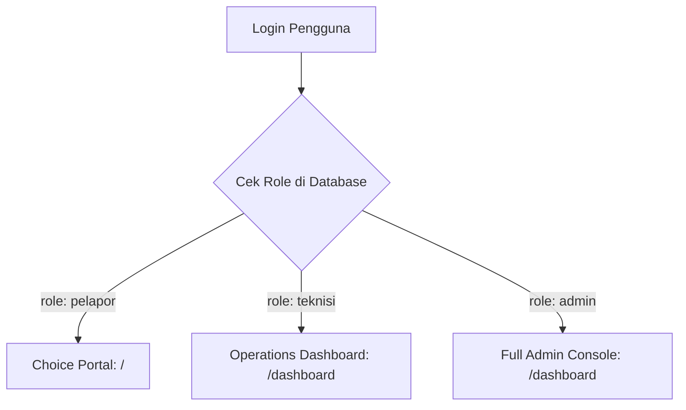

| Modul / Kemampuan | Pelapor (`pelapor`) | Teknisi (`teknisi`) | Administrator (`admin`) |
| :--- | :---: | :---: | :---: |
| Akses Choice Portal (`/`) | ✅ | ❌ | ❌ |
| Lapor Kendala TIK (Incident) | ✅ | ✅ | ✅ |
| Pengajuan Layanan TI (Service Request) | ✅ | ✅ | ✅ |
| Lacak Tiket & Riwayat Pribadi | ✅ | ✅ | ✅ |
| Live Chat pada Tiket Terkait | ✅ | ✅ | ✅ |
| Cetak Surat Permintaan Perbaikan BMN (PDF) | ✅ | ✅ | ✅ |
| Akses Dashboard Operasional TI (`/dashboard`) | ❌ | ✅ | ✅ |
| Kelola & Proses Antrean Semua Tiket | ❌ | ✅ | ✅ |
| Isi Analisa Teknis & Tindakan Resolusi | ❌ | ✅ | ✅ |
| Kontrol Buka/Tutup Sesi Live Chat | ❌ | ✅ | ✅ |
| Input Justifikasi Penolakan | ❌ | ✅ | ✅ |
| Manajemen Master Lokasi Ruangan | ❌ | ❌ | ✅ |
| Manajemen Akun Petugas & Hak Akses | ❌ | ❌ | ✅ |
| Konfigurasi WhatsApp & Pejabat Penandatangan | ❌ | ❌ | ✅ |
| Ekspor Laporan Rekapitulasi Excel | ❌ | ❌ | ✅ |

---

## 3. Daftar Modul & Fitur Terverifikasi

### 3.1 Autentikasi & Captcha Bahasa Banjar
- **Controller:** `App\Http\Controllers\Auth\LoginController`, `App\Http\Controllers\Auth\CaptchaController`
- **Model:** `App\Models\BanjarCaptcha`
- **Fitur Utama:**
  - Login manual terenkripsi dengan pembatasan percobaan login (throttling: 10 per menit).
  - Verifikasi bot unik menggunakan kamus lebih dari **130 kosakata asli Bahasa Banjar** (`database/seeders/BanjarCaptchaSeeder.php`).
  - Generator gambar PNG distorsi dinamis via pustaka GD (`App\Support\CaptchaImage`) dengan batas waktu kedaluwarsa 2 menit.
  - Validasi *case-insensitive* yang mencocokkan kata yang tertera pada gambar.
  - Pengalihan rute otomatis sesuai peran (*Role Redirection*).

### 3.2 Manajemen Insiden (Incident Management) & Cetak PDF BMN
- **Controller:** `App\Http\Controllers\IncidentController`
- **Request:** `App\Http\Requests\StoreIncidentRequest`, `App\Http\Requests\UpdateIncident`
- **Fitur Utama:**
  - Pembuatan nomor aduan otomatis berurutan per hari (`TIK-YYYYMMDD-XXXX`).
  - Deteksi dan auto-fill lokasi ruangan pelapor berdasarkan data bidang pengguna.
  - Dropdown searchable perangkat/aset TI terintegrasi data BMN.
  - Validasi unggah foto kendala (JPG/PNG maks. 2MB).
  - Pelacakan siklus hidup status: `Diajukan` ➔ `Diproses` ➔ `Selesai` / `Ditolak`.
  - Formulir tindakan resolusi petugas: pencatatan tanggal analisa, akar masalah (*root cause*), tanggal tindak lanjut, dan deskripsi tindakan perbaikan.
  - Catatan resmi justifikasi jika tiket ditolak.
  - Konfirmasi selesai oleh pelapor (`konfirmasi_selesai`).
  - **Cetak Surat Permintaan Perbaikan BMN:** Generate dokumen resmi format PDF siap cetak / tanda tangan menggunakan `barryvdh/laravel-dompdf`.

### 3.3 Permintaan Layanan TI (Service Request Management)
- **Controller:** `App\Http\Controllers\ServiceRequestController`
- **Fitur Utama:**
  - 5 kategori layanan dinas terintegrasi:
    1. **Permohonan Akun:** Pembuatan akun dinas baru atau reset password email/SIM instansi, dilengkapi form serah-terima kredensial (*generated username & password*) yang aman.
    2. **Akun Zoom Meeting:** Permohonan tautan rapat virtual dinas (judul kegiatan, tanggal mulai, jam, estimasi durasi).
    3. **Peminjaman Perangkat BMN:** Peminjaman proyektor LCD, laptop cadangan, atau kabel ekstensi, dilengkapi tanggal pinjam, rencana pengembalian, dan konfirmasi pengembalian alat fisik.
    4. **Konsultasi TI:** Permohonan pendampingan teknis perangkat lunak dinas.
    5. **Operator Kegiatan:** Permohonan teknisi sebagai operator multimedia/sound system kegiatan dinas.
  - Kemampuan pelapor untuk merevisi (*edit*) data permohonan selama tiket belum selesai diproses.
  - Konfirmasi penyelesaian oleh pemohon.

### 3.4 Realtime Live Chat (Laravel Reverb & Echo)
- **Controller:** `App\Http\Controllers\ServiceRequestController` (`chatMessages`, `sendChat`, `toggleChatStatus`)
- **Event:** `App\Events\ServiceRequestChatMessageSent`, `App\Events\ServiceRequestChatStatusChanged`
- **Fitur Utama:**
  - Komunikasi obrolan dua arah langsung di dalam halaman tiket permohonan.
  - Didukung server WebSocket **Laravel Reverb** (Port 8080) dan client **Laravel Echo**.
  - **Graceful Degradation:** Chat tetap berfungsi normal via fallback HTTP AJAX meskipun server Reverb sedang offline (tidak membebani thread browser).
  - Kontrol sesi chat: Teknisi/Admin dapat mengunci atau membuka kembali sesi obrolan saat tiket selesai.

### 3.5 Notifikasi Multi-Channel (In-App & WhatsApp Fonnte)
- **Notifikasi In-App:**
  - Lonceng notifikasi pada navbar atas dengan badge hitungan belum dibaca.
  - Memoized query dengan caching cerdas (`cache()->remember`) untuk kecepatan navigasi.
  - Opsi *Mark All as Read* dan *Delete All*.
- **WhatsApp Gateway:**
  - Service: `App\Services\FonnteService`
  - Job Asinkron: `App\Jobs\SendWhatsAppJob`
  - Mengirim notifikasi otomatis ke ponsel teknisi saat tiket masuk, dan ke pelapor saat tiket berstatus `Selesai` atau `Ditolak`.

### 3.6 Pusat Bantuan & Panduan (Knowledge Base)
- **Controller:** `App\Http\Controllers\KnowledgeBaseController`
- Menyediakan artikel panduan operasional alur aduan kendala, prosedur permohonan fasilitas, serta FAQ kendala teknis mandiri bagi seluruh pegawai.

### 3.7 Master Data & Pengaturan Sistem
- **Master Lokasi:** `App\Http\Controllers\LokasiController` — CRUD pemetaan ruangan fisik per unit kerja/bidang dan lantai gedung.
- **Master Petugas:** `App\Http\Controllers\PetugasController` — CRUD akun teknisi, pengelolaan nomor WhatsApp bot, dan pengaturan hak akses peran.
- **Pengaturan Sistem:** `App\Http\Controllers\SettingController` — Konfigurasi token WhatsApp Fonnte serta identitas Pejabat Penandatangan Surat (Kabag TU).

### 3.8 Laporan & Rekapitulasi Excel
- **Controller:** `App\Http\Controllers\ReportController`
- **Export Classes:** `App\Exports\IncidentExport`, `App\Exports\Sheets\IncidentSummarySheet`, `App\Exports\Sheets\IncidentDetailSheet`
- Filter fleksibel berdasarkan rentang tanggal awal - akhir dan status tiket.
- Menghasilkan berkas `.xlsx` multi-sheet yang memuat sheet ringkasan eksekutif dan sheet detail data komprehensif.

---

## 4. Skema Basis Data & Model Eloquent

### Entitas Kunci Basis Data (MySQL):

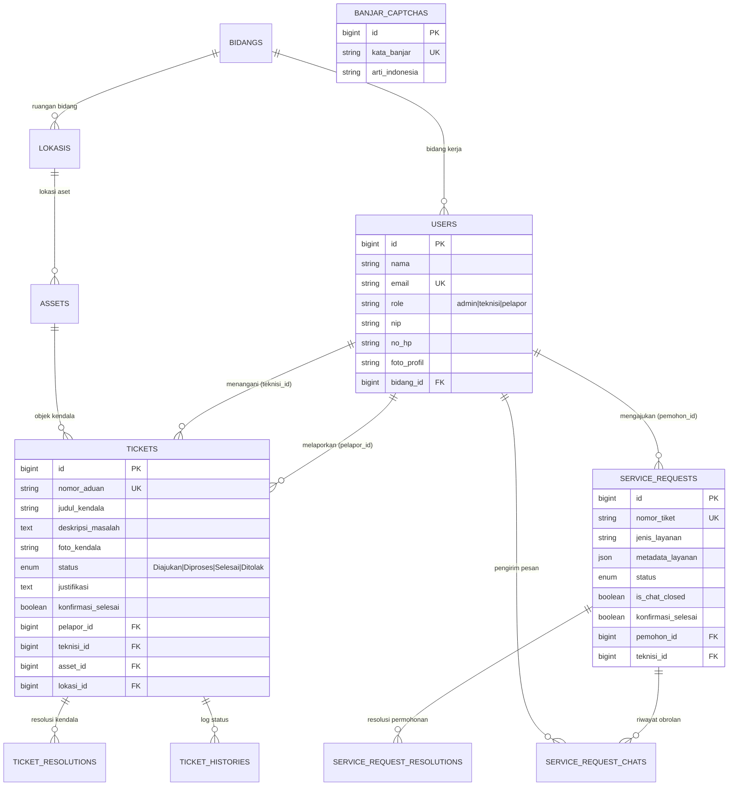

---

## 5. Optimasi Performa Lokal & Laragon

Pada pembaruan November 2026, telah diterapkan optimasi performa komprehensif untuk menghilangkan latensi pada lingkungan Windows & Laragon:

1. **Storage Driver Zero-Latency:**
   - `SESSION_DRIVER=file` dan `CACHE_STORE=file` di `.env` (menghilangkan *disk write lock* MySQL pada setiap request).
2. **Decoupled Echo / WebSocket:**
   - `echo.js` dimuat secara *lazy* hanya saat halaman chat dibuka, menghentikan *infinite reconnect loop* yang sebelumnya membebani CPU saat server Reverb offline.
3. **Vite Polling Removal:**
   - Mematikan `usePolling: true` pada Vite Windows untuk menghemat beban CPU latar belakang.
4. **Notification Query Memoization:**
   - Query unread notifications di-cache selama 30 detik per user (`cache()->remember`), mempercepat transisi halaman SPA.
5. **Skrip Optimasi Satu-Klik (`scripts/optimize-local.bat`):**
   - Menjalankan `optimize:clear`, `config:cache`, `route:cache`, `composer dump-autoload -o`, dan `storage:link`.
6. **Aktivasi PHP OPcache di Laragon:**
   - Klik kanan Laragon ➔ **PHP** ➔ **Quick Settings** ➔ aktifkan **`opcache`**. Memberikan percepatan *booting* Laravel hingga 300%-500%.

---

## 6. Panduan Instalasi & Menjalankan Proyek

### Prasyarat Sistem:
- **PHP** >= 8.3 (dengan ekstensi: `gd`, `zip`, `pdo_mysql`, `mbstring`, `fileinfo`, `curl`, `openssl`).
- **Composer** v2.x
- **Node.js** v18+ / v20+ LTS & **NPM**
- **MySQL** / MariaDB (via Laragon, XAMPP, atau Docker).

### Langkah Cepat Setup:
```bash
# 1. Clone repositori
git clone https://github.com/Sultan-ci90/itsm-bpom.git
cd itsm-bpom

# 2. Pasang dependensi
composer install
npm install

# 3. Konfigurasi .env & Key
cp .env.example .env
php artisan key:generate

# 4. Buat Database & Migrasi
# Pastikan database 'itsm_bpom' sudah dibuat di MySQL
php artisan migrate:fresh --seed
php artisan storage:link

# 5. Kompilasi Aset Frontend
npm run build

# 6. Jalankan Aplikasi (Satu Pintu)
composer run dev
```

---

## 7. Akun Pengujian Default

Setelah menjalankan `php artisan migrate:fresh --seed`, gunakan akun berikut:

| Peran (*Role*) | Alamat Email | Password | Fungsi Pengujian |
| :--- | :--- | :--- | :--- |
| **Administrator** | `admin@bpom.test` | `password` | Dashboard utama, Master Ruangan/Petugas, Pengaturan WA, Ekspor Excel. |
| **Teknisi IT** | `teknisi@bpom.test` | `password` | Antrean tiket, form analisa/tindakan resolusi, serah terima akun/BMN, kontrol chat. |
| **Pelapor (Pegawai)** | `pelapor@bpom.test` | `password` | Choice portal, lapor kendala, pengajuan 5 permohonan TI, live chat, cetak PDF BMN. |

---

## 8. Log Troubleshooting & Solusi Error

| # | Gejala Error | Penyebab Utama | Solusi Penanganan |
|---|---|---|---|
| 1 | `Call to undefined function imagecreatetruecolor()` | Ekstensi PHP `gd` belum aktif | Buka `php.ini`, hilangkan `;` pada `extension=gd`, lalu restart server PHP. |
| 2 | `Class "ZipArchive" not found` | Ekstensi PHP `zip` belum aktif | Buka `php.ini`, aktifkan `extension=zip`, lalu jalankan kembali `composer install`. |
| 3 | `SQLSTATE[HY000] [1049] Unknown database` | Database MySQL belum dibuat | Jalankan `CREATE DATABASE itsm_bpom;` di HeidiSQL / phpMyAdmin. |
| 4 | `Vite manifest not found` | Aset belum dikompilasi | Jalankan perintah `npm run build` atau `npm run dev`. |
| 5 | Foto kendala / avatar tidak muncul | Storage link belum dibuat | Jalankan perintah `php artisan storage:link`. |
| 6 | Chat tidak realtime tanpa reload | Reverb WebSocket belum hidup | Jalankan `php artisan reverb:start` (opsional, chat tetap masuk via AJAX). |
| 7 | Halaman web terasa lambat di lokal | Cache/OPcache belum optimal | Jalankan `scripts\optimize-local.bat` dan aktifkan OPcache di Laragon. |

---

## 9. Konvensi Kode & Standar Pengembangan

1. **Frontend Styling:** Menggunakan Tailwind CSS v4 dengan token tema `@theme` di `resources/css/app.css`. Jangan buat berkas `tailwind.config.js`.
2. **Dukungan RTL:** Gunakan *CSS Logical Properties* (`ms-*`, `me-*`, `ps-*`, `pe-*`, `text-start`, `text-end`).
3. **Komponen Modular:** Manfaatkan Blade Components `<x-ui.*>`, `<x-form.*>`, dan `<x-common.*>` dengan deklarasi `@props([...])`.
4. **Validasi Formulir:** Seluruh logika validasi dienkapsulasi dalam Form Request classes (`app/Http/Requests/`).
5. **Penanganan Error Background:** Broadcast WebSocket dan pengiriman pesan WhatsApp dibungkus blok `try-catch` agar kegagalan layanan eksternal tidak menghentikan transaksi database utama.
6. **Testing:** Pastikan `php artisan test` menghasilkan status `PASS` (lulus 100%) sebelum melakukan *commit* atau *merge*.

```

---

## File: `public/.htaccess`

```text
<IfModule mod_rewrite.c>
    <IfModule mod_negotiation.c>
        Options -MultiViews -Indexes
    </IfModule>

    RewriteEngine On

    # Handle Authorization Header
    RewriteCond %{HTTP:Authorization} .
    RewriteRule .* - [E=HTTP_AUTHORIZATION:%{HTTP:Authorization}]

    # Handle X-XSRF-Token Header
    RewriteCond %{HTTP:x-xsrf-token} .
    RewriteRule .* - [E=HTTP_X_XSRF_TOKEN:%{HTTP:X-XSRF-Token}]

    # Redirect Trailing Slashes If Not A Folder...
    RewriteCond %{REQUEST_FILENAME} !-d
    RewriteCond %{REQUEST_URI} (.+)/$
    RewriteRule ^ %1 [L,R=301]

    # Send Requests To Front Controller...
    RewriteCond %{REQUEST_FILENAME} !-d
    RewriteCond %{REQUEST_FILENAME} !-f
    RewriteRule ^ index.php [L]
</IfModule>

```

---

## File: `public/hot`

```text
http://localhost:5173
```

---

## File: `public/index.php`

```php
<?php

use Illuminate\Foundation\Application;
use Illuminate\Http\Request;

define('LARAVEL_START', microtime(true));

// Determine if the application is in maintenance mode...
if (file_exists($maintenance = __DIR__.'/../storage/framework/maintenance.php')) {
    require $maintenance;
}

// Register the Composer autoloader...
require __DIR__.'/../vendor/autoload.php';

// Bootstrap Laravel and handle the request...
/** @var Application $app */
$app = require_once __DIR__.'/../bootstrap/app.php';

$app->handleRequest(Request::capture());

```

---

## File: `public/robots.txt`

```text
User-agent: *
Disallow:

```

---

## File: `README.md`

```markdown
# 🏛️ ITSM BPOM — Sistem Manajemen Layanan Teknologi Informasi

<p align="center">
  
</p>

<p align="center">
  <a href="https://laravel.com"></a>
  <a href="https://tailwindcss.com"></a>
  <a href="https://alpinejs.dev"></a>
  <a href="https://reverb.laravel.com"></a>
  <a href="https://fonnte.com"></a>
  <a href="LICENSE"></a>
</p>

> **ITSM BPOM** adalah aplikasi *IT Service Management* berbasis web yang dikembangkan mengadopsi standar praktik terbaik **ITIL (Information Technology Infrastructure Library)** untuk mengelola aduan gangguan teknis (*Incident Management*) dan permohonan fasilitas TI (*Service Request Management*) di lingkungan **Balai Besar Pengawas Obat dan Makanan (BBPOM)**.

---

## 📑 Daftar Isi

- [📌 1. Latar Belakang & Masalah](#-1-latar-belakang--masalah)
- [👥 2. Peran & Hak Akses Pengguna (RBAC)](#-2-peran--hak-akses-pengguna-rbac)
- [🔄 3. Alur Layanan ITIL](#-3-alur-layanan-itil)
- [🛡️ 4. Fitur & Inovasi Utama](#️-4-fitur--inovasi-utama)
  - [4.1 Captcha Kamus Bahasa Banjar (Anti-Bot Lokal)](#41-captcha-kamus-bahasa-banjar-anti-bot-lokal)
  - [4.2 Realtime Live Chat (Laravel Reverb & Echo)](#42-realtime-live-chat-laravel-reverb--echo)
  - [4.3 Notifikasi Otomatis WhatsApp (Fonnte API)](#43-notifikasi-otomatis-whatsapp-fonnte-api)
  - [4.4 Form Analisa Teknis & Resolusi](#44-form-analisa-teknis--resolusi)
  - [4.5 Ekspor Laporan Rekapitulasi Excel](#45-ekspor-laporan-rekapitulasi-excel)
- [📸 5. Galeri Antarmuka](#-5-galeri-antarmuka)
- [📖 6. Panduan Pengguna (User Manual)](#-6-panduan-pengguna-user-manual)
- [💻 7. Arsitektur Teknis & Skema Database](#-7-arsitektur-teknis--skema-database)
- [⚙️ 8. Panduan Instalasi Lokal](#-8-panduan-instalasi-lokal)
- [🔑 9. Akun Pengujian Default](#-9-akun-pengujian-default)
- [🚀 10. Panduan Deployment Server Produksi (Linux VPS)](#-10-panduan-deployment-server-produksi-linux-vps)
- [❓ 11. FAQ & Pemecahan Masalah](#-11-faq--pemecahan-masalah)
- [🗺️ 12. Roadmap Pengembangan](#️-12-roadmap-pengembangan)

---

## 📌 1. Latar Belakang & Masalah

### Kondisi Sebelum Sistem Dibangun:
- ❌ **Pelaporan Tidak Tercatat (Informal)**: Aduan kerusakan PC, printer, atau jaringan sering disampaikan lewat chat WhatsApp pribadi atau lisan, menyebabkan banyak kendala lupa tertangani atau lambat ditindaklanjuti.
- ❌ **Status Tidak Transparan**: Pegawai yang melapor kesulitan mengetahui apakah kendala sudah ditangani atau sedang menunggu suku cadang.
- ❌ **Beban Kerja IT Tidak Terukur**: Pimpinan dan Subbagian Tata Usaha tidak memiliki rekam jejak kuantitatif mengenai performa teknisi, frekuensi kerusakan alat, dan kebutuhan pemeliharaan berkala.

### Solusi yang Dihadirkan:
- ✅ **One-Stop Service Portal**: Satu pintu digital terpadu untuk pelaporan kerusakan dan permohonan fasilitas TI.
- ✅ **Transparansi Siklus Hidup Tiket**: Alur tiket transparan dari `Diajukan` ➔ `Diproses` ➔ `Selesai` / `Ditolak`.
- ✅ **Audit Trail & Akuntabilitas**: Setiap aksi (tanggal analisa, analisa akar masalah, tindakan perbaikan, petugas penanggung jawab) tersimpan permanen.
- ✅ **Kearifan Lokal**: Perlindungan formulir login dengan **Captcha Bahasa Banjar** (>130 kosakata asli Banjar).
- ✅ **Notifikasi Multi-Channel**: Lonceng notifikasi in-app dan pesan WhatsApp instan ke ponsel teknisi/pelapor.

---

## 👥 2. Peran & Hak Akses Pengguna (RBAC)

Sistem menerapkan pembatasan akses berbasis peran (*Role-Based Access Control*) secara ketat melalui middleware:

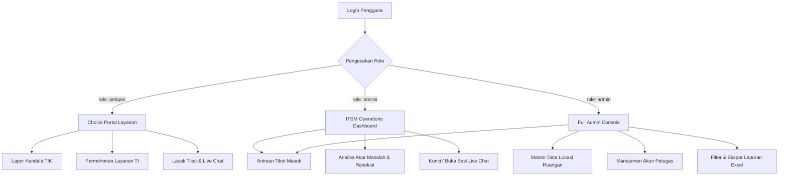

| Peran (*Role*) | Kode Role Basis Data | Hak Akses & Wewenang Utama |
| :--- | :---: | :--- |
| **Pegawai (Pelapor)** | `pelapor` | • Mengakses *Choice Portal* yang ramah pengguna.<br>• Melaporkan kendala perangkat/jaringan dengan auto-fill lokasi ruangan & upload bukti foto.<br>• Mengajukan permohonan fasilitas (Akun, Zoom, Peminjaman BMN, Konsultasi, Operator).<br>• Melacak status tiket dan berdiskusi dengan teknisi via *Live Chat*. |
| **Teknisi IT** | `teknisi` | • Mengakses *ITSM Operations Dashboard* dengan statistik antrean dan grafik ApexCharts.<br>• Mengambil tiket, mengubah status menjadi `Diproses`, dan mengisi form resolusi teknis.<br>• Memberikan justifikasi resmi bila tiket ditolak.<br>• Menyerahkan kredensial akun atau mengonfirmasi pengembalian barang pinjaman.<br>• Mengelola ruang diskusi obrolan (*live chat*). |
| **Administrator** | `admin` | • Memiliki seluruh hak akses teknisi (*Super User*).<br>• Manajemen **Master Lokasi Ruangan** (pemetaan ruangan fisik per unit kerja/bidang).<br>• Manajemen **Data Petugas** (menambah, mengubah peran, atau me-reset kredensial staf IT).<br>• Mengakses modul **Laporan & Rekapitulasi** (filter periode tanggal dan ekspor spreadsheet Excel). |

---

## 🔄 3. Alur Layanan ITIL

Sistem membedakan secara tegas dua pilar layanan sesuai kerangka kerja ITIL:

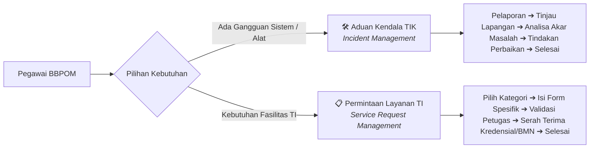

### 1. Aduan Kendala TIK (*Incident Management*)
Pemulihan segera atas gangguan tak terduga yang menghentikan operasional kerja (misal: koneksi LAN putus, printer macet, PC terserang virus, aplikasi internal error).

### 2. Permohonan Layanan TI (*Service Request Management*)
Pengajuan resmi atas fasilitas atau bantuan TI yang telah terstandardisasi:
1. **Permohonan Akun**: Pembuatan akun dinas baru atau *reset password* email/SIM internal BBPOM.
2. **Akun Zoom Meeting**: Penjadwalan rapat daring dinas beserta waktu mulai dan durasi.
3. **Peminjaman Perangkat / Aset**: Peminjaman proyektor LCD, laptop cadangan, atau kabel roll dinas.
4. **Konsultasi TI**: Pendampingan teknis dan konsultasi seputar perangkat lunak instansi.
5. **Operator Kegiatan**: Permintaan staf IT sebagai operator multimedia/sound system kegiatan dinas.

---

## 🛡️ 4. Fitur & Inovasi Utama

### 4.1 Captcha Kamus Bahasa Banjar (Anti-Bot Lokal)
Fitur autentikasi unik berbasis kearifan lokal. Menggunakan kamus lebih dari **130 kosa kata asli bahasa Banjar** beserta terjemahan bahasa Indonesia untuk memvalidasi login manusia.

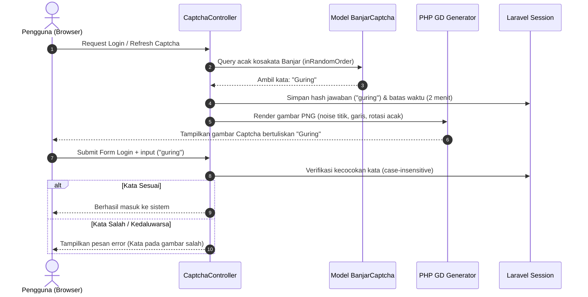

> [!TIP]
> Bot otomatis global tidak memiliki perbendaharaan kata lokal Kalimantan Selatan, sehingga metode ini efektif menangkal serangan *credential stuffing* sekaligus melestarikan budaya bahasa daerah.

---

### 4.2 Realtime Live Chat (Laravel Reverb & Echo — *Fitur Opsional*)
Komunikasi dua arah langsung antara pelapor dan teknisi penanggung jawab di dalam halaman tiket:

> [!NOTE]
> **Status: Fitur WebSocket Ini Bersifat Opsional (Non-Wajib)**
> - Fitur chat obrolan **tetap berfungsi normal 100%** dan riwayat pesan tetap tersimpan aman di database melalui request HTTP AJAX, meskipun server Reverb tidak dinyalakan.
> - Di lingkungan server produksi / online saat ini, fitur Reverb WebSocket dinonaktifkan sementara (*tidak wajib online*) agar arsitektur server lebih ringan dan tidak memerlukan konfigurasi port WebSocket publik tambahan.
> 
> **Cara Mengaktifkan Jika Ingin Menggunakan Reverb:**
> 1. Pastikan pada berkas `.env`:
>    ```env
>    BROADCAST_CONNECTION=reverb
>    ```
> 2. Jalankan server WebSocket Reverb di terminal terpisah:
>    ```bash
>    php artisan reverb:start
>    ```
> 3. Jika menggunakan domain produksi/HTTPS, arahkan proxy WebSocket port `8080` (lihat contoh konfigurasi Nginx di bagian Deployment).

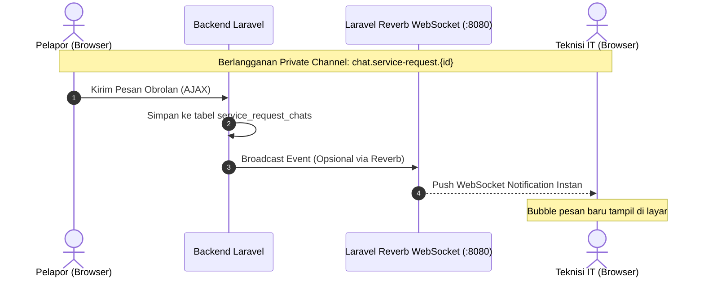

---

### 4.3 Notifikasi Otomatis WhatsApp (Fonnte API)
Notifikasi instan dikirimkan ke nomor WhatsApp teknisi saat tiket baru masuk, dan ke nomor pelapor saat tiket selesai:

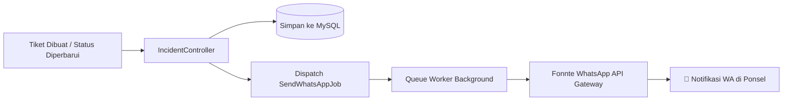

---

### 4.4 Form Analisa Teknis & Resolusi
Teknisi wajib mendokumentasikan proses perbaikan sebelum tiket dapat diselesaikan:
- **Tanggal Analisa & Akar Masalah (*Root Cause*)**: Identifikasi penyebab utama terjadinya gangguan.
- **Tanggal Tindak Lanjut & Tindakan Perbaikan**: Rincian tindakan konkret yang telah dilakukan.
- **Form Justifikasi Penolakan**: Catatan resmi transparan jika tiket berada di luar wewenang TIK.

---

### 4.5 Ekspor Laporan Rekapitulasi Excel
Administrator dapat memfilter periode awal - akhir dan mengekspor seluruh riwayat layanan ke format `.xlsx` dengan pembagian sheet:
- **Sheet Ringkasan**: Rekap total insiden, rasio selesai, rata-rata durasi, dan performa teknisi.
- **Sheet Detail**: Data baris per baris lengkap dengan nomor tiket, nama pelapor, unit kerja, analisa, dan tindakan perbaikan.

---

## 📸 5. Galeri Antarmuka

| Formulir Lapor Kendala Jaringan | Formulir Kendala Perangkat Keras (Laptop) |
| :---: | :---: |
| 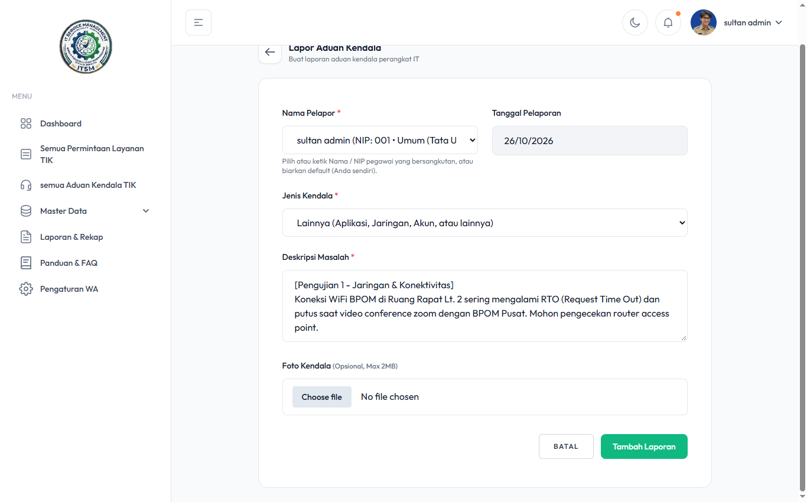 | 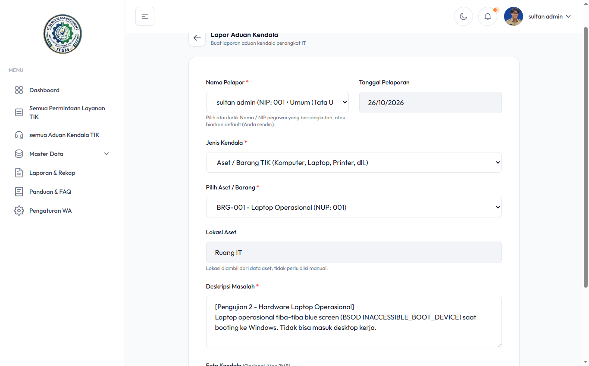 |

| Kendala Printer & Perangkat BMN | Validasi Keamanan Form Kosong |
| :---: | :---: |
| 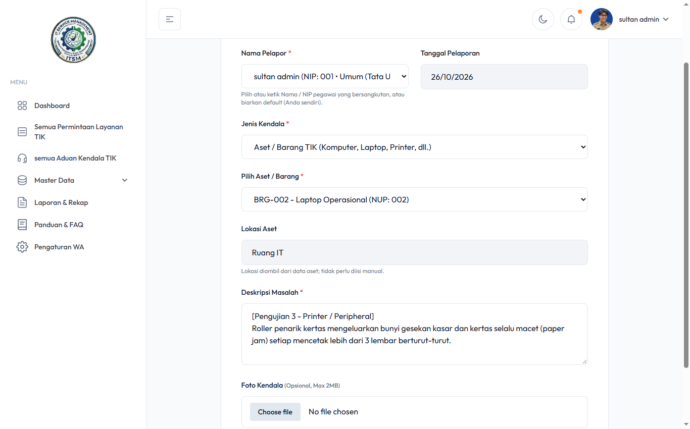 | 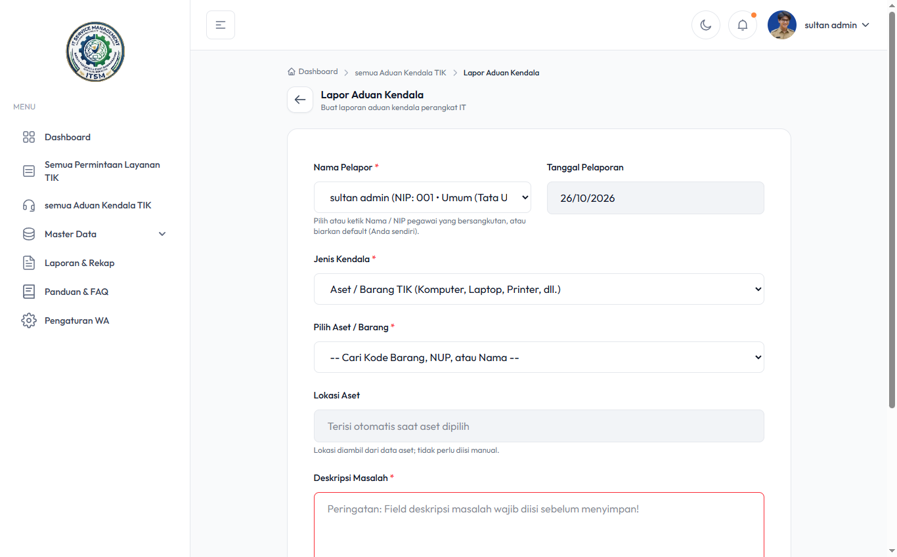 |

---

## 📖 6. Panduan Pengguna (User Manual)

<details>
<summary><b>👤 Panduan untuk Pegawai (Pelapor) — Klik untuk membuka</b></summary>

1. **Masuk ke Portal**:
   - Buka aplikasi di peramban web.
   - Masukkan email dinas, kata sandi, dan ketik kata yang tertera pada gambar **Captcha Bahasa Banjar** (misal: jika gambar menampilkan kata *"Guring"*, ketikkan *"guring"* — huruf besar/kecil tidak berpengaruh).
   - Terdapat batas waktu pengisian captcha selama 2 menit (jika habis, klik tombol refresh di samping gambar).
2. **Melaporkan Gangguan (Incident)**:
   - Klik menu **Lapor Kendala TIK**.
   - Lokasi ruangan akan terisi otomatis (*auto-detect* sesuai bidang Anda).
   - Pilih perangkat yang bermasalah pada dropdown aset, isi nama kendala, deskripsi kronologi (min. 10 karakter), serta unggah foto bukti jika ada.
   - Klik **Kirim Laporan** untuk memperoleh nomor tiket `TIK-YYYYMMDD-XXXX`.
3. **Mengajukan Permohonan Fasilitas**:
   - Klik menu **Ajukan Permohonan TI**, pilih jenis layanan:
     - *Permohonan Akun*: Email dinas / reset password.
     - *Akun Zoom*: Masukkan judul rapat, tanggal, jam, dan estimasi durasi.
     - *Peminjaman Barang*: Masukkan tanggal pinjam dan rencana pengembalian.
4. **Melacak & Berdiskusi**:
   - Buka menu **Tiket Saya** untuk memantau status (`Diajukan`, `Diproses`, `Selesai`, `Ditolak`).
   - Gunakan fitur **Live Chat** di bagian bawah tiket untuk berdiskusi langsung dengan teknisi yang menangani.
</details>

<details>
<summary><b>🛠️ Panduan untuk Teknisi IT — Klik untuk membuka</b></summary>

1. **Memantau Antrean**:
   - Buka **ITSM Operations Dashboard** untuk memantau tiket masuk berkategori `Diajukan`.
2. **Mengambil & Memproses Tiket**:
   - Buka rincian tiket, klik tombol **Proses Tiket** untuk mengubah status menjadi `Diproses`. Nama Anda otomatis tercatat sebagai teknisi penanggung jawab.
3. **Menyelesaikan Tiket**:
   - Lakukan penanganan teknis di lapangan.
   - Buka formulir resolusi di halaman tiket, isi **Tanggal Analisa**, **Analisa Akar Masalah**, **Tanggal Tindak Lanjut**, dan **Tindakan Perbaikan**.
   - Klik **Simpan Resolusi**. Notifikasi otomatis akan terkirim ke WhatsApp pelapor.
4. **Penyerahan Kredensial & Pengembalian Barang**:
   - Untuk permohonan akun: Isikan username & password yang telah dibuat pada form serah-terima kredensial aman.
   - Untuk peminjaman alat: Klik tombol **Konfirmasi Pengembalian Barang** saat perangkat fisik telah diterima kembali di ruang IT.
</details>

<details>
<summary><b>👑 Panduan untuk Administrator — Klik untuk membuka</b></summary>

1. **Manajemen Master Lokasi Ruangan**:
   - Buka menu **Master Data** ➔ **Lokasi Ruangan**.
   - Tambah ruangan baru beserta unit kerja/bidang penanggung jawab dan lokasi lantainya.
2. **Manajemen Akun Petugas**:
   - Buka menu **Master Data** ➔ **Data Petugas**.
   - Tambah petugas baru, tentukan role (`Teknisi IT` atau `Administrator`), serta masukkan nomor WhatsApp aktif untuk penerimaan notifikasi bot.
3. **Ekspor Laporan Rekapitulasi**:
   - Buka menu **Laporan & Rekapitulasi**.
   - Tentukan rentang tanggal awal dan akhir serta kategori layanan.
   - Klik **Download Excel** untuk mengunduh rekapitulasi data format `.xlsx`.
</details>

---

## 💻 7. Arsitektur Teknis & Skema Database

### Tech Stack Utama:
- **Backend**: Laravel 12 (PHP >= 8.2), Eloquent ORM, Database Transactions.
- **Frontend**: Blade Components modular, Tailwind CSS v4 (`@theme`), Alpine.js v3.
- **Realtime**: Laravel Reverb WebSocket Server & Laravel Echo.
- **Background Tasks**: Laravel Database Queue Worker (`SendWhatsAppJob`).
- **Database**: MySQL / MariaDB dengan relasi foreign key eksplisit.

### Struktur Direktori Proyek:
```
itsm-bpom/
├── app/
│   ├── Events/               # Broadcast event chat (ServiceRequestChatMessageSent)
│   ├── Exports/              # Generator file Excel (Maatwebsite Excel)
│   ├── Http/Controllers/     # IncidentController, ServiceRequestController, dsb.
│   ├── Jobs/                 # Antrean asinkron (SendWhatsAppJob)
│   ├── Models/               # 18 Model Eloquent (Ticket, ServiceRequest, User, dsb.)
│   ├── Notifications/        # Notifikasi in-app
│   ├── Services/             # FonnteService (WA Gateway), PeriodeResolver
│   └── Support/              # CaptchaImage (PHP GD generator)
├── database/
│   ├── migrations/           # Skema tabel database
│   └── seeders/              # Seeder data awal (User, Bidang, Captcha Banjar, Lokasi)
├── public/images/            # Logo dan tangkapan layar antarmuka
├── resources/
│   ├── css/app.css           # Konfigurasi Tailwind CSS v4 (@theme tokens)
│   ├── js/                   # Inisialisasi Alpine.js, Echo, dan chart ApexCharts
│   └── views/                # Template Blade TailAdmin modular
└── routes/
    ├── web.php               # Rute web utama dilindungi auth & role middleware
    ├── channels.php          # Otorisasi private channel Reverb WebSocket
    └── api.php               # Endpoint AJAX
```

### Skema Basis Data (Entity Relationship Diagram):

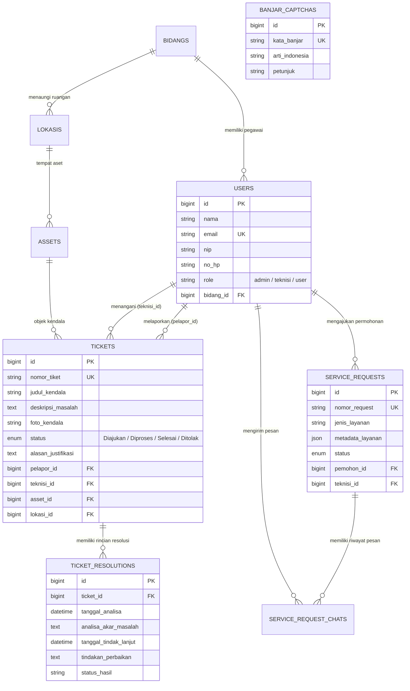

---

## ⚙️ 8. Panduan Instalasi Lokal

### Prasyarat Sistem:
## ⚙️ 8. Panduan Instalasi & Menjalankan Proyek (Setup Awal)

Panduan ini disusun secara rinci langkah demi langkah agar rekan tim yang melakukan **clone pertama kali** dapat menjalankan aplikasi tanpa kendala error (*zero-error onboarding*).

---

### 📋 A. Prasyarat Sistem & Dependensi Wajib

Pastikan perangkat lokal Anda telah memenuhi prasyarat perangkat lunak berikut:

| Perangkat Lunak | Versi Minimal | Keterangan & Rekomendasi |
| :--- | :--- | :--- |
| **PHP** | `^8.3` (8.3.x / 8.4.x) | Bahasa pemrograman backend utama (Laravel 12). |
| **Composer** | `v2.x` | Manajer dependensi PHP ([Unduh Composer](https://getcomposer.org/)). |
| **Node.js** | `v18.x` / `v20.x` / `v22.x` | Lingkungan runtime JavaScript ([Unduh Node.js LTS](https://nodejs.org/)). |
| **NPM** | `v9.x` / `v10.x` | Manajer paket frontend (termasuk bersama instalasi Node.js). |
| **MySQL / MariaDB** | `v8.0+` / `v10.4+` | Server basis data relasional (via Laragon, XAMPP, atau Docker). |
| **Git** | `v2.x` | Sistem pengontrol versi ([Unduh Git](https://git-scm.com/)). |

#### ⚠️ Ekstensi PHP yang Wajib Aktif di `php.ini`:
Aplikasi menggunakan fitur pemrosesan grafis, ekspor berkas, dan relasi basis data yang memerlukan modul PHP berikut dalam keadaan **aktif**:

- `gd` ➔ **Sangat Penting!** Diperlukan oleh generator gambar **Captcha Bahasa Banjar**, cetak DomPDF, dan styling Excel. (*Jika mati, aplikasi akan mengalami Error 500 `Call to undefined function imagecreatetruecolor()`*).
- `zip` ➔ Diperlukan untuk kompresi dan pembuatan berkas spreadsheet `.xlsx` oleh library `maatwebsite/excel`.
- `pdo_mysql` ➔ Diperlukan untuk komunikasi dengan basis data MySQL.
- `mbstring` ➔ Diperlukan untuk manipulasi teks multibyte dan PDF engine.
- `fileinfo` ➔ Diperlukan untuk validasi format MIME pada upload foto bukti kendala.
- `curl` & `openssl` ➔ Diperlukan untuk koneksi aman HTTP API WhatsApp Fonnte & enkripsi session.

<details>
<summary><b>💡 Cara Mengaktifkan Ekstensi PHP di Laragon / XAMPP / Ubuntu (Klik untuk membuka)</b></summary>

- **Di Laragon (Windows)**:
  1. Klik kanan pada jendela Laragon.
  2. Buka menu **PHP** ➔ **Quick Settings**.
  3. Pastikan opsi `gd`, `zip`, `pdo_mysql`, `fileinfo`, `curl`, `mbstring`, dan `openssl` dalam kondisi **tercentang (aktif)**.
  4. Klik tombol **Reload** atau restart Apache/Nginx di Laragon.

- **Di XAMPP / Standalone PHP (Windows)**:
  1. Buka berkas `php.ini` (biasanya di `C:\xampp\php\php.ini`).
  2. Cari baris berikut dan hilangkan tanda titik koma (`;`) di depannya:
     ```ini
     extension=gd
     extension=zip
     extension=pdo_mysql
     extension=fileinfo
     extension=curl
     extension=mbstring
     extension=openssl
     ```
  3. Simpan berkas dan restart Apache dari XAMPP Control Panel.

- **Di Linux Ubuntu / Debian**:
  Jalankan perintah instalasi paket ekstensi:
  ```bash
  sudo apt update
  sudo apt install -y php8.3-cli php8.3-fpm php8.3-mysql php8.3-gd php8.3-zip php8.3-mbstring php8.3-xml php8.3-curl
  ```
</details>

---

### 🚀 B. Langkah-Langkah Instalasi Lengkap (10 Langkah)

#### 1. Clone Repositori Git
Buka terminal (Git Bash, Command Prompt, atau PowerShell) di direktori kerja lokal Anda (misal `c:/laragon/www`):
```bash
git clone https://github.com/Sultan-ci90/itsm-bpom.git
cd itsm-bpom
```

#### 2. Pasang Dependensi Backend (Composer)
Jalankan perintah Composer untuk mengunduh seluruh pustaka PHP yang diperlukan:
```bash
composer install
```
> [!NOTE]
> Jika sistem lokal Anda menggunakan versi PHP berbeda dan memunculkan peringatan dependensi, Anda dapat menambahkan bendera toleransi: `composer install --ignore-platform-reqs`.

#### 3. Pasang Dependensi Frontend (NPM)
Pasang seluruh modul JavaScript, Tailwind CSS v4, dan pustaka UI:
```bash
npm install
```

#### 4. Siapkan Berkas Konfigurasi Lingkungan (`.env`)
Salin berkas contoh konfigurasi `.env.example` menjadi `.env`:
```bash
# Windows PowerShell / CMD:
copy .env.example .env

# Atau di Git Bash / Linux:
cp .env.example .env
```

#### 5. Generate Application Encryption Key
Buat kunci enkripsi aplikasi Laravel:
```bash
php artisan key:generate
```

#### 6. Buat Database MySQL & Sesuaikan `.env`
Buka aplikasi database manager Anda (HeidiSQL, DBeaver, phpMyAdmin, atau MySQL CLI) dan buat basis data baru bernama `itsm_bpom`:
```sql
CREATE DATABASE itsm_bpom CHARACTER SET utf8mb4 COLLATE utf8mb4_unicode_ci;
```

Buka file `.env` dan pastikan bagian konfigurasi database sesuai dengan server MySQL lokal Anda:
```env
DB_CONNECTION=mysql
DB_HOST=127.0.0.1
DB_PORT=3306
DB_DATABASE=itsm_bpom
DB_USERNAME=root
DB_PASSWORD=

# Driver Session & Cache (Gunakan 'file' untuk performa lokal instan)
SESSION_DRIVER=file
CACHE_STORE=file
```

Pastikan juga konfigurasi Broadcast dan Reverb sudah terisi:
```env
BROADCAST_CONNECTION=reverb
QUEUE_CONNECTION=database

REVERB_APP_ID=681459
REVERB_APP_KEY=nxviddclkp8ymhxwmfor
REVERB_APP_SECRET=1hypjxft40kymwmvfel4
REVERB_HOST="localhost"
REVERB_PORT=8080
REVERB_SCHEME=http

VITE_REVERB_APP_KEY="${REVERB_APP_KEY}"
VITE_REVERB_HOST="${REVERB_HOST}"
VITE_REVERB_PORT="${REVERB_PORT}"
VITE_REVERB_SCHEME="${REVERB_SCHEME}"
```

#### 7. Jalankan Migrasi Basis Data & Seeding Data Awal
Eksekusi migrasi skema tabel beserta data referensi awal (akun default, master bidang, master lokasi ruangan, dan kamus Captcha Bahasa Banjar):
```bash
php artisan migrate --seed
```
> [!TIP]
> Jika di kemudian hari Anda ingin me-reset ulang database ke kondisi pabrik yang bersih untuk pengujian baru, gunakan: `php artisan migrate:fresh --seed`.

#### 8. Buat Tautan Simbolik Penyimpanan (*Storage Symlink*)
Hubungkan folder berkas unggahan publik (foto kendala, bukti kerusakan BMN) agar dapat diakses oleh browser:
```bash
php artisan storage:link
```

#### 9. Kompilasi Aset Frontend (Vite)
Kompilasi berkas CSS Tailwind v4 dan JavaScript ke folder `public/build`:
```bash
npm run build
```

---

### 💻 C. Cara Menjalankan Aplikasi

Anda dapat memilih salah satu dari dua metode di bawah ini:

#### Opsi 1: Perintah Terpadu Satu Pintu (*Recommended*)
Aplikasi telah dilengkapi skrip otomatis menggunakan pustaka `concurrently` untuk menyalakan komponen utama secara serentak (**Web Server PHP**, **Queue Worker**, **Log Pail**, dan **Vite Bundler**):
```bash
composer run dev
```

#### Opsi 2: Menjalankan Manual di Terminal Terpisah
Jika Anda ingin menjalankan atau memantau komponen secara individual:
```bash
# Terminal 1: Web Server PHP (Wajib)
php artisan serve

# Terminal 2: Vite Hot-Reload / Frontend (Wajib saat pengembangan)
npm run dev

# Terminal 3: Queue Worker (Opsional: untuk pemrosesan pesan WhatsApp Fonnte)
php artisan queue:work

# Terminal 4: WebSocket Server Reverb (Opsional: hanya jika ingin menguji Live Chat realtime)
php artisan reverb:start
```

#### 10. Menjalankan Unit & Feature Test (Opsional)
Untuk memastikan seluruh rute dan logika aplikasi berjalan 100% tanpa error:
```bash
composer test
# atau
php artisan test
```

#### 11. Skrip Akselerasi Performa Lokal (*Local Speedup*)
Jika aplikasi terasa lambat saat dijalankan di Windows/Laragon, jalankan skrip pembantu untuk meng-cache konfigurasi dan membersihkan buffer:
```bash
# Klik dua kali atau jalankan lewat terminal Windows:
.\scripts\optimize-local.bat
```
> [!TIP]
> **Aktifkan OPcache di Laragon:** Klik kanan Laragon ➔ **PHP** ➔ **Quick Settings** ➔ centang **`opcache`**. Ini akan mempercepat *load-time* Laravel di Windows hingga 300%-500%!

#### 12. Buka Aplikasi di Peramban Web
Buka browser pilihan Anda dan akses alamat:
👉 **`http://127.0.0.1:8000`** atau domain virtual Laragon Anda (misal `http://itsm-bpom.test`).

---

### 🛠️ D. Checklist Pemecahan Masalah Pertama Kali Clone

| Pesan Kesalahan / Gejala | Penyebab Umum | Solusi Praktis |
| :--- | :--- | :--- |
| `Call to undefined function imagecreatetruecolor()` | Ekstensi `gd` belum aktif di `php.ini`. | Buka `php.ini`, hilangkan tanda `;` pada `;extension=gd`, lalu restart server PHP. |
| `Class "ZipArchive" not found` | Ekstensi `zip` belum aktif di `php.ini`. | Buka `php.ini`, hilangkan tanda `;` pada `;extension=zip`, lalu jalankan kembali `composer install`. |
| `SQLSTATE[HY000] [1049] Unknown database 'itsm_bpom'` | Database belum dibuat di MySQL. | Buka HeidiSQL/phpMyAdmin, jalankan `CREATE DATABASE itsm_bpom;`. |
| `Vite manifest not found at .../manifest.json` | Aset frontend belum dikompilasi. | Jalankan perintah `npm run build` atau `npm run dev`. |
| Foto kendala / avatar tidak tampil (gambar pecah) | Storage symlink belum dibuat. | Jalankan perintah `php artisan storage:link`. |
| Pesan chat tidak bertambah tanpa reload halaman | Server WebSocket Reverb belum hidup. | Jalankan `php artisan reverb:start` di terminal latar belakang. |
| Halaman web terasa lambat di Laragon / Windows | Cache belum optimal & OPcache mati. | Jalankan `.\scripts\optimize-local.bat` dan aktifkan `opcache` di Laragon. |

---

## 🔑 9. Akun Pengujian Default

Setelah proses seeder selesai, akun berikut siap digunakan:

| Role / Peran | Alamat Email | Password | Tujuan Pengujian |
| :--- | :--- | :--- | :--- |
| **Administrator** | `admin@bpom.test` | `password` | Menguji dashboard utama, manajemen petugas, setup lokasi, dan export laporan. |
| **Teknisi IT** | `teknisi@bpom.test` | `password` | Menguji alur penanganan tiket, input form analisa/tindakan, dan kontrol chat. |
| **Pegawai (Pelapor)** | `pelapor@bpom.test` | `password` | Menguji alur portal pelapor, pengajuan kendala, permohonan fasilitas, dan tracking. |

---

## 🚀 10. Panduan Deployment Server Produksi (Linux VPS)

<details>
<summary><b>🌐 Konfigurasi Nginx Web Server (Termasuk Reverse Proxy WebSocket) — Klik untuk membuka</b></summary>

Simpan konfigurasi berikut pada `/etc/nginx/sites-available/itsm-bpom`:

```nginx
server {
    listen 80;
    server_name itsm.bbpom-banjarmasin.go.id;
    root /var/www/itsm-bpom/public;

    add_header X-Frame-Options "SAMEORIGIN";
    add_header X-Content-Type-Options "nosniff";

    index index.php;
    charset utf-8;

    location / {
        try_files $uri $uri/ /index.php?$query_string;
    }

    # Proxy WebSocket untuk Laravel Reverb
    location /app {
        proxy_http_version 1.1;
        proxy_set_header Upgrade $http_upgrade;
        proxy_set_header Connection "Upgrade";
        proxy_set_header Host $host;
        proxy_set_header X-Real-IP $remote_addr;
        proxy_set_header X-Forwarded-For $proxy_add_x_forwarded_for;
        proxy_pass http://127.0.0.1:8080;
    }

    location = /favicon.ico { access_log off; log_not_found off; }
    location = /robots.txt  { access_log off; log_not_found off; }

    error_page 404 /index.php;

    location ~ \.php$ {
        fastcgi_pass unix:/var/run/php/php8.3-fpm.sock;
        fastcgi_param SCRIPT_FILENAME $realpath_root$fastcgi_script_name;
        include fastcgi_params;
    }

    location ~ /\.(?!well-known).* {
        deny all;
    }
}
```
</details>

<details>
<summary><b>⚙️ Konfigurasi Supervisor (Queue Worker & Reverb Daemon) — Klik untuk membuka</b></summary>

Simpan konfigurasi berikut pada `/etc/supervisor/conf.d/itsm-bpom.conf`:

```ini
[program:itsm-queue-worker]
process_name=%(program_name)s_%(process_num)02d
command=php /var/www/itsm-bpom/artisan queue:work database --sleep=3 --tries=3 --max-time=3600
autostart=true
autorestart=true
stopasgroup=true
killasgroup=true
user=www-data
numprocs=2
redirect_stderr=true
stdout_logfile=/var/www/itsm-bpom/storage/logs/queue-worker.log

[program:itsm-reverb-server]
process_name=%(program_name)s
command=php /var/www/itsm-bpom/artisan reverb:start --host=127.0.0.1 --port=8080
autostart=true
autorestart=true
stopasgroup=true
killasgroup=true
user=www-data
numprocs=1
redirect_stderr=true
stdout_logfile=/var/www/itsm-bpom/storage/logs/reverb.log
```

Jalankan perintah aktivasi:
```bash
sudo supervisorctl reread
sudo supervisorctl update
sudo supervisorctl start all
```
</details>

---

## ❓ 11. FAQ & Pemecahan Masalah

### 1. Gambar Captcha Bahasa Banjar Tidak Muncul (Error 500)
- **Penyebab**: Ekstensi **PHP GD** belum diaktifkan di server atau Laragon.
- **Solusi**: Buka berkas `php.ini`, hapus tanda titik koma pada `;extension=gd` menjadi `extension=gd`, lalu restart server PHP.

### 2. Pesan Live Chat Tidak Muncul Realtime
- **Penyebab**: Server WebSocket Reverb belum dijalankan atau port `8080` terblokir firewall.
- **Solusi**: Jalankan `php artisan reverb:start` di terminal, dan pastikan konfigurasi `REVERB_HOST` di `.env` dapat diakses oleh browser.

### 3. Notifikasi WhatsApp Tidak Masuk
- **Penyebab**: Queue worker belum aktif atau masa berlaku token Fonnte terputus (*disconnected*).
- **Solusi**: Jalankan `php artisan queue:work` dan verifikasi koneksi nomor pada dashboard Fonnte.

### 4. Tampilan CSS Tailwind v4 Berantakan
- **Penyebab**: Berkas bundel Vite pada `public/build` belum diperbarui.
- **Solusi**: Jalankan `npm run build` (produksi) atau `npm run dev` (pengembangan).

---

## 🗺️ 12. Roadmap Pengembangan

- [ ] **SLA Countdown Timer**: Penghitungan otomatis sisa target waktu penyelesaian tiket berdasarkan tingkat urgensi kendala.
- [ ] **Survei Kepuasan Layanan (CSAT)**: Formulir penilaian bintang dan ulasan oleh pelapor setelah tiket dinyatakan `Selesai`.
- [ ] **PWA & QR Code Scanning**: Fitur pelaporan cepat dengan memindai label stiker QR Code pada aset fisik perangkat keras BBPOM.

---

<p align="center">
  <b>Balai Besar Pengawas Obat dan Makanan (BBPOM)</b><br>
  <i>Subbagian Tata Usaha / Tim Teknologi Informasi & Komunikasi</i>
</p>

```

---

## File: `resources/css/app.css`

```css
@import 'tailwindcss';

@source '../../vendor/laravel/framework/src/Illuminate/Pagination/resources/views/*.blade.php';
@source '../**/*.blade.php';
@source '../**/*.js';


@custom-variant dark (&:is(.dark *));

@theme {
  --font-*: initial;
  --font-outfit: Outfit, sans-serif;

  --breakpoint-*: initial;
  --breakpoint-2xsm: 375px;
  --breakpoint-xsm: 425px;
  --breakpoint-3xl: 2000px;
  --breakpoint-sm: 640px;
  --breakpoint-md: 768px;
  --breakpoint-lg: 1024px;
  --breakpoint-xl: 1280px;
  --breakpoint-2xl: 1536px;

  --text-title-2xl: 72px;
  --text-title-2xl--line-height: 90px;
  --text-title-xl: 60px;
  --text-title-xl--line-height: 72px;
  --text-title-lg: 48px;
  --text-title-lg--line-height: 60px;
  --text-title-md: 36px;
  --text-title-md--line-height: 44px;
  --text-title-sm: 30px;
  --text-title-sm--line-height: 38px;
  --text-theme-xl: 20px;
  --text-theme-xl--line-height: 30px;
  --text-theme-sm: 14px;
  --text-theme-sm--line-height: 20px;
  --text-theme-xs: 12px;
  --text-theme-xs--line-height: 18px;

  --color-current: currentColor;
  --color-transparent: transparent;
  --color-white: #ffffff;
  --color-black: #101828;

  --color-brand-25: #f2f7ff;
  --color-brand-50: #ecf3ff;
  --color-brand-100: #dde9ff;
  --color-brand-200: #c2d6ff;
  --color-brand-300: #9cb9ff;
  --color-brand-400: #7592ff;
  --color-brand-500: #465fff;
  --color-brand-600: #3641f5;
  --color-brand-700: #2a31d8;
  --color-brand-800: #252dae;
  --color-brand-900: #262e89;
  --color-brand-950: #161950;

  --color-blue-light-25: #f5fbff;
  --color-blue-light-50: #f0f9ff;
  --color-blue-light-100: #e0f2fe;
  --color-blue-light-200: #b9e6fe;
  --color-blue-light-300: #7cd4fd;
  --color-blue-light-400: #36bffa;
  --color-blue-light-500: #0ba5ec;
  --color-blue-light-600: #0086c9;
  --color-blue-light-700: #026aa2;
  --color-blue-light-800: #065986;
  --color-blue-light-900: #0b4a6f;
  --color-blue-light-950: #062c41;

  --color-gray-25: #fcfcfd;
  --color-gray-50: #f9fafb;
  --color-gray-100: #f2f4f7;
  --color-gray-200: #e4e7ec;
  --color-gray-300: #d0d5dd;
  --color-gray-400: #98a2b3;
  --color-gray-500: #667085;
  --color-gray-600: #475467;
  --color-gray-700: #344054;
  --color-gray-800: #1d2939;
  --color-gray-900: #101828;
  --color-gray-950: #0c111d;
  --color-gray-dark: #1a2231;

  --color-orange-25: #fffaf5;
  --color-orange-50: #fff6ed;
  --color-orange-100: #ffead5;
  --color-orange-200: #fddcab;
  --color-orange-300: #feb273;
  --color-orange-400: #fd853a;
  --color-orange-500: #fb6514;
  --color-orange-600: #ec4a0a;
  --color-orange-700: #c4320a;
  --color-orange-800: #9c2a10;
  --color-orange-900: #7e2410;
  --color-orange-950: #511c10;

  --color-success-25: #f6fef9;
  --color-success-50: #ecfdf3;
  --color-success-100: #d1fadf;
  --color-success-200: #a6f4c5;
  --color-success-300: #6ce9a6;
  --color-success-400: #32d583;
  --color-success-500: #12b76a;
  --color-success-600: #039855;
  --color-success-700: #027a48;
  --color-success-800: #05603a;
  --color-success-900: #054f31;
  --color-success-950: #053321;

  --color-error-25: #fffbfa;
  --color-error-50: #fef3f2;
  --color-error-100: #fee4e2;
  --color-error-200: #fecdca;
  --color-error-300: #fda29b;
  --color-error-400: #f97066;
  --color-error-500: #f04438;
  --color-error-600: #d92d20;
  --color-error-700: #b42318;
  --color-error-800: #912018;
  --color-error-900: #7a271a;
  --color-error-950: #55160c;

  --color-warning-25: #fffcf5;
  --color-warning-50: #fffaeb;
  --color-warning-100: #fef0c7;
  --color-warning-200: #fedf89;
  --color-warning-300: #fec84b;
  --color-warning-400: #fdb022;
  --color-warning-500: #f79009;
  --color-warning-600: #dc6803;
  --color-warning-700: #b54708;
  --color-warning-800: #93370d;
  --color-warning-900: #7a2e0e;
  --color-warning-950: #4e1d09;

  --color-theme-pink-500: #ee46bc;

  --color-theme-purple-500: #7a5af8;

  /* ---- TailAdmin legacy palette (compat) ---- */
  --color-primary: #465fff;
  --color-boxdark: #1d2939;        /* gray-800: card/box background in dark mode */
  --color-boxdark-2: #101828;      /* gray-900: deeper surface */
  --color-strokedark: #344054;     /* gray-700: border color in dark mode */
  --color-form-strokedark: #344054;
  --color-form-input: #101828;     /* input background in dark mode */
  --color-dark: #1a2231;

  --shadow-theme-md: 0px 4px 8px -2px rgba(16, 24, 40, 0.1), 0px 2px 4px -2px rgba(16, 24, 40, 0.06);
  --shadow-theme-lg: 0px 12px 16px -4px rgba(16, 24, 40, 0.08),
    0px 4px 6px -2px rgba(16, 24, 40, 0.03);
  --shadow-theme-sm: 0px 1px 3px 0px rgba(16, 24, 40, 0.1), 0px 1px 2px 0px rgba(16, 24, 40, 0.06);
  --shadow-theme-xs: 0px 1px 2px 0px rgba(16, 24, 40, 0.05);
  --shadow-theme-xl: 0px 20px 24px -4px rgba(16, 24, 40, 0.08),
    0px 8px 8px -4px rgba(16, 24, 40, 0.03);
  --shadow-datepicker: -5px 0 0 #262d3c, 5px 0 0 #262d3c;
  --shadow-focus-ring: 0px 0px 0px 4px rgba(70, 95, 255, 0.12);
  --shadow-slider-navigation: 0px 1px 2px 0px rgba(16, 24, 40, 0.1),
    0px 1px 3px 0px rgba(16, 24, 40, 0.1);
  --shadow-tooltip: 0px 4px 6px -2px rgba(16, 24, 40, 0.05),
    -8px 0px 20px 8px rgba(16, 24, 40, 0.05);

  --drop-shadow-4xl: 0 35px 35px rgba(0, 0, 0, 0.25), 0 45px 65px rgba(0, 0, 0, 0.15);

  --z-index-1: 1;
  --z-index-9: 9;
  --z-index-99: 99;
  --z-index-999: 999;
  --z-index-9999: 9999;
  --z-index-99999: 99999;
  --z-index-999999: 999999;
}

/*
  The default border color has changed to `currentColor` in Tailwind CSS v4,
  so we've added these compatibility styles to make sure everything still
  looks the same as it did with Tailwind CSS v3.

  If we ever want to remove these styles, we need to add an explicit border
  color utility to any element that depends on these defaults.
*/
@layer base {
  *,
  ::after,
  ::before,
  ::backdrop,
  ::file-selector-button {
    border-color: var(--color-gray-200, currentColor);
  }
  button:not(:disabled),
  [role='button']:not(:disabled) {
    cursor: pointer;
  }
  body {
    @apply relative font-normal font-outfit z-1 bg-gray-50 dark:bg-gray-900;
  }
}

@utility menu-item {
  @apply relative flex items-center w-full gap-3 px-3 py-2 font-medium rounded-lg text-theme-sm cursor-pointer;
}

@utility menu-item-active {
  @apply bg-brand-50 text-brand-500 dark:bg-brand-500/[0.12] dark:text-brand-400;
}

@utility menu-item-inactive {
  @apply text-gray-700 hover:bg-gray-100 group-hover:text-gray-700 dark:text-gray-300 dark:hover:bg-white/5 dark:hover:text-gray-300;
}

@utility menu-item-icon {
  @apply text-gray-500 group-hover:text-gray-700 dark:text-gray-400;
}

@utility menu-item-icon-active {
  @apply text-brand-500 dark:text-brand-400;
}

@utility menu-item-icon-inactive {
  @apply text-gray-500 group-hover:text-gray-700 dark:text-gray-400 dark:group-hover:text-gray-300;
}

/* @utility menu-item-arrow {
  @apply relative;
} */

@utility menu-item-arrow-active {
  @apply rotate-180 text-brand-500 dark:text-brand-400;
}

@utility menu-item-arrow-inactive {
  @apply text-gray-500 group-hover:text-gray-700 dark:text-gray-400 dark:group-hover:text-gray-300;
}

@utility menu-dropdown-item {
  @apply relative flex items-center gap-3 rounded-lg px-3 py-2.5 text-theme-sm font-medium cursor-pointer;
}

@utility menu-dropdown-item-active {
  @apply bg-brand-50 text-brand-500 dark:bg-brand-500/[0.12] dark:text-brand-400;
}

@utility menu-dropdown-item-inactive {
  @apply text-gray-700 hover:bg-gray-100 dark:text-gray-300 dark:hover:bg-white/5;
}

@utility menu-dropdown-item {
  @apply text-theme-sm relative flex items-center gap-3 rounded-lg px-3 py-2.5 font-medium;
}

@utility menu-dropdown-item-active {
  @apply bg-brand-50 text-brand-500 dark:bg-brand-500/[0.12] dark:text-brand-400;
}

@utility menu-dropdown-item-inactive {
  @apply text-gray-700 hover:bg-gray-100 dark:text-gray-300 dark:hover:bg-white/5;
}

@utility menu-dropdown-badge {
  @apply text-success-600 dark:text-success-500 block rounded-full px-2.5 py-0.5 text-xs font-medium uppercase;
}

@utility menu-dropdown-badge-active {
  @apply bg-success-100 dark:bg-success-500/20;
}

@utility menu-dropdown-badge-inactive {
  @apply bg-success-50 group-hover:bg-success-100 dark:bg-success-500/15 dark:group-hover:bg-success-500/20;
}

@utility menu-dropdown-badge-pro {
  @apply text-brand-600 dark:text-brand-500 block rounded-full px-2.5 py-0.5 text-xs font-medium uppercase;
}

@utility menu-dropdown-badge-pro-active {
  @apply bg-brand-100 dark:bg-brand-500/20;
}

@utility menu-dropdown-badge-pro-inactive {
  @apply bg-brand-50 group-hover:bg-brand-100 dark:bg-brand-500/15 dark:group-hover:bg-brand-500/20;
}

@utility no-scrollbar {
  /* Chrome, Safari and Opera */
  &::-webkit-scrollbar {
    display: none;
  }
  -ms-overflow-style: none; /* IE and Edge */
  scrollbar-width: none; /* Firefox */
}

@utility custom-scrollbar {
  &::-webkit-scrollbar {
    @apply size-1.5;
  }

  &::-webkit-scrollbar-track {
    @apply rounded-full;
  }

  &::-webkit-scrollbar-thumb {
    @apply bg-gray-200 rounded-full dark:bg-gray-700;
  }
}
.dark .custom-scrollbar::-webkit-scrollbar-thumb {
  background-color: #344054;
}

@utility custom-scrollbar-floating {
  scrollbar-width: thin;
  scrollbar-color: #cbd5e1 transparent;

  &::-webkit-scrollbar {
    height: 10px;
  }

  &::-webkit-scrollbar-track {
    background: transparent;
  }

  &::-webkit-scrollbar-thumb {
    @apply bg-gray-300 rounded-full dark:bg-gray-600 transition-colors;
  }

  &::-webkit-scrollbar-thumb:hover {
    @apply bg-gray-400 dark:bg-gray-500;
  }
}
.dark .custom-scrollbar-floating {
  scrollbar-color: #4b5563 transparent;
}
.dark .custom-scrollbar-floating::-webkit-scrollbar-thumb {
  background-color: #4b5563;
}
.dark .custom-scrollbar-floating::-webkit-scrollbar-thumb:hover {
  background-color: #6b7280;
}
@layer utilities {
  /* For Remove Date Icon */
  input[type='date']::-webkit-inner-spin-button,
  input[type='time']::-webkit-inner-spin-button,
  input[type='date']::-webkit-calendar-picker-indicator,
  input[type='time']::-webkit-calendar-picker-indicator {
    display: none;
    -webkit-appearance: none;
  }
}

.sidebar:hover {
  width: 290px;
}
.sidebar:hover .logo {
  display: block;
}
.sidebar:hover .logo-icon {
  display: none;
}
.sidebar:hover .sidebar-header {
  justify-content: space-between;
}
.sidebar:hover .menu-group-title {
  display: block;
}
.sidebar:hover .menu-group-icon {
  display: none;
}

.sidebar:hover .menu-item-text {
  display: inline;
}

.sidebar:hover .menu-item-arrow {
  display: block;
}

.sidebar:hover .menu-dropdown {
  display: flex;
}

.tableCheckbox:checked ~ span span {
  @apply opacity-100;
}
.tableCheckbox:checked ~ span {
  @apply border-brand-500 bg-brand-500;
}

/* third-party libraries CSS */
.apexcharts-legend-text {
  @apply !text-gray-700 dark:!text-gray-400;
}

.apexcharts-text {
  @apply !fill-gray-700 dark:!fill-gray-400;
}

.apexcharts-tooltip.apexcharts-theme-light {
  @apply gap-1 !rounded-lg !border-gray-200 p-3 !shadow-theme-sm dark:!border-gray-800 dark:!bg-gray-900;
}

/* .apexcharts-tooltip-marker {
  @apply !mr-1.5 !h-1.5 !w-1.5;
} */
.apexcharts-legend-text {
  @apply !pl-5 !text-gray-700 dark:!text-gray-400;
}
.apexcharts-tooltip-series-group {
  @apply !p-0;
}
.apexcharts-tooltip-y-group {
  @apply !p-0;
}
.apexcharts-tooltip-title {
  @apply !mb-0 !border-b-0 !bg-transparent !p-0 !text-[10px] !leading-4 !text-gray-800 dark:!text-white/90;
}
.apexcharts-tooltip-text {
  @apply !text-theme-xs !text-gray-700 dark:!text-white/90;
}
.apexcharts-tooltip-text-y-value {
  @apply !font-medium;
}

.apexcharts-gridline {
  @apply !stroke-gray-100 dark:!stroke-gray-800;
}
#chartTwo .apexcharts-datalabels-group {
  @apply !-translate-y-24;
}

#chartSeven .apexcharts-datalabels-group .apexcharts-text,
#chartTwo .apexcharts-datalabels-group .apexcharts-text,
#chartThirteen .apexcharts-datalabels-group .apexcharts-text,
#chartTwelve .apexcharts-datalabels-group .apexcharts-text {
  @apply !fill-gray-800 !font-semibold dark:!fill-white/90;
}

#chartSixteen .apexcharts-legend {
  @apply !p-0 !pl-6;
}

.flatpickr-wrapper {
  @apply w-full;
}
.flatpickr-calendar {
  @apply mt-2 !rounded-xl bg-black !p-5 !border !border-transparent dark:!border-white/5 !text-gray-500 dark:!bg-gray-dark dark:!text-gray-400 dark:!shadow-theme-xl 2xsm:!w-auto;
}
.flatpickr-time input {
  background-color: #f9fafb !important;
}
.flatpickr-months .flatpickr-prev-month:hover svg,
.flatpickr-months .flatpickr-next-month:hover svg {
  @apply stroke-brand-500;
}
.flatpickr-calendar.arrowTop:before,
.flatpickr-calendar.arrowTop:after {
  @apply hidden;
}
.flatpickr-current-month .cur-month,
.flatpickr-current-month input.cur-year {
  @apply !h-auto !pt-0 !text-lg !font-medium !text-gray-800 dark:!text-white/90;
}

.flatpickr-prev-month,
.flatpickr-next-month {
  @apply !p-0;
}

.flatpickr-weekdays {
  @apply h-auto mt-6 mb-4;
}

.flatpickr-weekday {
  @apply !text-theme-sm !font-medium !text-gray-500 dark:!text-gray-400;
}

.flatpickr-day {
  @apply !flex !items-center !text-theme-sm !font-medium !text-gray-800 dark:!text-white/90 dark:hover:!border-gray-300 dark:hover:!bg-gray-900;
}
.flatpickr-day.nextMonthDay,
.flatpickr-day.prevMonthDay {
  @apply !text-gray-400;
}
.flatpickr-months .flatpickr-prev-month,
.flatpickr-months .flatpickr-next-month {
  @apply !top-7 dark:!fill-white dark:!text-white;
}
.flatpickr-months .flatpickr-prev-month.flatpickr-prev-month,
.flatpickr-months .flatpickr-next-month.flatpickr-prev-month {
  @apply !left-7 rtl:!left-auto rtl:!right-7;
}
.flatpickr-months .flatpickr-prev-month.flatpickr-next-month,
.flatpickr-months .flatpickr-next-month.flatpickr-next-month {
  @apply !right-7 rtl:!right-auto rtl:!left-7;
}
span.flatpickr-weekday,
.flatpickr-months .flatpickr-month {
  @apply dark:!fill-white dark:!text-white;
}
.flatpickr-day.inRange {
  box-shadow:
    -5px 0 0 #f9fafb,
    5px 0 0 #f9fafb !important;
  @apply dark:!shadow-datepicker;
}
.flatpickr-day.inRange,
.flatpickr-day.prevMonthDay.inRange,
.flatpickr-day.nextMonthDay.inRange,
.flatpickr-day.today.inRange,
.flatpickr-day.prevMonthDay.today.inRange,
.flatpickr-day.nextMonthDay.today.inRange,
.flatpickr-day:hover,
.flatpickr-day.prevMonthDay:hover,
.flatpickr-day.nextMonthDay:hover,
.flatpickr-day:focus,
.flatpickr-day.prevMonthDay:focus,
.flatpickr-day.nextMonthDay:focus {
  @apply !border-gray-50 !bg-gray-50 dark:!border-0 dark:!border-white/5 dark:!bg-white/5;
}
.flatpickr-day.selected,
.flatpickr-day.startRange,
.flatpickr-day.selected,
.flatpickr-day.endRange {
  @apply !text-white dark:!text-white;
}
.flatpickr-day.selected,
.flatpickr-day.startRange,
.flatpickr-day.endRange,
.flatpickr-day.selected.inRange,
.flatpickr-day.startRange.inRange,
.flatpickr-day.endRange.inRange,
.flatpickr-day.selected:focus,
.flatpickr-day.startRange:focus,
.flatpickr-day.endRange:focus,
.flatpickr-day.selected:hover,
.flatpickr-day.startRange:hover,
.flatpickr-day.endRange:hover,
.flatpickr-day.selected.prevMonthDay,
.flatpickr-day.startRange.prevMonthDay,
.flatpickr-day.endRange.prevMonthDay,
.flatpickr-day.selected.nextMonthDay,
.flatpickr-day.startRange.nextMonthDay,
.flatpickr-day.endRange.nextMonthDay {
  background: #465fff;
  @apply !border-brand-500 !bg-brand-500 hover:!border-brand-500 hover:!bg-brand-500;
}
.flatpickr-day.selected.startRange + .endRange:not(:nth-child(7n + 1)),
.flatpickr-day.startRange.startRange + .endRange:not(:nth-child(7n + 1)),
.flatpickr-day.endRange.startRange + .endRange:not(:nth-child(7n + 1)) {
  box-shadow: -10px 0 0 #465fff;
}

.flatpickr-months .flatpickr-prev-month svg,
.flatpickr-months .flatpickr-next-month svg,
.flatpickr-months .flatpickr-prev-month,
.flatpickr-months .flatpickr-next-month {
  @apply hover:!fill-none;
}
.flatpickr-months .flatpickr-prev-month:hover svg,
.flatpickr-months .flatpickr-next-month:hover svg {
  fill: none !important;
}

.flatpickr-prev-month svg,
.flatpickr-next-month svg {
  @apply rtl:rotate-180;
}

.flatpickr-calendar.static {
  @apply left-0 right-auto rtl:left-auto rtl:right-0;
}
.flatpickr-calendar.static.flatpickr-right {
  @apply right-0 left-auto rtl:right-auto rtl:left-0;
}
.flatpickr-calendar.static.flatpickr-left {
  @apply left-0 right-auto rtl:left-auto rtl:right-0;
}
.flatpickr-calendar.hasTime {
  width: 300px !important;
}
.flatpickr-calendar.hasTime.noCalendar {
  width: auto !important;
  min-width: 170px !important;
  max-width: 220px !important;
  padding: 0.5rem 0.75rem !important;
}
.flatpickr-calendar.hasTime.noCalendar .flatpickr-time {
  height: 44px !important;
  line-height: 44px !important;
  max-height: 44px !important;
}
.flatpickr-calendar.hasTime.noCalendar .flatpickr-time input {
  font-size: 1rem !important;
  font-weight: 600 !important;
  background-color: transparent !important;
  color: #1f2937 !important;
}
.dark .flatpickr-calendar.hasTime.noCalendar .flatpickr-time input {
  color: #f9fafb !important;
}
.flatpickr-calendar.hasTime.noCalendar .flatpickr-time .flatpickr-time-separator {
  font-size: 1rem !important;
  font-weight: 700 !important;
  color: #1f2937 !important;
}
.dark .flatpickr-calendar.hasTime.noCalendar .flatpickr-time .flatpickr-time-separator {
  color: #f9fafb !important;
}
.flatpickr-calendar.hasTime.noCalendar .flatpickr-time .numInputWrapper span.arrowUp:after {
  border-bottom-color: currentColor !important;
}
.flatpickr-calendar.hasTime.noCalendar .flatpickr-time .numInputWrapper span.arrowDown:after {
  border-top-color: currentColor !important;
}
.flatpickr-calendar.hasTime .flatpickr-time {
  border: transparent !important;
}
.fc .fc-view-harness {
  @apply max-w-full overflow-x-auto custom-scrollbar;
}
.fc-dayGridMonth-view.fc-view.fc-daygrid {
  @apply min-w-[718px];
}
.fc .fc-scrollgrid-section > * {
  border-right-width: 0;
  border-bottom-width: 0;
}
.fc .fc-scrollgrid {
  border-left-width: 0;
}
.fc .fc-toolbar.fc-header-toolbar {
  @apply flex-col gap-4 px-6 pt-6 sm:flex-row;
}
.fc-button-group {
  @apply gap-2;
}
.fc-button-group .fc-button {
  @apply flex h-10 w-10 items-center justify-center !rounded-lg border border-gray-200 bg-transparent hover:border-gray-200 hover:bg-gray-50 focus:shadow-none active:!border-gray-200 active:!bg-transparent active:!shadow-none dark:border-gray-800 dark:hover:border-gray-800 dark:hover:bg-gray-900 dark:active:!border-gray-800;
}

.fc-button-group .fc-button.fc-prev-button:before {
  @apply inline-block mt-1;
  content: url("data:image/svg+xml,%3Csvg width='25' height='24' viewBox='0 0 25 24' fill='none' xmlns='http://www.w3.org/2000/svg'%3E%3Cpath d='M16.0068 6L9.75684 12.25L16.0068 18.5' stroke='%23344054' stroke-width='1.5' stroke-linecap='round' stroke-linejoin='round'/%3E%3C/svg%3E%0A");
}
.fc-button-group .fc-button.fc-next-button:before {
  @apply inline-block mt-1;
  content: url("data:image/svg+xml,%3Csvg width='25' height='24' viewBox='0 0 25 24' fill='none' xmlns='http://www.w3.org/2000/svg'%3E%3Cpath d='M9.50684 19L15.7568 12.75L9.50684 6.5' stroke='%23344054' stroke-width='1.5' stroke-linecap='round' stroke-linejoin='round'/%3E%3C/svg%3E%0A");
}
.dark .fc-button-group .fc-button.fc-prev-button:before {
  content: url("data:image/svg+xml,%3Csvg width='25' height='24' viewBox='0 0 25 24' fill='none' xmlns='http://www.w3.org/2000/svg'%3E%3Cpath d='M16.0068 6L9.75684 12.25L16.0068 18.5' stroke='%2398A2B3' stroke-width='1.5' stroke-linecap='round' stroke-linejoin='round'/%3E%3C/svg%3E%0A");
}
.dark .fc-button-group .fc-button.fc-next-button:before {
  content: url("data:image/svg+xml,%3Csvg width='25' height='24' viewBox='0 0 25 24' fill='none' xmlns='http://www.w3.org/2000/svg'%3E%3Cpath d='M9.50684 19L15.7568 12.75L9.50684 6.5' stroke='%2398A2B3' stroke-width='1.5' stroke-linecap='round' stroke-linejoin='round'/%3E%3C/svg%3E%0A");
}
.fc-button-group .fc-button .fc-icon {
  @apply hidden;
}
.fc-addEventButton-button {
  @apply !rounded-lg !border-0 !bg-brand-500 !px-4 !py-2.5 !text-sm !font-medium hover:!bg-brand-600 focus:!shadow-none;
}
.fc-toolbar-title {
  @apply !text-lg !font-medium text-gray-800 dark:text-white/90;
}
/* FullCalendar Dark Mode & Theming */
html.dark .fc .fc-daygrid-day,
html.dark .fc .fc-daygrid-day-frame,
html.dark .fc td,
html.dark td.fc-classic-Jk3,
html.dark .fc-daygrid-day.fc-classic-Jk3 {
  background-color: transparent !important;
}

html.dark [role="dialog"],
html.dark [role="dialog"].fc-classic-Jk3,
html.dark .fc-popover,
html.dark .fc-popover.fc-classic-Jk3,
html.dark .fc-more-popover {
  background-color: var(--color-gray-900, #111827) !important;
}

html.dark .fc table,
html.dark .fc td,
html.dark .fc th,
html.dark .fc .fc-scrollgrid,
html.dark .fc-classic-C1x {
  border-color: var(--color-gray-800, #1f2937) !important;
}

.dark .event-fc-color .fc-event-title,
.dark .event-fc-color .fc-event-time,
.dark .fc-event-title {
  color: #ffffff !important;
}

:root[data-color-scheme="dark"],
:root.dark,
html.dark,
html.dark body,
html.dark #calendar,
.dark {
  --fc-classic-background: transparent !important;
  --fc-classic-border: var(--color-gray-800, #1f2937) !important;
  --fc-classic-strong-border: var(--color-gray-700, #374151) !important;
  --fc-classic-foreground: #ffffff !important;
  --fc-classic-faint: rgba(255, 255, 255, 0.04) !important;
  --fc-classic-muted: rgba(255, 255, 255, 0.08) !important;
  --fc-classic-strong: rgba(255, 255, 255, 0.14) !important;
  --fc-classic-faint-foreground: #9ca3af !important;
  --fc-classic-muted-foreground: #9ca3af !important;
  --fc-classic-today: rgba(255, 255, 255, 0.05) !important;
}

.dark .fc,
.dark .fc-theme-classic,
.dark .fc-theme-standard {
  --fc-classic-background: transparent !important;
  --fc-classic-border: var(--color-gray-800, #1f2937) !important;
}

.dark .fc table,
.dark .fc td,
.dark .fc th,
.dark .fc .fc-scrollgrid,
.dark .fc .fc-theme-classic td,
.dark .fc .fc-theme-classic th,
.dark .fc .fc-theme-standard td,
.dark .fc .fc-theme-standard th {
  border-color: var(--color-gray-800, #1f2937) !important;
}

.dark .fc .fc-daygrid-day,
.dark .fc .fc-daygrid-day-frame,
.dark .fc .fc-timegrid-slot,
.dark .fc .fc-timegrid-col {
  background-color: transparent !important;
}

.dark .fc .fc-daygrid-day.fc-day-today {
  background-color: transparent !important;
}

.dark .fc .fc-daygrid-day.fc-day-today .fc-scrollgrid-sync-inner,
.dark .fc .fc-daygrid-day.fc-day-today .fc-daygrid-day-frame {
  background-color: rgba(255, 255, 255, 0.03) !important;
}

.dark .fc .fc-col-header-cell,
.dark .fc th {
  background-color: var(--color-gray-900, #111827) !important;
  border-color: var(--color-gray-800, #1f2937) !important;
}

.dark .fc .fc-daygrid-day-number {
  color: var(--color-gray-400, #9ca3af) !important;
}

.dark .fc .fc-col-header-cell-cushion {
  color: var(--color-gray-400, #9ca3af) !important;
}

.dark .fc-timegrid-slot-label-frame,
.dark .fc .fc-timegrid-axis-cushion {
  color: var(--color-gray-400, #9ca3af) !important;
}

.dark .fc .fc-timegrid-slot-minor {
  border-top-style: dashed !important;
  border-top-color: var(--color-gray-800, #1f2937) !important;
}

.fc-theme-standard th {
  @apply !border-x-0 border-t !border-gray-200 bg-gray-50 !text-left dark:!border-gray-800 dark:bg-gray-900;
}
.fc-theme-standard td,
.fc-theme-standard .fc-scrollgrid {
  @apply !border-gray-200 dark:!border-gray-800;
}
.fc .fc-col-header-cell-cushion {
  @apply !px-5 !py-4 text-sm font-medium uppercase text-gray-400;
}
.fc .fc-daygrid-day.fc-day-today {
  @apply bg-transparent;
}
.fc .fc-daygrid-day {
  @apply p-2;
}
.fc .fc-daygrid-day.fc-day-today .fc-scrollgrid-sync-inner {
  @apply rounded-sm bg-gray-100 dark:bg-white/[0.03];
}
.fc .fc-daygrid-day-number {
  @apply !p-3 text-sm font-medium text-gray-700 dark:text-gray-400;
}
.fc .fc-daygrid-day-top {
  @apply flex-row-reverse;
}
[dir="rtl"] .fc .fc-daygrid-day-top {
  @apply flex-row;
}
.fc .fc-day-other .fc-daygrid-day-top {
  opacity: 1;
}
.fc .fc-day-other .fc-daygrid-day-top .fc-daygrid-day-number {
  @apply text-gray-400 dark:text-white/30;
}
.event-fc-color {
  @apply rounded-lg py-2.5 pl-4 pr-3;
  direction: ltr !important;
}
.event-fc-color .fc-event-title {
  @apply p-0 text-sm font-normal text-gray-700 dark:text-white!;
}
.fc-daygrid-event-dot {
  @apply w-1 h-5 ml-0 mr-3 border-none rounded-sm;
}
.fc-event {
  @apply focus:shadow-none;
}
.fc-daygrid-event.fc-event-start {
  @apply !ml-3;
}
.event-fc-color.fc-bg-success {
  @apply border-success-50 bg-success-50;
}
.event-fc-color.fc-bg-danger {
  @apply border-error-50 bg-error-50;
}
.event-fc-color.fc-bg-primary {
  @apply border-brand-50 bg-brand-50;
}
.event-fc-color.fc-bg-warning {
  @apply border-orange-50 bg-orange-50;
}
.event-fc-color.fc-bg-success .fc-daygrid-event-dot {
  @apply bg-success-500;
}
.event-fc-color.fc-bg-danger .fc-daygrid-event-dot {
  @apply bg-error-500;
}
.event-fc-color.fc-bg-primary .fc-daygrid-event-dot {
  @apply bg-brand-500;
}
.event-fc-color.fc-bg-warning .fc-daygrid-event-dot {
  @apply bg-orange-500;
}
.fc-direction-ltr .fc-timegrid-slot-label-frame {
  @apply px-3 py-1.5 text-left text-sm font-medium text-gray-500 dark:text-gray-400;
}
.fc .fc-timegrid-axis-cushion {
  @apply text-sm font-medium text-gray-500 dark:text-gray-400;
}
/* FullCalendar Style Overrides */
.custom-calendar .fc-scroller {
  -webkit-overflow-scrolling: touch;
  scrollbar-width: thin;
}

.custom-calendar .fc-classic-yth {
  @apply gap-0!;
}

.dark .event-fc-color .fc-event-title,
.dark .fc-event-title {
  @apply text-white!;
}

/* Update year view to show bookmark trigger */
.custom-calendar.fc-multimonth [role="gridcell"] > .fc-g2,
.custom-calendar .fc-multimonth [role="gridcell"] > .fc-g2,
.custom-calendar.fc-multimonth [role="gridcell"] > .fc-GV,
.custom-calendar .fc-multimonth [role="gridcell"] > .fc-GV,
.custom-calendar.fc-multimonth [role="gridcell"] > div:nth-child(2),
.custom-calendar .fc-multimonth [role="gridcell"] > div:nth-child(2) {
  max-height: 0 !important;
  min-height: 0 !important;
  flex-grow: 0 !important;
  flex-basis: 0 !important;
}

@media (max-width: 639px) {
  .custom-calendar:has(.fc-multimonth) .fc-toolbar,
  .custom-calendar.fc-multimonth .fc-toolbar {
    position: relative !important;
    top: auto !important;
  }

  /* Month Title sticks below the dashboard AppHeader (56px) */
  .custom-calendar:has(.fc-multimonth) [role="grid"] [id*="month-"],
  .custom-calendar .fc-multimonth [role="grid"] [id*="month-"],
  .custom-calendar.fc-multimonth [role="grid"] [id*="month-"],
  .custom-calendar [role="grid"].fc-multimonth [id*="month-"] {
    position: sticky !important;
    top: 56px !important;
    z-index: 10 !important;
    background-color: #ffffff !important;
    margin-bottom: 0 !important;
    padding-top: 8px !important;
    padding-bottom: 8px !important;
  }
  .dark .custom-calendar:has(.fc-multimonth) [role="grid"] [id*="month-"],
  .dark .custom-calendar .fc-multimonth [role="grid"] [id*="month-"],
  .dark .custom-calendar.fc-multimonth [role="grid"] [id*="month-"],
  .dark .custom-calendar [role="grid"].fc-multimonth [id*="month-"] {
    background-color: #111827 !important;
  }

  /* Day Header (SUN MON TUE...) sticks directly below the Month Title */
  .custom-calendar:has(.fc-multimonth)
    [role="grid"]
    [role="row"]:has([role="columnheader"]),
  .custom-calendar:has(.fc-multimonth)
    [role="grid"]
    .fc-multimonth-day-header-row,
  .custom-calendar:has(.fc-multimonth) [role="grid"] .fc-daygrid-header,
  .custom-calendar
    .fc-multimonth
    [role="grid"]
    [role="row"]:has([role="columnheader"]),
  .custom-calendar .fc-multimonth [role="grid"] .fc-multimonth-day-header-row,
  .custom-calendar .fc-multimonth [role="grid"] .fc-daygrid-header,
  .custom-calendar.fc-multimonth
    [role="grid"]
    [role="row"]:has([role="columnheader"]),
  .custom-calendar.fc-multimonth [role="grid"] .fc-multimonth-day-header-row,
  .custom-calendar.fc-multimonth [role="grid"] .fc-daygrid-header,
  .custom-calendar
    [role="grid"].fc-multimonth
    [role="row"]:has([role="columnheader"]),
  .custom-calendar [role="grid"].fc-multimonth .fc-multimonth-day-header-row,
  .custom-calendar [role="grid"].fc-multimonth .fc-daygrid-header {
    position: sticky !important;
    top: 92px !important;
    z-index: 9 !important;
    background-color: #f9fafb !important;
  }
  .dark
    .custom-calendar:has(.fc-multimonth)
    [role="grid"]
    [role="row"]:has([role="columnheader"]),
  .dark
    .custom-calendar:has(.fc-multimonth)
    [role="grid"]
    .fc-multimonth-day-header-row,
  .dark .custom-calendar:has(.fc-multimonth) [role="grid"] .fc-daygrid-header,
  .dark
    .custom-calendar
    .fc-multimonth
    [role="grid"]
    [role="row"]:has([role="columnheader"]),
  .dark
    .custom-calendar
    .fc-multimonth
    [role="grid"]
    .fc-multimonth-day-header-row,
  .dark .custom-calendar .fc-multimonth [role="grid"] .fc-daygrid-header,
  .dark
    .custom-calendar.fc-multimonth
    [role="grid"]
    [role="row"]:has([role="columnheader"]),
  .dark
    .custom-calendar.fc-multimonth
    [role="grid"]
    .fc-multimonth-day-header-row,
  .dark .custom-calendar.fc-multimonth [role="grid"] .fc-daygrid-header,
  .dark
    .custom-calendar
    [role="grid"].fc-multimonth
    [role="row"]:has([role="columnheader"]),
  .dark
    .custom-calendar
    [role="grid"].fc-multimonth
    .fc-multimonth-day-header-row,
  .dark .custom-calendar [role="grid"].fc-multimonth .fc-daygrid-header {
    background-color: #111827 !important;
  }

  /* Reset FullCalendar margin math to avoid whitespace gaps */
  .custom-calendar:has(.fc-multimonth) [role="grid"] > div,
  .custom-calendar .fc-multimonth [role="grid"] > div,
  .custom-calendar.fc-multimonth [role="grid"] > div,
  .custom-calendar [role="grid"].fc-multimonth > div {
    margin-top: 0 !important;
    margin-bottom: 0 !important;
  }
  .custom-calendar:has(.fc-multimonth) [role="grid"] > div > div,
  .custom-calendar .fc-multimonth [role="grid"] > div > div,
  .custom-calendar.fc-multimonth [role="grid"] > div > div,
  .custom-calendar [role="grid"].fc-multimonth > div > div {
    margin-top: 0 !important;
    margin-bottom: 0 !important;
  }

  /* Remove inner month border and border radius on small devices */
  .custom-calendar:has(.fc-multimonth) [role="grid"] > div:last-child,
  .custom-calendar .fc-multimonth [role="grid"] > div:last-child,
  .custom-calendar.fc-multimonth [role="grid"] > div:last-child,
  .custom-calendar [role="grid"].fc-multimonth > div:last-child {
    border: 0 !important;
    border-radius: 0 !important;
  }
  .custom-calendar:has(.fc-multimonth) [role="grid"] [role="columnheader"],
  .custom-calendar .fc-multimonth [role="grid"] [role="columnheader"],
  .custom-calendar.fc-multimonth [role="grid"] [role="columnheader"],
  .custom-calendar [role="grid"].fc-multimonth [role="columnheader"] {
    border-radius: 0 !important;
  }
}

@media (max-width: 640px) {
  .custom-calendar .fc-timegrid {
    min-width: 580px;
  }
}
.input-date-icon::-webkit-inner-spin-button,
.input-date-icon::-webkit-calendar-picker-indicator {
  opacity: 0;
  -webkit-appearance: none;
}

.swiper-button-prev svg,
.swiper-button-next svg {
  @apply !h-auto w-auto!;
}

.carouselTwo .swiper-button-next:after,
.carouselTwo .swiper-button-prev:after,
.carouselFour .swiper-button-next:after,
.carouselFour .swiper-button-prev:after {
  @apply hidden;
}
.carouselTwo .swiper-button-next.swiper-button-disabled,
.carouselTwo .swiper-button-prev.swiper-button-disabled,
.carouselFour .swiper-button-next.swiper-button-disabled,
.carouselFour .swiper-button-prev.swiper-button-disabled {
  @apply bg-white/60 opacity-100!;
}
.carouselTwo .swiper-button-next,
.carouselTwo .swiper-button-prev,
.carouselFour .swiper-button-next,
.carouselFour .swiper-button-prev {
  @apply h-10 w-10 rounded-full border-[0.5px] border-white/10 bg-white/90 !text-gray-700 shadow-slider-navigation backdrop-blur-[10px];
}

.carouselTwo .swiper-button-prev,
.carouselFour .swiper-button-prev {
  @apply !left-3 sm:!left-4 rtl:!left-auto rtl:!right-3 rtl:sm:!right-4;
}

.carouselTwo .swiper-button-next,
.carouselFour .swiper-button-next {
  @apply !right-3 sm:!right-4 rtl:!right-auto rtl:!left-3 rtl:sm:!left-4;
}

.carouselThree .swiper-pagination,
.carouselFour .swiper-pagination {
  @apply !bottom-3 !left-1/2 inline-flex !w-auto -translate-x-1/2 items-center gap-1.5 rounded-[40px] border-[0.5px] border-white/10 bg-white/60 px-2 py-1.5 shadow-slider-navigation backdrop-blur-[10px] sm:!bottom-5;
}

.carouselThree .swiper-pagination-bullet,
.carouselFour .swiper-pagination-bullet {
  @apply !m-0 h-2.5 w-2.5 bg-white opacity-100 shadow-theme-xs duration-200 ease-in-out;
}

.carouselThree .swiper-pagination-bullet-active,
.carouselFour .swiper-pagination-bullet-active {
  @apply w-6.5 rounded-xl;
}

.form-check-input:checked ~ span {
  @apply border-[6px] border-brand-500 dark:border-brand-500;
}

.taskCheckbox:checked ~ .box span {
  @apply opacity-100;
}
.taskCheckbox:checked ~ p {
  @apply text-gray-400 line-through;
}
.taskCheckbox:checked ~ .box {
  @apply border-brand-500 bg-brand-500 dark:border-brand-500;
}

.task {
  transition: all 0.2s ease; /* Smooth transition for visual effects */
}

.task.is-dragging {
  border-radius: 0.75rem;
  box-shadow:
    0px 1px 3px 0px rgba(16, 24, 40, 0.1),
    0px 1px 2px 0px rgba(16, 24, 40, 0.06);
  opacity: 0.8;
  cursor: grabbing; /* Changes the cursor to indicate dragging */
}


.custom-calendar .fc-h-event {
  background-color: #0000;
  border: none;
  color: black;
}

.simplebar-scrollbar:before {
  @apply !bg-gray-200 !rounded-full dark:!bg-gray-700 !opacity-100;
}

.dark .simplebar-scrollbar::before {
  @apply !bg-gray-700;
}

.simplebar-scrollbar.simplebar-visible:before {
  @apply opacity-100;
}

.social-button {
  @apply flex h-11 w-11 items-center justify-center gap-2 rounded-full border border-gray-300 bg-white text-sm font-medium text-gray-700 shadow-theme-xs hover:bg-gray-50 hover:text-gray-800 dark:border-gray-700 dark:bg-gray-800 dark:text-gray-400 dark:hover:bg-white/[0.03] dark:hover:text-gray-200;
}

.edit-button {
  @apply flex w-full items-center justify-center gap-2 rounded-full border border-gray-300 bg-white px-4 py-3 text-sm font-medium text-gray-700 shadow-theme-xs hover:bg-gray-50 hover:text-gray-800 dark:border-gray-700 dark:bg-gray-800 dark:text-gray-400 dark:hover:bg-white/[0.03] dark:hover:text-gray-200 lg:inline-flex lg:w-auto;
}

/* Code Editor */
code[class*='language-'],
pre[class*='language-'] {
  text-shadow: none;
  color: #344054;
  overflow: hidden !important;
  font-size: 14px;
  margin: 0;
  padding: 0;
  white-space: pre-wrap;
  word-wrap: break-word;
  text-align: justify;
}

.dark code[class*='language-'],
.dark pre[class*='language-'] {
  text-shadow: none;
  color: #98a2b3;
}
.language-html {
  background-color: #ffffff !important;
}
.dark .language-html {
  background-color: #ffffff00 !important;
}
.token {
  text-shadow: none;
  font-size: 14px;
}
.token.doctype-tag,
.token.name {
  color: #018001;
}
.token.tag {
  color: #267f99;
}
.token.selector {
  color: #267f99;
}
.token.property {
  color: #0070c1;
}
.token.language-css {
  color: #1b00ff;
}
.token.attr-name {
  color: #98a2b3;
}
.token.attr-value {
  color: #a31615;
}
.token.punctuation {
  color: #344054;
}
.dark .token.punctuation {
  color: #98a2b3;
}
.custom-datepicker .flatpickr-calendar.static.open,
.custom-timepicker .flatpickr-calendar.static.open {
  left: 0;
  right: auto;
}
[dir="rtl"] .custom-datepicker .flatpickr-calendar.static.open,
[dir="rtl"] .custom-timepicker .flatpickr-calendar.static.open {
  right: 0;
  left: auto;
}

.swiper-button-prev, .swiper-button-next {
    svg {
        fill: none !important;
    }
}

@media screen and (max-width: 525px) {
  .flatpickr-calendar.static {
    margin-right: -60px !important;
  }
}

@utility menu-item {
  @apply relative flex items-center gap-3 rounded-lg px-3 py-2 text-sm font-medium cursor-pointer;
}

@utility menu-item-active {
  @apply bg-brand-50 text-brand-500 dark:bg-brand-500/[0.12] dark:text-brand-400;
}

@utility menu-item-inactive {
  @apply text-gray-700 hover:bg-gray-100 hover:text-gray-700 dark:text-gray-300 dark:hover:bg-white/5 dark:hover:text-gray-300;
}

@utility menu-item-icon-active {
  @apply text-brand-500 dark:text-brand-400;
}

@utility menu-item-icon-inactive {
  @apply text-gray-500 group-hover:text-gray-700 dark:text-gray-400 dark:group-hover:text-gray-300;
}

@utility menu-item-arrow {
  @apply absolute top-1/2 right-2.5 -translate-y-1/2;
}

@utility menu-item-arrow-active {
  @apply stroke-brand-500 dark:stroke-brand-400 rotate-180;
}

@utility menu-item-arrow-inactive {
  @apply stroke-gray-500 group-hover:stroke-gray-700 dark:stroke-gray-400 dark:group-hover:stroke-gray-300;
}

@utility menu-dropdown-item {
  @apply text-theme-sm relative flex items-center gap-3 rounded-lg px-3 py-2.5 font-medium cursor-pointer;
}

@utility menu-dropdown-item-active {
  @apply bg-brand-50 text-brand-500 dark:bg-brand-500/[0.12] dark:text-brand-400;
}

@utility menu-dropdown-item-inactive {
  @apply text-gray-700 hover:bg-gray-100 dark:text-gray-300 dark:hover:bg-white/5;
}

@utility menu-dropdown-badge {
  @apply text-success-600 dark:text-success-500 block rounded-full px-2.5 py-0.5 text-xs font-medium uppercase;
}

@utility menu-dropdown-badge-active {
  @apply bg-success-100 dark:bg-success-500/20;
}

@utility menu-dropdown-badge-inactive {
  @apply bg-success-50 group-hover:bg-success-100 dark:bg-success-500/15 dark:group-hover:bg-success-500/20;
}

@utility menu-dropdown-badge-pro {
  @apply text-brand-600 dark:text-brand-500 block rounded-full px-2.5 py-0.5 text-xs font-medium uppercase;
}

@utility menu-dropdown-badge-pro-active {
  @apply bg-brand-100 dark:bg-brand-500/20;
}

@utility menu-dropdown-badge-pro-inactive {
  @apply bg-brand-50 group-hover:bg-brand-100 dark:bg-brand-500/15 dark:group-hover:bg-brand-500/20;
}

@utility docs-menu-item {
  @apply block rounded-lg px-3 py-1.5 text-sm transition-colors duration-150;
}

@utility docs-menu-item-active {
  @apply bg-brand-50 text-brand-500 dark:bg-brand-500/[0.12] dark:text-brand-400;
}

@utility docs-menu-item-inactive {
  @apply text-gray-500 hover:bg-gray-100 hover:text-gray-800 dark:text-gray-400 dark:hover:bg-white/5 dark:hover:text-white;
}

@utility docs-border-item {
  @apply -ml-[1.5px] block border-l pl-4 text-sm font-normal transition-colors duration-200;
}

@utility docs-border-item-active {
  @apply border-brand-500 text-brand-500;
}

@utility docs-border-item-inactive {
  @apply border-transparent text-gray-500 hover:border-gray-800 hover:text-gray-800 dark:text-gray-400 dark:hover:border-gray-400 dark:hover:text-gray-200;
}

@utility nav-icon-item {
  @apply flex size-10 items-center justify-center rounded-full;
}

@utility nav-icon-item-active {
  @apply text-brand-500 border border-gray-200 bg-white dark:border-gray-800 dark:bg-gray-900;
}

@utility nav-icon-item-inactive {
  @apply hover:text-brand-500 dark:hover:text-brand-500 border border-transparent text-gray-500 hover:border-gray-200 hover:bg-white dark:text-gray-400 dark:hover:border-gray-800 dark:hover:bg-gray-900;
}

@utility no-scrollbar {
  /* Chrome, Safari and Opera */
  &::-webkit-scrollbar {
    display: none;
  }
  -ms-overflow-style: none; /* IE and Edge */
  scrollbar-width: none; /* Firefox */
}

@utility custom-scrollbar {
  &::-webkit-scrollbar {
    @apply size-1.5;
  }

  &::-webkit-scrollbar-track {
    @apply rounded-full;
  }

  &::-webkit-scrollbar-thumb {
    @apply rounded-full bg-gray-200;
  }
}

.dark .custom-scrollbar::-webkit-scrollbar-thumb {
  background-color: #344054;
}

.api-token-chart .apexcharts-tooltip {
    border: 0 !important;
    background: transparent !important;
    box-shadow: none !important;
}

#card-slider-prev.swiper-button-disabled,
#card-slider-next.swiper-button-disabled {
  @apply pointer-events-none opacity-50;
}

/* ---- TailAdmin legacy utility compat (v3 class names used in views) ---- */
@utility shadow-default {
  box-shadow: 0px 1px 3px rgba(16, 24, 40, 0.1), 0px 1px 2px rgba(16, 24, 40, 0.06);
}

/* ---- TomSelect Base & TailAdmin Integration ---- */
.ts-wrapper {
  width: 100% !important;
}

.ts-control {
  width: 100% !important;
  min-height: 48px !important;
  padding: 0.75rem 1.25rem !important;
  border-radius: 0.5rem !important;
  border: 1.5px solid #e2e8f0 !important;
  background-color: transparent !important;
  font-size: 0.875rem !important;
  color: #101828 !important;
  display: flex !important;
  align-items: center !important;
  box-shadow: none !important;
  transition: border-color 0.15s ease-in-out, box-shadow 0.15s ease-in-out !important;
}

.ts-wrapper.focus .ts-control {
  border-color: #465fff !important;
  outline: none !important;
}

.ts-control > input {
  font-size: 0.875rem !important;
  color: #101828 !important;
}

.ts-control > input::placeholder {
  color: #98a2b3 !important;
}

.ts-dropdown {
  border-radius: 0.5rem !important;
  border: 1px solid #e2e8f0 !important;
  background-color: #ffffff !important;
  box-shadow: 0 10px 15px -3px rgba(0, 0, 0, 0.1), 0 4px 6px -4px rgba(0, 0, 0, 0.05) !important;
  margin-top: 4px !important;
  z-index: 9999 !important;
  font-size: 0.875rem !important;
  overflow: hidden !important;
}

.ts-dropdown .option {
  padding: 0.625rem 1.25rem !important;
  color: #344054 !important;
  cursor: pointer !important;
}

.ts-dropdown .active,
.ts-dropdown .highlighted,
.ts-dropdown .option:hover {
  background-color: #f2f4f7 !important;
  color: #101828 !important;
}

.ts-dropdown .selected {
  background-color: #465fff !important;
  color: #ffffff !important;
}

/* ---- TomSelect Dark Mode styling ---- */
.dark .ts-wrapper .ts-control,
.dark .ts-control,
html.dark .ts-wrapper.single .ts-control,
html.dark .ts-control {
  background-color: #101828 !important;
  background: #101828 !important;
  border-color: #1f2a37 !important;
  color: rgb(255 255 255 / 0.9) !important;
}

.dark .ts-wrapper.focus .ts-control,
html.dark .ts-wrapper.focus .ts-control {
  border-color: #465fff !important;
}

.dark .ts-wrapper.single .ts-control .item,
.dark .ts-control .item,
html.dark .ts-control .item {
  color: #ffffff !important;
  background-color: transparent !important;
}

.dark .ts-control > input,
html.dark .ts-control > input {
  color: #ffffff !important;
}

.dark .ts-control > input::placeholder,
html.dark .ts-control > input::placeholder {
  color: #98a2b3 !important;
}

.dark .ts-dropdown,
html.dark .ts-dropdown {
  background-color: #101828 !important;
  background: #101828 !important;
  border-color: #1f2a37 !important;
  color: rgb(255 255 255 / 0.9) !important;
  box-shadow: 0 10px 15px -3px rgba(0, 0, 0, 0.5), 0 4px 6px -4px rgba(0, 0, 0, 0.5) !important;
}

.dark .ts-dropdown .option,
html.dark .ts-dropdown .option {
  color: rgb(255 255 255 / 0.85) !important;
  background-color: transparent !important;
}

.dark .ts-dropdown .active,
.dark .ts-dropdown .highlighted,
.dark .ts-dropdown .option:hover,
html.dark .ts-dropdown .active,
html.dark .ts-dropdown .highlighted,
html.dark .ts-dropdown .option:hover {
  background-color: #1d2939 !important;
  color: #ffffff !important;
}

.dark .ts-dropdown .selected,
html.dark .ts-dropdown .selected {
  background-color: #465fff !important;
  color: #ffffff !important;
}

.dark .ts-wrapper.multi .ts-control > div,
html.dark .ts-wrapper.multi .ts-control > div {
  background-color: #1d2939 !important;
  color: #ffffff !important;
  border-radius: 0.25rem;
}

/* Native select option fix for Windows browser dark mode */
.dark select option,
html.dark select option {
  background-color: #101828 !important;
  color: #ffffff !important;
}

/* Force code blocks to always remain LTR */
pre,
code,
pre code {
  direction: ltr !important;
  text-align: left !important;
  unicode-bidi: isolate;
}

```

---

## File: `resources/js/app.js`

```javascript
import { createPopper } from '@popperjs/core';
import './bootstrap';
import Alpine from 'alpinejs';

// flatpickr
import flatpickr from 'flatpickr';
import 'flatpickr/dist/flatpickr.min.css';

// SPA & Live Table engines
import { registerLiveTable } from './live-table';
import { initSpaNav } from './spa-nav';

window.Alpine = Alpine;
window.createPopper = createPopper;
window.flatpickr = flatpickr;

// Daftarkan komponen live table ke Alpine sebelum start
registerLiveTable(Alpine);
Alpine.start();

// Asynchronous ApexCharts Dynamic Loader
let apexPromise = null;
window.ensureApexCharts = function () {
    if (window.ApexCharts) {
        return Promise.resolve(window.ApexCharts);
    }
    if (!apexPromise) {
        apexPromise = import('apexcharts').then(module => {
            window.ApexCharts = module.default || module;
            return window.ApexCharts;
        });
    }
    return apexPromise;
};

// Hook global untuk inisialisasi ulang komponen dinamis pada setiap navigasi SPA & DOM load
window.initPageComponents = function () {
    // 1. Chart components (Dynamic on-demand loading)
    const hasCharts = document.querySelector('#ticket-status-chart, #incidentTrendChart');
    if (hasCharts) {
        window.ensureApexCharts().then(() => {
            if (document.querySelector('#ticket-status-chart')) {
                import("./components/chart/ticket-charts").then(module => module.default());
            }

            if (typeof window.renderDashboardCharts === 'function' && document.querySelector('#incidentTrendChart')) {
                window.renderDashboardCharts();
            }
        });
    }
};

document.addEventListener('DOMContentLoaded', () => {
    window.initPageComponents();
    initSpaNav();
});

```

---

## File: `resources/js/bootstrap.js`

```javascript
import axios from 'axios';
window.axios = axios;

window.axios.defaults.headers.common['X-Requested-With'] = 'XMLHttpRequest';

import './echo';

```

---

## File: `resources/js/components/chart/ticket-charts.js`

```javascript
export default function initTicketStatusChart() {
    const chartElement = document.querySelector('#ticket-status-chart');

    if (!chartElement) {
        return;
    }

    const rawStats = chartElement.dataset.ticketStats;

    if (!rawStats) {
        console.warn('Data ticket stats tidak ditemukan.');
        return;
    }

    let ticketStats;

    try {
        ticketStats = JSON.parse(rawStats);
    } catch (error) {
        console.error('Gagal membaca data ticket stats:', error);
        return;
    }

    console.log('Ticket stats dari database:', ticketStats);

    const labels = ticketStats.map(item => item.status);
    const series = ticketStats.map(item => Number(item.total));

    const options = {
        series: series,

        chart: {
            type: 'donut',
            height: 350,
            fontFamily: 'Outfit, sans-serif',
        },

        labels: labels,

        legend: {
            position: 'bottom',
        },

        dataLabels: {
            enabled: true,
        },

        responsive: [
            {
                breakpoint: 480,
                options: {
                    chart: {
                        width: 300,
                    },

                    legend: {
                        position: 'bottom',
                    },
                },
            },
        ],
    };

    const ApexConstructor = window.ApexCharts || (typeof ApexCharts !== 'undefined' ? ApexCharts : null);
    if (!ApexConstructor) {
        console.warn('ApexCharts belum siap untuk ticket status chart.');
        return;
    }
    const chart = new ApexConstructor(chartElement, options);

    chart.render();
}
```

---

## File: `resources/js/echo.js`

```javascript
import Echo from 'laravel-echo';
import Pusher from 'pusher-js';

window.Pusher = Pusher;

export function initEcho() {
    if (window.Echo) return window.Echo;

    const key = import.meta.env.VITE_REVERB_APP_KEY;
    if (!key) {
        return null;
    }

    const reverbHost = import.meta.env.VITE_REVERB_HOST && import.meta.env.VITE_REVERB_HOST !== 'localhost'
        ? import.meta.env.VITE_REVERB_HOST
        : window.location.hostname;

    try {
        window.Echo = new Echo({
            broadcaster: 'reverb',
            key: key,
            wsHost: reverbHost,
            wsPort: import.meta.env.VITE_REVERB_PORT ?? 8080,
            wssPort: import.meta.env.VITE_REVERB_PORT ?? 8080,
            forceTLS: (import.meta.env.VITE_REVERB_SCHEME ?? 'http') === 'https',
            enabledTransports: ['ws', 'wss'],
        });
    } catch (e) {
        console.warn('Echo could not connect to Reverb:', e);
    }

    return window.Echo;
}

window.initEcho = initEcho;

```

---

## File: `resources/js/live-table.js`

```javascript
/**
 * Live Table Engine - Alpine.js
 * Memfasilitasi filter, pencarian, pagination, dan reset data table tanpa reload halaman.
 */
export function registerLiveTable(Alpine) {
    Alpine.data('liveTable', () => ({
        loading: false,
        hasFilters: false,
        _isSyncingScroll: false,
        _floatingScrollBound: false,
        _windowListenersBound: false,
        _scrollHandler: null,
        _resizeHandler: null,
        _resizeObserver: null,

        init() {
            this.checkHasFilters();
            this.bindPagination();
            this.initStickyScrollbar();
        },

        destroy() {
            if (this._resizeObserver) this._resizeObserver.disconnect();
            if (this._scrollHandler) window.removeEventListener('scroll', this._scrollHandler);
            if (this._resizeHandler) window.removeEventListener('resize', this._resizeHandler);
        },

        checkHasFilters() {
            const form = this.$refs.form;
            if (!form) return;
            const formData = new FormData(form);
            let active = false;
            for (let [key, val] of formData.entries()) {
                if (key !== '_token' && val && val.toString().trim() !== '') {
                    active = true;
                    break;
                }
            }
            this.hasFilters = active;
        },

        bindPagination() {
            const wrapper = this.$refs.tableWrapper;
            if (!wrapper) return;
            const paginationLinks = wrapper.querySelectorAll('nav[role="navigation"] a, .pagination a, a[rel="prev"], a[rel="next"]');
            paginationLinks.forEach(link => {
                link.addEventListener('click', (e) => {
                    const href = link.getAttribute('href');
                    if (href && href !== '#' && !href.startsWith('javascript:')) {
                        e.preventDefault();
                        this.fetchData(href);
                    }
                });
            });
        },

        applyFilter() {
            const form = this.$refs.form;
            if (!form) return;

            const formData = new FormData(form);
            const params = new URLSearchParams();

            for (let [key, val] of formData.entries()) {
                if (key !== '_token') {
                    const str = val ? val.toString().trim() : '';
                    if (str !== '') {
                        params.append(key, str);
                    }
                }
            }

            const action = form.getAttribute('action') || window.location.pathname;
            const qs = params.toString();
            const targetUrl = qs ? `${action}?${qs}` : action;

            this.fetchData(targetUrl);
        },

        resetFilters() {
            const form = this.$refs.form;
            if (!form) return;

            form.querySelectorAll('input[type="text"], input[type="search"]').forEach(input => {
                input.value = '';
            });

            form.querySelectorAll('select').forEach(select => {
                select.selectedIndex = 0;
            });

            const action = form.getAttribute('action') || window.location.pathname;
            this.fetchData(action);
        },

        async fetchData(url) {
            if (this.loading) return;
            this.loading = true;

            try {
                const response = await fetch(url, {
                    headers: {
                        'X-Requested-With': 'XMLHttpRequest'
                    }
                });

                if (!response.ok) {
                    throw new Error(`HTTP error! status: ${response.status}`);
                }

                const html = await response.text();
                const parser = new DOMParser();
                const doc = parser.parseFromString(html, 'text/html');

                const newWrapper = doc.querySelector('[x-ref="tableWrapper"]');
                if (newWrapper && this.$refs.tableWrapper) {
                    this.$refs.tableWrapper.innerHTML = newWrapper.innerHTML;
                    this.bindPagination();
                    this.initStickyScrollbar();
                }

                // Sinkronkan URL browser tanpa reload halaman
                window.history.replaceState(null, '', url);
                this.checkHasFilters();
            } catch (err) {
                console.error('[LiveTable] Gagal memuat data:', err);
            } finally {
                this.loading = false;
            }
        },

        initStickyScrollbar() {
            this.$nextTick(() => {
                const container = this.$refs.tableContainer;
                const floating = this.$refs.floatingScroll;
                const content = this.$refs.floatingScrollContent;
                if (!container || !floating || !content) return;

                // Bind listener pada floating scrollbar hanya sekali
                if (!this._floatingScrollBound) {
                    floating.addEventListener('scroll', () => {
                        if (this._isSyncingScroll) return;
                        this._isSyncingScroll = true;
                        if (this.$refs.tableContainer) {
                            this.$refs.tableContainer.scrollLeft = floating.scrollLeft;
                        }
                        requestAnimationFrame(() => { this._isSyncingScroll = false; });
                    }, { passive: true });
                    this._floatingScrollBound = true;
                }

                // Bind listener pada table container (bisa elemen baru pasca AJAX)
                container.addEventListener('scroll', () => {
                    if (this._isSyncingScroll) return;
                    this._isSyncingScroll = true;
                    if (this.$refs.floatingScroll) {
                        this.$refs.floatingScroll.scrollLeft = container.scrollLeft;
                    }
                    requestAnimationFrame(() => { this._isSyncingScroll = false; });
                }, { passive: true });

                // Window listeners (scroll & resize)
                if (!this._windowListenersBound) {
                    this._scrollHandler = () => this.updateStickyScrollbar();
                    this._resizeHandler = () => this.updateStickyScrollbar();
                    window.addEventListener('scroll', this._scrollHandler, { passive: true });
                    window.addEventListener('resize', this._resizeHandler, { passive: true });
                    this._windowListenersBound = true;
                }

                // ResizeObserver untuk memantau perubahan ukuran kontainer (misal: toggle sidebar)
                if (window.ResizeObserver) {
                    if (this._resizeObserver) {
                        this._resizeObserver.disconnect();
                    }
                    this._resizeObserver = new ResizeObserver(() => this.updateStickyScrollbar());
                    this._resizeObserver.observe(container);
                }

                this.updateStickyScrollbar();
            });
        },

        updateStickyScrollbar() {
            const container = this.$refs.tableContainer;
            const floating = this.$refs.floatingScroll;
            const content = this.$refs.floatingScrollContent;
            if (!container || !floating || !content) return;

            // Pastikan kontainer tampak di layar (tidak hidden di mobile < sm)
            if (container.offsetParent === null) {
                floating.style.display = 'none';
                return;
            }

            const hasOverflow = container.scrollWidth > container.clientWidth;
            if (!hasOverflow) {
                floating.style.display = 'none';
                return;
            }

            // Samakan lebar konten dummy dengan lebar penuh scrollable tabel
            content.style.width = `${container.scrollWidth}px`;

            const rect = container.getBoundingClientRect();
            const winHeight = window.innerHeight || document.documentElement.clientHeight;

            // Kondisi aktif:
            // 1. Bagian atas tabel sudah mulai masuk ke dalam viewport (rect.top < winHeight)
            // 2. Bagian dasar tabel (tempat scrollbar asli) masih di bawah tepi layar (rect.bottom > winHeight)
            const isTopVisible = rect.top < winHeight - 30;
            const isBottomOffscreen = rect.bottom > winHeight;

            if (isTopVisible && isBottomOffscreen) {
                floating.style.display = 'block';
                floating.style.left = `${rect.left}px`;
                floating.style.width = `${rect.width}px`;

                if (!this._isSyncingScroll) {
                    floating.scrollLeft = container.scrollLeft;
                }
            } else {
                floating.style.display = 'none';
            }
        }
    }));
}

```

---

## File: `resources/js/spa-nav.js`

```javascript
/**
 * Native Vanilla SPA Navigation Engine
 * Menyediakan transisi antar halaman instan tanpa full page reload.
 */

let progressBar = null;
let progressTimer = null;

function createProgressBar() {
    if (!progressBar) {
        progressBar = document.createElement('div');
        progressBar.id = 'spa-progress-bar';
        progressBar.style.cssText = [
            'position: fixed',
            'top: 0',
            'left: 0',
            'height: 2.5px',
            'background-color: #10B981',
            'z-index: 999999',
            'transition: width 0.25s ease, opacity 0.3s ease',
            'width: 0%',
            'opacity: 0',
            'pointer-events: none',
            'box-shadow: 0 0 10px rgba(16, 185, 129, 0.75)'
        ].join(';');
        document.body.appendChild(progressBar);
    }
    return progressBar;
}

function startProgressBar() {
    const bar = createProgressBar();
    if (progressTimer) clearInterval(progressTimer);

    bar.style.opacity = '1';
    bar.style.width = '25%';

    let current = 25;
    progressTimer = setInterval(() => {
        if (current < 85) {
            current += Math.random() * 15;
            bar.style.width = `${Math.min(current, 85)}%`;
        }
    }, 200);
}

function finishProgressBar() {
    const bar = createProgressBar();
    if (progressTimer) clearInterval(progressTimer);

    bar.style.width = '100%';
    setTimeout(() => {
        bar.style.opacity = '0';
        setTimeout(() => {
            bar.style.width = '0%';
        }, 300);
    }, 150);
}

function updateSidebarActive(targetUrl) {
    try {
        const targetPath = new URL(targetUrl, window.location.origin).pathname;
        const sidebar = document.getElementById('sidebar');
        if (!sidebar) return;

        sidebar.querySelectorAll('a.menu-item, a.menu-dropdown-item').forEach(link => {
            try {
                const linkPath = new URL(link.href, window.location.origin).pathname;
                const isExact = (linkPath === targetPath);

                if (link.classList.contains('menu-item')) {
                    if (isExact) {
                        link.classList.add('menu-item-active');
                        link.classList.remove('menu-item-inactive');
                        const icon = link.querySelector('span');
                        if (icon) {
                            icon.classList.add('menu-item-icon-active');
                            icon.classList.remove('menu-item-icon-inactive');
                        }
                    } else {
                        link.classList.remove('menu-item-active');
                        link.classList.add('menu-item-inactive');
                        const icon = link.querySelector('span');
                        if (icon) {
                            icon.classList.remove('menu-item-icon-active');
                            icon.classList.add('menu-item-icon-inactive');
                        }
                    }
                } else if (link.classList.contains('menu-dropdown-item')) {
                    if (isExact) {
                        link.classList.add('menu-dropdown-item-active');
                        link.classList.remove('menu-dropdown-item-inactive');
                    } else {
                        link.classList.remove('menu-dropdown-item-active');
                        link.classList.add('menu-dropdown-item-inactive');
                    }
                }
            } catch (e) {
                // Ignore parse errors on relative or invalid links
            }
        });
    } catch (e) {
        // Safe fallback
    }
}

export async function navigateTo(url, pushState = true) {
    const currentMain = document.getElementById('main-content');
    if (!currentMain) {
        window.location.href = url;
        return;
    }

    startProgressBar();

    try {
        const response = await fetch(url, {
            headers: {
                'X-Requested-With': 'XMLHttpRequest'
            }
        });

        if (!response.ok) {
            window.location.href = url;
            return;
        }

        const html = await response.text();
        const parser = new DOMParser();
        const doc = parser.parseFromString(html, 'text/html');

        const newMain = doc.getElementById('main-content');
        if (!newMain) {
            // Jika halaman tidak memiliki main-content (misal halaman signin/error/fullscreen), fallback ke reload penuh
            window.location.href = url;
            return;
        }

        // 1. Update Title Dokumen
        document.title = doc.title;

        // 2. Ganti konten utama
        currentMain.innerHTML = newMain.innerHTML;

        // 3. Update History URL
        if (pushState) {
            window.history.pushState({ spa: true }, '', url);
        }

        // 4. Update status aktif menu sidebar
        updateSidebarActive(url);

        // 5. Tutup sidebar mobile jika sedang terbuka
        if (window.Alpine && window.Alpine.store('sidebar')) {
            window.Alpine.store('sidebar').isMobileOpen = false;
        }

        // 6. Jalankan script yang ada di dalam main-content secara berurutan
        const scripts = Array.from(currentMain.querySelectorAll('script'));
        for (const oldScript of scripts) {
            const newScript = document.createElement('script');
            Array.from(oldScript.attributes).forEach(attr => {
                newScript.setAttribute(attr.name, attr.value);
            });

            if (oldScript.src) {
                await new Promise((resolve) => {
                    newScript.onload = resolve;
                    newScript.onerror = resolve;
                    oldScript.parentNode.replaceChild(newScript, oldScript);
                });
            } else {
                newScript.textContent = oldScript.textContent;
                oldScript.parentNode.replaceChild(newScript, oldScript);
            }
        }

        // 7. Re-inisialisasi Alpine.js pada DOM baru
        if (window.Alpine) {
            window.Alpine.initTree(currentMain);
        }

        // 8. Re-inisialisasi komponen UI lainnya (TomSelect, Charts, dll.)
        if (typeof window.initPageComponents === 'function') {
            window.initPageComponents();
        }

        // 9. Pancarkan event kustom navigasi halaman selesai
        window.dispatchEvent(new CustomEvent('spa:navigated', { detail: { url } }));

        // 10. Scroll ke paling atas
        window.scrollTo({ top: 0, behavior: 'instant' });
    } catch (err) {
        console.error('[SPA Engine] Gagal navigasi, fallback ke halaman reguler:', err);
        window.location.href = url;
    } finally {
        finishProgressBar();
    }
}

export function initSpaNav() {
    // Intersep klik pada seluruh link internal
    document.addEventListener('click', (e) => {
        const link = e.target.closest('a');
        if (!link || !link.href) return;

        // Cek modifikasi tombol mouse (Ctrl+Click, Middle Click, dsb.)
        if (e.button !== 0 || e.ctrlKey || e.metaKey || e.shiftKey || e.altKey) return;

        // Cek pengecualian
        if (link.hasAttribute('download')) return;
        if (link.getAttribute('target') === '_blank') return;
        if (link.hasAttribute('data-no-spa')) return;

        const href = link.getAttribute('href');
        if (!href || href === '#' || href.startsWith('#') || href.startsWith('javascript:') || href.startsWith('mailto:') || href.startsWith('tel:')) {
            return;
        }

        try {
            const url = new URL(link.href, window.location.origin);

            // Cek origin sama
            if (url.origin !== window.location.origin) return;

            // Jangan intersep link file download (pdf, excel, zip)
            const pathname = url.pathname.toLowerCase();
            if (pathname.endsWith('.pdf') || pathname.endsWith('.xlsx') || pathname.endsWith('.csv') || pathname.endsWith('.zip') || pathname.includes('/pdf') || pathname.includes('/export')) {
                return;
            }

            // Jika link mengarah ke rute yang sama persis
            if (url.href === window.location.href) {
                e.preventDefault();
                return;
            }

            // Jalankan SPA navigasi
            e.preventDefault();
            navigateTo(url.href, true);
        } catch (err) {
            // Abaikan parsing error, biarkan browser menanganinya secara native
        }
    });

    // Tangani navigasi tombol Back/Forward browser
    window.addEventListener('popstate', () => {
        navigateTo(window.location.href, false);
    });
}

```

---

## File: `resources/views/components/common/common-grid-shape.blade.php`

```php
<div>
    <div class="absolute right-0 top-0 -z-1 w-full max-w-[250px] xl:max-w-[450px]">
        
    </div>
    <div class="absolute bottom-0 left-0 -z-1 w-full max-w-[250px] rotate-180 xl:max-w-[450px]">
        
    </div>
</div>

```

---

## File: `resources/views/components/common/component-card.blade.php`

```php
@props([
    'title',
    'desc' => '',
])

<div {{ $attributes->merge(['class' => 'rounded-2xl border border-gray-200 bg-white dark:border-gray-800 dark:bg-white/[0.03]']) }}>
    <!-- Card Header -->
    <div class="px-6 py-5">
        <h3 class="text-base font-medium text-gray-800 dark:text-white/90">
            {{ $title }}
        </h3>
        @if($desc)
            <p class="mt-1 text-sm text-gray-500 dark:text-gray-400">
                {{ $desc }}
            </p>
        @endif
    </div>

    <!-- Card Body -->
    <div class="p-4 border-t border-gray-100 dark:border-gray-800 sm:p-6">
        <div class="space-y-6">
            {{ $slot }}
        </div>
    </div>
</div>
```

---

## File: `resources/views/components/common/page-breadcrumb.blade.php`

```php
@props(['pageTitle' => 'Page'])

<div class="flex flex-wrap items-center justify-between gap-3 mb-6">
    <h2 class="text-xl font-semibold text-gray-800 dark:text-white/90">
        {{ $pageTitle }}
    </h2>
    <nav>
        <ol class="flex items-center gap-1.5">
            <li>
                <a
                    class="inline-flex items-center gap-1.5 text-sm text-gray-500 dark:text-gray-400"
                    href="{{ url('/') }}"
                >
                    Home
                    <svg
                        class="stroke-current rtl:rotate-180"
                        width="17"
                        height="16"
                        viewBox="0 0 17 16"
                        fill="none"
                        xmlns="http://www.w3.org/2000/svg"
                    >
                        <path
                            d="M6.0765 12.667L10.2432 8.50033L6.0765 4.33366"
                            stroke=""
                            stroke-width="1.2"
                            stroke-linecap="round"
                            stroke-linejoin="round"
                        />
                    </svg>
                </a>
            </li>
            <li class="text-sm text-gray-800 dark:text-white/90">
                {{ $pageTitle }}
            </li>
        </ol>
    </nav>
</div>

```

---

## File: `resources/views/components/form/date-picker.blade.php`

```php
@props([
    'id' => 'datepicker-' . uniqid(),
    'mode' => 'single', // 'single', 'multiple', 'range', 'time'
    'defaultDate' => null,
    'label' => null,
    'placeholder' => 'Select date',
    'name' => null,
    'dateFormat' => 'Y-m-d',
])

<div x-data="{
    flatpickrInstance: null,
    init() {
        this.$nextTick(() => {
            this.flatpickrInstance = flatpickr(this.$refs.dateInput, {
                mode: '{{ $mode }}',
                static: true,
                monthSelectorType: 'static',
                dateFormat: '{{ $dateFormat }}',
                defaultDate: {{ $defaultDate ? (is_array($defaultDate) ? json_encode($defaultDate) : "'" . $defaultDate . "'") : 'null' }},
                onChange: (selectedDates, dateStr, instance) => {
                    this.$dispatch('date-change', {
                        selectedDates,
                        dateStr,
                        instance
                    });
                }
            });
        });
    },
    destroy() {
        if (this.flatpickrInstance) {
            this.flatpickrInstance.destroy();
            this.flatpickrInstance = null;
        }
    }
}" x-init="init()" x-destroy="destroy()">
    @if($label)
        <label for="{{ $id }}" class="mb-1.5 block text-sm font-medium text-gray-700 dark:text-gray-400">
            {{ $label }}
        </label>
    @endif

    <div class="relative custom-datepicker">
        <input
            x-ref="dateInput"
            type="text"
            id="{{ $id }}"
            name="{{ $name }}"
            placeholder="{{ $placeholder }}"
            class="h-11 w-full rounded-lg border appearance-none ltr:pl-4 ltr:pr-11 rtl:pr-4 rtl:pl-11 py-2.5 text-sm shadow-theme-xs placeholder:text-gray-400 focus:outline-hidden focus:ring-3 dark:bg-gray-900 dark:text-white/90 dark:placeholder:text-white/30 bg-transparent text-gray-800 border-gray-300 focus:border-brand-300 focus:ring-brand-500/20 dark:border-gray-700 dark:focus:border-brand-800"
            autocomplete="off"
        />
        <span class="absolute text-gray-500 -translate-y-1/2 pointer-events-none ltr:right-3.5 rtl:left-3.5 top-1/2 dark:text-gray-400">
            <svg xmlns="http://www.w3.org/2000/svg" width="1em" height="1em" viewBox="0 0 24 24" fill="none" class="size-6">
                <path fill-rule="evenodd" clip-rule="evenodd" d="M8 2C8.41421 2 8.75 2.33579 8.75 2.75V3.75H15.25V2.75C15.25 2.33579 15.5858 2 16 2C16.4142 2 16.75 2.33579 16.75 2.75V3.75H18.5C19.7426 3.75 20.75 4.75736 20.75 6V9V19C20.75 20.2426 19.7426 21.25 18.5 21.25H5.5C4.25736 21.25 3.25 20.2426 3.25 19V9V6C3.25 4.75736 4.25736 3.75 5.5 3.75H7.25V2.75C7.25 2.33579 7.58579 2 8 2ZM8 5.25H5.5C5.08579 5.25 4.75 5.58579 4.75 6V8.25H19.25V6C19.25 5.58579 18.9142 5.25 18.5 5.25H16H8ZM19.25 9.75H4.75V19C4.75 19.4142 5.08579 19.75 5.5 19.75H18.5C18.9142 19.75 19.25 19.4142 19.25 19V9.75Z" fill="currentColor"></path>
            </svg>
        </span>
    </div>
</div>

```

---

## File: `resources/views/components/form/time-range-picker.blade.php`

```php
@props([
    'startName' => 'jam_mulai',
    'endName' => 'jam_selesai',
    'startValue' => null,
    'endValue' => null,
    'startLabel' => 'Start time:',
    'endLabel' => 'End time:',
    'label' => null,
    'required' => true,
    'alpineRequired' => null,
])

@php
    $rawStart = old($startName, $startValue ?? '');
    $rawEnd = old($endName, $endValue ?? '');
    // Sanitize H:i:s from DB to H:i for time format compatibility
    $initStart = $rawStart ? substr($rawStart, 0, 5) : '';
    $initEnd = $rawEnd ? substr($rawEnd, 0, 5) : '';
    $startId = $startName . '_' . uniqid();
    $endId = $endName . '_' . uniqid();
@endphp

<div x-data="{
    start: @js($initStart),
    end: @js($initEnd),
    fpStart: null,
    fpEnd: null,

    init() {
        this.$nextTick(() => {
            const commonConfig = {
                enableTime: true,
                noCalendar: true,
                dateFormat: 'H:i',
                time_24hr: true,
                allowInput: true,
                minuteIncrement: 5,
                static: true,
            };

            if (this.$refs.startInput && typeof flatpickr !== 'undefined') {
                this.fpStart = flatpickr(this.$refs.startInput, {
                    ...commonConfig,
                    defaultDate: this.start ? this.start : null,
                    onChange: (selectedDates, dateStr) => {
                        this.start = dateStr;
                    },
                    onClose: (selectedDates, dateStr) => {
                        this.start = dateStr;
                    }
                });
            }

            if (this.$refs.endInput && typeof flatpickr !== 'undefined') {
                this.fpEnd = flatpickr(this.$refs.endInput, {
                    ...commonConfig,
                    defaultDate: this.end ? this.end : null,
                    onChange: (selectedDates, dateStr) => {
                        this.end = dateStr;
                    },
                    onClose: (selectedDates, dateStr) => {
                        this.end = dateStr;
                    }
                });
            }
        });
    },

    destroy() {
        if (this.fpStart) { this.fpStart.destroy(); this.fpStart = null; }
        if (this.fpEnd) { this.fpEnd.destroy(); this.fpEnd = null; }
    },

    syncManual(type, value) {
        this[type] = value;
        const fp = type === 'start' ? this.fpStart : this.fpEnd;
        if (fp && value && /^([01]?[0-9]|2[0-3]):[0-5][0-9]$/.test(value)) {
            fp.setDate(value, false, 'H:i');
        }
    },

    get durationText() {
        if (!this.start || !this.end) return null;
        const [h1, m1] = this.start.split(':').map(Number);
        const [h2, m2] = this.end.split(':').map(Number);
        if (isNaN(h1) || isNaN(m1) || isNaN(h2) || isNaN(m2)) return null;
        const diff = (h2 * 60 + m2) - (h1 * 60 + m1);
        if (diff <= 0) return null;
        const hours = Math.floor(diff / 60);
        const mins = diff % 60;
        let res = '';
        if (hours > 0) res += `${hours} jam `;
        if (mins > 0) res += `${mins} menit`;
        return res.trim();
    },

    get isInvalid() {
        if (!this.start || !this.end) return false;
        const [h1, m1] = this.start.split(':').map(Number);
        const [h2, m2] = this.end.split(':').map(Number);
        if (isNaN(h1) || isNaN(m1) || isNaN(h2) || isNaN(m2)) return false;
        return (h2 * 60 + m2) <= (h1 * 60 + m1);
    }
}" x-init="init()" x-destroy="destroy()" class="w-full">
    @if($label)
        <label class="mb-2.5 block text-sm font-medium text-black dark:text-white">
            {{ $label }}
            @if($alpineRequired)
                <span class="text-meta-1 text-red-500" x-show="{{ $alpineRequired }}">*</span>
            @elseif($required)
                <span class="text-meta-1 text-red-500">*</span>
            @endif
        </label>
    @endif

    <div class="grid grid-cols-1 sm:grid-cols-2 gap-4">
        {{-- Start Time Input --}}
        <div>
            <label for="{{ $startId }}" class="block mb-2 text-sm font-medium text-gray-900 dark:text-white">
                {{ $startLabel }}
                @if(!$label)
                    @if($alpineRequired)
                        <span class="text-meta-1 text-red-500" x-show="{{ $alpineRequired }}">*</span>
                    @elseif($required)
                        <span class="text-meta-1 text-red-500">*</span>
                    @endif
                @endif
            </label>
            <div class="relative custom-timepicker">
                <input type="text"
                       x-ref="startInput"
                       id="{{ $startId }}"
                       name="{{ $startName }}"
                       :value="start"
                       @input="syncManual('start', $event.target.value)"
                       @change="syncManual('start', $event.target.value)"
                       placeholder="JJ:MM (cth: 09:00)"
                       class="h-11 w-full rounded-lg border appearance-none ltr:pl-4 ltr:pr-11 rtl:pr-4 rtl:pl-11 py-2.5 text-sm font-medium shadow-theme-xs placeholder:text-gray-400 focus:outline-hidden focus:ring-3 dark:bg-gray-900 dark:text-white/90 dark:placeholder:text-white/30 bg-transparent text-gray-800 border-gray-300 focus:border-brand-300 focus:ring-brand-500/20 dark:border-gray-700 dark:focus:border-brand-800"
                       autocomplete="off"
                       @if($alpineRequired) :required="{{ $alpineRequired }}" @elseif($required) required @endif />
                <button type="button"
                        @click="fpStart ? fpStart.toggle() : null"
                        title="Buka pemilih waktu"
                        tabindex="-1"
                        class="absolute text-gray-500 -translate-y-1/2 ltr:right-3.5 rtl:left-3.5 top-1/2 dark:text-gray-400 hover:text-brand-500 dark:hover:text-brand-400 cursor-pointer">
                    <svg class="w-5 h-5" fill="none" stroke="currentColor" viewBox="0 0 24 24">
                        <path stroke-linecap="round" stroke-linejoin="round" stroke-width="2" d="M12 8v4l3 3m6-3a9 9 0 11-18 0 9 9 0 0118 0z"/>
                    </svg>
                </button>
            </div>
            @error($startName)
                <p class="mt-1 text-xs text-red-500">{{ $message }}</p>
            @enderror
        </div>

        {{-- End Time Input --}}
        <div>
            <label for="{{ $endId }}" class="block mb-2 text-sm font-medium text-gray-900 dark:text-white">
                {{ $endLabel }}
                @if(!$label)
                    @if($alpineRequired)
                        <span class="text-meta-1 text-red-500" x-show="{{ $alpineRequired }}">*</span>
                    @elseif($required)
                        <span class="text-meta-1 text-red-500">*</span>
                    @endif
                @endif
            </label>
            <div class="relative custom-timepicker">
                <input type="text"
                       x-ref="endInput"
                       id="{{ $endId }}"
                       name="{{ $endName }}"
                       :value="end"
                       @input="syncManual('end', $event.target.value)"
                       @change="syncManual('end', $event.target.value)"
                       placeholder="JJ:MM (cth: 11:30)"
                       class="h-11 w-full rounded-lg border appearance-none ltr:pl-4 ltr:pr-11 rtl:pr-4 rtl:pl-11 py-2.5 text-sm font-medium shadow-theme-xs placeholder:text-gray-400 focus:outline-hidden focus:ring-3 dark:bg-gray-900 dark:text-white/90 dark:placeholder:text-white/30 bg-transparent text-gray-800 border-gray-300 focus:border-brand-300 focus:ring-brand-500/20 dark:border-gray-700 dark:focus:border-brand-800"
                       :class="isInvalid ? 'border-red-500 text-red-600 focus:border-red-500 focus:ring-red-500 dark:border-red-500 dark:text-red-400' : ''"
                       autocomplete="off"
                       @if($alpineRequired) :required="{{ $alpineRequired }}" @elseif($required) required @endif />
                <button type="button"
                        @click="fpEnd ? fpEnd.toggle() : null"
                        title="Buka pemilih waktu"
                        tabindex="-1"
                        class="absolute text-gray-500 -translate-y-1/2 ltr:right-3.5 rtl:left-3.5 top-1/2 dark:text-gray-400 hover:text-brand-500 dark:hover:text-brand-400 cursor-pointer">
                    <svg class="w-5 h-5" fill="none" stroke="currentColor" viewBox="0 0 24 24">
                        <path stroke-linecap="round" stroke-linejoin="round" stroke-width="2" d="M12 8v4l3 3m6-3a9 9 0 11-18 0 9 9 0 0118 0z"/>
                    </svg>
                </button>
            </div>
            @error($endName)
                <p class="mt-1 text-xs text-red-500">{{ $message }}</p>
            @enderror
        </div>
    </div>

    {{-- Durasi & Validasi Helper --}}
    <div class="mt-1.5 flex items-center justify-between text-xs min-h-[1.25rem]">
        <template x-if="durationText && !isInvalid">
            <span class="inline-flex items-center gap-1 text-emerald-600 dark:text-emerald-400 font-medium">
                <svg class="w-3.5 h-3.5" fill="none" stroke="currentColor" viewBox="0 0 24 24">
                    <path stroke-linecap="round" stroke-linejoin="round" stroke-width="2" d="M12 8v4l3 3m6-3a9 9 0 11-18 0 9 9 0 0118 0z"/>
                </svg>
                Durasi Acara: <span x-text="durationText"></span>
            </span>
        </template>
        <template x-if="isInvalid">
            <span class="text-red-500 dark:text-red-400 flex items-center gap-1 font-medium">
                <svg class="w-3.5 h-3.5 shrink-0" fill="none" stroke="currentColor" viewBox="0 0 24 24">
                    <path stroke-linecap="round" stroke-linejoin="round" stroke-width="2" d="M12 9v2m0 4h.01m-6.938 4h13.856c1.54 0 2.502-1.667 1.732-3L13.732 4c-.77-1.333-2.694-1.333-3.464 0L3.34 16c-.77 1.333.192 3 1.732 3z"/>
                </svg>
                End time harus lebih besar dari Start time
            </span>
        </template>
    </div>
</div>

```

---

## File: `resources/views/components/header/notification-dropdown.blade.php`

```php
@php
    $user = auth()->user();
    if ($user) {
        $unreadCount = cache()->remember("user_{$user->id}_unread_notifs_count", 30, function () use ($user) {
            return $user->unreadNotifications()->count();
        });
        $notifications = cache()->remember("user_{$user->id}_recent_notifs", 30, function () use ($user) {
            return $user->notifications()->take(10)->get();
        });
    } else {
        $unreadCount = 0;
        $notifications = collect();
    }
@endphp

<div class="relative" x-data="{
    dropdownOpen: false,
    notifying: {{ $unreadCount > 0 ? 'true' : 'false' }},
    toggleDropdown() {
        this.dropdownOpen = !this.dropdownOpen;
    },
    closeDropdown() {
        this.dropdownOpen = false;
    }
}" @click.away="closeDropdown()">
    <!-- Notification Button -->
    <button
        class="relative flex items-center justify-center text-gray-500 transition-colors bg-white border border-gray-200 rounded-full hover:text-dark-900 h-11 w-11 hover:bg-gray-100 hover:text-gray-700 dark:border-gray-800 dark:bg-gray-900 dark:text-gray-400 dark:hover:bg-gray-800 dark:hover:text-white cursor-pointer"
        @click="toggleDropdown()"
        type="button"
        title="Notifikasi"
    >
        <!-- Notification Badge -->
        @if($unreadCount > 0)
        <span
            class="absolute right-0 top-0.5 z-1 h-2 w-2 rounded-full bg-orange-400"
        >
            <span
                class="absolute inline-flex w-full h-full bg-orange-400 rounded-full opacity-75 -z-1 animate-ping"
            ></span>
        </span>
        @endif

        <!-- Bell Icon -->
        <svg
            class="fill-current"
            width="20"
            height="20"
            viewBox="0 0 20 20"
            fill="none"
            xmlns="http://www.w3.org/2000/svg"
        >
            <path
                fill-rule="evenodd"
                clip-rule="evenodd"
                d="M10.75 2.29248C10.75 1.87827 10.4143 1.54248 10 1.54248C9.58583 1.54248 9.25004 1.87827 9.25004 2.29248V2.83613C6.08266 3.20733 3.62504 5.9004 3.62504 9.16748V14.4591H3.33337C2.91916 14.4591 2.58337 14.7949 2.58337 15.2091C2.58337 15.6234 2.91916 15.9591 3.33337 15.9591H4.37504H15.625H16.6667C17.0809 15.9591 17.4167 15.6234 17.4167 15.2091C17.4167 14.7949 17.0809 14.4591 16.6667 14.4591H16.375V9.16748C16.375 5.9004 13.9174 3.20733 10.75 2.83613V2.29248ZM14.875 14.4591V9.16748C14.875 6.47509 12.6924 4.29248 10 4.29248C7.30765 4.29248 5.12504 6.47509 5.12504 9.16748V14.4591H14.875ZM8.00004 17.7085C8.00004 18.1228 8.33583 18.4585 8.75004 18.4585H11.25C11.6643 18.4585 12 18.1228 12 17.7085C12 17.2943 11.6643 16.9585 11.25 16.9585H8.75004C8.33583 16.9585 8.00004 17.2943 8.00004 17.7085Z"
                fill=""
            />
        </svg>
    </button>

    <!-- Dropdown Start -->
    <div
        x-show="dropdownOpen"
        x-cloak
        x-transition:enter="transition ease-out duration-100"
        x-transition:enter-start="transform opacity-0 scale-95"
        x-transition:enter-end="transform opacity-100 scale-100"
        x-transition:leave="transition ease-in duration-75"
        x-transition:leave-start="transform opacity-100 scale-100"
        x-transition:leave-end="transform opacity-0 scale-95"
        class="absolute -right-[240px] mt-[17px] flex h-[500px] w-[350px] flex-col rounded-2xl border border-gray-200 bg-white p-3 shadow-theme-lg dark:border-gray-800 dark:bg-gray-dark sm:w-[380px] lg:right-0"
        style="display: none;"
    >
        <!-- Dropdown Header -->
        <div class="flex items-center justify-between pb-3 mb-2 border-b border-gray-100 dark:border-gray-800">
            <div class="flex items-center gap-2">
                <h5 class="text-base font-semibold text-gray-800 dark:text-white/90">Notifikasi</h5>
                @if($unreadCount > 0)
                    <span class="rounded-full bg-brand-50 px-2 py-0.5 text-xs font-semibold text-brand-600 dark:bg-brand-950/40 dark:text-brand-400">
                        {{ $unreadCount }} baru
                    </span>
                @endif
            </div>

            <div class="flex items-center gap-1">
                @if($notifications->count() > 0)
                <!-- Tombol Hapus Semua Notifikasi -->
                <form action="{{ route('notifications.destroyAll') }}" method="POST" class="inline"
                      onsubmit="return confirm('Apakah Anda yakin ingin menghapus semua notifikasi?')">
                    @csrf
                    @method('DELETE')
                    <button type="submit"
                            title="Hapus Semua Notifikasi"
                            class="flex h-8 w-8 items-center justify-center rounded-lg text-gray-400 transition hover:bg-red-50 hover:text-red-500 dark:hover:bg-red-950/30 dark:hover:text-red-400 cursor-pointer">
                        <svg class="w-4 h-4" fill="none" stroke="currentColor" viewBox="0 0 24 24">
                            <path stroke-linecap="round" stroke-linejoin="round" stroke-width="2" d="M19 7l-.867 12.142A2 2 0 0116.138 21H7.862a2 2 0 01-1.995-1.858L5 7m5 4v6m4-6v6m1-10V4a1 1 0 00-1-1h-4a1 1 0 00-1 1v3M4 7h16" />
                        </svg>
                    </button>
                </form>
                @endif

                <button @click="closeDropdown()" class="flex h-8 w-8 items-center justify-center rounded-lg text-gray-500 transition hover:bg-gray-100 dark:text-gray-400 dark:hover:bg-gray-800 cursor-pointer" type="button" title="Tutup">
                    <svg
                        class="fill-current"
                        width="20"
                        height="20"
                        viewBox="0 0 24 24"
                        fill="none"
                        xmlns="http://www.w3.org/2000/svg"
                    >
                        <path
                            fill-rule="evenodd"
                            clip-rule="evenodd"
                            d="M6.21967 7.28131C5.92678 6.98841 5.92678 6.51354 6.21967 6.22065C6.51256 5.92775 6.98744 5.92775 7.28033 6.22065L11.999 10.9393L16.7176 6.22078C17.0105 5.92789 17.4854 5.92788 17.7782 6.22078C18.0711 6.51367 18.0711 6.98855 17.7782 7.28144L13.0597 12L17.7782 16.7186C18.0711 17.0115 18.0711 17.4863 17.7782 17.7792C17.4854 18.0721 17.0105 18.0721 16.7176 17.7792L11.999 13.0607L7.28033 17.7794C6.98744 18.0722 6.51256 18.0722 6.21967 17.7794C5.92678 17.4865 5.92678 17.0116 6.21967 16.7187L10.9384 12L6.21967 7.28131Z"
                            fill=""
                        />
                    </svg>
                </button>
            </div>
        </div>

        <!-- Notification List -->
        <ul class="flex flex-col h-auto overflow-y-auto custom-scrollbar flex-1 pr-1">
            @forelse ($notifications as $notification)
                @php
                    $isUnread = $notification->unread();
                @endphp
                <li class="mb-1">
                    <a
                        class="flex items-start gap-3 rounded-xl p-3 transition {{ $isUnread ? 'bg-brand-50/60 dark:bg-brand-950/30 border border-brand-200/70 dark:border-brand-900/40 hover:bg-brand-50 dark:hover:bg-brand-950/50' : 'bg-transparent border border-transparent hover:bg-gray-50 dark:hover:bg-white/5 opacity-80 hover:opacity-100' }}"
                        href="{{ route('notifications.readAndRedirect', $notification->id) }}"
                    >
                        @if(isset($notification->data['user_avatar']) && $notification->data['user_avatar'])
                            <span class="relative block w-10 h-10 rounded-full z-1 shrink-0 mt-0.5">
                                data['user_avatar'] }}" alt="User" class="overflow-hidden rounded-full h-10 w-10 object-cover" />
                                @if($isUnread)
                                    <span class="absolute bottom-0 right-0 z-10 h-2.5 w-2.5 rounded-full border-2 border-white dark:border-gray-900 bg-brand-500"></span>
                                @endif
                            </span>
                        @else
                            <span class="relative flex items-center justify-center w-10 h-10 rounded-full {{ $isUnread ? 'bg-brand-100 text-brand-600 dark:bg-brand-900/40 dark:text-brand-300' : 'bg-gray-100 text-gray-500 dark:bg-gray-800 dark:text-gray-400' }} shrink-0 mt-0.5">
                                @if(($notification->data['type'] ?? '') == 'new_ticket')
                                    <svg class="w-5 h-5" fill="none" stroke="currentColor" viewBox="0 0 24 24"><path stroke-linecap="round" stroke-linejoin="round" stroke-width="2" d="M12 4v16m8-8H4"></path></svg>
                                @else
                                    <svg class="w-5 h-5" fill="none" stroke="currentColor" viewBox="0 0 24 24"><path stroke-linecap="round" stroke-linejoin="round" stroke-width="2" d="M9 12l2 2 4-4m6 2a9 9 0 11-18 0 9 9 0 0118 0z"></path></svg>
                                @endif
                                @if($isUnread)
                                    <span class="absolute top-0 right-0 h-2.5 w-2.5 rounded-full border-2 border-white dark:border-gray-900 bg-brand-500"></span>
                                @endif
                            </span>
                        @endif

                        <div class="flex-1 min-w-0">
                            <div class="flex items-center justify-between gap-1 mb-0.5">
                                <span class="text-xs {{ $isUnread ? 'font-semibold text-gray-900 dark:text-white' : 'font-medium text-gray-600 dark:text-gray-400' }} truncate">
                                    {{ $notification->data['title'] ?? 'Notifikasi' }}
                                </span>
                                @if($isUnread)
                                    <span class="h-2 w-2 rounded-full bg-brand-500 shrink-0" title="Belum dibaca"></span>
                                @endif
                            </div>
                            <p class="text-xs leading-relaxed {{ $isUnread ? 'text-gray-700 dark:text-gray-300 font-normal' : 'text-gray-500 dark:text-gray-500' }} line-clamp-2">
                                {{ $notification->data['message'] ?? '' }}
                            </p>
                            <span class="mt-1 block text-[11px] text-gray-400 dark:text-gray-500">
                                {{ $notification->created_at->diffForHumans() }}
                            </span>
                        </div>
                    </a>
                </li>
            @empty
                <li class="py-12 text-center text-xs text-gray-400 dark:text-gray-500">
                    <svg class="w-8 h-8 mx-auto mb-2 text-gray-300 dark:text-gray-600" fill="none" stroke="currentColor" viewBox="0 0 24 24">
                        <path stroke-linecap="round" stroke-linejoin="round" stroke-width="1.5" d="M15 17h5l-1.405-1.405A2.032 2.032 0 0118 14.158V11a6.002 6.002 0 00-4-5.659V5a2 2 0 10-4 0v.341C7.67 6.165 6 8.388 6 11v3.159c0 .538-.214 1.055-.595 1.436L4 17h5m6 0v1a3 3 0 11-6 0v-1m6 0H9" />
                    </svg>
                    Belum ada notifikasi
                </li>
            @endforelse
        </ul>

        <!-- Dropdown Footer -->
        @if($unreadCount > 0)
        <form action="{{ route('notifications.readAll') }}" method="POST" class="mt-2 pt-2 border-t border-gray-100 dark:border-gray-800">
            @csrf
            <button
                type="submit"
                class="flex w-full items-center justify-center gap-1.5 rounded-xl border border-gray-300 bg-white py-2.5 px-3 text-xs font-semibold text-gray-700 shadow-theme-xs transition hover:bg-gray-50 hover:text-gray-900 dark:border-gray-700 dark:bg-gray-800 dark:text-gray-300 dark:hover:bg-gray-700 cursor-pointer"
            >
                <svg class="w-4 h-4 text-brand-500" fill="none" stroke="currentColor" viewBox="0 0 24 24">
                    <path stroke-linecap="round" stroke-linejoin="round" stroke-width="2" d="M5 13l4 4L19 7" />
                </svg>
                Tandai Semua Dibaca
            </button>
        </form>
        @elseif($notifications->count() > 0)
        <div class="mt-2 pt-2 border-t border-gray-100 dark:border-gray-800 text-center text-[11px] text-gray-400 dark:text-gray-500">
            Semua notifikasi telah dibaca
        </div>
        @endif
    </div>
    <!-- Dropdown End -->
</div>

```

---

## File: `resources/views/components/header/user-dropdown.blade.php`

```php

   @props(['user' => auth()->user()])
    <div class="relative" x-data="{
        isOpen: false,
        subDropdownOpen: false,
        currentLocale: '{{ app()->getLocale() }}' || localStorage.getItem('locale') || (localStorage.getItem('dir') === 'rtl' ? 'ar' : 'en'),
        languages: [
            {
                id: 'en',
                name: 'English',
                shortName: 'English',
                flag: 'flag-us.svg',
                dir: 'ltr'
            },
            {
                id: 'ar',
                name: 'Arabic (Saudi)',
                shortName: 'Arabic',
                flag: 'flag-sa.svg',
                badge: 'RTL',
                dir: 'rtl'
            },
            {
                id: 'es',
                name: 'Español',
                shortName: 'Español',
                flag: 'flag-es.svg',
                dir: 'ltr'
            },
            {
                id: 'de',
                name: 'Deutsch',
                shortName: 'Deutsch',
                flag: 'flag-de.svg',
                dir: 'ltr'
            }
        ],
        get currentLang() {
            return this.languages.find(l => l.id === this.currentLocale) || this.languages[0];
        },
        toggleDropdown() {
            this.isOpen = !this.isOpen;
            if (!this.isOpen) {
                this.subDropdownOpen = false;
            }
        },
        closeDropdown() {
            this.isOpen = false;
            this.subDropdownOpen = false;
        },
        selectLanguage(lang) {
            this.currentLocale = lang.id;
            const dir = lang.dir || (lang.id === 'ar' ? 'rtl' : 'ltr');
            localStorage.setItem('locale', lang.id);
            localStorage.setItem('dir', dir);
            document.documentElement.setAttribute('dir', dir);
            document.documentElement.setAttribute('lang', lang.id);
            window.location.href = '/locale/' + lang.id;
        }
    }" @click.outside="closeDropdown()">
        <!-- User Trigger -->
        <button
            class="flex items-center text-gray-700 dark:text-gray-400 cursor-pointer"
            type="button"
            @click="toggleDropdown()"
        >
            <span class="mr-3 overflow-hidden rounded-full h-11 w-11 rtl:mr-0 rtl:ml-3">
                foto_profil ? asset('storage/' . $user->foto_profil) : asset('images/user/owner.png') }}" alt="User" class="w-full h-full object-cover" />
            </span>

            <span class="block mr-1 font-medium text-theme-sm rtl:mr-0 rtl:ml-1">{{ $user->nama }}</span>

            <!-- Chevron Down Icon -->
            <svg
                :class="isOpen ? 'rotate-180' : ''"
                class="transition-transform duration-200 stroke-gray-500 group-hover:stroke-gray-700 dark:stroke-gray-400 dark:group-hover:stroke-gray-200"
                width="18"
                height="18"
                viewBox="0 0 18 18"
                fill="none"
                xmlns="http://www.w3.org/2000/svg"
            >
                <path
                    d="M4.5 6.75L9 11.25L13.5 6.75"
                    stroke="currentColor"
                    stroke-width="1.5"
                    stroke-linecap="round"
                    stroke-linejoin="round"
                />
            </svg>
        </button>

        <!-- Dropdown Menu -->
        <div
            x-show="isOpen"
            x-cloak
            x-transition:enter="transition ease-out duration-100"
            x-transition:enter-start="transform opacity-0 scale-95"
            x-transition:enter-end="transform opacity-100 scale-100"
            x-transition:leave="transition ease-in duration-75"
            x-transition:leave-start="transform opacity-100 scale-100"
            x-transition:leave-end="transform opacity-0 scale-95"
            class="absolute ltr:right-0 rtl:left-0 mt-[17px] flex w-[260px] flex-col rounded-2xl border border-gray-200 bg-white p-3 shadow-theme-lg dark:border-gray-800 dark:bg-gray-dark z-50"
            style="display: none;"
        >
            <!-- User Info -->
            <div>
                <span class="block font-medium text-gray-700 text-theme-sm dark:text-gray-400">{{ $user->nama }}</span>
                <span class="mt-0.5 block text-theme-xs text-gray-500 dark:text-gray-400">{{ $user->email }}</span>
            </div>

            <!-- Menu Items -->
            <ul class="flex flex-col gap-1 pt-4 pb-3 border-b border-gray-200 dark:border-gray-800">
                <li>
                    <a
                        href="/profile"
                        class="flex items-center gap-3 px-3 py-2 font-medium text-gray-700 rounded-lg group text-theme-sm hover:bg-gray-100 hover:text-gray-700 dark:text-gray-400 dark:hover:bg-white/5 dark:hover:text-gray-300"
                    >
                        <span class="text-gray-500 group-hover:text-gray-700 dark:group-hover:text-gray-300">
                            <svg class="w-6 h-6" viewBox="0 0 24 24" fill="none" xmlns="http://www.w3.org/2000/svg">
                                <path fill-rule="evenodd" clip-rule="evenodd" d="M12 3.5C7.30558 3.5 3.5 7.30558 3.5 12C3.5 14.1526 4.3002 16.1184 5.61936 17.616C6.17279 15.3096 8.24852 13.5955 10.7246 13.5955H13.2746C15.7509 13.5955 17.8268 15.31 18.38 17.6167C19.6996 16.119 20.5 14.153 20.5 12C20.5 7.30558 16.6944 3.5 12 3.5ZM17.0246 18.8566V18.8455C17.0246 16.7744 15.3457 15.0955 13.2746 15.0955H10.7246C8.65354 15.0955 6.97461 16.7744 6.97461 18.8455V18.856C8.38223 19.8895 10.1198 20.5 12 20.5C13.8798 20.5 15.6171 19.8898 17.0246 18.8566ZM2 12C2 6.47715 6.47715 2 12 2C17.5228 2 22 6.47715 22 12C22 17.5228 17.5228 22 12 22C6.47715 22 2 17.5228 2 12ZM11.9991 7.25C10.8847 7.25 9.98126 8.15342 9.98126 9.26784C9.98126 10.3823 10.8847 11.2857 11.9991 11.2857C13.1135 11.2857 14.0169 10.3823 14.0169 9.26784C14.0169 8.15342 13.1135 7.25 11.9991 7.25ZM8.48126 9.26784C8.48126 7.32499 10.0563 5.75 11.9991 5.75C13.9419 5.75 15.5169 7.32499 15.5169 9.26784C15.5169 11.2107 13.9419 12.7857 11.9991 12.7857C10.0563 12.7857 8.48126 11.2107 8.48126 9.26784Z" fill="currentColor" />
                            </svg>
                        </span>
                        Edit profile
                    </a>
                </li>

            </ul>

            <!-- Sign Out -->
            <form action="{{ route('logout') }}" method="POST" class="mt-2">
                @csrf
                <button type="submit"
                    class="flex items-center w-full gap-3 px-3 py-2 font-medium text-gray-700 rounded-lg group text-theme-sm hover:bg-red-50 hover:text-red-600 dark:text-gray-400 dark:hover:bg-red-500/10 dark:hover:text-red-400 transition cursor-pointer"
                    @click="closeDropdown()">
                    <span class="text-gray-500 group-hover:text-red-600 dark:group-hover:text-red-400">
                        <svg class="w-5 h-5" fill="none" stroke="currentColor" viewBox="0 0 24 24">
                            <path stroke-linecap="round" stroke-linejoin="round" stroke-width="2" d="M17 16l4-4m0 0l-4-4m4 4H7m6 4v1a3 3 0 01-3 3H6a3 3 0 01-3-3V7a3 3 0 013-3h4a3 3 0 013 3v1"></path>
                        </svg>
                    </span>
                    Sign out
                </button>
            </form>
            </div>
    </div>
```

---

## File: `resources/views/components/ui/alert.blade.php`

```php
{{-- resources/views/components/alert.blade.php --}}

@props([
    'variant' => 'info',
    'title' => '',
    'message' => '',
    'showLink' => false,
    'linkHref' => '#',
    'linkText' => 'Learn more'
])

@php
    $variantClasses = [
        'success' => [
            'container' => 'border-green-500 bg-green-50 dark:border-green-500/30 dark:bg-green-500/15',
            'icon' => 'text-green-500',
        ],
        'error' => [
            'container' => 'border-red-500 bg-red-50 dark:border-red-500/30 dark:bg-red-500/15',
            'icon' => 'text-red-500',
        ],
        'warning' => [
            'container' => 'border-yellow-500 bg-yellow-50 dark:border-yellow-500/30 dark:bg-yellow-500/15',
            'icon' => 'text-yellow-500',
        ],
        'info' => [
            'container' => 'border-blue-500 bg-blue-50 dark:border-blue-500/30 dark:bg-blue-500/15',
            'icon' => 'text-blue-500',
        ],
    ];

    $icons = [
        'success' => '<svg class="fill-current" width="24" height="24" viewBox="0 0 24 24" fill="none" xmlns="http://www.w3.org/2000/svg">
        <path fill-rule="evenodd" clip-rule="evenodd" d="M3.70186 12.0001C3.70186 7.41711 7.41711 3.70186 12.0001 3.70186C16.5831 3.70186 20.2984 7.41711 20.2984 12.0001C20.2984 16.5831 16.5831 20.2984 12.0001 20.2984C7.41711 20.2984 3.70186 16.5831 3.70186 12.0001ZM12.0001 1.90186C6.423 1.90186 1.90186 6.423 1.90186 12.0001C1.90186 17.5772 6.423 22.0984 12.0001 22.0984C17.5772 22.0984 22.0984 17.5772 22.0984 12.0001C22.0984 6.423 17.5772 1.90186 12.0001 1.90186ZM15.6197 10.7395C15.9712 10.388 15.9712 9.81819 15.6197 9.46672C15.2683 9.11525 14.6984 9.11525 14.347 9.46672L11.1894 12.6243L9.6533 11.0883C9.30183 10.7368 8.73198 10.7368 8.38051 11.0883C8.02904 11.4397 8.02904 12.0096 8.38051 12.3611L10.553 14.5335C10.7217 14.7023 10.9507 14.7971 11.1894 14.7971C11.428 14.7971 11.657 14.7023 11.8257 14.5335L15.6197 10.7395Z" fill=""></path>
      </svg>',
        'error' => '<svg class="fill-current" width="24" height="24" viewBox="0 0 24 24" fill="none" xmlns="http://www.w3.org/2000/svg">
        <path fill-rule="evenodd" clip-rule="evenodd" d="M3.6501 12.0001C3.6501 7.38852 7.38852 3.6501 12.0001 3.6501C16.6117 3.6501 20.3501 7.38852 20.3501 12.0001C20.3501 16.6117 16.6117 20.3501 12.0001 20.3501C7.38852 20.3501 3.6501 16.6117 3.6501 12.0001ZM12.0001 1.8501C6.39441 1.8501 1.8501 6.39441 1.8501 12.0001C1.8501 17.6058 6.39441 22.1501 12.0001 22.1501C17.6058 22.1501 22.1501 17.6058 22.1501 12.0001C22.1501 6.39441 17.6058 1.8501 12.0001 1.8501ZM10.9992 7.52517C10.9992 8.07746 11.4469 8.52517 11.9992 8.52517H12.0002C12.5525 8.52517 13.0002 8.07746 13.0002 7.52517C13.0002 6.97289 12.5525 6.52517 12.0002 6.52517H11.9992C11.4469 6.52517 10.9992 6.97289 10.9992 7.52517ZM12.0002 17.3715C11.586 17.3715 11.2502 17.0357 11.2502 16.6215V10.945C11.2502 10.5308 11.586 10.195 12.0002 10.195C12.4144 10.195 12.7502 10.5308 12.7502 10.945V16.6215C12.7502 17.0357 12.4144 17.3715 12.0002 17.3715Z" fill=""></path>
      </svg>',
        'warning' => '<svg class="fill-current" width="24" height="24" viewBox="0 0 24 24" fill="none" xmlns="http://www.w3.org/2000/svg">
        <path fill-rule="evenodd" clip-rule="evenodd" d="M20.3499 12.0004C20.3499 16.612 16.6115 20.3504 11.9999 20.3504C7.38832 20.3504 3.6499 16.612 3.6499 12.0004C3.6499 7.38881 7.38833 3.65039 11.9999 3.65039C16.6115 3.65039 20.3499 7.38881 20.3499 12.0004ZM11.9999 22.1504C17.6056 22.1504 22.1499 17.6061 22.1499 12.0004C22.1499 6.3947 17.6056 1.85039 11.9999 1.85039C6.39421 1.85039 1.8499 6.3947 1.8499 12.0004C1.8499 17.6061 6.39421 22.1504 11.9999 22.1504ZM13.0008 16.4753C13.0008 15.923 12.5531 15.4753 12.0008 15.4753L11.9998 15.4753C11.4475 15.4753 10.9998 15.923 10.9998 16.4753C10.9998 17.0276 11.4475 17.4753 11.9998 17.4753L12.0008 17.4753C12.5531 17.4753 13.0008 17.0276 13.0008 16.4753ZM11.9998 6.62898C12.414 6.62898 12.7498 6.96476 12.7498 7.37898L12.7498 13.0555C12.7498 13.4697 12.414 13.8055 11.9998 13.8055C11.5856 13.8055 11.2498 13.4697 11.2498 13.0555L11.2498 7.37898C11.2498 6.96476 11.5856 6.62898 11.9998 6.62898Z" fill="#F04438"></path>
      </svg>',
        'info' => '<svg class="fill-current" width="24" height="24" viewBox="0 0 24 24" fill="none" xmlns="http://www.w3.org/2000/svg">
        <path fill-rule="evenodd" clip-rule="evenodd" d="M3.6501 11.9996C3.6501 7.38803 7.38852 3.64961 12.0001 3.64961C16.6117 3.64961 20.3501 7.38803 20.3501 11.9996C20.3501 16.6112 16.6117 20.3496 12.0001 20.3496C7.38852 20.3496 3.6501 16.6112 3.6501 11.9996ZM12.0001 1.84961C6.39441 1.84961 1.8501 6.39392 1.8501 11.9996C1.8501 17.6053 6.39441 22.1496 12.0001 22.1496C17.6058 22.1496 22.1501 17.6053 22.1501 11.9996C22.1501 6.39392 17.6058 1.84961 12.0001 1.84961ZM10.9992 7.52468C10.9992 8.07697 11.4469 8.52468 11.9992 8.52468H12.0002C12.5525 8.52468 13.0002 8.07697 13.0002 7.52468C13.0002 6.9724 12.5525 6.52468 12.0002 6.52468H11.9992C11.4469 6.52468 10.9992 6.9724 10.9992 7.52468ZM12.0002 17.371C11.586 17.371 11.2502 17.0352 11.2502 16.621V10.9445C11.2502 10.5303 11.586 10.1945 12.0002 10.1945C12.4144 10.1945 12.7502 10.5303 12.7502 10.9445V16.621C12.7502 17.0352 12.4144 17.371 12.0002 17.371Z" fill=""></path>
      </svg>',
    ];

    $containerClass = $variantClasses[$variant]['container'] ?? $variantClasses['info']['container'];
    $iconClass = $variantClasses[$variant]['icon'] ?? $variantClasses['info']['icon'];
    $icon = $icons[$variant] ?? $icons['info'];
@endphp

<div class="rounded-xl border p-4 {{ $containerClass }}">
    <div class="flex items-start gap-3">
        <div class="-mt-0.5 {{ $iconClass }}">
            {!! $icon !!}
        </div>

        <div class="flex-1">
            @if($title)
                <h4 class="mb-1 text-sm font-semibold text-gray-800 dark:text-white/90">
                    {{ $title }}
                </h4>
            @endif

            @if($message)
                <p class="text-sm text-gray-500 dark:text-gray-400">{{ $message }}</p>
            @endif

            @if($showLink)
                <a 
                    href="{{ $linkHref }}" 
                    class="inline-block mt-3 text-sm font-medium text-gray-500 underline dark:text-gray-400 hover:text-gray-700 dark:hover:text-gray-300"
                >
                    {{ $linkText }}
                </a>
            @endif

            {{-- Slot for custom content --}}
            {{ $slot }}
        </div>
    </div>
</div>
```

---

## File: `resources/views/components/ui/avatar.blade.php`

```php

@props([
    'src' => '',
    'alt' => 'User Avatar',
    'size' => 'medium',
    'status' => 'none',
])

@php
    $sizeClasses = [
        'xsmall' => 'h-6 w-6 max-w-6',
        'small' => 'h-8 w-8 max-w-8',
        'medium' => 'h-10 w-10 max-w-10',
        'large' => 'h-12 w-12 max-w-12',
        'xlarge' => 'h-14 w-14 max-w-14',
        'xxlarge' => 'h-16 w-16 max-w-16',
    ];

    $statusSizeClasses = [
        'xsmall' => 'h-1.5 w-1.5 max-w-1.5',
        'small' => 'h-2 w-2 max-w-2',
        'medium' => 'h-2.5 w-2.5 max-w-2.5',
        'large' => 'h-3 w-3 max-w-3',
        'xlarge' => 'h-3.5 w-3.5 max-w-3.5',
        'xxlarge' => 'h-4 w-4 max-w-4',
    ];

    $statusColorClasses = [
        'online' => 'bg-green-500',
        'offline' => 'bg-red-400',
        'busy' => 'bg-yellow-500',
    ];

    $sizeClass = $sizeClasses[$size] ?? $sizeClasses['medium'];
    $statusSizeClass = $statusSizeClasses[$size] ?? $statusSizeClasses['medium'];
    $statusColorClass = $statusColorClasses[$status] ?? '';
@endphp

<div class="relative rounded-full {{ $sizeClass }}">
    
    
    @if($status !== 'none')
        <span class="absolute bottom-0 right-0 rounded-full border-[1.5px] border-white dark:border-gray-900 {{ $statusSizeClass }} {{ $statusColorClass }}"></span>
    @endif
</div>
```

---

## File: `resources/views/components/ui/badge.blade.php`

```php

@props([
    'variant' => 'light',
    'size' => 'md',
    'color' => 'primary',
    'startIcon' => null,
    'endIcon' => null,
])

@php
    $baseStyles = 'inline-flex items-center px-2.5 py-0.5 justify-center gap-1 rounded-full font-medium capitalize';

    $sizeStyles = [
        'sm' => 'text-xs',
        'md' => 'text-sm',
    ];

    $variants = [
        'light' => [
            'primary' => 'bg-blue-50 text-blue-500 dark:bg-blue-500/15 dark:text-blue-400',
            'success' => 'bg-green-50 text-green-600 dark:bg-green-500/15 dark:text-green-500',
            'error' => 'bg-red-50 text-red-600 dark:bg-red-500/15 dark:text-red-500',
            'warning' => 'bg-yellow-50 text-yellow-600 dark:bg-yellow-500/15 dark:text-orange-400',
            'info' => 'bg-sky-50 text-sky-500 dark:bg-sky-500/15 dark:text-sky-500',
            'light' => 'bg-gray-100 text-gray-700 dark:bg-white/5 dark:text-white/80',
            'dark' => 'bg-gray-500 text-white dark:bg-white/5 dark:text-white',
        ],
        'solid' => [
            'primary' => 'bg-blue-500 text-white dark:text-white',
            'success' => 'bg-green-500 text-white dark:text-white',
            'error' => 'bg-red-500 text-white dark:text-white',
            'warning' => 'bg-yellow-500 text-white dark:text-white',
            'info' => 'bg-sky-500 text-white dark:text-white',
            'light' => 'bg-gray-400 dark:bg-white/5 text-white dark:text-white/80',
            'dark' => 'bg-gray-700 text-white dark:text-white',
        ],
    ];

    $sizeClass = $sizeStyles[$size] ?? $sizeStyles['md'];
    $colorStyles = $variants[$variant][$color] ?? $variants['light']['primary'];
@endphp

<span class="{{ $baseStyles }} {{ $sizeClass }} {{ $colorStyles }}" {{ $attributes }}>
    @if($startIcon)
        {!! $startIcon !!}
    @endif

    {{ $slot }}

    @if($endIcon)
        {!! $endIcon !!}
    @endif
</span>

```

---

## File: `resources/views/components/ui/button.blade.php`

```php
@props([
    'size' => 'md',          
    'variant' => 'primary',
    'startIcon' => null,
    'endIcon' => null,
    'className' => '',
    'disabled' => false,
])

@php
    // Base classes
    $base = 'inline-flex items-center justify-center font-medium gap-2 rounded-lg transition';

    // Size map
    $sizeMap = [
        'sm' => 'px-4 py-3 text-sm',
        'md' => 'px-5 py-3.5 text-sm',
    ];
    $sizeClass = $sizeMap[$size] ?? $sizeMap['md'];

    // Variant map
    $variantMap = [
        'primary' => 'bg-brand-500 text-white shadow-theme-xs hover:bg-brand-600 disabled:bg-brand-300',
        'outline' => 'bg-white text-gray-700 ring-1 ring-inset ring-gray-300 hover:bg-gray-50 dark:bg-gray-800 dark:text-gray-400 dark:ring-gray-700 dark:hover:bg-white/[0.03] dark:hover:text-gray-300',
    ];
    $variantClass = $variantMap[$variant] ?? $variantMap['primary'];

    // disabled classes
    $disabledClass = $disabled ? 'cursor-not-allowed opacity-50' : '';

    // final classes (merge user className too)
    $classes = trim("{$base} {$sizeClass} {$variantClass} {$className} {$disabledClass}");
@endphp

<button
    {{ $attributes->merge(['class' => $classes, 'type' => $attributes->get('type', 'button')]) }}
    @if($disabled) disabled @endif
>
    {{-- start icon: priority — named slot 'startIcon' first, then startIcon prop if it's a HtmlString --}}
    @if (isset($__env) && $slot->isEmpty() === false) @endif

    @hasSection('startIcon')
        <span class="flex items-center">
            @yield('startIcon')
        </span>
    @elseif($startIcon)
        <span class="flex items-center">{!! $startIcon !!}</span>
    @endif

    {{-- main slot --}}
    {{ $slot }}

    {{-- end icon: named slot 'endIcon' first, then endIcon prop --}}
    @hasSection('endIcon')
        <span class="flex items-center">
            @yield('endIcon')
        </span>
    @elseif($endIcon)
        <span class="flex items-center">{!! $endIcon !!}</span>
    @endif
</button>

```

---

## File: `resources/views/components/ui/modal.blade.php`

```php
@props([
    'isOpen' => false,
    'showCloseButton' => true,
])

<div x-data="{
    open: @js($isOpen),
    init() {
        this.$watch('open', value => {
            if (value) {
                document.body.style.overflow = 'hidden';
            } else {
                document.body.style.overflow = 'unset';
            }
        });
    }
}" x-show="open" x-cloak @keydown.escape.window="open = false"
    class="modal fixed inset-0 z-99999 flex items-center justify-center overflow-y-auto p-5"
    {{ $attributes->except('class') }}>

    <!-- Backdrop -->
    <div @click="open = false" class="fixed inset-0 h-full w-full bg-gray-400/50 backdrop-blur-[32px]"
        x-transition:enter="transition ease-out duration-300" x-transition:enter-start="opacity-0"
        x-transition:enter-end="opacity-100" x-transition:leave="transition ease-in duration-200"
        x-transition:leave-start="opacity-100" x-transition:leave-end="opacity-0">
    </div>

    <!-- Modal Content -->
    <div @click.stop class="relative w-full rounded-3xl bg-white dark:bg-gray-900 {{ $attributes->get('class') }}"
        x-transition:enter="transition ease-out duration-300" x-transition:enter-start="opacity-0 transform scale-95"
        x-transition:enter-end="opacity-100 transform scale-100" x-transition:leave="transition ease-in duration-200"
        x-transition:leave-start="opacity-100 transform scale-100"
        x-transition:leave-end="opacity-0 transform scale-95">

        <!-- Close Button -->
        @if ($showCloseButton)
            <button @click="open = false"
                class="absolute right-3 top-3 z-999 flex h-9.5 w-9.5 items-center justify-center rounded-full bg-gray-100 text-gray-400 transition-colors hover:bg-gray-200 hover:text-gray-700 dark:bg-gray-800 dark:text-gray-400 dark:hover:bg-gray-700 dark:hover:text-white sm:right-6 sm:top-6 sm:h-11 sm:w-11">
                <svg width="24" height="24" viewBox="0 0 24 24" fill="none"
                    xmlns="http://www.w3.org/2000/svg">
                    <path fillRule="evenodd" clipRule="evenodd"
                        d="M6.04289 16.5413C5.65237 16.9318 5.65237 17.565 6.04289 17.9555C6.43342 18.346 7.06658 18.346 7.45711 17.9555L11.9987 13.4139L16.5408 17.956C16.9313 18.3466 17.5645 18.3466 17.955 17.956C18.3455 17.5655 18.3455 16.9323 17.955 16.5418L13.4129 11.9997L17.955 7.4576C18.3455 7.06707 18.3455 6.43391 17.955 6.04338C17.5645 5.65286 16.9313 5.65286 16.5408 6.04338L11.9987 10.5855L7.45711 6.0439C7.06658 5.65338 6.43342 5.65338 6.04289 6.0439C5.65237 6.43442 5.65237 7.06759 6.04289 7.45811L10.5845 11.9997L6.04289 16.5413Z"
                        fill="currentColor" />
                </svg>
            </button>
        @endif

        <!-- Modal Body -->
        <div>
            {{ $slot }}
        </div>
    </div>
</div>

<style>
    [x-cloak] {
        display: none;
    }
</style>

```

---

## File: `resources/views/incidents/all.blade.php`

```php
@extends('layouts.app')

@section('content')
@php
    $user    = auth()->user();
    $isStaff = $user->isTeknisi() || $user->isAdmin();

    $badge = [
        'Belum diperiksa' => 'bg-yellow-100 text-yellow-700 dark:bg-yellow-800/20 dark:text-yellow-400',
        'Sedang diproses' => 'bg-blue-100 text-blue-700 dark:bg-blue-800/20 dark:text-blue-400',
        'Selesai'         => 'bg-green-100 text-green-700 dark:bg-green-800/20 dark:text-green-400',
        'Ditolak'         => 'bg-red-100 text-red-700 dark:bg-red-800/20 dark:text-red-400',
    ];
    $statuses = ['Belum diperiksa', 'Sedang diproses', 'Selesai', 'Ditolak'];
@endphp

    <x-common.page-breadcrumb pageTitle="Semua Aduan Kendala TIK" />

    @if (session('success'))
        <div class="mb-6 rounded-lg border border-green-200 bg-green-50 p-4 text-sm text-green-700 dark:border-green-800/40 dark:bg-green-800/15 dark:text-green-400">
            {{ session('success') }}
        </div>
    @endif

    @if (session('error'))
        <div class="mb-6 rounded-lg border border-red-200 bg-red-50 p-4 text-sm text-red-600 dark:border-red-800/40 dark:bg-red-800/15 dark:text-red-400">
            {{ session('error') }}
        </div>
    @endif

    <div x-data="liveTable()">
        {{-- Filter + tombol tambah --}}
        <div class="mb-6 flex flex-col gap-3 lg:flex-row lg:items-center lg:justify-between">
            <a href="{{ route('incidents.create') }}"
               class="inline-flex items-center justify-center rounded-lg bg-[#10B981] px-5 py-2.5 text-sm font-medium text-white transition hover:bg-green-700">
                + Lapor Aduan Kendala
            </a>
            
            <form x-ref="form" @submit.prevent="applyFilter()" method="GET" action="{{ route('incidents.all') }}" class="flex flex-col gap-3 sm:flex-row sm:flex-wrap">
                <input type="text" name="q" value="{{ request('q') }}" placeholder="Cari nomor / deskripsi..."
                       @input.debounce.350ms="applyFilter()"
                       class="w-full rounded-lg border-[1.5px] border-stroke bg-transparent px-4 py-2.5 text-sm text-black outline-none transition focus:border-primary dark:border-gray-800 dark:bg-gray-900 dark:text-white sm:w-64">
                <select name="status"
                        @change="applyFilter()"
                        class="cursor-pointer rounded-lg border-[1.5px] border-stroke bg-transparent px-4 py-2.5 text-sm text-black outline-none transition focus:border-primary dark:border-gray-800 dark:bg-gray-900 dark:text-white">
                    <option value="">Semua Status</option>
                    @foreach($statuses as $s)
                        <option value="{{ $s }}" @selected(request('status') === $s)>{{ $s }}</option>
                    @endforeach
                </select>
                <select name="jenis_penyelesaian"
                        @change="applyFilter()"
                        class="cursor-pointer rounded-lg border-[1.5px] border-stroke bg-transparent px-4 py-2.5 text-sm text-black outline-none transition focus:border-primary dark:border-gray-800 dark:bg-gray-900 dark:text-white">
                    <option value="">Semua Penyelesaian</option>
                    <option value="mandiri" @selected(request('jenis_penyelesaian') === 'mandiri')>Mandiri</option>
                    <option value="Pihak ke-3" @selected(request('jenis_penyelesaian') === 'Pihak ke-3')>Pihak ke-3</option>
                </select>
                <button type="button"
                        @click.prevent="resetFilters()"
                        x-show="hasFilters"
                        x-cloak
                        class="cursor-pointer inline-flex items-center justify-center rounded-lg border border-stroke px-5 py-2.5 text-sm font-medium text-black transition hover:bg-gray-100 dark:border-gray-800 dark:text-white dark:hover:bg-meta-4">
                    Reset
                </button>
            </form>
        </div>

        {{-- Wrapper Tabel & Pagination dengan Overlay Loading Spinner --}}
        <div class="relative min-h-[200px]">
            <!-- Loading Overlay Spinner di tengah tabel -->
            <div x-show="loading" x-cloak
                 class="absolute inset-0 z-30 flex items-center justify-center rounded-2xl bg-white/60 backdrop-blur-[1px] transition-opacity duration-200 dark:bg-gray-900/60">
                <div class="inline-flex items-center gap-2.5 rounded-xl border border-gray-200 bg-white px-4 py-2.5 shadow-theme-sm dark:border-gray-700 dark:bg-gray-800">
                    <svg class="h-5 w-5 animate-spin text-[#10B981]" fill="none" viewBox="0 0 24 24">
                        <circle class="opacity-25" cx="12" cy="12" r="10" stroke="currentColor" stroke-width="4"></circle>
                        <path class="opacity-75" fill="currentColor" d="M4 12a8 8 0 018-8V0C5.373 0 0 5.373 0 12h4zm2 5.291A7.962 7.962 0 014 12H0c0 3.042 1.135 5.824 3 7.938l3-2.647z"></path>
                    </svg>
                    <span class="text-xs font-medium text-gray-700 dark:text-gray-300">Memuat data...</span>
                </div>
            </div>

            <!-- Konten Dinamis yang di-swap via AJAX -->
            <div x-ref="tableWrapper">

    <div class="w-full max-w-full overflow-hidden rounded-2xl border border-gray-200 bg-white dark:border-gray-800 dark:bg-white/[0.03]">
        {{-- Tampilan Desktop Table (>= sm) --}}
        <div x-ref="tableContainer" class="hidden sm:block w-full max-w-full overflow-x-auto custom-scrollbar">
            <table class="w-full text-left">
                <thead>
                    <tr class="border-b border-gray-200 text-sm text-gray-500 dark:border-gray-800 dark:text-gray-400">
                        <th class="px-5 py-4 font-medium">Nomor Aduan</th>
                        @if($isStaff)
                            <th class="px-5 py-4 font-medium">Pelapor</th>
                        @endif
                        <th class="px-5 py-4 font-medium">Aset / Kategori</th>
                        <th class="px-5 py-4 font-medium">Tanggal</th>
                        <th class="px-5 py-4 font-medium">Deskripsi</th>
                        <th class="px-5 py-4 font-medium">Status</th>
                        <th class="px-5 py-4 text-center font-medium">Aksi</th>
                    </tr>
                </thead>
                <tbody>
                    @forelse ($tickets as $ticket)
                        @php $final = in_array($ticket->status, ['Selesai', 'Ditolak']); @endphp
                        <tr class="border-b border-gray-100 text-sm last:border-0 dark:border-gray-800 cursor-pointer hover:bg-gray-50 dark:hover:bg-white/[0.03]"
                            onclick="window.location='{{ route('incidents.show', $ticket) }}'">
                            <td class="whitespace-nowrap px-5 py-4 font-medium text-gray-800 dark:text-white/90">{{ $ticket->nomor_aduan }}</td>
                            @if($isStaff)
                                <td class="px-5 py-4 text-gray-600 dark:text-gray-400">{{ $ticket->pelapor->nama ?? '-' }}</td>
                            @endif
                            <td class="px-5 py-4 text-gray-600 dark:text-gray-400">
                                @if($ticket->asset)
                                    <span>{{ $ticket->asset->nama_barang }}</span>
                                @else
                                    <span class="inline-flex items-center rounded-md bg-gray-100 px-2 py-0.5 text-xs text-gray-600 dark:bg-gray-800 dark:text-gray-300">
                                        Lainnya (Non-Aset)
                                    </span>
                                @endif
                            </td>
                            <td class="whitespace-nowrap px-5 py-4 text-gray-600 dark:text-gray-400">{{ $ticket->tgl_pelaporan?->format('d/m/Y') ?? '-' }}</td>
                            <td class="max-w-xs truncate px-5 py-4 text-gray-600 dark:text-gray-400">{{ $ticket->deskripsi_masalah }}</td>
                            <td class="px-5 py-4">
                                <span class="inline-flex items-center gap-1 whitespace-nowrap rounded-full px-3 py-1 text-xs font-medium {{ $badge[$ticket->status] ?? $badge['Ditolak'] }}"
                                      @if($ticket->needsConfirmationAlert()) title="Belum dikonfirmasi oleh pelapor" @endif>
                                    <span>{{ $ticket->status }}</span>
                                    @if($ticket->needsConfirmationAlert())
                                        <svg class="h-3.5 w-3.5 text-amber-500 shrink-0" fill="currentColor" viewBox="0 0 20 20">
                                            <path fill-rule="evenodd" d="M8.257 3.099c.765-1.36 2.722-1.36 3.486 0l5.58 9.92c.75 1.334-.213 2.98-1.742 2.98H4.42c-1.53 0-2.493-1.646-1.743-2.98l5.58-9.92zM11 13a1 1 0 11-2 0 1 1 0 012 0zm-1-8a1 1 0 00-1 1v3a1 1 0 002 0V6a1 1 0 00-1-1z" clip-rule="evenodd" />
                                        </svg>
                                    @endif
                                </span>
                                @if($ticket->resolution?->jenis_penyelesaian)
                                    <div class="mt-1">
                                        <span class="inline-flex items-center gap-1 rounded-md px-2 py-0.5 text-[11px] font-medium {{ $ticket->resolution->jenis_penyelesaian === 'Pihak ke-3' ? 'bg-purple-100 text-purple-700 dark:bg-purple-900/30 dark:text-purple-300' : 'bg-gray-100 text-gray-600 dark:bg-gray-800 dark:text-gray-400' }}">
                                            {{ $ticket->resolution->jenis_penyelesaian }}
                                        </span>
                                    </div>
                                @endif
                            </td>
                            <td class="px-5 py-4" onclick="event.stopPropagation()">
                                <div class="flex items-center justify-center gap-2">

                                    {{-- Detail (semua role) --}}
                                    <a href="{{ route('incidents.show', $ticket) }}" title="Detail" aria-label="Detail"
                                       class="cursor-pointer inline-flex h-8 w-8 items-center justify-center rounded-lg border border-stroke text-gray-500 transition hover:border-primary hover:text-primary dark:border-gray-800 dark:text-gray-400">
                                        <svg width="16" height="16" viewBox="0 0 24 24" fill="none" stroke="currentColor" stroke-width="2" stroke-linecap="round" stroke-linejoin="round">
                                            <path d="M1 12s4-8 11-8 11 8 11 8-4 8-11 8-11-8-11-8z"/><circle cx="12" cy="12" r="3"/>
                                        </svg>
                                    </a>

                                    @if($isStaff)
                                        @php
                                            $isAdmin = auth()->user()->isAdmin();
                                            $editLink = $isAdmin 
                                                ? route('incidents.edit', $ticket) 
                                                : (($ticket->status === 'Selesai') ? route('incidents.editResolution', $ticket) : route('incidents.edit', $ticket));
                                        @endphp
                                        {{-- Edit data aduan / resolusi --}}
                                        <a href="{{ $editLink }}" title="Edit" aria-label="Edit"
                                           class="cursor-pointer inline-flex h-8 w-8 items-center justify-center rounded-lg border border-stroke text-gray-500 transition hover:border-warning hover:text-warning dark:border-gray-800 dark:text-gray-400">
                                            <svg width="16" height="16" viewBox="0 0 24 24" fill="none" stroke="currentColor" stroke-width="2" stroke-linecap="round" stroke-linejoin="round">
                                                <path d="M12 20h9"/><path d="M16.5 3.5a2.121 2.121 0 0 1 3 3L7 19l-4 1 1-4L16.5 3.5z"/>
                                            </svg>
                                        </a>

                                        {{-- Proses / tindak lanjut (status belum Selesai dan bukan Ditolak) --}}
                                        @if(!in_array($ticket->status, ['Selesai', 'Ditolak']))
                                            <a href="{{ route('incidents.show', $ticket) }}?proses=1#proses" title="Proses / Tindak Lanjut" aria-label="Proses"
                                               class="cursor-pointer inline-flex h-8 w-8 items-center justify-center rounded-lg border border-stroke text-gray-500 transition hover:border-success hover:text-success dark:border-gray-800 dark:text-gray-400">
                                                <svg width="16" height="16" viewBox="0 0 24 24" fill="none" stroke="currentColor" stroke-width="2" stroke-linecap="round" stroke-linejoin="round">
                                                    <path d="M16 4h2a2 2 0 0 1 2 2v14a2 2 0 0 1-2 2H6a2 2 0 0 1-2-2V6a2 2 0 0 1 2-2h2"/><rect x="8" y="2" width="8" height="4" rx="1" ry="1"/><path d="M9 14l2 2 4-4"/>
                                                </svg>
                                            </a>
                                        @endif

                                        {{-- Hapus (soft delete) di paling ujung kanan --}}
                                        <form action="{{ route('incidents.destroy', $ticket) }}" method="POST"
                                              onsubmit="return confirm('Hapus aduan {{ $ticket->nomor_aduan }}? Data tetap tersimpan sebagai arsip.')">
                                            @csrf
                                            @method('DELETE')
                                            <button type="submit" title="Hapus" aria-label="Hapus"
                                                    class="cursor-pointer inline-flex h-8 w-8 items-center justify-center rounded-lg border border-stroke text-gray-500 transition hover:border-danger hover:text-danger dark:border-gray-800 dark:text-gray-400">
                                                <svg width="16" height="16" viewBox="0 0 24 24" fill="none" stroke="currentColor" stroke-width="2" stroke-linecap="round" stroke-linejoin="round">
                                                    <polyline points="3 6 5 6 21 6"/><path d="M19 6l-1 14a2 2 0 0 1-2 2H8a2 2 0 0 1-2-2L5 6m3 0V4a2 2 0 0 1 2-2h4a2 2 0 0 1 2 2v2"/><line x1="10" y1="11" x2="10" y2="17"/><line x1="14" y1="11" x2="14" y2="17"/>
                                                </svg>
                                            </button>
                                        </form>
                                    @endif
                                </div>
                            </td>
                        </tr>
                    @empty
                        <tr>
                            <td colspan="{{ $isStaff ? 7 : 6 }}" class="px-5 py-10 text-center text-sm text-gray-500 dark:text-gray-400">
                                @if(request()->filled('q') || request()->filled('status'))
                                    Tidak ada aduan yang cocok dengan filter.
                                @else
                                    Belum ada aduan. Klik "Lapor Kendala Baru" untuk membuat laporan.
                                @endif
                            </td>
                        </tr>
                    @endforelse
                </tbody>
            </table>
        </div>

        {{-- Tampilan Mobile Cards (< sm) --}}
        <div class="block sm:hidden divide-y divide-gray-100 dark:divide-gray-800">
            @forelse ($tickets as $ticket)
                @php $final = in_array($ticket->status, ['Selesai', 'Ditolak']); @endphp
                <div class="p-4 hover:bg-gray-50 dark:hover:bg-white/[0.02] transition cursor-pointer"
                     onclick="window.location='{{ route('incidents.show', $ticket) }}'">
                    {{-- Baris 1: Nomor & Status Badge --}}
                    <div class="flex items-center justify-between gap-2 mb-2">
                        <span class="font-semibold text-sm text-gray-900 dark:text-white">
                            {{ $ticket->nomor_aduan }}
                        </span>
                        <span class="inline-flex items-center gap-1 rounded-full px-2.5 py-0.5 text-xs font-medium {{ $badge[$ticket->status] ?? $badge['Ditolak'] }}"
                              @if($ticket->needsConfirmationAlert()) title="Belum dikonfirmasi oleh pelapor" @endif>
                            <span>{{ $ticket->status }}</span>
                            @if($ticket->needsConfirmationAlert())
                                <svg class="h-3 w-3 text-amber-500 shrink-0" fill="currentColor" viewBox="0 0 20 20">
                                    <path fill-rule="evenodd" d="M8.257 3.099c.765-1.36 2.722-1.36 3.486 0l5.58 9.92c.75 1.334-.213 2.98-1.742 2.98H4.42c-1.53 0-2.493-1.646-1.743-2.98l5.58-9.92zM11 13a1 1 0 11-2 0 1 1 0 012 0zm-1-8a1 1 0 00-1 1v3a1 1 0 002 0V6a1 1 0 00-1-1z" clip-rule="evenodd" />
                                </svg>
                            @endif
                        </span>
                    </div>

                    {{-- Baris 2: Pelapor / Aset & Tanggal --}}
                    <div class="flex items-center justify-between text-xs text-gray-500 dark:text-gray-400 mb-2">
                        <span>
                            @if($isStaff)
                                <strong class="text-gray-700 dark:text-gray-300">{{ $ticket->pelapor->nama ?? '-' }}</strong> • 
                            @endif
                            {{ $ticket->asset ? $ticket->asset->nama_barang : 'Lainnya (Non-Aset)' }}
                        </span>
                        <span>{{ $ticket->tgl_pelaporan?->format('d/m/Y') ?? '-' }}</span>
                    </div>

                    {{-- Baris 3: Cuplikan Deskripsi --}}
                    <p class="text-xs text-gray-600 dark:text-gray-400 line-clamp-2 mb-3">
                        {{ $ticket->deskripsi_masalah }}
                    </p>

                    {{-- Baris 4: Resolusi & Tombol Aksi --}}
                    <div class="flex items-center justify-between border-t border-gray-100 dark:border-gray-800/60 pt-2.5" onclick="event.stopPropagation()">
                        @if($ticket->resolution?->jenis_penyelesaian)
                            <span class="inline-flex rounded-md px-2 py-0.5 text-[10px] font-medium {{ $ticket->resolution->jenis_penyelesaian === 'Pihak ke-3' ? 'bg-purple-100 text-purple-700 dark:bg-purple-900/30 dark:text-purple-300' : 'bg-gray-100 text-gray-600 dark:bg-gray-800 dark:text-gray-400' }}">
                                {{ $ticket->resolution->jenis_penyelesaian }}
                            </span>
                        @else
                            <span></span>
                        @endif

                        <div class="flex items-center gap-1.5">
                            <a href="{{ route('incidents.show', $ticket) }}" title="Detail"
                               class="inline-flex h-8 w-8 items-center justify-center rounded-lg border border-stroke text-gray-500 transition hover:border-primary hover:text-primary dark:border-gray-800 dark:text-gray-400">
                                <svg width="15" height="15" viewBox="0 0 24 24" fill="none" stroke="currentColor" stroke-width="2" stroke-linecap="round" stroke-linejoin="round">
                                    <path d="M1 12s4-8 11-8 11 8 11 8-4 8-11 8-11-8-11-8z"/><circle cx="12" cy="12" r="3"/>
                                </svg>
                            </a>

                            @if($isStaff)
                                @php
                                    $isAdmin = auth()->user()->isAdmin();
                                    $editLink = $isAdmin 
                                        ? route('incidents.edit', $ticket) 
                                        : (($ticket->status === 'Selesai') ? route('incidents.editResolution', $ticket) : route('incidents.edit', $ticket));
                                @endphp
                                <a href="{{ $editLink }}" title="Edit"
                                   class="inline-flex h-8 w-8 items-center justify-center rounded-lg border border-stroke text-gray-500 transition hover:border-warning hover:text-warning dark:border-gray-800 dark:text-gray-400">
                                    <svg width="15" height="15" viewBox="0 0 24 24" fill="none" stroke="currentColor" stroke-width="2" stroke-linecap="round" stroke-linejoin="round">
                                        <path d="M12 20h9"/><path d="M16.5 3.5a2.121 2.121 0 0 1 3 3L7 19l-4 1 1-4L16.5 3.5z"/>
                                    </svg>
                                </a>

                                @if(!in_array($ticket->status, ['Selesai', 'Ditolak']))
                                    <a href="{{ route('incidents.show', $ticket) }}?proses=1#proses" title="Proses / Tindak Lanjut"
                                       class="inline-flex h-8 w-8 items-center justify-center rounded-lg border border-stroke text-gray-500 transition hover:border-success hover:text-success dark:border-gray-800 dark:text-gray-400">
                                        <svg width="15" height="15" viewBox="0 0 24 24" fill="none" stroke="currentColor" stroke-width="2" stroke-linecap="round" stroke-linejoin="round">
                                            <path d="M16 4h2a2 2 0 0 1 2 2v14a2 2 0 0 1-2 2H6a2 2 0 0 1-2-2V6a2 2 0 0 1 2-2h2"/><rect x="8" y="2" width="8" height="4" rx="1" ry="1"/><path d="M9 14l2 2 4-4"/>
                                        </svg>
                                    </a>
                                @endif

                                <form action="{{ route('incidents.destroy', $ticket) }}" method="POST"
                                      onsubmit="return confirm('Hapus aduan {{ $ticket->nomor_aduan }}? Data tetap tersimpan sebagai arsip.')">
                                    @csrf
                                    @method('DELETE')
                                    <button type="submit" title="Hapus"
                                            class="inline-flex h-8 w-8 items-center justify-center rounded-lg border border-stroke text-gray-500 transition hover:border-danger hover:text-danger dark:border-gray-800 dark:text-gray-400 cursor-pointer">
                                        <svg width="15" height="15" viewBox="0 0 24 24" fill="none" stroke="currentColor" stroke-width="2" stroke-linecap="round" stroke-linejoin="round">
                                            <polyline points="3 6 5 6 21 6"/><path d="M19 6l-1 14a2 2 0 0 1-2 2H8a2 2 0 0 1-2-2L5 6m3 0V4a2 2 0 0 1 2-2h4a2 2 0 0 1 2 2v2"/><line x1="10" y1="11" x2="10" y2="17"/><line x1="14" y1="11" x2="14" y2="17"/>
                                        </svg>
                                    </button>
                                </form>
                            @endif
                        </div>
                    </div>
                </div>
            @empty
                <div class="p-6 text-center text-sm text-gray-500 dark:text-gray-400">
                    @if(request()->filled('q') || request()->filled('status'))
                        Tidak ada aduan yang cocok dengan filter.
                    @else
                        Belum ada aduan. Klik "Lapor Kendala Baru" untuk membuat laporan.
                    @endif
                </div>
            @endforelse
        </div>
    </div>

    <div class="mt-6">
        {{ $tickets->links() }}
    </div>
            </div>

            {{-- Sticky Floating Bottom Horizontal Scrollbar --}}
            <div x-ref="floatingScroll"
                 x-cloak
                 class="hidden sm:block fixed bottom-0 z-30 overflow-x-auto custom-scrollbar-floating bg-white/90 dark:bg-gray-900/90 backdrop-blur-md border-t border-gray-200/80 dark:border-gray-800/80 shadow-[0_-4px_16px_rgba(0,0,0,0.08)] py-1"
                 style="display: none;">
                <div x-ref="floatingScrollContent" style="height: 1px;"></div>
            </div>
        </div>
    </div>
@endsection


```

---

## File: `resources/views/incidents/create.blade.php`

```php
@extends('layouts.app')

@section('content')
    {{-- Header, Breadcrumb & Back Navigation --}}
    <div class="mx-auto w-full max-w-3xl mb-6 space-y-3">
        {{-- Breadcrumb di Atas --}}
        <nav class="flex items-center text-xs text-gray-500 dark:text-gray-400">
            <ol class="flex flex-wrap items-center gap-1.5">
                <li>
                    <a href="{{ auth()->user()->isPelapor() ? route('home') : route('dashboard') }}" class="inline-flex items-center gap-1 transition hover:text-primary">
                        <svg class="h-3.5 w-3.5" fill="none" stroke="currentColor" viewBox="0 0 24 24">
                            <path stroke-linecap="round" stroke-linejoin="round" stroke-width="2" d="M3 12l2-2m0 0l7-7 7 7M5 10v10a1 1 0 001 1h3m10-11l2 2m-2-2v10a1 1 0 01-1 1h-3m-6 0a1 1 0 001-1v-4a1 1 0 011-1h2a1 1 0 011 1v4a1 1 0 001 1m-6 0h6"/>
                        </svg>
                        <span>Dashboard</span>
                    </a>
                </li>
                <li>
                    <svg class="h-3.5 w-3.5 text-gray-400 rtl:rotate-180" fill="none" stroke="currentColor" viewBox="0 0 24 24">
                        <path stroke-linecap="round" stroke-linejoin="round" stroke-width="2" d="M9 5l7 7-7 7"/>
                    </svg>
                </li>
                <li>
                    <a href="{{ (auth()->user()->isTeknisi() || auth()->user()->isAdmin()) ? route('incidents.all') : route('incidents.index') }}" class="transition hover:text-primary">
                        {{ auth()->user()->isTeknisi() || auth()->user()->isAdmin() ? 'Semua Aduan Kendala TIK' : 'Aduan Kendala Saya' }}
                    </a>
                </li>
                <li>
                    <svg class="h-3.5 w-3.5 text-gray-400 rtl:rotate-180" fill="none" stroke="currentColor" viewBox="0 0 24 24">
                        <path stroke-linecap="round" stroke-linejoin="round" stroke-width="2" d="M9 5l7 7-7 7"/>
                    </svg>
                </li>
                <li class="font-medium text-gray-800 dark:text-white/90">
                    Lapor Aduan Kendala
                </li>
            </ol>
        </nav>

        {{-- Baris Judul & Tombol Kembali di Sebelah Kiri Judul --}}
        <div class="flex items-center gap-3">
            <a href="{{ (auth()->user()->isTeknisi() || auth()->user()->isAdmin()) ? route('incidents.all') : route('incidents.index') }}"
               title="Kembali ke Daftar Aduan Kendala"
               class="inline-flex h-10 w-10 shrink-0 items-center justify-center rounded-xl border border-stroke bg-white text-gray-600 shadow-xs transition hover:border-primary hover:bg-gray-50 hover:text-primary dark:border-gray-800 dark:bg-gray-900 dark:text-gray-400 dark:hover:border-gray-700 dark:hover:bg-gray-800 dark:hover:text-white">
                <svg class="h-5 w-5 rtl:rotate-180" fill="none" stroke="currentColor" viewBox="0 0 24 24">
                    <path stroke-linecap="round" stroke-linejoin="round" stroke-width="2" d="M10 19l-7-7m0 0l7-7m-7 7h18"/>
                </svg>
            </a>
            <div>
                <h2 class="text-title-md2 font-semibold text-black dark:text-white">
                    Lapor Aduan Kendala
                </h2>
                <p class="text-xs text-gray-500 dark:text-gray-400">Buat laporan aduan kendala perangkat IT</p>
            </div>
        </div>
    </div>

    {{-- Preload peta lokasi aset sekali saja; hindari fetch API setiap ganti pilihan --}}
    <script>
        const ASSET_LOKASI = @json($assets->pluck('lokasi', 'id'));
    </script>

    <div class="mx-auto w-full max-w-3xl">
        <div class="rounded-2xl border border-gray-200 bg-white px-5 py-7 dark:border-gray-800 dark:bg-white/[0.03] xl:px-10 xl:py-12">

            @if ($errors->any())
                <div class="mb-6 rounded-lg border border-red-200 bg-red-50 p-4 text-sm text-red-600 dark:border-red-800/40 dark:bg-red-800/15 dark:text-red-400">
                    <p class="mb-1 font-medium">Perbaiki kesalahan berikut:</p>
                    <ul class="list-disc pl-5">
                        @foreach ($errors->all() as $error)
                            <li>{{ $error }}</li>
                        @endforeach
                    </ul>
                </div>
            @endif

            <form action="{{ route('incidents.store') }}" method="POST" enctype="multipart/form-data"
                  x-data="incidentForm()" @submit="submitting = true">
                @csrf

                <div class="grid grid-cols-1 gap-6 xl:grid-cols-2">
                    @if($isStaff)
                    <div>
                        <label class="mb-3 block text-sm font-medium text-black dark:text-white">
                            Nama Pelapor <span class="text-red-500">*</span>
                        </label>
                        <select id="pelapor_select" name="pelapor_id" x-ref="pelaporSelect" required
                                class="w-full rounded-lg border-[1.5px] border-stroke bg-transparent py-3 px-5 text-black outline-none transition focus:border-primary active:border-primary dark:border-gray-800 dark:bg-gray-900 dark:text-white">
                            @foreach($users as $userItem)
                                <option value="{{ $userItem->id }}" class="bg-white text-black dark:bg-gray-900 dark:text-white" @selected(old('pelapor_id', auth()->id()) == $userItem->id)>
                                    {{ $userItem->nama }} (NIP: {{ $userItem->nip ?? '-' }} • {{ $userItem->bidang->nama_bidang ?? 'Umum' }}){{ $userItem->id === auth()->id() ? ' ★ (Anda)' : '' }}
                                </option>
                            @endforeach
                        </select>
                        <p class="mt-1 text-xs text-gray-500 dark:text-gray-400">
                            Pilih atau ketik Nama / NIP pegawai yang bersangkutan, atau biarkan default (Anda sendiri).
                        </p>
                        @error('pelapor_id')
                        <p class="mt-1 text-xs text-red-500">{{ $message }}</p>
                        @enderror
                    </div>
                    @else
                    <div>
                        <label class="mb-3 block text-sm font-medium text-black dark:text-white">Nama Pelapor</label>
                        <input type="text" value="{{ auth()->user()->nama }} ({{ auth()->user()->nip }})" readonly
                               class="w-full rounded-lg border-[1.5px] border-stroke bg-gray-100 py-3 px-5 text-black outline-none transition disabled:cursor-default dark:border-gray-800 dark:bg-gray-900 dark:text-white dark:disabled:bg-black">
                    </div>
                    @endif
                    <div>
                        <label class="mb-3 block text-sm font-medium text-black dark:text-white">Tanggal Pelaporan</label>
                        <input type="text" value="{{ \Carbon\Carbon::now()->format('d/m/Y') }}" readonly
                               class="w-full rounded-lg border-[1.5px] border-stroke bg-gray-100 py-3 px-5 text-black outline-none transition disabled:cursor-default dark:border-gray-800 dark:bg-gray-900 dark:text-white dark:disabled:bg-black">
                    </div>
                </div>

                <div class="mt-6">
                    <label class="mb-3 block text-sm font-medium text-black dark:text-white">
                        Jenis Kendala <span class="text-red-500">*</span>
                    </label>
                    <select name="jenis_kendala" x-model="jenisKendala" required
                            class="w-full rounded-lg border-[1.5px] border-stroke bg-transparent py-3 px-5 text-black outline-none transition focus:border-primary active:border-primary dark:border-gray-800 dark:bg-gray-900 dark:text-white">
                        <option value="lainnya">Lainnya (Aplikasi, Jaringan, Akun, atau lainnya)</option>
                        <option value="aset">Aset / Barang TIK (Komputer, Laptop, Printer, dll.)</option>
                    </select>
                    @error('jenis_kendala')
                    <p class="mt-1 text-xs text-red-500">{{ $message }}</p>
                    @enderror
                </div>

                {{-- Field Aset dan Lokasi: Hanya Muncul Jika Jenis Kendala = 'aset' --}}
                <div x-cloak x-show="jenisKendala === 'aset'" x-transition class="space-y-6 mt-6">
                    <div>
                        <label class="mb-3 block text-sm font-medium text-black dark:text-white">
                            Pilih Aset / Barang <span class="text-red-500">*</span>
                        </label>
                        <select id="asset_select" name="asset_id" x-ref="assetSelect" :required="jenisKendala === 'aset'"
                                @change="lokasi = ASSET_LOKASI[$event.target.value] ?? ''"
                                class="w-full rounded-lg border-[1.5px] border-stroke bg-transparent py-3 px-5 text-black outline-none transition focus:border-primary active:border-primary dark:border-gray-800 dark:bg-gray-900 dark:text-white">
                            <option value="" class="bg-white text-black dark:bg-gray-900 dark:text-white">-- Cari Kode Barang, NUP, atau Nama --</option>
                            @foreach ($assets as $asset)
                                <option value="{{ $asset->id }}" class="bg-white text-black dark:bg-gray-900 dark:text-white" @selected(old('asset_id') == $asset->id)>
                                    {{ $asset->kode_barang }} - {{ $asset->nama_barang }} (NUP: {{ $asset->nup }})
                                </option>
                            @endforeach
                        </select>
                        @error('asset_id')
                        <p class="mt-1 text-xs text-red-500">{{ $message }}</p>
                        @enderror
                    </div>

                    <div>
                        <label class="mb-3 block text-sm font-medium text-black dark:text-white">Lokasi Aset</label>
                        <input type="text" x-model="lokasi" readonly placeholder="Terisi otomatis saat aset dipilih"
                               class="w-full rounded-lg border-[1.5px] border-stroke bg-gray-100 py-3 px-5 text-black outline-none transition disabled:cursor-default dark:border-gray-800 dark:bg-gray-900 dark:text-white dark:disabled:bg-black">
                        <p class="mt-1 text-xs text-gray-500 dark:text-gray-400">Lokasi diambil dari data aset; tidak perlu diisi manual.</p>
                    </div>
                </div>

                <div class="mt-6">
                    <label class="mb-3 block text-sm font-medium text-black dark:text-white">
                        Deskripsi Masalah <span class="text-red-500">*</span>
                    </label>
                    <textarea name="deskripsi_masalah" rows="4" required
                              class="w-full rounded-lg border-[1.5px] border-stroke bg-transparent py-3 px-5 text-black outline-none transition focus:border-primary active:border-primary dark:border-gray-800 dark:bg-gray-900 dark:text-white"
                              placeholder="Jelaskan kendala yang dialami...">{{ old('deskripsi_masalah') }}</textarea>
                    @error('deskripsi_masalah')
                    <p class="mt-1 text-xs text-red-500">{{ $message }}</p>
                    @enderror
                </div>

                <div class="mt-6">
                    <label class="mb-3 block text-sm font-medium text-black dark:text-white">
                        Foto Kendala <span class="text-xs text-gray-500">(Opsional, Max 2MB)</span>
                    </label>
                    <input type="file" name="foto_kendala" accept="image/jpeg,image/png,image/jpg"
                           class="w-full rounded-lg border border-stroke bg-transparent py-3 px-4 text-black outline-none transition file:mr-4 file:rounded file:border-0 file:bg-[#E2E8F0] file:px-4 file:py-2 file:text-sm file:font-medium file:text-black dark:border-gray-800 dark:bg-gray-900 dark:text-white dark:file:bg-gray-700 dark:file:text-white">
                    @error('foto_kendala')
                    <p class="mt-1 text-xs text-red-500">{{ $message }}</p>
                    @enderror
                </div>

                <div class="mt-8 flex justify-end gap-3">
                    <a href="{{ (auth()->user()->isTeknisi() || auth()->user()->isAdmin()) ? route('incidents.all') : route('incidents.index') }}"
                       class="inline-flex items-center rounded-md border border-gray-300 px-6 py-3 text-xs font-semibold uppercase tracking-widest text-gray-700 transition hover:bg-gray-100 dark:border-gray-700 dark:text-gray-300 dark:hover:bg-gray-800 cursor-pointer">
                        Batal
                    </a>
                    <button type="submit" :disabled="submitting"
                            class="inline-flex items-center px-5 py-2.5 bg-[#10B981] rounded-lg font-medium text-white text-sm hover:bg-green-700 transition focus:bg-green-700 focus:outline-none focus:ring-2 focus:ring-green-500 focus:ring-offset-2 disabled:cursor-not-allowed disabled:opacity-60 cursor-pointer">
                        <span x-show="!submitting">Tambah Laporan</span>
                        <span x-cloak x-show="submitting">Menyimpan...</span>
                    </button>
                </div>
            </form>
        </div>
    </div>

    <script>
        function incidentForm() {
            return {
                jenisKendala: @js(old('jenis_kendala', 'lainnya')),
                lokasi: '',
                submitting: false,
                init() {
                    const select = this.$refs.assetSelect;

                    // Retensi lokasi jika form gagal validasi dan asset_id lama terpilih kembali
                    if (select && select.value) {
                        this.lokasi = ASSET_LOKASI[select.value] ?? '';
                    }

                    const setupTomSelect = () => {
                        if (typeof TomSelect === 'undefined') return;

                        // Setup Asset Select
                        if (select && !select.tomselect) {
                            new TomSelect(select, {
                                create: false,
                                sortField: { field: 'text', direction: 'asc' },
                                placeholder: 'Ketik Kode Barang, NUP, atau Nama Aset...',
                                maxOptions: 1000,
                                allowEmptyOption: true,
                                onChange: (value) => {
                                    this.lokasi = value ? (ASSET_LOKASI[value] ?? 'Lokasi tidak diketahui') : '';
                                },
                            });
                        }

                        // Setup Pelapor Select (Khusus Staff) — sama persis seperti asset_select
                        const pelaporSelect = this.$refs.pelaporSelect;
                        if (pelaporSelect && !pelaporSelect.tomselect) {
                            new TomSelect(pelaporSelect, {
                                create: false,
                                sortField: { field: 'text', direction: 'asc' },
                                placeholder: 'Ketik Nama atau NIP pegawai...',
                                maxOptions: 1000,
                                allowEmptyOption: true,
                            });
                        }
                    };

                    this.$watch('jenisKendala', (val) => {
                        if (val === 'aset') {
                            this.$nextTick(() => {
                                if (select && select.tomselect) {
                                    select.tomselect.sync();
                                } else {
                                    setupTomSelect();
                                }
                            });
                        } else {
                            if (select && select.tomselect) {
                                select.tomselect.clear();
                            } else if (select) {
                                select.value = '';
                            }
                            this.lokasi = '';
                        }
                    });

                    if (typeof TomSelect !== 'undefined') {
                        this.$nextTick(() => setupTomSelect());
                    } else {
                        window.addEventListener('load', setupTomSelect);
                        document.addEventListener('DOMContentLoaded', setupTomSelect);
                    }
                    window.addEventListener('spa:navigated', setupTomSelect);
                },
            };
        }
    </script>
@endsection
@push('scripts')
<script>
    // Safety net non-Alpine: jika JS Alpine error, submit tetap diberi feedback & cegah klik ganda.
    document.addEventListener('DOMContentLoaded', function () {
        const form = document.querySelector('form[action*="incidents"]');
        if (!form) return;
        form.addEventListener('submit', function () {
            setTimeout(() => {
                const btn = form.querySelector('button[type="submit"]');
                if (btn) { btn.disabled = true; btn.classList.add('opacity-60', 'cursor-not-allowed'); }
            }, 50);
        });
    });
</script>
@endpush

```

---

## File: `resources/views/incidents/edit-resolution.blade.php`

```php
@extends('layouts.app')

@section('content')
@php
    $user    = auth()->user();
    $res     = $ticket->resolution;

    $input = 'w-full rounded-lg border-[1.5px] border-stroke bg-transparent py-3 px-5 text-black outline-none transition focus:border-primary dark:border-gray-800 dark:bg-gray-900 dark:text-white';
    $label = 'mb-2.5 block text-sm font-medium text-black dark:text-white';
@endphp

<div class="mx-auto max-w-4xl">
    {{-- Header, Breadcrumb & Back Navigation --}}
    <div class="mb-6 space-y-3">
        {{-- Breadcrumb di Atas --}}
        <nav class="flex items-center text-xs text-gray-500 dark:text-gray-400">
            <ol class="flex flex-wrap items-center gap-1.5">
                <li>
                    <a href="{{ route('dashboard') }}" class="inline-flex items-center gap-1 transition hover:text-primary">
                        <svg class="h-3.5 w-3.5" fill="none" stroke="currentColor" viewBox="0 0 24 24">
                            <path stroke-linecap="round" stroke-linejoin="round" stroke-width="2" d="M3 12l2-2m0 0l7-7 7 7M5 10v10a1 1 0 001 1h3m10-11l2 2m-2-2v10a1 1 0 01-1 1h-3m-6 0a1 1 0 001-1v-4a1 1 0 011-1h2a1 1 0 011 1v4a1 1 0 001 1m-6 0h6"/>
                        </svg>
                        <span>Dashboard</span>
                    </a>
                </li>
                <li>
                    <svg class="h-3.5 w-3.5 text-gray-400 rtl:rotate-180" fill="none" stroke="currentColor" viewBox="0 0 24 24">
                        <path stroke-linecap="round" stroke-linejoin="round" stroke-width="2" d="M9 5l7 7-7 7"/>
                    </svg>
                </li>
                <li>
                    <a href="{{ (auth()->user()->isTeknisi() || auth()->user()->isAdmin()) ? route('incidents.all') : route('incidents.index') }}" class="transition hover:text-primary">
                        {{ auth()->user()->isTeknisi() || auth()->user()->isAdmin() ? 'Semua Aduan Kendala TIK' : 'Aduan Kendala Saya' }}
                    </a>
                </li>
                <li>
                    <svg class="h-3.5 w-3.5 text-gray-400 rtl:rotate-180" fill="none" stroke="currentColor" viewBox="0 0 24 24">
                        <path stroke-linecap="round" stroke-linejoin="round" stroke-width="2" d="M9 5l7 7-7 7"/>
                    </svg>
                </li>
                <li>
                    <a href="{{ route('incidents.show', $ticket) }}" class="transition hover:text-primary">
                        {{ $ticket->nomor_aduan }}
                    </a>
                </li>
                <li>
                    <svg class="h-3.5 w-3.5 text-gray-400 rtl:rotate-180" fill="none" stroke="currentColor" viewBox="0 0 24 24">
                        <path stroke-linecap="round" stroke-linejoin="round" stroke-width="2" d="M9 5l7 7-7 7"/>
                    </svg>
                </li>
                <li class="font-medium text-gray-800 dark:text-white/90">
                    Edit Tindak Lanjut Aduan Kendala
                </li>
            </ol>
        </nav>

        {{-- Baris Judul & Tombol Kembali di Sebelah Kiri Judul --}}
        <div class="flex items-center gap-3">
            <a href="{{ route('incidents.show', $ticket) }}"
               title="Kembali ke Detail Aduan Kendala"
               class="inline-flex h-10 w-10 shrink-0 items-center justify-center rounded-xl border border-stroke bg-white text-gray-600 shadow-xs transition hover:border-primary hover:bg-gray-50 hover:text-primary dark:border-gray-800 dark:bg-gray-900 dark:text-gray-400 dark:hover:border-gray-700 dark:hover:bg-gray-800 dark:hover:text-white">
                <svg class="h-5 w-5 rtl:rotate-180" fill="none" stroke="currentColor" viewBox="0 0 24 24">
                    <path stroke-linecap="round" stroke-linejoin="round" stroke-width="2" d="M10 19l-7-7m0 0l7-7m-7 7h18"/>
                </svg>
            </a>
            <div>
                <h2 class="text-title-md2 font-semibold text-black dark:text-white">
                    Edit Tindak Lanjut Aduan Kendala
                </h2>
                <p class="text-xs text-gray-500 dark:text-gray-400">Nomor: {{ $ticket->nomor_aduan }}</p>
            </div>
        </div>
    </div>

    @if ($errors->any())
        <div class="mb-4 rounded-lg border border-red-200 bg-red-50 p-4 text-sm text-red-600 dark:border-red-800/40 dark:bg-red-800/15 dark:text-red-400">
            <p class="mb-1 font-medium">Perbaiki kesalahan berikut:</p>
            <ul class="list-disc pl-5">
                @foreach ($errors->all() as $error)
                    <li>{{ $error }}</li>
                @endforeach
            </ul>
        </div>
    @endif

    <div class="rounded-2xl border border-stroke bg-white shadow-default dark:border-gray-800 dark:bg-white/[0.03]">
        <div class="border-b border-stroke px-6.5 py-4 dark:border-gray-800">
            <h3 class="font-medium text-black dark:text-white">Form Edit Tindak Lanjut ({{ $ticket->nomor_aduan }})</h3>
        </div>

        <div class="p-6.5">
            <form action="{{ route('incidents.updateResolution', $ticket) }}" method="POST" enctype="multipart/form-data"
                  x-data="{
                      jenis: @js(old('jenis_penyelesaian', $res->jenis_penyelesaian ?? 'mandiri'))
                  }">
                @csrf
                @method('PUT')

                <div class="mb-5">
                    <label class="{{ $label }}">Jenis Penyelesaian</label>
                    <input type="hidden" name="jenis_penyelesaian" :value="jenis">
                    <div class="inline-flex rounded-lg border border-stroke p-1 dark:border-gray-800">
                        <button type="button" @click="jenis = 'mandiri'"
                                :class="jenis === 'mandiri' ? 'bg-green-700 text-white' : 'text-gray-600 hover:bg-gray-100 dark:text-gray-400 dark:hover:bg-meta-4'"
                                class="rounded-md px-6 py-2 text-sm font-medium transition cursor-pointer">mandiri</button>
                        <button type="button" @click="jenis = 'Pihak ke-3'"
                                :class="jenis === 'Pihak ke-3' ? 'bg-green-700 text-white' : 'text-gray-600 hover:bg-gray-100 dark:text-gray-400 dark:hover:bg-meta-4'"
                                class="rounded-md px-6 py-2 text-sm font-medium transition cursor-pointer">Pihak ke-3</button>
                    </div>
                    @error('jenis_penyelesaian') <p class="mt-1 text-sm text-meta-1">{{ $message }}</p> @enderror
                </div>

                @if($res && $res->jenis_penyelesaian === 'Pihak ke-3')
                <div x-show="jenis === 'Pihak ke-3'" x-cloak x-transition class="mb-5 rounded-lg border border-stroke p-5 dark:border-gray-800">
                    <h4 class="mb-4 text-base font-semibold text-black dark:text-white">Detail Pihak ke-3</h4>
                    
                    {{-- Surat Permohonan Perbaikan (Pihak ke-3) PDF --}}
                    <div class="flex flex-col sm:flex-row sm:items-center justify-between gap-4 rounded-xl border border-blue-200 bg-blue-50/80 p-4 dark:border-blue-900/40 dark:bg-blue-950/20">
                        <div class="flex items-center gap-3">
                            <div class="flex h-10 w-10 shrink-0 items-center justify-center rounded-full bg-blue-100 text-blue-600 dark:bg-blue-900/50 dark:text-blue-400">
                                <svg class="h-5 w-5" fill="none" stroke="currentColor" viewBox="0 0 24 24">
                                    <path stroke-linecap="round" stroke-linejoin="round" stroke-width="2" d="M14 2H6a2 2 0 0 0-2 2v16a2 2 0 0 0 2 2h12a2 2 0 0 0 2-2V8z"/>
                                    <polyline points="14 2 14 8 20 8" stroke-width="2"/>
                                </svg>
                            </div>
                            <div>
                                <h4 class="text-sm font-semibold text-blue-900 dark:text-blue-300">Surat Permohonan Perbaikan (Pihak ke-3)</h4>
                                <p class="text-xs text-blue-700/80 dark:text-blue-400/80">Dokumen PDF resmi perbaikan BMN oleh pihak ketiga</p>
                            </div>
                        </div>
                        <a href="{{ route('incidents.justifikasi', $ticket) }}" target="_blank"
                           class="inline-flex shrink-0 items-center justify-center gap-2 rounded-lg bg-blue-600 px-4 py-2 text-sm font-medium text-white transition hover:bg-blue-700 shadow-xs">
                            <svg class="h-4 w-4" fill="none" stroke="currentColor" viewBox="0 0 24 24">
                                <path stroke-linecap="round" stroke-linejoin="round" stroke-width="2" d="M4 16v1a3 3 0 003 3h10a3 3 0 003-3v-1m-4-4l-4 4m0 0l-4-4m4 4V4"/>
                            </svg>
                            Unduh Surat PDF
                        </a>
                    </div>
                </div>
                @endif

                <div class="mb-5 grid grid-cols-1 gap-4.5 sm:grid-cols-2">
                    <div>
                        <label class="{{ $label }}">Tgl Analisa <span class="text-xs font-normal text-gray-500">(opsional)</span></label>
                        <x-form.date-picker id="tgl_analisa" name="tgl_analisa" :defaultDate="old('tgl_analisa', $res?->tgl_analisa?->format('Y-m-d') ?? date('Y-m-d'))" placeholder="Pilih Tanggal Analisa" />
                        @error('tgl_analisa') <p class="mt-1 text-sm text-meta-1">{{ $message }}</p> @enderror
                    </div>
                    <div>
                        <label class="{{ $label }}">Pemeriksa <span class="text-meta-1">*</span></label>
                        @php
                            $assignedPemeriksa = $res?->pemeriksa ?? $user;
                        @endphp
                        <input type="text"
                               class="w-full rounded-lg border-[1.5px] border-stroke bg-gray-100 py-3 px-5 text-black outline-none transition cursor-not-allowed dark:border-gray-800 dark:bg-gray-900 dark:text-white"
                               value="{{ ($assignedPemeriksa->nip ?? '-') . ' || ' . ($assignedPemeriksa->nama ?? '-') }}"
                               readonly>
                        <input type="hidden" name="pemeriksa_id" value="{{ $assignedPemeriksa->id }}">
                        <p class="mt-1 text-xs text-gray-500 dark:text-gray-400">Teknisi pemeriksa dikunci permanen sesuai penangan tiket.</p>
                        @error('pemeriksa_id') <p class="mt-1 text-sm text-meta-1">{{ $message }}</p> @enderror
                    </div>
                </div>

                <div class="mb-5">
                    <label class="{{ $label }}">Analisa Tim Teknis <span class="text-xs font-normal text-gray-500">(opsional)</span></label>
                    <textarea name="analisa_teknis" rows="3" placeholder="Deskripsi analisa masalah oleh tim teknis (opsional)..." class="{{ $input }}">{{ old('analisa_teknis', $res->analisa_teknis ?? '') }}</textarea>
                    @error('analisa_teknis') <p class="mt-1 text-sm text-meta-1">{{ $message }}</p> @enderror
                </div>

                <div class="mb-5 sm:w-1/2 sm:pr-2.25">
                    <label class="{{ $label }}">Tgl Tindak Lanjut <span class="text-meta-1">*</span></label>
                    <x-form.date-picker id="tgl_tindak_lanjut" name="tgl_tindak_lanjut" :defaultDate="old('tgl_tindak_lanjut', $res?->tgl_tindak_lanjut?->format('Y-m-d') ?? date('Y-m-d'))" placeholder="Pilih Tanggal Tindak Lanjut" />
                    @error('tgl_tindak_lanjut') <p class="mt-1 text-sm text-meta-1">{{ $message }}</p> @enderror
                </div>

                <div class="mb-5">
                    <label class="{{ $label }}">Tindak Lanjut Tim Teknis <span class="text-meta-1">*</span></label>
                    <textarea name="tindak_lanjut_teknis" rows="3" placeholder="Tindakan atau perbaikan teknis yang dilakukan..." class="{{ $input }}">{{ old('tindak_lanjut_teknis', $res->tindak_lanjut_teknis ?? '') }}</textarea>
                    @error('tindak_lanjut_teknis') <p class="mt-1 text-sm text-meta-1">{{ $message }}</p> @enderror
                </div>

                <div class="mb-5 sm:w-1/2 sm:pr-2.25">
                    <label class="{{ $label }}">Tgl Hasil</label>
                    <x-form.date-picker id="tgl_hasil" name="tgl_hasil" :defaultDate="old('tgl_hasil', $res?->tgl_hasil?->format('Y-m-d'))" placeholder="Pilih Tanggal Hasil" />
                    @error('tgl_hasil') <p class="mt-1 text-sm text-meta-1">{{ $message }}</p> @enderror
                </div>

                <div class="mb-6">
                    <label class="{{ $label }}">Hasil</label>
                    <textarea name="hasil" rows="3" class="{{ $input }}">{{ old('hasil', $res->hasil ?? '') }}</textarea>
                    @error('hasil') <p class="mt-1 text-sm text-meta-1">{{ $message }}</p> @enderror
                </div>

                <div class="flex flex-col-reverse gap-3 border-t border-stroke pt-5 dark:border-gray-800 sm:flex-row sm:justify-end">
                    <a href="{{ route('incidents.show', $ticket) }}"
                       class="inline-flex items-center justify-center rounded-lg border border-stroke px-5 py-2.5 text-sm font-medium text-black transition hover:bg-gray-100 dark:border-gray-800 dark:text-white dark:hover:bg-meta-4 cursor-pointer">
                        Batal
                    </a>
                    <button type="submit"
                            class="inline-flex items-center justify-center rounded-lg bg-green-700 px-8 py-2.5 text-sm font-medium text-white transition hover:bg-opacity-90 cursor-pointer">
                        Simpan Perubahan
                    </button>
                </div>
            </form>
        </div>
    </div>
</div>
@endsection

```

---

## File: `resources/views/incidents/edit.blade.php`

```php
@extends('layouts.app')

@section('content')
    {{-- Header, Breadcrumb & Back Navigation --}}
    <div class="mx-auto w-full max-w-3xl mb-6 space-y-3">
        {{-- Breadcrumb di Atas --}}
        <nav class="flex items-center text-xs text-gray-500 dark:text-gray-400">
            <ol class="flex flex-wrap items-center gap-1.5">
                <li>
                    <a href="{{ auth()->user()->isPelapor() ? route('home') : route('dashboard') }}" class="inline-flex items-center gap-1 transition hover:text-primary">
                        <svg class="h-3.5 w-3.5" fill="none" stroke="currentColor" viewBox="0 0 24 24">
                            <path stroke-linecap="round" stroke-linejoin="round" stroke-width="2" d="M3 12l2-2m0 0l7-7 7 7M5 10v10a1 1 0 001 1h3m10-11l2 2m-2-2v10a1 1 0 01-1 1h-3m-6 0a1 1 0 001-1v-4a1 1 0 011-1h2a1 1 0 011 1v4a1 1 0 001 1m-6 0h6"/>
                        </svg>
                        <span>Dashboard</span>
                    </a>
                </li>
                <li>
                    <svg class="h-3.5 w-3.5 text-gray-400 rtl:rotate-180" fill="none" stroke="currentColor" viewBox="0 0 24 24">
                        <path stroke-linecap="round" stroke-linejoin="round" stroke-width="2" d="M9 5l7 7-7 7"/>
                    </svg>
                </li>
                <li>
                    <a href="{{ (auth()->user()->isTeknisi() || auth()->user()->isAdmin()) ? route('incidents.all') : route('incidents.index') }}" class="transition hover:text-primary">
                        {{ auth()->user()->isTeknisi() || auth()->user()->isAdmin() ? 'Semua Aduan Kendala TIK' : 'Aduan Kendala Saya' }}
                    </a>
                </li>
                <li>
                    <svg class="h-3.5 w-3.5 text-gray-400 rtl:rotate-180" fill="none" stroke="currentColor" viewBox="0 0 24 24">
                        <path stroke-linecap="round" stroke-linejoin="round" stroke-width="2" d="M9 5l7 7-7 7"/>
                    </svg>
                </li>
                <li>
                    <a href="{{ route('incidents.show', $ticket) }}" class="transition hover:text-primary">
                        {{ $ticket->nomor_aduan }}
                    </a>
                </li>
                <li>
                    <svg class="h-3.5 w-3.5 text-gray-400 rtl:rotate-180" fill="none" stroke="currentColor" viewBox="0 0 24 24">
                        <path stroke-linecap="round" stroke-linejoin="round" stroke-width="2" d="M9 5l7 7-7 7"/>
                    </svg>
                </li>
                <li class="font-medium text-gray-800 dark:text-white/90">
                    Edit Aduan Kendala
                </li>
            </ol>
        </nav>

        {{-- Baris Judul & Tombol Kembali di Sebelah Kiri Judul --}}
        <div class="flex items-center gap-3">
            <a href="{{ route('incidents.show', $ticket) }}"
               title="Kembali ke Detail Aduan Kendala"
               class="inline-flex h-10 w-10 shrink-0 items-center justify-center rounded-xl border border-stroke bg-white text-gray-600 shadow-xs transition hover:border-primary hover:bg-gray-50 hover:text-primary dark:border-gray-800 dark:bg-gray-900 dark:text-gray-400 dark:hover:border-gray-700 dark:hover:bg-gray-800 dark:hover:text-white">
                <svg class="h-5 w-5 rtl:rotate-180" fill="none" stroke="currentColor" viewBox="0 0 24 24">
                    <path stroke-linecap="round" stroke-linejoin="round" stroke-width="2" d="M10 19l-7-7m0 0l7-7m-7 7h18"/>
                </svg>
            </a>
            <div>
                <h2 class="text-title-md2 font-semibold text-black dark:text-white">
                    Edit Aduan Kendala
                </h2>
                <p class="text-xs text-gray-500 dark:text-gray-400">Nomor: {{ $ticket->nomor_aduan }}</p>
            </div>
        </div>
    </div>

    <script>
        const ASSET_LOKASI = @json($assets->pluck('lokasi', 'id'));
    </script>

    <div class="mx-auto w-full max-w-3xl">
        <div class="rounded-2xl border border-gray-200 bg-white px-5 py-7 dark:border-gray-800 dark:bg-white/[0.03] xl:px-10 xl:py-12">

            @if ($errors->any())
                <div class="mb-6 rounded-lg border border-red-200 bg-red-50 p-4 text-sm text-red-600 dark:border-red-800/40 dark:bg-red-800/15 dark:text-red-400">
                    <p class="mb-1 font-medium">Perbaiki kesalahan berikut:</p>
                    <ul class="list-disc pl-5">
                        @foreach ($errors->all() as $error)
                            <li>{{ $error }}</li>
                        @endforeach
                    </ul>
                </div>
            @endif

            @if (session('error'))
                <div class="mb-6 rounded-lg border border-red-200 bg-red-50 p-4 text-sm text-red-600 dark:border-red-800/40 dark:bg-red-800/15 dark:text-red-400">
                    {{ session('error') }}
                </div>
            @endif

            <form action="{{ route('incidents.updateData', $ticket) }}" method="POST" enctype="multipart/form-data"
                  x-data="editIncidentForm()" @submit="submitting = true">
                @csrf
                @method('PUT')

                <div class="grid grid-cols-1 gap-6 xl:grid-cols-2">
                    <div>
                        <label class="mb-3 block text-sm font-medium text-black dark:text-white">Nomor Aduan</label>
                        <input type="text" value="{{ $ticket->nomor_aduan }}" readonly
                               class="w-full rounded-lg border-[1.5px] border-stroke bg-gray-100 py-3 px-5 text-black outline-none dark:border-gray-800 dark:bg-gray-900 dark:text-white">
                    </div>
                    <div>
                        <label class="mb-3 block text-sm font-medium text-black dark:text-white">Pelapor</label>
                        <input type="text" value="{{ $ticket->pelapor->nip ?? '-' }} || {{ $ticket->pelapor->nama ?? '-' }}" readonly
                               class="w-full rounded-lg border-[1.5px] border-stroke bg-gray-100 py-3 px-5 text-black outline-none dark:border-gray-800 dark:bg-gray-900 dark:text-white">
                    </div>
                </div>

                <div class="mt-6">
                    <label class="mb-3 block text-sm font-medium text-black dark:text-white">
                        Jenis Kendala <span class="text-red-500">*</span>
                    </label>
                    <select name="jenis_kendala" x-model="jenisKendala" required
                            class="w-full rounded-lg border-[1.5px] border-stroke bg-transparent py-3 px-5 text-black outline-none transition focus:border-primary dark:border-gray-800 dark:bg-gray-900 dark:text-white">
                        <option value="lainnya">Lainnya (Aplikasi, Jaringan, Akun, atau lainnya)</option>
                        <option value="aset">Aset / Barang TIK (Komputer, Laptop, Printer, dll.)</option>
                    </select>
                    @error('jenis_kendala')
                        <p class="mt-1 text-xs text-red-500">{{ $message }}</p>
                    @enderror
                </div>

                {{-- Field Aset dan Lokasi: Hanya Muncul Jika Jenis Kendala = 'aset' --}}
                <div x-cloak x-show="jenisKendala === 'aset'" x-transition class="space-y-6 mt-6">
                    <div>
                        <label class="mb-3 block text-sm font-medium text-black dark:text-white">
                            Aset / Barang <span class="text-red-500">*</span>
                        </label>
                        <select id="asset_select" name="asset_id" x-ref="assetSelect" :required="jenisKendala === 'aset'"
                                @change="lokasi = ASSET_LOKASI[$event.target.value] ?? ''"
                                class="w-full rounded-lg border-[1.5px] border-stroke bg-transparent py-3 px-5 text-black outline-none transition focus:border-primary dark:border-gray-800 dark:bg-gray-900 dark:text-white">
                            <option value="" class="bg-white text-black dark:bg-gray-900 dark:text-white">-- Cari Kode Barang, NUP, atau Nama --</option>
                            @foreach ($assets as $asset)
                                <option value="{{ $asset->id }}" class="bg-white text-black dark:bg-gray-900 dark:text-white" @selected(old('asset_id', $ticket->asset_id) == $asset->id)>
                                    {{ $asset->kode_barang }} - {{ $asset->nama_barang }} (NUP: {{ $asset->nup }})
                                </option>
                            @endforeach
                        </select>
                        @error('asset_id')
                            <p class="mt-1 text-xs text-red-500">{{ $message }}</p>
                        @enderror
                    </div>

                    <div>
                        <label class="mb-3 block text-sm font-medium text-black dark:text-white">Lokasi Aset</label>
                        <input type="text" x-model="lokasi" readonly placeholder="Terisi otomatis saat aset dipilih"
                               class="w-full rounded-lg border-[1.5px] border-stroke bg-gray-100 py-3 px-5 text-black outline-none dark:border-gray-800 dark:bg-gray-900 dark:text-white">
                        <p class="mt-1 text-xs text-gray-500 dark:text-gray-400">Lokasi diambil dari data aset.</p>
                    </div>
                </div>

                <div class="mt-6">
                    <label class="mb-3 block text-sm font-medium text-black dark:text-white">
                        Deskripsi Masalah <span class="text-red-500">*</span>
                    </label>
                    <textarea name="deskripsi_masalah" rows="4" required
                              class="w-full rounded-lg border-[1.5px] border-stroke bg-transparent py-3 px-5 text-black outline-none transition focus:border-primary dark:border-gray-800 dark:bg-gray-900 dark:text-white">{{ old('deskripsi_masalah', $ticket->deskripsi_masalah) }}</textarea>
                    @error('deskripsi_masalah')
                        <p class="mt-1 text-xs text-red-500">{{ $message }}</p>
                    @enderror
                </div>

                <div class="mt-6">
                    <label class="mb-3 block text-sm font-medium text-black dark:text-white">
                        Foto Kendala <span class="text-xs text-gray-500">(Opsional, Max 2MB; kosongkan jika tidak diganti)</span>
                    </label>
                    @if($ticket->foto_kendala)
                        foto_kendala) }}" alt="Foto Kendala"
                             class="mb-3 max-h-48 rounded-lg border border-stroke dark:border-gray-800">
                    @endif
                    <input type="file" name="foto_kendala" accept="image/jpeg,image/png,image/jpg"
                           class="w-full rounded-lg border border-stroke bg-transparent py-3 px-4 text-black outline-none transition file:mr-4 file:rounded file:border-0 file:bg-[#E2E8F0] file:px-4 file:py-2 file:text-sm file:font-medium file:text-black dark:border-gray-800 dark:bg-gray-900 dark:text-white dark:file:bg-gray-700 dark:file:text-white">
                    @error('foto_kendala')
                        <p class="mt-1 text-xs text-red-500">{{ $message }}</p>
                    @enderror
                </div>

                <div class="mt-8 flex justify-end gap-3">
                    <a href="{{ route('incidents.show', $ticket) }}"
                       class="inline-flex items-center rounded-md border border-gray-300 px-6 py-3 text-xs font-semibold uppercase tracking-widest text-gray-700 transition hover:bg-gray-100 dark:border-gray-700 dark:text-gray-300 dark:hover:bg-gray-800 cursor-pointer">
                        Batal
                    </a>
                    <button type="submit" :disabled="submitting"
                            class="inline-flex items-center px-5 py-2.5 bg-[#10B981] rounded-lg font-medium text-white text-sm hover:bg-green-700 transition focus:bg-green-700 focus:outline-none focus:ring-2 focus:ring-green-500 focus:ring-offset-2 disabled:cursor-not-allowed disabled:opacity-60 cursor-pointer">
                        <span x-show="!submitting">Simpan Perubahan</span>
                        <span x-cloak x-show="submitting">Menyimpan...</span>
                    </button>
                </div>
            </form>
        </div>
    </div>

    <script>
        function editIncidentForm() {
            return {
                jenisKendala: @js(old('jenis_kendala', $ticket->jenis_kendala ?? ($ticket->asset_id ? 'aset' : 'lainnya'))),
                lokasi: '',
                submitting: false,
                init() {
                    const select = this.$refs.assetSelect;

                    if (select && select.value) {
                        this.lokasi = ASSET_LOKASI[select.value] ?? '';
                    }

                    const setupTomSelect = () => {
                        if (typeof TomSelect === 'undefined' || !select || select.tomselect) return;

                        new TomSelect(select, {
                            create: false,
                            sortField: { field: 'text', direction: 'asc' },
                            placeholder: 'Ketik Kode Barang, NUP, atau Nama Aset...',
                            maxOptions: 1000,
                            allowEmptyOption: true,
                            onChange: (value) => {
                                this.lokasi = value ? (ASSET_LOKASI[value] ?? 'Lokasi tidak diketahui') : '';
                            },
                        });
                    };

                    this.$watch('jenisKendala', (val) => {
                        if (val === 'aset') {
                            this.$nextTick(() => {
                                if (select && select.tomselect) {
                                    select.tomselect.sync();
                                } else {
                                    setupTomSelect();
                                }
                            });
                        } else {
                            if (select && select.tomselect) {
                                select.tomselect.clear();
                            } else if (select) {
                                select.value = '';
                            }
                            this.lokasi = '';
                        }
                    });

                    if (typeof TomSelect !== 'undefined') {
                        this.$nextTick(() => setupTomSelect());
                    } else {
                        window.addEventListener('load', setupTomSelect);
                        document.addEventListener('DOMContentLoaded', setupTomSelect);
                    }
                    window.addEventListener('spa:navigated', setupTomSelect);
                },
            };
        }
    </script>
@endsection
```

---

## File: `resources/views/incidents/index.blade.php`

```php
@extends('layouts.app')

@section('content')
@php
    $user    = auth()->user();
    $isStaff = $user->isTeknisi() || $user->isAdmin();

    $badge = [
        'Belum diperiksa' => 'bg-yellow-100 text-yellow-700 dark:bg-yellow-800/20 dark:text-yellow-400',
        'Sedang diproses' => 'bg-blue-100 text-blue-700 dark:bg-blue-800/20 dark:text-blue-400',
        'Selesai'         => 'bg-green-100 text-green-700 dark:bg-green-800/20 dark:text-green-400',
        'Ditolak'         => 'bg-red-100 text-red-700 dark:bg-red-800/20 dark:text-red-400',
    ];
    $statuses = ['Belum diperiksa', 'Sedang diproses', 'Selesai', 'Ditolak'];
@endphp

    <x-common.page-breadcrumb pageTitle="Aduan Kendala Saya" />

    @if (session('success'))
        <div class="mb-6 rounded-lg border border-green-200 bg-green-50 p-4 text-sm text-green-700 dark:border-green-800/40 dark:bg-green-800/15 dark:text-green-400">
            {{ session('success') }}
        </div>
    @endif

    @if (session('error'))
        <div class="mb-6 rounded-lg border border-red-200 bg-red-50 p-4 text-sm text-red-600 dark:border-red-800/40 dark:bg-red-800/15 dark:text-red-400">
            {{ session('error') }}
        </div>
    @endif

    <div x-data="liveTable()">
        {{-- Filter + tombol tambah --}}
        <div class="mb-6 flex flex-col gap-3 lg:flex-row lg:items-center lg:justify-between">
            <a href="{{ route('incidents.create') }}"
               class="inline-flex items-center justify-center rounded-lg bg-[#10B981] px-5 py-2.5 text-sm font-medium text-white transition hover:bg-green-700">
                + Lapor Aduan Kendala
            </a>

            <form x-ref="form" @submit.prevent="applyFilter()" method="GET" action="{{ route('incidents.index') }}" class="flex flex-col gap-3 sm:flex-row sm:flex-wrap">
                <input type="text" name="q" value="{{ request('q') }}" placeholder="Cari nomor / deskripsi..."
                       @input.debounce.350ms="applyFilter()"
                       class="w-full rounded-lg border-[1.5px] border-stroke bg-transparent px-4 py-2.5 text-sm text-black outline-none transition focus:border-primary dark:border-gray-800 dark:bg-gray-900 dark:text-white sm:w-64">
                <select name="status"
                        @change="applyFilter()"
                        class="cursor-pointer rounded-lg border-[1.5px] border-stroke bg-transparent px-4 py-2.5 text-sm text-black outline-none transition focus:border-primary dark:border-gray-800 dark:bg-gray-900 dark:text-white">
                    <option value="">Semua Status</option>
                    @foreach($statuses as $s)
                        <option value="{{ $s }}" @selected(request('status') === $s)>{{ $s }}</option>
                    @endforeach
                </select>
                <select name="jenis_penyelesaian"
                        @change="applyFilter()"
                        class="cursor-pointer rounded-lg border-[1.5px] border-stroke bg-transparent px-4 py-2.5 text-sm text-black outline-none transition focus:border-primary dark:border-gray-800 dark:bg-gray-900 dark:text-white">
                    <option value="">Semua Penyelesaian</option>
                    <option value="mandiri" @selected(request('jenis_penyelesaian') === 'mandiri')>Mandiri</option>
                    <option value="Pihak ke-3" @selected(request('jenis_penyelesaian') === 'Pihak ke-3')>Pihak ke-3</option>
                </select>
                <button type="button"
                        @click.prevent="resetFilters()"
                        x-show="hasFilters"
                        x-cloak
                        class="cursor-pointer inline-flex items-center justify-center rounded-lg border border-stroke px-5 py-2.5 text-sm font-medium text-black transition hover:bg-gray-100 dark:border-gray-800 dark:text-white dark:hover:bg-meta-4">
                    Reset
                </button>
            </form>
        </div>

        {{-- Wrapper Tabel & Pagination dengan Overlay Loading Spinner --}}
        <div class="relative min-h-[200px]">
            <!-- Loading Overlay Spinner di tengah tabel -->
            <div x-show="loading" x-cloak
                 class="absolute inset-0 z-30 flex items-center justify-center rounded-2xl bg-white/60 backdrop-blur-[1px] transition-opacity duration-200 dark:bg-gray-900/60">
                <div class="inline-flex items-center gap-2.5 rounded-xl border border-gray-200 bg-white px-4 py-2.5 shadow-theme-sm dark:border-gray-700 dark:bg-gray-800">
                    <svg class="h-5 w-5 animate-spin text-[#10B981]" fill="none" viewBox="0 0 24 24">
                        <circle class="opacity-25" cx="12" cy="12" r="10" stroke="currentColor" stroke-width="4"></circle>
                        <path class="opacity-75" fill="currentColor" d="M4 12a8 8 0 018-8V0C5.373 0 0 5.373 0 12h4zm2 5.291A7.962 7.962 0 014 12H0c0 3.042 1.135 5.824 3 7.938l3-2.647z"></path>
                    </svg>
                    <span class="text-xs font-medium text-gray-700 dark:text-gray-300">Memuat data...</span>
                </div>
            </div>

            <!-- Konten Dinamis yang di-swap via AJAX -->
            <div x-ref="tableWrapper">
                <div class="w-full max-w-full overflow-hidden rounded-2xl border border-gray-200 bg-white dark:border-gray-800 dark:bg-white/[0.03]">
                    {{-- Tampilan Desktop Table (>= sm) --}}
                    <div x-ref="tableContainer" class="hidden sm:block w-full max-w-full overflow-x-auto custom-scrollbar">
                        <table class="w-full text-left">
                            <thead>
                                <tr class="border-b border-gray-200 text-sm text-gray-500 dark:border-gray-800 dark:text-gray-400">
                                    <th class="px-5 py-4 font-medium">Nomor Aduan</th>
                                    @if($isStaff)
                                        <th class="px-5 py-4 font-medium">Pelapor</th>
                                    @endif
                                    <th class="px-5 py-4 font-medium">Aset / Kategori</th>
                                    <th class="px-5 py-4 font-medium">Tanggal</th>
                                    <th class="px-5 py-4 font-medium">Deskripsi</th>
                                    <th class="px-5 py-4 font-medium">Status</th>
                                    <th class="px-5 py-4 text-center font-medium">Aksi</th>
                                </tr>
                            </thead>
                            <tbody>
                                @forelse ($tickets as $ticket)
                                    @php $final = in_array($ticket->status, ['Selesai', 'Ditolak']); @endphp
                                    <tr class="border-b border-gray-100 text-sm last:border-0 dark:border-gray-800 cursor-pointer hover:bg-gray-50 dark:hover:bg-white/[0.03]"
                                        onclick="window.location='{{ route('incidents.show', $ticket) }}'">
                                        <td class="whitespace-nowrap px-5 py-4 font-medium text-gray-800 dark:text-white/90">{{ $ticket->nomor_aduan }}</td>
                                        @if($isStaff)
                                            <td class="px-5 py-4 text-gray-600 dark:text-gray-400">{{ $ticket->pelapor->nama ?? '-' }}</td>
                                        @endif
                                        <td class="px-5 py-4 text-gray-600 dark:text-gray-400">
                                            @if($ticket->asset)
                                                <span>{{ $ticket->asset->nama_barang }}</span>
                                            @else
                                                <span class="inline-flex items-center rounded-md bg-gray-100 px-2 py-0.5 text-xs text-gray-600 dark:bg-gray-800 dark:text-gray-300">
                                                    Lainnya (Non-Aset)
                                                </span>
                                            @endif
                                        </td>
                                        <td class="whitespace-nowrap px-5 py-4 text-gray-600 dark:text-gray-400">{{ $ticket->tgl_pelaporan?->format('d/m/Y') ?? '-' }}</td>
                                        <td class="max-w-xs truncate px-5 py-4 text-gray-600 dark:text-gray-400">{{ $ticket->deskripsi_masalah }}</td>
                                        <td class="px-5 py-4">
                                            <span class="inline-flex items-center gap-1 whitespace-nowrap rounded-full px-3 py-1 text-xs font-medium {{ $badge[$ticket->status] ?? $badge['Ditolak'] }}" @if($ticket->needsConfirmationAlert()) title="Belum dikonfirmasi oleh pelapor" @endif>
                                                <span>{{ $ticket->status }}</span>
                                                @if($ticket->needsConfirmationAlert())
                                                    <svg class="h-3.5 w-3.5 text-amber-500 shrink-0" fill="currentColor" viewBox="0 0 20 20">
                                                        <path fill-rule="evenodd" d="M8.257 3.099c.765-1.36 2.722-1.36 3.486 0l5.58 9.92c.75 1.334-.213 2.98-1.742 2.98H4.42c-1.53 0-2.493-1.646-1.743-2.98l5.58-9.92zM11 13a1 1 0 11-2 0 1 1 0 012 0zm-1-8a1 1 0 00-1 1v3a1 1 0 002 0V6a1 1 0 00-1-1z" clip-rule="evenodd" />
                                                    </svg>
                                                @endif
                                            </span>
                                            @if($ticket->resolution?->jenis_penyelesaian)
                                                <div class="mt-1">
                                                    <span class="inline-flex items-center gap-1 rounded-md px-2 py-0.5 text-[11px] font-medium {{ $ticket->resolution->jenis_penyelesaian === 'Pihak ke-3' ? 'bg-purple-100 text-purple-700 dark:bg-purple-900/30 dark:text-purple-300' : 'bg-gray-100 text-gray-600 dark:bg-gray-800 dark:text-gray-400' }}">
                                                        {{ $ticket->resolution->jenis_penyelesaian }}
                                                    </span>
                                                </div>
                                            @endif
                                        </td>
                                        <td class="px-5 py-4" onclick="event.stopPropagation()">
                                            <div class="flex items-center justify-center gap-2">

                                                {{-- Detail (semua role) --}}
                                                <a href="{{ route('incidents.show', $ticket) }}" title="Detail" aria-label="Detail"
                                                   class="cursor-pointer inline-flex h-8 w-8 items-center justify-center rounded-lg border border-stroke text-gray-500 transition hover:border-primary hover:text-primary dark:border-gray-800 dark:text-gray-400">
                                                    <svg width="16" height="16" viewBox="0 0 24 24" fill="none" stroke="currentColor" stroke-width="2" stroke-linecap="round" stroke-linejoin="round">
                                                        <path d="M1 12s4-8 11-8 11 8 11 8-4 8-11 8-11-8-11-8z"/><circle cx="12" cy="12" r="3"/>
                                                    </svg>
                                                </a>

                                                @php
                                                    $isAdmin = auth()->user()->isAdmin();
                                                @endphp

                                                {{-- Edit data aduan / resolusi --}}
                                                @if($isAdmin || $isStaff || (!$isStaff && $ticket->status === 'Belum diperiksa'))
                                                    @php
                                                        $editLink = $isAdmin 
                                                            ? route('incidents.edit', $ticket) 
                                                            : (($isStaff && $ticket->status === 'Selesai') ? route('incidents.editResolution', $ticket) : route('incidents.edit', $ticket));
                                                    @endphp
                                                    <a href="{{ $editLink }}" title="Edit" aria-label="Edit"
                                                       class="cursor-pointer inline-flex h-8 w-8 items-center justify-center rounded-lg border border-stroke text-gray-500 transition hover:border-warning hover:text-warning dark:border-gray-800 dark:text-gray-400">
                                                        <svg width="16" height="16" viewBox="0 0 24 24" fill="none" stroke="currentColor" stroke-width="2" stroke-linecap="round" stroke-linejoin="round">
                                                            <path d="M12 20h9"/><path d="M16.5 3.5a2.121 2.121 0 0 1 3 3L7 19l-4 1 1-4L16.5 3.5z"/>
                                                        </svg>
                                                    </a>
                                                @endif

                                                @if($isStaff)
                                                    {{-- Proses / tindak lanjut (status belum Selesai dan bukan Ditolak) --}}
                                                    @if(!in_array($ticket->status, ['Selesai', 'Ditolak']))
                                                        <a href="{{ route('incidents.show', $ticket) }}?proses=1#proses" title="Proses / Tindak Lanjut" aria-label="Proses"
                                                           class="cursor-pointer inline-flex h-8 w-8 items-center justify-center rounded-lg border border-stroke text-gray-500 transition hover:border-success hover:text-success dark:border-gray-800 dark:text-gray-400">
                                                            <svg width="16" height="16" viewBox="0 0 24 24" fill="none" stroke="currentColor" stroke-width="2" stroke-linecap="round" stroke-linejoin="round">
                                                                <path d="M16 4h2a2 2 0 0 1 2 2v14a2 2 0 0 1-2 2H6a2 2 0 0 1-2-2V6a2 2 0 0 1 2-2h2"/><rect x="8" y="2" width="8" height="4" rx="1" ry="1"/><path d="M9 14l2 2 4-4"/>
                                                            </svg>
                                                        </a>
                                                    @endif

                                                    {{-- Hapus (soft delete) diposisikan di paling ujung kanan --}}
                                                    <form action="{{ route('incidents.destroy', $ticket) }}" method="POST"
                                                          onsubmit="return confirm('Hapus aduan {{ $ticket->nomor_aduan }}? Data tetap tersimpan sebagai arsip.')">
                                                        @csrf
                                                        @method('DELETE')
                                                        <button type="submit" title="Hapus" aria-label="Hapus"
                                                                class="cursor-pointer inline-flex h-8 w-8 items-center justify-center rounded-lg border border-stroke text-gray-500 transition hover:border-danger hover:text-danger dark:border-gray-800 dark:text-gray-400">
                                                            <svg width="16" height="16" viewBox="0 0 24 24" fill="none" stroke="currentColor" stroke-width="2" stroke-linecap="round" stroke-linejoin="round">
                                                                <polyline points="3 6 5 6 21 6"/><path d="M19 6l-1 14a2 2 0 0 1-2 2H8a2 2 0 0 1-2-2L5 6m3 0V4a2 2 0 0 1 2-2h4a2 2 0 0 1 2 2v2"/><line x1="10" y1="11" x2="10" y2="17"/><line x1="14" y1="11" x2="14" y2="17"/>
                                                            </svg>
                                                        </button>
                                                    </form>
                                                @endif
                                            </div>
                                        </td>
                                    </tr>
                                @empty
                                    <tr>
                                        <td colspan="{{ $isStaff ? 7 : 6 }}" class="px-5 py-10 text-center text-sm text-gray-500 dark:text-gray-400">
                                            @if(request()->filled('q') || request()->filled('status'))
                                                Tidak ada aduan yang cocok dengan filter.
                                            @else
                                                Belum ada aduan. Klik "Lapor Kendala Baru" untuk membuat laporan.
                                            @endif
                                        </td>
                                    </tr>
                                @endforelse
                            </tbody>
                        </table>
                    </div>

                    {{-- Tampilan Mobile Cards (< sm) --}}
                    <div class="block sm:hidden divide-y divide-gray-100 dark:divide-gray-800">
                        @forelse ($tickets as $ticket)
                            @php $final = in_array($ticket->status, ['Selesai', 'Ditolak']); @endphp
                            <div class="p-4 hover:bg-gray-50 dark:hover:bg-white/[0.02] transition cursor-pointer"
                                 onclick="window.location='{{ route('incidents.show', $ticket) }}'">
                                {{-- Baris 1: Nomor & Status Badge --}}
                                <div class="flex items-center justify-between gap-2 mb-2">
                                    <span class="font-semibold text-sm text-gray-900 dark:text-white">
                                        {{ $ticket->nomor_aduan }}
                                    </span>
                                    <span class="inline-flex items-center gap-1 rounded-full px-2.5 py-0.5 text-xs font-medium {{ $badge[$ticket->status] ?? $badge['Ditolak'] }}"
                                          @if($ticket->needsConfirmationAlert()) title="Belum dikonfirmasi oleh pelapor" @endif>
                                        <span>{{ $ticket->status }}</span>
                                        @if($ticket->needsConfirmationAlert())
                                            <svg class="h-3 w-3 text-amber-500 shrink-0" fill="currentColor" viewBox="0 0 20 20">
                                                <path fill-rule="evenodd" d="M8.257 3.099c.765-1.36 2.722-1.36 3.486 0l5.58 9.92c.75 1.334-.213 2.98-1.742 2.98H4.42c-1.53 0-2.493-1.646-1.743-2.98l5.58-9.92zM11 13a1 1 0 11-2 0 1 1 0 012 0zm-1-8a1 1 0 00-1 1v3a1 1 0 002 0V6a1 1 0 00-1-1z" clip-rule="evenodd" />
                                            </svg>
                                        @endif
                                    </span>
                                </div>

                                {{-- Baris 2: Pelapor (jika staff) / Aset & Tanggal --}}
                                <div class="flex items-center justify-between text-xs text-gray-500 dark:text-gray-400 mb-2">
                                    <span>
                                        @if($isStaff)
                                            <strong class="text-gray-700 dark:text-gray-300">{{ $ticket->pelapor->nama ?? '-' }}</strong> • 
                                        @endif
                                        {{ $ticket->asset ? $ticket->asset->nama_barang : 'Lainnya (Non-Aset)' }}
                                    </span>
                                    <span>{{ $ticket->tgl_pelaporan?->format('d/m/Y') ?? '-' }}</span>
                                </div>

                                {{-- Baris 3: Cuplikan Deskripsi --}}
                                <p class="text-xs text-gray-600 dark:text-gray-400 line-clamp-2 mb-3">
                                    {{ $ticket->deskripsi_masalah }}
                                </p>

                                {{-- Baris 4: Resolusi & Tombol Aksi --}}
                                <div class="flex items-center justify-between border-t border-gray-100 dark:border-gray-800/60 pt-2.5" onclick="event.stopPropagation()">
                                    @if($ticket->resolution?->jenis_penyelesaian)
                                        <span class="inline-flex rounded-md px-2 py-0.5 text-[10px] font-medium {{ $ticket->resolution->jenis_penyelesaian === 'Pihak ke-3' ? 'bg-purple-100 text-purple-700 dark:bg-purple-900/30 dark:text-purple-300' : 'bg-gray-100 text-gray-600 dark:bg-gray-800 dark:text-gray-400' }}">
                                            {{ $ticket->resolution->jenis_penyelesaian }}
                                        </span>
                                    @else
                                        <span></span>
                                    @endif

                                    <div class="flex items-center gap-1.5">
                                        <a href="{{ route('incidents.show', $ticket) }}" title="Detail" aria-label="Detail"
                                           class="inline-flex h-8 w-8 items-center justify-center rounded-lg border border-stroke text-gray-500 transition hover:border-primary hover:text-primary dark:border-gray-800 dark:text-gray-400">
                                            <svg width="15" height="15" viewBox="0 0 24 24" fill="none" stroke="currentColor" stroke-width="2" stroke-linecap="round" stroke-linejoin="round">
                                                <path d="M1 12s4-8 11-8 11 8 11 8-4 8-11 8-11-8-11-8z"/><circle cx="12" cy="12" r="3"/>
                                            </svg>
                                        </a>

                                        @php
                                            $isAdmin = auth()->user()->isAdmin();
                                        @endphp

                                        @if($isAdmin || $isStaff || (!$isStaff && $ticket->status === 'Belum diperiksa'))
                                            @php
                                                $editLink = $isAdmin 
                                                    ? route('incidents.edit', $ticket) 
                                                    : (($isStaff && $ticket->status === 'Selesai') ? route('incidents.editResolution', $ticket) : route('incidents.edit', $ticket));
                                            @endphp
                                            <a href="{{ $editLink }}" title="Edit" aria-label="Edit"
                                               class="inline-flex h-8 w-8 items-center justify-center rounded-lg border border-stroke text-gray-500 transition hover:border-warning hover:text-warning dark:border-gray-800 dark:text-gray-400">
                                                <svg width="15" height="15" viewBox="0 0 24 24" fill="none" stroke="currentColor" stroke-width="2" stroke-linecap="round" stroke-linejoin="round">
                                                    <path d="M12 20h9"/><path d="M16.5 3.5a2.121 2.121 0 0 1 3 3L7 19l-4 1 1-4L16.5 3.5z"/>
                                                </svg>
                                            </a>
                                        @endif

                                        @if($isStaff)
                                            @if(!in_array($ticket->status, ['Selesai', 'Ditolak']))
                                                <a href="{{ route('incidents.show', $ticket) }}?proses=1#proses" title="Proses / Tindak Lanjut" aria-label="Proses"
                                                   class="inline-flex h-8 w-8 items-center justify-center rounded-lg border border-stroke text-gray-500 transition hover:border-success hover:text-success dark:border-gray-800 dark:text-gray-400">
                                                    <svg width="15" height="15" viewBox="0 0 24 24" fill="none" stroke="currentColor" stroke-width="2" stroke-linecap="round" stroke-linejoin="round">
                                                        <path d="M16 4h2a2 2 0 0 1 2 2v14a2 2 0 0 1-2 2H6a2 2 0 0 1-2-2V6a2 2 0 0 1 2-2h2"/><rect x="8" y="2" width="8" height="4" rx="1" ry="1"/><path d="M9 14l2 2 4-4"/>
                                                    </svg>
                                                </a>
                                            @endif

                                            <form action="{{ route('incidents.destroy', $ticket) }}" method="POST"
                                                  onsubmit="return confirm('Hapus aduan {{ $ticket->nomor_aduan }}? Data tetap tersimpan sebagai arsip.')">
                                                @csrf
                                                @method('DELETE')
                                                <button type="submit" title="Hapus" aria-label="Hapus"
                                                        class="inline-flex h-8 w-8 items-center justify-center rounded-lg border border-stroke text-gray-500 transition hover:border-danger hover:text-danger dark:border-gray-800 dark:text-gray-400 cursor-pointer">
                                                    <svg width="15" height="15" viewBox="0 0 24 24" fill="none" stroke="currentColor" stroke-width="2" stroke-linecap="round" stroke-linejoin="round">
                                                        <polyline points="3 6 5 6 21 6"/><path d="M19 6l-1 14a2 2 0 0 1-2 2H8a2 2 0 0 1-2-2L5 6m3 0V4a2 2 0 0 1 2-2h4a2 2 0 0 1 2 2v2"/><line x1="10" y1="11" x2="10" y2="17"/><line x1="14" y1="11" x2="14" y2="17"/>
                                                    </svg>
                                                </button>
                                            </form>
                                        @endif
                                    </div>
                                </div>
                            </div>
                        @empty
                            <div class="p-6 text-center text-sm text-gray-500 dark:text-gray-400">
                                @if(request()->filled('q') || request()->filled('status'))
                                    Tidak ada aduan yang cocok dengan filter.
                                @else
                                    Belum ada aduan. Klik "Lapor Kendala Baru" untuk membuat laporan.
                                @endif
                            </div>
                        @endforelse
                    </div>
                </div>

                <div class="mt-6">
                    {{ $tickets->links() }}
                </div>
            </div>

            {{-- Sticky Floating Bottom Horizontal Scrollbar --}}
            <div x-ref="floatingScroll"
                 x-cloak
                 class="hidden sm:block fixed bottom-0 z-30 overflow-x-auto custom-scrollbar-floating bg-white/90 dark:bg-gray-900/90 backdrop-blur-md border-t border-gray-200/80 dark:border-gray-800/80 shadow-[0_-4px_16px_rgba(0,0,0,0.08)] py-1"
                 style="display: none;">
                <div x-ref="floatingScrollContent" style="height: 1px;"></div>
            </div>
        </div>
    </div>
@endsection


```

---

## File: `resources/views/incidents/justifikasi.blade.php`

```php
{{-- Halaman cetak Surat Justifikasi (standalone, tanpa layout).
     CATATAN: sesuaikan redaksi/kop dengan template resmi BPOM sebelum dipakai. --}}
@php
    $res = $ticket->resolution;
    $tanggal = \Carbon\Carbon::now()->locale('id')->translatedFormat('d F Y');
@endphp
<!DOCTYPE html>
<html lang="id">
<head>
    <meta charset="UTF-8">
    <title>Surat Justifikasi {{ $ticket->nomor_aduan }}</title>
    <style>
        body { font-family: "Times New Roman", serif; font-size: 12pt; color: #000; margin: 0; background: #f3f4f6; }
        .toolbar { padding: 12px; text-align: center; background: #fff; border-bottom: 1px solid #ddd; }
        .toolbar button { padding: 8px 20px; font-size: 14px; cursor: pointer; border: 0; border-radius: 6px; background: #3C50E0; color: #fff; }
        .page { width: 210mm; min-height: 297mm; margin: 16px auto; padding: 20mm; background: #fff; box-sizing: border-box; }
        h1 { font-size: 14pt; text-align: center; margin: 0; text-transform: uppercase; }
        h2 { font-size: 13pt; text-align: center; margin: 4px 0 0; text-decoration: underline; }
        .nomor { text-align: center; margin: 4px 0 20px; }
        table.data { width: 100%; border-collapse: collapse; margin: 12px 0; }
        table.data td { padding: 3px 4px; vertical-align: top; }
        table.data td:first-child { width: 38%; }
        table.data td:nth-child(2) { width: 3%; }
        p { text-align: justify; line-height: 1.5; margin: 8px 0; }
        .ttd { width: 100%; margin-top: 36px; }
        .ttd td { width: 50%; text-align: center; vertical-align: top; }
        .space { height: 70px; }
        @media print {
            body { background: #fff; }
            .toolbar { display: none; }
            .page { margin: 0; padding: 15mm 20mm; width: auto; min-height: auto; }
        }
    </style>
</head>
<body>
    <div class="toolbar">
        <button onclick="window.print()">Cetak / Simpan PDF</button>
    </div>

    <div class="page">
        <h1>Badan Pengawas Obat dan Makanan</h1>
        <hr>
        <h2>Surat Justifikasi Perbaikan oleh Pihak Ketiga</h2>
        <div class="nomor">Nomor Aduan: {{ $ticket->nomor_aduan }}</div>

        <p>Yang bertanda tangan di bawah ini menyatakan bahwa perangkat berikut tidak dapat diperbaiki secara mandiri oleh tim IT dan memerlukan perbaikan oleh pihak ketiga:</p>

        <table class="data">
            <tr><td>Nama Perangkat</td><td>:</td><td>{{ $ticket->asset?->nama_barang ?? '-' }}</td></tr>
            <tr><td>Kode Barang / NUP</td><td>:</td><td>{{ $ticket->asset?->kode_barang ?? '-' }} / {{ $ticket->asset?->nup ?? '-' }}</td></tr>
            <tr><td>Lokasi</td><td>:</td><td>{{ $ticket->asset?->lokasi ?? '-' }}</td></tr>
            <tr><td>Penanggung Jawab</td><td>:</td><td>{{ $ticket->asset?->penanggungJawab?->nama ?? '-' }}</td></tr>
            <tr><td>Pelapor</td><td>:</td><td>{{ $ticket->pelapor->nama ?? '-' }} ({{ $ticket->pelapor->bidang->nama_bidang ?? '-' }})</td></tr>
            <tr><td>Tanggal Pelaporan</td><td>:</td><td>{{ $ticket->tgl_pelaporan->format('d/m/Y') }}</td></tr>
            <tr><td>Deskripsi Kendala</td><td>:</td><td>{{ $ticket->deskripsi_masalah }}</td></tr>
            <tr><td>Hasil Analisa Tim Teknis</td><td>:</td><td>{{ $res->analisa_teknis ?: '-' }}</td></tr>
            <tr><td>Tindak Lanjut</td><td>:</td><td>{{ $res->tindak_lanjut_teknis ?: '-' }}</td></tr>
        </table>

        <p>Demikian surat justifikasi ini dibuat untuk dapat dipergunakan sebagaimana mestinya.</p>

        <p style="text-align:right;">Banjarmasin, {{ $tanggal }}</p>

        <table class="ttd">
            <tr>
                <td>
                    Pemeriksa / Teknisi
                    <div class="space"></div>
                    <strong><u>{{ $res->pemeriksa->nama ?? '........................' }}</u></strong><br>
                    NIP. {{ $res->pemeriksa->nip ?? '........................' }}
                </td>
                <td>
                    Mengetahui,<br>Kasubbag Tata Usaha
                    <div class="space"></div>
                    <strong><u>........................</u></strong><br>
                    NIP. ........................
                </td>
            </tr>
        </table>
    </div>
</body>
</html>
```

---

## File: `resources/views/incidents/show.blade.php`

```php
@extends('layouts.app')

@section('content')
@php
    $user    = auth()->user();
    $isStaff = $user->isTeknisi() || $user->isAdmin();
    $isFinal = in_array($ticket->status, ['Selesai', 'Ditolak']);
    $res     = $ticket->resolution;

    $badge = [
        'Belum diperiksa' => 'bg-yellow-100 text-yellow-700 dark:bg-yellow-800/20 dark:text-yellow-400',
        'Sedang diproses' => 'bg-blue-100 text-blue-700 dark:bg-blue-800/20 dark:text-blue-400',
        'Selesai'         => 'bg-green-100 text-green-700 dark:bg-green-800/20 dark:text-green-400',
        'Ditolak'         => 'bg-red-100 text-red-700 dark:bg-red-800/20 dark:text-red-400',
    ];

    $chip = [
        'aduan dibuat'            => 'bg-green-100 text-green-700 dark:bg-green-800/20 dark:text-green-400',
        'status diubah'           => 'bg-blue-100 text-blue-700 dark:bg-blue-800/20 dark:text-blue-400',
        'tindak lanjut diperbarui'=> 'bg-green-100 text-green-700 dark:bg-green-800/20 dark:text-green-400  ',
        'data diperbarui'         => 'bg-primary/10 text-primary',
    ];

    $input = 'w-full rounded-lg border-[1.5px] border-stroke bg-transparent py-3 px-5 text-black outline-none transition focus:border-primary dark:border-gray-800 dark:bg-gray-900 dark:text-white';
    $label = 'mb-2.5 block text-sm font-medium text-black dark:text-white';

    $isAset = ($ticket->jenis_kendala ?? ($ticket->asset_id ? 'aset' : 'lainnya')) === 'aset';

    $info = [
        'Nomor Aduan'      => $ticket->nomor_aduan,
        'Tgl Pelaporan'    => $ticket->tgl_pelaporan->format('d/m/Y'),
        'Jenis Kendala'    => $isAset ? 'Aset / Perangkat TIK' : 'Lainnya (Aplikasi, Jaringan, Akun, dll.)',
        'Pelapor'          => ($ticket->pelapor->nip ?? '-') . ' || ' . ($ticket->pelapor->nama ?? '-'),
        'Bidang'           => $ticket->pelapor->bidang->nama_bidang ?? '-',
    ];

    if ($isAset) {
        $info['Nama Perangkat']   = $ticket->asset->nama_barang ?? '-';
        $info['Kode Barang']      = ($ticket->asset->kode_barang ?? '-') . ' / NUP ' . ($ticket->asset->nup ?? '-');
        $info['Lokasi']           = $ticket->asset->lokasi ?? '-';
        $info['Penanggung Jawab'] = $ticket->asset->penanggungJawab->nama ?? '-';
    }

    // Detail service (read-only) tampil jika ada resolusi dan tiket sudah final / dilihat pelapor
    // Mode proses (dibuka lewat tombol penindakan)
    $isProsesMode = request()->boolean('proses') || request('proses') == '1';

    // Cek apakah tiket bisa di-take (status Belum diperiksa & belum ada pemeriksa)
    $canTake = $isStaff && $ticket->status === 'Belum diperiksa' && empty($res?->pemeriksa_id);

    // Cek status penanganan
    $isHandler = empty($res?->pemeriksa_id) || ($res->pemeriksa_id === $user->id);
    $handledByOther = !empty($res?->pemeriksa_id) && ($res->pemeriksa_id !== $user->id);

    // Staff dapat memproses/menindaklanjuti selama status bukan 'Ditolak' / 'Selesai' DAN bukan ditangani teknisi lain
    $canProcess = $isStaff && !in_array($ticket->status, ['Selesai', 'Ditolak']) && $isHandler;

    // Detail service (read-only) tampil jika ada resolusi dan (tiket sudah final / dilihat pelapor / teknisi lain)
    $showDetail = $res && (in_array($ticket->status, ['Selesai', 'Ditolak']) || !$isStaff || !$isProsesMode || $handledByOther);
@endphp

<div class="mx-auto max-w-4xl">

    {{-- Header, Breadcrumb & Back Navigation --}}
    <div class="mb-6 space-y-3">
        {{-- Breadcrumb di Atas --}}
        <nav class="flex items-center text-xs text-gray-500 dark:text-gray-400">
            <ol class="flex flex-wrap items-center gap-1.5">
                <li>
                    <a href="{{ auth()->user()->isPelapor() ? route('home') : route('dashboard') }}" class="inline-flex items-center gap-1 transition hover:text-primary">
                        <svg class="h-3.5 w-3.5" fill="none" stroke="currentColor" viewBox="0 0 24 24">
                            <path stroke-linecap="round" stroke-linejoin="round" stroke-width="2" d="M3 12l2-2m0 0l7-7 7 7M5 10v10a1 1 0 001 1h3m10-11l2 2m-2-2v10a1 1 0 01-1 1h-3m-6 0a1 1 0 001-1v-4a1 1 0 011-1h2a1 1 0 011 1v4a1 1 0 001 1m-6 0h6"/>
                        </svg>
                        <span>Dashboard</span>
                    </a>
                </li>
                <li>
                    <svg class="h-3.5 w-3.5 text-gray-400 rtl:rotate-180" fill="none" stroke="currentColor" viewBox="0 0 24 24">
                        <path stroke-linecap="round" stroke-linejoin="round" stroke-width="2" d="M9 5l7 7-7 7"/>
                    </svg>
                </li>
                <li>
                    <a href="{{ $isStaff ? route('incidents.all') : route('incidents.index') }}" class="transition hover:text-primary">
                        {{ $isStaff ? 'Semua Aduan Kendala TIK' : 'Aduan Kendala Saya' }}
                    </a>
                </li>
                <li>
                    <svg class="h-3.5 w-3.5 text-gray-400 rtl:rotate-180" fill="none" stroke="currentColor" viewBox="0 0 24 24">
                        <path stroke-linecap="round" stroke-linejoin="round" stroke-width="2" d="M9 5l7 7-7 7"/>
                    </svg>
                </li>
                <li class="font-medium text-gray-800 dark:text-white/90">
                    {{ $ticket->nomor_aduan }}
                </li>
            </ol>
        </nav>

        {{-- Baris Judul & Tombol Kembali di Sebelah Kiri Judul --}}
        <div class="flex flex-col gap-3 sm:flex-row sm:items-center sm:justify-between">
            <div class="flex items-center gap-3">
                <a href="{{ $isStaff ? route('incidents.all') : route('incidents.index') }}"
                   title="Kembali ke Daftar Aduan Kendala"
                   class="inline-flex h-10 w-10 shrink-0 items-center justify-center rounded-xl border border-stroke bg-white text-gray-600 shadow-xs transition hover:border-primary hover:bg-gray-50 hover:text-primary dark:border-gray-800 dark:bg-gray-900 dark:text-gray-400 dark:hover:border-gray-700 dark:hover:bg-gray-800 dark:hover:text-white">
                    <svg class="h-5 w-5 rtl:rotate-180" fill="none" stroke="currentColor" viewBox="0 0 24 24">
                        <path stroke-linecap="round" stroke-linejoin="round" stroke-width="2" d="M10 19l-7-7m0 0l7-7m-7 7h18"/>
                    </svg>
                </a>
                <div>
                    <h2 class="text-title-md2 font-semibold text-black dark:text-white">
                        Detail Aduan Kendala
                    </h2>
                    <p class="text-xs text-gray-500 dark:text-gray-400">Nomor: {{ $ticket->nomor_aduan }}</p>
                </div>
            </div>

            <div class="flex flex-wrap items-center gap-2">
                @if($canTake)
                    <form action="{{ route('incidents.take', $ticket) }}" method="POST"
                          onsubmit="return confirm('Apakah Anda yakin ingin mengambil dan mulai memproses aduan kendala ini?')">
                        @csrf
                        <button type="submit"
                                class="inline-flex items-center gap-2 rounded-lg bg-green-700 px-4 py-2.5 text-sm font-medium text-white shadow-theme-xs transition hover:bg-opacity-90 cursor-pointer">
                            <svg width="16" height="16" viewBox="0 0 24 24" fill="none" stroke="currentColor" stroke-width="2" stroke-linecap="round" stroke-linejoin="round">
                                <path d="M16 4h2a2 2 0 0 1 2 2v14a2 2 0 0 1-2 2H6a2 2 0 0 1-2-2V6a2 2 0 0 1 2-2h2"/><rect x="8" y="2" width="8" height="4" rx="1" ry="1"/><path d="M9 14l2 2 4-4"/>
                            </svg>
                            Ambil & Proses Tiket
                        </button>
                    </form>
                @endif

                @if($handledByOther)
                    <div class="inline-flex items-center gap-2 rounded-lg bg-gray-100 px-3.5 py-2 text-xs font-medium text-gray-700 dark:bg-gray-800 dark:text-gray-300">
                        <svg class="h-4 w-4 text-gray-500" fill="none" stroke="currentColor" viewBox="0 0 24 24">
                            <path stroke-linecap="round" stroke-linejoin="round" stroke-width="2" d="M12 15v2m-6 4h12a2 2 0 002-2v-6a2 2 0 00-2-2H6a2 2 0 00-2 2v6a2 2 0 002 2zm10-10V7a4 4 0 00-8 0v4h8z"/>
                        </svg>
                        <span>Ditangani oleh: <strong>{{ $res->pemeriksa->nama ?? 'Teknisi Lain' }}</strong></span>
                    </div>
                @endif

                @if(!$canTake && $canProcess)
                    <div>
                        @if(!$isProsesMode)
                            <a href="{{ route('incidents.show', $ticket) }}?proses=1#proses"
                               class="inline-flex items-center gap-2 rounded-lg bg-green-700 px-4 py-2.5 text-sm font-medium text-white transition hover:bg-opacity-90">
                                <svg width="16" height="16" viewBox="0 0 24 24" fill="none" stroke="currentColor" stroke-width="2" stroke-linecap="round" stroke-linejoin="round">
                                    <path d="M16 4h2a2 2 0 0 1 2 2v14a2 2 0 0 1-2 2H6a2 2 0 0 1-2-2V6a2 2 0 0 1 2-2h2"/><rect x="8" y="2" width="8" height="4" rx="1" ry="1"/><path d="M9 14l2 2 4-4"/>
                                </svg>
                                Tindak Lanjuti / Proses Tiket
                            </a>
                        @else
                            <a href="{{ route('incidents.show', $ticket) }}"
                               class="inline-flex items-center gap-2 rounded-lg border border-stroke px-4 py-2.5 text-sm font-medium text-gray-700 transition hover:bg-gray-100 dark:border-gray-800 dark:text-gray-300 dark:hover:bg-meta-4">
                                <svg width="16" height="16" viewBox="0 0 24 24" fill="none" stroke="currentColor" stroke-width="2" stroke-linecap="round" stroke-linejoin="round">
                                    <line x1="18" y1="6" x2="6" y2="18"></line><line x1="6" y1="6" x2="18" y2="18"></line>
                                </svg>
                                Sembunyikan Form Penindakan
                            </a>
                        @endif
                    </div>
                @endif
            </div>
        </div>
    </div>

    {{-- Flash message --}}
    @if (session('success'))
        <div class="mb-4 rounded-lg border border-green-200 bg-green-50 p-4 text-sm text-green-700 dark:border-green-800/40 dark:bg-green-800/15 dark:text-green-400">
            {{ session('success') }}
        </div>
    @endif
    @if (session('error'))
        <div class="mb-4 rounded-lg border border-red-200 bg-red-50 p-4 text-sm text-red-600 dark:border-red-800/40 dark:bg-red-800/15 dark:text-red-400">
            {{ session('error') }}
        </div>
    @endif
    @if ($errors->any())
        <div class="mb-4 rounded-lg border border-red-200 bg-red-50 p-4 text-sm text-red-600 dark:border-red-800/40 dark:bg-red-800/15 dark:text-red-400">
            <p class="mb-1 font-medium">Perbaiki kesalahan berikut:</p>
            <ul class="list-disc pl-5">
                @foreach ($errors->all() as $error)
                    <li>{{ $error }}</li>
                @endforeach
            </ul>
        </div>
    @endif

    {{-- Banner Notifikasi jika sedang ditangani oleh teknisi lain --}}
    @if($handledByOther)
        <div class="mb-6 flex items-center gap-3 rounded-xl border border-amber-200 bg-amber-50 p-4 text-sm text-amber-800 dark:border-amber-900/50 dark:bg-amber-900/20 dark:text-amber-300">
            <svg class="h-5 w-5 shrink-0 text-amber-600 dark:text-amber-400" fill="none" stroke="currentColor" viewBox="0 0 24 24">
                <path stroke-linecap="round" stroke-linejoin="round" stroke-width="2" d="M13 16h-1v-4h-1m1-4h.01M21 12a9 9 0 11-18 0 9 9 0 0118 0z" />
            </svg>
            <div>
                <span class="font-semibold">Perhatian:</span> Aduan kendala ini sedang ditangani oleh <strong>{{ $res->pemeriksa->nama ?? 'Teknisi Lain' }}</strong>. Anda hanya dapat melihat detail dan riwayat penanganan.
            </div>
        </div>
    @endif

    <div class="space-y-6">

        {{-- 1. INFORMASI ADUAN --}}
        <div class="rounded-2xl border border-stroke bg-white shadow-default dark:border-gray-800 dark:bg-white/[0.03]">
            <div class="flex items-center justify-between border-b border-stroke px-6.5 py-4 dark:border-gray-800">
                <h3 class="font-medium text-black dark:text-white">{{ $isAset ? 'Informasi Perangkat / Aset' : 'Informasi Aduan Kendala' }}</h3>
                <span class="inline-flex items-center gap-1 rounded-full px-3 py-1 text-xs font-medium {{ $badge[$ticket->status] ?? $badge['Ditolak'] }}"
                      @if($ticket->needsConfirmationAlert()) title="Belum dikonfirmasi oleh pelapor" @endif>
                    <span>{{ $ticket->status }}</span>
                    @if($ticket->needsConfirmationAlert())
                        <svg class="h-3.5 w-3.5 text-amber-500 shrink-0" fill="currentColor" viewBox="0 0 20 20">
                            <path fill-rule="evenodd" d="M8.257 3.099c.765-1.36 2.722-1.36 3.486 0l5.58 9.92c.75 1.334-.213 2.98-1.742 2.98H4.42c-1.53 0-2.493-1.646-1.743-2.98l5.58-9.92zM11 13a1 1 0 11-2 0 1 1 0 012 0zm-1-8a1 1 0 00-1 1v3a1 1 0 002 0V6a1 1 0 00-1-1z" clip-rule="evenodd" />
                        </svg>
                    @endif
                </span>
            </div>
            <div class="p-6.5">
                <dl class="grid grid-cols-1 gap-4.5 sm:grid-cols-2">
                    @foreach($info as $k => $v)
                        <div>
                            <dt class="mb-1 text-sm font-medium text-gray-500 dark:text-gray-400">{{ $k }}</dt>
                            <dd class="text-black dark:text-white">{{ $v }}</dd>
                        </div>
                    @endforeach
                    <!-- <div class="sm:col-span-2">
                        <dt class="mb-1 text-sm font-medium text-gray-500 dark:text-gray-400">Deskripsi Kendala</dt>
                        <dd class="whitespace-pre-line text-black dark:text-white">{{ $ticket->deskripsi_masalah }}</dd>
                    </div>
                </dl>

                @if($ticket->foto_kendala)
                    <div class="mt-5">
                        <p class="mb-2 text-sm font-medium text-gray-500 dark:text-gray-400">Foto Kendala</p>
                        foto_kendala) }}" alt="Foto Kendala"
                             loading="lazy" decoding="async"
                             class="max-h-72 rounded-lg border border-stroke dark:border-gray-800">
                    </div>
                @endif -->
            </div>
        </div>
        <div class="rounded-2xl border border-stroke bg-white shadow-default dark:border-gray-800 dark:bg-white/[0.03] mb-6">
            <div class="flex items-center justify-between border-b border-stroke px-6.5 py-4 dark:border-gray-800">
                <h3 class="font-medium text-black dark:text-white">{{ $isAset ? 'Deskripsi masalah' : 'Informasi Aduan Kendala' }}</h3>
                
            </div>
            <div class="p-6.5">
                <dl class="grid grid-cols-1 gap-4.5">
                    <div>
                        <dt class="mb-1 text-sm font-medium text-gray-500 dark:text-gray-400">Deskripsi Kendala</dt>
                        <dd class="whitespace-pre-line text-black dark:text-white">{{ $ticket->deskripsi_masalah }}</dd>
                    </div>
                </dl>

                @if($ticket->foto_kendala)
                    <div class="mt-5">
                        <p class="mb-2 text-sm font-medium text-gray-500 dark:text-gray-400">Foto Kendala</p>
                        foto_kendala) }}" alt="Foto Kendala"
                             loading="lazy" decoding="async"
                             class="max-h-72 rounded-lg border border-stroke dark:border-gray-800">
                    </div>
                @endif
            </div>
        </div>
        {{-- 2. FORM PROSES TIKET (teknisi/admin, status bukan Ditolak) --}}
        @if($canProcess && $isProsesMode)
        <div id="proses" class="rounded-2xl border border-stroke bg-white shadow-default dark:border-gray-800 dark:bg-white/[0.03]">
            <div class="border-b border-stroke px-6.5 py-4 dark:border-gray-800">
                <h3 class="font-medium text-black dark:text-white">Proses Kendala</h3>
            </div>

            <div class="p-6.5">
                                <form action="{{ route('incidents.update', $ticket) }}" method="POST"
                      x-data="{
                          jenis: @js(old('jenis_penyelesaian', $res->jenis_penyelesaian ?? 'mandiri'))
                      }">
                    @csrf
                    @method('PUT')

                    {{-- Info status berjalan --}}
                    <div class="mb-5 flex items-center justify-between rounded-lg border border-stroke bg-gray-50/50 p-3.5 dark:border-gray-800 dark:bg-white/[0.02]">
                        <div class="flex items-center gap-2">
                            <span class="text-xs font-medium uppercase tracking-wider text-gray-500 dark:text-gray-400">Status Saat Ini:</span>
                            <span class="inline-flex rounded-full px-2.5 py-0.5 text-xs font-medium 
                                {{ $ticket->status === 'Selesai' ? 'bg-green-100 text-green-800 dark:bg-green-900/30 dark:text-green-400' : 'bg-yellow-100 text-yellow-800 dark:bg-yellow-900/30 dark:text-yellow-400' }}">
                                {{ $ticket->status }}
                            </span>
                        </div>
                        <span class="text-xs text-gray-400">Isi analisa & tindak lanjut untuk draft, atau lengkapi hasil untuk menyelesaikan.</span>
                    </div>

                    <!-- deskripsi
                    <div class="mb-5">
                        <label class="{{ $label }}">Deskripsi Kendala <span class="text-meta-1">*</span></label>
                        <textarea name="deskripsi_masalah" rows="3" placeholder="Deskripsi kendala yang dialami..." class="w-full rounded-lg border-[1.5px] border-stroke bg-gray-100 py-3 px-5 text-black outline-none transition disabled:cursor-default dark:border-gray-800 dark:bg-gray-900 dark:text-white dark:disabled:bg-black" readonly>{{ $ticket->deskripsi_masalah }}</textarea>
                        @error('deskripsi_masalah') <p class="mt-1 text-sm text-meta-1">{{ $message }}</p> @enderror
                    </div> -->


                    {{-- Bagian 1: Analisa & Tindak Lanjut --}}
                    <div class="mb-4">
                        <h4 class="text-xs font-semibold uppercase tracking-wider text-primary">1. Analisa & Tindak Lanjut</h4>
                    </div>

                    {{-- Analisa --}}
                    <div class="mb-5 grid grid-cols-1 gap-4.5 sm:grid-cols-2">
                        <div>
                            <label class="{{ $label }}">Tgl Analisa <span class="text-xs font-normal text-gray-500">(opsional)</span></label>
                            <x-form.date-picker id="tgl_analisa" name="tgl_analisa" :defaultDate="old('tgl_analisa', $res?->tgl_analisa?->format('Y-m-d') ?? date('Y-m-d'))" placeholder="Pilih Tanggal Analisa" />
                            @error('tgl_analisa') <p class="mt-1 text-sm text-meta-1">{{ $message }}</p> @enderror
                        </div>
                        <div>
                            <label class="{{ $label }}">Pemeriksa <span class="text-meta-1">*</span></label>
                            @php
                                $assignedPemeriksa = $res?->pemeriksa ?? $user;
                            @endphp
                            <input type="text"
                                   class="w-full rounded-lg border-[1.5px] border-stroke bg-gray-100 py-3 px-5 text-black outline-none transition cursor-not-allowed dark:border-gray-800 dark:bg-gray-900 dark:text-white"
                                   value="{{ ($assignedPemeriksa->nip ?? '-') . ' || ' . ($assignedPemeriksa->nama ?? '-') }}"
                                   readonly>
                            <input type="hidden" name="pemeriksa_id" value="{{ $assignedPemeriksa->id }}">
                            <p class="mt-1 text-xs text-gray-500 dark:text-gray-400">Teknisi pemeriksa dikunci permanen sesuai penangan tiket.</p>
                            @error('pemeriksa_id') <p class="mt-1 text-sm text-meta-1">{{ $message }}</p> @enderror
                        </div>
                    </div>

                    <div class="mb-5">
                        <label class="{{ $label }}">Analisa Tim Teknis <span class="text-xs font-normal text-gray-500">(opsional)</span></label>
                        <textarea name="analisa_teknis" rows="3" placeholder="Deskripsi analisa masalah oleh tim teknis (opsional)..." class="{{ $input }}">{{ old('analisa_teknis', $res->analisa_teknis ?? '') }}</textarea>
                        @error('analisa_teknis') <p class="mt-1 text-sm text-meta-1">{{ $message }}</p> @enderror
                    </div>

                    {{-- Tindak lanjut --}}
                    <div class="mb-5 sm:w-1/2 sm:pr-2.25">
                        <label class="{{ $label }}">Tgl Tindak Lanjut <span class="text-meta-1">*</span></label>
                        <x-form.date-picker id="tgl_tindak_lanjut" name="tgl_tindak_lanjut" :defaultDate="old('tgl_tindak_lanjut', $res?->tgl_tindak_lanjut?->format('Y-m-d') ?? date('Y-m-d'))" placeholder="Pilih Tanggal Tindak Lanjut" />
                        @error('tgl_tindak_lanjut') <p class="mt-1 text-sm text-meta-1">{{ $message }}</p> @enderror
                    </div>

                    <div class="mb-5">
                        <label class="{{ $label }}">Tindak Lanjut Tim Teknis <span class="text-meta-1">*</span></label>
                        <textarea name="tindak_lanjut_teknis" rows="3" placeholder="Tindakan atau perbaikan teknis yang dilakukan..." class="{{ $input }}">{{ old('tindak_lanjut_teknis', $res->tindak_lanjut_teknis ?? '') }}</textarea>
                        @error('tindak_lanjut_teknis') <p class="mt-1 text-sm text-meta-1">{{ $message }}</p> @enderror
                    </div>

                    {{-- Jenis penyelesaian (segmented toggle) --}}
                    <div class="mb-5">
                        <label class="{{ $label }}">Jenis Penyelesaian <span class="text-xs font-normal text-gray-500">(pilih mandiri atau perbaikan ke pihak ke-3)</span></label>
                        <input type="hidden" name="jenis_penyelesaian" :value="jenis">
                        <div class="inline-flex rounded-lg border border-stroke p-1 dark:border-gray-800">
                            <button type="button" @click="jenis = 'mandiri'"
                                    :class="jenis === 'mandiri' ? 'bg-green-700 text-white' : 'text-gray-600 hover:bg-gray-100 dark:text-gray-400 dark:hover:bg-meta-4'"
                                    class="rounded-md px-6 py-2 text-sm font-medium transition cursor-pointer">mandiri</button>
                            <button type="button" @click="jenis = 'Pihak ke-3'"
                                    :class="jenis === 'Pihak ke-3' ? 'bg-green-700 text-white' : 'text-gray-600 hover:bg-gray-100 dark:text-gray-400 dark:hover:bg-meta-4'"
                                    class="rounded-md px-6 py-2 text-sm font-medium transition cursor-pointer">Pihak ke-3</button>
                        </div>
                        @error('jenis_penyelesaian') <p class="mt-1 text-sm text-meta-1">{{ $message }}</p> @enderror
                    </div>

                    {{-- Boks Biru Pihak ke-3 (Hanya tampil jika sudah tersimpan sebagai draft Pihak ke-3 di database) --}}
                    @if($res && $res->jenis_penyelesaian === 'Pihak ke-3')
                    <div x-show="jenis === 'Pihak ke-3'" x-cloak x-transition 
                         class="mb-5 flex flex-col sm:flex-row sm:items-center justify-between gap-4 rounded-xl border border-blue-200 bg-blue-50 p-5 dark:border-blue-800/40 dark:bg-blue-900/20">
                        <div class="flex items-center gap-3">
                            <div class="flex h-10 w-10 shrink-0 items-center justify-center rounded-full bg-blue-100 text-blue-600 dark:bg-blue-800/30 dark:text-blue-400">
                                <svg width="20" height="20" viewBox="0 0 24 24" fill="none" stroke="currentColor" stroke-width="2" stroke-linecap="round" stroke-linejoin="round">
                                    <path d="M14 2H6a2 2 0 0 0-2 2v16a2 2 0 0 0 2 2h12a2 2 0 0 0 2-2V8z"></path><polyline points="14 2 14 8 20 8"></polyline><line x1="16" y1="13" x2="8" y2="13"></line><line x1="16" y1="17" x2="8" y2="17"></line><polyline points="10 9 9 9 8 9"></polyline>
                                </svg>
                            </div>
                            <div>
                                <h4 class="text-sm font-semibold text-blue-900 dark:text-blue-300">Surat Permohonan Perbaikan</h4>
                                <p class="text-xs text-blue-700 dark:text-blue-400/80">Otomatis di-generate oleh sistem</p>
                            </div>
                        </div>
                        <a href="{{ route('incidents.justifikasi', $ticket) }}" target="_blank"
                           class="inline-flex items-center justify-center gap-2 rounded-lg bg-blue-600 px-5 py-2.5 text-sm font-medium text-white transition hover:bg-blue-700 shadow-xs">
                            <svg width="16" height="16" viewBox="0 0 24 24" fill="none" stroke="currentColor" stroke-width="2" stroke-linecap="round" stroke-linejoin="round">
                                <path d="M21 15v4a2 2 0 0 1-2 2H5a2 2 0 0 1-2-2v-4"></path><polyline points="7 10 12 15 17 10"></polyline><line x1="12" y1="15" x2="12" y2="3"></line>
                            </svg>
                            Unduh PDF
                        </a>
                    </div>
                    @endif

                    {{-- Tombol Simpan Draft DI BAWAH JENIS PENYELESAIAN --}}
                    <div class="my-6 rounded-xl border border-amber-200 bg-amber-50/70 p-4 dark:border-amber-900/40 dark:bg-amber-950/20 flex flex-col sm:flex-row sm:items-center sm:justify-between gap-4">
                        <div>
                            <div class="flex items-center gap-2">
                                <span class="flex h-2 w-2 rounded-full bg-amber-500"></span>
                                <h4 class="text-sm font-semibold text-amber-900 dark:text-amber-300">Simpan Draft (Sedang Diproses)</h4>
                            </div>
                            <p class="mt-1 text-xs text-amber-700/80 dark:text-amber-400/80">Simpan analisa, tindak lanjut, serta jenis penyelesaian terlebih dahulu jika perbaikan/hasil masih dalam proses atau memerlukan waktu (misal: dibawa ke pihak ke-3).</p>
                        </div>
                        <button type="submit" name="action_type" value="draft"
                                class="inline-flex shrink-0 items-center justify-center gap-2 rounded-lg bg-amber-500 px-6 py-2.5 text-sm font-medium text-white shadow-sm transition hover:bg-amber-600 focus:outline-none focus:ring-2 focus:ring-amber-400 cursor-pointer">
                            <svg class="h-4 w-4" fill="none" stroke="currentColor" viewBox="0 0 24 24">
                                <path stroke-linecap="round" stroke-linejoin="round" stroke-width="2" d="M8 7H5a2 2 0 0 0-2 2v9a2 2 0 0 0 2 2h14a2 2 0 0 0 2-2V9a2 2 0 0 0-2-2h-3m-1 4l-3 3m0 0l-3-3m3 3V4"/>
                            </svg>
                            Simpan Draft
                        </button>
                    </div>

                    <div class="mb-4 pt-3 border-t border-stroke dark:border-gray-800">
                        <h4 class="text-xs font-semibold uppercase tracking-wider text-primary">2. Penyelesaian & Hasil Akhir</h4>
                        <p class="text-xs text-gray-500 dark:text-gray-400 mt-0.5">Lengkapi bagian ini apabila perbaikan telah tuntas dan tiket siap diselesaikan.</p>
                    </div>

                    {{-- Hasil --}}
                    <div class="mb-5 sm:w-1/2 sm:pr-2.25">
                        <label class="{{ $label }}">Tgl Hasil <span class="text-meta-1">*</span> <span class="text-xs font-normal text-gray-500">(wajib untuk menyelesaikan)</span></label>
                        <x-form.date-picker id="tgl_hasil" name="tgl_hasil" :defaultDate="old('tgl_hasil', $res?->tgl_hasil?->format('Y-m-d'))" placeholder="Pilih Tanggal Hasil" />
                        @error('tgl_hasil') <p class="mt-1 text-sm text-meta-1">{{ $message }}</p> @enderror
                    </div>

                    <div class="mb-6">
                        <label class="{{ $label }}">Hasil <span class="text-meta-1">*</span> <span class="text-xs font-normal text-gray-500">(wajib untuk menyelesaikan)</span></label>
                        <textarea name="hasil" rows="3" placeholder="Deskripsi hasil perbaikan / penyelesaian akhir..." class="{{ $input }}">{{ old('hasil', $res->hasil ?? '') }}</textarea>
                        @error('hasil') <p class="mt-1 text-sm text-meta-1">{{ $message }}</p> @enderror
                    </div>

                    <div class="flex flex-col-reverse gap-3 border-t border-stroke pt-5 dark:border-gray-800 sm:flex-row sm:justify-end">
                        <button type="submit" name="action_type" value="selesai"
                                class="inline-flex items-center justify-center gap-2 rounded-lg bg-green-700 px-8 py-2.5 text-sm font-medium text-white transition hover:bg-green-800 focus:outline-none focus:ring-2 focus:ring-green-600 cursor-pointer">
                            <svg class="h-4 w-4" fill="none" stroke="currentColor" viewBox="0 0 24 24">
                                <path stroke-linecap="round" stroke-linejoin="round" stroke-width="2" d="M5 13l4 4L19 7"/>
                            </svg>
                            Simpan & Selesaikan Aduan
                        </button>
                    </div>
                </form>
            </div>
        </div>
        @endif

        {{-- 3. DETAIL SERVICE (read-only) --}}
        @if($showDetail)
        <div class="rounded-2xl border border-primary/20 bg-primary/5 p-6.5 shadow-default dark:border-primary/30 dark:bg-primary/10">
            <h3 class="mb-4 text-lg font-semibold text-black dark:text-white">Detail Kendala</h3>
            <dl class="grid grid-cols-1 gap-4.5 sm:grid-cols-2">
                <!-- <div class="sm:col-span-2">
                    <dt class="mb-1 text-sm font-medium text-gray-500 dark:text-gray-400">Deskripsi Kendala</dt>
                    <dd class="whitespace-pre-line text-black dark:text-white">{{ $ticket->deskripsi_masalah ?: '-' }}</dd>
                </div> -->

                <div>
                    <dt class="mb-1 text-sm font-medium text-gray-500 dark:text-gray-400">Tgl Analisa</dt>
                    <dd class="text-black dark:text-white">{{ $res->tgl_analisa?->format('d/m/Y') ?? '-' }}</dd>
                </div>
                <div>
                    <dt class="mb-1 text-sm font-medium text-gray-500 dark:text-gray-400">Jenis Penyelesaian</dt>
                    <dd class="text-black dark:text-white">{{ $res->jenis_penyelesaian }}</dd>
                </div>
                
                <div class="sm:col-span-2">
                    <dt class="mb-1 text-sm font-medium text-gray-500 dark:text-gray-400">hasil analisa</dt>
                    <dd class="whitespace-pre-line text-black dark:text-white">{{ $res->analisa_teknis ?: '-' }}</dd>
                </div>

                <div>
                    <dt class="mb-1 text-sm font-medium text-gray-500 dark:text-gray-400">Tgl Tindak Lanjut</dt>
                    <dd class="text-black dark:text-white">{{ ($res->tgl_hasil ?? $res->tgl_tindak_lanjut)?->format('d/m/Y') ?? '-' }}</dd>
                </div>
                <div>
                    <dt class="mb-1 text-sm font-medium text-gray-500 dark:text-gray-400">Teknisi</dt>
                    <dd class="text-black dark:text-white">{{ $res->pemeriksa ? $res->pemeriksa->nip . ' || ' . $res->pemeriksa->nama : '-' }}</dd>
                </div>
            
                <div class="sm:col-span-2">
                    <dt class="mb-1 text-sm font-medium text-gray-500 dark:text-gray-400">Tindak Lanjut</dt>
                    <dd class="whitespace-pre-line text-black dark:text-white">{{ $res->tindak_lanjut_teknis ?: '-' }}</dd>
                </div>

                @if($res->jenis_penyelesaian === 'Pihak ke-3' && $isStaff)
                    <div class="sm:col-span-2 mt-2">
                        <div class="flex flex-col sm:flex-row sm:items-center justify-between gap-4 rounded-xl border border-blue-200 bg-blue-50/80 p-4 dark:border-blue-900/40 dark:bg-blue-950/20">
                            <div class="flex items-center gap-3">
                                <div class="flex h-10 w-10 shrink-0 items-center justify-center rounded-full bg-blue-100 text-blue-600 dark:bg-blue-900/50 dark:text-blue-400">
                                    <svg class="h-5 w-5" fill="none" stroke="currentColor" viewBox="0 0 24 24">
                                        <path stroke-linecap="round" stroke-linejoin="round" stroke-width="2" d="M14 2H6a2 2 0 0 0-2 2v16a2 2 0 0 0 2 2h12a2 2 0 0 0 2-2V8z"/>
                                        <polyline points="14 2 14 8 20 8" stroke-width="2"/>
                                    </svg>
                                </div>
                                <div>
                                    <h4 class="text-sm font-semibold text-blue-900 dark:text-blue-300">Surat Permohonan Perbaikan (Pihak ke-3)</h4>
                                    <p class="text-xs text-blue-700/80 dark:text-blue-400/80">Dokumen PDF resmi perbaikan BMN oleh pihak ketiga</p>
                                </div>
                            </div>
                            <a href="{{ route('incidents.justifikasi', $ticket) }}" target="_blank"
                               class="inline-flex shrink-0 items-center justify-center gap-2 rounded-lg bg-blue-600 px-4 py-2 text-sm font-medium text-white transition hover:bg-blue-700 shadow-xs">
                                <svg class="h-4 w-4" fill="none" stroke="currentColor" viewBox="0 0 24 24">
                                    <path stroke-linecap="round" stroke-linejoin="round" stroke-width="2" d="M4 16v1a3 3 0 003 3h10a3 3 0 003-3v-1m-4-4l-4 4m0 0l-4-4m4 4V4"/>
                                </svg>
                                Unduh Surat PDF
                            </a>
                        </div>
                    </div>
                @endif


                <div class="sm:col-span-2">
                    <dt class="mb-1 text-sm font-medium text-gray-500 dark:text-gray-400">Solusi / Hasil</dt>
                    <dd class="whitespace-pre-line text-black dark:text-white">{{ $res->hasil ?: '-' }}</dd>
                </div>
            </dl>
        </div>
        @endif

        {{-- 4. HISTORY --}}
        <div class="rounded-2xl border border-stroke bg-white shadow-default dark:border-gray-800 dark:bg-white/[0.03]">
            <div class="border-b border-stroke px-6.5 py-4 dark:border-gray-800">
                <h3 class="font-medium text-black dark:text-white">History</h3>
            </div>
            <div class="p-6.5">
                <div class="space-y-5">
                    @forelse($ticket->histories as $h)
                        <div class="border-l-2 border-stroke pl-4 dark:border-gray-700">
                            <div class="flex items-center justify-between gap-3">
                                <span class="inline-flex rounded-md px-2.5 py-0.5 text-xs font-medium {{ $chip[$h->status_label] ?? 'bg-gray-100 text-gray-600 dark:bg-meta-4 dark:text-gray-300' }}">
                                    {{ ucfirst($h->status_label) }}
                                </span>
                                <span class="text-xs text-gray-500 dark:text-gray-400">{{ $h->created_at->format('d/m/Y H:i') }}</span>
                            </div>
                            <p class="mt-1 text-sm text-black dark:text-white">{{ $h->keterangan }}</p>
                        </div>
                    @empty
                        <p class="text-sm text-gray-500 dark:text-gray-400">Belum ada riwayat.</p>
                    @endforelse
                </div>
            </div>
        </div>

        {{-- 3.5 KONFIRMASI PENYELESAIAN KENDALA OLEH PELAPOR --}}
        {{-- Hanya aktif dan muncul jika status kendala 'Selesai' --}}
        @if($ticket->status === 'Selesai')
        @php
            $isAuto = $ticket->isAutoConfirmed();
            $isConfirmed = $ticket->isConfirmed();
            $deadline = $ticket->confirmationDeadline();
        @endphp
        <div class="rounded-2xl border border-stroke bg-white p-6 shadow-default dark:border-gray-800 dark:bg-white/[0.03]">
            <div class="flex flex-col sm:flex-row sm:items-center sm:justify-between gap-4">
                <div class="flex items-start gap-3.5">
                    <div class="flex h-12 w-12 shrink-0 items-center justify-center rounded-xl {{ $isConfirmed ? ($isAuto ? 'bg-blue-100 text-blue-600 dark:bg-blue-900/30 dark:text-blue-400' : 'bg-green-100 text-green-600 dark:bg-green-900/30 dark:text-green-400') : 'bg-brand-50 text-brand-600 dark:bg-brand-950/40 dark:text-brand-400' }}">
                        @if($isAuto)
                            {{-- Icon Sistem Otomatis --}}
                            <svg class="h-6 w-6" fill="none" stroke="currentColor" viewBox="0 0 24 24">
                                <path stroke-linecap="round" stroke-linejoin="round" stroke-width="2" d="M9 12l2 2 4-4m5.618-4.016A11.955 11.955 0 0112 2.944a11.955 11.955 0 01-8.618 3.04A12.02 12.02 0 003 9c0 5.591 3.824 10.29 9 11.622 5.176-1.332 9-6.03 9-11.622 0-1.042-.133-2.052-.382-3.016z"/>
                            </svg>
                        @elseif($isConfirmed)
                            {{-- Icon Dikonfirmasi Pelapor --}}
                            <svg class="h-6 w-6" fill="none" stroke="currentColor" viewBox="0 0 24 24">
                                <path stroke-linecap="round" stroke-linejoin="round" stroke-width="2" d="M9 12l2 2 4-4m6 2a9 9 0 11-18 0 9 9 0 0118 0z"/>
                            </svg>
                        @else
                            {{-- Icon Menunggu Konfirmasi --}}
                            <svg class="h-6 w-6" fill="none" stroke="currentColor" viewBox="0 0 24 24">
                                <path stroke-linecap="round" stroke-linejoin="round" stroke-width="2" d="M12 8v4l3 3m6-3a9 9 0 11-18 0 9 9 0 0118 0z"/>
                            </svg>
                        @endif
                    </div>
                    <div>
                        <h3 class="text-base font-semibold text-black dark:text-white">
                            Konfirmasi Penyelesaian Kendala
                        </h3>

                        @if($isAuto)
                            <p class="text-xs text-blue-700 dark:text-blue-400 font-medium mt-1 flex items-start gap-1.5">
                                <svg class="h-4 w-4 shrink-0 text-blue-600 dark:text-blue-400 mt-0.5" fill="none" stroke="currentColor" viewBox="0 0 24 24">
                                    <path stroke-linecap="round" stroke-linejoin="round" stroke-width="2" d="M13 16h-1v-4h-1m1-4h.01M21 12a9 9 0 11-18 0 9 9 0 0118 0z"/>
                                </svg>
                                <span>Aduan kendala telah dikonfirmasi selesai secara otomatis oleh sistem (melewati batas waktu konfirmasi 2 hari) pada {{ ($ticket->konfirmasi_selesai_at ?? $deadline)->translatedFormat('d F Y, H:i') }} WIB.</span>
                            </p>
                        @elseif($isConfirmed)
                            <p class="text-xs text-green-700 dark:text-green-400 font-medium mt-1 flex items-center gap-1.5">
                                <svg class="h-4 w-4 shrink-0 text-green-600 dark:text-green-400" fill="none" stroke="currentColor" viewBox="0 0 24 24">
                                    <path stroke-linecap="round" stroke-linejoin="round" stroke-width="2" d="M5 13l4 4L19 7"/>
                                </svg>
                                <span>Aduan kendala telah dikonfirmasi selesai diterima oleh Pelapor pada {{ $ticket->konfirmasi_selesai_at->translatedFormat('d F Y, H:i') }} WIB.</span>
                            </p>
                        @else
                            <p class="text-xs text-gray-500 dark:text-gray-400 mt-0.5">
                                @if(auth()->id() === $ticket->pelapor_id || auth()->id() === $ticket->reported_by)
                                    Apakah penanganan kendala ini telah diselesaikan dengan baik oleh Tim IT? Silakan tekan tombol konfirmasi selesai di samping.
                                @else
                                    Menunggu konfirmasi penyelesaian kendala dari pelapor ({{ $ticket->pelapor?->nama ?? 'Pegawai' }}).
                                @endif
                            </p>
                            @if($deadline)
                                <div class="mt-2 inline-flex items-center gap-1.5 rounded-lg border border-amber-200 bg-amber-50 px-2.5 py-1 text-[11px] font-medium text-amber-800 dark:border-amber-800/40 dark:bg-amber-900/20 dark:text-amber-300">
                                    <svg class="h-3.5 w-3.5 text-amber-600 shrink-0 dark:text-amber-400" fill="currentColor" viewBox="0 0 20 20">
                                        <path fill-rule="evenodd" d="M10 18a8 8 0 100-16 8 8 0 000 16zm1-12a1 1 0 10-2 0v4a1 1 0 00.293.707l2.828 2.829a1 1 0 101.415-1.415L11 9.586V6z" clip-rule="evenodd"/>
                                    </svg>
                                    <span>Batas konfirmasi: s.d. <strong>{{ $deadline->translatedFormat('d M Y, H:i') }} WIB</strong> (tersisa {{ now()->diffForHumans($deadline, ['parts' => 1, 'syntax' => \Carbon\CarbonInterface::DIFF_ABSOLUTE]) }} lagi, setelah itu otomatis dianggap selesai).</span>
                                </div>
                            @endif
                        @endif
                    </div>
                </div>

                <div class="shrink-0">
                    @if(auth()->id() === $ticket->pelapor_id || auth()->id() === $ticket->reported_by)
                        @if(!$isConfirmed)
                            <form action="{{ route('incidents.confirmCompleted', $ticket->id) }}" method="POST"
                                  onsubmit="return confirm('Apakah Anda yakin ingin mengonfirmasi bahwa penanganan kendala ini telah selesai dengan baik?')">
                                @csrf
                                <button type="submit"
                                        class="inline-flex items-center gap-2 rounded-xl bg-green-700 px-5 py-2.5 text-sm font-semibold text-white shadow-xs transition hover:bg-green-800 cursor-pointer">
                                    <svg class="h-4 w-4" fill="none" stroke="currentColor" viewBox="0 0 24 24">
                                        <path stroke-linecap="round" stroke-linejoin="round" stroke-width="2" d="M5 13l4 4L19 7"/>
                                    </svg>
                                    Konfirmasi Selesai
                                </button>
                            </form>
                        @elseif($isAuto)
                            <span class="inline-flex items-center gap-1.5 rounded-xl border border-blue-200 bg-blue-50 px-4 py-2 text-xs font-semibold text-blue-700 dark:border-blue-800/40 dark:bg-blue-900/20 dark:text-blue-400">
                                <svg class="h-4 w-4" fill="none" stroke="currentColor" viewBox="0 0 24 24">
                                    <path stroke-linecap="round" stroke-linejoin="round" stroke-width="2" d="M5 13l4 4L19 7"/>
                                </svg>
                                Dikonfirmasi Otomatis
                            </span>
                        @else
                            <span class="inline-flex items-center gap-1.5 rounded-xl border border-green-200 bg-green-50 px-4 py-2 text-xs font-semibold text-green-700 dark:border-green-800/40 dark:bg-green-900/20 dark:text-green-400">
                                <svg class="h-4 w-4" fill="none" stroke="currentColor" viewBox="0 0 24 24">
                                    <path stroke-linecap="round" stroke-linejoin="round" stroke-width="2" d="M5 13l4 4L19 7"/>
                                </svg>
                                Telah Dikonfirmasi
                            </span>
                        @endif
                    @else
                        @if($isAuto)
                            <span class="inline-flex items-center gap-1.5 rounded-xl border border-blue-200 bg-blue-50 px-4 py-2 text-xs font-semibold text-blue-700 dark:border-blue-800/40 dark:bg-blue-900/20 dark:text-blue-400">
                                <svg class="h-4 w-4" fill="none" stroke="currentColor" viewBox="0 0 24 24">
                                    <path stroke-linecap="round" stroke-linejoin="round" stroke-width="2" d="M5 13l4 4L19 7"/>
                                </svg>
                                <span>Dikonfirmasi Otomatis</span>
                            </span>
                        @elseif($isConfirmed)
                            <span class="inline-flex items-center gap-1.5 rounded-xl border border-green-200 bg-green-50 px-4 py-2 text-xs font-semibold text-green-700 dark:border-green-800/40 dark:bg-green-900/20 dark:text-green-400">
                                <svg class="h-4 w-4" fill="none" stroke="currentColor" viewBox="0 0 24 24">
                                    <path stroke-linecap="round" stroke-linejoin="round" stroke-width="2" d="M5 13l4 4L19 7"/>
                                </svg>
                                <span>Dikonfirmasi Pelapor</span>
                            </span>
                        @else
                            <span class="inline-flex items-center gap-1.5 rounded-xl border border-amber-200 bg-amber-50 px-4 py-2 text-xs font-semibold text-amber-700 dark:border-amber-800/40 dark:bg-amber-900/20 dark:text-amber-400">
                                <svg class="h-4 w-4 shrink-0 text-amber-500" fill="currentColor" viewBox="0 0 20 20">
                                    <path fill-rule="evenodd" d="M8.257 3.099c.765-1.36 2.722-1.36 3.486 0l5.58 9.92c.75 1.334-.213 2.98-1.742 2.98H4.42c-1.53 0-2.493-1.646-1.743-2.98l5.58-9.92zM11 13a1 1 0 11-2 0 1 1 0 012 0zm-1-8a1 1 0 00-1 1v3a1 1 0 002 0V6a1 1 0 00-1-1z" clip-rule="evenodd" />
                                </svg>
                                <span>Menunggu Konfirmasi</span>
                            </span>
                        @endif
                    @endif
                </div>
            </div>
        </div>
        @endif

        {{-- KARTU INFORMASI BANTUAN IT --}}
        <div class="rounded-2xl border border-stroke bg-white p-5 shadow-default dark:border-gray-800 dark:bg-white/[0.03]">
            <div class="flex items-center gap-4">
                <div class="flex h-12 w-12 shrink-0 items-center justify-center rounded-xl bg-blue-50 text-blue-600 dark:bg-blue-900/30 dark:text-blue-400">
                    <svg class="h-6 w-6" fill="none" stroke="currentColor" viewBox="0 0 24 24">
                        <path stroke-linecap="round" stroke-linejoin="round" stroke-width="2" d="M13 16h-1v-4h-1m1-4h.01M21 12a9 9 0 11-18 0 9 9 0 0118 0z" />
                    </svg>
                </div>
                <div>
                    <h4 class="text-sm font-semibold text-gray-800 dark:text-white/90">
                        Informasi Bantuan IT
                    </h4>
                    <p class="mt-0.5 text-xs text-gray-500 dark:text-gray-400">
                        Untuk informasi lebih lanjut mengenai tiket ini, silakan hubungi Tim IT BPOM.
                    </p>
                </div>
            </div>
        </div>

        <div class="flex justify-end">
            <a href="{{ $isStaff ? route('incidents.all') : route('incidents.index') }}"
               class="inline-flex items-center rounded-lg border border-stroke px-5 py-2.5 text-sm font-medium text-black transition hover:bg-gray-100 dark:border-gray-800 dark:text-white dark:hover:bg-meta-4">
                Kembali
            </a>
        </div>
    </div>
</div>
@endsection


```

---

## File: `resources/views/layouts/app-header.blade.php`

```php
<header
    class="sticky top-0 flex w-full bg-white border-b border-gray-200 z-99999 dark:border-gray-800 dark:bg-gray-900">
    <div class="flex items-center justify-between w-full px-4 py-2.5 sm:px-6 lg:py-3.5">
        <div class="flex items-center gap-2 sm:gap-4">
            <!-- Desktop Sidebar Toggle Button (visible on xl and up) -->
            <button
                class="hidden xl:flex items-center justify-center w-10 h-10 text-gray-500 border border-gray-200 rounded-lg dark:border-gray-800 dark:text-gray-400 lg:h-11 lg:w-11 cursor-pointer transition hover:bg-gray-100 dark:hover:bg-white/[0.03]"
                :class="{ 'bg-gray-100 dark:bg-white/[0.03]': !$store.sidebar.isExpanded }"
                @click="$store.sidebar.toggleExpanded()" aria-label="Toggle Sidebar">
                <svg x-show="!$store.sidebar.isMobileOpen" width="16" height="12" viewBox="0 0 16 12" fill="none"
                    xmlns="http://www.w3.org/2000/svg">
                    <path fill-rule="evenodd" clip-rule="evenodd"
                        d="M0.583252 1C0.583252 0.585788 0.919038 0.25 1.33325 0.25H14.6666C15.0808 0.25 15.4166 0.585786 15.4166 1C15.4166 1.41421 15.0808 1.75 14.6666 1.75L1.33325 1.75C0.919038 1.75 0.583252 1.41422 0.583252 1ZM0.583252 11C0.583252 10.5858 0.919038 10.25 1.33325 10.25L14.6666 10.25C15.0808 10.25 15.4166 10.5858 15.4166 11C15.4166 11.4142 15.0808 11.75 14.6666 11.75L1.33325 11.75C0.919038 11.75 0.583252 11.4142 0.583252 11ZM1.33325 5.25C0.919038 5.25 0.583252 5.58579 0.583252 6C0.583252 6.41421 0.919038 6.75 1.33325 6.75L7.99992 6.75C8.41413 6.75 8.74992 6.41421 8.74992 6C8.74992 5.58579 8.41413 5.25 7.99992 5.25L1.33325 5.25Z"
                        fill="currentColor"></path>
                </svg>
                <svg x-show="$store.sidebar.isMobileOpen" class="fill-current" width="24" height="24" viewBox="0 0 24 24"
                    fill="none" xmlns="http://www.w3.org/2000/svg">
                    <path fill-rule="evenodd" clip-rule="evenodd"
                        d="M6.21967 7.28131C5.92678 6.98841 5.92678 6.51354 6.21967 6.22065C6.51256 5.92775 6.98744 5.92775 7.28033 6.22065L11.999 10.9393L16.7176 6.22078C17.0105 5.92789 17.4854 5.92788 17.7782 6.22078C18.0711 6.51367 18.0711 6.98855 17.7782 7.28144L13.0597 12L17.7782 16.7186C18.0711 17.0115 18.0711 17.4863 17.7782 17.7792C17.4854 18.0721 17.0105 18.0721 16.7176 17.7792L11.999 13.0607L7.28033 17.7794C6.98744 18.0722 6.51256 18.0722 6.21967 17.7794C5.92678 17.4865 5.92678 17.0116 6.21967 16.7187L10.9384 12L6.21967 7.28131Z"
                        fill="" />
                </svg>
            </button>

            <!-- Mobile Menu Toggle Button (visible below xl) -->
            <button
                class="flex xl:hidden items-center justify-center w-10 h-10 text-gray-600 rounded-lg border border-gray-200 dark:border-gray-800 dark:text-gray-300 cursor-pointer transition hover:bg-gray-100 dark:hover:bg-white/[0.03]"
                :class="{ 'bg-gray-100 dark:bg-white/[0.03]': $store.sidebar.isMobileOpen }"
                @click="$store.sidebar.toggleMobileOpen()" aria-label="Toggle Mobile Menu">
                <svg x-show="!$store.sidebar.isMobileOpen" width="18" height="14" viewBox="0 0 16 12" fill="none"
                    xmlns="http://www.w3.org/2000/svg">
                    <path fill-rule="evenodd" clip-rule="evenodd"
                        d="M0.583252 1C0.583252 0.585788 0.919038 0.25 1.33325 0.25H14.6666C15.0808 0.25 15.4166 0.585786 15.4166 1C15.4166 1.41421 15.0808 1.75 14.6666 1.75L1.33325 1.75C0.919038 1.75 0.583252 1.41422 0.583252 1ZM0.583252 11C0.583252 10.5858 0.919038 10.25 1.33325 10.25L14.6666 10.25C15.0808 10.25 15.4166 10.5858 15.4166 11C15.4166 11.4142 15.0808 11.75 14.6666 11.75L1.33325 11.75C0.919038 11.75 0.583252 11.4142 0.583252 11ZM1.33325 5.25C0.919038 5.25 0.583252 5.58579 0.583252 6C0.583252 6.41421 0.919038 6.75 1.33325 6.75L7.99992 6.75C8.41413 6.75 8.74992 6.41421 8.74992 6C8.74992 5.58579 8.41413 5.25 7.99992 5.25L1.33325 5.25Z"
                        fill="currentColor"></path>
                </svg>
                <svg x-show="$store.sidebar.isMobileOpen" class="fill-current" width="22" height="22" viewBox="0 0 24 24"
                    fill="none" xmlns="http://www.w3.org/2000/svg">
                    <path fill-rule="evenodd" clip-rule="evenodd"
                        d="M6.21967 7.28131C5.92678 6.98841 5.92678 6.51354 6.21967 6.22065C6.51256 5.92775 6.98744 5.92775 7.28033 6.22065L11.999 10.9393L16.7176 6.22078C17.0105 5.92789 17.4854 5.92788 17.7782 6.22078C18.0711 6.51367 18.0711 6.98855 17.7782 7.28144L13.0597 12L17.7782 16.7186C18.0711 17.0115 18.0711 17.4863 17.7782 17.7792C17.4854 18.0721 17.0105 18.0721 16.7176 17.7792L11.999 13.0607L7.28033 17.7794C6.98744 18.0722 6.51256 18.0722 6.21967 17.7794C5.92678 17.4865 5.92678 17.0116 6.21967 16.7187L10.9384 12L6.21967 7.28131Z"
                        fill="" />
                </svg>
            </button>

            <!-- Logo (mobile only) -->
            <a href="/" class="flex items-center gap-2 xl:hidden">
                
                
            </a>
        </div>

        <!-- Right Side Actions (Direct on Mobile & Desktop) -->
        <div class="flex items-center gap-2 sm:gap-3">
            <!-- Theme Toggle Button -->
            <button
                class="relative flex items-center justify-center text-gray-500 transition-colors bg-white border border-gray-200 rounded-full hover:text-dark-900 h-9 w-9 sm:h-11 sm:w-11 hover:bg-gray-100 hover:text-gray-700 dark:border-gray-800 dark:bg-gray-900 dark:text-gray-400 dark:hover:bg-gray-800 dark:hover:text-white cursor-pointer"
                @click="$store.theme.toggle()" aria-label="Toggle Dark Mode">
                <svg class="hidden dark:block h-4.5 w-4.5 sm:h-5 sm:w-5" viewBox="0 0 20 20" fill="none"
                    xmlns="http://www.w3.org/2000/svg">
                    <path fill-rule="evenodd" clip-rule="evenodd"
                        d="M9.99998 1.5415C10.4142 1.5415 10.75 1.87729 10.75 2.2915V3.5415C10.75 3.95572 10.4142 4.2915 9.99998 4.2915C9.58577 4.2915 9.24998 3.95572 9.24998 3.5415V2.2915C9.24998 1.87729 9.58577 1.5415 9.99998 1.5415ZM10.0009 6.79327C8.22978 6.79327 6.79402 8.22904 6.79402 10.0001C6.79402 11.7712 8.22978 13.207 10.0009 13.207C11.772 13.207 13.2078 11.7712 13.2078 10.0001C13.2078 8.22904 11.772 6.79327 10.0009 6.79327ZM5.29402 10.0001C5.29402 7.40061 7.40135 5.29327 10.0009 5.29327C12.6004 5.29327 14.7078 7.40061 14.7078 10.0001C14.7078 12.5997 12.6004 14.707 10.0009 14.707C7.40135 14.707 5.29402 12.5997 5.29402 10.0001ZM15.9813 5.08035C16.2742 4.78746 16.2742 4.31258 15.9813 4.01969C15.6884 3.7268 15.2135 3.7268 14.9207 4.01969L14.0368 4.90357C13.7439 5.19647 13.7439 5.67134 14.0368 5.96423C14.3297 6.25713 14.8045 6.25713 15.0974 5.96423L15.9813 5.08035ZM18.4577 10.0001C18.4577 10.4143 18.1219 10.7501 17.7077 10.7501H16.4577C16.0435 10.7501 15.7077 10.4143 15.7077 10.0001C15.7077 9.58592 16.0435 9.25013 16.4577 9.25013H17.7077C18.1219 9.25013 18.4577 9.58592 18.4577 10.0001ZM14.9207 15.9806C15.2135 16.2735 15.6884 16.2735 15.9813 15.9806C16.2742 15.6877 16.2742 15.2128 15.9813 14.9199L15.0974 14.036C14.8045 13.7431 14.3297 13.7431 14.0368 14.036C13.7439 14.3289 13.7439 14.8038 14.0368 15.0967L14.9207 15.9806ZM9.99998 15.7088C10.4142 15.7088 10.75 16.0445 10.75 16.4588V17.7088C10.75 18.123 10.4142 18.4588 9.99998 18.4588C9.58577 18.4588 9.24998 18.123 9.24998 17.7088V16.4588C9.24998 16.0445 9.58577 15.7088 9.99998 15.7088ZM5.96356 15.0972C6.25646 14.8043 6.25646 14.3295 5.96356 14.0366C5.67067 13.7437 5.1958 13.7437 4.9029 14.0366L4.01902 14.9204C3.72613 15.2133 3.72613 15.6882 4.01902 15.9811C4.31191 16.274 4.78679 16.274 5.07968 15.9811L5.96356 15.0972ZM4.29224 10.0001C4.29224 10.4143 3.95645 10.7501 3.54224 10.7501H2.29224C1.87802 10.7501 1.54224 10.4143 1.54224 10.0001C1.54224 9.58592 1.87802 9.25013 2.29224 9.25013H3.54224C3.95645 9.25013 4.29224 9.58592 4.29224 10.0001ZM4.9029 5.9637C5.1958 6.25659 5.67067 6.25659 5.96356 5.9637C6.25646 5.6708 6.25646 5.19593 5.96356 4.90303L5.07968 4.01915C4.78679 3.72626 4.31191 3.72626 4.01902 4.01915C3.72613 4.31204 3.72613 4.78692 4.01902 5.07981L4.9029 5.9637Z"
                        fill="currentColor" />
                </svg>
                <svg class="dark:hidden h-4.5 w-4.5 sm:h-5 sm:w-5" viewBox="0 0 20 20" fill="none"
                    xmlns="http://www.w3.org/2000/svg">
                    <path
                        d="M17.4547 11.97L18.1799 12.1611C18.265 11.8383 18.1265 11.4982 17.8401 11.3266C17.5538 11.1551 17.1885 11.1934 16.944 11.4207L17.4547 11.97ZM8.0306 2.5459L8.57989 3.05657C8.80718 2.81209 8.84554 2.44682 8.67398 2.16046C8.50243 1.8741 8.16227 1.73559 7.83948 1.82066L8.0306 2.5459ZM12.9154 13.0035C9.64678 13.0035 6.99707 10.3538 6.99707 7.08524H5.49707C5.49707 11.1823 8.81835 14.5035 12.9154 14.5035V13.0035ZM16.944 11.4207C15.8869 12.4035 14.4721 13.0035 12.9154 13.0035V14.5035C14.8657 14.5035 16.6418 13.7499 17.9654 12.5193L16.944 11.4207ZM16.7295 11.7789C15.9437 14.7607 13.2277 16.9586 10.0003 16.9586V18.4586C13.9257 18.4586 17.2249 15.7853 18.1799 12.1611L16.7295 11.7789ZM10.0003 16.9586C6.15734 16.9586 3.04199 13.8433 3.04199 10.0003H1.54199C1.54199 14.6717 5.32892 18.4586 10.0003 18.4586V16.9586ZM3.04199 10.0003C3.04199 6.77289 5.23988 4.05695 8.22173 3.27114L7.83948 1.82066C4.21532 2.77574 1.54199 6.07486 1.54199 10.0003H3.04199ZM6.99707 7.08524C6.99707 5.52854 7.5971 4.11366 8.57989 3.05657L7.48132 2.03522C6.25073 3.35885 5.49707 5.13487 5.49707 7.08524H6.99707Z"
                        fill="currentColor" />
                </svg>
            </button>

            <!-- Notification Dropdown -->
            <x-header.notification-dropdown />

            <!-- User Dropdown -->
            <x-header.user-dropdown />
        </div>
    </div>
</header>

```

---

## File: `resources/views/layouts/app.blade.php`

```php
<!DOCTYPE html>
<html lang="{{ str_replace('_', '-', app()->getLocale()) }}" dir="{{ app()->getLocale() === 'ar' ? 'rtl' : 'ltr' }}" class="h-full bg-gray-50 dark:bg-gray-900">

<head>
    <meta charset="utf-8">
    <meta name="viewport" content="width=device-width, initial-scale=1">
    <meta name="csrf-token" content="{{ csrf_token() }}">

    <title>{{ $title ?? 'ITSM' }} | BPOM</title>

    
    <!-- Google Fonts Preconnect & Stylesheet -->
    <link rel="preconnect" href="https://fonts.googleapis.com">
    <link rel="preconnect" href="https://fonts.gstatic.com" crossorigin>
    <link href="https://fonts.googleapis.com/css2?family=Outfit:wght@400;500;600;700&display=swap" rel="stylesheet">

    <!-- TomSelect CSS & JS (Searchable Selects) -->
    <link rel="stylesheet" href="https://cdn.jsdelivr.net/npm/tom-select@2.4.1/dist/css/tom-select.default.min.css">
    <script src="https://cdn.jsdelivr.net/npm/tom-select@2.4.1/dist/js/tom-select.complete.min.js"></script>

    <!-- Scripts -->
    @vite(['resources/css/app.css', 'resources/js/app.js'])

    <!-- Theme Store -->
    <style>
        /* x-cloak WAJIB di head: mencegah elemen Alpine (form dinamis request, dsb.)
           terlihat/flicker sebelum Alpine.start(). Tanpa ini, Alpine gagal init secara
           senyap dan submit form tampak "tidak terjadi apa-apa". */
        [x-cloak] {
            display: none !important;
        }
    </style>
    <!-- Theme Store -->
    <script>
        document.addEventListener('alpine:init', () => {
            Alpine.store('theme', {
                init() {
                    const savedTheme = localStorage.getItem('theme');
                    this.theme = savedTheme === 'dark' ? 'dark' : 'light';
                    this.updateTheme();
                },
                theme: 'light',
                resolvedTheme: 'light',
                set(value) {
                    value = value === 'dark' ? 'dark' : 'light';
                    this.theme = value;
                    localStorage.setItem('theme', value);
                    this.updateTheme();
                    window.dispatchEvent(new CustomEvent('theme-changed', { detail: value }));
                },
                toggle() {
                    this.set(this.resolvedTheme === 'dark' ? 'light' : 'dark');
                },
                updateTheme() {
                    const html = document.documentElement;
                    const isDark = this.theme === 'dark';
                    if (isDark) {
                        html.classList.add('dark');
                    } else {
                        html.classList.remove('dark');
                    }

                    this.resolvedTheme = isDark ? 'dark' : 'light';
                    html.setAttribute('data-color-scheme', this.resolvedTheme);
                    html.dataset['theme'] = this.resolvedTheme;
                    html.style.colorScheme = this.resolvedTheme;
                    if (document.body) {
                        document.body.dataset['theme'] = this.resolvedTheme;
                        document.body.style.colorScheme = this.resolvedTheme;
                    }
                }
            });

            Alpine.store('sidebar', {
                isExpanded: false,
                isMobileOpen: false,
                isHovered: false,

                init() {
                    const savedState = localStorage.getItem('sidebarExpanded');
                    if (window.innerWidth >= 1280) {
                        this.isExpanded = savedState === null ? true : savedState === 'true';
                    } else {
                        this.isExpanded = false;
                    }
                    this.isMobileOpen = false;

                    window.addEventListener('resize', () => {
                        this.handleResize();
                    });
                },

                handleResize() {
                    if (window.innerWidth < 1280) {
                        if (this.isMobileOpen) {
                             this.isMobileOpen = false;
                        }
                    } else {
                        this.isMobileOpen = false;
                        const savedState = localStorage.getItem('sidebarExpanded');
                        this.isExpanded = savedState === null ? true : savedState === 'true';
                    }
                },

                toggleExpanded() {
                    this.isExpanded = !this.isExpanded;
                    this.isMobileOpen = false;
                    
                    if (window.innerWidth >= 1280) {
                        localStorage.setItem('sidebarExpanded', this.isExpanded);
                    }
                },

                toggleMobileOpen() {
                    this.isMobileOpen = !this.isMobileOpen;
                },

                setMobileOpen(val) {
                    this.isMobileOpen = val;
                },

                setHovered(val) {
                    if (window.innerWidth >= 1280 && !this.isExpanded) {
                        this.isHovered = val;
                    }
                }
            });
        });
    </script>

    <!-- Apply RTL and dark mode immediately to prevent flash -->
    <script>
        (function() {
            const savedDir = localStorage.getItem('dir');
            const savedLocale = localStorage.getItem('locale');
            if (savedDir) {
                document.documentElement.setAttribute('dir', savedDir);
            } else if (savedLocale === 'ar') {
                document.documentElement.setAttribute('dir', 'rtl');
            }
            if (savedLocale) {
                document.documentElement.setAttribute('lang', savedLocale);
            }

            const savedTheme = localStorage.getItem('theme');
            const isDark = savedTheme === 'dark';
            if (isDark) {
                document.documentElement.classList.add('dark');
                document.documentElement.setAttribute('data-color-scheme', 'dark');
            } else {
                document.documentElement.classList.remove('dark');
                document.documentElement.setAttribute('data-color-scheme', 'light');
            }
        })();
    </script>
    

</head>

<body class="min-h-screen bg-gray-50 dark:bg-gray-900 text-gray-900 dark:text-gray-100">

    <div class="min-h-screen xl:flex sidebar-expanded" x-data :class="{ 'sidebar-expanded': $store.sidebar.isExpanded || $store.sidebar.isHovered || $store.sidebar.isMobileOpen }">
        @include('layouts.backdrop')
        @include('layouts.sidebar')

        {{-- transition-all duration-300 ease-in-out --}}
        <div class="flex-1 min-w-0 ml-0 ltr:xl:ml-[90px] rtl:xl:ml-0 rtl:xl:mr-[90px] [.sidebar-expanded_&]:ltr:xl:ml-[290px] [.sidebar-expanded_&]:rtl:xl:ml-0 [.sidebar-expanded_&]:rtl:xl:mr-[290px] transition-all duration-300 ease-in-out">
            <!-- app header start -->
            @include('layouts.app-header')
            <!-- app header end -->
            <div class="p-4 mx-auto max-w-(--breakpoint-2xl) md:p-6" id="main-content">
                @yield('content')
                @stack('scripts')
            </div>
        </div>

    </div>

    {{-- Fallback: jika Vite build belum dijalankan (`npm run build`) ATAU CDN Alpine mati,
         load Alpine dari CDN agar x-data/x-show/submit handler tetap berfungsi.
         window.Alpine sudah diset oleh bundle Vite bila tersedia. --}}
    <script>
        window.addEventListener('load', function () {
            if (typeof window.Alpine === 'undefined' || typeof window.Alpine.start !== 'function') {
                var s = document.createElement('script');
                s.src = 'https://cdn.jsdelivr.net/npm/alpinejs@3.x.x/dist/cdn.min.js';
                s.defer = true;
                document.head.appendChild(s);
                console.warn('[ITSM] Bundle Alpine tidak ditemukan — fallback ke CDN. Jalankan `npm run build` di folder proyek.');
            }
        });
    </script>

</body>

</html>

```

---

## File: `resources/views/layouts/backdrop.blade.php`

```php
<div
    x-cloak
    x-show="$store.sidebar.isMobileOpen"
    x-transition.opacity.duration.300ms
    @click="$store.sidebar.setMobileOpen(false)"
    class="fixed inset-0 z-50 bg-gray-900/50 xl:hidden"
></div>

```

---

## File: `resources/views/layouts/fullscreen-layout.blade.php`

```php
<!DOCTYPE html>
<html lang="{{ str_replace('_', '-', app()->getLocale()) }}" class="h-full">

<head>
    <meta charset="utf-8">
    <meta name="viewport" content="width=device-width, initial-scale=1">
    <meta name="csrf-token" content="{{ csrf_token() }}">

    <title>{{ $title ?? 'Dashboard' }} | ITSM</title>

    <!-- Google Fonts Preconnect & Stylesheet -->
    <link rel="preconnect" href="https://fonts.googleapis.com">
    <link rel="preconnect" href="https://fonts.gstatic.com" crossorigin>
    <link href="https://fonts.googleapis.com/css2?family=Outfit:wght@400;500;600;700&display=swap" rel="stylesheet">

    <!-- Scripts -->
    @vite(['resources/css/app.css', 'resources/js/app.js'])

    <!-- Alpine.js -->
    {{-- <script defer src="https://unpkg.com/alpinejs@3.x.x/dist/cdn.min.js"></script> --}}

    <!-- Theme Store -->
    <script>
        document.addEventListener('alpine:init', () => {
            Alpine.store('theme', {
                init() {
                    const savedTheme = localStorage.getItem('theme');
                    this.theme = savedTheme === 'dark' ? 'dark' : 'light';
                    this.updateTheme();
                },
                theme: 'light',
                toggle() {
                    this.theme = this.theme === 'light' ? 'dark' : 'light';
                    localStorage.setItem('theme', this.theme);
                    this.updateTheme();
                },
                updateTheme() {
                    const html = document.documentElement;
                    const body = document.body;
                    if (this.theme === 'dark') {
                        html.classList.add('dark');
                        body.classList.add('dark', 'bg-gray-900');
                    } else {
                        html.classList.remove('dark');
                        body.classList.remove('dark', 'bg-gray-900');
                    }
                }
            });

            Alpine.store('sidebar', {
                // Initialize based on screen size
                isExpanded: window.innerWidth >= 1280, // true for desktop, false for mobile
                isMobileOpen: false,
                isHovered: false,

                toggleExpanded() {
                    this.isExpanded = !this.isExpanded;
                    // When toggling desktop sidebar, ensure mobile menu is closed
                    this.isMobileOpen = false;
                },

                toggleMobileOpen() {
                    this.isMobileOpen = !this.isMobileOpen;
                    // Don't modify isExpanded when toggling mobile menu
                },

                setMobileOpen(val) {
                    this.isMobileOpen = val;
                },

                setHovered(val) {
                    // Only allow hover effects on desktop when sidebar is collapsed
                    if (window.innerWidth >= 1280 && !this.isExpanded) {
                        this.isHovered = val;
                    }
                }
            });
        });
    </script>

    <!-- Apply dark mode immediately to prevent flash -->
    <script>
        (function() {
            const savedTheme = localStorage.getItem('theme');
            const theme = savedTheme === 'dark' ? 'dark' : 'light';
            if (theme === 'dark') {
                document.documentElement.classList.add('dark');
                if (document.body) document.body.classList.add('dark', 'bg-gray-900');
            } else {
                document.documentElement.classList.remove('dark');
                if (document.body) document.body.classList.remove('dark', 'bg-gray-900');
            }
        })();
    </script>
    <!-- Apply RTL mode immediately to prevent flash -->
    <script>
        (function() {
            const savedDir = localStorage.getItem("dir");
            if (savedDir === "rtl") {
                document.documentElement.setAttribute("dir", "rtl");
            } else {
                document.documentElement.setAttribute("dir", "ltr");
            }
        })();
    </script>
</head>

<body x-init="$store.sidebar.isExpanded = window.innerWidth >= 1280;
const checkMobile = () => {
    if (window.innerWidth < 1280) {
        $store.sidebar.setMobileOpen(false);
        $store.sidebar.isExpanded = false;
    } else {
        $store.sidebar.isMobileOpen = false;
        $store.sidebar.isExpanded = true;
    }
};
window.addEventListener('resize', checkMobile);">

    @yield('content')

</body>

@stack('scripts')

</html>

```

---

## File: `resources/views/layouts/sidebar-widget.blade.php`

```php

```

---

## File: `resources/views/layouts/sidebar.blade.php`

```php
@php
    use App\Helpers\MenuHelper;
    $menuGroups = MenuHelper::getMenuGroups();

    // Get current path
    $currentPath = request()->path();
@endphp

<aside id="sidebar"
    class="fixed flex flex-col mt-0 top-0 px-5 start-0 bg-white dark:bg-gray-900 dark:border-gray-800 text-gray-900 h-screen transition-all duration-300 ease-in-out z-99999 ltr:border-r rtl:border-l border-gray-200 w-[90px] [.sidebar-expanded_&]:min-w-[290px]"
    x-data="{
        openSubmenus: {},
        init() {
            // Auto-open Dashboard menu on page load
            this.initializeActiveMenus();
        },
        initializeActiveMenus() {
            const currentPath = '{{ $currentPath }}';

            @foreach ($menuGroups as $groupIndex => $menuGroup)
                @foreach ($menuGroup['items'] as $itemIndex => $item)
                    @if (isset($item['subItems']))
                        // Check if any submenu item matches current path
                        @foreach ($item['subItems'] as $subItem)
                            if (currentPath === '{{ ltrim($subItem['path'], '/') }}' ||
                                window.location.pathname === '{{ $subItem['path'] }}') {
                                this.openSubmenus['{{ $groupIndex }}-{{ $itemIndex }}'] = true;
                            } @endforeach
            @endif
            @endforeach
            @endforeach
        },
        toggleSubmenu(groupIndex, itemIndex) {
            const key = groupIndex + '-' + itemIndex;
            const newState = !this.openSubmenus[key];

            // Close all other submenus when opening a new one
            if (newState) {
                this.openSubmenus = {};
            }

            this.openSubmenus[key] = newState;
        },
        isSubmenuOpen(groupIndex, itemIndex) {
            const key = groupIndex + '-' + itemIndex;
            return this.openSubmenus[key] || false;
        },
        isActive(path) {
            return window.location.pathname === path || '{{ $currentPath }}' === path.replace(/^\//, '');
        }
    }"
    :class="{
        'translate-x-0': $store.sidebar.isMobileOpen,
        'max-xl:-translate-x-full max-xl:rtl:translate-x-full': !$store.sidebar.isMobileOpen
    }"
    @mouseenter="if (!$store.sidebar.isExpanded) $store.sidebar.setHovered(true)"
    @mouseleave="$store.sidebar.setHovered(false)">
    <!-- Logo Section -->
    <div class="pt-8 pb-7 flex items-center gap-2" :class="(!$store.sidebar.isExpanded && !$store.sidebar.isHovered && !$store.sidebar.isMobileOpen) ? 'justify-center' : 'justify-evenly'">
        <a href="/">
            <div class="hidden [.sidebar-expanded_&]:block">
                
                
            </div>
            
        </a>
    </div>

    <!-- Navigation Menu -->
    <div class="flex flex-col overflow-y-auto duration-300 ease-linear no-scrollbar">
        <nav class="mb-6">
            <div class="flex flex-col gap-4">
                @foreach ($menuGroups as $groupIndex => $menuGroup)
                    <div>
                        <!-- Menu Group Title -->
                        <h2 class="mb-4 text-xs uppercase flex leading-[20px] text-gray-400"
                            :class="(!$store.sidebar.isExpanded && !$store.sidebar.isHovered && !$store.sidebar.isMobileOpen) ?
                            'lg:justify-center' : 'justify-start'">
                            <template
                                x-if="$store.sidebar.isExpanded || $store.sidebar.isHovered || $store.sidebar.isMobileOpen">
                                <span>{{ __($menuGroup['title']) }}</span>
                            </template>
                            <template x-if="!$store.sidebar.isExpanded && !$store.sidebar.isHovered && !$store.sidebar.isMobileOpen">
                                <svg width="24" height="24" viewBox="0 0 24 24" fill="none" xmlns="http://www.w3.org/2000/svg">
                                    <path fill-rule="evenodd" clip-rule="evenodd" d="M4.25 12C4.25 11.5858 4.58579 11.25 5 11.25H19C19.4142 11.25 19.75 11.5858 19.75 12C19.75 12.4142 19.4142 12.75 19 12.75H5C4.58579 12.75 4.25 12.4142 4.25 12Z" fill="currentColor"/>
                                </svg>
                            </template>
                        </h2>

                        <!-- Menu Items -->
                        <ul class="flex flex-col gap-1">
                            @foreach ($menuGroup['items'] as $itemIndex => $item)
                                <li>
                                    @if (isset($item['subItems']))
                                        <!-- Dropdown Menu Item -->
                                        <button @click="toggleSubmenu({{ $groupIndex }}, {{ $itemIndex }})"
                                            class="menu-item group w-full"
                                            :class="[
                                                isSubmenuOpen({{ $groupIndex }}, {{ $itemIndex }}) ?
                                                'menu-item-active' :
                                                'menu-item-inactive',
                                                (!$store.sidebar.isExpanded && !$store.sidebar.isHovered && !$store.sidebar.isMobileOpen) ?
                                                'xl:justify-center' :
                                                'xl:justify-start'
                                            ]">
                                            <!-- Left Icon -->
                                            <span :class="isSubmenuOpen({{ $groupIndex }}, {{ $itemIndex }}) ?
                                                'menu-item-icon-active' :
                                                'menu-item-icon-inactive'">
                                                {!! MenuHelper::getIconSvg($item['icon']) !!}
                                            </span>

                                            <!-- Item Text -->
                                            <span
                                                x-show="$store.sidebar.isExpanded || $store.sidebar.isHovered || $store.sidebar.isMobileOpen"
                                                class="menu-item-text flex items-center gap-2">
                                                {{ __($item['name']) }}
                                                @if (!empty($item['new']))
                                                    <span class="absolute ltr:right-10 rtl:left-10"
                                                        :class="isActive('{{ $item['path'] ?? '' }}') ?
                                                            'menu-dropdown-badge menu-dropdown-badge-active' :
                                                            'menu-dropdown-badge menu-dropdown-badge-inactive'">
                                                        {{ __('new') }}
                                                    </span>
                                                @endif
                                            </span>

                                            <!-- Dropdown Chevron -->
                                            <svg x-show="$store.sidebar.isExpanded || $store.sidebar.isHovered || $store.sidebar.isMobileOpen"
                                                class="ltr:ml-auto rtl:mr-auto w-5 h-5 transition-transform duration-200"
                                                :class="{
                                                    'rotate-180 text-brand-500': isSubmenuOpen({{ $groupIndex }},
                                                        {{ $itemIndex }}),
                                                    'text-gray-500 dark:text-gray-400': !isSubmenuOpen(
                                                        {{ $groupIndex }}, {{ $itemIndex }})
                                                }"
                                                viewBox="0 0 20 20" fill="currentColor">
                                                <path fill-rule="evenodd"
                                                    d="M5.293 7.293a1 1 0 011.414 0L10 10.586l3.293-3.293a1 1 0 111.414 1.414l-4 4a1 1 0 01-1.414 0l-4-4a1 1 0 010-1.414z"
                                                    clip-rule="evenodd" />
                                            </svg>
                                        </button>

                                        <!-- Submenu -->
                                        <div x-show="isSubmenuOpen({{ $groupIndex }}, {{ $itemIndex }}) && ($store.sidebar.isExpanded || $store.sidebar.isHovered || $store.sidebar.isMobileOpen)"
                                            x-collapse>
                                            <ul class="mt-2 space-y-1 ltr:ml-9 rtl:mr-9">
                                                @foreach ($item['subItems'] as $subItem)
                                                    <li>
                                                        <a href="{{ $subItem['path'] }}" class="menu-dropdown-item"
                                                            :class="isActive('{{ $subItem['path'] }}') ?
                                                                'menu-dropdown-item-active' :
                                                                'menu-dropdown-item-inactive'">
                                                            {{ __($subItem['name']) }}
                                                            <span class="flex items-center gap-1 ltr:ml-auto rtl:mr-auto">
                                                                @if (!empty($subItem['new']))
                                                                    <span
                                                                        :class="isActive('{{ $subItem['path'] }}') ?
                                                                            'menu-dropdown-badge menu-dropdown-badge-active' :
                                                                            'menu-dropdown-badge menu-dropdown-badge-inactive'">
                                                                        {{ __('new') }}
                                                                    </span>
                                                                @endif
                                                                @if (!empty($subItem['pro']))
                                                                    <span
                                                                        :class="isActive('{{ $subItem['path'] }}') ?
                                                                            'menu-dropdown-badge-pro menu-dropdown-badge-pro-active' :
                                                                            'menu-dropdown-badge-pro menu-dropdown-badge-pro-inactive'">
                                                                        {{ __('pro') }}
                                                                    </span>
                                                                @endif
                                                            </span>
                                                        </a>
                                                    </li>
                                                @endforeach
                                            </ul>
                                        </div>
                                    @else
                                        <!-- Simple Menu Item -->
                                        <a href="{{ $item['path'] }}" class="menu-item group"
                                            :class="[
                                                isActive('{{ $item['path'] }}') ? 'menu-item-active' :
                                                'menu-item-inactive',
                                                (!$store.sidebar.isExpanded && !$store.sidebar.isHovered && !$store.sidebar.isMobileOpen) ?
                                                'xl:justify-center' :
                                                'xl:justify-start'
                                            ]">
                                            <!-- Left Icon -->
                                            <span :class="isActive('{{ $item['path'] }}') ?
                                                'menu-item-icon-active' :
                                                'menu-item-icon-inactive'">
                                                {!! MenuHelper::getIconSvg($item['icon']) !!}
                                            </span>

                                            <!-- Item Text -->
                                            <span
                                                x-show="$store.sidebar.isExpanded || $store.sidebar.isHovered || $store.sidebar.isMobileOpen"
                                                class="menu-item-text flex items-center gap-2">
                                                {{ __($item['name']) }}
                                                @if (!empty($item['new']))
                                                    <span
                                                        class="ltr:ml-2 rtl:mr-2 inline-flex items-center px-2 py-0.5 rounded text-xs font-semibold bg-brand-500 text-white">
                                                        {{ __('new') }}
                                                    </span>
                                                @endif
                                            </span>
                                        </a>
                                    @endif
                                </li>
                            @endforeach
                        </ul>
                    </div>
                @endforeach
            </div>
        </nav>

        <!-- Sidebar Widget -->
        <!-- <div class="hidden [.sidebar-expanded_&]:block mt-auto">
            @include('layouts.sidebar-widget')
        </div> -->
    </div>
</aside>

```

---

## File: `resources/views/master/lokasi/index.blade.php`

```php
@extends('layouts.app')

@section('content')
<div x-data="{
    showModal: false,
    editMode: false,
    deleteModal: false,
    deleteTarget: { id: null, name: '' },
    form: { id: null, nama_lokasi: '' },
    openCreate() {
        this.editMode = false;
        this.form = { id: null, nama_lokasi: '' };
        this.showModal = true;
    },
    openEdit(item) {
        this.editMode = true;
        this.form = { id: item.id, nama_lokasi: item.nama_lokasi };
        this.showModal = true;
    },
    confirmDelete(id, name) {
        this.deleteTarget = { id: id, name: name };
        this.deleteModal = true;
    }
}">
    {{-- Breadcrumb & Title --}}
    <div class="mb-6 space-y-3">
        <nav class="flex items-center text-xs text-gray-500 dark:text-gray-400">
            <ol class="flex flex-wrap items-center gap-1.5">
                <li>
                    <a href="{{ route('dashboard') }}" class="inline-flex items-center gap-1 transition hover:text-primary">
                        <svg class="h-3.5 w-3.5" fill="none" stroke="currentColor" viewBox="0 0 24 24">
                            <path stroke-linecap="round" stroke-linejoin="round" stroke-width="2" d="M3 12l2-2m0 0l7-7 7 7M5 10v10a1 1 0 001 1h3m10-11l2 2m-2-2v10a1 1 0 01-1 1h-3m-6 0a1 1 0 001-1v-4a1 1 0 011-1h2a1 1 0 011 1v4a1 1 0 001 1m-6 0h6"/>
                        </svg>
                        <span>Dashboard</span>
                    </a>
                </li>
                <li>
                    <svg class="h-3.5 w-3.5 text-gray-400 rtl:rotate-180" fill="none" stroke="currentColor" viewBox="0 0 24 24">
                        <path stroke-linecap="round" stroke-linejoin="round" stroke-width="2" d="M9 5l7 7-7 7"/>
                    </svg>
                </li>
                <li class="text-gray-500 dark:text-gray-400">Master Data</li>
                <li>
                    <svg class="h-3.5 w-3.5 text-gray-400 rtl:rotate-180" fill="none" stroke="currentColor" viewBox="0 0 24 24">
                        <path stroke-linecap="round" stroke-linejoin="round" stroke-width="2" d="M9 5l7 7-7 7"/>
                    </svg>
                </li>
                <li class="font-medium text-gray-800 dark:text-white/90">Setup Lokasi</li>
            </ol>
        </nav>

        <div class="flex flex-col gap-3 sm:flex-row sm:items-center sm:justify-between">
            <div>
                <h2 class="text-title-md2 font-semibold text-black dark:text-white">
                    Setup Lokasi Ruangan
                </h2>
                <p class="text-xs text-gray-500 dark:text-gray-400">
                    Kelola daftar lokasi ruangan kerja dan fasilitas di lingkungan BPOM
                </p>
            </div>
            <button @click="openCreate()"
                    type="button"
                    class="inline-flex items-center justify-center gap-2 rounded-xl bg-[#10B981] px-5 py-2.5 text-sm font-semibold text-white shadow-xs transition hover:bg-green-700 cursor-pointer">
                <svg class="h-4 w-4 stroke-[2.5]" fill="none" stroke="currentColor" viewBox="0 0 24 24">
                    <path stroke-linecap="round" stroke-linejoin="round" d="M12 4v16m8-8H4"/>
                </svg>
                <span>+ Tambah Lokasi Baru</span>
            </button>
        </div>
    </div>

    {{-- Feedback Alerts --}}
    @if(session('success'))
        <div class="mb-5 flex items-center justify-between rounded-xl border border-green-200 bg-green-50 p-4 text-sm text-green-700 dark:border-green-800/40 dark:bg-green-900/20 dark:text-green-400">
            <div class="flex items-center gap-2">
                <svg class="h-5 w-5 text-green-500" fill="none" stroke="currentColor" viewBox="0 0 24 24">
                    <path stroke-linecap="round" stroke-linejoin="round" stroke-width="2" d="M5 13l4 4L19 7"/>
                </svg>
                <span>{{ session('success') }}</span>
            </div>
        </div>
    @endif

    @if($errors->any())
        <div class="mb-5 rounded-xl border border-red-200 bg-red-50 p-4 text-sm text-red-600 dark:border-red-800/40 dark:bg-red-800/15 dark:text-red-400">
            <p class="font-medium">Periksa kembali data yang dimasukkan:</p>
            <ul class="mt-1 list-disc pl-5">
                @foreach($errors->all() as $err)
                    <li>{{ $err }}</li>
                @endforeach
            </ul>
        </div>
    @endif

    {{-- Filter & Search Toolbar + Tabel --}}
    <div x-data="liveTable()">
        <div class="mb-6 flex flex-col gap-3 rounded-2xl border border-stroke bg-white p-4 shadow-default dark:border-gray-800 dark:bg-white/[0.03] lg:flex-row lg:items-center lg:justify-between">
            <form x-ref="form" @submit.prevent="applyFilter()" method="GET" action="{{ route('master.lokasi.index') }}" class="flex flex-1 flex-col gap-3 sm:flex-row sm:items-center">
                <div class="relative flex-1">
                    <input type="text" name="search" value="{{ $search }}" placeholder="Cari nama lokasi ruangan..."
                           @input.debounce.350ms="applyFilter()"
                           class="w-full rounded-xl border border-stroke bg-transparent py-2.5 ps-10 pe-4 text-sm text-black outline-none transition focus:border-brand-500 dark:border-gray-800 dark:bg-gray-900 dark:text-white">
                    <svg class="absolute start-3.5 top-3 h-4 w-4 text-gray-400" fill="none" stroke="currentColor" viewBox="0 0 24 24">
                        <path stroke-linecap="round" stroke-linejoin="round" stroke-width="2" d="M21 21l-6-6m2-5a7 7 0 11-14 0 7 7 0 0114 0z"/>
                    </svg>
                </div>

                <button type="button"
                        @click.prevent="resetFilters()"
                        x-show="hasFilters"
                        x-cloak
                        class="inline-flex items-center justify-center rounded-xl border border-stroke px-4 py-2.5 text-sm font-medium text-gray-600 transition hover:bg-gray-50 dark:border-gray-800 dark:text-gray-300 dark:hover:bg-gray-800">
                    Reset
                </button>
            </form>
        </div>

        {{-- Tabel Master Lokasi dengan Overlay Loading Spinner --}}
        <div class="relative min-h-[200px]">
            <!-- Loading Overlay Spinner di tengah tabel -->
            <div x-show="loading" x-cloak
                 class="absolute inset-0 z-30 flex items-center justify-center rounded-2xl bg-white/60 backdrop-blur-[1px] transition-opacity duration-200 dark:bg-gray-900/60">
                <div class="inline-flex items-center gap-2.5 rounded-xl border border-gray-200 bg-white px-4 py-2.5 shadow-theme-sm dark:border-gray-700 dark:bg-gray-800">
                    <svg class="h-5 w-5 animate-spin text-[#10B981]" fill="none" viewBox="0 0 24 24">
                        <circle class="opacity-25" cx="12" cy="12" r="10" stroke="currentColor" stroke-width="4"></circle>
                        <path class="opacity-75" fill="currentColor" d="M4 12a8 8 0 018-8V0C5.373 0 0 5.373 0 12h4zm2 5.291A7.962 7.962 0 014 12H0c0 3.042 1.135 5.824 3 7.938l3-2.647z"></path>
                    </svg>
                    <span class="text-xs font-medium text-gray-700 dark:text-gray-300">Memuat data...</span>
                </div>
            </div>

            <!-- Konten Dinamis yang di-swap via AJAX -->
            <div x-ref="tableWrapper">
                <div class="overflow-hidden rounded-2xl border border-stroke bg-white shadow-default dark:border-gray-800 dark:bg-white/[0.03]">
        <div class="overflow-x-auto">
            <table class="w-full text-start">
                <thead>
                    <tr class="border-b border-stroke text-xs uppercase tracking-wider text-gray-500 dark:border-gray-800 dark:text-gray-400">
                        <th class="px-5 py-4 font-semibold text-start w-16">No</th>
                        <th class="px-5 py-4 font-semibold text-start">Nama Lokasi Ruangan</th>
                        <th class="px-5 py-4 font-semibold text-start">Tanggal Ditambahkan</th>
                        <th class="px-5 py-4 font-semibold text-center w-32">Aksi</th>
                    </tr>
                </thead>
                <tbody class="divide-y divide-stroke text-sm dark:divide-gray-800">
                    @forelse($lokasis as $index => $lokasi)
                        <tr class="transition hover:bg-gray-50/50 dark:hover:bg-white/[0.02]">
                            <td class="px-5 py-4 font-medium text-gray-500 dark:text-gray-400">
                                {{ $lokasis->firstItem() + $index }}
                            </td>
                            <td class="px-5 py-4">
                                <span class="font-semibold text-gray-900 dark:text-white">{{ $lokasi->nama_lokasi }}</span>
                            </td>
                            <td class="px-5 py-4 text-xs text-gray-500 dark:text-gray-400">
                                {{ $lokasi->created_at ? $lokasi->created_at->format('d/m/Y H:i') : '-' }}
                            </td>
                            <td class="px-5 py-4 text-center">
                                <div class="inline-flex items-center gap-1.5">
                                    <button @click='openEdit(@json($lokasi))'
                                            type="button"
                                            title="Edit Lokasi"
                                            class="inline-flex h-8 w-8 items-center justify-center rounded-lg border border-stroke text-gray-600 transition hover:border-primary hover:text-primary dark:border-gray-800 dark:text-gray-400 dark:hover:border-gray-700 dark:hover:text-white">
                                        <svg class="h-4 w-4" fill="none" stroke="currentColor" viewBox="0 0 24 24">
                                            <path stroke-linecap="round" stroke-linejoin="round" stroke-width="2" d="M15.232 5.232l3.536 3.536m-2.036-5.036a2.5 2.5 0 113.536 3.536L6.5 21.036H3v-3.572L16.732 3.732z"/>
                                        </svg>
                                    </button>
                                    <button @click="confirmDelete({{ $lokasi->id }}, '{{ addslashes($lokasi->nama_lokasi) }}')"
                                            type="button"
                                            title="Hapus Lokasi"
                                            class="inline-flex h-8 w-8 items-center justify-center rounded-lg border border-stroke text-red-600 transition hover:border-red-600 hover:bg-red-50 dark:border-gray-800 dark:text-red-400 dark:hover:border-red-800/40 dark:hover:bg-red-900/20">
                                        <svg class="h-4 w-4" fill="none" stroke="currentColor" viewBox="0 0 24 24">
                                            <path stroke-linecap="round" stroke-linejoin="round" stroke-width="2" d="M19 7l-.867 12.142A2 2 0 0116.138 21H7.862a2 2 0 01-1.995-1.858L5 7m5 4v6m4-6v6m1-10V4a1 1 0 00-1-1h-4a1 1 0 00-1 1v3M4 7h16"/>
                                        </svg>
                                    </button>
                                </div>
                            </td>
                        </tr>
                    @empty
                        <tr>
                            <td colspan="4" class="py-12 text-center text-gray-500 dark:text-gray-400">
                                <svg class="mx-auto mb-3 h-10 w-10 text-gray-300 dark:text-gray-600" fill="none" stroke="currentColor" viewBox="0 0 24 24">
                                    <path stroke-linecap="round" stroke-linejoin="round" stroke-width="1.5" d="M17.657 16.657L13.414 20.9a1.998 1.998 0 01-2.827 0l-4.244-4.243a8 8 0 1111.314 0z"/>
                                    <path stroke-linecap="round" stroke-linejoin="round" stroke-width="1.5" d="M15 11a3 3 0 11-6 0 3 3 0 016 0z"/>
                                </svg>
                                <p class="text-sm font-medium">Belum ada data lokasi ruangan.</p>
                                <button @click="openCreate()" type="button" class="mt-3 inline-flex items-center gap-2 rounded-xl bg-[#10B981] px-4 py-2 text-xs font-semibold text-white transition hover:bg-green-700 cursor-pointer">
                                    + Tambah Lokasi Baru
                                </button>
                            </td>
                        </tr>
                    @endforelse
                </tbody>
            </table>
        </div>

        @if($lokasis->hasPages())
            <div class="border-t border-stroke p-4 dark:border-gray-800">
                {{ $lokasis->links() }}
            </div>
        @endif
                </div>
            </div>
        </div>
    </div>

    {{-- Modal Tambah / Edit Lokasi --}}
    <div x-show="showModal"
         x-cloak
         x-transition.opacity.duration.200ms
         class="fixed inset-0 z-99999 flex items-center justify-center overflow-y-auto bg-black/50 p-4 backdrop-blur-xs"
         @keydown.escape.window="showModal = false">
        <div class="w-full max-w-lg rounded-2xl border border-stroke bg-white p-6 shadow-default dark:border-gray-800 dark:bg-gray-900"
             @click.outside="showModal = false">
            <div class="mb-4 flex items-center justify-between border-b border-stroke pb-3 dark:border-gray-800">
                <h3 class="text-lg font-semibold text-black dark:text-white"
                    x-text="editMode ? 'Edit Lokasi Ruangan' : 'Tambah Lokasi Ruangan Baru'"></h3>
                <button @click="showModal = false" class="text-gray-400 hover:text-gray-600 dark:hover:text-gray-200 cursor-pointer">
                    <svg class="h-5 w-5" fill="none" stroke="currentColor" viewBox="0 0 24 24">
                        <path stroke-linecap="round" stroke-linejoin="round" stroke-width="2" d="M6 18L18 6M6 6l12 12"/>
                    </svg>
                </button>
            </div>

            <form :action="editMode ? '{{ url('/master/lokasi') }}/' + form.id : '{{ route('master.lokasi.store') }}'"
                  method="POST" class="space-y-4">
                @csrf
                <template x-if="editMode">
                    <input type="hidden" name="_method" value="PUT">
                </template>

                <div>
                    <label class="mb-2 block text-sm font-medium text-black dark:text-white">
                        Nama Lokasi Ruangan <span class="text-red-500">*</span>
                    </label>
                    <input type="text"
                           name="nama_lokasi"
                           x-model="form.nama_lokasi"
                           required
                           placeholder="Contoh: Ruang Staff Tata Usaha, Aula BPOM, dll"
                           class="w-full rounded-xl border border-stroke bg-transparent py-2.5 px-4 text-sm text-black outline-none transition focus:border-brand-500 dark:border-gray-800 dark:bg-gray-900 dark:text-white">
                </div>

                <div class="mt-6 flex justify-end gap-3 pt-3 border-t border-stroke dark:border-gray-800">
                    <button @click="showModal = false" type="button"
                            class="rounded-xl border border-stroke px-4 py-2.5 text-sm font-medium text-gray-700 transition hover:bg-gray-50 dark:border-gray-800 dark:text-gray-300 dark:hover:bg-gray-800 cursor-pointer">
                        Batal
                    </button>
                    <button type="submit"
                            class="rounded-xl bg-brand-500 px-5 py-2.5 text-sm font-medium text-white shadow-theme-xs transition hover:bg-brand-600 cursor-pointer">
                        <span x-text="editMode ? 'Simpan Perubahan' : 'Tambah Lokasi'"></span>
                    </button>
                </div>
            </form>
        </div>
    </div>

    {{-- Modal Konfirmasi Hapus --}}
    <div x-show="deleteModal"
         x-cloak
         x-transition.opacity.duration.200ms
         class="fixed inset-0 z-99999 flex items-center justify-center overflow-y-auto bg-black/50 p-4 backdrop-blur-xs"
         @keydown.escape.window="deleteModal = false">
        <div class="w-full max-w-md rounded-2xl border border-stroke bg-white p-6 shadow-default dark:border-gray-800 dark:bg-gray-900"
             @click.outside="deleteModal = false">
            <div class="mb-4 flex items-center gap-3 text-red-600">
                <div class="flex h-10 w-10 items-center justify-center rounded-full bg-red-100 dark:bg-red-900/30">
                    <svg class="h-6 w-6" fill="none" stroke="currentColor" viewBox="0 0 24 24">
                        <path stroke-linecap="round" stroke-linejoin="round" stroke-width="2" d="M12 9v2m0 4h.01m-6.938 4h13.856c1.54 0 2.502-1.667 1.732-3L13.732 4c-.77-1.333-2.694-1.333-3.464 0L3.34 16c-.77 1.333.192 3 1.732 3z"/>
                    </svg>
                </div>
                <h3 class="text-lg font-semibold text-black dark:text-white">Konfirmasi Hapus</h3>
            </div>
            <p class="text-sm text-gray-600 dark:text-gray-400">
                Apakah Anda yakin ingin menghapus lokasi <strong class="text-black dark:text-white" x-text="deleteTarget.name"></strong>?
            </p>
            <div class="mt-6 flex justify-end gap-3">
                <button @click="deleteModal = false" type="button"
                        class="rounded-xl border border-stroke px-4 py-2.5 text-sm font-medium text-gray-700 transition hover:bg-gray-50 dark:border-gray-800 dark:text-gray-300 dark:hover:bg-gray-800 cursor-pointer">
                    Batal
                </button>
                <form :action="'{{ url('/master/lokasi') }}/' + deleteTarget.id" method="POST">
                    @csrf
                    @method('DELETE')
                    <button type="submit"
                            class="rounded-xl bg-red-600 px-5 py-2.5 text-sm font-medium text-white transition hover:bg-red-700 cursor-pointer">
                        Ya, Hapus Lokasi
                    </button>
                </form>
            </div>
        </div>
    </div>
</div>
@endsection

```

---

## File: `resources/views/master/petugas/index.blade.php`

```php
@extends('layouts.app')

@section('content')
<div x-data="{
    showCreateModal: false,
    showEditModal: false,
    showRevokeModal: false,
    editTarget: { id: null, nama: '', role: 'teknisi' },
    revokeTarget: { id: null, nama: '' },
    openCreate() {
        this.showCreateModal = true;
    },
    openEdit(user) {
        this.editTarget = { id: user.id, nama: user.nama, role: user.role };
        this.showEditModal = true;
    },
    confirmRevoke(id, nama) {
        this.revokeTarget = { id: id, nama: nama };
        this.showRevokeModal = true;
    }
}">
    {{-- Breadcrumb & Title --}}
    <div class="mb-6 space-y-3">
        <nav class="flex items-center text-xs text-gray-500 dark:text-gray-400">
            <ol class="flex flex-wrap items-center gap-1.5">
                <li>
                    <a href="{{ route('dashboard') }}" class="inline-flex items-center gap-1 transition hover:text-primary">
                        <svg class="h-3.5 w-3.5" fill="none" stroke="currentColor" viewBox="0 0 24 24">
                            <path stroke-linecap="round" stroke-linejoin="round" stroke-width="2" d="M3 12l2-2m0 0l7-7 7 7M5 10v10a1 1 0 001 1h3m10-11l2 2m-2-2v10a1 1 0 01-1 1h-3m-6 0a1 1 0 001-1v-4a1 1 0 011-1h2a1 1 0 011 1v4a1 1 0 001 1m-6 0h6"/>
                        </svg>
                        <span>Dashboard</span>
                    </a>
                </li>
                <li>
                    <svg class="h-3.5 w-3.5 text-gray-400 rtl:rotate-180" fill="none" stroke="currentColor" viewBox="0 0 24 24">
                        <path stroke-linecap="round" stroke-linejoin="round" stroke-width="2" d="M9 5l7 7-7 7"/>
                    </svg>
                </li>
                <li class="text-gray-500 dark:text-gray-400">Master Data</li>
                <li>
                    <svg class="h-3.5 w-3.5 text-gray-400 rtl:rotate-180" fill="none" stroke="currentColor" viewBox="0 0 24 24">
                        <path stroke-linecap="round" stroke-linejoin="round" stroke-width="2" d="M9 5l7 7-7 7"/>
                    </svg>
                </li>
                <li class="font-medium text-gray-800 dark:text-white/90">Setup Petugas</li>
            </ol>
        </nav>

        <div class="flex flex-col gap-3 sm:flex-row sm:items-center sm:justify-between">
            <div>
                <h2 class="text-title-md2 font-semibold text-black dark:text-white">
                    Setup Petugas & Tim IT
                </h2>
                <p class="text-xs text-gray-500 dark:text-gray-400">
                    Kelola penugasan peran personil Tim IT dan Administrator dari seluruh pegawai BPOM
                </p>
            </div>
            <button @click="openCreate()"
                    type="button"
                    class="inline-flex items-center justify-center gap-2 rounded-xl bg-[#10B981] px-5 py-2.5 text-sm font-semibold text-white shadow-xs transition hover:bg-green-700 cursor-pointer">
                <svg class="h-4 w-4 stroke-[2.5]" fill="none" stroke="currentColor" viewBox="0 0 24 24">
                    <path stroke-linecap="round" stroke-linejoin="round" d="M12 4v16m8-8H4"/>
                </svg>
                <span>+ Tugaskan Petugas Baru</span>
            </button>
        </div>
    </div>

    {{-- Feedback Alerts --}}
    @if(session('success'))
        <div class="mb-5 flex items-center justify-between rounded-xl border border-green-200 bg-green-50 p-4 text-sm text-green-700 dark:border-green-800/40 dark:bg-green-900/20 dark:text-green-400">
            <div class="flex items-center gap-2">
                <svg class="h-5 w-5 text-green-500" fill="none" stroke="currentColor" viewBox="0 0 24 24">
                    <path stroke-linecap="round" stroke-linejoin="round" stroke-width="2" d="M5 13l4 4L19 7"/>
                </svg>
                <span>{{ session('success') }}</span>
            </div>
        </div>
    @endif

    @if(session('error'))
        <div class="mb-5 rounded-xl border border-red-200 bg-red-50 p-4 text-sm text-red-600 dark:border-red-800/40 dark:bg-red-800/15 dark:text-red-400">
            {{ session('error') }}
        </div>
    @endif

    {{-- Ringkasan Kartu Metrik --}}
    <div class="mb-6 grid grid-cols-1 gap-4 sm:grid-cols-3">
        <div class="rounded-2xl border border-stroke bg-white p-5 shadow-default dark:border-gray-800 dark:bg-white/[0.03]">
            <div class="flex items-center justify-between">
                <div>
                    <span class="text-xs font-medium text-gray-500 dark:text-gray-400">Tim IT (Teknisi)</span>
                    <h4 class="mt-1 text-2xl font-bold text-black dark:text-white">{{ $totalTeknisi }}</h4>
                </div>
                <div class="flex h-11 w-11 items-center justify-center rounded-xl bg-blue-50 text-blue-600 dark:bg-blue-900/20 dark:text-blue-400">
                    <svg class="h-6 w-6" fill="none" stroke="currentColor" viewBox="0 0 24 24">
                        <path stroke-linecap="round" stroke-linejoin="round" stroke-width="1.5" d="M9.75 17L9 20l-1 1h8l-1-1-.75-3M3 13h18M5 17h14a2 2 0 002-2V5a2 2 0 00-2-2H5a2 2 0 00-2 2v10a2 2 0 002 2z"/>
                    </svg>
                </div>
            </div>
            <p class="mt-2 text-xs text-gray-500 dark:text-gray-400">Petugas penanganan tiket & chat realtime</p>
        </div>

        <div class="rounded-2xl border border-stroke bg-white p-5 shadow-default dark:border-gray-800 dark:bg-white/[0.03]">
            <div class="flex items-center justify-between">
                <div>
                    <span class="text-xs font-medium text-gray-500 dark:text-gray-400">Administrator</span>
                    <h4 class="mt-1 text-2xl font-bold text-black dark:text-white">{{ $totalAdmin }}</h4>
                </div>
                <div class="flex h-11 w-11 items-center justify-center rounded-xl bg-purple-50 text-purple-600 dark:bg-purple-900/20 dark:text-purple-400">
                    <svg class="h-6 w-6" fill="none" stroke="currentColor" viewBox="0 0 24 24">
                        <path stroke-linecap="round" stroke-linejoin="round" stroke-width="1.5" d="M9 12l2 2 4-4m5.618-4.016A11.955 11.955 0 0112 2.944a11.955 11.955 0 01-8.618 3.04A12.02 12.02 0 003 9c0 5.591 3.824 10.29 9 11.622 5.176-1.332 9-6.03 9-11.622 0-1.042-.133-2.052-.382-3.016z"/>
                    </svg>
                </div>
            </div>
            <p class="mt-2 text-xs text-gray-500 dark:text-gray-400">Akses penuh konfigurasi & master data</p>
        </div>

        <div class="rounded-2xl border border-stroke bg-white p-5 shadow-default dark:border-gray-800 dark:bg-white/[0.03]">
            <div class="flex items-center justify-between">
                <div>
                    <span class="text-xs font-medium text-gray-500 dark:text-gray-400">Pegawai Biasa (Pelapor)</span>
                    <h4 class="mt-1 text-2xl font-bold text-black dark:text-white">{{ $totalPelapor }}</h4>
                </div>
                <div class="flex h-11 w-11 items-center justify-center rounded-xl bg-gray-100 text-gray-600 dark:bg-gray-800 dark:text-gray-300">
                    <svg class="h-6 w-6" fill="none" stroke="currentColor" viewBox="0 0 24 24">
                        <path stroke-linecap="round" stroke-linejoin="round" stroke-width="1.5" d="M12 4.354a4 4 0 110 5.292M15 21H3v-1a6 6 0 0112 0v1zm0 0h6v-1a6 6 0 00-9-5.197M13 7a4 4 0 11-8 0 4 4 0 018 0z"/>
                    </svg>
                </div>
            </div>
            <p class="mt-2 text-xs text-gray-500 dark:text-gray-400">Seluruh pegawai pemohon layanan</p>
        </div>
    </div>

    {{-- Filter & Search Card + Tabel Petugas --}}
    <div x-data="liveTable()">
        <div class="mb-6 flex flex-col gap-3 rounded-2xl border border-stroke bg-white p-4 shadow-default dark:border-gray-800 dark:bg-white/[0.03] lg:flex-row lg:items-center lg:justify-between">
            <form x-ref="form" @submit.prevent="applyFilter()" method="GET" action="{{ route('master.petugas.index') }}" class="flex flex-1 flex-col gap-3 sm:flex-row sm:items-center">
                <div class="relative flex-1">
                    <input type="text" name="search" value="{{ $search }}" placeholder="Cari nama pegawai, NIP, atau email..."
                           @input.debounce.350ms="applyFilter()"
                           class="w-full rounded-xl border border-stroke bg-transparent py-2.5 ps-10 pe-4 text-sm text-black outline-none transition focus:border-brand-500 dark:border-gray-800 dark:bg-gray-900 dark:text-white">
                    <svg class="absolute start-3.5 top-3 h-4 w-4 text-gray-400" fill="none" stroke="currentColor" viewBox="0 0 24 24">
                        <path stroke-linecap="round" stroke-linejoin="round" stroke-width="2" d="M21 21l-6-6m2-5a7 7 0 11-14 0 7 7 0 0114 0z"/>
                    </svg>
                </div>

                <div class="w-full sm:w-64">
                    <select name="role"
                            @change="applyFilter()"
                            class="w-full rounded-xl border border-stroke bg-transparent py-2.5 px-4 text-sm text-black outline-none transition focus:border-brand-500 dark:border-gray-800 dark:bg-gray-900 dark:text-white">
                        <option value="" {{ empty($roleFilter) ? 'selected' : '' }}>Semua Petugas (Tim IT & Admin)</option>
                        <option value="teknisi" {{ $roleFilter === 'teknisi' ? 'selected' : '' }}>Hanya Tim IT (Teknisi)</option>
                        <option value="admin" {{ $roleFilter === 'admin' ? 'selected' : '' }}>Hanya Administrator</option>
                        <option value="pelapor" {{ $roleFilter === 'pelapor' ? 'selected' : '' }}>Pegawai Biasa (Pelapor)</option>
                    </select>
                </div>

                <button type="button"
                        @click.prevent="resetFilters()"
                        x-show="hasFilters"
                        x-cloak
                        class="inline-flex items-center justify-center rounded-xl border border-stroke px-4 py-2.5 text-sm font-medium text-gray-600 transition hover:bg-gray-50 dark:border-gray-800 dark:text-gray-300 dark:hover:bg-gray-800">
                    Reset
                </button>
            </form>
        </div>

        {{-- Tabel Petugas dengan Overlay Loading Spinner --}}
        <div class="relative min-h-[200px]">
            <!-- Loading Overlay Spinner di tengah tabel -->
            <div x-show="loading" x-cloak
                 class="absolute inset-0 z-30 flex items-center justify-center rounded-2xl bg-white/60 backdrop-blur-[1px] transition-opacity duration-200 dark:bg-gray-900/60">
                <div class="inline-flex items-center gap-2.5 rounded-xl border border-gray-200 bg-white px-4 py-2.5 shadow-theme-sm dark:border-gray-700 dark:bg-gray-800">
                    <svg class="h-5 w-5 animate-spin text-[#10B981]" fill="none" viewBox="0 0 24 24">
                        <circle class="opacity-25" cx="12" cy="12" r="10" stroke="currentColor" stroke-width="4"></circle>
                        <path class="opacity-75" fill="currentColor" d="M4 12a8 8 0 018-8V0C5.373 0 0 5.373 0 12h4zm2 5.291A7.962 7.962 0 014 12H0c0 3.042 1.135 5.824 3 7.938l3-2.647z"></path>
                    </svg>
                    <span class="text-xs font-medium text-gray-700 dark:text-gray-300">Memuat data...</span>
                </div>
            </div>

            <!-- Konten Dinamis yang di-swap via AJAX -->
            <div x-ref="tableWrapper">
                <div class="overflow-hidden rounded-2xl border border-stroke bg-white shadow-default dark:border-gray-800 dark:bg-white/[0.03]">
        <div class="overflow-x-auto">
            <table class="w-full text-start">
                <thead>
                    <tr class="border-b border-stroke text-xs uppercase tracking-wider text-gray-500 dark:border-gray-800 dark:text-gray-400">
                        <th class="px-5 py-4 font-semibold text-start w-16">No</th>
                        <th class="px-5 py-4 font-semibold text-start">Nama Pegawai & NIP</th>
                        <th class="px-5 py-4 font-semibold text-start">Bidang</th>
                        <th class="px-5 py-4 font-semibold text-start">Email</th>
                        <th class="px-5 py-4 font-semibold text-start">Peran / Role</th>
                        <th class="px-5 py-4 font-semibold text-center w-36">Aksi</th>
                    </tr>
                </thead>
                <tbody class="divide-y divide-stroke text-sm dark:divide-gray-800">
                    @forelse($petugasList as $index => $petugas)
                        @php
                            $isMe = $petugas->id === auth()->id();
                        @endphp
                        <tr class="transition hover:bg-gray-50/50 dark:hover:bg-white/[0.02]">
                            <td class="px-5 py-4 font-medium text-gray-500 dark:text-gray-400">
                                {{ $petugasList->firstItem() + $index }}
                            </td>
                            <td class="px-5 py-4">
                                <div class="flex items-center gap-3">
                                    <div class="flex h-10 w-10 shrink-0 items-center justify-center rounded-full bg-primary/10 text-sm font-bold text-primary dark:bg-primary/20">
                                        {{ strtoupper(substr($petugas->nama, 0, 1)) }}
                                    </div>
                                    <div>
                                        <div class="font-semibold text-gray-900 dark:text-white flex items-center gap-2">
                                            <span>{{ $petugas->nama }}</span>
                                            @if($isMe)
                                                <span class="rounded bg-gray-100 px-1.5 py-0.5 text-[10px] font-medium text-gray-600 dark:bg-gray-800 dark:text-gray-300">(Anda)</span>
                                            @endif
                                        </div>
                                        <div class="text-xs text-gray-500 dark:text-gray-400">NIP: {{ $petugas->nip ?? '-' }}</div>
                                    </div>
                                </div>
                            </td>
                            <td class="px-5 py-4 text-gray-600 dark:text-gray-400">
                                {{ $petugas->bidang->nama_bidang ?? '-' }}
                            </td>
                            <td class="px-5 py-4 text-gray-600 dark:text-gray-400">
                                {{ $petugas->email }}
                            </td>
                            <td class="px-5 py-4">
                                @if($petugas->role === 'admin')
                                    <span class="inline-flex items-center gap-1.5 rounded-full bg-purple-50 px-3 py-1 text-xs font-semibold text-purple-700 dark:bg-purple-900/30 dark:text-purple-300">
                                        <span class="h-1.5 w-1.5 rounded-full bg-purple-500"></span>
                                        Administrator
                                    </span>
                                @elseif($petugas->role === 'teknisi')
                                    <span class="inline-flex items-center gap-1.5 rounded-full bg-blue-50 px-3 py-1 text-xs font-semibold text-blue-700 dark:bg-blue-900/30 dark:text-blue-300">
                                        <span class="h-1.5 w-1.5 rounded-full bg-blue-500"></span>
                                        Tim IT (Teknisi)
                                    </span>
                                @else
                                    <span class="inline-flex items-center gap-1.5 rounded-full bg-gray-100 px-3 py-1 text-xs font-medium text-gray-600 dark:bg-gray-800 dark:text-gray-400">
                                        <span class="h-1.5 w-1.5 rounded-full bg-gray-400"></span>
                                        Pegawai Biasa
                                    </span>
                                @endif
                            </td>
                            <td class="px-5 py-4 text-center">
                                <div class="inline-flex items-center gap-2">
                                    <button @click='openEdit(@json($petugas))'
                                            type="button"
                                            title="Ubah Role"
                                            class="inline-flex items-center gap-1 rounded-lg border border-stroke px-2.5 py-1.5 text-xs font-medium text-gray-700 transition hover:border-primary hover:text-primary dark:border-gray-800 dark:text-gray-300 dark:hover:border-gray-700 dark:hover:text-white">
                                        <svg class="h-3.5 w-3.5" fill="none" stroke="currentColor" viewBox="0 0 24 24">
                                            <path stroke-linecap="round" stroke-linejoin="round" stroke-width="2" d="M11 5H6a2 2 0 00-2 2v11a2 2 0 002 2h11a2 2 0 002-2v-5m-1.414-9.414a2 2 0 112.828 2.828L11.828 15H9v-2.828l8.586-8.586z"/>
                                        </svg>
                                        <span>Ubah</span>
                                    </button>

                                    @if(!$isMe && in_array($petugas->role, ['teknisi', 'admin']))
                                        <button @click="confirmRevoke({{ $petugas->id }}, '{{ addslashes($petugas->nama) }}')"
                                                type="button"
                                                title="Cabut Status Petugas"
                                                class="inline-flex items-center gap-1 rounded-lg border border-stroke px-2.5 py-1.5 text-xs font-medium text-red-600 transition hover:border-red-600 hover:bg-red-50 dark:border-gray-800 dark:text-red-400 dark:hover:border-red-800/40 dark:hover:bg-red-900/20">
                                            <svg class="h-3.5 w-3.5" fill="none" stroke="currentColor" viewBox="0 0 24 24">
                                                <path stroke-linecap="round" stroke-linejoin="round" stroke-width="2" d="M6 18L18 6M6 6l12 12"/>
                                            </svg>
                                            <span>Cabut</span>
                                        </button>
                                    @endif
                                </div>
                            </td>
                        </tr>
                    @empty
                        <tr>
                            <td colspan="6" class="py-12 text-center text-gray-500 dark:text-gray-400">
                                <svg class="mx-auto mb-3 h-10 w-10 text-gray-300 dark:text-gray-600" fill="none" stroke="currentColor" viewBox="0 0 24 24">
                                    <path stroke-linecap="round" stroke-linejoin="round" stroke-width="1.5" d="M17 20h5v-2a3 3 0 00-5.356-1.857M17 20H7m10 0v-2c0-.656-.126-1.283-.356-1.857M7 20H2v-2a3 3 0 015.356-1.857M7 20v-2c0-.656.126-1.283.356-1.857m0 0a5.002 5.002 0 019.288 0M15 7a3 3 0 11-6 0 3 3 0 016 0zm6 3a2 2 0 11-4 0 2 2 0 014 0zM7 10a2 2 0 11-4 0 2 2 0 014 0z"/>
                                </svg>
                                <p class="text-sm font-medium">Tidak ada data pegawai yang cocok dengan filter pencarian.</p>
                                <button @click="openCreate()" type="button" class="mt-3 inline-flex items-center gap-2 rounded-xl bg-[#10B981] px-4 py-2 text-xs font-semibold text-white transition hover:bg-green-700 cursor-pointer">
                                    + Tugaskan Petugas Baru
                                </button>
                            </td>
                        </tr>
                    @endforelse
                </tbody>
            </table>
        </div>

        @if($petugasList->hasPages())
            <div class="border-t border-stroke p-4 dark:border-gray-800">
                {{ $petugasList->links() }}
            </div>
        @endif
                </div>
            </div>
        </div>
    </div>

    {{-- Modal Tambah / Tugaskan Petugas Baru --}}
    <div x-show="showCreateModal"
         x-cloak
         x-transition.opacity.duration.200ms
         class="fixed inset-0 z-99999 flex items-center justify-center overflow-y-auto bg-black/50 p-4 backdrop-blur-xs"
         @keydown.escape.window="showCreateModal = false"
         x-data="{ mode: 'new' }">
        <div class="w-full max-w-lg rounded-2xl border border-stroke bg-white p-6 shadow-default dark:border-gray-800 dark:bg-gray-900"
             @click.outside="showCreateModal = false">
            <div class="mb-4 flex items-center justify-between border-b border-stroke pb-3 dark:border-gray-800">
                <h3 class="text-lg font-semibold text-black dark:text-white">Tambah / Tugaskan Petugas</h3>
                <button @click="showCreateModal = false" class="text-gray-400 hover:text-gray-600 dark:hover:text-gray-200 cursor-pointer">
                    <svg class="h-5 w-5" fill="none" stroke="currentColor" viewBox="0 0 24 24">
                        <path stroke-linecap="round" stroke-linejoin="round" stroke-width="2" d="M6 18L18 6M6 6l12 12"/>
                    </svg>
                </button>
            </div>

            {{-- Mode Switcher: Pegawai Baru vs Pilih Pegawai Ada --}}
            <div class="mb-5 flex rounded-xl border border-stroke p-1 dark:border-gray-800">
                <button type="button"
                        @click="mode = 'new'"
                        :class="mode === 'new' ? 'bg-brand-500 text-white shadow-xs font-semibold' : 'text-gray-600 hover:text-black dark:text-gray-400 dark:hover:text-white'"
                        class="flex-1 rounded-lg py-2 text-xs transition cursor-pointer">
                    + Daftarkan Pegawai Baru
                </button>
                <button type="button"
                        @click="mode = 'existing'"
                        :class="mode === 'existing' ? 'bg-brand-500 text-white shadow-xs font-semibold' : 'text-gray-600 hover:text-black dark:text-gray-400 dark:hover:text-white'"
                        class="flex-1 rounded-lg py-2 text-xs transition cursor-pointer">
                    Pilih dari Pegawai Terdaftar
                </button>
            </div>

            <form action="{{ route('master.petugas.store') }}" method="POST" class="space-y-4">
                @csrf
                <input type="hidden" name="mode" :value="mode">

                {{-- FORM MODE 1: DAFTARKAN PEGAWAI BARU --}}
                <div x-show="mode === 'new'" class="space-y-3.5">
                    <div>
                        <label class="mb-1.5 block text-sm font-medium text-black dark:text-white">
                            Nama Pegawai <span class="text-red-500">*</span>
                        </label>
                        <input type="text"
                               name="nama"
                               :required="mode === 'new'"
                               placeholder="Contoh: Ahmad Fauzi, S.Kom"
                               class="w-full rounded-xl border border-stroke bg-transparent py-2.5 px-4 text-sm text-black outline-none transition focus:border-primary dark:border-gray-800 dark:bg-gray-900 dark:text-white">
                    </div>

                    <div class="grid grid-cols-1 gap-3 sm:grid-cols-2">
                        <div>
                            <label class="mb-1.5 block text-sm font-medium text-black dark:text-white">
                                NIP Pegawai <span class="text-red-500">*</span>
                            </label>
                            <input type="text"
                                   name="nip"
                                   inputmode="numeric"
                                   maxlength="18"
                                   oninput="this.value = this.value.replace(/[^0-9]/g, '')"
                                   :required="mode === 'new'"
                                   placeholder="Contoh: 199401012020..."
                                   class="w-full rounded-xl border border-stroke bg-transparent py-2.5 px-4 text-sm text-black outline-none transition focus:border-primary dark:border-gray-800 dark:bg-gray-900 dark:text-white">
                        </div>

                        <div>
                            <label class="mb-1.5 block text-sm font-medium text-black dark:text-white">
                                Bidang <span class="text-xs text-gray-400 font-normal">(Opsional)</span>
                            </label>
                            <select name="bidang_id"
                                    class="w-full rounded-xl border border-stroke bg-transparent py-2.5 px-4 text-sm text-black outline-none transition focus:border-primary dark:border-gray-800 dark:bg-gray-900 dark:text-white">
                                <option value="">-- Pilih Bidang --</option>
                                @foreach($bidangs as $b)
                                    <option value="{{ $b->id }}">{{ $b->nama_bidang }}</option>
                                @endforeach
                            </select>
                        </div>
                    </div>

                    <div>
                        <label class="mb-1.5 block text-sm font-medium text-black dark:text-white">
                            Email
                            <span class="text-xs text-gray-400 font-normal">(Opsional - default: NIP@bpom.go.id)</span>
                        </label>
                        <input type="email"
                               name="email"
                               placeholder="nama@bpom.go.id"
                               class="w-full rounded-xl border border-stroke bg-transparent py-2.5 px-4 text-sm text-black outline-none transition focus:border-primary dark:border-gray-800 dark:bg-gray-900 dark:text-white">
                        <p class="mt-1 text-[11px] text-gray-500 dark:text-gray-400 flex items-center gap-1.5">
                            <svg class="h-3.5 w-3.5 text-amber-500 shrink-0" fill="none" stroke="currentColor" viewBox="0 0 24 24">
                                <path stroke-linecap="round" stroke-linejoin="round" stroke-width="2" d="M15 7a2 2 0 012 2m4 0a6 6 0 01-7.743 5.743L11 17H9v2H7v2H4a1 1 0 01-1-1v-2.586a1 1 0 01.293-.707l5.964-5.964A6 6 0 1121 9z"/>
                            </svg>
                            <span>Password default saat pendaftaran adalah: <code class="rounded bg-gray-100 px-1 py-0.5 dark:bg-gray-800">password</code></span>
                        </p>
                    </div>
                </div>

                {{-- FORM MODE 2: PILIH PEGAWAI TERDAFTAR --}}
                <div x-show="mode === 'existing'" class="space-y-3">
                    <div>
                        <label class="mb-2 block text-sm font-medium text-black dark:text-white">
                            Pilih Pegawai Terdaftar <span class="text-red-500">*</span>
                        </label>
                        <select name="user_id"
                                :required="mode === 'existing'"
                                class="w-full rounded-xl border border-stroke bg-transparent py-2.5 px-4 text-sm text-black outline-none transition focus:border-primary dark:border-gray-800 dark:bg-gray-900 dark:text-white">
                            <option value="">-- Pilih Pegawai --</option>
                            @foreach($availablePegawai as $pegawai)
                                <option value="{{ $pegawai->id }}">
                                    {{ $pegawai->nama }} (NIP: {{ $pegawai->nip ?? '-' }}) - {{ $pegawai->bidang->nama_bidang ?? 'Umum' }}
                                </option>
                            @endforeach
                        </select>
                        @if($availablePegawai->isEmpty())
                            <p class="mt-1.5 text-xs text-amber-600 dark:text-amber-400 flex items-start gap-1.5">
                                <svg class="h-4 w-4 text-amber-500 shrink-0 mt-0.5" fill="none" stroke="currentColor" viewBox="0 0 24 24">
                                    <path stroke-linecap="round" stroke-linejoin="round" stroke-width="2" d="M13 16h-1v-4h-1m1-4h.01M21 12a9 9 0 11-18 0 9 9 0 0118 0z"/>
                                </svg>
                                <span>Seluruh pegawai saat ini sudah memiliki peran. Gunakan tab <strong>"+ Daftarkan Pegawai Baru"</strong> di atas untuk menambah pegawai baru.</span>
                            </p>
                        @endif
                    </div>
                </div>

                {{-- PILIHAN PERAN / JENIS PETUGAS (UNTUK KEDUA MODE) --}}
                <div class="pt-2 border-t border-stroke dark:border-gray-800">
                    <label class="mb-2 block text-sm font-medium text-black dark:text-white">
                        Jenis Petugas / Peran <span class="text-red-500">*</span>
                    </label>
                    <div class="grid grid-cols-1 gap-2.5 sm:grid-cols-2">
                        <label class="flex cursor-pointer items-start gap-2.5 rounded-xl border border-stroke p-3 transition hover:border-primary dark:border-gray-800">
                            <input type="radio" name="role" value="teknisi" checked class="mt-0.5 text-primary">
                            <div>
                                <span class="block text-xs font-semibold text-black dark:text-white">Tim IT (Teknisi)</span>
                                <span class="block text-[11px] text-gray-500 dark:text-gray-400">Akses respon & penyelesaian tiket ITSM</span>
                            </div>
                        </label>
                        <label class="flex cursor-pointer items-start gap-2.5 rounded-xl border border-stroke p-3 transition hover:border-primary dark:border-gray-800">
                            <input type="radio" name="role" value="admin" class="mt-0.5 text-primary">
                            <div>
                                <span class="block text-xs font-semibold text-black dark:text-white">Administrator</span>
                                <span class="block text-[11px] text-gray-500 dark:text-gray-400">Akses penuh sistem & master data</span>
                            </div>
                        </label>
                        <label class="flex cursor-pointer items-start gap-2.5 rounded-xl border border-stroke p-3 transition hover:border-primary dark:border-gray-800 sm:col-span-2"
                               x-show="mode === 'new'">
                            <input type="radio" name="role" value="pelapor" class="mt-0.5 text-primary">
                            <div>
                                <span class="block text-xs font-semibold text-black dark:text-white">Pegawai Biasa (Pelapor)</span>
                                <span class="block text-[11px] text-gray-500 dark:text-gray-400">Pengguna standar pemohon layanan TI</span>
                            </div>
                        </label>
                    </div>
                </div>

                <div class="mt-6 flex justify-end gap-3 pt-3 border-t border-stroke dark:border-gray-800">
                    <button @click="showCreateModal = false" type="button"
                            class="rounded-xl border border-stroke px-4 py-2.5 text-sm font-medium text-gray-700 transition hover:bg-gray-50 dark:border-gray-800 dark:text-gray-300 dark:hover:bg-gray-800">
                        Batal
                    </button>
                    <button type="submit"
                            class="rounded-xl bg-brand-500 px-5 py-2.5 text-sm font-medium text-white shadow-theme-xs transition hover:bg-brand-600">
                        Simpan & Tambahkan
                    </button>
                </div>
            </form>
        </div>
    </div>

    {{-- Modal Ubah Peran Pegawai --}}
    <div x-show="showEditModal"
         x-cloak
         x-transition.opacity.duration.200ms
         class="fixed inset-0 z-99999 flex items-center justify-center overflow-y-auto bg-black/50 p-4 backdrop-blur-xs"
         @keydown.escape.window="showEditModal = false">
        <div class="w-full max-w-lg rounded-2xl border border-stroke bg-white p-6 shadow-default dark:border-gray-800 dark:bg-gray-900"
             @click.outside="showEditModal = false">
            <div class="mb-4 flex items-center justify-between border-b border-stroke pb-3 dark:border-gray-800">
                <h3 class="text-lg font-semibold text-black dark:text-white">Ubah Peran Petugas</h3>
                <button @click="showEditModal = false" class="text-gray-400 hover:text-gray-600 dark:hover:text-gray-200 cursor-pointer">
                    <svg class="h-5 w-5" fill="none" stroke="currentColor" viewBox="0 0 24 24">
                        <path stroke-linecap="round" stroke-linejoin="round" stroke-width="2" d="M6 18L18 6M6 6l12 12"/>
                    </svg>
                </button>
            </div>

            <form :action="'{{ url('/master/petugas') }}/' + editTarget.id" method="POST" class="space-y-4">
                @csrf
                @method('PUT')

                <div>
                    <label class="mb-1 block text-xs text-gray-500 dark:text-gray-400">Nama Pegawai</label>
                    <p class="font-semibold text-gray-900 dark:text-white text-base" x-text="editTarget.nama"></p>
                </div>

                <div>
                    <label class="mb-2 block text-sm font-medium text-black dark:text-white">
                        Pilih Peran Baru <span class="text-red-500">*</span>
                    </label>
                    <div class="space-y-2">
                        <label class="flex cursor-pointer items-start gap-3 rounded-xl border border-stroke p-3 transition hover:border-primary dark:border-gray-800">
                            <input type="radio" name="role" value="teknisi" :checked="editTarget.role === 'teknisi'" class="mt-0.5 text-primary">
                            <div>
                                <span class="block text-sm font-medium text-black dark:text-white">Tim IT (Teknisi)</span>
                                <span class="block text-xs text-gray-500 dark:text-gray-400">Bisa merespon & menyelesaikan tiket permohonan / insiden</span>
                            </div>
                        </label>

                        <label class="flex cursor-pointer items-start gap-3 rounded-xl border border-stroke p-3 transition hover:border-primary dark:border-gray-800">
                            <input type="radio" name="role" value="admin" :checked="editTarget.role === 'admin'" class="mt-0.5 text-primary">
                            <div>
                                <span class="block text-sm font-medium text-black dark:text-white">Administrator</span>
                                <span class="block text-xs text-gray-500 dark:text-gray-400">Akses penuh pengaturan master data dan sistem</span>
                            </div>
                        </label>

                        <label class="flex cursor-pointer items-start gap-3 rounded-xl border border-stroke p-3 transition hover:border-primary dark:border-gray-800">
                            <input type="radio" name="role" value="pelapor" :checked="editTarget.role === 'pelapor'" class="mt-0.5 text-primary">
                            <div>
                                <span class="block text-sm font-medium text-black dark:text-white">Pegawai Biasa (Pelapor)</span>
                                <span class="block text-xs text-gray-500 dark:text-gray-400">Kembalikan ke pengguna standar yang hanya bisa membuat aduan</span>
                            </div>
                        </label>
                    </div>
                </div>

                <div class="mt-6 flex justify-end gap-3 pt-3 border-t border-stroke dark:border-gray-800">
                    <button @click="showEditModal = false" type="button"
                            class="rounded-xl border border-stroke px-4 py-2.5 text-sm font-medium text-gray-700 transition hover:bg-gray-50 dark:border-gray-800 dark:text-gray-300 dark:hover:bg-gray-800 cursor-pointer">
                        Batal
                    </button>
                    <button type="submit"
                            class="rounded-xl bg-brand-500 px-5 py-2.5 text-sm font-medium text-white shadow-theme-xs transition hover:bg-brand-600 cursor-pointer">
                        Simpan Perubahan
                    </button>
                </div>
            </form>
        </div>
    </div>

    {{-- Modal Konfirmasi Cabut Status Petugas --}}
    <div x-show="showRevokeModal"
         x-cloak
         x-transition.opacity.duration.200ms
         class="fixed inset-0 z-99999 flex items-center justify-center overflow-y-auto bg-black/50 p-4 backdrop-blur-xs"
         @keydown.escape.window="showRevokeModal = false">
        <div class="w-full max-w-md rounded-2xl border border-stroke bg-white p-6 shadow-default dark:border-gray-800 dark:bg-gray-900"
             @click.outside="showRevokeModal = false">
            <div class="mb-4 flex items-center gap-3 text-red-600">
                <div class="flex h-10 w-10 items-center justify-center rounded-full bg-red-100 dark:bg-red-900/30">
                    <svg class="h-6 w-6" fill="none" stroke="currentColor" viewBox="0 0 24 24">
                        <path stroke-linecap="round" stroke-linejoin="round" stroke-width="2" d="M12 9v2m0 4h.01m-6.938 4h13.856c1.54 0 2.502-1.667 1.732-3L13.732 4c-.77-1.333-2.694-1.333-3.464 0L3.34 16c-.77 1.333.192 3 1.732 3z"/>
                    </svg>
                </div>
                <h3 class="text-lg font-semibold text-black dark:text-white">Cabut Status Petugas</h3>
            </div>
            <p class="text-sm text-gray-600 dark:text-gray-400">
                Apakah Anda yakin ingin mencabut hak akses Tim IT / Petugas dari <strong class="text-black dark:text-white" x-text="revokeTarget.nama"></strong>? Akun akan kembali menjadi Pegawai Biasa (Pelapor).
            </p>
            <div class="mt-6 flex justify-end gap-3">
                <button @click="showRevokeModal = false" type="button"
                        class="rounded-xl border border-stroke px-4 py-2.5 text-sm font-medium text-gray-700 transition hover:bg-gray-50 dark:border-gray-800 dark:text-gray-300 dark:hover:bg-gray-800 cursor-pointer">
                    Batal
                </button>
                <form :action="'{{ url('/master/petugas') }}/' + revokeTarget.id" method="POST">
                    @csrf
                    @method('DELETE')
                    <button type="submit"
                            class="rounded-xl bg-red-600 px-5 py-2.5 text-sm font-medium text-white transition hover:bg-red-700 cursor-pointer">
                        Ya, Cabut Status
                    </button>
                </form>
            </div>
        </div>
    </div>
</div>
@endsection

```

---

## File: `resources/views/pages/auth/signin.blade.php`

```php
@extends('layouts.fullscreen-layout')

@section('content')
    <div class="relative z-1 bg-white dark:bg-gray-900">
        <div class="relative flex min-h-screen lg:h-screen w-full flex-col justify-center lg:flex-row dark:bg-gray-900">
            <!-- Form -->
            <div class="flex w-full flex-1 flex-col justify-center px-4 py-8 sm:px-6 sm:py-10 lg:w-1/2 lg:h-full lg:overflow-y-auto lg:px-8 lg:py-0">

                <div class="mx-auto flex w-full max-w-md flex-col justify-center">
                    <div>
                        {{-- Logo khusus mobile (< lg) --}}
                        <div class="mb-6 flex items-center gap-3 lg:hidden">
                            
                            
                            <div>
                                <span class="block text-xs font-bold tracking-wider text-brand-500 uppercase">ITSM BBPOM</span>
                                <span class="block text-[11px] text-gray-500 dark:text-gray-400">Banjarbaru</span>
                            </div>
                        </div>

                        <div class="mb-6 sm:mb-8">
                            <h1 class="text-title-sm sm:text-title-md mb-2 font-semibold text-gray-800 dark:text-white/90">
                                Login
                            </h1>
                            <p class="text-sm text-gray-500 dark:text-gray-400">
                                Masukkan Email dan Password anda
                            </p>
                        </div>

                        @if ($errors->has('email') && $errors->first('email') === 'Email atau password salah.')
                            <div class="mb-5 rounded-lg border border-red-200 bg-red-50 p-3.5 text-xs font-medium text-red-600 dark:border-red-800/40 dark:bg-red-900/20 dark:text-red-400 flex items-center gap-2">
                                <svg class="h-4 w-4 shrink-0 text-red-500" fill="none" stroke="currentColor" viewBox="0 0 24 24">
                                    <path stroke-linecap="round" stroke-linejoin="round" stroke-width="2" d="M12 8v4m0 4h.01M21 12a9 9 0 11-18 0 9 9 0 0118 0z"/>
                                </svg>
                                <span>{{ $errors->first('email') }}</span>
                            </div>
                        @endif

                        <div>
                            <form action="{{ route('login') }}" method="POST">
                                @csrf
                                <div class="space-y-5">
                                    <!-- Email -->
                                    <div>
                                        <label for="email" class="mb-1.5 block text-sm font-medium text-gray-700 dark:text-gray-400">
                                            Email<span class="text-error-500">*</span>
                                        </label>
                                        <input type="email" id="email" name="email" placeholder="info@gmail.com" value="{{ old('email') }}" required autofocus
                                            class="dark:bg-dark-900 shadow-theme-xs focus:border-brand-300 focus:ring-brand-500/10 dark:focus:border-brand-800 h-11 w-full rounded-lg border border-gray-300 bg-transparent px-4 py-2.5 text-sm text-gray-800 placeholder:text-gray-400 focus:ring-3 focus:outline-hidden dark:border-gray-700 dark:bg-gray-900 dark:text-white/90 dark:placeholder:text-white/30" />
                                        @if ($errors->has('email') && $errors->first('email') !== 'Email atau password salah.')
                                            <p class="mt-1 text-xs text-red-500">{{ $errors->first('email') }}</p>
                                        @endif
                                    </div>
                                    <!-- Password -->
                                    <div>
                                        <label for="password" class="mb-1.5 block text-sm font-medium text-gray-700 dark:text-gray-400">
                                            Password<span class="text-error-500">*</span>
                                        </label>
                                        <div x-data="{ showPassword: false }" class="relative">
                                            <input :type="showPassword ? 'text' : 'password'" type="password" name="password"
                                                placeholder="Enter your password"
                                                class="dark:bg-dark-900 shadow-theme-xs focus:border-brand-300 focus:ring-brand-500/10 dark:focus:border-brand-800 h-11 w-full rounded-lg border border-gray-300 bg-transparent py-2.5 pr-11 pl-4 text-sm text-gray-800 placeholder:text-gray-400 focus:ring-3 focus:outline-hidden dark:border-gray-700 dark:bg-gray-900 dark:text-white/90 dark:placeholder:text-white/30" />
                                            <span @click="showPassword = !showPassword"
                                                class="absolute top-1/2 right-4 z-30 -translate-y-1/2 cursor-pointer text-gray-500 dark:text-gray-400">
                                                <svg x-show="!showPassword" class="fill-current" width="20" height="20" viewBox="0 0 20 20" fill="none" xmlns="http://www.w3.org/2000/svg">
                                                    <path fill-rule="evenodd" clip-rule="evenodd" d="M10.0002 13.8619C7.23361 13.8619 4.86803 12.1372 3.92328 9.70241C4.86804 7.26761 7.23361 5.54297 10.0002 5.54297C12.7667 5.54297 15.1323 7.26762 16.0771 9.70243C15.1323 12.1372 12.7667 13.8619 10.0002 13.8619ZM10.0002 4.04297C6.48191 4.04297 3.49489 6.30917 2.4155 9.4593C2.3615 9.61687 2.3615 9.78794 2.41549 9.94552C3.49488 13.0957 6.48191 15.3619 10.0002 15.3619C13.5184 15.3619 16.5055 13.0957 17.5849 9.94555C17.6389 9.78797 17.6389 9.6169 17.5849 9.45932C16.5055 6.30919 13.5184 4.04297 10.0002 4.04297ZM9.99151 7.84413C8.96527 7.84413 8.13333 8.67606 8.13333 9.70231C8.13333 10.7286 8.96527 11.5605 9.99151 11.5605H10.0064C11.0326 11.5605 11.8646 10.7286 11.8646 9.70231C11.8646 8.67606 11.0326 7.84413 10.0064 7.84413H9.99151Z" fill="#98A2B3" />
                                                </svg>
                                                <svg x-show="showPassword" class="fill-current" width="20" height="20" viewBox="0 0 20 20" fill="none" xmlns="http://www.w3.org/2000/svg">
                                                    <path fill-rule="evenodd" clip-rule="evenodd"
                                                        d="M4.63803 3.57709C4.34513 3.2842 3.87026 3.2842 3.57737 3.57709C3.28447 3.86999 3.28447 4.34486 3.57737 4.63775L4.85323 5.91362C3.74609 6.84199 2.89363 8.06395 2.4155 9.45936C2.3615 9.61694 2.3615 9.78801 2.41549 9.94558C3.49488 13.0957 6.48191 15.3619 10.0002 15.3619C11.255 15.3619 12.4422 15.0737 13.4994 14.5598L15.3625 16.4229C15.6554 16.7158 16.1302 16.7158 16.4231 16.4229C16.716 16.13 16.716 15.6551 16.4231 15.3622L4.63803 3.57709ZM12.3608 13.4212L10.4475 11.5079C10.3061 11.5423 10.1584 11.5606 10.0064 11.5606H9.99151C8.96527 11.5606 8.13333 10.7286 8.13333 9.70237C8.13333 9.5461 8.15262 9.39434 8.18895 9.24933L5.91885 6.97923C5.03505 7.69015 4.34057 8.62704 3.92328 9.70247C4.86803 12.1373 7.23361 13.8619 10.0002 13.8619C10.8326 13.8619 11.6287 13.7058 12.3608 13.4212ZM16.0771 9.70249C15.7843 10.4569 15.3552 11.1432 14.8199 11.7311L15.8813 12.7925C16.6329 11.9813 17.2187 11.0143 17.5849 9.94561C17.6389 9.78803 17.6389 9.61696 17.5849 9.45938C16.5055 6.30925 13.5184 4.04303 10.0002 4.04303C9.13525 4.04303 8.30244 4.17999 7.52218 4.43338L8.75139 5.66259C9.1556 5.58413 9.57311 5.54303 10.0002 5.54303C12.7667 5.54303 15.1323 7.26768 16.0771 9.70249Z"
                                                        fill="#98A2B3" />
                                                </svg>
                                            </span>
                                        </div>
                                    </div>
                                    <!-- Captcha Banjar -->
                                    <div x-data="{
                                            failed: false,
                                            expiredWarning: false,
                                            timeLeft: 120,
                                            timer: null,
                                            init() {
                                                this.startTimer();
                                            },
                                            startTimer() {
                                                this.timeLeft = 120;
                                                if (this.timer) clearInterval(this.timer);
                                                this.timer = setInterval(() => {
                                                    if (this.timeLeft > 1) {
                                                        this.timeLeft--;
                                                    } else {
                                                        this.expiredWarning = true;
                                                        this.refresh(true);
                                                    }
                                                }, 1000);
                                            },
                                            formatTime() {
                                                const m = Math.floor(this.timeLeft / 60);
                                                const s = this.timeLeft % 60;
                                                return (m < 10 ? '0' : '') + m + ':' + (s < 10 ? '0' : '') + s;
                                            },
                                            refresh(fromExpire = false) {
                                                this.failed = false;
                                                if (!fromExpire) this.expiredWarning = false;
                                                this.$refs.captchaImg.src = @js(route('captcha.image')) + '?t=' + Date.now();
                                                this.$refs.captchaInput.value = '';
                                                this.$refs.captchaInput.focus();
                                                this.startTimer();
                                            }
                                        }">
                                        <div class="mb-1.5 flex items-center justify-between">
                                            <label for="captcha" class="text-sm font-medium text-gray-700 dark:text-gray-400">
                                                Captcha<span class="text-error-500">*</span>
                                            </label>
                                            <span class="inline-flex items-center gap-1 text-xs font-mono text-gray-400 dark:text-gray-500" title="Batas waktu captcha">
                                                <svg class="h-3 w-3 shrink-0" fill="none" stroke="currentColor" viewBox="0 0 24 24">
                                                    <path stroke-linecap="round" stroke-linejoin="round" stroke-width="2" d="M12 8v4l3 3m6-3a9 9 0 11-18 0 9 9 0 0118 0z"/>
                                                </svg>
                                                <span x-text="formatTime()"></span>
                                            </span>
                                        </div>
                                        <div class="mb-2 flex items-center gap-3">
                                            
                                            <button type="button" @click="refresh(false)" title="Ganti gambar" aria-label="Ganti gambar"
                                                class="flex size-10 shrink-0 items-center justify-center rounded-lg border border-gray-300 text-gray-500 transition hover:bg-gray-50 hover:text-gray-700 dark:border-gray-700 dark:text-gray-400 dark:hover:bg-white/[0.03] cursor-pointer">
                                                <svg class="size-5" fill="none" stroke="currentColor" viewBox="0 0 24 24" stroke-width="2">
                                                    <path stroke-linecap="round" stroke-linejoin="round" d="M4 4v5h5M20 20v-5h-5M5.6 15A8 8 0 0 0 20 12M18.4 9A8 8 0 0 0 4 12" />
                                                </svg>
                                            </button>
                                        </div>
                                        <p x-show="expiredWarning" x-cloak class="mb-2 text-xs font-medium text-amber-600 dark:text-amber-400 flex items-center gap-1.5">
                                            <svg class="h-4 w-4 shrink-0 text-amber-500" fill="none" stroke="currentColor" viewBox="0 0 24 24">
                                                <path stroke-linecap="round" stroke-linejoin="round" stroke-width="2" d="M12 9v2m0 4h.01m-6.938 4h13.856c1.54 0 2.502-1.667 1.732-3L13.732 4c-.77-1.333-2.694-1.333-3.464 0L3.34 16c-.77 1.333.192 3 1.732 3z"/>
                                            </svg>
                                            <span>Captcha diperbarui otomatis karena batas waktu habis (2 menit).</span>
                                        </p>
                                        <p x-show="failed" x-cloak class="mb-2 text-sm text-error-500">Gambar captcha gagal dimuat. Klik tombol refresh di samping gambar.</p>
                                        <input type="text" id="captcha" name="captcha" x-ref="captchaInput" required
                                            autocomplete="off" autocapitalize="none" spellcheck="false" maxlength="50"
                                            placeholder="Ketikan Captcha di atas"
                                            class="dark:bg-dark-900 shadow-theme-xs focus:border-brand-300 focus:ring-brand-500/10 dark:focus:border-brand-800 h-11 w-full rounded-lg border border-gray-300 bg-transparent px-4 py-2.5 text-sm text-gray-800 placeholder:text-gray-400 focus:ring-3 focus:outline-hidden dark:border-gray-700 dark:bg-gray-900 dark:text-white/90 dark:placeholder:text-white/30">
                                        @error('captcha')
                                            <p class="mt-1 text-sm text-error-500">{{ $message }}</p>
                                        @enderror
                                    </div>
                                    <!-- Checkbox -->
                                    <div class="flex items-center justify-between">
                                        <div x-data="{ checkboxToggle: false }">
                                            <label for="checkboxLabelOne"
                                                class="flex cursor-pointer items-center text-sm font-normal text-gray-700 select-none dark:text-gray-400">
                                                <div class="relative">
                                                    <input type="checkbox" id="checkboxLabelOne" class="sr-only" @change="checkboxToggle = !checkboxToggle" />
                                                    <div :class="checkboxToggle ? 'border-brand-500 bg-brand-500' :
                                                        'bg-transparent border-gray-300 dark:border-gray-700'"
                                                        class="mr-3 flex h-5 w-5 items-center justify-center rounded-md border-[1.25px]">
                                                        <span :class="checkboxToggle ? '' : 'opacity-0'">
                                                            <svg width="14" height="14" viewBox="0 0 14 14" fill="none" xmlns="http://www.w3.org/2000/svg">
                                                                <path d="M11.6666 3.5L5.24992 9.91667L2.33325 7" stroke="white" stroke-width="1.94437" stroke-linecap="round" stroke-linejoin="round" />
                                                            </svg>
                                                        </span>
                                                    </div>
                                                </div>
                                                Keep me logged in
                                            </label>
                                        </div>
                                        <a href="/reset-password" class="text-brand-500 hover:text-brand-600 dark:text-brand-400 text-sm">
                                            Forgot password?
                                        </a>
                                    </div>

                                    <!-- Button -->
                                    <div>
                                        <button type="submit"
                                            class="bg-brand-500 shadow-theme-xs hover:bg-brand-600 flex w-full items-center justify-center rounded-lg px-4 py-3 text-sm font-medium text-white transition cursor-pointer">
                                            Login
                                        </button>
                                    </div>
                                </div>
                            </form>
                        </div>
                    </div>
                </div>
            </div>

            <!-- Right Banner (Desktop) -->
            <div class="bg-brand-950 relative hidden lg:flex lg:w-1/2 lg:h-full items-center justify-center overflow-hidden dark:bg-white/5">
                <!-- ===== Common Grid Shape Start ===== -->
                <x-common.common-grid-shape/>
                <div class="relative z-1 flex max-w-xs flex-col items-center text-center px-6">
                    <a href="https://www.pom.go.id/" target="_blank" class="mb-6 block transition hover:opacity-90">
                        
                    </a>
                    <p class="text-sm leading-relaxed text-gray-300 dark:text-white/60">
                        Aplikasi IT Service Management (ITSM)<br>
                        Balai Besar Pengawas Obat dan Makanan di Banjarbaru
                    </p>
                </div>
            </div>

            <!-- Toggler Tema (Light/Dark) -->
            <div class="fixed right-4 bottom-4 sm:right-6 sm:bottom-6 z-50">
                <button
                    class="bg-brand-500 hover:bg-brand-600 inline-flex size-11 sm:size-14 items-center justify-center rounded-full text-white transition-colors cursor-pointer shadow-lg"
                    @click.prevent="$store.theme.toggle()"
                    title="Ubah tema (Terang / Gelap)"
                    aria-label="Toggle Theme">
                    <svg class="hidden fill-current dark:block" width="20" height="20" viewBox="0 0 20 20" fill="none" xmlns="http://www.w3.org/2000/svg">
                        <path fill-rule="evenodd" clip-rule="evenodd" d="M9.99998 1.5415C10.4142 1.5415 10.75 1.87729 10.75 2.2915V3.5415C10.75 3.95572 10.4142 4.2915 9.99998 4.2915C9.58577 4.2915 9.24998 3.95572 9.24998 3.5415V2.2915C9.24998 1.87729 9.58577 1.5415 9.99998 1.5415ZM10.0009 6.79327C8.22978 6.79327 6.79402 8.22904 6.79402 10.0001C6.79402 11.7712 8.22978 13.207 10.0009 13.207C11.772 13.207 13.2078 11.7712 13.2078 10.0001C13.2078 8.22904 11.772 6.79327 10.0009 6.79327ZM5.29402 10.0001C5.29402 7.40061 7.40135 5.29327 10.0009 5.29327C12.6004 5.29327 14.7078 7.40061 14.7078 10.0001C14.7078 12.5997 12.6004 14.707 10.0009 14.707C7.40135 14.707 5.29402 12.5997 5.29402 10.0001ZM15.9813 5.08035C16.2742 4.78746 16.2742 4.31258 15.9813 4.01969C15.6884 3.7268 15.2135 3.7268 14.9207 4.01969L14.0368 4.90357C13.7439 5.19647 13.7439 5.67134 14.0368 5.96423C14.3297 6.25713 14.8045 6.25713 15.0974 5.96423L15.9813 5.08035ZM18.4577 10.0001C18.4577 10.4143 18.1219 10.7501 17.7077 10.7501H16.4577C16.0435 10.7501 15.7077 10.4143 15.7077 10.0001C15.7077 9.58592 16.0435 9.25013 16.4577 9.25013H17.7077C18.1219 9.25013 18.4577 9.58592 18.4577 10.0001ZM14.9207 15.9806C15.2135 16.2735 15.6884 16.2735 15.9813 15.9806C16.2742 15.6877 16.2742 15.2128 15.9813 14.9199L15.0974 14.036C14.8045 13.7431 14.3297 13.7431 14.0368 14.036C13.7439 14.3289 13.7439 14.8038 14.0368 15.0967L14.9207 15.9806ZM9.99998 15.7088C10.4142 15.7088 10.75 16.0445 10.75 16.4588V17.7088C10.75 18.123 10.4142 18.4588 9.99998 18.4588C9.58577 18.4588 9.24998 18.123 9.24998 17.7088V16.4588C9.24998 16.0445 9.58577 15.7088 9.99998 15.7088ZM5.96356 15.0972C6.25646 14.8043 6.25646 14.3295 5.96356 14.0366C5.67067 13.7437 5.1958 13.7437 4.9029 14.0366L4.01902 14.9204C3.72613 15.2133 3.72613 15.6882 4.01902 15.9811C4.31191 16.274 4.78679 16.274 5.07968 15.9811L5.96356 15.0972ZM4.29224 10.0001C4.29224 10.4143 3.95645 10.7501 3.54224 10.7501H2.29224C1.87802 10.7501 1.54224 10.4143 1.54224 10.0001C1.54224 9.58592 1.87802 9.25013 2.29224 9.25013H3.54224C3.95645 9.25013 4.29224 9.58592 4.29224 10.0001ZM4.9029 5.9637C5.1958 6.25659 5.67067 6.25659 5.96356 5.9637C6.25646 5.6708 6.25646 5.19593 5.96356 4.90303L5.07968 4.01915C4.78679 3.72626 4.31191 3.72626 4.01902 4.01915C3.72613 4.31204 3.72613 4.78692 4.01902 5.07981L4.9029 5.9637Z" fill="" />
                    </svg>
                    <svg class="fill-current dark:hidden" width="20" height="20" viewBox="0 0 20 20" fill="none" xmlns="http://www.w3.org/2000/svg">
                        <path d="M17.4547 11.97L18.1799 12.1611C18.265 11.8383 18.1265 11.4982 17.8401 11.3266C17.5538 11.1551 17.1885 11.1934 16.944 11.4207L17.4547 11.97ZM8.0306 2.5459L8.57989 3.05657C8.80718 2.81209 8.84554 2.44682 8.67398 2.16046C8.50243 1.8741 8.16227 1.73559 7.83948 1.82066L8.0306 2.5459ZM12.9154 13.0035C9.64678 13.0035 6.99707 10.3538 6.99707 7.08524H5.49707C5.49707 11.1823 8.81835 14.5035 12.9154 14.5035V13.0035ZM16.944 11.4207C15.8869 12.4035 14.4721 13.0035 12.9154 13.0035V14.5035C14.8657 14.5035 16.6418 13.7499 17.9654 12.5193L16.944 11.4207ZM16.7295 11.7789C15.9437 14.7607 13.2277 16.9586 10.0003 16.9586V18.4586C13.9257 18.4586 17.2249 15.7853 18.1799 12.1611L16.7295 11.7789ZM10.0003 16.9586C6.15734 16.9586 3.04199 13.8433 3.04199 10.0003H1.54199C1.54199 14.6717 5.32892 18.4586 10.0003 18.4586V16.9586ZM3.04199 10.0003C3.04199 6.77289 5.23988 4.05695 8.22173 3.27114L7.83948 1.82066C4.21532 2.77574 1.54199 6.07486 1.54199 10.0003H3.04199ZM6.99707 7.08524C6.99707 5.52854 7.5971 4.11366 8.57989 3.05657L7.48132 2.03522C6.25073 3.35885 5.49707 5.13487 5.49707 7.08524H6.99707Z" fill="" />
                    </svg>
                </button>
            </div>
        </div>
    </div>
@endsection
```

---

## File: `resources/views/pages/choice/index.blade.php`

```php
@extends('layouts.app')

@section('content')
<div class="mx-auto max-w-6xl px-4 py-6 sm:px-0 sm:py-10">
    <div class="text-center mb-8 sm:mb-10">
        <h1 class="text-2xl sm:text-3xl font-bold text-black dark:text-white">Selamat Datang, {{ auth()->user()->nama }}</h1>
        <p class="mt-2 text-sm sm:text-base text-gray-500 dark:text-gray-400">Silakan pilih jenis layanan IT atau temukan solusi mandiri yang Anda butuhkan:</p>
    </div>

    <div class="grid grid-cols-1 gap-6 md:grid-cols-3">
        {{-- TOMBOL 1: INCIDENT (ADUAN KENDALA) --}}
        <a href="{{ route('incidents.index') }}" class="group relative flex flex-col items-center justify-between rounded-2xl border border-stroke bg-white p-6 sm:p-8 shadow-default transition-all hover:-translate-y-1 hover:border-red-500 hover:shadow-lg dark:border-gray-800 dark:bg-white/[0.03]">
            <div class="flex flex-col items-center text-center">
                <div class="mb-6 flex h-18 w-18 items-center justify-center rounded-2xl bg-red-100 text-red-600 transition-colors group-hover:bg-red-600 group-hover:text-white dark:bg-red-900/30 dark:text-red-400 dark:group-hover:bg-red-600 dark:group-hover:text-white">
                    <svg xmlns="http://www.w3.org/2000/svg" fill="none" viewBox="0 0 24 24" stroke-width="1.5" stroke="currentColor" class="h-9 w-9">
                        <path stroke-linecap="round" stroke-linejoin="round" d="M12 9v3.75m-9.303 3.376c-.866 1.5.217 3.374 1.948 3.374h14.71c1.73 0 2.813-1.874 1.948-3.374L13.949 3.378c-.866-1.5-3.032-1.5-3.898 0L2.697 16.126zM12 15.75h.007v.008H12v-.008z" />
                    </svg>
                </div>
                <h3 class="mb-2 text-xl font-bold text-black dark:text-white">Aduan Kendala</h3>
                <p class="text-xs leading-relaxed text-gray-500 dark:text-gray-400">
                    Lapor kendala atau kerusakan perangkat hardware, jaringan internet, atau sistem yang butuh perbaikan teknisi.
                </p>
            </div>
            <span class="mt-6 inline-flex items-center gap-1.5 text-xs font-semibold text-red-600 transition-transform group-hover:translate-x-1 dark:text-red-400">
                Buat Laporan Aduan &rarr;
            </span>
        </a>

        {{-- TOMBOL 2: REQUEST (PERMINTAAN LAYANAN) --}}
        <a href="{{ route('requests.index') }}" class="group relative flex flex-col items-center justify-between rounded-2xl border border-stroke bg-white p-6 sm:p-8 shadow-default transition-all hover:-translate-y-1 hover:border-blue-500 hover:shadow-lg dark:border-gray-800 dark:bg-white/[0.03]">
            <div class="flex flex-col items-center text-center">
                <div class="mb-6 flex h-18 w-18 items-center justify-center rounded-2xl bg-blue-100 text-blue-600 transition-colors group-hover:bg-blue-600 group-hover:text-white dark:bg-blue-900/30 dark:text-blue-400 dark:group-hover:bg-blue-600 dark:group-hover:text-white">
                    <svg xmlns="http://www.w3.org/2000/svg" fill="none" viewBox="0 0 24 24" stroke-width="1.5" stroke="currentColor" class="h-9 w-9">
                        <path stroke-linecap="round" stroke-linejoin="round" d="M9 12h3.75M9 15h3.75M9 18h3.75m3 .75H18a2.25 2.25 0 002.25-2.25V6.108c0-1.135-.845-2.098-1.976-2.192a48.424 48.424 0 00-1.123-.08m-5.801 0c-.065.21-.1.433-.1.664 0 .414.336.75.75.75h4.5a.75.75 0 00.75-.75 2.25 2.25 0 00-.1-.664m-5.8 0A2.251 2.251 0 0113.5 2.25H15c1.012 0 1.867.668 2.15 1.586m-5.8 0c-.376.023-.75.05-1.124.08C9.095 4.01 8.25 4.973 8.25 6.108V8.25m0 0H4.875c-.621 0-1.125.504-1.125 1.125v11.25c0 .621.504 1.125 1.125 1.125h9.75c.621 0 1.125-.504 1.125-1.125V9.375c0-.621-.504-1.125-1.125-1.125H8.25z" />
                    </svg>
                </div>
                <h3 class="mb-2 text-xl font-bold text-black dark:text-white">Permintaan Layanan</h3>
                <p class="text-xs leading-relaxed text-gray-500 dark:text-gray-400">
                    Permohonan layanan IT seperti link Zoom, operator rapat, reset sandi akun, penambahan akun, atau konsultasi IT.
                </p>
            </div>
            <span class="mt-6 inline-flex items-center gap-1.5 text-xs font-semibold text-blue-600 transition-transform group-hover:translate-x-1 dark:text-blue-400">
                Ajukan Permintaan &rarr;
            </span>
        </a>

        {{-- TOMBOL 3: KNOWLEDGE BASE / PANDUAN MANDIRI --}}
        <a href="{{ route('panduan.index') }}" class="group relative flex flex-col items-center justify-between rounded-2xl border border-stroke bg-white p-6 sm:p-8 shadow-default transition-all hover:-translate-y-1 hover:border-[#10B981] hover:shadow-lg dark:border-gray-800 dark:bg-white/[0.03]">
            <div class="flex flex-col items-center text-center">
                <div class="mb-6 flex h-18 w-18 items-center justify-center rounded-2xl bg-emerald-100 text-emerald-600 transition-colors group-hover:bg-[#10B981] group-hover:text-white dark:bg-emerald-900/30 dark:text-emerald-400 dark:group-hover:bg-[#10B981] dark:group-hover:text-white">
                    <svg xmlns="http://www.w3.org/2000/svg" fill="none" viewBox="0 0 24 24" stroke-width="1.5" stroke="currentColor" class="h-9 w-9">
                        <path stroke-linecap="round" stroke-linejoin="round" d="M12 6.042A8.967 8.967 0 006 3.75c-1.052 0-2.062.18-3 .512v14.25A8.987 8.987 0 016 18c2.305 0 4.408.867 6 2.292m0-14.25a8.966 8.966 0 016-2.292c1.052 0 2.062.18 3 .512v14.25A8.987 8.987 0 0018 18a8.967 8.967 0 00-6 2.292m0-14.25v14.25" />
                    </svg>
                </div>
                <h3 class="mb-2 text-xl font-bold text-black dark:text-white">Panduan Solusi Mandiri</h3>
                <p class="text-xs leading-relaxed text-gray-500 dark:text-gray-400">
                    Cari tutorial cepat dan panduan penyelesaian masalah umum (Wi-Fi, printer, audio Zoom, akun SSO) secara mandiri.
                </p>
            </div>
            <span class="mt-6 inline-flex items-center gap-1.5 text-xs font-semibold text-emerald-600 transition-transform group-hover:translate-x-1 dark:text-emerald-400">
                Buka Pusat Bantuan &rarr;
            </span>
        </a>
    </div>

    
</div>
@endsection

```

---

## File: `resources/views/pages/dashboard/index.blade.php`

```php
@extends('layouts.app')

@section('content')
@php
    $cards = [
        [
            'title' => 'Total Aduan Kendala', 'value' => $totalIncident,
            'bg' => 'rgba(60, 80, 224, 0.08)', 'icon' => '#3C50E0',
            'svg' => '<path d="M21.3 6.7c-.3-1.4-1.5-2.4-2.9-2.4H16c-.3-2.3-2.2-4-4.5-4S7.3 2 7 4.3H5.6c-1.4 0-2.6 1-2.9 2.4l-.7 4.1V20c0 1.7 1.3 3 3 3h14c1.7 0 3-1.3 3-3v-9.2l-.7-4.1zM11.5 1.9c1.4 0 2.6 1.1 2.7 2.5H8.8c.1-1.4 1.3-2.5 2.7-2.5zm7.9 18.6c0 .8-.7 1.5-1.5 1.5h-14c-.8 0-1.5-.7-1.5-1.5v-9.1l.7-4.1c.2-.7.8-1.1 1.5-1.1h1.3v1.4c0 .4.3.8.8.8s.8-.3.8-.8V6.3h5.4v1.4c0 .4.3.8.8.8s.8-.3.8-.8V6.3h1.3c.7 0 1.3.5 1.5 1.1l.7 4.1v9.1z"/>',
            'delta' => $statsDelta['incident']['delta'], 'period' => 'Bulan ini: ' . $statsDelta['incident']['value'],
        ],
        [
            'title' => 'Total Permintaan Layanan', 'value' => $totalRequest,
            'bg' => 'rgba(65, 177, 251, 0.1)', 'icon' => '#41B1FB',
            'svg' => '<path d="M14.5 15.2c-.6 0-1.2.5-1.2 1.2s.5 1.2 1.2 1.2 1.2-.5 1.2-1.2-.6-1.2-1.2-1.2zM9.5 15.2c-.6 0-1.2.5-1.2 1.2s.5 1.2 1.2 1.2 1.2-.5 1.2-1.2-.6-1.2-1.2-1.2zM21.6 5.8c-.2-.3-.5-.5-.9-.5H5c-.7 0-1.2.6-1.1 1.3.1.6.7 1.1 1.4 1h14.5l1.9 8.2c.2.9-.4 1.7-1.3 1.7H6.6c-.9 0-1.5-.8-1.3-1.7L6.6 8.4H4.8L3.3 9.9c-.4.4-.6 1-.5 1.5l1.4 7.1c.1.6.7 1.1 1.4 1.1h.4c-.1.4-.2.8-.2 1.2 0 1.5 1.2 2.7 2.7 2.7s2.7-1.2 2.7-2.7c0-.4-.1-.8-.3-1.2h3.5c-.1.4-.3.8-.3 1.2 0 1.5 1.2 2.7 2.7 2.7s2.7-1.2 2.7-2.7c0-.4-.1-.8-.3-1.2h1.6c1.9 0 3.4-1.8 3-3.7l-2.2-9.1c-.1-.6-.4-1-.7-1zM7.7 21.7c-.7 0-1.3-.6-1.3-1.3s.6-1.3 1.3-1.3 1.3.6 1.3 1.3-.6 1.3-1.3 1.3zm8.6 0c-.7 0-1.3-.6-1.3-1.3s.6-1.3 1.3-1.3 1.3.6 1.3 1.3-.6 1.3-1.3 1.3z"/>',
            'delta' => $statsDelta['request']['delta'], 'period' => 'Bulan ini: ' . $statsDelta['request']['value'],
        ],
        [
            'title' => 'Sedang Diproses', 'value' => $statusIncident['Sedang diproses'],
            'bg' => 'rgba(251, 191, 36, 0.1)', 'icon' => '#FBBF24',
            'svg' => '<path d="M12 1a11 11 0 1 0 11 11A11 11 0 0 0 12 1zm0 20a9 9 0 1 1 9-9 9 9 0 0 1-9 9zm.9-9.4V5.8a.9.9 0 0 0-1.8 0v6.2a1 1 0 0 0 .5.8l4.1 2.4a.9.9 0 1 0 .9-1.6z"/>',
            'delta' => null, 'period' => 'Sedang ditangani tim IT',
        ],
        [
            'title' => 'Sudah Selesai', 'value' => $totalSelesai,
            'bg' => 'rgba(77, 168, 99, 0.1)', 'icon' => '#4DA863',
            'svg' => '<path d="M12 1a11 11 0 1 0 11 11A11 11 0 0 0 12 1zm5.4 8.2-6 6a1 1 0 0 1-1.4 0l-3-3a1 1 0 1 1 1.4-1.4l2.3 2.3 5.3-5.3a1 1 0 0 1 1.4 1.4z"/>',
            'delta' => null, 'period' => 'Aduan Kendala: ' . $selesaiIncident . ' · Permintaan Layanan: ' . $selesaiRequest,
        ],
    ];

    $badge = [
        'Selesai' => 'bg-green-100 text-green-700 dark:bg-green-800/20 dark:text-green-400',
        'Diproses' => 'bg-blue-100 text-blue-700 dark:bg-blue-800/20 dark:text-blue-400',
        'Diajukan' => 'bg-yellow-100 text-yellow-700 dark:bg-yellow-800/20 dark:text-yellow-400',
        'Belum diperiksa' => 'bg-gray-100 text-gray-700 dark:bg-gray-800 dark:text-gray-300',
        'Ditolak' => 'bg-red-200 text-red-600 dark:bg-red-800/20 dark:text-red-300',
        
     
    ];
@endphp

<div class="mx-auto max-w-screen-2xl p-4 md:p-6 2xl:p-10">

    {{-- HEADER --}}
    <div class="mb-6">
        <h2 class="text-title-md2 font-semibold text-black dark:text-white">Dashboard Tim IT</h2>
        <p class="mt-1 text-sm font-medium text-gray-500 dark:text-gray-400">Ringkasan operasional dan pemantauan layanan IT.</p>
    </div>

    {{-- 1. STAT CARDS (gaya CRM TailAdmin) --}}
    <div class="mb-6 grid grid-cols-1 gap-4 sm:grid-cols-2 md:gap-6 xl:grid-cols-4 2xl:gap-7.5">
        @foreach($cards as $card)
        <div class="rounded-sm border border-stroke bg-white px-7.5 py-6 shadow-default dark:border-strokedark dark:bg-boxdark">
            <div class="flex h-11.5 w-11.5 items-center justify-center rounded-full"
                 style="background-color: {{ $card['bg'] }}; color: {{ $card['icon'] }}">
                <svg width="22" height="22" viewBox="0 0 24 24" fill="currentColor" xmlns="http://www.w3.org/2000/svg">
                    {!! $card['svg'] !!}
                </svg>
            </div>

            <div class="mt-4 flex items-end justify-between">
                <div>
                    <h4 class="text-title-md font-bold text-black dark:text-white">{{ number_format($card['value']) }}</h4>
                    <span class="text-sm font-medium text-gray-500 dark:text-gray-400">{{ $card['title'] }}</span>
                </div>

                @if(!is_null($card['delta']))
                <span class="flex items-center gap-1 text-sm font-medium {{ $card['delta'] >= 0 ? 'text-success' : 'text-danger' }}">
                    {{ abs($card['delta']) }}%
                    <svg width="10" height="11" viewBox="0 0 10 11" fill="currentColor" xmlns="http://www.w3.org/2000/svg">
                        @if($card['delta'] >= 0)
                            <path d="M5 0L10 6H0L5 0Z"/>
                        @else
                            <path d="M5 11L0 5H10L5 11Z"/>
                        @endif
                    </svg>
                </span>
                @endif
            </div>

            <p class="mt-3 border-t border-stroke pt-3 text-xs font-medium text-gray-400 dark:border-strokedark dark:text-gray-500">{{ $card['period'] }}</p>
        </div>
        @endforeach
    </div>

    {{-- 2. CHARTS --}}
    <div class="mb-6 grid grid-cols-12 gap-4 md:gap-6 2xl:gap-7.5">

        {{-- BARIS 1: BARCHART TREN ADUAN KENDALA & PERMINTAAN LAYANAN (FULL WIDTH - 12 KOLOM) --}}
        <div class="col-span-12 rounded-sm border border-stroke bg-white px-5 pb-5 pt-7.5 shadow-default dark:border-strokedark dark:bg-boxdark sm:px-7.5"
             x-data="{
                 period: '6months',
                 year: '{{ date('Y') }}',
                 loading: false,
                 async fetchTrend() {
                     this.loading = true;
                     try {
                         const url = `{{ route('dashboard.trendData') }}?period=${this.period}&year=${this.year}`;
                         const res = await fetch(url, {
                             headers: { 'Accept': 'application/json' }
                         });
                         const data = await res.json();
                         if (window.updateDashboardTrend) {
                             window.updateDashboardTrend(data, this.period === 'yearly' ? 'Periode Tahun ' + this.year : '6 bulan terakhir');
                         }
                     } catch (e) {
                         console.error('Failed to update trend chart', e);
                     } finally {
                         this.loading = false;
                     }
                 },
                 setPeriod(newPeriod) {
                     if (this.period === newPeriod) return;
                     this.period = newPeriod;
                     this.fetchTrend();
                 },
                 changeYear(newYear) {
                     this.year = newYear;
                     this.fetchTrend();
                 }
             }">
            <div class="mb-4 flex flex-col gap-3.5 sm:flex-row sm:items-center sm:justify-between">
                <div>
                    <h4 class="text-xl font-semibold text-black dark:text-white">Tren Aduan Kendala & Permintaan Layanan</h4>
                    <p class="text-sm font-medium text-gray-500 dark:text-gray-400" id="trendSubText" x-text="period === 'yearly' ? 'Periode Tahun ' + year : '6 bulan terakhir'">6 bulan terakhir</p>
                </div>

                <div class="flex flex-wrap items-center gap-2.5">
                    {{-- Loading Spinner indicator --}}
                    <div x-show="loading" x-cloak class="flex items-center gap-1.5 text-xs font-medium text-primary">
                        <svg class="h-4 w-4 animate-spin text-primary" xmlns="http://www.w3.org/2000/svg" fill="none" viewBox="0 0 24 24">
                            <circle class="opacity-25" cx="12" cy="12" r="10" stroke="currentColor" stroke-width="4"></circle>
                            <path class="opacity-75" fill="currentColor" d="M4 12a8 8 0 018-8v4a4 4 0 00-4 4H4z"></path>
                        </svg>
                        <span>Memuat...</span>
                    </div>

                    {{-- Dropdown Pemilihan Tahun (Hanya muncul saat mode Per Tahun aktif) --}}
                    <div x-show="period === 'yearly'" x-cloak x-transition.opacity.duration.200ms>
                        <select :value="year"
                                @change="changeYear($event.target.value)"
                                class="rounded-lg border border-stroke bg-white px-3 py-1.5 text-xs font-medium text-black outline-none transition focus:border-primary dark:border-strokedark dark:bg-meta-4 dark:text-white cursor-pointer">
                            @foreach($availableYears as $y)
                                <option value="{{ $y }}" @selected($y == date('Y'))>Tahun {{ $y }}</option>
                            @endforeach
                        </select>
                    </div>

                    {{-- Segmented Toggle Button: 6 Bulan | Per Tahun --}}
                    <div class="inline-flex rounded-lg border border-stroke p-1 dark:border-strokedark bg-gray-50 dark:bg-meta-4">
                        <button type="button"
                                @click="setPeriod('6months')"
                                :class="period === '6months' ? 'bg-white text-primary shadow-xs dark:bg-boxdark dark:text-white font-semibold' : 'text-gray-600 hover:text-black dark:text-gray-400 dark:hover:text-white font-medium'"
                                class="rounded-md px-3 py-1 text-xs transition cursor-pointer">
                            6 Bulan
                        </button>
                        <button type="button"
                                @click="setPeriod('yearly')"
                                :class="period === 'yearly' ? 'bg-white text-primary shadow-xs dark:bg-boxdark dark:text-white font-semibold' : 'text-gray-600 hover:text-black dark:text-gray-400 dark:hover:text-white font-medium'"
                                class="rounded-md px-3 py-1 text-xs transition cursor-pointer">
                            Per Tahun
                        </button>
                    </div>
                </div>
            </div>

            <div id="incidentTrendChart" class="min-h-[340px] w-full"></div>
        </div>

        {{-- BARIS 2: PERMINTAAN PER JENIS LAYANAN (7 KOLOM) & DISTRIBUSI STATUS PERMINTAAN (5 KOLOM) --}}
        <div class="col-span-12 xl:col-span-7 rounded-sm border border-stroke bg-white px-5 pb-5 pt-7.5 shadow-default dark:border-strokedark dark:bg-boxdark sm:px-7.5">
            <div class="mb-4">
                <h4 class="text-xl font-semibold text-black dark:text-white">Permintaan per Jenis Layanan</h4>
                <p class="text-sm font-medium text-gray-500 dark:text-gray-400">Jumlah permintaan tiap layanan</p>
            </div>
            <div id="requestLayananChart" class="min-h-[320px] w-full"></div>
        </div>

        <div class="col-span-12 xl:col-span-5 rounded-sm border border-stroke bg-white px-5 pb-5 pt-7.5 shadow-default dark:border-strokedark dark:bg-boxdark sm:px-7.5">
            <div class="mb-4">
                <h4 class="text-xl font-semibold text-black dark:text-white">Distribusi Status Permintaan</h4>
                <p class="text-sm font-medium text-gray-500 dark:text-gray-400">Proporsi status saat ini</p>
            </div>
            <div id="requestStatusChart" class="min-h-[320px] w-full"></div>
        </div>

        {{-- BARIS 3: JENIS KENDALA (6 KOLOM) & METODE PENYELESAIAN (6 KOLOM) --}}
        <div class="col-span-12 xl:col-span-6 rounded-sm border border-stroke bg-white px-5 pb-5 pt-7.5 shadow-default dark:border-strokedark dark:bg-boxdark sm:px-7.5">
            <div class="mb-4">
                <h4 class="text-xl font-semibold text-black dark:text-white">Jenis Kendala</h4>
                <p class="text-sm font-medium text-gray-500 dark:text-gray-400">Perbandingan kendala aset TIK vs non-aset</p>
            </div>
            <div id="jenisKendalaChart" class="min-h-[320px] w-full"></div>
        </div>

        <div class="col-span-12 xl:col-span-6 rounded-sm border border-stroke bg-white px-5 pb-5 pt-7.5 shadow-default dark:border-strokedark dark:bg-boxdark sm:px-7.5">
            <div class="mb-4">
                <h4 class="text-xl font-semibold text-black dark:text-white">Metode Penyelesaian</h4>
                <p class="text-sm font-medium text-gray-500 dark:text-gray-400">Cara aduan diselesaikan</p>
            </div>
            <div id="resolutionChart" class="min-h-[320px] w-full"></div>
        </div>

    </div>

    {{-- 3. TABEL TERBARU --}}
    <div class="grid grid-cols-1 gap-4 md:gap-6 xl:grid-cols-2 2xl:gap-7.5">

        {{-- Incident --}}
        <div class="rounded-sm border border-stroke bg-white shadow-default dark:border-strokedark dark:bg-boxdark">
            <div class="flex items-center justify-between px-6 py-5 sm:px-7.5">
                <h4 class="text-xl font-semibold text-black dark:text-white">Aduan Kendala Terbaru</h4>
                <a href="{{ route('incidents.all') }}" class="text-sm font-medium text-primary hover:underline">Lihat Semua</a>
            </div>
            <div class="overflow-x-auto">
                <table class="w-full table-auto text-left">
                    <thead>
                        <tr class="bg-gray-2 text-sm dark:bg-meta-4">
                            <th class="px-6 py-3 font-medium text-black dark:text-white sm:px-7.5">Nomor</th>
                            <th class="px-4 py-3 font-medium text-black dark:text-white">Pelapor</th>
                            <th class="px-4 py-3 font-medium text-black dark:text-white">Status</th>
                        </tr>
                    </thead>
                    <tbody>
                        @forelse ($recentIncidents as $ticket)
                        <tr class="border-t border-stroke text-sm dark:border-strokedark cursor-pointer hover:bg-gray-50 dark:hover:bg-white/[0.03]"
                            onclick="window.location='{{ route('incidents.show', $ticket) }}'">
                            <td class="px-6 py-4 font-medium text-black dark:text-white sm:px-7.5">{{ $ticket->nomor_aduan }}</td>
                            <td class="px-4 py-4 text-gray-600 dark:text-gray-400">{{ $ticket->pelapor->nama ?? '-' }}</td>
                            <td class="px-4 py-4">
                                <span class="inline-flex items-center gap-1 whitespace-nowrap rounded-full px-3 py-1 text-xs font-medium {{ $badge[$ticket->status] ?? $badge['Ditolak'] }}"
                                      @if($ticket->needsConfirmationAlert()) title="Belum dikonfirmasi oleh pelapor" @endif>
                                    <span>{{ $ticket->status }}</span>
                                    @if($ticket->needsConfirmationAlert())
                                        <svg class="h-3.5 w-3.5 text-amber-500 shrink-0" fill="currentColor" viewBox="0 0 20 20">
                                            <path fill-rule="evenodd" d="M8.257 3.099c.765-1.36 2.722-1.36 3.486 0l5.58 9.92c.75 1.334-.213 2.98-1.742 2.98H4.42c-1.53 0-2.493-1.646-1.743-2.98l5.58-9.92zM11 13a1 1 0 11-2 0 1 1 0 012 0zm-1-8a1 1 0 00-1 1v3a1 1 0 002 0V6a1 1 0 00-1-1z" clip-rule="evenodd" />
                                        </svg>
                                    @endif
                                </span>
                            </td>
                        </tr>
                        @empty
                        <tr><td colspan="3" class="px-6 py-6 text-center text-sm text-gray-500 dark:text-gray-400">Belum ada data.</td></tr>
                        @endforelse
                    </tbody>
                </table>
            </div>
        </div>

        {{-- Request --}}
        <div class="rounded-sm border border-stroke bg-white shadow-default dark:border-strokedark dark:bg-boxdark">
            <div class="flex items-center justify-between px-6 py-5 sm:px-7.5">
                <h4 class="text-xl font-semibold text-black dark:text-white">Permintaan Layanan Terbaru</h4>
                <a href="{{ route('requests.all') }}" class="text-sm font-medium text-primary hover:underline">Lihat Semua</a>
            </div>
            <div class="overflow-x-auto">
                <table class="w-full table-auto text-left">
                    <thead>
                        <tr class="bg-gray-2 text-sm dark:bg-meta-4">
                            <th class="px-6 py-3 font-medium text-black dark:text-white sm:px-7.5">Nomor</th>
                            <th class="px-4 py-3 font-medium text-black dark:text-white">Pemohon</th>
                            <th class="px-4 py-3 font-medium text-black dark:text-white">Layanan</th>
                            <th class="px-4 py-3 font-medium text-black dark:text-white">Status</th>
                        </tr>
                    </thead>
                    <tbody>
                        @forelse ($recentRequests as $request)
                        <tr class="border-t border-stroke text-sm dark:border-strokedark cursor-pointer hover:bg-gray-50 dark:hover:bg-white/[0.03]"
                            onclick="window.location='{{ route('requests.show', $request->id) }}'">
                            <td class="px-6 py-4 font-medium text-black dark:text-white sm:px-7.5">{{ $request->nomor_request }}</td>
                            <td class="px-4 py-4 text-gray-600 dark:text-gray-400">{{ $request->user->nama ?? '-' }}</td>
                            <td class="px-4 py-4 text-gray-600 dark:text-gray-400">{{ ucfirst($request->layanan) }}</td>
                            <td class="px-4 py-4">
                                @php
                                    $statusBadge = match ($request->status) {
                                        'Selesai' => 'bg-green-100 text-green-700 dark:bg-green-800/20 dark:text-green-400',
                                        'Diproses' => 'bg-blue-100 text-blue-700 dark:bg-blue-800/20 dark:text-blue-400',
                                        'Diajukan' => 'bg-yellow-100 text-yellow-700 dark:bg-yellow-800/20 dark:text-yellow-400',
                                        'Ditolak' => 'bg-red-200 text-red-600 dark:bg-red-800/20 dark:text-red-300',
                                        default => 'bg-gray-100 text-gray-700 dark:bg-gray-800 dark:text-gray-400',
                                    };
                                @endphp
                                <span class="inline-flex items-center gap-1 whitespace-nowrap rounded-full px-3 py-1 text-xs font-medium capitalize {{ $statusBadge }}"
                                      @if($request->needsConfirmationAlert()) title="Belum dikonfirmasi oleh pemohon" @endif>
                                    <span>{{ $request->status }}</span>
                                    @if($request->needsConfirmationAlert())
                                        <svg class="h-3.5 w-3.5 text-amber-500 shrink-0" fill="currentColor" viewBox="0 0 20 20">
                                            <path fill-rule="evenodd" d="M8.257 3.099c.765-1.36 2.722-1.36 3.486 0l5.58 9.92c.75 1.334-.213 2.98-1.742 2.98H4.42c-1.53 0-2.493-1.646-1.743-2.98l5.58-9.92zM11 13a1 1 0 11-2 0 1 1 0 012 0zm-1-8a1 1 0 00-1 1v3a1 1 0 002 0V6a1 1 0 00-1-1z" clip-rule="evenodd" />
                                        </svg>
                                    @endif
                                </span>
                            </td>
                        </tr>
                        @empty
                        <tr><td colspan="4" class="px-6 py-6 text-center text-sm text-gray-500 dark:text-gray-400">Belum ada data.</td></tr>
                        @endforelse
                    </tbody>
                </table>
            </div>
        </div>
    </div>
</div>

@push('scripts')
<script>
    let apexInstances = {};

    function getApexTheme() {
        const isDark = document.documentElement.classList.contains('dark');
        return {
            isDark,
            text: isDark ? '#AEB7C0' : '#64748B',
            grid: isDark ? '#2E3A47' : '#E2E8F0',
            primary: '#3C50E0', secondary: '#41B1FB', success: '#4DA863',
            warning: '#FBBF24', danger: '#FA5656', sky: '#0EA5E9',
        };
    }

    function baseOptions(c) {
        return {
            chart: {
                fontFamily: 'Satoshi, inherit', foreColor: c.text, background: 'transparent',
                toolbar: { show: false }, animations: { enabled: true, speed: 500 },
            },
            theme: { mode: c.isDark ? 'dark' : 'light' },
            grid: { borderColor: c.grid, strokeDashArray: 4 },
            dataLabels: { enabled: false },
            tooltip: { theme: c.isDark ? 'dark' : 'light', y: { formatter: v => v } },
            legend: {
                position: 'bottom', fontSize: '13px', labels: { colors: c.text },
                markers: { width: 10, height: 10, radius: 12 },
                itemMargin: { horizontal: 8, vertical: 4 },
            },
            noData: { style: { color: c.text, fontSize: '14px' } },
        };
    }

    function renderCharts() {
        if (!document.querySelector('#incidentTrendChart')) return;

        const ApexConstructor = window.ApexCharts || (typeof ApexCharts !== 'undefined' ? ApexCharts : null);
        if (!ApexConstructor) {
            if (typeof window.ensureApexCharts === 'function') {
                window.ensureApexCharts().then(renderCharts);
            } else {
                console.warn('[Dashboard] ApexCharts belum tersedia.');
            }
            return;
        }

        Object.values(apexInstances).forEach(ch => {
            try { ch.destroy(); } catch (e) {}
        });
        apexInstances = {};

        const c = getApexTheme();
        const base = baseOptions(c);
        const axisLabels = { style: { colors: c.text, fontSize: '12px' } };

        apexInstances.trend = new ApexConstructor(document.querySelector('#incidentTrendChart'), {
            ...base,
            chart: { ...base.chart, type: 'bar', height: 340 },
            series: [
                { name: 'Aduan Kendala', data: @json($incidentTrend) },
                { name: 'Permintaan Layanan', data: @json($requestTrend) }
            ],
            colors: ['#465FFF', '#41B1FB'],
            xaxis: { categories: @json($last6Months), labels: axisLabels, axisBorder: { show: false }, axisTicks: { show: false } },
            yaxis: { forceNiceScale: true, labels: { ...axisLabels, formatter: v => Math.round(v) } },
            plotOptions: {
                bar: {
                    horizontal: false,
                    columnWidth: '45%',
                    borderRadius: 4,
                    borderRadiusApplication: 'end'
                }
            },
            legend: {
                show: true,
                position: 'bottom',
                horizontalAlign: 'center',
                labels: { colors: c.text },
                markers: { width: 10, height: 10, radius: 12 },
                itemMargin: { horizontal: 12, vertical: 8 },
            },
            grid: { ...base.grid, xaxis: { lines: { show: false } } },
            responsive: [{
                breakpoint: 640,
                options: {
                    chart: { height: 280 },
                    plotOptions: { bar: { columnWidth: '60%' } },
                    xaxis: { labels: { rotate: -45, style: { fontSize: '10px' } } },
                    legend: { position: 'bottom', fontSize: '11px', itemMargin: { horizontal: 6, vertical: 4 } }
                }
            }],
        });

        apexInstances.layanan = new ApexConstructor(document.querySelector('#requestLayananChart'), {
            ...base,
            chart: { ...base.chart, type: 'bar', height: 320 },
            series: [{ name: 'Jumlah Permintaan Layanan', data: @json($layananData['data']) }],
            colors: [c.secondary],
            plotOptions: { bar: { horizontal: true, barHeight: '50%', borderRadius: 4, borderRadiusApplication: 'end' } },
            xaxis: { categories: @json($layananData['labels']), labels: axisLabels },
            yaxis: { labels: axisLabels },
            grid: { ...base.grid, yaxis: { lines: { show: false } } },
            responsive: [{
                breakpoint: 640,
                options: {
                    chart: { height: 280 },
                    plotOptions: { bar: { barHeight: '65%' } },
                    yaxis: { labels: { style: { fontSize: '11px' } } },
                    xaxis: { labels: { style: { fontSize: '10px' } } }
                }
            }],
        });

        apexInstances.status = new ApexConstructor(document.querySelector('#requestStatusChart'), {
            ...base,
            chart: { ...base.chart, type: 'donut', height: 320 },
            series: @json($requestStatusData['data']),
            labels: @json($requestStatusData['labels']),
            colors: [c.warning, c.sky, c.success, c.danger],
            stroke: { show: false },
            plotOptions: { pie: { donut: { size: '72%', labels: { show: true, total: { show: true, label: 'Total', fontSize: '14px', color: c.text } } } } },
            responsive: [{
                breakpoint: 640,
                options: {
                    chart: { height: 280 },
                    legend: { position: 'bottom', fontSize: '11px', itemMargin: { horizontal: 6, vertical: 2 } },
                    plotOptions: { pie: { donut: { size: '68%', labels: { total: { fontSize: '12px' } } } } }
                }
            }],
        });

        apexInstances.jenisKendala = new ApexConstructor(document.querySelector('#jenisKendalaChart'), {
            ...base,
            chart: { ...base.chart, type: 'donut', height: 320 },
            series: @json($jenisKendalaData['data']),
            labels: @json($jenisKendalaData['labels']),
            colors: ['#465FFF', '#A855F7'],
            stroke: { show: false },
            plotOptions: { pie: { donut: { size: '72%', labels: { show: true, total: { show: true, label: 'Total', fontSize: '14px', color: c.text } } } } },
            responsive: [{
                breakpoint: 640,
                options: {
                    chart: { height: 280 },
                    legend: { position: 'bottom', fontSize: '11px', itemMargin: { horizontal: 6, vertical: 2 } },
                    plotOptions: { pie: { donut: { size: '68%', labels: { total: { fontSize: '12px' } } } } }
                }
            }],
        });

        apexInstances.resolution = new ApexConstructor(document.querySelector('#resolutionChart'), {
            ...base,
            chart: { ...base.chart, type: 'donut', height: 320 },
            series: @json($resolutionData['data']),
            labels: @json($resolutionData['labels']),
            colors: [c.success, c.warning],
            stroke: { show: false },
            dataLabels: { enabled: false },
            plotOptions: { pie: { donut: { size: '72%', labels: { show: true, total: { show: true, label: 'Total', fontSize: '14px', color: c.text } } } } },
            responsive: [{
                breakpoint: 640,
                options: {
                    chart: { height: 280 },
                    legend: { position: 'bottom', fontSize: '11px', itemMargin: { horizontal: 6, vertical: 2 } },
                    plotOptions: { pie: { donut: { size: '68%', labels: { total: { fontSize: '12px' } } } } }
                }
            }],
        });

        Object.values(apexInstances).forEach(ch => ch.render());
    }

    window.updateDashboardTrend = function(data, subtext) {
        if (!apexInstances.trend) return;
        apexInstances.trend.updateOptions({
            xaxis: {
                categories: data.categories
            },
            series: [
                { name: 'Aduan Kendala', data: data.incidentTrend },
                { name: 'Permintaan Layanan', data: data.requestTrend }
            ]
        });
        const subEl = document.getElementById('trendSubText');
        if (subEl && subtext) {
            subEl.textContent = subtext;
        }
    };

    window.renderDashboardCharts = renderCharts;

    if (document.readyState === 'loading') {
        document.addEventListener('DOMContentLoaded', renderCharts);
    } else {
        renderCharts();
    }

    window.addEventListener('spa:navigated', () => {
        if (document.querySelector('#incidentTrendChart')) {
            renderCharts();
        }
    });

    // Render ulang chart saat dark mode di-toggle (class 'dark' pada <html>)
    new MutationObserver(() => {
        if (document.querySelector('#incidentTrendChart')) {
            renderCharts();
        }
    }).observe(document.documentElement, { attributes: true, attributeFilter: ['class'] });
</script>
@endpush
@endsection
```

---

## File: `resources/views/pages/errors/error-404.blade.php`

```php
@extends('layouts.fullscreen-layout')

@section('content')
@php
    $currentYear = date('Y');
@endphp
  <div class="relative flex flex-col items-center justify-center min-h-screen p-6 overflow-hidden z-1">
      {{-- common grid shape --}}
      <x-common.common-grid-shape />
      <!-- Centered Content -->
      <div class="mx-auto w-full max-w-[242px] text-center sm:max-w-[472px]">
          <h1 class="mb-8 font-bold text-gray-800 text-title-md dark:text-white/90 xl:text-title-2xl">
              ERROR
          </h1>

          
          

          <p class="mt-10 mb-6 text-base text-gray-700 dark:text-gray-400 sm:text-lg">
              We can't seem to find the page you are looking for!
          </p>

          <a href="/"
              class="inline-flex items-center justify-center rounded-lg border border-gray-300 bg-white px-5 py-3.5 text-sm font-medium text-gray-700 shadow-theme-xs hover:bg-gray-50 hover:text-gray-800 dark:border-gray-700 dark:bg-gray-800 dark:text-gray-400 dark:hover:bg-white/[0.03] dark:hover:text-gray-200">
              Back to Home Page
          </a>
      </div>
      <!-- Footer -->
      <p class="absolute text-sm text-center text-gray-500 -translate-x-1/2 bottom-6 left-1/2 dark:text-gray-400">
          &copy; {{ $currentYear }} - TailAdmin
      </p>
  </div>
@endsection

```

---

## File: `resources/views/pages/profile.blade.php`

```php
@extends('layouts.app')

@section('content')
<link rel="stylesheet" href="https://cdnjs.cloudflare.com/ajax/libs/cropperjs/1.6.1/cropper.min.css">
<style>
    .crop-wrapper { position: relative; width: 100%; height: 100%; border-radius: 50%; overflow: hidden; background: #f3f4f6; }
    .dark .crop-wrapper { background: #1f2937; }
    .crop-wrapper img { display: block; max-width: 100%; }

    /* Bingkai crop bulat */
    .cropper-crop-box .cropper-view-box { border-radius: 50% !important; outline: 0 !important; box-shadow: 0 0 0 1px rgba(255,255,255,.4) !important; }
    .cropper-crop-box .cropper-face { border-radius: 50% !important; background-color: transparent !important; }
    .cropper-line, .cropper-point, .cropper-dashed, .cropper-center { display: none !important; }
</style>

@php
    $input = 'shadow-theme-xs focus:border-brand-300 focus:ring-brand-500/10 h-11 w-full rounded-lg border border-gray-300 bg-transparent px-4 py-2.5 text-sm text-gray-800 focus:ring-3 focus:outline-hidden dark:border-gray-700 dark:bg-gray-900 dark:text-white/90 dark:focus:border-brand-800';
    $readonlyInput = 'h-11 w-full rounded-lg border border-gray-200 bg-gray-100 px-4 py-2.5 text-sm text-gray-500 cursor-not-allowed dark:border-gray-800 dark:bg-gray-800/60 dark:text-gray-400';
    $label = 'mb-1.5 block text-sm font-medium text-gray-700 dark:text-gray-400';
@endphp

<div x-data="profileForm()" @keydown.escape.window="isCropModalOpen && closeModal()">
    <x-common.page-breadcrumb pageTitle="User Profile" />

    @if(session('success'))
        <div class="mb-4 rounded-lg bg-success-50 p-4 text-success-800 dark:bg-success-900/30 dark:text-success-400">
            {{ session('success') }}
        </div>
    @endif
    @if($errors->any())
        <div class="mb-4 rounded-lg bg-error-50 p-4 text-error-800 dark:bg-error-900/30 dark:text-error-400">
            <ul class="list-disc pl-5">
                @foreach ($errors->all() as $error)
                    <li>{{ $error }}</li>
                @endforeach
            </ul>
        </div>
    @endif

    <form x-ref="profileForm" action="{{ route('profile.update') }}" method="POST"
          class="rounded-2xl border border-gray-200 bg-white p-5 lg:p-6 dark:border-gray-800 dark:bg-white/[0.03]">
        @csrf
        <div class="mb-5 flex items-center justify-between lg:mb-7">
            <h3 class="text-lg font-semibold text-gray-800 dark:text-white/90">Pengaturan Profil</h3>
            <button type="submit" class="rounded-lg bg-brand-500 px-5 py-2.5 text-sm font-medium text-white hover:bg-brand-600 cursor-pointer">
                Simpan Perubahan
            </button>
        </div>

        <div class="grid grid-cols-1 gap-6 xl:grid-cols-3">
            <!-- Kolom kiri: foto & akun -->
            <div class="flex flex-col gap-6 xl:col-span-1">

                <div class="rounded-2xl border border-gray-200 p-5 lg:p-6 dark:border-gray-800">
                    <h4 class="mb-4 text-base font-medium text-gray-800 dark:text-white/90">Foto Profil</h4>
                    <div class="flex flex-col items-center gap-4">
                        <button type="button" @click="openModal()" title="Ubah foto"
                                class="relative size-32 overflow-hidden rounded-full border-4 border-white shadow-md dark:border-gray-800 cursor-pointer">
                            
                        </button>

                        <input type="hidden" name="foto_profil_base64" :value="croppedImageBase64">
                        <input type="hidden" name="hapus_foto" :value="deleteFoto ? '1' : '0'">

                        <button type="button" @click="openModal()"
                                class="rounded-lg border border-gray-300 bg-white px-4 py-2 text-sm font-medium text-gray-700 hover:bg-gray-50 dark:border-gray-700 dark:bg-gray-800 dark:text-gray-300 dark:hover:bg-white/[0.03] cursor-pointer">
                            Ubah Foto
                        </button>
                        <p class="text-center text-xs text-gray-500 dark:text-gray-400">Format JPG atau PNG, maksimal 5 MB.</p>
                    </div>
                </div>

                <div class="rounded-2xl border border-gray-200 p-5 lg:p-6 dark:border-gray-800">
                    <div class="mb-4 flex items-center justify-between">
                        <h4 class="text-base font-medium text-gray-800 dark:text-white/90">Ubah Password</h4>
                        <span class="text-xs text-gray-400 dark:text-gray-500">(Opsional)</span>
                    </div>
                    <div class="flex flex-col gap-4">
                        <div>
                            <label class="{{ $label }}">Email</label>
                            <input type="email" value="{{ $user->email }}" class="{{ $readonlyInput }}" disabled readonly title="Email tidak dapat diubah secara mandiri" />
                        </div>
                        {{-- 1. Password Lama --}}
                        <div x-data="{ show: false }">
                            <label class="{{ $label }}">Password Lama</label>
                            <div class="relative">
                                <input :type="show ? 'text' : 'password'" name="current_password" placeholder="Masukkan password saat ini" autocomplete="current-password" class="{{ $input }} pe-10" />
                                <button type="button" @click="show = !show" class="absolute inset-y-0 end-0 flex items-center pe-3 text-gray-400 hover:text-gray-600 dark:hover:text-gray-300 cursor-pointer">
                                    <svg x-show="!show" class="h-4 w-4" fill="none" stroke="currentColor" viewBox="0 0 24 24"><path stroke-linecap="round" stroke-linejoin="round" stroke-width="2" d="M15 12a3 3 0 11-6 0 3 3 0 016 0z"/><path stroke-linecap="round" stroke-linejoin="round" stroke-width="2" d="M2.458 12C3.732 7.943 7.523 5 12 5c4.478 0 8.268 2.943 9.542 7-1.274 4.057-5.064 7-9.542 7-4.477 0-8.268-2.943-9.542-7z"/></svg>
                                    <svg x-show="show" x-cloak class="h-4 w-4" fill="none" stroke="currentColor" viewBox="0 0 24 24"><path stroke-linecap="round" stroke-linejoin="round" stroke-width="2" d="M13.875 18.825A10.05 10.05 0 0112 19c-4.478 0-8.268-2.943-9.543-7a9.97 9.97 0 011.563-3.029m5.858.908a3 3 0 114.243 4.243M9.878 9.878l4.242 4.242M9.88 9.88l-3.29-3.29m7.532 7.532l3.29 3.29M3 3l18 18"/></svg>
                                </button>
                            </div>
                            @error('current_password') <p class="mt-1 text-xs text-error-500">{{ $message }}</p> @enderror
                        </div>
                        {{-- 2. Password Baru --}}
                        <div x-data="{ show: false }">
                            <label class="{{ $label }}">Password Baru</label>
                            <div class="relative">
                                <input :type="show ? 'text' : 'password'" name="password" placeholder="Minimal 6 karakter" autocomplete="new-password" class="{{ $input }} pe-10" />
                                <button type="button" @click="show = !show" class="absolute inset-y-0 end-0 flex items-center pe-3 text-gray-400 hover:text-gray-600 dark:hover:text-gray-300 cursor-pointer">
                                    <svg x-show="!show" class="h-4 w-4" fill="none" stroke="currentColor" viewBox="0 0 24 24"><path stroke-linecap="round" stroke-linejoin="round" stroke-width="2" d="M15 12a3 3 0 11-6 0 3 3 0 016 0z"/><path stroke-linecap="round" stroke-linejoin="round" stroke-width="2" d="M2.458 12C3.732 7.943 7.523 5 12 5c4.478 0 8.268 2.943 9.542 7-1.274 4.057-5.064 7-9.542 7-4.477 0-8.268-2.943-9.542-7z"/></svg>
                                    <svg x-show="show" x-cloak class="h-4 w-4" fill="none" stroke="currentColor" viewBox="0 0 24 24"><path stroke-linecap="round" stroke-linejoin="round" stroke-width="2" d="M13.875 18.825A10.05 10.05 0 0112 19c-4.478 0-8.268-2.943-9.543-7a9.97 9.97 0 011.563-3.029m5.858.908a3 3 0 114.243 4.243M9.878 9.878l4.242 4.242M9.88 9.88l-3.29-3.29m7.532 7.532l3.29 3.29M3 3l18 18"/></svg>
                                </button>
                            </div>
                            @error('password') <p class="mt-1 text-xs text-error-500">{{ $message }}</p> @enderror
                        </div>
                        {{-- 3. Password Verifikasi --}}
                        <div x-data="{ show: false }">
                            <label class="{{ $label }}">Password Verifikasi</label>
                            <div class="relative">
                                <input :type="show ? 'text' : 'password'" name="password_confirmation" placeholder="Ulangi password baru" autocomplete="new-password" class="{{ $input }} pe-10" />
                                <button type="button" @click="show = !show" class="absolute inset-y-0 end-0 flex items-center pe-3 text-gray-400 hover:text-gray-600 dark:hover:text-gray-300 cursor-pointer">
                                    <svg x-show="!show" class="h-4 w-4" fill="none" stroke="currentColor" viewBox="0 0 24 24"><path stroke-linecap="round" stroke-linejoin="round" stroke-width="2" d="M15 12a3 3 0 11-6 0 3 3 0 016 0z"/><path stroke-linecap="round" stroke-linejoin="round" stroke-width="2" d="M2.458 12C3.732 7.943 7.523 5 12 5c4.478 0 8.268 2.943 9.542 7-1.274 4.057-5.064 7-9.542 7-4.477 0-8.268-2.943-9.542-7z"/></svg>
                                    <svg x-show="show" x-cloak class="h-4 w-4" fill="none" stroke="currentColor" viewBox="0 0 24 24"><path stroke-linecap="round" stroke-linejoin="round" stroke-width="2" d="M13.875 18.825A10.05 10.05 0 0112 19c-4.478 0-8.268-2.943-9.543-7a9.97 9.97 0 011.563-3.029m5.858.908a3 3 0 114.243 4.243M9.878 9.878l4.242 4.242M9.88 9.88l-3.29-3.29m7.532 7.532l3.29 3.29M3 3l18 18"/></svg>
                                </button>
                            </div>
                            @error('password_confirmation') <p class="mt-1 text-xs text-error-500">{{ $message }}</p> @enderror
                        </div>

                        {{-- Tombol Proses / Simpan Password --}}
                        <div class="mt-2 pt-3 border-t border-gray-100 dark:border-gray-800">
                            <button type="submit" name="action" value="update_password"
                                    class="flex w-full items-center justify-center gap-2 rounded-lg bg-brand-500 px-4 py-2.5 text-sm font-medium text-white shadow-theme-xs transition hover:bg-brand-600 focus:outline-hidden cursor-pointer">
                                <svg class="h-4 w-4" fill="none" stroke="currentColor" viewBox="0 0 24 24">
                                    <path stroke-linecap="round" stroke-linejoin="round" stroke-width="2" d="M12 15v2m-6 4h12a2 2 0 002-2v-6a2 2 0 00-2-2H6a2 2 0 00-2 2v6a2 2 0 002 2zm10-10V7a4 4 0 00-8 0v4h8z"/>
                                </svg>
                                <span>Simpan Password Baru</span>
                            </button>
                        </div>
                    </div>
                </div>
            </div>

            <!-- Kolom kanan: info pribadi & kepegawaian -->
            <div class="flex flex-col gap-6 xl:col-span-2">
                <div class="rounded-2xl border border-gray-200 p-5 lg:p-6 dark:border-gray-800">
                    <div class="mb-4 flex items-center justify-between">
                        <h4 class="text-base font-medium text-gray-800 dark:text-white/90">Informasi Pribadi</h4>
                        <span class="rounded-md bg-gray-100 px-2.5 py-1 text-xs text-gray-500 dark:bg-gray-800 dark:text-gray-400">
                            Data identitas resmi (read-only)
                        </span>
                    </div>
                    <div class="grid grid-cols-1 gap-x-6 gap-y-5 sm:grid-cols-2">
                        <div class="sm:col-span-2">
                            <label class="{{ $label }}">Nama Lengkap</label>
                            <input type="text" value="{{ $user->nama }}" class="{{ $readonlyInput }}" disabled readonly />
                        </div>
                        <div>
                            <label class="{{ $label }}">Tempat Lahir</label>
                            <input type="text" value="{{ $user->tempat_lahir ?? '-' }}" class="{{ $readonlyInput }}" disabled readonly />
                        </div>
                        <div>
                            <label class="{{ $label }}">Tanggal Lahir</label>
                            <input type="text" value="{{ $user->tanggal_lahir ? \Carbon\Carbon::parse($user->tanggal_lahir)->translatedFormat('d F Y') : '-' }}" class="{{ $readonlyInput }}" disabled readonly />
                        </div>
                        <div>
                            <label class="{{ $label }}">Jenis Kelamin</label>
                            <input type="text" value="{{ match($user->jenkel) { 'L' => 'Laki-laki', 'P' => 'Perempuan', default => '-' } }}" class="{{ $readonlyInput }}" disabled readonly />
                        </div>
                        <div>
                            <label class="{{ $label }}">Status Pernikahan</label>
                            <input type="text" value="{{ $user->status_pernikahan ?? '-' }}" class="{{ $readonlyInput }}" disabled readonly />
                        </div>
                        <div class="sm:col-span-2">
                            <label class="{{ $label }}">No. Telepon / WhatsApp <span class="text-brand-500 font-semibold">*</span></label>
                            <input type="tel"
                                   name="no_telp"
                                   inputmode="tel"
                                   maxlength="16"
                                   oninput="this.value = this.value.replace(/[^0-9+]/g, '')"
                                   value="{{ old('no_telp', $user->no_telp) }}"
                                   placeholder="Contoh: 08123456789 atau +628123456789"
                                   class="{{ $input }}"
                                   required />
                            @error('no_telp') <p class="mt-1 text-xs text-error-500">{{ $message }}</p> @enderror
                        </div>
                        <div class="sm:col-span-2">
                            <label class="{{ $label }}">Alamat Lengkap <span class="text-brand-500 font-semibold">*</span></label>
                            <textarea name="alamat" rows="3" required class="shadow-theme-xs focus:border-brand-300 focus:ring-brand-500/10 w-full rounded-lg border border-gray-300 bg-transparent px-4 py-2.5 text-sm text-gray-800 focus:ring-3 focus:outline-hidden dark:border-gray-700 dark:text-white/90 dark:focus:border-brand-800">{{ old('alamat', $user->alamat) }}</textarea>
                            @error('alamat') <p class="mt-1 text-xs text-error-500">{{ $message }}</p> @enderror
                        </div>
                    </div>
                </div>

                <div class="rounded-2xl border border-gray-200 bg-gray-50/50 p-5 lg:p-6 dark:border-gray-800 dark:bg-gray-900/50">
                    <div class="mb-4 flex items-center justify-between">
                        <h4 class="text-base font-medium text-gray-800 dark:text-white/90">Informasi Kepegawaian</h4>
                        <span class="rounded-md bg-gray-200 px-2 py-1 text-xs font-medium text-gray-600 dark:bg-gray-700 dark:text-gray-300">Read-Only</span>
                    </div>
                    <div class="grid grid-cols-1 gap-x-6 gap-y-5 sm:grid-cols-2">
                        @php
                            $kepegawaian = [
                                'NIP' => $user->nip ?: '-',
                                'Jabatan Fungsional' => $user->jabatan_fungsional ?: '-',
                                'Bidang/Bagian' => $user->bidang ? $user->bidang->nama_bidang : '-',
                                'Status Kepegawaian' => $user->status_kepegawaian ?: '-',
                                'Pangkat/Golongan' => $user->panggol ? $user->panggol->pangkat . ' (' . $user->panggol->golongan . ')' : '-',
                                'Hak Akses (Role)' => strtoupper($user->role),
                            ];
                        @endphp
                        @foreach($kepegawaian as $k => $v)
                            <div>
                                <label class="mb-1.5 block text-sm font-medium text-gray-500 dark:text-gray-400">{{ $k }}</label>
                                <p class="text-sm font-semibold text-gray-800 dark:text-white/90">{{ $v }}</p>
                            </div>
                        @endforeach
                    </div>
                </div>
            </div>
        </div>
    </form>

    <!-- ============ MODAL UBAH FOTO PROFIL ============ -->
    <div x-show="isCropModalOpen" x-cloak x-transition.opacity.duration.200ms class="fixed inset-0 z-99999 flex items-center justify-center overflow-y-auto p-4 sm:p-5">
        <div class="fixed inset-0 h-full w-full bg-gray-900/60 backdrop-blur-sm" @click="closeModal()"></div>

        <div class="relative w-full max-w-md rounded-2xl bg-white shadow-lg dark:bg-gray-900" @click.stop>
            <!-- Header -->
            <div class="flex items-center justify-between border-b border-gray-200 px-6 py-4 dark:border-gray-800">
                <h4 class="text-lg font-semibold text-gray-800 dark:text-white/90">Ubah Foto Profil</h4>
                <button @click="closeModal()" type="button" aria-label="Tutup" class="cursor-pointer text-gray-400 hover:text-gray-600 dark:hover:text-gray-300">
                    <svg class="size-5 fill-current" viewBox="0 0 24 24"><path d="M19 6.41L17.59 5 12 10.59 6.41 5 5 6.41 10.59 12 5 17.59 6.41 19 12 13.41 17.59 19 19 17.59 13.41 12 19 6.41z"/></svg>
                </button>
            </div>

            <div class="p-6">
                <!-- Preview / area crop bulat -->
                <div class="mb-6 flex justify-center">
                    <div class="relative size-40 rounded-full bg-gray-100 sm:size-48 dark:bg-gray-800">
                        <div x-show="!imageSrc" class="size-full overflow-hidden rounded-full">
                            
                        </div>

                        <div x-show="imageSrc" style="display:none;" class="crop-wrapper">
                            
                        </div>

                        <button type="button" @click="$refs.fileInput.click()" aria-label="Pilih foto"
                                class="cursor-pointer absolute right-1 bottom-1 flex size-9 items-center justify-center rounded-full border border-gray-200 bg-white text-gray-500 shadow-xs hover:text-brand-500 dark:border-gray-700 dark:bg-gray-800 dark:text-gray-400">
                            <svg class="size-5" fill="none" stroke="currentColor" viewBox="0 0 24 24" stroke-width="1.5"><path stroke-linecap="round" stroke-linejoin="round" d="M6.827 6.175A2.31 2.31 0 015.186 7.23c-.38.054-.757.112-1.134.175C2.999 7.58 2.25 8.507 2.25 9.574V18a2.25 2.25 0 002.25 2.25h15A2.25 2.25 0 0021.75 18V9.574c0-1.067-.75-1.994-1.802-2.169a47.865 47.865 0 00-1.134-.175 2.31 2.31 0 01-1.64-1.055l-.822-1.316a2.192 2.192 0 00-1.736-1.039 48.774 48.774 0 00-5.232 0 2.192 2.192 0 00-1.736 1.039l-.821 1.316z"/><path stroke-linecap="round" stroke-linejoin="round" d="M16.5 12.75a4.5 4.5 0 11-9 0 4.5 4.5 0 019 0z"/></svg>
                        </button>
                    </div>
                </div>

                <!-- Tombol unggah & hapus -->
                <div class="mb-6 flex items-center justify-center gap-3">
                    <button type="button" @click="$refs.fileInput.click()"
                            class="cursor-pointer flex items-center gap-2 rounded-lg bg-brand-500 px-4 py-2 text-sm font-medium text-white hover:bg-brand-600">
                        <svg class="size-4" fill="none" stroke="currentColor" viewBox="0 0 24 24" stroke-width="2"><path stroke-linecap="round" stroke-linejoin="round" d="M4 16v1a3 3 0 003 3h10a3 3 0 003-3v-1m-4-8l-4-4m0 0L8 8m4-4v12"/></svg>
                        Unggah Foto Baru
                    </button>
                    <button type="button" @click="hapusFoto()" :disabled="!hasPhoto"
                            class="cursor-pointer flex items-center gap-2 rounded-lg bg-error-50 px-4 py-2 text-sm font-medium text-error-600 hover:bg-error-100 disabled:cursor-not-allowed disabled:opacity-50 dark:bg-error-500/10 dark:text-error-500 dark:hover:bg-error-500/20">
                        <svg class="size-4" fill="none" stroke="currentColor" viewBox="0 0 24 24" stroke-width="2"><path stroke-linecap="round" stroke-linejoin="round" d="M19 7l-.867 12.142A2 2 0 0116.138 21H7.862a2 2 0 01-1.995-1.858L5 7m5 4v6m4-6v6m1-10V4a1 1 0 00-1-1h-4a1 1 0 00-1 1v3M4 7h16"/></svg>
                        Hapus Foto
                    </button>
                </div>

                <!-- Dropzone -->
                <div class="mb-2 cursor-pointer rounded-xl border-2 border-dashed bg-gray-50 p-5 text-center transition-colors dark:bg-gray-800/50"
                     :class="dragging ? 'border-brand-500 bg-brand-50/50' : 'border-gray-300 dark:border-gray-700'"
                     @dragover.prevent="dragging = true"
                     @dragleave.prevent="dragging = false"
                     @drop.prevent="dragging = false; handleDrop($event)"
                     @click="$refs.fileInput.click()">
                    <input type="file" x-ref="fileInput" class="hidden" accept="image/jpeg,image/png" @change="fileChosen($event)">
                    <svg class="mx-auto mb-2 size-6 text-gray-400 dark:text-gray-500" fill="none" stroke="currentColor" viewBox="0 0 24 24" stroke-width="1.5"><path stroke-linecap="round" stroke-linejoin="round" d="M12 16.5V9.75m0 0l3 3m-3-3l-3 3M6.75 19.5a4.5 4.5 0 01-1.41-8.775 5.25 5.25 0 0110.233-2.33 3 3 0 013.758 3.848A3.752 3.752 0 0118 19.5H6.75z"/></svg>
                    <p class="text-xs text-gray-500 sm:text-sm dark:text-gray-400">Seret dan lepas foto di sini, atau klik untuk mencari</p>
                </div>
                <p x-show="errorMsg" x-text="errorMsg" class="mb-4 text-xs text-error-600 dark:text-error-500"></p>
                <div class="mb-4" x-show="!errorMsg"></div>

                <!-- Slider ukuran -->
                <div class="mb-6 flex items-center gap-3" :class="!imageSrc && 'opacity-50'">
                    <span class="shrink-0 text-sm font-medium text-gray-700 dark:text-gray-300">Sesuaikan Ukuran</span>
                    <button type="button" @click="zoomOutSlider()" :disabled="!imageSrc" aria-label="Perkecil"
                            class="cursor-pointer flex size-6 shrink-0 items-center justify-center rounded-full bg-gray-100 text-gray-500 hover:text-gray-800 disabled:cursor-not-allowed dark:bg-gray-800 dark:text-gray-400">
                        <svg class="size-3.5" fill="none" stroke="currentColor" viewBox="0 0 24 24" stroke-width="2"><path stroke-linecap="round" stroke-linejoin="round" d="M20 12H4"/></svg>
                    </button>
                    <input type="range" min="0" max="100" step="1" x-model="zoomSlider" :disabled="!imageSrc"
                           class="h-1.5 w-full cursor-pointer appearance-none rounded-lg bg-gray-200 outline-hidden disabled:cursor-not-allowed dark:bg-gray-700"
                           style="accent-color: #3641f5;">
                    <button type="button" @click="zoomInSlider()" :disabled="!imageSrc" aria-label="Perbesar"
                            class="cursor-pointer flex size-6 shrink-0 items-center justify-center rounded-full bg-gray-100 text-gray-500 hover:text-gray-800 disabled:cursor-not-allowed dark:bg-gray-800 dark:text-gray-400">
                        <svg class="size-3.5" fill="none" stroke="currentColor" viewBox="0 0 24 24" stroke-width="2"><path stroke-linecap="round" stroke-linejoin="round" d="M12 4v16m8-8H4"/></svg>
                    </button>
                </div>

                <!-- Footer -->
                <div class="flex items-center justify-end gap-3">
                    <button type="button" @click="closeModal()"
                            class="cursor-pointer rounded-lg border border-gray-300 bg-white px-5 py-2.5 text-sm font-medium text-gray-700 hover:bg-gray-50 dark:border-gray-700 dark:bg-gray-800 dark:text-gray-300 dark:hover:bg-white/[0.03]">
                        Batal
                    </button>
                    <button type="button" @click="saveAndSubmit()" :disabled="saving"
                            class="cursor-pointer rounded-lg bg-brand-500 px-5 py-2.5 text-sm font-medium text-white hover:bg-brand-600 disabled:cursor-not-allowed disabled:opacity-60">
                        <span x-show="!saving">Simpan Perubahan</span>
                        <span x-cloak x-show="saving">Menyimpan...</span>
                    </button>
                </div>
            </div>
        </div>
    </div>
</div>
@endsection

@push('scripts')
<script src="https://cdnjs.cloudflare.com/ajax/libs/cropperjs/1.6.1/cropper.min.js"></script>
<script>
    function registerProfileForm() {
        if (typeof Alpine === 'undefined') return;
        Alpine.data('profileForm', () => ({
            // data dari server
            currentPhoto: @js($user->foto_profil ? asset('storage/' . $user->foto_profil) : null),
            defaultPhoto: @js(asset('images/user/owner.png')),

            // state
            isCropModalOpen: false,
            previewImage: '',        // foto baru (hasil crop) yang belum disimpan
            croppedImageBase64: '',  // dikirim ke server
            deleteFoto: false,
            cropper: null,
            imageSrc: '',
            zoomSlider: 0,
            minRatio: 0,
            maxRatio: 0,
            syncing: false,
            dragging: false,
            saving: false,
            errorMsg: '',
            backup: null,

            // foto yang ditampilkan di halaman & modal
            get displayPhoto() {
                if (this.previewImage) return this.previewImage;
                if (this.deleteFoto) return this.defaultPhoto;
                return this.currentPhoto || this.defaultPhoto;
            },
            get hasPhoto() {
                return !!this.previewImage || (!this.deleteFoto && !!this.currentPhoto);
            },

            init() {
                // slider -> zoom cropper
                this.$watch('zoomSlider', (value) => {
                    if (this.syncing || !this.cropper || !this.maxRatio) return;
                    const ratio = this.minRatio + (this.maxRatio - this.minRatio) * (parseFloat(value) / 100);
                    this.cropper.zoomTo(ratio);
                });
            },

            // ---------- buka / tutup ----------
            openModal() {
                this.backup = {
                    previewImage: this.previewImage,
                    croppedImageBase64: this.croppedImageBase64,
                    deleteFoto: this.deleteFoto,
                };
                this.errorMsg = '';
                this.imageSrc = '';
                this.isCropModalOpen = true;
            },

            // Batal / klik luar / Esc: kembalikan perubahan yang belum disimpan
            closeModal() {
                this.destroyCropper();
                this.imageSrc = '';
                if (this.backup) {
                    Object.assign(this, this.backup);
                    this.backup = null;
                }
                this.isCropModalOpen = false;
            },

            // ---------- file ----------
            fileChosen(event) {
                const file = event.target.files[0];
                event.target.value = ''; // agar file yang sama bisa dipilih lagi
                this.processFile(file);
            },

            handleDrop(event) {
                this.processFile(event.dataTransfer.files[0]);
            },

            processFile(file) {
                if (!file) return;
                this.errorMsg = '';

                if (!['image/jpeg', 'image/png'].includes(file.type)) {
                    this.errorMsg = 'Hanya file JPG dan PNG yang diizinkan.';
                    return;
                }
                if (file.size > 5 * 1024 * 1024) {
                    this.errorMsg = 'Ukuran file maksimal 5 MB.';
                    return;
                }

                const reader = new FileReader();
                reader.onload = (e) => {
                    this.imageSrc = e.target.result;
                    this.$nextTick(() => this.initCropper());
                };
                reader.readAsDataURL(file);
            },

            // ---------- cropper ----------
            initCropper() {
                this.destroyCropper();

                const img = this.$refs.cropImage;
                img.src = this.imageSrc;

                this.cropper = new Cropper(img, {
                    aspectRatio: 1,
                    viewMode: 3,            // gambar selalu menutupi seluruh lingkaran
                    dragMode: 'move',
                    autoCropArea: 1,
                    guides: false,
                    center: false,
                    highlight: false,
                    background: false,
                    restore: false,
                    cropBoxMovable: false,
                    cropBoxResizable: false,
                    toggleDragModeOnDblclick: false,
                    ready: () => {
                        const d = this.cropper.getImageData();
                        this.minRatio = d.width / d.naturalWidth;  // ukuran paling kecil (menutupi lingkaran)
                        this.maxRatio = this.minRatio * 3;         // maksimal zoom 3x
                        this.setSlider(0, true);
                    },
                    zoom: (e) => { // roda mouse / pinch -> sinkron ke slider
                        if (!this.maxRatio) return;
                        if (e.detail.ratio > this.maxRatio + 0.0001) { e.preventDefault(); return; }
                        const p = ((e.detail.ratio - this.minRatio) / (this.maxRatio - this.minRatio)) * 100;
                        this.setSlider(p);
                    },
                });
            },

            destroyCropper() {
                if (this.cropper) {
                    this.cropper.destroy();
                    this.cropper = null;
                }
                this.minRatio = 0;
                this.maxRatio = 0;
            },

            // ubah slider tanpa memicu zoom balik (hindari loop)
            setSlider(percent, force = false) {
                const p = Math.max(0, Math.min(100, percent));
                if (!force && Math.abs(p - parseFloat(this.zoomSlider)) < 0.5) return;
                this.syncing = true;
                this.zoomSlider = p;
                setTimeout(() => { this.syncing = false; }, 0);
            },

            zoomInSlider()  { this.zoomSlider = Math.min(100, parseFloat(this.zoomSlider) + 5); },
            zoomOutSlider() { this.zoomSlider = Math.max(0, parseFloat(this.zoomSlider) - 5); },

            // ---------- hapus foto ----------
            hapusFoto() {
                this.destroyCropper();
                this.imageSrc = '';
                this.previewImage = '';
                this.croppedImageBase64 = '';
                this.deleteFoto = !!this.currentPhoto; // hanya perlu hapus di server jika sudah ada foto tersimpan
            },

            // ---------- simpan ----------
            applyCrop() {
                if (!this.cropper) return false;
                const canvas = this.cropper.getCroppedCanvas({
                    width: 400,
                    height: 400,
                    fillColor: '#fff',
                    imageSmoothingEnabled: true,
                    imageSmoothingQuality: 'high',
                });
                if (!canvas) return false;

                const base64 = canvas.toDataURL('image/jpeg', 0.9);
                this.previewImage = base64;
                this.croppedImageBase64 = base64;
                this.deleteFoto = false;
                return true;
            },

            // "Simpan Perubahan" di modal: terapkan crop lalu kirim form profil
            saveAndSubmit() {
                const hadCropper = !!this.cropper;
                if (hadCropper && !this.applyCrop()) {
                    this.errorMsg = 'Gagal memproses gambar. Coba pilih foto lain.';
                    return;
                }

                const changed = hadCropper
                    || this.deleteFoto !== this.backup?.deleteFoto
                    || this.previewImage !== this.backup?.previewImage;

                this.backup = null;
                this.destroyCropper();
                this.imageSrc = '';
                this.isCropModalOpen = false;

                if (!changed) return; // tidak ada perubahan foto

                this.saving = true;
                this.$nextTick(() => this.$refs.profileForm.requestSubmit());
            },
        }));
    }

    if (typeof Alpine !== 'undefined') {
        registerProfileForm();
    } else {
        document.addEventListener('alpine:init', registerProfileForm);
    }
</script>
@endpush
```

---

## File: `resources/views/panduan/create.blade.php`

```php
@extends('layouts.app')

@section('content')
<div class="mx-auto max-w-4xl py-4"
     x-data="{
         imagePreview: null,
         previewFile(event) {
             const file = event.target.files[0];
             if (file) {
                 this.imagePreview = URL.createObjectURL(file);
             } else {
                 this.imagePreview = null;
             }
         }
     }">
    {{-- Breadcrumb --}}
    <x-common.page-breadcrumb pageTitle="Tambah Panduan Solusi Baru" />

    {{-- Error Alert --}}
    @if($errors->any())
        <div class="mb-6 rounded-xl border border-red-200 bg-red-50 p-4 text-sm text-red-600 dark:border-red-800/40 dark:bg-red-800/15 dark:text-red-400">
            <p class="font-semibold mb-1">Periksa isian formulir:</p>
            <ul class="list-disc ps-5 space-y-0.5 text-xs">
                @foreach($errors->all() as $err)
                    <li>{{ $err }}</li>
                @endforeach
            </ul>
        </div>
    @endif

    <div class="rounded-2xl border border-stroke bg-white p-6 shadow-default dark:border-gray-800 dark:bg-white/[0.03] sm:p-10">
        <div class="border-b border-stroke pb-4 mb-6 dark:border-gray-800">
            <h2 class="text-lg font-bold text-gray-900 dark:text-white">Formulir Panduan Solusi Mandiri</h2>
            <p class="text-xs text-gray-500 dark:text-gray-400 mt-1">
                Tuliskan panduan langkah per langkah yang jelas untuk membantu pegawai menyelesaikan kendala teknis ringan secara mandiri.
            </p>
        </div>

        <form action="{{ route('panduan.store') }}" method="POST" enctype="multipart/form-data" class="space-y-6">
            @csrf

            {{-- Judul Panduan --}}
            <div>
                <label for="judul" class="mb-2 block text-sm font-semibold text-gray-900 dark:text-white">
                    Judul Panduan <span class="text-red-500">*</span>
                </label>
                <input type="text" id="judul" name="judul" value="{{ old('judul') }}"
                       placeholder="Contoh: Cara Mengatasi Printer Canon Status Offline pada Windows"
                       required
                       class="w-full rounded-xl border border-stroke bg-transparent px-4 py-2.5 text-sm text-black outline-none transition focus:border-brand-500 dark:border-gray-800 dark:bg-gray-900 dark:text-white">
                <p class="mt-1 text-[11px] text-gray-400">Gunakan judul yang menggambarkan solusi atau kendala spesifik.</p>
            </div>

            <div class="grid grid-cols-1 gap-6 sm:grid-cols-2">
                {{-- Kategori --}}
                <div>
                    <label for="kategori" class="mb-2 block text-sm font-semibold text-gray-900 dark:text-white">
                        Kategori Panduan <span class="text-red-500">*</span>
                    </label>
                    <select id="kategori" name="kategori" required
                            class="w-full rounded-xl border border-stroke bg-transparent px-4 py-2.5 text-sm text-black outline-none transition focus:border-brand-500 dark:border-gray-800 dark:bg-gray-900 dark:text-white">
                        <option value="">Pilih Kategori...</option>
                        @foreach($kategoriList as $key => $label)
                            <option value="{{ $key }}" @selected(old('kategori') === $key)>{{ $label }}</option>
                        @endforeach
                    </select>
                </div>

                {{-- Status Publish --}}
                <div class="flex flex-col justify-end">
                    <label class="flex cursor-pointer items-center gap-3 rounded-xl border border-stroke p-3 dark:border-gray-800">
                        <input type="checkbox" name="is_published" value="1"
                               {{ old('is_published', '1') == '1' ? 'checked' : '' }}
                               class="h-4 w-4 rounded border-gray-300 text-[#10B981] focus:ring-[#10B981]">
                        <div>
                            <span class="block text-xs font-semibold text-gray-900 dark:text-white">Publikasikan Sekarang</span>
                            <span class="block text-[11px] text-gray-400">Bila dicentang, panduan langsung terlihat oleh seluruh pegawai.</span>
                        </div>
                    </label>
                </div>
            </div>

            {{-- Ringkasan Singkat --}}
            <div>
                <label for="ringkasan" class="mb-2 block text-sm font-semibold text-gray-900 dark:text-white">
                    Ringkasan Singkat Masalah <span class="text-red-500">*</span>
                </label>
                <textarea id="ringkasan" name="ringkasan" rows="2" required
                          placeholder="Penjelasan ringkas 1-2 kalimat tentang gejala kendala atau kapan panduan ini digunakan..."
                          class="w-full rounded-xl border border-stroke bg-transparent px-4 py-2.5 text-sm text-black outline-none transition focus:border-brand-500 dark:border-gray-800 dark:bg-gray-900 dark:text-white">{{ old('ringkasan') }}</textarea>
                <p class="mt-1 text-[11px] text-gray-400">Teks ini akan ditampilkan pada pratinjau kartu di katalog panduan.</p>
            </div>

            {{-- Langkah Solusi --}}
            <div>
                <label for="solusi" class="mb-2 block text-sm font-semibold text-gray-900 dark:text-white">
                    Langkah-Langkah Solusi <span class="text-red-500">*</span>
                </label>
                <textarea id="solusi" name="solusi" rows="8" required
                          placeholder="Tuliskan tahapan perbaikan secara berurutan:&#10;1. Periksa kabel...&#10;2. Buka menu Settings...&#10;3. Lakukan restart..."
                          class="w-full rounded-xl border border-stroke bg-transparent p-4 font-mono text-sm text-black outline-none transition focus:border-brand-500 dark:border-gray-800 dark:bg-gray-900 dark:text-white">{{ old('solusi') }}</textarea>
                <p class="mt-1 text-[11px] text-gray-400">Gunakan format poin angka (1, 2, 3) agar mudah dipahami pegawai awam.</p>
            </div>

            {{-- Lampiran Gambar Screenshot --}}
            <div>
                <label for="gambar" class="mb-2 block text-sm font-semibold text-gray-900 dark:text-white">
                    Lampiran Tangkapan Layar / Screenshot (Opsional)
                </label>
                <input type="file" id="gambar" name="gambar" accept="image/*"
                       @change="previewFile($event)"
                       class="w-full rounded-xl border border-stroke bg-transparent px-4 py-2 text-sm text-black outline-none transition focus:border-brand-500 dark:border-gray-800 dark:bg-gray-900 dark:text-white file:mr-4 file:rounded-lg file:border-0 file:bg-gray-100 file:px-4 file:py-1.5 file:text-xs file:font-semibold file:text-gray-700 hover:file:bg-gray-200 dark:file:bg-gray-800 dark:file:text-gray-300">
                <p class="mt-1 text-[11px] text-gray-400">Format gambar: PNG, JPG, JPEG, WEBP (maksimal 2MB).</p>

                {{-- Image Preview Box --}}
                <template x-if="imagePreview">
                    <div class="mt-3">
                        <span class="block text-xs font-semibold text-gray-600 dark:text-gray-400 mb-1.5">Pratinjau Gambar:</span>
                        <div class="overflow-hidden rounded-xl border border-stroke bg-gray-50 dark:border-gray-800 dark:bg-gray-900 max-w-md">
                            
                        </div>
                    </div>
                </template>
            </div>

            {{-- Tombol Aksi --}}
            <div class="flex items-center justify-end gap-3 border-t border-stroke pt-6 dark:border-gray-800">
                <a href="{{ route('panduan.index') }}"
                   class="cursor-pointer inline-flex items-center justify-center rounded-xl border border-stroke px-5 py-2.5 text-sm font-medium text-gray-600 transition hover:bg-gray-50 dark:border-gray-700 dark:text-gray-300 dark:hover:bg-gray-800">
                    Batal
                </a>
                <button type="submit"
                        class="cursor-pointer inline-flex items-center justify-center rounded-xl bg-[#10B981] px-6 py-2.5 text-sm font-semibold text-white shadow-xs transition hover:bg-green-700">
                    Terbitkan Panduan
                </button>
            </div>
        </form>
    </div>
</div>
@endsection

```

---

## File: `resources/views/panduan/edit.blade.php`

```php
@extends('layouts.app')

@section('content')
<div class="mx-auto max-w-4xl py-4"
     x-data="{
         imagePreview: null,
         previewFile(event) {
             const file = event.target.files[0];
             if (file) {
                 this.imagePreview = URL.createObjectURL(file);
             } else {
                 this.imagePreview = null;
             }
         }
     }">
    {{-- Breadcrumb --}}
    <x-common.page-breadcrumb pageTitle="Edit Panduan Solusi" />

    {{-- Error Alert --}}
    @if($errors->any())
        <div class="mb-6 rounded-xl border border-red-200 bg-red-50 p-4 text-sm text-red-600 dark:border-red-800/40 dark:bg-red-800/15 dark:text-red-400">
            <p class="font-semibold mb-1">Periksa isian formulir:</p>
            <ul class="list-disc ps-5 space-y-0.5 text-xs">
                @foreach($errors->all() as $err)
                    <li>{{ $err }}</li>
                @endforeach
            </ul>
        </div>
    @endif

    <div class="rounded-2xl border border-stroke bg-white p-6 shadow-default dark:border-gray-800 dark:bg-white/[0.03] sm:p-10">
        <div class="border-b border-stroke pb-4 mb-6 dark:border-gray-800 flex items-center justify-between">
            <div>
                <h2 class="text-lg font-bold text-gray-900 dark:text-white">Edit Panduan Solusi</h2>
                <p class="text-xs text-gray-500 dark:text-gray-400 mt-1">
                    Perbarui materi solusi, judul, kategori, atau tangkapan layar panduan.
                </p>
            </div>
            <a href="{{ route('panduan.show', $panduan->slug) }}" class="text-xs font-semibold text-[#10B981] hover:underline">
                &larr; Lihat Artikel
            </a>
        </div>

        <form action="{{ route('panduan.update', $panduan->id) }}" method="POST" enctype="multipart/form-data" class="space-y-6">
            @csrf
            @method('PUT')

            {{-- Judul Panduan --}}
            <div>
                <label for="judul" class="mb-2 block text-sm font-semibold text-gray-900 dark:text-white">
                    Judul Panduan <span class="text-red-500">*</span>
                </label>
                <input type="text" id="judul" name="judul" value="{{ old('judul', $panduan->judul) }}"
                       required
                       class="w-full rounded-xl border border-stroke bg-transparent px-4 py-2.5 text-sm text-black outline-none transition focus:border-brand-500 dark:border-gray-800 dark:bg-gray-900 dark:text-white">
            </div>

            <div class="grid grid-cols-1 gap-6 sm:grid-cols-2">
                {{-- Kategori --}}
                <div>
                    <label for="kategori" class="mb-2 block text-sm font-semibold text-gray-900 dark:text-white">
                        Kategori Panduan <span class="text-red-500">*</span>
                    </label>
                    <select id="kategori" name="kategori" required
                            class="w-full rounded-xl border border-stroke bg-transparent px-4 py-2.5 text-sm text-black outline-none transition focus:border-brand-500 dark:border-gray-800 dark:bg-gray-900 dark:text-white">
                        @foreach($kategoriList as $key => $label)
                            <option value="{{ $key }}" @selected(old('kategori', $panduan->kategori) === $key)>{{ $label }}</option>
                        @endforeach
                    </select>
                </div>

                {{-- Status Publish --}}
                <div class="flex flex-col justify-end">
                    <label class="flex cursor-pointer items-center gap-3 rounded-xl border border-stroke p-3 dark:border-gray-800">
                        <input type="checkbox" name="is_published" value="1"
                               {{ old('is_published', $panduan->is_published ? '1' : '0') == '1' ? 'checked' : '' }}
                               class="h-4 w-4 rounded border-gray-300 text-[#10B981] focus:ring-[#10B981]">
                        <div>
                            <span class="block text-xs font-semibold text-gray-900 dark:text-white">Publikasikan Artikel</span>
                            <span class="block text-[11px] text-gray-400">Bila tidak dicentang, artikel hanya tersimpan sebagai draft staf IT.</span>
                        </div>
                    </label>
                </div>
            </div>

            {{-- Ringkasan Singkat --}}
            <div>
                <label for="ringkasan" class="mb-2 block text-sm font-semibold text-gray-900 dark:text-white">
                    Ringkasan Singkat Masalah <span class="text-red-500">*</span>
                </label>
                <textarea id="ringkasan" name="ringkasan" rows="2" required
                          class="w-full rounded-xl border border-stroke bg-transparent px-4 py-2.5 text-sm text-black outline-none transition focus:border-brand-500 dark:border-gray-800 dark:bg-gray-900 dark:text-white">{{ old('ringkasan', $panduan->ringkasan) }}</textarea>
            </div>

            {{-- Langkah Solusi --}}
            <div>
                <label for="solusi" class="mb-2 block text-sm font-semibold text-gray-900 dark:text-white">
                    Langkah-Langkah Solusi <span class="text-red-500">*</span>
                </label>
                <textarea id="solusi" name="solusi" rows="9" required
                          class="w-full rounded-xl border border-stroke bg-transparent p-4 font-mono text-sm text-black outline-none transition focus:border-brand-500 dark:border-gray-800 dark:bg-gray-900 dark:text-white">{{ old('solusi', $panduan->solusi) }}</textarea>
            </div>

            {{-- Lampiran Gambar Screenshot --}}
            <div>
                <label for="gambar" class="mb-2 block text-sm font-semibold text-gray-900 dark:text-white">
                    Lampiran Tangkapan Layar / Screenshot (Opsional)
                </label>

                {{-- Gambar Lama (Jika Ada) --}}
                @if($panduan->gambar)
                    <div class="mb-3 rounded-xl border border-stroke bg-gray-50 p-3 dark:border-gray-800 dark:bg-gray-900 max-w-md">
                        <span class="block text-xs font-semibold text-gray-600 dark:text-gray-400 mb-1.5">Gambar Saat Ini:</span>
                        gambar) }}" alt="Screenshot Lama" class="max-h-48 object-contain rounded-lg">
                        <label class="mt-2.5 flex items-center gap-2 cursor-pointer text-xs text-red-600 dark:text-red-400">
                            <input type="checkbox" name="hapus_gambar" value="1" class="rounded border-gray-300 text-red-600 focus:ring-red-500">
                            <span>Hapus gambar saat ini</span>
                        </label>
                    </div>
                @endif

                <input type="file" id="gambar" name="gambar" accept="image/*"
                       @change="previewFile($event)"
                       class="w-full rounded-xl border border-stroke bg-transparent px-4 py-2 text-sm text-black outline-none transition focus:border-brand-500 dark:border-gray-800 dark:bg-gray-900 dark:text-white file:mr-4 file:rounded-lg file:border-0 file:bg-gray-100 file:px-4 file:py-1.5 file:text-xs file:font-semibold file:text-gray-700 hover:file:bg-gray-200 dark:file:bg-gray-800 dark:file:text-gray-300">
                <p class="mt-1 text-[11px] text-gray-400">Pilih file baru jika ingin mengganti gambar screenshot.</p>

                {{-- Image Preview Box Baru --}}
                <template x-if="imagePreview">
                    <div class="mt-3">
                        <span class="block text-xs font-semibold text-gray-600 dark:text-gray-400 mb-1.5">Pratinjau Gambar Baru:</span>
                        <div class="overflow-hidden rounded-xl border border-stroke bg-gray-50 dark:border-gray-800 dark:bg-gray-900 max-w-md">
                            
                        </div>
                    </div>
                </template>
            </div>

            {{-- Tombol Aksi --}}
            <div class="flex items-center justify-end gap-3 border-t border-stroke pt-6 dark:border-gray-800">
                <a href="{{ route('panduan.show', $panduan->slug) }}"
                   class="cursor-pointer inline-flex items-center justify-center rounded-xl border border-stroke px-5 py-2.5 text-sm font-medium text-gray-600 transition hover:bg-gray-50 dark:border-gray-700 dark:text-gray-300 dark:hover:bg-gray-800">
                    Batal
                </a>
                <button type="submit"
                        class="cursor-pointer inline-flex items-center justify-center rounded-xl bg-[#10B981] px-6 py-2.5 text-sm font-semibold text-white shadow-xs transition hover:bg-green-700">
                    Simpan Perubahan
                </button>
            </div>
        </form>
    </div>
</div>
@endsection

```

---

## File: `resources/views/panduan/index.blade.php`

```php
@extends('layouts.app')

@section('content')
<div x-data="liveTable()">
    {{-- Breadcrumb --}}
    <x-common.page-breadcrumb pageTitle="Pusat Bantuan & Panduan Mandiri" />

    {{-- Feedback Alert --}}
    @if(session('success'))
        <div class="mb-6 flex items-center justify-between rounded-xl border border-green-200 bg-green-50 p-4 text-sm text-green-700 dark:border-green-800/40 dark:bg-green-800/15 dark:text-green-400">
            <div class="flex items-center gap-2.5">
                <svg class="h-5 w-5 text-green-500 shrink-0" fill="none" stroke="currentColor" viewBox="0 0 24 24">
                    <path stroke-linecap="round" stroke-linejoin="round" stroke-width="2" d="M5 13l4 4L19 7"/>
                </svg>
                <span>{{ session('success') }}</span>
            </div>
        </div>
    @endif

    {{-- HERO SEARCH BANNER --}}
    <div class="mb-8 overflow-hidden rounded-2xl border border-stroke bg-gradient-to-br from-emerald-500/10 via-white to-emerald-500/5 p-6 shadow-default dark:border-gray-800 dark:bg-gray-900/60 dark:from-emerald-950/20 dark:via-gray-900 dark:to-gray-900 sm:p-10">
        <div class="mx-auto max-w-2xl text-center">
            <span class="inline-flex items-center gap-1.5 rounded-full bg-emerald-100 px-3.5 py-1 text-xs font-semibold text-emerald-800 dark:bg-emerald-900/30 dark:text-emerald-300">
                <svg class="h-3.5 w-3.5" fill="none" stroke="currentColor" viewBox="0 0 24 24">
                    <path stroke-linecap="round" stroke-linejoin="round" stroke-width="2" d="M13 16h-1v-4h-1m1-4h.01M21 12a9 9 0 11-18 0 9 9 0 0118 0z"/>
                </svg>
                Knowledge Base & FAQ IT BPOM
            </span>
            <h1 class="mt-3 text-2xl font-bold tracking-tight text-gray-900 dark:text-white sm:text-3xl">
                Ada kendala apa hari ini?
            </h1>
            <p class="mt-2 text-sm text-gray-500 dark:text-gray-400">
                Cari panduan langkah per langkah untuk printer, Wi-Fi, akun SSO, Zoom, dan aplikasi internal BPOM secara mandiri.
            </p>

            {{-- Form Pencarian Live --}}
            <form x-ref="form" @submit.prevent="applyFilter()" method="GET" action="{{ route('panduan.index') }}" class="mt-6 flex flex-col gap-3 sm:flex-row">
                <input type="hidden" name="kategori" value="{{ $selectedCategory }}">
                <div class="relative flex-1">
                    <input type="text" name="q" value="{{ request('q') }}" placeholder="Ketik kata kunci kendala (misal: printer offline, wifi, zoom audio)..."
                           @input.debounce.350ms="applyFilter()"
                           class="w-full rounded-xl border border-stroke bg-white py-3 ps-11 pe-4 text-sm text-gray-900 shadow-xs outline-none transition focus:border-brand-500 focus:ring-2 focus:ring-brand-500/20 dark:border-gray-700 dark:bg-gray-900 dark:text-white">
                    <svg class="absolute start-4 top-3.5 h-4 w-4 text-gray-400" fill="none" stroke="currentColor" viewBox="0 0 24 24">
                        <path stroke-linecap="round" stroke-linejoin="round" stroke-width="2" d="M21 21l-6-6m2-5a7 7 0 11-14 0 7 7 0 0114 0z"/>
                    </svg>
                </div>
                <button type="button"
                        @click.prevent="resetFilters()"
                        x-show="hasFilters"
                        x-cloak
                        class="inline-flex items-center justify-center rounded-xl border border-stroke bg-white px-5 py-3 text-sm font-medium text-gray-700 shadow-xs transition hover:bg-gray-50 dark:border-gray-700 dark:bg-gray-800 dark:text-gray-300 dark:hover:bg-gray-700 cursor-pointer">
                    Reset
                </button>
            </form>
        </div>
    </div>

    {{-- BARIS TAB KATEGORI & TOMBOL AKSI STAF --}}
    <div class="mb-6 flex flex-col gap-4 lg:flex-row lg:items-center lg:justify-between">
        {{-- Kategori Filter Pills --}}
        <div class="flex flex-wrap items-center gap-2">
            <button type="button"
                    @click="$refs.form.querySelector('input[name=kategori]').value = ''; applyFilter();"
                    class="inline-flex items-center gap-1.5 rounded-xl px-4 py-2 text-xs font-semibold transition cursor-pointer {{ empty($selectedCategory) ? 'bg-[#10B981] text-white shadow-xs' : 'border border-stroke bg-white text-gray-600 hover:bg-gray-50 dark:border-gray-800 dark:bg-white/[0.03] dark:text-gray-300' }}">
                <span>Semua Kategori</span>
            </button>
            @foreach($kategoriList as $key => $label)
                <button type="button"
                        @click="$refs.form.querySelector('input[name=kategori]').value = '{{ $key }}'; applyFilter();"
                        class="inline-flex items-center gap-1.5 rounded-xl px-4 py-2 text-xs font-semibold transition cursor-pointer {{ $selectedCategory === $key ? 'bg-[#10B981] text-white shadow-xs' : 'border border-stroke bg-white text-gray-600 hover:bg-gray-50 dark:border-gray-800 dark:bg-white/[0.03] dark:text-gray-300' }}">
                    <span>{{ $label }}</span>
                    @if(isset($categoryCounts[$key]) && $categoryCounts[$key] > 0)
                        <span class="rounded-full px-1.5 py-0.2 text-[10px] {{ $selectedCategory === $key ? 'bg-white/25 text-white' : 'bg-gray-100 text-gray-600 dark:bg-gray-800 dark:text-gray-400' }}">
                            {{ $categoryCounts[$key] }}
                        </span>
                    @endif
                </button>
            @endforeach
        </div>

        {{-- Tombol Tambah Panduan (Khusus Staff) --}}
        @if($isStaff)
            <div class="shrink-0">
                <a href="{{ route('panduan.create') }}"
                   class="inline-flex items-center justify-center gap-2 rounded-xl bg-[#10B981] px-5 py-2.5 text-sm font-semibold text-white shadow-xs transition hover:bg-green-700">
                    <svg class="h-4 w-4" fill="none" stroke="currentColor" viewBox="0 0 24 24">
                        <path stroke-linecap="round" stroke-linejoin="round" stroke-width="2" d="M12 4v16m8-8H4"/>
                    </svg>
                    <span>+ Tambah Panduan</span>
                </a>
            </div>
        @endif
    </div>

    {{-- WRAPPER KONTEN & OVERLAY SPINNER --}}
    <div class="relative min-h-[300px]">
        <!-- Loading Overlay Spinner -->
        <div x-show="loading" x-cloak
             class="absolute inset-0 z-30 flex items-center justify-center rounded-2xl bg-white/60 backdrop-blur-[1px] transition-opacity duration-200 dark:bg-gray-900/60">
            <div class="inline-flex items-center gap-2.5 rounded-xl border border-gray-200 bg-white px-4 py-2.5 shadow-theme-sm dark:border-gray-700 dark:bg-gray-800">
                <svg class="h-5 w-5 animate-spin text-[#10B981]" fill="none" viewBox="0 0 24 24">
                    <circle class="opacity-25" cx="12" cy="12" r="10" stroke="currentColor" stroke-width="4"></circle>
                    <path class="opacity-75" fill="currentColor" d="M4 12a8 8 0 018-8V0C5.373 0 0 5.373 0 12h4zm2 5.291A7.962 7.962 0 014 12H0c0 3.042 1.135 5.824 3 7.938l3-2.647z"></path>
                </svg>
                <span class="text-xs font-medium text-gray-700 dark:text-gray-300">Memuat panduan...</span>
            </div>
        </div>

        <!-- Dynamic Content Swap via LiveTable -->
        <div x-ref="tableWrapper">
            @if($panduans->count() > 0)
                <div class="grid grid-cols-1 gap-5 md:grid-cols-2 lg:grid-cols-3">
                    @foreach($panduans as $item)
                        <div class="group flex flex-col justify-between rounded-2xl border border-stroke bg-white p-6 shadow-default transition-all hover:-translate-y-1 hover:border-brand-500 hover:shadow-lg dark:border-gray-800 dark:bg-white/[0.03]">
                            <div>
                                <div class="flex items-center justify-between gap-2">
                                    <span class="inline-block rounded-lg border px-2.5 py-1 text-[11px] font-semibold {{ $item->kategori_badge }}">
                                        {{ $item->kategori }}
                                    </span>

                                    @if(!$item->is_published)
                                        <span class="rounded-md bg-gray-100 px-2 py-0.5 text-[10px] font-medium text-gray-600 dark:bg-gray-800 dark:text-gray-400">
                                            Draft
                                        </span>
                                    @endif
                                </div>

                                <h3 class="mt-4 text-base font-bold text-gray-900 group-hover:text-brand-500 dark:text-white line-clamp-2">
                                    <a href="{{ route('panduan.show', $item->slug) }}">
                                        {{ $item->judul }}
                                    </a>
                                </h3>

                                <p class="mt-2 text-xs leading-relaxed text-gray-500 dark:text-gray-400 line-clamp-3">
                                    {{ $item->ringkasan }}
                                </p>
                            </div>

                            <div class="mt-6 border-t border-stroke pt-4 dark:border-gray-800">
                                <div class="flex items-center justify-between text-xs text-gray-400">
                                    <div class="flex items-center gap-3">
                                        <span class="inline-flex items-center gap-1" title="Jumlah pembaca">
                                            <svg class="h-3.5 w-3.5" fill="none" stroke="currentColor" viewBox="0 0 24 24">
                                                <path stroke-linecap="round" stroke-linejoin="round" stroke-width="2" d="M15 12a3 3 0 11-6 0 3 3 0 016 0z"/>
                                                <path stroke-linecap="round" stroke-linejoin="round" stroke-width="2" d="M2.458 12C3.732 7.943 7.523 5 12 5c4.478 0 8.268 2.943 9.542 7-1.274 4.057-5.064 7-9.542 7-4.477 0-8.268-2.943-9.542-7z"/>
                                            </svg>
                                            {{ $item->views }}
                                        </span>
                                        <span class="inline-flex items-center gap-1 text-emerald-600 dark:text-emerald-400" title="Pembaca terbantu">
                                            <svg class="h-3.5 w-3.5" fill="none" stroke="currentColor" viewBox="0 0 24 24">
                                                <path stroke-linecap="round" stroke-linejoin="round" stroke-width="2" d="M14 10h4.764a2 2 0 011.789 2.894l-3.5 7A2 2 0 0115.263 21h-4.017c-.163 0-.326-.02-.485-.06L7 20m7-10V5a2 2 0 00-2-2h-.095c-.5 0-.905.405-.905.905 0 .714-.211 1.412-.608 2.006L7 11v9m7-10h-2M7 20H5a2 2 0 01-2-2v-6a2 2 0 012-2h2.5"/>
                                            </svg>
                                            {{ $item->helpful_yes }}
                                        </span>
                                    </div>

                                    <a href="{{ route('panduan.show', $item->slug) }}" class="inline-flex items-center gap-1 font-semibold text-[#10B981] hover:underline">
                                        Baca Solusi &rarr;
                                    </a>
                                </div>

                                {{-- Aksi Edit/Hapus khusus Staf --}}
                                @if($isStaff)
                                    <div class="mt-3 flex items-center justify-end gap-2 border-t border-dashed border-stroke pt-2 dark:border-gray-800">
                                        <a href="{{ route('panduan.edit', $item->id) }}" class="text-[11px] font-medium text-amber-600 hover:underline dark:text-amber-400">
                                            Edit
                                        </a>
                                        <span class="text-gray-300 dark:text-gray-700">&bull;</span>
                                        <form action="{{ route('panduan.destroy', $item->id) }}" method="POST"
                                              onsubmit="return confirm('Hapus artikel panduan ini?')">
                                            @csrf
                                            @method('DELETE')
                                            <button type="submit" class="text-[11px] font-medium text-red-600 hover:underline dark:text-red-400 cursor-pointer">
                                                Hapus
                                            </button>
                                        </form>
                                    </div>
                                @endif
                            </div>
                        </div>
                    @endforeach
                </div>

                @if($panduans->hasPages())
                    <div class="mt-8">
                        {{ $panduans->links() }}
                    </div>
                @endif
            @else
                <div class="rounded-2xl border border-stroke bg-white p-12 text-center shadow-default dark:border-gray-800 dark:bg-white/[0.03]">
                    <svg class="mx-auto h-12 w-12 text-gray-300 dark:text-gray-600" fill="none" stroke="currentColor" viewBox="0 0 24 24">
                        <path stroke-linecap="round" stroke-linejoin="round" stroke-width="1.5" d="M12 6.042A8.967 8.967 0 006 3.75c-1.052 0-2.062.18-3 .512v14.25A8.987 8.987 0 016 18c2.305 0 4.408.867 6 2.292m0-14.25a8.966 8.966 0 016-2.292c1.052 0 2.062.18 3 .512v14.25A8.987 8.987 0 0018 18a8.967 8.967 0 00-6 2.292m0-14.25v14.25"/>
                    </svg>
                    <h3 class="mt-3 text-base font-semibold text-gray-800 dark:text-white">Tidak ada panduan yang cocok</h3>
                    <p class="mt-1 text-xs text-gray-500 dark:text-gray-400">
                        Coba gunakan kata kunci pencarian yang lain atau pilih kategori yang berbeda.
                    </p>
                    <div class="mt-5">
                        <button type="button" @click.prevent="resetFilters()" class="cursor-pointer inline-flex items-center gap-1 rounded-xl bg-gray-100 px-4 py-2 text-xs font-semibold text-gray-700 transition hover:bg-gray-200 dark:bg-gray-800 dark:text-gray-300 dark:hover:bg-gray-700">
                            Reset Pencarian
                        </button>
                    </div>
                </div>
            @endif
        </div>
    </div>
</div>
@endsection

```

---

## File: `resources/views/panduan/show.blade.php`

```php
@extends('layouts.app')

@section('content')
<div class="mx-auto max-w-4xl py-4"
     x-data="{
         voted: false,
         feedbackType: '',
         yesCount: {{ $panduan->helpful_yes }},
         noCount: {{ $panduan->helpful_no }},
         showImageModal: false,
         async sendFeedback(type) {
             if (this.voted) return;
             this.feedbackType = type;
             this.voted = true;

             try {
                 const res = await fetch('{{ route('panduan.feedback', $panduan->id) }}', {
                     method: 'POST',
                     headers: {
                         'Content-Type': 'application/json',
                         'X-CSRF-TOKEN': document.querySelector('meta[name=csrf-token]').content,
                         'Accept': 'application/json'
                     },
                     body: JSON.stringify({ helpful: type })
                 });
                 const data = await res.json();
                 if (data.success) {
                     this.yesCount = data.yes;
                     this.noCount = data.no;
                 }
             } catch (e) {
                 console.error('Gagal mengirim umpan balik:', e);
             }
         }
     }">

    {{-- Breadcrumb --}}
    <nav class="mb-6 flex items-center text-xs text-gray-500 dark:text-gray-400">
        <ol class="flex flex-wrap items-center gap-1.5">
            <li>
                <a href="{{ route('dashboard') }}" class="transition hover:text-primary">Dashboard</a>
            </li>
            <li><span class="text-gray-400">/</span></li>
            <li>
                <a href="{{ route('panduan.index') }}" class="transition hover:text-primary">Pusat Bantuan & Panduan</a>
            </li>
            <li><span class="text-gray-400">/</span></li>
            <li class="font-medium text-gray-800 dark:text-white/90 truncate max-w-xs">{{ $panduan->judul }}</li>
        </ol>
    </nav>

    {{-- Feedback Alert --}}
    @if(session('success'))
        <div class="mb-6 flex items-center justify-between rounded-xl border border-green-200 bg-green-50 p-4 text-sm text-green-700 dark:border-green-800/40 dark:bg-green-800/15 dark:text-green-400">
            <div class="flex items-center gap-2.5">
                <svg class="h-5 w-5 text-green-500 shrink-0" fill="none" stroke="currentColor" viewBox="0 0 24 24">
                    <path stroke-linecap="round" stroke-linejoin="round" stroke-width="2" d="M5 13l4 4L19 7"/>
                </svg>
                <span>{{ session('success') }}</span>
            </div>
        </div>
    @endif

    {{-- KARTU UTAMA ARTIKEL --}}
    <div class="rounded-2xl border border-stroke bg-white p-6 shadow-default dark:border-gray-800 dark:bg-white/[0.03] sm:p-10">
        
        {{-- Metadata Bar --}}
        <div class="flex flex-wrap items-center justify-between gap-3 border-b border-stroke pb-6 dark:border-gray-800">
            <div class="flex flex-wrap items-center gap-2.5">
                <span class="inline-block rounded-lg border px-3 py-1 text-xs font-semibold {{ $panduan->kategori_badge }}">
                    {{ $panduan->kategori }}
                </span>
                <span class="text-xs text-gray-400">&bull;</span>
                <span class="text-xs text-gray-500 dark:text-gray-400">
                    Diperbarui {{ $panduan->updated_at->format('d M Y') }}
                </span>
                <span class="text-xs text-gray-400">&bull;</span>
                <span class="inline-flex items-center gap-1 text-xs text-gray-500 dark:text-gray-400">
                    <svg class="h-3.5 w-3.5" fill="none" stroke="currentColor" viewBox="0 0 24 24">
                        <path stroke-linecap="round" stroke-linejoin="round" stroke-width="2" d="M15 12a3 3 0 11-6 0 3 3 0 016 0z"/>
                        <path stroke-linecap="round" stroke-linejoin="round" stroke-width="2" d="M2.458 12C3.732 7.943 7.523 5 12 5c4.478 0 8.268 2.943 9.542 7-1.274 4.057-5.064 7-9.542 7-4.477 0-8.268-2.943-9.542-7z"/>
                    </svg>
                    {{ $panduan->views }} kali dibaca
                </span>
            </div>

            {{-- Opsi Staf (Edit / Hapus) --}}
            @if($isStaff)
                <div class="flex items-center gap-2">
                    <a href="{{ route('panduan.edit', $panduan->id) }}"
                       class="inline-flex items-center gap-1 rounded-lg border border-stroke px-3 py-1.5 text-xs font-medium text-gray-700 transition hover:bg-gray-50 dark:border-gray-700 dark:text-gray-300 dark:hover:bg-gray-800">
                        <svg class="h-3.5 w-3.5 text-amber-500" fill="none" stroke="currentColor" viewBox="0 0 24 24">
                            <path stroke-linecap="round" stroke-linejoin="round" stroke-width="2" d="M11 5H6a2 2 0 00-2 2v11a2 2 0 002 2h11a2 2 0 002-2v-5m-1.414-9.414a2 2 0 112.828 2.828L11.828 15H9v-2.828l8.586-8.586z"/>
                        </svg>
                        <span>Edit</span>
                    </a>
                    <form action="{{ route('panduan.destroy', $panduan->id) }}" method="POST"
                          onsubmit="return confirm('Hapus artikel panduan ini secara permanen?')">
                        @csrf
                        @method('DELETE')
                        <button type="submit"
                                class="inline-flex items-center gap-1 rounded-lg border border-stroke px-3 py-1.5 text-xs font-medium text-red-600 transition hover:bg-red-50 dark:border-gray-700 dark:text-red-400 dark:hover:bg-red-950/20 cursor-pointer">
                            <svg class="h-3.5 w-3.5" fill="none" stroke="currentColor" viewBox="0 0 24 24">
                                <path stroke-linecap="round" stroke-linejoin="round" stroke-width="2" d="M19 7l-.867 12.142A2 2 0 0116.138 21H7.862a2 2 0 01-1.995-1.858L5 7m5 4v6m4-6v6m1-10V4a1 1 0 00-1-1h-4a1 1 0 00-1 1v3M4 7h16"/>
                            </svg>
                            <span>Hapus</span>
                        </button>
                    </form>
                </div>
            @endif
        </div>

        {{-- Judul Artikel --}}
        <h1 class="mt-6 text-2xl font-bold tracking-tight text-gray-900 dark:text-white sm:text-3xl">
            {{ $panduan->judul }}
        </h1>

        {{-- Penulis --}}
        <div class="mt-3 flex items-center gap-2 text-xs text-gray-500 dark:text-gray-400">
            <span>Diterbitkan oleh: <strong>{{ $panduan->author?->nama ?? 'Tim IT BPOM' }}</strong></span>
        </div>

        {{-- Kotak Ringkasan --}}
        <div class="mt-6 rounded-xl border border-emerald-500/20 bg-emerald-50/50 p-4 text-sm text-emerald-900 dark:border-emerald-500/20 dark:bg-emerald-950/20 dark:text-emerald-300">
            <div class="flex items-start gap-3">
                <svg class="h-5 w-5 text-emerald-600 dark:text-emerald-400 shrink-0 mt-0.5" fill="none" stroke="currentColor" viewBox="0 0 24 24">
                    <path stroke-linecap="round" stroke-linejoin="round" stroke-width="2" d="M13 16h-1v-4h-1m1-4h.01M21 12a9 9 0 11-18 0 9 9 0 0118 0z"/>
                </svg>
                <div>
                    <h4 class="font-semibold text-xs uppercase tracking-wider text-emerald-800 dark:text-emerald-400 mb-1">Ringkasan Masalah</h4>
                    <p class="text-xs sm:text-sm leading-relaxed">{{ $panduan->ringkasan }}</p>
                </div>
            </div>
        </div>

        {{-- Gambar Screenshot Tutorial (Jika ada) --}}
        @if($panduan->gambar)
            <div class="mt-8">
                <h4 class="mb-3 text-xs font-semibold uppercase tracking-wider text-gray-500 dark:text-gray-400">
                    Lampiran Tangkapan Layar (Tutorial)
                </h4>
                <div class="overflow-hidden rounded-xl border border-stroke bg-gray-50 dark:border-gray-800 dark:bg-gray-900 cursor-zoom-in"
                     @click="showImageModal = true">
                    gambar) }}"
                         alt="{{ $panduan->judul }}"
                         loading="lazy" decoding="async"
                         class="w-full max-h-[420px] object-contain transition hover:scale-[1.01]">
                </div>
                <p class="mt-1.5 text-center text-[11px] text-gray-400">Klik gambar untuk melihat ukuran penuh</p>
            </div>

            {{-- Modal Pembesar Gambar --}}
            <div x-show="showImageModal" x-cloak x-transition.opacity.duration.200ms
                 class="fixed inset-0 z-99999 flex items-center justify-center bg-black/80 p-4 backdrop-blur-xs"
                 @keydown.escape.window="showImageModal = false"
                 @click.self="showImageModal = false">
                <div class="relative max-w-5xl">
                    <button @click="showImageModal = false" class="cursor-pointer absolute -top-10 end-0 text-white hover:text-gray-300 text-sm font-semibold">
                        &times; Tutup
                    </button>
                    gambar) }}" alt="{{ $panduan->judul }}" loading="lazy" decoding="async" class="max-h-[85vh] w-auto rounded-lg shadow-2xl">
                </div>
            </div>
        @endif

        {{-- Langkah-Langkah Solusi --}}
        <div class="mt-8">
            <h3 class="mb-4 text-lg font-bold text-gray-900 dark:text-white">
                Langkah-Langkah Solusi
            </h3>
            <div class="prose max-w-none text-sm leading-relaxed text-gray-700 dark:text-gray-300">
                {!! nl2br(e($panduan->solusi)) !!}
            </div>
        </div>

        {{-- SECTION FEEDBACK PEMBACA --}}
        <div class="mt-12 rounded-2xl border border-stroke bg-gray-50/70 p-6 text-center dark:border-gray-800 dark:bg-white/[0.02]">
            <h4 class="text-sm font-semibold text-gray-900 dark:text-white">
                Apakah panduan ini membantu menyelesaikan kendala Anda?
            </h4>
            <p class="mt-1 text-xs text-gray-500 dark:text-gray-400">
                Tanggapan Anda membantu kami meningkatkan kualitas materi panduan mandiri.
            </p>

            <div class="mt-4 flex flex-wrap items-center justify-center gap-3" x-show="!voted">
                <button type="button"
                        @click="sendFeedback('yes')"
                        class="inline-flex items-center gap-2 rounded-xl bg-white px-5 py-2.5 text-xs font-semibold text-emerald-700 shadow-xs border border-emerald-200 transition hover:bg-emerald-50 dark:bg-emerald-950/20 dark:border-emerald-800/50 dark:text-emerald-300 dark:hover:bg-emerald-900/30 cursor-pointer">
                    <svg class="h-4 w-4" fill="none" stroke="currentColor" viewBox="0 0 24 24">
                        <path stroke-linecap="round" stroke-linejoin="round" stroke-width="2" d="M14 10h4.764a2 2 0 011.789 2.894l-3.5 7A2 2 0 0115.263 21h-4.017c-.163 0-.326-.02-.485-.06L7 20m7-10V5a2 2 0 00-2-2h-.095c-.5 0-.905.405-.905.905 0 .714-.211 1.412-.608 2.006L7 11v9m7-10h-2M7 20H5a2 2 0 01-2-2v-6a2 2 0 012-2h2.5"/>
                    </svg>
                    <span>Ya, Sangat Membantu (<span x-text="yesCount"></span>)</span>
                </button>

                <button type="button"
                        @click="sendFeedback('no')"
                        class="inline-flex items-center gap-2 rounded-xl bg-white px-5 py-2.5 text-xs font-semibold text-gray-600 shadow-xs border border-gray-200 transition hover:bg-gray-100 dark:bg-gray-800 dark:border-gray-700 dark:text-gray-300 dark:hover:bg-gray-700 cursor-pointer">
                    <svg class="h-4 w-4" fill="none" stroke="currentColor" viewBox="0 0 24 24">
                        <path stroke-linecap="round" stroke-linejoin="round" stroke-width="2" d="M10 14H5.236a2 2 0 01-1.789-2.894l3.5-7A2 2 0 018.736 3h4.018a2 2 0 01.485.06l3.76.94m-7 10v5a2 2 0 002 2h.096c.5 0 .905-.405.905-.904 0-.715.211-1.413.608-2.008L17 13V4m-7 10h2m5-10h2a2 2 0 012 2v6a2 2 0 01-2 2h-2.5"/>
                    </svg>
                    <span>Belum Menyelesaikan (<span x-text="noCount"></span>)</span>
                </button>
            </div>

            <div x-show="voted" x-cloak class="mt-4 inline-flex items-center gap-2 rounded-xl bg-emerald-100/70 px-4 py-2 text-xs font-medium text-emerald-800 dark:bg-emerald-950/40 dark:text-emerald-300">
                <svg class="h-4 w-4" fill="none" stroke="currentColor" viewBox="0 0 24 24">
                    <path stroke-linecap="round" stroke-linejoin="round" stroke-width="2" d="M5 13l4 4L19 7"/>
                </svg>
                <span>Terima kasih atas tanggapan Anda!</span>
            </div>
        </div>

        {{-- FALLBACK CALL-TO-ACTION TIKET --}}
        <div class="mt-8 flex flex-col items-center justify-between gap-4 rounded-2xl border border-blue-500/20 bg-blue-50/50 p-6 sm:flex-row dark:border-blue-500/20 dark:bg-blue-950/20">
            <div>
                <h4 class="text-sm font-bold text-gray-900 dark:text-white">
                    Masih mengalami kendala yang sama?
                </h4>
                <p class="mt-0.5 text-xs text-gray-500 dark:text-gray-400">
                    Tim IT BPOM siap membantu memeriksa langsung perangkat atau akun Anda.
                </p>
            </div>
            <a href="{{ route('incidents.create') }}"
               class="inline-flex items-center gap-2 rounded-xl bg-primary px-5 py-2.5 text-xs font-semibold text-white shadow-xs transition hover:bg-blue-700 shrink-0">
                <svg class="h-4 w-4" fill="none" stroke="currentColor" viewBox="0 0 24 24">
                    <path stroke-linecap="round" stroke-linejoin="round" stroke-width="2" d="M12 4v16m8-8H4"/>
                </svg>
                <span>Buat Tiket Aduan Kendala</span>
            </a>
        </div>
    </div>

    {{-- PANDUAN TERKAIT LAINNYA --}}
    @if(isset($related) && $related->count() > 0)
        <div class="mt-10">
            <h3 class="mb-4 text-base font-bold text-gray-900 dark:text-white">
                Panduan Terkait dalam Kategori {{ $panduan->kategori }}
            </h3>
            <div class="grid grid-cols-1 gap-4 sm:grid-cols-3">
                @foreach($related as $rel)
                    <a href="{{ route('panduan.show', $rel->slug) }}"
                       class="group rounded-xl border border-stroke bg-white p-4 shadow-default transition hover:-translate-y-0.5 hover:border-brand-500 hover:shadow-md dark:border-gray-800 dark:bg-white/[0.03]">
                        <h4 class="text-xs font-bold text-gray-900 group-hover:text-brand-500 dark:text-white line-clamp-2">
                            {{ $rel->judul }}
                        </h4>
                        <p class="mt-1 text-[11px] text-gray-500 dark:text-gray-400 line-clamp-2">
                            {{ $rel->ringkasan }}
                        </p>
                        <span class="mt-3 inline-flex items-center gap-1 text-[11px] font-semibold text-[#10B981]">
                            Baca &rarr;
                        </span>
                    </a>
                @endforeach
            </div>
        </div>
    @endif
</div>
@endsection

```

---

## File: `resources/views/pdf/surat-perbaikan-bmn.blade.php`

```php
<!DOCTYPE html>
<html lang="id">
<head>
<meta charset="utf-8">
<title>Surat Permintaan Perbaikan BMN - {{ $ticket->nomor_aduan }}</title>
<style>
    @page { size: A4 portrait; margin: 15mm 20mm; }
    body { font-family: Arial, Helvetica, sans-serif; font-size: 10pt; color: #000; line-height: 1.3; }
    .nomor-formulir { font-size: 7pt; margin-bottom: 14px; }
    .kop { text-align: center; font-weight: bold; line-height: 1.4; margin-bottom: 16px; }
    table.info { width: 100%; border-collapse: collapse; }
    table.info td { padding: 2px 0; vertical-align: top; }
    table.info td.label { width: 130px; }
    table.info td.sep { width: 12px; }
    .judul-box { margin-top: 14px; text-decoration: underline; font-weight: 500; }
    .box { border: 1px solid #000; min-height: 60px; padding: 6px; margin-bottom: 14px; }
    table.ttd { width: 100%; margin-top: 20px; text-align: center; border-collapse: collapse;  }
    table.ttd td {  vertical-align: middle; padding: 0 4px;   height: 84px; text-align: left}
    .ttd-space {margin: 28px 0 28px 20px; font-size: 9pt; text-align: left; vertical-align: middle;}
    .nama { text-decoration: underline; font-weight: bold; }
</style>
</head>
<body>

<div class="nomor-formulir">Nomor Formulir: POM-14.01/CPM.01/SOP.01/IK.17A.01.F.01</div>

<div class="kop">
    Balai Besar Pengawas Obat dan Makanan di Banjarbaru<br>
    Surat Permintaan Perbaikan BMN<br>
    No. {{ $ticket->nomor_aduan }}
</div>

<table class="info">
    <tr>
        <td class="label">Tanggal Permintaan</td>
        <td class="sep">:</td>
        <td>{{ $ticket->tgl_pelaporan ? \Carbon\Carbon::parse($ticket->tgl_pelaporan)->translatedFormat('d F Y') : '-' }}</td>
    </tr>
    <tr>
        <td class="label">Nama Pegawai</td>
        <td class="sep">:</td>
        <td>{{ $ticket->pelapor->nama ?? '-' }}</td>
    </tr>
    <tr>
        <td class="label">Bag / Bid / Lab</td>
        <td class="sep">:</td>
        <td>{{ $ticket->pelapor->bidang->nama_bidang ?? '-' }}</td>
    </tr>
    <tr>
        <td class="label">Jenis Barang</td>
        <td class="sep">:</td>
        <td>{{ $ticket->asset?->jenis_barang ?? ($ticket->jenis_kendala === 'lainnya' ? 'Non-Aset / Lainnya' : '-') }}</td>
    </tr>
    <tr>
        <td class="label">Nama Barang</td>
        <td class="sep">:</td>
        <td><b>{{ $ticket->asset?->nama_barang ?? ($ticket->jenis_kendala === 'lainnya' ? 'Aplikasi / Jaringan / Lainnya' : '-') }}</b></td>
    </tr>
    <tr>
        <td class="label">Lokasi</td>
        <td class="sep">:</td>
        <td>{{ $ticket->asset?->lokasi ?? '-' }}</td>
    </tr>
</table>

<div class="judul-box">Deskripsi Kendala :</div>
<div class="box">{{ $ticket->deskripsi_masalah ?? '-' }}</div>

<div class="judul-box">
    Analisis Pemeriksa : {{ $ticket->resolution?->tgl_analisa ? \Carbon\Carbon::parse($ticket->resolution->tgl_analisa)->translatedFormat('d F Y') : '-' }}
</div>
<div class="box">{{ $ticket->resolution?->analisa_teknis ?? '-' }}</div>

<div class="judul-box">
    Tindak Lanjut : {{ $ticket->resolution?->tgl_tindak_lanjut ? \Carbon\Carbon::parse($ticket->resolution->tgl_tindak_lanjut)->translatedFormat('d F Y') : '-' }}
</div>
<div class="box">{{ $ticket->resolution?->tindak_lanjut_teknis ?? '-' }}</div>

<table class="ttd">
    <tr>
        <td width="250px" class="">Mengetahui,<br>Kepala Bagian Tata Usaha</td>
        <td width=""></td> <!-- GAP -->
        <td width="200px" class="text-center">Pemeriksa</td>
        <td width=""></td> <!-- GAP -->
        <td width="">Yang meminta</td>
    </tr>
    <tr>
        <td class="ttd-space">&nbsp;&nbsp;&nbsp;&nbsp;&nbsp;&nbsp;${ttd_pengirim3}</td>
           <td></td>
        <td class="ttd-space">&nbsp;&nbsp;&nbsp;&nbsp;&nbsp;&nbsp;${ttd_pengirim2}</td>
           <td></td>
        <td class="ttd-space">&nbsp;&nbsp;&nbsp;&nbsp;&nbsp;&nbsp;${ttd_pengirim1}</td>
    </tr>
    <tr>
        <td><span class="nama">{{ $kabag->nama }}</span><br>NIP.{{ $kabag->nip }}</td>
           <td></td>
        <td><span class="nama">{{ $pemeriksa->nama ?? '-' }}</span><br>NIP.{{ $pemeriksa->nip ?? '-' }}</td>
           <td></td>
        <td><span class="nama">{{ $ticket->pelapor->nama ?? '-' }}</span><br>NIP.{{ $ticket->pelapor->nip ?? '-' }}</td>
    </tr>
</table>

</body>
</html>

```

---

## File: `resources/views/reports/index.blade.php`

```php
@extends('layouts.app')

@section('content')
<div x-data="{
    periode: '{{ old('periode', 'triwulan') }}',
    jenis: '{{ old('jenis', 'kerusakan') }}'
}">
    {{-- Breadcrumb --}}
    <x-common.page-breadcrumb pageTitle="Laporan & Rekapitulasi" />

    {{-- Feedback Alerts --}}
    @if(session('error'))
        <div class="mb-6 flex items-center justify-between rounded-xl border border-red-200 bg-red-50 p-4 text-sm text-red-600 dark:border-red-800/40 dark:bg-red-800/15 dark:text-red-400">
            <div class="flex items-center gap-2.5">
                <svg class="h-5 w-5 text-red-500 shrink-0" fill="none" stroke="currentColor" viewBox="0 0 24 24">
                    <path stroke-linecap="round" stroke-linejoin="round" stroke-width="2" d="M12 9v2m0 4h.01m-6.938 4h13.856c1.54 0 2.502-1.667 1.732-3L13.732 4c-.77-1.333-2.694-1.333-3.464 0L3.34 16c-.77 1.333.192 3 1.732 3z"/>
                </svg>
                <span>{{ session('error') }}</span>
            </div>
        </div>
    @endif

    @if($errors->any())
        <div class="mb-6 rounded-xl border border-red-200 bg-red-50 p-4 text-sm text-red-600 dark:border-red-800/40 dark:bg-red-800/15 dark:text-red-400">
            <p class="font-semibold mb-1">Periksa kembali kriteria laporan:</p>
            <ul class="list-disc ps-5 space-y-0.5 text-xs">
                @foreach($errors->all() as $err)
                    <li>{{ $err }}</li>
                @endforeach
            </ul>
        </div>
    @endif

    <div class="grid grid-cols-1 gap-6 lg:grid-cols-3">
        {{-- Card Form Filter Laporan --}}
        <div class="lg:col-span-2 rounded-2xl border border-gray-200 bg-white p-6 shadow-default dark:border-gray-800 dark:bg-white/[0.03]">
            <div class="mb-6 border-b border-gray-100 pb-4 dark:border-gray-800">
                <h3 class="text-lg font-semibold text-gray-900 dark:text-white">
                    Konfigurasi Ekspor Laporan
                </h3>
                <p class="text-xs text-gray-500 dark:text-gray-400 mt-1">
                    Pilih jenis data dan periode laporan untuk mengunduh rekapitulasi komprehensif dalam format Excel (.xlsx)
                </p>
            </div>

            <form action="{{ route('reports.export') }}" method="POST" class="space-y-6">
                @csrf

                {{-- 1. Pilihan Jenis Laporan --}}
                <div>
                    <label class="mb-2 block text-sm font-semibold text-gray-900 dark:text-white">
                        1. Jenis Laporan <span class="text-red-500">*</span>
                    </label>
                    <div class="grid grid-cols-1 sm:grid-cols-2 gap-3">
                        <label class="flex cursor-pointer items-start gap-3 rounded-xl border p-4 transition"
                               :class="jenis === 'kerusakan' ? 'border-brand-500 bg-brand-50/40 dark:bg-brand-950/20' : 'border-gray-200 dark:border-gray-800'">
                            <input type="radio" name="jenis" value="kerusakan" x-model="jenis"
                                   class="mt-1 text-brand-500 focus:ring-brand-500">
                            <div>
                                <span class="block text-sm font-semibold text-gray-900 dark:text-white">
                                    Laporan Kerusakan Aset
                                </span>
                                <span class="block text-xs text-gray-500 dark:text-gray-400 mt-0.5">
                                    Aduan kendala perangkat, analisa teknis, & hasil penanganan tiket
                                </span>
                            </div>
                        </label>

                        <label class="flex cursor-pointer items-start gap-3 rounded-xl border p-4 transition"
                               :class="jenis === 'layanan' ? 'border-brand-500 bg-brand-50/40 dark:bg-brand-950/20' : 'border-gray-200 dark:border-gray-800'">
                            <input type="radio" name="jenis" value="layanan" x-model="jenis"
                                   class="mt-1 text-brand-500 focus:ring-brand-500">
                            <div>
                                <span class="block text-sm font-semibold text-gray-900 dark:text-white">
                                    Laporan Layanan TI
                                </span>
                                <span class="block text-xs text-gray-500 dark:text-gray-400 mt-0.5">
                                    Permohonan Zoom, akun baru, reset password, & peminjaman
                                </span>
                            </div>
                        </label>
                    </div>
                </div>

                {{-- 2. Pilihan Model Periode --}}
                <div>
                    <label class="mb-2 block text-sm font-semibold text-gray-900 dark:text-white">
                        2. Model Rentang Periode <span class="text-red-500">*</span>
                    </label>
                    <div class="grid grid-cols-2 sm:grid-cols-4 gap-2.5">
                        {{-- Per 3 Bulan (Triwulan) --}}
                        <label class="flex flex-col items-center justify-center p-3 rounded-xl border cursor-pointer text-center transition"
                               :class="periode === 'triwulan' ? 'border-brand-500 bg-brand-50 text-brand-600 dark:bg-brand-950/30 dark:text-brand-400 font-semibold' : 'border-gray-200 hover:border-gray-300 dark:border-gray-800 text-gray-600 dark:text-gray-400'">
                            <input type="radio" name="periode" value="triwulan" x-model="periode" class="sr-only">
                            <span class="text-xs">Per 3 Bulan (Triwulan)</span>
                        </label>

                        {{-- Per Bulan --}}
                        <label class="flex flex-col items-center justify-center p-3 rounded-xl border cursor-pointer text-center transition"
                               :class="periode === 'bulan' ? 'border-brand-500 bg-brand-50 text-brand-600 dark:bg-brand-950/30 dark:text-brand-400 font-semibold' : 'border-gray-200 hover:border-gray-300 dark:border-gray-800 text-gray-600 dark:text-gray-400'">
                            <input type="radio" name="periode" value="bulan" x-model="periode" class="sr-only">
                            <span class="text-xs">Rentang Bulan</span>
                        </label>

                        {{-- Per 6 Bulan (Semester) --}}
                        <label class="flex flex-col items-center justify-center p-3 rounded-xl border cursor-pointer text-center transition"
                               :class="periode === 'semester' ? 'border-brand-500 bg-brand-50 text-brand-600 dark:bg-brand-950/30 dark:text-brand-400 font-semibold' : 'border-gray-200 hover:border-gray-300 dark:border-gray-800 text-gray-600 dark:text-gray-400'">
                            <input type="radio" name="periode" value="semester" x-model="periode" class="sr-only">
                            <span class="text-xs">Per 6 Bulan (Semester)</span>
                        </label>

                        {{-- Per Tahun --}}
                        <label class="flex flex-col items-center justify-center p-3 rounded-xl border cursor-pointer text-center transition"
                               :class="periode === 'tahun' ? 'border-brand-500 bg-brand-50 text-brand-600 dark:bg-brand-950/30 dark:text-brand-400 font-semibold' : 'border-gray-200 hover:border-gray-300 dark:border-gray-800 text-gray-600 dark:text-gray-400'">
                            <input type="radio" name="periode" value="tahun" x-model="periode" class="sr-only">
                            <span class="text-xs">Per 1 Tahun</span>
                        </label>
                    </div>
                </div>

                {{-- 3. Input Parameter Dinamis Berdasarkan Periode --}}
                <div class="rounded-xl border border-dashed border-gray-300 bg-gray-50/70 p-4.5 dark:border-gray-700 dark:bg-gray-900/40">
                    {{-- A. Panel Per 3 Bulan (Triwulan) --}}
                    <div x-show="periode === 'triwulan'" x-cloak class="space-y-3">
                        <div class="flex items-center gap-2 text-xs font-semibold text-gray-700 dark:text-gray-300 mb-1">
                            <svg class="h-4 w-4 text-primary shrink-0" fill="none" stroke="currentColor" viewBox="0 0 24 24">
                                <path stroke-linecap="round" stroke-linejoin="round" stroke-width="2" d="M9 19v-6a2 2 0 00-2-2H5a2 2 0 00-2 2v6a2 2 0 002 2h2a2 2 0 002-2zm0 0V9a2 2 0 012-2h2a2 2 0 012 2v10m-6 0a2 2 0 002 2h2a2 2 0 002-2m0 0V5a2 2 0 012-2h2a2 2 0 012 2v14a2 2 0 01-2 2h-2a2 2 0 01-2-2z"/>
                            </svg>
                            <span>Laporan Per 3 Bulan (Triwulan)</span>
                        </div>
                        <div class="grid grid-cols-1 sm:grid-cols-2 gap-3">
                            <div>
                                <label class="mb-1 block text-xs text-gray-600 dark:text-gray-400">Pilih Tahun</label>
                                <select name="tahun_triwulan"
                                        :disabled="periode !== 'triwulan'"
                                        class="cursor-pointer w-full rounded-xl border border-gray-300 bg-white px-3.5 py-2.5 text-sm text-gray-900 outline-none transition focus:border-brand-500 dark:border-gray-700 dark:bg-gray-900 dark:text-white disabled:opacity-50">
                                    @foreach($availableYears as $yr)
                                        <option value="{{ $yr }}" {{ (string)old('tahun_triwulan', $currentYear) === (string)$yr ? 'selected' : '' }}>
                                            Tahun {{ $yr }}
                                        </option>
                                    @endforeach
                                </select>
                            </div>
                            <div>
                                <label class="mb-1 block text-xs text-gray-600 dark:text-gray-400">Pilih Triwulan</label>
                                @php
                                    $curQuarter = ceil(date('n') / 3);
                                @endphp
                                <select name="triwulan"
                                        :disabled="periode !== 'triwulan'"
                                        class="cursor-pointer w-full rounded-xl border border-gray-300 bg-white px-3.5 py-2.5 text-sm text-gray-900 outline-none transition focus:border-brand-500 dark:border-gray-700 dark:bg-gray-900 dark:text-white disabled:opacity-50">
                                    <option value="1" {{ old('triwulan', $curQuarter) == '1' ? 'selected' : '' }}>
                                        Triwulan 1 (Januari - Maret)
                                    </option>
                                    <option value="2" {{ old('triwulan', $curQuarter) == '2' ? 'selected' : '' }}>
                                        Triwulan 2 (April - Juni)
                                    </option>
                                    <option value="3" {{ old('triwulan', $curQuarter) == '3' ? 'selected' : '' }}>
                                        Triwulan 3 (Juli - September)
                                    </option>
                                    <option value="4" {{ old('triwulan', $curQuarter) == '4' ? 'selected' : '' }}>
                                        Triwulan 4 (Oktober - Desember)
                                    </option>
                                </select>
                            </div>
                        </div>
                    </div>

                    {{-- B. Panel Per Bulan --}}
                    <div x-show="periode === 'bulan'" x-cloak class="space-y-3">
                        <div class="flex items-center gap-2 text-xs font-semibold text-gray-700 dark:text-gray-300 mb-1">
                            <svg class="h-4 w-4 text-primary shrink-0" fill="none" stroke="currentColor" viewBox="0 0 24 24">
                                <path stroke-linecap="round" stroke-linejoin="round" stroke-width="2" d="M8 7V3m8 4V3m-9 8h10M5 21h14a2 2 0 002-2V7a2 2 0 00-2-2H5a2 2 0 00-2 2v12a2 2 0 002 2z"/>
                            </svg>
                            <span>Rentang Bulan (Maksimal 24 Bulan)</span>
                        </div>
                        <div class="grid grid-cols-1 sm:grid-cols-2 gap-3">
                            <div>
                                <label class="mb-1 block text-xs text-gray-600 dark:text-gray-400">Dari Bulan</label>
                                <input type="month" name="bulan_awal"
                                       value="{{ old('bulan_awal', date('Y-01')) }}"
                                       :disabled="periode !== 'bulan'"
                                       class="w-full rounded-xl border border-gray-300 bg-white px-3.5 py-2.5 text-sm text-gray-900 outline-none transition focus:border-brand-500 dark:border-gray-700 dark:bg-gray-900 dark:text-white disabled:opacity-50">
                            </div>
                            <div>
                                <label class="mb-1 block text-xs text-gray-600 dark:text-gray-400">Sampai Bulan</label>
                                <input type="month" name="bulan_akhir"
                                       value="{{ old('bulan_akhir', date('Y-m')) }}"
                                       :disabled="periode !== 'bulan'"
                                       class="w-full rounded-xl border border-gray-300 bg-white px-3.5 py-2.5 text-sm text-gray-900 outline-none transition focus:border-brand-500 dark:border-gray-700 dark:bg-gray-900 dark:text-white disabled:opacity-50">
                            </div>
                        </div>
                    </div>

                    {{-- C. Panel Per 6 Bulan (Semester) --}}
                    <div x-show="periode === 'semester'" x-cloak class="space-y-3">
                        <div class="flex items-center gap-2 text-xs font-semibold text-gray-700 dark:text-gray-300 mb-1">
                            <svg class="h-4 w-4 text-primary shrink-0" fill="none" stroke="currentColor" viewBox="0 0 24 24">
                                <path stroke-linecap="round" stroke-linejoin="round" stroke-width="2" d="M9 19v-6a2 2 0 00-2-2H5a2 2 0 00-2 2v6a2 2 0 002 2h2a2 2 0 002-2zm0 0V9a2 2 0 012-2h2a2 2 0 012 2v10m-6 0a2 2 0 002 2h2a2 2 0 002-2m0 0V5a2 2 0 012-2h2a2 2 0 012 2v14a2 2 0 01-2 2h-2a2 2 0 01-2-2z"/>
                            </svg>
                            <span>Laporan Semester (6 Bulan)</span>
                        </div>
                        <div class="grid grid-cols-1 sm:grid-cols-2 gap-3">
                            <div>
                                <label class="mb-1 block text-xs text-gray-600 dark:text-gray-400">Pilih Tahun</label>
                                <select name="tahun_semester"
                                        :disabled="periode !== 'semester'"
                                        class="cursor-pointer w-full rounded-xl border border-gray-300 bg-white px-3.5 py-2.5 text-sm text-gray-900 outline-none transition focus:border-brand-500 dark:border-gray-700 dark:bg-gray-900 dark:text-white disabled:opacity-50">
                                    @foreach($availableYears as $yr)
                                        <option value="{{ $yr }}" {{ (string)old('tahun_semester', $currentYear) === (string)$yr ? 'selected' : '' }}>
                                            Tahun {{ $yr }}
                                        </option>
                                    @endforeach
                                </select>
                            </div>
                            <div>
                                <label class="mb-1 block text-xs text-gray-600 dark:text-gray-400">Pilih Semester</label>
                                <select name="semester"
                                        :disabled="periode !== 'semester'"
                                        class="cursor-pointer w-full rounded-xl border border-gray-300 bg-white px-3.5 py-2.5 text-sm text-gray-900 outline-none transition focus:border-brand-500 dark:border-gray-700 dark:bg-gray-900 dark:text-white disabled:opacity-50">
                                    <option value="1" {{ old('semester', (date('n') <= 6 ? '1' : '2')) == '1' ? 'selected' : '' }}>
                                        Semester 1 (Januari - Juni)
                                    </option>
                                    <option value="2" {{ old('semester', (date('n') <= 6 ? '1' : '2')) == '2' ? 'selected' : '' }}>
                                        Semester 2 (Juli - Desember)
                                    </option>
                                </select>
                            </div>
                        </div>
                    </div>

                    {{-- D. Panel Per Tahun --}}
                    <div x-show="periode === 'tahun'" x-cloak class="space-y-3">
                        <div class="flex items-center gap-2 text-xs font-semibold text-gray-700 dark:text-gray-300 mb-1">
                            <svg class="h-4 w-4 text-primary shrink-0" fill="none" stroke="currentColor" viewBox="0 0 24 24">
                                <path stroke-linecap="round" stroke-linejoin="round" stroke-width="2" d="M8 7V3m8 4V3m-9 8h10M5 21h14a2 2 0 002-2V7a2 2 0 00-2-2H5a2 2 0 00-2 2v12a2 2 0 002 2z"/>
                            </svg>
                            <span>Laporan Tahunan Penuh (1 Januari - 31 Desember)</span>
                        </div>
                        <div>
                            <label class="mb-1 block text-xs text-gray-600 dark:text-gray-400">Pilih Tahun</label>
                            <select name="tahun"
                                    :disabled="periode !== 'tahun'"
                                    class="cursor-pointer w-full sm:w-1/2 rounded-xl border border-gray-300 bg-white px-3.5 py-2.5 text-sm text-gray-900 outline-none transition focus:border-brand-500 dark:border-gray-700 dark:bg-gray-900 dark:text-white disabled:opacity-50">
                                @foreach($availableYears as $yr)
                                    <option value="{{ $yr }}" {{ (string)old('tahun', $currentYear) === (string)$yr ? 'selected' : '' }}>
                                        Tahun {{ $yr }}
                                    </option>
                                @endforeach
                            </select>
                        </div>
                    </div>
                </div>

                {{-- Action Submit --}}
                <div class="pt-2">
                    <button type="submit"
                            class="inline-flex items-center justify-center gap-2.5 rounded-xl bg-[#10B981] px-6 py-3.5 text-sm font-semibold text-white shadow-xs transition hover:bg-green-700 cursor-pointer">
                        <svg class="h-5 w-5" fill="none" stroke="currentColor" viewBox="0 0 24 24">
                            <path stroke-linecap="round" stroke-linejoin="round" stroke-width="2" d="M12 10v6m0 0l-3-3m3 3l3-3m2 8H7a2 2 0 01-2-2V5a2 2 0 012-2h5.586a1 1 0 01.707.293l5.414 5.414a1 1 0 01.293.707V19a2 2 0 01-2 2z"/>
                        </svg>
                        <span>Generate & Unduh Laporan Excel (.xlsx)</span>
                    </button>
                </div>
            </form>
        </div>

        {{-- Card Informasi & Spesifikasi Excel --}}
        <div class="space-y-6">
            <div class="rounded-2xl border border-gray-200 bg-white p-6 shadow-default dark:border-gray-800 dark:bg-white/[0.03]">
                <h4 class="text-sm font-semibold text-gray-900 dark:text-white flex items-center gap-2 mb-3">
                    <svg class="h-4 w-4 text-emerald-600" fill="none" stroke="currentColor" viewBox="0 0 24 24">
                        <path stroke-linecap="round" stroke-linejoin="round" stroke-width="2" d="M9 12l2 2 4-4m6 2a9 9 0 11-18 0 9 9 0 0118 0z"/>
                    </svg>
                    Struktur File Hasil Ekspor
                </h4>
                <div class="space-y-3.5 text-xs text-gray-600 dark:text-gray-400">
                    <div class="rounded-xl border border-gray-100 p-3 bg-gray-50/70 dark:border-gray-800 dark:bg-gray-900/40">
                        <span class="font-bold text-gray-800 dark:text-gray-200 flex items-center gap-1.5 mb-1">
                            <svg class="h-3.5 w-3.5 text-gray-500 shrink-0" fill="none" stroke="currentColor" viewBox="0 0 24 24">
                                <path stroke-linecap="round" stroke-linejoin="round" stroke-width="2" d="M9 12h6m-6 4h6m2 5H7a2 2 0 01-2-2V5a2 2 0 012-2h5.586a1 1 0 01.707.293l5.414 5.414a1 1 0 01.293.707V19a2 2 0 01-2 2z"/>
                            </svg>
                            <span>Sheet 1: Ringkasan</span>
                        </span>
                        <ul class="list-disc ps-4 space-y-0.5">
                            <li>Judul laporan & identitas instansi</li>
                            <li>Periode & tanggal cetak</li>
                            <li>Identitas operator / dicetak oleh</li>
                            <li>Tabel rekapitulasi status tiket/request</li>
                            <li>Tabel rekapitulasi jenis kendala / layanan</li>
                            <li>Tabel tren volume laporan per bulan</li>
                        </ul>
                    </div>

                    <div class="rounded-xl border border-gray-100 p-3 bg-gray-50/70 dark:border-gray-800 dark:bg-gray-900/40">
                        <span class="font-bold text-gray-800 dark:text-gray-200 flex items-center gap-1.5 mb-1">
                            <svg class="h-3.5 w-3.5 text-gray-500 shrink-0" fill="none" stroke="currentColor" viewBox="0 0 24 24">
                                <path stroke-linecap="round" stroke-linejoin="round" stroke-width="2" d="M3 10h18M3 14h18m-9-4v8m-7 4h14a2 2 0 002-2V6a2 2 0 00-2-2H5a2 2 0 00-2 2v12a2 2 0 002 2z"/>
                            </svg>
                            <span>Sheet 2: Detail</span>
                        </span>
                        <ul class="list-disc ps-4 space-y-0.5">
                            <li>Daftar lengkap seluruh tiket/permohonan</li>
                            <li>Header kolom beku (Freeze Top Row)</li>
                            <li>Lebar kolom otomatis (Auto-Size)</li>
                            <li>Diproses secara streaming/chunking memory-safe</li>
                        </ul>
                    </div>
                </div>
            </div>

            <div class="rounded-2xl border border-blue-100 bg-blue-50/50 p-5 dark:border-blue-900/30 dark:bg-blue-950/20">
                <div class="flex items-start gap-3">
                    <span class="flex h-7 w-7 shrink-0 items-center justify-center rounded-lg bg-blue-100 text-blue-600 dark:bg-blue-900/50 dark:text-blue-400 font-bold text-xs">
                        i
                    </span>
                    <div class="text-xs text-blue-900 dark:text-blue-300 space-y-1">
                        <p class="font-semibold">Aturan Rentang Periode</p>
                        <p>
                            Untuk menjaga efisiensi kinerja server, batas rentang maksimum laporan yang dapat diekspor dalam satu file adalah <strong>2 Tahun</strong>.
                        </p>
                    </div>
                </div>
            </div>
        </div>
    </div>
</div>
@endsection

```

---

## File: `resources/views/requests/all.blade.php`

```php
@extends('layouts.app')

@section('content')
    <x-common.page-breadcrumb pageTitle="Semua Permintaan Layanan TIK" />

    <div x-data="liveTable()">
        <div class="mb-6 flex flex-col gap-3 lg:flex-row lg:items-center lg:justify-between">
            <a href="{{ route('requests.create') }}"
               class="inline-flex items-center justify-center rounded-lg bg-[#10B981] px-5 py-2.5 text-sm font-medium text-white transition hover:bg-green-700">
                + Permintaan Layanan Baru
            </a>    
            <form x-ref="form" @submit.prevent="applyFilter()" method="GET" action="{{ route('requests.all') }}" class="flex flex-col gap-3 sm:flex-row sm:flex-wrap">
                <input type="text" name="q" value="{{ request('q') }}" placeholder="Cari nomor / layanan..."
                       @input.debounce.350ms="applyFilter()"
                       class="w-full rounded-lg border-[1.5px] border-stroke bg-transparent px-4 py-2.5 text-sm text-black outline-none transition focus:border-primary dark:border-gray-800 dark:bg-gray-900 dark:text-white sm:w-64">
                <select name="status"
                        @change="applyFilter()"
                        class="cursor-pointer rounded-lg border-[1.5px] border-stroke bg-transparent px-4 py-2.5 text-sm text-black outline-none transition focus:border-primary dark:border-gray-800 dark:bg-gray-900 dark:text-white">
                    <option value="">Semua Status</option>
                    @foreach($statuses as $s)
                        <option value="{{ $s }}" @selected(request('status') === $s)>{{ $s }}</option>
                    @endforeach
                </select>
                <select name="layanan"
                        @change="applyFilter()"
                        class="cursor-pointer rounded-lg border-[1.5px] border-stroke bg-transparent px-4 py-2.5 text-sm text-black outline-none transition focus:border-primary dark:border-gray-800 dark:bg-gray-900 dark:text-white">
                    <option value="">Semua Jenis Layanan</option>
                    @foreach($layananOptions as $key => $label)
                        <option value="{{ $key }}" @selected(request('layanan') === $key)>{{ $label }}</option>
                    @endforeach
                </select>
                <button type="button"
                        @click.prevent="resetFilters()"
                        x-show="hasFilters"
                        x-cloak
                        class="cursor-pointer inline-flex items-center justify-center rounded-lg border border-stroke px-5 py-2.5 text-sm font-medium text-black transition hover:bg-gray-100 dark:border-gray-800 dark:text-white dark:hover:bg-meta-4">
                    Reset
                </button>
            </form>
        </div>

        {{-- Wrapper Tabel & Pagination dengan Overlay Loading Spinner --}}
        <div class="relative min-h-[200px]">
            <!-- Loading Overlay Spinner di tengah tabel -->
            <div x-show="loading" x-cloak
                 class="absolute inset-0 z-30 flex items-center justify-center rounded-2xl bg-white/60 backdrop-blur-[1px] transition-opacity duration-200 dark:bg-gray-900/60">
                <div class="inline-flex items-center gap-2.5 rounded-xl border border-gray-200 bg-white px-4 py-2.5 shadow-theme-sm dark:border-gray-700 dark:bg-gray-800">
                    <svg class="h-5 w-5 animate-spin text-[#10B981]" fill="none" viewBox="0 0 24 24">
                        <circle class="opacity-25" cx="12" cy="12" r="10" stroke="currentColor" stroke-width="4"></circle>
                        <path class="opacity-75" fill="currentColor" d="M4 12a8 8 0 018-8V0C5.373 0 0 5.373 0 12h4zm2 5.291A7.962 7.962 0 014 12H0c0 3.042 1.135 5.824 3 7.938l3-2.647z"></path>
                    </svg>
                    <span class="text-xs font-medium text-gray-700 dark:text-gray-300">Memuat data...</span>
                </div>
            </div>

            <!-- Konten Dinamis yang di-swap via AJAX -->
            <div x-ref="tableWrapper">
                <div class="w-full max-w-full overflow-hidden rounded-2xl border border-gray-200 bg-white dark:border-gray-800 dark:bg-white/[0.03]">
                    {{-- Tampilan Desktop Table (>= sm) --}}
                    <div class="hidden sm:block w-full max-w-full overflow-x-auto custom-scrollbar">
                        <table class="w-full text-left">
                            <thead>
                                <tr class="border-b border-gray-200 dark:border-gray-800 text-sm text-gray-500 dark:text-gray-400">
                                    <th class="px-5 py-4 font-medium">Nomor</th>
                                    <th class="px-5 py-4 font-medium">Layanan</th>
                                    <th class="px-5 py-4 font-medium">Pemohon</th>
                                    <th class="px-5 py-4 font-medium">Deskripsi</th>
                                    <th class="px-5 py-4 font-medium">Status</th>
                                    <th class="px-5 py-4 text-center font-medium">Aksi</th>
                                </tr>
                            </thead>
                            <tbody>
                                @forelse ($requests as $req)
                                    @php $final = in_array($req->status, ['Selesai', 'Ditolak']); @endphp
                                    <tr class="border-b border-gray-100 last:border-0 dark:border-gray-800 text-sm hover:bg-gray-50 dark:hover:bg-white/[0.03] cursor-pointer"
                                        onclick="window.location='{{ route('requests.show', $req->id) }}'">
                                        <td class="px-5 py-4 font-medium text-gray-800 dark:text-white/90">{{ $req->nomor_request }}</td>
                                        <td class="px-5 py-4 text-gray-600 dark:text-gray-400 max-w-xs truncate">{{ match($req->layanan) { 'reset_password' => 'Reset Password', 'tambah_akun' => 'Tambah Akun', 'rapat' => 'Operator Rapat', 'zoom' => 'Link Zoom', default => ucwords(str_replace('_', ' ', $req->layanan ?? '-')) } }}</td>
                                        <td class="px-5 py-4 text-gray-600 dark:text-gray-400">{{ $req->user?->nama ?? '-' }}</td>
                                        <td class="px-5 py-4 text-gray-600 dark:text-gray-400 max-w-xs truncate" title="{{ $req->deskripsi }}">{{ $req->deskripsi ?? "-" }}</td>
                                        <td class="px-5 py-4">
                                            @php
                                                $statusBadge = match ($req->status) {
                                                    'Selesai' => 'bg-green-100 text-green-700 dark:bg-green-800/20 dark:text-green-400',
                                                    'Diproses' => 'bg-blue-100 text-blue-700 dark:bg-blue-800/20 dark:text-blue-400',
                                                    'Diajukan' => 'bg-yellow-100 text-yellow-700 dark:bg-yellow-800/20 dark:text-yellow-400',
                                                    'Ditolak' => 'bg-red-200 text-red-600 dark:bg-red-800/20 dark:text-red-300',
                                                    default => 'bg-gray-100 text-gray-700 dark:bg-gray-800 dark:text-gray-400',
                                                };
                                            @endphp
                                            <span class="inline-flex items-center gap-1 whitespace-nowrap rounded-full px-3 py-1 text-xs font-medium capitalize {{ $statusBadge }}"
                                                  @if($req->needsConfirmationAlert()) title="Belum dikonfirmasi oleh pemohon" @endif>
                                                <span>{{ $req->status }}</span>
                                                @if($req->needsConfirmationAlert())
                                                    <svg class="h-3.5 w-3.5 text-amber-500 shrink-0" fill="currentColor" viewBox="0 0 20 20">
                                                        <path fill-rule="evenodd" d="M8.257 3.099c.765-1.36 2.722-1.36 3.486 0l5.58 9.92c.75 1.334-.213 2.98-1.742 2.98H4.42c-1.53 0-2.493-1.646-1.743-2.98l5.58-9.92zM11 13a1 1 0 11-2 0 1 1 0 012 0zm-1-8a1 1 0 00-1 1v3a1 1 0 002 0V6a1 1 0 00-1-1z" clip-rule="evenodd" />
                                                    </svg>
                                                @endif
                                            </span>
                                        </td>
                                        <td class="px-5 py-4" onclick="event.stopPropagation()">
                                            <div class="flex items-center justify-center gap-2">
                                                <a href="{{ route('requests.show', $req->id) }}" title="Detail" aria-label="Detail"
                                                   class="inline-flex h-8 w-8 items-center justify-center rounded-lg border border-stroke text-gray-500 transition hover:border-primary hover:text-primary dark:border-gray-800 dark:text-gray-400">
                                                    <svg width="16" height="16" viewBox="0 0 24 24" fill="none" stroke="currentColor" stroke-width="2" stroke-linecap="round" stroke-linejoin="round">
                                                        <path d="M1 12s4-8 11-8 11 8 11 8-4 8-11 8-11-8-11-8z"/><circle cx="12" cy="12" r="3"/>
                                                    </svg>
                                                </a>

                                                @php
                                                    $isAdmin = auth()->user()->isAdmin();
                                                    $editLink = $isAdmin 
                                                        ? route('requests.edit', $req->id) 
                                                        : (($req->status === 'Selesai') ? route('requests.editResolution', $req->id) : route('requests.edit', $req->id));
                                                @endphp
                                                <a href="{{ $editLink }}" title="Edit Data" aria-label="Edit"
                                                    class="cursor-pointer inline-flex h-8 w-8 items-center justify-center rounded-lg border border-stroke text-gray-500 transition hover:border-warning hover:text-warning dark:border-gray-800 dark:text-gray-400">
                                                    <svg width="16" height="16" viewBox="0 0 24 24" fill="none" stroke="currentColor" stroke-width="2" stroke-linecap="round" stroke-linejoin="round">
                                                        <path d="M11 4H4a2 2 0 0 0-2 2v14a2 2 0 0 0 2 2h14a2 2 0 0 0 2-2v-7"/><path d="M18.5 2.5a2.121 2.121 0 0 1 3 3L12 15l-4 1 1-4 9.5-9.5z"/>
                                                    </svg>
                                                </a>

                                                @if(!in_array($req->status, ['Selesai', 'Ditolak']))
                                                    <a href="{{ route('requests.show', $req->id) }}?proses=1#proses" title="Proses / Tindak Lanjut" aria-label="Proses"
                                                        class="cursor-pointer inline-flex h-8 w-8 items-center justify-center rounded-lg border border-stroke text-gray-500 transition hover:border-success hover:text-success dark:border-gray-800 dark:text-gray-400">
                                                        <svg width="16" height="16" viewBox="0 0 24 24" fill="none" stroke="currentColor" stroke-width="2" stroke-linecap="round" stroke-linejoin="round">
                                                            <path d="M16 4h2a2 2 0 0 1 2 2v14a2 2 0 0 1-2 2H6a2 2 0 0 1-2-2V6a2 2 0 0 1 2-2h2"/><rect x="8" y="2" width="8" height="4" rx="1" ry="1"/><path d="M9 14l2 2 4-4"/>
                                                        </svg>
                                                    </a>
                                                @endif

                                                <form action="{{ route('requests.destroy', $req->id) }}" method="POST"
                                                        onsubmit="return confirm('Hapus request {{ $req->nomor_request }}? Data tetap tersimpan sebagai arsip.')">
                                                    @csrf
                                                    @method('DELETE')
                                                    <button type="submit" title="Hapus" aria-label="Hapus"
                                                            class="cursor-pointer inline-flex h-8 w-8 items-center justify-center rounded-lg border border-stroke text-gray-500 transition hover:border-danger hover:text-danger dark:border-gray-800 dark:text-gray-400">
                                                        <svg width="16" height="16" viewBox="0 0 24 24" fill="none" stroke="currentColor" stroke-width="2" stroke-linecap="round" stroke-linejoin="round">
                                                            <polyline points="3 6 5 6 21 6"/><path d="M19 6l-1 14a2 2 0 0 1-2 2H8a2 2 0 0 1-2-2L5 6m3 0V4a2 2 0 0 1 2-2h4a2 2 0 0 1 2 2v2"/><line x1="10" y1="11" x2="10" y2="17"/><line x1="14" y1="11" x2="14" y2="17"/>
                                                        </svg>
                                                    </button>
                                                </form>
                                            </div>
                                        </td>
                                    </tr>
                                @empty
                                    <tr>
                                        <td colspan="6" class="px-5 py-10 text-center text-sm text-gray-500 dark:text-gray-400">Belum ada permintaan layanan.</td>
                                    </tr>
                                @endforelse
                            </tbody>
                        </table>
                    </div>

                    {{-- Tampilan Mobile Cards (< sm) --}}
                    <div class="block sm:hidden divide-y divide-gray-100 dark:divide-gray-800">
                        @forelse ($requests as $req)
                            @php
                                $statusBadge = match ($req->status) {
                                    'Selesai' => 'bg-green-100 text-green-700 dark:bg-green-800/20 dark:text-green-400',
                                    'Diproses' => 'bg-blue-100 text-blue-700 dark:bg-blue-800/20 dark:text-blue-400',
                                    'Diajukan' => 'bg-yellow-100 text-yellow-700 dark:bg-yellow-800/20 dark:text-yellow-400',
                                    'Ditolak' => 'bg-red-200 text-red-600 dark:bg-red-800/20 dark:text-red-300',
                                    default => 'bg-gray-100 text-gray-700 dark:bg-gray-800 dark:text-gray-400',
                                };
                            @endphp
                            <div class="p-4 hover:bg-gray-50 dark:hover:bg-white/[0.02] transition cursor-pointer"
                                 onclick="window.location='{{ route('requests.show', $req->id) }}'">
                                {{-- Baris 1: Nomor & Status Badge --}}
                                <div class="flex items-center justify-between gap-2 mb-2">
                                    <span class="font-semibold text-sm text-gray-900 dark:text-white">
                                        {{ $req->nomor_request }}
                                    </span>
                                    <span class="inline-flex items-center gap-1 rounded-full px-2.5 py-0.5 text-xs font-medium capitalize {{ $statusBadge }}"
                                          @if($req->needsConfirmationAlert()) title="Belum dikonfirmasi oleh pemohon" @endif>
                                        <span>{{ $req->status }}</span>
                                        @if($req->needsConfirmationAlert())
                                            <svg class="h-3 w-3 text-amber-500 shrink-0" fill="currentColor" viewBox="0 0 20 20">
                                                <path fill-rule="evenodd" d="M8.257 3.099c.765-1.36 2.722-1.36 3.486 0l5.58 9.92c.75 1.334-.213 2.98-1.742 2.98H4.42c-1.53 0-2.493-1.646-1.743-2.98l5.58-9.92zM11 13a1 1 0 11-2 0 1 1 0 012 0zm-1-8a1 1 0 00-1 1v3a1 1 0 002 0V6a1 1 0 00-1-1z" clip-rule="evenodd" />
                                            </svg>
                                        @endif
                                    </span>
                                </div>

                                {{-- Baris 2: Layanan & Pemohon & Tanggal --}}
                                <div class="flex items-center justify-between text-xs text-gray-500 dark:text-gray-400 mb-2">
                                    <span>
                                        <span class="inline-flex items-center rounded-md bg-brand-50 text-brand-600 dark:bg-brand-500/10 dark:text-brand-400 px-1.5 py-0.5 text-[11px] font-medium mr-1.5">
                                            {{ match($req->layanan) { 'reset_password' => 'Reset Password', 'tambah_akun' => 'Tambah Akun', 'rapat' => 'Operator Rapat', 'zoom' => 'Link Zoom', default => ucwords(str_replace('_', ' ', $req->layanan ?? '-')) } }}
                                        </span>
                                        <strong class="text-gray-700 dark:text-gray-300">{{ $req->user?->nama ?? '-' }}</strong>
                                    </span>
                                    <span>{{ $req->tgl_request?->format('d/m/Y') ?? ($req->created_at?->format('d/m/Y') ?? '-') }}</span>
                                </div>

                                {{-- Baris 3: Cuplikan Deskripsi --}}
                                <p class="text-xs text-gray-600 dark:text-gray-400 line-clamp-2 mb-3">
                                    {{ $req->deskripsi ?? '-' }}
                                </p>

                                {{-- Baris 4: Tombol Aksi --}}
                                <div class="flex items-center justify-end border-t border-gray-100 dark:border-gray-800/60 pt-2.5 gap-1.5" onclick="event.stopPropagation()">
                                    <a href="{{ route('requests.show', $req->id) }}" title="Detail" aria-label="Detail"
                                       class="inline-flex h-8 w-8 items-center justify-center rounded-lg border border-stroke text-gray-500 transition hover:border-primary hover:text-primary dark:border-gray-800 dark:text-gray-400">
                                        <svg width="15" height="15" viewBox="0 0 24 24" fill="none" stroke="currentColor" stroke-width="2" stroke-linecap="round" stroke-linejoin="round">
                                            <path d="M1 12s4-8 11-8 11 8 11 8-4 8-11 8-11-8-11-8z"/><circle cx="12" cy="12" r="3"/>
                                        </svg>
                                    </a>

                                    @php
                                        $isAdmin = auth()->user()->isAdmin();
                                        $editLink = $isAdmin 
                                            ? route('requests.edit', $req->id) 
                                            : (($req->status === 'Selesai') ? route('requests.editResolution', $req->id) : route('requests.edit', $req->id));
                                    @endphp
                                    <a href="{{ $editLink }}" title="Edit Data" aria-label="Edit"
                                       class="cursor-pointer inline-flex h-8 w-8 items-center justify-center rounded-lg border border-stroke text-gray-500 transition hover:border-warning hover:text-warning dark:border-gray-800 dark:text-gray-400">
                                        <svg width="15" height="15" viewBox="0 0 24 24" fill="none" stroke="currentColor" stroke-width="2" stroke-linecap="round" stroke-linejoin="round">
                                            <path d="M11 4H4a2 2 0 0 0-2 2v14a2 2 0 0 0 2 2h14a2 2 0 0 0 2-2v-7"/><path d="M18.5 2.5a2.121 2.121 0 0 1 3 3L12 15l-4 1 1-4 9.5-9.5z"/>
                                        </svg>
                                    </a>

                                    @if(!in_array($req->status, ['Selesai', 'Ditolak']))
                                        <a href="{{ route('requests.show', $req->id) }}?proses=1#proses" title="Proses / Tindak Lanjut" aria-label="Proses"
                                           class="cursor-pointer inline-flex h-8 w-8 items-center justify-center rounded-lg border border-stroke text-gray-500 transition hover:border-success hover:text-success dark:border-gray-800 dark:text-gray-400">
                                            <svg width="15" height="15" viewBox="0 0 24 24" fill="none" stroke="currentColor" stroke-width="2" stroke-linecap="round" stroke-linejoin="round">
                                                <path d="M16 4h2a2 2 0 0 1 2 2v14a2 2 0 0 1-2 2H6a2 2 0 0 1-2-2V6a2 2 0 0 1 2-2h2"/><rect x="8" y="2" width="8" height="4" rx="1" ry="1"/><path d="M9 14l2 2 4-4"/>
                                            </svg>
                                        </a>
                                    @endif

                                    <form action="{{ route('requests.destroy', $req->id) }}" method="POST"
                                          onsubmit="return confirm('Hapus permintaan layanan {{ $req->nomor_request }}? Data tetap tersimpan sebagai arsip.')">
                                        @csrf
                                        @method('DELETE')
                                        <button type="submit" title="Hapus" aria-label="Hapus"
                                                class="cursor-pointer inline-flex h-8 w-8 items-center justify-center rounded-lg border border-stroke text-gray-500 transition hover:border-danger hover:text-danger dark:border-gray-800 dark:text-gray-400">
                                            <svg width="15" height="15" viewBox="0 0 24 24" fill="none" stroke="currentColor" stroke-width="2" stroke-linecap="round" stroke-linejoin="round">
                                                <polyline points="3 6 5 6 21 6"/><path d="M19 6l-1 14a2 2 0 0 1-2 2H8a2 2 0 0 1-2-2L5 6m3 0V4a2 2 0 0 1 2-2h4a2 2 0 0 1 2 2v2"/><line x1="10" y1="11" x2="10" y2="17"/><line x1="14" y1="11" x2="14" y2="17"/>
                                            </svg>
                                        </button>
                                    </form>
                                </div>
                            </div>
                        @empty
                            <div class="p-6 text-center text-sm text-gray-500 dark:text-gray-400">
                                Belum ada permintaan layanan.
                            </div>
                        @endforelse
                    </div>
                </div>

                @if($requests->hasPages())
                    <div class="mt-6">
                        {{ $requests->links() }}
                    </div>
                @endif
            </div>
        </div>
    </div>
@endsection

```

---

## File: `resources/views/requests/create.blade.php`

```php
@extends('layouts.app') {{-- Sesuaikan dengan layout utama Anda --}}

@section('content')
<div class="mx-auto max-w-4xl">
    
    {{-- Header, Breadcrumb & Back Navigation --}}
    <div class="mb-6 space-y-3">
        {{-- Breadcrumb di Atas --}}
        <nav class="flex items-center text-xs text-gray-500 dark:text-gray-400">
            <ol class="flex flex-wrap items-center gap-1.5">
                <li>
                    <a href="{{ auth()->user()->isPelapor() ? route('home') : route('dashboard') }}" class="inline-flex items-center gap-1 transition hover:text-primary">
                        <svg class="h-3.5 w-3.5" fill="none" stroke="currentColor" viewBox="0 0 24 24">
                            <path stroke-linecap="round" stroke-linejoin="round" stroke-width="2" d="M3 12l2-2m0 0l7-7 7 7M5 10v10a1 1 0 001 1h3m10-11l2 2m-2-2v10a1 1 0 01-1 1h-3m-6 0a1 1 0 001-1v-4a1 1 0 011-1h2a1 1 0 011 1v4a1 1 0 001 1m-6 0h6"/>
                        </svg>
                        <span>Dashboard</span>
                    </a>
                </li>
                <li>
                    <svg class="h-3.5 w-3.5 text-gray-400 rtl:rotate-180" fill="none" stroke="currentColor" viewBox="0 0 24 24">
                        <path stroke-linecap="round" stroke-linejoin="round" stroke-width="2" d="M9 5l7 7-7 7"/>
                    </svg>
                </li>
                <li>
                    <a href="{{ (auth()->user()->isTeknisi() || auth()->user()->isAdmin()) ? route('requests.all') : route('requests.index') }}" class="transition hover:text-primary">
                        {{ auth()->user()->isTeknisi() || auth()->user()->isAdmin() ? 'Semua Permintaan Layanan TIK' : 'Permintaan Layanan Saya' }}
                    </a>
                </li>
                <li>
                    <svg class="h-3.5 w-3.5 text-gray-400 rtl:rotate-180" fill="none" stroke="currentColor" viewBox="0 0 24 24">
                        <path stroke-linecap="round" stroke-linejoin="round" stroke-width="2" d="M9 5l7 7-7 7"/>
                    </svg>
                </li>
                <li class="font-medium text-gray-800 dark:text-white/90">
                    Buat Permintaan Layanan
                </li>
            </ol>
        </nav>

        {{-- Baris Judul & Tombol Kembali di Sebelah Kiri Judul --}}
        <div class="flex items-center gap-3">
            <a href="{{ (auth()->user()->isTeknisi() || auth()->user()->isAdmin()) ? route('requests.all') : route('requests.index') }}"
               title="Kembali ke Daftar Permintaan Layanan"
               class="inline-flex h-10 w-10 shrink-0 items-center justify-center rounded-xl border border-stroke bg-white text-gray-600 shadow-xs transition hover:border-primary hover:bg-gray-50 hover:text-primary dark:border-gray-800 dark:bg-gray-900 dark:text-gray-400 dark:hover:border-gray-700 dark:hover:bg-gray-800 dark:hover:text-white">
                <svg class="h-5 w-5 rtl:rotate-180" fill="none" stroke="currentColor" viewBox="0 0 24 24">
                    <path stroke-linecap="round" stroke-linejoin="round" stroke-width="2" d="M10 19l-7-7m0 0l7-7m-7 7h18"/>
                </svg>
            </a>
            <div>
                <h2 class="text-title-md2 font-semibold text-black dark:text-white">
                    Buat Permintaan Layanan
                </h2>
                <p class="text-xs text-gray-500 dark:text-gray-400">Ajukan permohonan layanan teknologi informasi baru</p>
            </div>
        </div>
    </div>

    <div class="rounded-sm border border-stroke bg-white shadow-default dark:border-gray-800 dark:bg-white/[0.03]">
        <div class="border-b border-stroke px-6.5 py-4 dark:border-gray-800">
            <h3 class="font-medium text-black dark:text-white">Formulir Permintaan Layanan</h3>
        </div>
        
        <div class="p-6.5">
            <!-- Alpine.js Data untuk Form Dinamis -->
            {{-- Nilai awal `layanan` dibaca langsung dari elemen select (bukan via string Blade)
                 agar atribut x-data tidak pernah rusak oleh karakter kutip → Alpine selalu init. --}}
            <form action="{{ route('requests.store') }}" method="POST"
                x-data="{ 
                    layanan: $el.querySelector('[name=layanan]') ? $el.querySelector('[name=layanan]').value : 'lainnya',
                    submitting: false
                }"
                @submit="submitting = true">
                @csrf

                @if ($errors->any())
                    <div class="mb-6 rounded-lg border border-red-200 bg-red-50 p-4 text-sm text-red-600 dark:border-red-800/40 dark:bg-red-800/15 dark:text-red-400">
                        <p class="mb-1 font-medium">Perbaiki kesalahan berikut:</p>
                        <ul class="list-disc pl-5">
                            @foreach ($errors->all() as $error)
                                <li>{{ $error }}</li>
                            @endforeach
                        </ul>
                    </div>
                @endif

                {{-- Error dari controller (mis. gagal simpan ke database) --}}
                @if (session('error'))
                    <div class="mb-6 rounded-lg border border-red-200 bg-red-50 p-4 text-sm text-red-600 dark:border-red-800/40 dark:bg-red-800/15 dark:text-red-400">
                        {{ session('error') }}
                    </div>
                @endif

                <!-- SECTION 1: Data Umum -->
                <div class="mb-6">
                    <h4 class="mb-4 text-lg font-semibold text-black dark:text-white">Informasi Umum</h4>
                    <div class="grid grid-cols-1 gap-4.5 sm:grid-cols-2">
                        
                        <!-- Nama Pelapor -->
                        @if($isStaff)
                        <div>
                            <label class="mb-2.5 block text-sm font-medium text-black dark:text-white">
                                Nama Pelapor <span class="text-meta-1">*</span>
                            </label>
                            <select id="pelapor_select_request" name="pelapor_id" required
                                    class="w-full rounded-lg border-[1.5px] border-stroke bg-transparent py-3 px-5 text-black outline-none transition focus:border-primary dark:border-gray-800 dark:bg-gray-900 dark:text-white">
                                @foreach($users as $userItem)
                                    <option value="{{ $userItem->id }}" class="bg-white text-black dark:bg-gray-900 dark:text-white" @selected(old('pelapor_id', auth()->id()) == $userItem->id)>
                                        {{ $userItem->nama }} (NIP: {{ $userItem->nip ?? '-' }} • {{ $userItem->bidang->nama_bidang ?? 'Umum' }}){{ $userItem->id === auth()->id() ? ' ★ (Anda)' : '' }}
                                    </option>
                                @endforeach
                            </select>
                            <p class="mt-1 text-xs text-gray-500 dark:text-gray-400">
                                Pilih atau ketik Nama / NIP pegawai yang bersangkutan, atau biarkan default (Anda sendiri).
                            </p>
                            @error('pelapor_id') <p class="mt-1 text-sm text-meta-1">{{ $message }}</p> @enderror
                        </div>
                        @else
                        <div>
                            <label class="mb-2.5 block text-sm font-medium text-black dark:text-white">Nama Pelapor</label>
                            <input type="text" value="{{ auth()->user()->nama }} ({{ auth()->user()->bidang->nama_bidang ?? 'Umum' }})" readonly class="w-full rounded-lg border-[1.5px] border-stroke bg-gray-100 py-3 px-5 text-black dark:border-gray-800 dark:bg-gray-900 dark:text-white">
                        </div>
                        @endif

                        <!-- Tanggal -->
                        <div>
                            <label class="mb-2.5 block text-sm font-medium text-black dark:text-white">Tanggal Permintaan</label>
                            <input type="text" value="{{ \Carbon\Carbon::now()->format('d/m/Y') }}" readonly class="w-full rounded-lg border-[1.5px] border-stroke bg-gray-100 py-3 px-5 text-black dark:border-gray-800 dark:bg-gray-900 dark:text-white">
                        </div>

                        <!-- Jenis Layanan (Default: Lainnya) -->
                        <div>
                            <label class="mb-2.5 block text-sm font-medium text-black dark:text-white">Jenis Layanan <span class="text-meta-1">*</span></label>
                            <select x-model="layanan" name="layanan" class="w-full rounded-lg border-[1.5px] border-stroke bg-transparent py-3 px-5 text-black outline-none transition focus:border-primary dark:border-gray-800 dark:bg-gray-900 dark:text-white">
                                <option value="lainnya" {{ old('layanan', 'lainnya') == 'lainnya' ? 'selected' : '' }}>Lainnya (Permintaan Layanan Umum)</option>
                                <option value="konsultasi" {{ old('layanan') == 'konsultasi' ? 'selected' : '' }}>Konsultasi / Asistensi IT</option>
                                <option value="zoom" {{ old('layanan') == 'zoom' ? 'selected' : '' }}>Permintaan Link Zoom Meeting</option>
                                <option value="rapat" {{ old('layanan') == 'rapat' ? 'selected' : '' }}>Permintaan Operator Rapat</option>
                                <option value="reset_password" {{ old('layanan') == 'reset_password' ? 'selected' : '' }}>Reset Password Akun Aplikasi</option>
                                <option value="tambah_akun" {{ old('layanan') == 'tambah_akun' ? 'selected' : '' }}>Tambah / Pembuatan Akun Baru</option>
                            </select>
                            @error('layanan') <p class="mt-1 text-sm text-meta-1">{{ $message }}</p> @enderror
                        </div>
                    </div>
                </div>

                <!-- SECTION 2: Form Dinamis Zoom -->
                <div x-show="layanan === 'zoom'" x-cloak x-transition class="mb-6 rounded-lg border border-stroke p-5 dark:border-gray-800">
                    <h4 class="mb-4 text-lg font-semibold text-black dark:text-white">Detail Zoom Meeting</h4>
                    <div class="grid grid-cols-1 gap-4.5 sm:grid-cols-2">
                        
                        <div>
                            <label class="mb-2.5 block text-sm font-medium text-black dark:text-white">Bidang <span class="text-meta-1">*</span></label>
                            <select name="bidang_id" class="w-full rounded-lg border-[1.5px] border-stroke bg-transparent py-3 px-5 text-black dark:border-gray-800 dark:bg-gray-900 dark:text-white">
                                <option value="">-- Pilih Bidang --</option>
                                @foreach($bidangs as $bidang)
                                    <option value="{{ $bidang->id }}" {{ old('bidang_id', auth()->user()->bidang_id) == $bidang->id ? 'selected' : '' }}>{{ $bidang->nama_bidang }}</option>
                                @endforeach
                            </select>
                            @error('bidang_id') <p class="mt-1 text-sm text-meta-1">{{ $message }}</p> @enderror
                        </div>
                        <div class="mb-2.5 block text-sm font-medium text-black dark:text-white">
                            <label class="mb-2.5 block text-sm font-medium text-black dark:text-white">Tanggal Acara <span class="text-meta-1">*</span></label>
                            <x-form.date-picker id="tgl_acara" name="tgl_acara" :defaultDate="old('tgl_acara')" placeholder="Pilih Tanggal Acara" />
                            @error('tgl_acara') <p class="mt-1 text-sm text-meta-1">{{ $message }}</p> @enderror
                        </div>

                        <div class="sm:col-span-2">
                            <label class="mb-2.5 block text-sm font-medium text-black dark:text-white">Nama Acara <span class="text-meta-1">*</span></label>
                            <input type="text" name="nama_acara" value="{{ old('nama_acara') }}" class="w-full rounded-lg border-[1.5px] border-stroke bg-transparent py-3 px-5 text-black dark:border-gray-800 dark:bg-gray-900 dark:text-white">
                            @error('nama_acara') <p class="mt-1 text-sm text-meta-1">{{ $message }}</p> @enderror
                        </div>

                        <div class="sm:col-span-2">
                            <x-form.time-range-picker 
                                startName="jam_mulai" 
                                endName="jam_selesai" 
                                :startValue="old('jam_mulai')" 
                                :endValue="old('jam_selesai')" 
                                :alpineRequired="'layanan === \'zoom\''" />
                        </div>

                        <div class="sm:col-span-2">
                            <label class="mb-2.5 block text-sm font-medium text-black dark:text-white">Butuh Operator? <span class="text-meta-1">*</span></label>
                            <select name="butuh_operator" class="w-full rounded-lg border-[1.5px] border-stroke bg-transparent py-3 px-5 text-black dark:border-gray-800 dark:bg-gray-900 dark:text-white">
                                <option value="Tidak" {{ old('butuh_operator') == 'Tidak' ? 'selected' : '' }}>Tidak</option>
                                <option value="Ya" {{ old('butuh_operator') == 'Ya' ? 'selected' : '' }}>Ya</option>
                            </select>
                            @error('butuh_operator') <p class="mt-1 text-sm text-meta-1">{{ $message }}</p> @enderror
                        </div>

                    </div>
                </div>

                <!-- SECTION 3: Form Dinamis Akun (Reset Password / Tambah Akun) -->
                <div x-show="layanan === 'reset_password' || layanan === 'tambah_akun' || layanan === 'akun'" x-cloak x-transition class="mb-6 rounded-lg border border-stroke p-5 dark:border-gray-800">
                    <h4 class="mb-4 text-lg font-semibold text-black dark:text-white" x-text="layanan === 'tambah_akun' ? 'Detail Tambah Akun Baru' : 'Detail Reset Password Akun'">Detail Akun</h4>
                    <div class="grid grid-cols-1 gap-4.5 sm:grid-cols-2">
                        <div>
                            <label class="mb-2.5 block text-sm font-medium text-black dark:text-white">Sistem / Aplikasi Tujuan <span class="text-meta-1">*</span></label>
                            <select name="sistem_tujuan" class="w-full rounded-lg border-[1.5px] border-stroke bg-transparent py-3 px-5 text-black dark:border-gray-800 dark:bg-gray-900 dark:text-white">
                                <option value="Srikandi" {{ old('sistem_tujuan') == 'Srikandi' ? 'selected' : '' }}>Srikandi</option>
                                <option value="SIPT" {{ old('sistem_tujuan') == 'SIPT' ? 'selected' : '' }}>SIPT</option>
                                <option value="Email BPOM" {{ old('sistem_tujuan') == 'Email BPOM' ? 'selected' : '' }}>Email BPOM (@pom.go.id)</option>
                                <option value="Lainnya" {{ old('sistem_tujuan') == 'Lainnya' ? 'selected' : '' }}>Aplikasi Lainnya</option>
                            </select>
                            @error('sistem_tujuan') <p class="mt-1 text-sm text-meta-1">{{ $message }}</p> @enderror
                        </div>


                    </div>
                </div>

                <!-- Deskripsi / Keterangan Permintaan (Posisi Paling Bawah) -->
                <div class="mb-6 rounded-lg border border-stroke p-5 dark:border-gray-800">
                    <label class="mb-2.5 block text-sm font-medium text-black dark:text-white">
                        Deskripsi / Penjelasan Permintaan
                        <span class="text-meta-1" x-show="layanan === 'lainnya' || layanan === 'konsultasi'">*</span>
                    </label>
                    <textarea name="deskripsi" rows="4"
                        :required="layanan === 'lainnya' || layanan === 'konsultasi'"
                        placeholder="Jelaskan kebutuhan atau permohonan layanan Anda secara rinci (contoh: bantuan instalasi software, setting email, perbaikan koneksi, dll)..."
                        class="w-full rounded-lg border-[1.5px] border-stroke bg-transparent py-3 px-5 text-black outline-none transition focus:border-primary dark:border-gray-800 dark:bg-gray-900 dark:text-white">{{ old('deskripsi') }}</textarea>
                    @error('deskripsi') <p class="mt-1 text-sm text-meta-1">{{ $message }}</p> @enderror
                    <p class="mt-1.5 text-xs text-gray-500 dark:text-gray-400">
                        Catatan tambahan atau uraian rinci permohonan layanan. Wajib diisi bila memilih jenis layanan "Lainnya" atau "Konsultasi / Asistensi IT".
                    </p>
                </div>

                <!-- Tombol Submit -->
                <div class="flex justify-end border-t border-stroke pt-5 dark:border-gray-800">
                    <button type="submit" :disabled="submitting"
                            class="inline-flex items-center px-5 py-2.5 bg-[#10B981] rounded-lg font-medium text-white text-sm hover:bg-green-700 transition focus:bg-green-700 focus:outline-none focus:ring-2 focus:ring-green-500 focus:ring-offset-2 disabled:cursor-not-allowed disabled:opacity-60 cursor-pointer">
                        <span x-show="!submitting">Ajukan Permintaan Layanan</span>
                        <span x-cloak x-show="submitting">Mengajukan...</span>
                    </button>
                </div>
            </form>
        </div>
    </div>
</div>

@if($isStaff)
@push('scripts')
<script>
    const USER_BIDANG = @json($users->pluck('bidang_id', 'id'));

    document.addEventListener('DOMContentLoaded', function () {
        const pelaporEl = document.getElementById('pelapor_select_request');
        const zoomBidangSelect = document.querySelector('select[name="bidang_id"]');

        const initPelaporSelect = () => {
            if (!pelaporEl || typeof TomSelect === 'undefined' || pelaporEl.tomselect) return;

            new TomSelect(pelaporEl, {
                create: false,
                sortField: { field: 'text', direction: 'asc' },
                placeholder: 'Ketik Nama atau NIP pegawai...',
                maxOptions: 500,
                onChange: function(value) {
                    if (!value) return;

                    const bidangId = USER_BIDANG[value] ?? null;

                    // Jika ada dropdown Bidang pada form Zoom, sinkronkan ke bidang user terpilih
                    if (zoomBidangSelect && bidangId) {
                        zoomBidangSelect.value = bidangId;
                    }
                }
            });
        };

        if (typeof TomSelect !== 'undefined') {
            initPelaporSelect();
        } else {
            window.addEventListener('load', initPelaporSelect);
        }
        window.addEventListener('spa:navigated', initPelaporSelect);
    });
</script>
@endpush
@endif
@endsection
```

---

## File: `resources/views/requests/edit-resolution.blade.php`

```php
@extends('layouts.app')

@section('content')
@php
    $user     = auth()->user();
    $res      = $req->resolution;

    $input = 'w-full rounded-lg border-[1.5px] border-stroke bg-transparent py-3 px-5 text-black outline-none transition focus:border-primary dark:border-gray-800 dark:bg-gray-900 dark:text-white';
    $label = 'mb-2.5 block text-sm font-medium text-black dark:text-white';
@endphp

<div class="mx-auto max-w-4xl space-y-6">

    {{-- Header, Breadcrumb & Back Navigation --}}
    <div class="space-y-3">
        {{-- Breadcrumb di Atas --}}
        <nav class="flex items-center text-xs text-gray-500 dark:text-gray-400">
            <ol class="flex flex-wrap items-center gap-1.5">
                <li>
                    <a href="{{ route('dashboard') }}" class="inline-flex items-center gap-1 transition hover:text-primary">
                        <svg class="h-3.5 w-3.5" fill="none" stroke="currentColor" viewBox="0 0 24 24">
                            <path stroke-linecap="round" stroke-linejoin="round" stroke-width="2" d="M3 12l2-2m0 0l7-7 7 7M5 10v10a1 1 0 001 1h3m10-11l2 2m-2-2v10a1 1 0 01-1 1h-3m-6 0a1 1 0 001-1v-4a1 1 0 011-1h2a1 1 0 011 1v4a1 1 0 001 1m-6 0h6"/>
                        </svg>
                        <span>Dashboard</span>
                    </a>
                </li>
                <li>
                    <svg class="h-3.5 w-3.5 text-gray-400 rtl:rotate-180" fill="none" stroke="currentColor" viewBox="0 0 24 24">
                        <path stroke-linecap="round" stroke-linejoin="round" stroke-width="2" d="M9 5l7 7-7 7"/>
                    </svg>
                </li>
                <li>
                    <a href="{{ (auth()->user()->isTeknisi() || auth()->user()->isAdmin()) ? route('requests.all') : route('requests.index') }}" class="transition hover:text-primary">
                        {{ auth()->user()->isTeknisi() || auth()->user()->isAdmin() ? 'Semua Permintaan Layanan TIK' : 'Permintaan Layanan Saya' }}
                    </a>
                </li>
                <li>
                    <svg class="h-3.5 w-3.5 text-gray-400 rtl:rotate-180" fill="none" stroke="currentColor" viewBox="0 0 24 24">
                        <path stroke-linecap="round" stroke-linejoin="round" stroke-width="2" d="M9 5l7 7-7 7"/>
                    </svg>
                </li>
                <li>
                    <a href="{{ route('requests.show', $req->id) }}" class="transition hover:text-primary">
                        {{ $req->nomor_request }}
                    </a>
                </li>
                <li>
                    <svg class="h-3.5 w-3.5 text-gray-400 rtl:rotate-180" fill="none" stroke="currentColor" viewBox="0 0 24 24">
                        <path stroke-linecap="round" stroke-linejoin="round" stroke-width="2" d="M9 5l7 7-7 7"/>
                    </svg>
                </li>
                <li class="font-medium text-gray-800 dark:text-white/90">
                    Edit Tindak Lanjut Permintaan Layanan
                </li>
            </ol>
        </nav>

        {{-- Baris Judul & Tombol Kembali di Sebelah Kiri Judul --}}
        <div class="flex items-center gap-3">
            <a href="{{ route('requests.show', $req->id) }}"
               title="Kembali ke Detail Permintaan Layanan"
               class="inline-flex h-10 w-10 shrink-0 items-center justify-center rounded-xl border border-stroke bg-white text-gray-600 shadow-xs transition hover:border-primary hover:bg-gray-50 hover:text-primary dark:border-gray-800 dark:bg-gray-900 dark:text-gray-400 dark:hover:border-gray-700 dark:hover:bg-gray-800 dark:hover:text-white">
                <svg class="h-5 w-5 rtl:rotate-180" fill="none" stroke="currentColor" viewBox="0 0 24 24">
                    <path stroke-linecap="round" stroke-linejoin="round" stroke-width="2" d="M10 19l-7-7m0 0l7-7m-7 7h18"/>
                </svg>
            </a>
            <div>
                <h2 class="text-title-md2 font-semibold text-black dark:text-white">
                    Edit Tindak Lanjut Permintaan Layanan
                </h2>
                <p class="text-xs text-gray-500 dark:text-gray-400">Nomor: {{ $req->nomor_request }}</p>
            </div>
        </div>
    </div>

    @if ($errors->any())
        <div class="rounded-lg border border-red-200 bg-red-50 p-4 text-sm text-red-600 dark:border-red-800/40 dark:bg-red-800/15 dark:text-red-400">
            <p class="mb-1 font-medium">Perbaiki kesalahan berikut:</p>
            <ul class="list-disc pl-5">
                @foreach ($errors->all() as $error)
                    <li>{{ $error }}</li>
                @endforeach
            </ul>
        </div>
    @endif

    <div class="rounded-2xl border border-stroke bg-white shadow-default dark:border-gray-800 dark:bg-white/[0.03]">
        <div class="flex items-center justify-between border-b border-stroke px-6.5 py-4 dark:border-gray-800">
            <h3 class="font-medium text-black dark:text-white">
                Perbarui Tindak Lanjut
            </h3>
        </div>

        <div class="p-6.5">
            <form action="{{ route('requests.updateResolution', $req->id) }}" method="POST"
                  x-data="{
                      layanan: @js($req->layanan)
                  }">
                @csrf
                @method('PUT')

                <div class="mb-5 grid grid-cols-1 gap-4.5 sm:grid-cols-2">
                    <div>
                        <label class="{{ $label }}">Petugas Penindak Lanjut <span class="text-meta-1">*</span></label>
                        @php
                            $assignedPetugas = $res?->petugas ?? $user;
                        @endphp
                        <input type="text"
                               class="w-full rounded-lg border-[1.5px] border-stroke bg-gray-100 py-3 px-5 text-black outline-none transition cursor-not-allowed dark:border-gray-800 dark:bg-gray-900 dark:text-white"
                               value="{{ ($assignedPetugas->nip ?? '-') . ' || ' . ($assignedPetugas->nama ?? '-') }}"
                               readonly>
                        <input type="hidden" name="petugas_id" value="{{ $assignedPetugas->id }}">
                        <p class="mt-1 text-xs text-gray-500 dark:text-gray-400">Petugas dikunci permanen sesuai penangan permintaan.</p>
                        @error('petugas_id') <p class="mt-1 text-sm text-meta-1">{{ $message }}</p> @enderror
                    </div>

                    <div class="sm:pr-2.25">
                        <label class="{{ $label }}">Tanggal Tindak Lanjut <span class="text-meta-1">*</span></label>
                        <input type="date" name="tgl_tindak_lanjut" 
                               value="{{ old('tgl_tindak_lanjut', $res?->tgl_tindak_lanjut?->format('Y-m-d') ?? date('Y-m-d')) }}" 
                               class="{{ $input }}">
                        @error('tgl_tindak_lanjut') <p class="mt-1 text-sm text-meta-1">{{ $message }}</p> @enderror
                    </div>
                </div>

                <div class="mb-5">
                    <label class="{{ $label }}">
                        Tindakan yang Dilakukan / Solusi Tim IT <span class="text-meta-1">*</span>
                    </label>
                    <textarea name="tindak_lanjut" rows="3" 
                              placeholder="Jelaskan tindakan apa yang telah dilakukan tim IT untuk menyelesaikan permintaan ini..." 
                              class="{{ $input }}">{{ old('tindak_lanjut', $res?->tindak_lanjut ?? '') }}</textarea>
                    @error('tindak_lanjut') <p class="mt-1 text-sm text-meta-1">{{ $message }}</p> @enderror
                </div>

                <div class="flex flex-col-reverse gap-3 border-t border-stroke pt-5 dark:border-gray-800 sm:flex-row sm:justify-end">
                    <a href="{{ route('requests.show', $req->id) }}"
                       class="inline-flex items-center justify-center rounded-lg border border-stroke px-5 py-2.5 text-sm font-medium text-black transition hover:bg-gray-100 dark:border-gray-800 dark:text-white dark:hover:bg-meta-4 cursor-pointer">
                        Batal
                    </a>
                    <button type="submit" 
                            class="inline-flex items-center justify-center rounded-lg bg-green-700 px-8 py-2.5 text-sm font-medium text-white transition hover:bg-opacity-90 cursor-pointer">
                        Simpan Perubahan
                    </button>
                </div>
            </form>
        </div>
    </div>

</div>
@endsection

```

---

## File: `resources/views/requests/edit.blade.php`

```php
@extends('layouts.app') {{-- Sesuaikan dengan layout utama Anda --}}

@section('content')
<div class="mx-auto max-w-4xl">
    
    {{-- Header, Breadcrumb & Back Navigation --}}
    <div class="mb-6 space-y-3">
        {{-- Breadcrumb di Atas --}}
        <nav class="flex items-center text-xs text-gray-500 dark:text-gray-400">
            <ol class="flex flex-wrap items-center gap-1.5">
                <li>
                    <a href="{{ auth()->user()->isPelapor() ? route('home') : route('dashboard') }}" class="inline-flex items-center gap-1 transition hover:text-primary">
                        <svg class="h-3.5 w-3.5" fill="none" stroke="currentColor" viewBox="0 0 24 24">
                            <path stroke-linecap="round" stroke-linejoin="round" stroke-width="2" d="M3 12l2-2m0 0l7-7 7 7M5 10v10a1 1 0 001 1h3m10-11l2 2m-2-2v10a1 1 0 01-1 1h-3m-6 0a1 1 0 001-1v-4a1 1 0 011-1h2a1 1 0 011 1v4a1 1 0 001 1m-6 0h6"/>
                        </svg>
                        <span>Dashboard</span>
                    </a>
                </li>
                <li>
                    <svg class="h-3.5 w-3.5 text-gray-400 rtl:rotate-180" fill="none" stroke="currentColor" viewBox="0 0 24 24">
                        <path stroke-linecap="round" stroke-linejoin="round" stroke-width="2" d="M9 5l7 7-7 7"/>
                    </svg>
                </li>
                <li>
                    <a href="{{ (auth()->user()->isTeknisi() || auth()->user()->isAdmin()) ? route('requests.all') : route('requests.index') }}" class="transition hover:text-primary">
                        {{ auth()->user()->isTeknisi() || auth()->user()->isAdmin() ? 'Semua Permintaan Layanan TIK' : 'Permintaan Layanan Saya' }}
                    </a>
                </li>
                <li>
                    <svg class="h-3.5 w-3.5 text-gray-400 rtl:rotate-180" fill="none" stroke="currentColor" viewBox="0 0 24 24">
                        <path stroke-linecap="round" stroke-linejoin="round" stroke-width="2" d="M9 5l7 7-7 7"/>
                    </svg>
                </li>
                <li>
                    <a href="{{ route('requests.show', $req->id) }}" class="transition hover:text-primary">
                        {{ $req->nomor_request }}
                    </a>
                </li>
                <li>
                    <svg class="h-3.5 w-3.5 text-gray-400 rtl:rotate-180" fill="none" stroke="currentColor" viewBox="0 0 24 24">
                        <path stroke-linecap="round" stroke-linejoin="round" stroke-width="2" d="M9 5l7 7-7 7"/>
                    </svg>
                </li>
                <li class="font-medium text-gray-800 dark:text-white/90">
                    Edit Permintaan Layanan
                </li>
            </ol>
        </nav>

        {{-- Baris Judul & Tombol Kembali di Sebelah Kiri Judul --}}
        <div class="flex items-center gap-3">
            <a href="{{ route('requests.show', $req->id) }}"
               title="Kembali ke Detail Permintaan Layanan"
               class="inline-flex h-10 w-10 shrink-0 items-center justify-center rounded-xl border border-stroke bg-white text-gray-600 shadow-xs transition hover:border-primary hover:bg-gray-50 hover:text-primary dark:border-gray-800 dark:bg-gray-900 dark:text-gray-400 dark:hover:border-gray-700 dark:hover:bg-gray-800 dark:hover:text-white">
                <svg class="h-5 w-5 rtl:rotate-180" fill="none" stroke="currentColor" viewBox="0 0 24 24">
                    <path stroke-linecap="round" stroke-linejoin="round" stroke-width="2" d="M10 19l-7-7m0 0l7-7m-7 7h18"/>
                </svg>
            </a>
            <div>
                <h2 class="text-title-md2 font-semibold text-black dark:text-white">
                    Edit Permintaan Layanan
                </h2>
                <p class="text-xs text-gray-500 dark:text-gray-400">Nomor: {{ $req->nomor_request }}</p>
            </div>
        </div>
    </div>

    <div class="rounded-sm border border-stroke bg-white shadow-default dark:border-gray-800 dark:bg-white/[0.03]">
        <div class="border-b border-stroke px-6.5 py-4 dark:border-gray-800">
            <h3 class="font-medium text-black dark:text-white">Formulir Edit Permintaan Layanan</h3>
        </div>
        
        <div class="p-6.5">
            <!-- Alpine.js Data untuk Form Dinamis -->
            {{-- Nilai awal `layanan` dibaca langsung dari elemen select (bukan via string Blade)
                 agar atribut x-data tidak pernah rusak oleh karakter kutip → Alpine selalu init. --}}
            <form action="{{ route('requests.updateData', $req->id) }}" method="POST"
                x-data="{ layanan: $el.querySelector('[name=layanan]') ? $el.querySelector('[name=layanan]').value : 'lainnya' }">
                @csrf
                @method('PUT')

                @if ($errors->any())
                    <div class="mb-6 rounded-lg border border-red-200 bg-red-50 p-4 text-sm text-red-600 dark:border-red-800/40 dark:bg-red-800/15 dark:text-red-400">
                        <p class="mb-1 font-medium">Perbaiki kesalahan berikut:</p>
                        <ul class="list-disc pl-5">
                            @foreach ($errors->all() as $error)
                                <li>{{ $error }}</li>
                            @endforeach
                        </ul>
                    </div>
                @endif

                {{-- Error dari controller (mis. gagal simpan ke database) --}}
                @if (session('error'))
                    <div class="mb-6 rounded-lg border border-red-200 bg-red-50 p-4 text-sm text-red-600 dark:border-red-800/40 dark:bg-red-800/15 dark:text-red-400">
                        {{ session('error') }}
                    </div>
                @endif

                <!-- SECTION 1: Data Umum -->
                <div class="mb-6">
                    <h4 class="mb-4 text-lg font-semibold text-black dark:text-white">Informasi Umum</h4>
                    <div class="grid grid-cols-1 gap-4.5 sm:grid-cols-2">
                        
                        <!-- Nama Pelapor -->
                        <div>
                            <label class="mb-2.5 block text-sm font-medium text-black dark:text-white">Nama Pelapor</label>
                            <input type="text" value="{{ auth()->user()->nama }} ({{ auth()->user()->bidang->nama_bidang ?? 'Umum' }})" readonly class="w-full rounded-lg border-[1.5px] border-stroke bg-gray-100 py-3 px-5 text-black dark:border-gray-800 dark:bg-gray-900 dark:text-white">
                        </div>

                        <!-- Tanggal -->
                        <div>
                            <label class="mb-2.5 block text-sm font-medium text-black dark:text-white">Tanggal Permintaan</label>
                            <input type="text" value="{{ \Carbon\Carbon::now()->format('d/m/Y') }}" readonly class="w-full rounded-lg border-[1.5px] border-stroke bg-gray-100 py-3 px-5 text-black dark:border-gray-800 dark:bg-gray-900 dark:text-white">
                        </div>

                        <!-- Jenis Layanan (Default: Lainnya) -->
                        <div>
                            <label class="mb-2.5 block text-sm font-medium text-black dark:text-white">Jenis Layanan <span class="text-meta-1">*</span></label>
                            <select x-model="layanan" name="layanan" class="w-full rounded-lg border-[1.5px] border-stroke bg-transparent py-3 px-5 text-black outline-none transition focus:border-primary dark:border-gray-800 dark:bg-gray-900 dark:text-white">
                                <option value="lainnya" {{ old('layanan', $req->layanan ?? 'lainnya') == 'lainnya' ? 'selected' : '' }}>Lainnya (Permintaan Layanan Umum)</option>
                                <option value="konsultasi" {{ old('layanan', $req->layanan) == 'konsultasi' ? 'selected' : '' }}>Konsultasi / Asistensi IT</option>
                                <option value="zoom" {{ old('layanan', $req->layanan) == 'zoom' ? 'selected' : '' }}>Permintaan Link Zoom Meeting</option>
                                <option value="rapat" {{ old('layanan', $req->layanan) == 'rapat' ? 'selected' : '' }}>Permintaan Operator Rapat</option>
                                <option value="reset_password" {{ old('layanan', $req->layanan) == 'reset_password' ? 'selected' : '' }}>Reset Password Akun Aplikasi</option>
                                <option value="tambah_akun" {{ old('layanan', $req->layanan) == 'tambah_akun' ? 'selected' : '' }}>Tambah / Pembuatan Akun Baru</option>
                            </select>
                            @error('layanan') <p class="mt-1 text-sm text-meta-1">{{ $message }}</p> @enderror
                        </div>
                    </div>
                </div>

                <!-- SECTION 2: Form Dinamis Zoom -->
                <div x-show="layanan === 'zoom'" x-cloak x-transition class="mb-6 rounded-lg border border-stroke p-5 dark:border-gray-800">
                    <h4 class="mb-4 text-lg font-semibold text-black dark:text-white">Detail Zoom Meeting</h4>
                    <div class="grid grid-cols-1 gap-4.5 sm:grid-cols-2">
                        
                        <div>
                            <label class="mb-2.5 block text-sm font-medium text-black dark:text-white">Bidang <span class="text-meta-1">*</span></label>
                            <select name="bidang_id" class="w-full rounded-lg border-[1.5px] border-stroke bg-transparent py-3 px-5 text-black dark:border-gray-800 dark:bg-gray-900 dark:text-white">
                                <option value="">-- Pilih Bidang --</option>
                                @foreach($bidangs as $bidang)
                                    <option value="{{ $bidang->id }}" {{ old('bidang_id', $req->detailZoom?->bidang_id ?? '') == $bidang->id ? 'selected' : '' }}>{{ $bidang->nama_bidang }}</option>
                                @endforeach
                            </select>
                            @error('bidang_id') <p class="mt-1 text-sm text-meta-1">{{ $message }}</p> @enderror
                        </div>

                        <div class="sm:col-span-2">
                            <label class="mb-2.5 block text-sm font-medium text-black dark:text-white">Nama Acara <span class="text-meta-1">*</span></label>
                            <input type="text" name="nama_acara" value="{{ old('nama_acara', $req->detailZoom?->nama_acara ?? '') }}" class="w-full rounded-lg border-[1.5px] border-stroke bg-transparent py-3 px-5 text-black dark:border-gray-800 dark:bg-gray-900 dark:text-white">
                            @error('nama_acara') <p class="mt-1 text-sm text-meta-1">{{ $message }}</p> @enderror
                        </div>

                        <div class="sm:col-span-2">
                            <label class="mb-2.5 block text-sm font-medium text-black dark:text-white">Tanggal Acara <span class="text-meta-1">*</span></label>
                            <x-form.date-picker id="tgl_acara" name="tgl_acara" :defaultDate="old('tgl_acara', $req->detailZoom?->tgl_acara?->format('Y-m-d') ?? '')" placeholder="Pilih Tanggal Acara" />
                            @error('tgl_acara') <p class="mt-1 text-sm text-meta-1">{{ $message }}</p> @enderror
                        </div>

                        <div class="sm:col-span-2">
                            <x-form.time-range-picker 
                                startName="jam_mulai" 
                                endName="jam_selesai" 
                                :startValue="old('jam_mulai', $req->detailZoom?->jam_mulai ?? '')" 
                                :endValue="old('jam_selesai', $req->detailZoom?->jam_selesai ?? '')" 
                                :alpineRequired="'layanan === \'zoom\''" />
                        </div>

                        <div class="sm:col-span-2">
                            <label class="mb-2.5 block text-sm font-medium text-black dark:text-white">Butuh Operator? <span class="text-meta-1">*</span></label>
                            <select name="butuh_operator" class="w-full rounded-lg border-[1.5px] border-stroke bg-transparent py-3 px-5 text-black dark:border-gray-800 dark:bg-gray-900 dark:text-white">
                                <option value="Tidak" {{ old('butuh_operator', $req->detailZoom?->butuh_operator ?? '') == 'Tidak' ? 'selected' : '' }}>Tidak</option>
                                <option value="Ya" {{ old('butuh_operator', $req->detailZoom?->butuh_operator ?? '') == 'Ya' ? 'selected' : '' }}>Ya</option>
                            </select>
                            @error('butuh_operator') <p class="mt-1 text-sm text-meta-1">{{ $message }}</p> @enderror
                        </div>

                    </div>
                </div>

                <!-- SECTION 3: Form Dinamis Akun (Reset Password / Tambah Akun) -->
                <div x-show="layanan === 'reset_password' || layanan === 'tambah_akun' || layanan === 'akun'" x-cloak x-transition class="mb-6 rounded-lg border border-stroke p-5 dark:border-gray-800">
                    <h4 class="mb-4 text-lg font-semibold text-black dark:text-white" x-text="layanan === 'tambah_akun' ? 'Detail Tambah Akun Baru' : 'Detail Reset Password Akun'">Detail Akun</h4>
                    <div class="grid grid-cols-1 gap-4.5 sm:grid-cols-2">
                        <div>
                            <label class="mb-2.5 block text-sm font-medium text-black dark:text-white">Sistem / Aplikasi Tujuan <span class="text-meta-1">*</span></label>
                            <select name="sistem_tujuan" class="w-full rounded-lg border-[1.5px] border-stroke bg-transparent py-3 px-5 text-black dark:border-gray-800 dark:bg-gray-900 dark:text-white">
                                <option value="Srikandi" {{ old('sistem_tujuan', $req->detailAkun?->sistem_tujuan ?? '') == 'Srikandi' ? 'selected' : '' }}>Srikandi</option>
                                <option value="SIPT" {{ old('sistem_tujuan', $req->detailAkun?->sistem_tujuan ?? '') == 'SIPT' ? 'selected' : '' }}>SIPT</option>
                                <option value="Email BPOM" {{ old('sistem_tujuan', $req->detailAkun?->sistem_tujuan ?? '') == 'Email BPOM' ? 'selected' : '' }}>Email BPOM (@pom.go.id)</option>
                                <option value="Lainnya" {{ old('sistem_tujuan', $req->detailAkun?->sistem_tujuan ?? '') == 'Lainnya' ? 'selected' : '' }}>Aplikasi Lainnya</option>
                            </select>
                            @error('sistem_tujuan') <p class="mt-1 text-sm text-meta-1">{{ $message }}</p> @enderror
                        </div>


                    </div>
                </div>

                <!-- Deskripsi / Keterangan Permintaan (Posisi Paling Bawah) -->
                <div class="mb-6 rounded-lg border border-stroke p-5 dark:border-gray-800">
                    <label class="mb-2.5 block text-sm font-medium text-black dark:text-white">
                        Deskripsi / Penjelasan Permintaan
                        <span class="text-meta-1" x-show="layanan === 'lainnya' || layanan === 'konsultasi'">*</span>
                    </label>
                    <textarea name="deskripsi" rows="4"
                        :required="layanan === 'lainnya' || layanan === 'konsultasi'"
                        placeholder="Jelaskan kebutuhan atau permohonan layanan Anda secara rinci..."
                        class="w-full rounded-lg border-[1.5px] border-stroke bg-transparent py-3 px-5 text-black outline-none transition focus:border-primary dark:border-gray-800 dark:bg-gray-900 dark:text-white">{{ old('deskripsi', $req->deskripsi) }}</textarea>
                    @error('deskripsi') <p class="mt-1 text-sm text-meta-1">{{ $message }}</p> @enderror
                    <p class="mt-1.5 text-xs text-gray-500 dark:text-gray-400">
                        Catatan tambahan atau uraian rinci permohonan layanan. Wajib diisi bila memilih jenis layanan "Lainnya" atau "Konsultasi / Asistensi IT".
                    </p>
                </div>

                <!-- Tombol Submit -->
                <div class="flex justify-end border-t border-stroke pt-5 dark:border-gray-800">
                    <button type="submit" class="inline-flex items-center px-5 py-2.5 bg-[#10B981] rounded-lg font-medium text-white text-sm hover:bg-green-700 transition cursor-pointer">
                        Simpan Perubahan
                    </button>
                </div>
            </form>
        </div>
    </div>
</div>
@endsection
```

---

## File: `resources/views/requests/index.blade.php`

```php
@extends('layouts.app')

@section('content')
    <x-common.page-breadcrumb pageTitle="Permintaan Layanan Saya" />

    <div x-data="liveTable()">
        <div class="mb-6 flex flex-col gap-3 lg:flex-row lg:items-center lg:justify-between">
            <a href="{{ route('requests.create') }}"
               class="inline-flex items-center justify-center rounded-lg bg-[#10B981] px-5 py-2.5 text-sm font-medium text-white transition hover:bg-green-700">
                + Permintaan Layanan Baru
            </a>    
            <form x-ref="form" @submit.prevent="applyFilter()" method="GET" action="{{ route('requests.index') }}" class="flex flex-col gap-3 sm:flex-row sm:flex-wrap">
                <input type="text" name="q" value="{{ request('q') }}" placeholder="Cari nomor / layanan..."
                       @input.debounce.350ms="applyFilter()"
                       class="w-full rounded-lg border-[1.5px] border-stroke bg-transparent px-4 py-2.5 text-sm text-black outline-none transition focus:border-primary dark:border-gray-800 dark:bg-gray-900 dark:text-white sm:w-64">
                <select name="status"
                        @change="applyFilter()"
                        class="cursor-pointer rounded-lg border-[1.5px] border-stroke bg-transparent px-4 py-2.5 text-sm text-black outline-none transition focus:border-primary dark:border-gray-800 dark:bg-gray-900 dark:text-white">
                    <option value="">Semua Status</option>
                    @foreach($statuses as $s)
                        <option value="{{ $s }}" @selected(request('status') === $s)>{{ $s }}</option>
                    @endforeach
                </select>
                <button type="button"
                        @click.prevent="resetFilters()"
                        x-show="hasFilters"
                        x-cloak
                        class="cursor-pointer inline-flex items-center justify-center rounded-lg border border-stroke px-5 py-2.5 text-sm font-medium text-black transition hover:bg-gray-100 dark:border-gray-800 dark:text-white dark:hover:bg-meta-4">
                    Reset
                </button>
            </form>
        </div>

        @if (session('success'))
            <div class="mb-6 rounded-lg border border-green-200 bg-green-50 p-4 text-sm text-green-700 dark:border-green-800/40 dark:bg-green-800/15 dark:text-green-400">
                {{ session('success') }}
            </div>
        @endif

        {{-- Wrapper Tabel & Pagination dengan Overlay Loading Spinner --}}
        <div class="relative min-h-[200px]">
            <!-- Loading Overlay Spinner di tengah tabel -->
            <div x-show="loading" x-cloak
                 class="absolute inset-0 z-30 flex items-center justify-center rounded-2xl bg-white/60 backdrop-blur-[1px] transition-opacity duration-200 dark:bg-gray-900/60">
                <div class="inline-flex items-center gap-2.5 rounded-xl border border-gray-200 bg-white px-4 py-2.5 shadow-theme-sm dark:border-gray-700 dark:bg-gray-800">
                    <svg class="h-5 w-5 animate-spin text-[#10B981]" fill="none" viewBox="0 0 24 24">
                        <circle class="opacity-25" cx="12" cy="12" r="10" stroke="currentColor" stroke-width="4"></circle>
                        <path class="opacity-75" fill="currentColor" d="M4 12a8 8 0 018-8V0C5.373 0 0 5.373 0 12h4zm2 5.291A7.962 7.962 0 014 12H0c0 3.042 1.135 5.824 3 7.938l3-2.647z"></path>
                    </svg>
                    <span class="text-xs font-medium text-gray-700 dark:text-gray-300">Memuat data...</span>
                </div>
            </div>

            <!-- Konten Dinamis yang di-swap via AJAX -->
            <div x-ref="tableWrapper">
                <div class="w-full max-w-full overflow-hidden rounded-2xl border border-gray-200 bg-white dark:border-gray-800 dark:bg-white/[0.03]">
                    {{-- Tampilan Desktop Table (>= sm) --}}
                    <div class="hidden sm:block w-full max-w-full overflow-x-auto custom-scrollbar">
                        <table class="w-full text-left">
                        <thead>
                            <tr class="border-b border-gray-200 dark:border-gray-800 text-sm text-gray-500 dark:text-gray-400">
                                <th class="px-5 py-4 font-medium">Nomor</th>
                                <th class="px-5 py-4 font-medium">Layanan</th>
                                <th class="px-5 py-4 font-medium">Deskripsi</th>
                                
                                <th class="px-5 py-4 font-medium">Tanggal</th>
                                <th class="px-5 py-4 font-medium">Status</th>
                                <th class="px-5 py-4 text-center font-medium">Aksi</th>
                            </tr>
                        </thead>
                        <tbody>
                            @forelse ($requests as $req)
                                <tr class="border-b border-gray-100 last:border-0 dark:border-gray-800 text-sm hover:bg-gray-50 dark:hover:bg-white/[0.03] cursor-pointer"
                                    onclick="window.location='{{ route('requests.show', $req->id) }}'">
                                    <td class="px-5 py-4 font-medium text-gray-800 dark:text-white/90">{{ $req->nomor_request }}</td>
                                    <td class="px-5 py-4 text-gray-600 dark:text-gray-400 max-w-xs truncate">{{ match($req->layanan) { 'reset_password' => 'Reset Password', 'tambah_akun' => 'Tambah Akun', 'rapat' => 'Operator Rapat', 'zoom' => 'Link Zoom', default => ucwords(str_replace('_', ' ', $req->layanan ?? '-')) } }}</td>
                                    <td class="px-5 py-4 text-gray-600 dark:text-gray-400 max-w-xs truncate" title="{{ $req->deskripsi }}">{{ $req->deskripsi ?? "-" }}</td>
                                    <td class="px-5 py-4 text-gray-600 dark:text-gray-400">{{ $req->tgl_request?->format('d/m/Y') ?? '-' }}</td>
                                    <td class="px-5 py-4">
                                        @php
                                            $statusBadge = match ($req->status) {
                                                'Selesai' => 'bg-green-100 text-green-700 dark:bg-green-800/20 dark:text-green-400',
                                                'Diproses' => 'bg-blue-100 text-blue-700 dark:bg-blue-800/20 dark:text-blue-400',
                                                'Diajukan' => 'bg-yellow-100 text-yellow-700 dark:bg-yellow-800/20 dark:text-yellow-400',
                                                'Ditolak' => 'bg-red-200 text-red-600 dark:bg-red-800/20 dark:text-red-300',
                                                default => 'bg-gray-100 text-gray-700 dark:bg-gray-800 dark:text-gray-400',
                                            };
                                        @endphp
                                        <span class="inline-flex items-center gap-1 whitespace-nowrap rounded-full px-3 py-1 text-xs font-medium capitalize {{ $statusBadge }}"
                                              @if($req->needsConfirmationAlert()) title="Belum dikonfirmasi oleh pemohon" @endif>
                                            <span>{{ $req->status }}</span>
                                            @if($req->needsConfirmationAlert())
                                                <svg class="h-3.5 w-3.5 text-amber-500 shrink-0" fill="currentColor" viewBox="0 0 20 20">
                                                    <path fill-rule="evenodd" d="M8.257 3.099c.765-1.36 2.722-1.36 3.486 0l5.58 9.92c.75 1.334-.213 2.98-1.742 2.98H4.42c-1.53 0-2.493-1.646-1.743-2.98l5.58-9.92zM11 13a1 1 0 11-2 0 1 1 0 012 0zm-1-8a1 1 0 00-1 1v3a1 1 0 002 0V6a1 1 0 00-1-1z" clip-rule="evenodd" />
                                                </svg>
                                            @endif
                                        </span>
                                    </td>
                                    <td class="px-5 py-4" onclick="event.stopPropagation()">
                                        <div class="flex items-center justify-center gap-2">
                                            {{-- Detail --}}
                                            <a href="{{ route('requests.show', $req->id) }}" title="Detail" aria-label="Detail"
                                               class="cursor-pointer inline-flex h-8 w-8 items-center justify-center rounded-lg border border-stroke text-gray-500 transition hover:border-primary hover:text-primary dark:border-gray-800 dark:text-gray-400">
                                                <svg width="16" height="16" viewBox="0 0 24 24" fill="none" stroke="currentColor" stroke-width="2" stroke-linecap="round" stroke-linejoin="round">
                                                    <path d="M1 12s4-8 11-8 11 8 11 8-4 8-11 8-11-8-11-8z"/><circle cx="12" cy="12" r="3"/>
                                                </svg>
                                            </a>

                                            {{-- Edit --}}
                                            @if($req->status === 'Diajukan')
                                                <a href="{{ route('requests.edit', $req->id) }}" title="Edit" aria-label="Edit"
                                                   class="cursor-pointer inline-flex h-8 w-8 items-center justify-center rounded-lg border border-stroke text-gray-500 transition hover:border-warning hover:text-warning dark:border-gray-800 dark:text-gray-400">
                                                    <svg width="16" height="16" viewBox="0 0 24 24" fill="none" stroke="currentColor" stroke-width="2" stroke-linecap="round" stroke-linejoin="round">
                                                        <path d="M12 20h9"/><path d="M16.5 3.5a2.121 2.121 0 0 1 3 3L7 19l-4 1 1-4L16.5 3.5z"/>
                                                    </svg>
                                                </a>
                                            @endif

                                            {{-- Hapus (soft delete) --}}
                                            @if(auth()->user()->isTeknisi() || auth()->user()->isAdmin())
                                                <form action="{{ route('requests.destroy', $req->id) }}" method="POST"
                                                      onsubmit="return confirm('Hapus permintaan layanan {{ $req->nomor_request }}? Data tetap tersimpan sebagai arsip.')">
                                                    @csrf
                                                    @method('DELETE')
                                                    <button type="submit" title="Hapus" aria-label="Hapus"
                                                            class="cursor-pointer inline-flex h-8 w-8 items-center justify-center rounded-lg border border-stroke text-gray-500 transition hover:border-danger hover:text-danger dark:border-gray-800 dark:text-gray-400">
                                                        <svg width="16" height="16" viewBox="0 0 24 24" fill="none" stroke="currentColor" stroke-width="2" stroke-linecap="round" stroke-linejoin="round">
                                                            <polyline points="3 6 5 6 21 6"/><path d="M19 6l-1 14a2 2 0 0 1-2 2H8a2 2 0 0 1-2-2L5 6m3 0V4a2 2 0 0 1 2-2h4a2 2 0 0 1 2 2v2"/><line x1="10" y1="11" x2="10" y2="17"/><line x1="14" y1="11" x2="14" y2="17"/>
                                                        </svg>
                                                    </button>
                                                </form>
                                            @endif
                                        </div>
                                    </td>
                                </tr>
                            @empty
                                <tr>
                                    <td colspan="6" class="px-5 py-10 text-center text-sm text-gray-500 dark:text-gray-400">
                                        Belum ada permintaan layanan. Klik "+ Permintaan Layanan Baru" untuk mengajukan.
                                    </td>
                                </tr>
                            @endforelse
                        </tbody>
                    </table>
                </div>

                {{-- Tampilan Mobile Cards (< sm) --}}
                <div class="block sm:hidden divide-y divide-gray-100 dark:divide-gray-800">
                    @forelse ($requests as $req)
                        @php
                            $statusBadge = match ($req->status) {
                                'Selesai' => 'bg-green-100 text-green-700 dark:bg-green-800/20 dark:text-green-400',
                                'Diproses' => 'bg-blue-100 text-blue-700 dark:bg-blue-800/20 dark:text-blue-400',
                                'Diajukan' => 'bg-yellow-100 text-yellow-700 dark:bg-yellow-800/20 dark:text-yellow-400',
                                'Ditolak' => 'bg-red-200 text-red-600 dark:bg-red-800/20 dark:text-red-300',
                                default => 'bg-gray-100 text-gray-700 dark:bg-gray-800 dark:text-gray-400',
                            };
                        @endphp
                        <div class="p-4 hover:bg-gray-50 dark:hover:bg-white/[0.02] transition cursor-pointer"
                             onclick="window.location='{{ route('requests.show', $req->id) }}'">
                            {{-- Baris 1: Nomor & Status Badge --}}
                            <div class="flex items-center justify-between gap-2 mb-2">
                                <span class="font-semibold text-sm text-gray-900 dark:text-white">
                                    {{ $req->nomor_request }}
                                </span>
                                <span class="inline-flex items-center gap-1 rounded-full px-2.5 py-0.5 text-xs font-medium capitalize {{ $statusBadge }}"
                                      @if($req->needsConfirmationAlert()) title="Belum dikonfirmasi oleh pemohon" @endif>
                                    <span>{{ $req->status }}</span>
                                    @if($req->needsConfirmationAlert())
                                        <svg class="h-3 w-3 text-amber-500 shrink-0" fill="currentColor" viewBox="0 0 20 20">
                                            <path fill-rule="evenodd" d="M8.257 3.099c.765-1.36 2.722-1.36 3.486 0l5.58 9.92c.75 1.334-.213 2.98-1.742 2.98H4.42c-1.53 0-2.493-1.646-1.743-2.98l5.58-9.92zM11 13a1 1 0 11-2 0 1 1 0 012 0zm-1-8a1 1 0 00-1 1v3a1 1 0 002 0V6a1 1 0 00-1-1z" clip-rule="evenodd" />
                                        </svg>
                                    @endif
                                </span>
                            </div>

                            {{-- Baris 2: Layanan & Tanggal --}}
                            <div class="flex items-center justify-between text-xs text-gray-500 dark:text-gray-400 mb-2">
                                <span class="inline-flex items-center rounded-md bg-brand-50 text-brand-600 dark:bg-brand-500/10 dark:text-brand-400 px-1.5 py-0.5 text-[11px] font-medium">
                                    {{ match($req->layanan) { 'reset_password' => 'Reset Password', 'tambah_akun' => 'Tambah Akun', 'rapat' => 'Operator Rapat', 'zoom' => 'Link Zoom', default => ucwords(str_replace('_', ' ', $req->layanan ?? '-')) } }}
                                </span>
                                <span>{{ $req->tgl_request?->format('d/m/Y') ?? ($req->created_at?->format('d/m/Y') ?? '-') }}</span>
                            </div>

                            {{-- Baris 3: Cuplikan Deskripsi --}}
                            <p class="text-xs text-gray-600 dark:text-gray-400 line-clamp-2 mb-3">
                                {{ $req->deskripsi ?? '-' }}
                            </p>

                            {{-- Baris 4: Tombol Aksi --}}
                            <div class="flex items-center justify-end border-t border-gray-100 dark:border-gray-800/60 pt-2.5 gap-1.5" onclick="event.stopPropagation()">
                                <a href="{{ route('requests.show', $req->id) }}" title="Detail" aria-label="Detail"
                                   class="inline-flex h-8 w-8 items-center justify-center rounded-lg border border-stroke text-gray-500 transition hover:border-primary hover:text-primary dark:border-gray-800 dark:text-gray-400">
                                    <svg width="15" height="15" viewBox="0 0 24 24" fill="none" stroke="currentColor" stroke-width="2" stroke-linecap="round" stroke-linejoin="round">
                                        <path d="M1 12s4-8 11-8 11 8 11 8-4 8-11 8-11-8z"/><circle cx="12" cy="12" r="3"/>
                                    </svg>
                                </a>

                                @if($req->status === 'Diajukan')
                                    <a href="{{ route('requests.edit', $req->id) }}" title="Edit" aria-label="Edit"
                                       class="cursor-pointer inline-flex h-8 w-8 items-center justify-center rounded-lg border border-stroke text-gray-500 transition hover:border-warning hover:text-warning dark:border-gray-800 dark:text-gray-400">
                                        <svg width="15" height="15" viewBox="0 0 24 24" fill="none" stroke="currentColor" stroke-width="2" stroke-linecap="round" stroke-linejoin="round">
                                            <path d="M12 20h9"/><path d="M16.5 3.5a2.121 2.121 0 0 1 3 3L7 19l-4 1 1-4L16.5 3.5z"/>
                                        </svg>
                                    </a>
                                @endif

                                @if(auth()->user()->isTeknisi() || auth()->user()->isAdmin())
                                    <form action="{{ route('requests.destroy', $req->id) }}" method="POST"
                                          onsubmit="return confirm('Hapus permintaan layanan {{ $req->nomor_request }}? Data tetap tersimpan sebagai arsip.')">
                                        @csrf
                                        @method('DELETE')
                                        <button type="submit" title="Hapus" aria-label="Hapus"
                                                class="cursor-pointer inline-flex h-8 w-8 items-center justify-center rounded-lg border border-stroke text-gray-500 transition hover:border-danger hover:text-danger dark:border-gray-800 dark:text-gray-400">
                                            <svg width="15" height="15" viewBox="0 0 24 24" fill="none" stroke="currentColor" stroke-width="2" stroke-linecap="round" stroke-linejoin="round">
                                                <polyline points="3 6 5 6 21 6"/><path d="M19 6l-1 14a2 2 0 0 1-2 2H8a2 2 0 0 1-2-2L5 6m3 0V4a2 2 0 0 1 2-2h4a2 2 0 0 1 2 2v2"/><line x1="10" y1="11" x2="10" y2="17"/><line x1="14" y1="11" x2="14" y2="17"/>
                                            </svg>
                                        </button>
                                    </form>
                                @endif
                            </div>
                        </div>
                    @empty
                        <div class="p-6 text-center text-sm text-gray-500 dark:text-gray-400">
                            Belum ada permintaan layanan. Klik "+ Permintaan Layanan Baru" untuk mengajukan.
                        </div>
                    @endforelse
                </div>
                </div>

                @if($requests->hasPages())
                    <div class="mt-6">
                        {{ $requests->links() }}
                    </div>
                @endif
            </div>
        </div>
    </div>
@endsection

```

---

## File: `resources/views/requests/show.blade.php`

```php
@extends('layouts.app')

@section('content')
@php
    $user     = auth()->user();
    $isStaff  = $user->isTeknisi() || $user->isAdmin();
    $isFinal  = in_array($req->status, ['Selesai', 'Ditolak']);
    $res      = $req->resolution;

    $badge = [
        'Selesai' => 'bg-green-100 text-green-700 dark:bg-green-800/20 dark:text-green-400',
        'Diproses' => 'bg-blue-100 text-blue-700 dark:bg-blue-800/20 dark:text-blue-400',
        'Diajukan' => 'bg-yellow-100 text-yellow-700 dark:bg-yellow-800/20 dark:text-yellow-400',
        'Ditolak' => 'bg-red-200 text-red-600 dark:bg-red-800/20 dark:text-red-300',
        'Belum diperiksa' => 'bg-gray-100 text-gray-700 dark:bg-gray-800 dark:text-gray-300',
    ];

    $layananLabel = [
        'lainnya'        => 'Lainnya (Permintaan Layanan Umum)',
        'konsultasi'     => 'Konsultasi / Asistensi IT',
        'zoom'           => 'Link Zoom Meeting',
        'rapat'          => 'Permintaan Operator Rapat',
        'operator'       => 'Permintaan Operator Rapat',
        'reset_password' => 'Reset Password Akun Aplikasi',
        'tambah_akun'    => 'Tambah / Pembuatan Akun Baru',
        'akun'           => 'Reset Password / Akun Aplikasi',
    ];

    $input = 'w-full rounded-lg border-[1.5px] border-stroke bg-transparent py-3 px-5 text-black outline-none transition focus:border-primary dark:border-gray-800 dark:bg-gray-900 dark:text-white';
    $label = 'mb-2.5 block text-sm font-medium text-black dark:text-white';

    // Mode proses (dibuka lewat tombol penindakan)
    $isProsesMode = request()->boolean('proses') || request('proses') == '1';

    // Cek apakah permintaan bisa di-take (status Diajukan & belum ada petugas)
    $canTake = $isStaff && $req->status === 'Diajukan' && empty($res?->petugas_id);

    // Cek status penanganan
    $isHandler = empty($res?->petugas_id) || ($res->petugas_id === $user->id);
    $handledByOther = !empty($res?->petugas_id) && ($res->petugas_id !== $user->id);

    // Staff dapat memproses/menindaklanjuti selama status bukan 'Ditolak' / 'Selesai' DAN bukan ditangani teknisi lain
    $canProcess = $isStaff && !in_array($req->status, ['Selesai', 'Ditolak']) && $isHandler;

    // Detail resolusi ditampilkan jika ada data resolusi dan (tiket sudah ditolak / dilihat pelapor / tidak dalam mode proses / ditangani teknisi lain)
    $showResolutionDetail = $res && ($req->status === 'Ditolak' || !$isStaff || !$isProsesMode || $handledByOther);
@endphp

<div class="mx-auto max-w-4xl space-y-6">

    {{-- Header, Breadcrumb & Back Navigation --}}
    <div class="space-y-3">
        {{-- Breadcrumb di Atas --}}
        <nav class="flex items-center text-xs text-gray-500 dark:text-gray-400">
            <ol class="flex flex-wrap items-center gap-1.5">
                <li>
                    <a href="{{ auth()->user()->isPelapor() ? route('home') : route('dashboard') }}" class="inline-flex items-center gap-1 transition hover:text-primary">
                        <svg class="h-3.5 w-3.5" fill="none" stroke="currentColor" viewBox="0 0 24 24">
                            <path stroke-linecap="round" stroke-linejoin="round" stroke-width="2" d="M3 12l2-2m0 0l7-7 7 7M5 10v10a1 1 0 001 1h3m10-11l2 2m-2-2v10a1 1 0 01-1 1h-3m-6 0a1 1 0 001-1v-4a1 1 0 011-1h2a1 1 0 011 1v4a1 1 0 001 1m-6 0h6"/>
                        </svg>
                        <span>Dashboard</span>
                    </a>
                </li>
                <li>
                    <svg class="h-3.5 w-3.5 text-gray-400 rtl:rotate-180" fill="none" stroke="currentColor" viewBox="0 0 24 24">
                        <path stroke-linecap="round" stroke-linejoin="round" stroke-width="2" d="M9 5l7 7-7 7"/>
                    </svg>
                </li>
                <li>
                    <a href="{{ $isStaff ? route('requests.all') : route('requests.index') }}" class="transition hover:text-primary">
                        {{ $isStaff ? 'Semua Permintaan Layanan TIK' : 'Permintaan Layanan Saya' }}
                    </a>
                </li>
                <li>
                    <svg class="h-3.5 w-3.5 text-gray-400 rtl:rotate-180" fill="none" stroke="currentColor" viewBox="0 0 24 24">
                        <path stroke-linecap="round" stroke-linejoin="round" stroke-width="2" d="M9 5l7 7-7 7"/>
                    </svg>
                </li>
                <li class="font-medium text-gray-800 dark:text-white/90">
                    {{ $req->nomor_request }}
                </li>
            </ol>
        </nav>

        {{-- Baris Judul & Tombol Kembali di Sebelah Kiri Judul --}}
        <div class="flex flex-col gap-3 sm:flex-row sm:items-center sm:justify-between">
            <div class="flex items-center gap-3">
                <a href="{{ $isStaff ? route('requests.all') : route('requests.index') }}"
                   title="Kembali ke Daftar Permintaan Layanan"
                   class="inline-flex h-10 w-10 shrink-0 items-center justify-center rounded-xl border border-stroke bg-white text-gray-600 shadow-xs transition hover:border-primary hover:bg-gray-50 hover:text-primary dark:border-gray-800 dark:bg-gray-900 dark:text-gray-400 dark:hover:border-gray-700 dark:hover:bg-gray-800 dark:hover:text-white">
                    <svg class="h-5 w-5 rtl:rotate-180" fill="none" stroke="currentColor" viewBox="0 0 24 24">
                        <path stroke-linecap="round" stroke-linejoin="round" stroke-width="2" d="M10 19l-7-7m0 0l7-7m-7 7h18"/>
                    </svg>
                </a>
                <div>
                    <h2 class="text-title-md2 font-semibold text-black dark:text-white">
                        Detail Permintaan Layanan
                    </h2>
                    <p class="text-xs text-gray-500 dark:text-gray-400">Nomor: {{ $req->nomor_request }}</p>
                </div>
            </div>

            <div class="flex flex-wrap items-center gap-2">
                @if($canTake)
                    <form action="{{ route('requests.take', $req->id) }}" method="POST"
                          onsubmit="return confirm('Apakah Anda yakin ingin mengambil dan menangani permintaan layanan ini?')">
                        @csrf
                        <button type="submit"
                                class="inline-flex items-center gap-2 rounded-lg bg-primary px-4 py-2.5 text-sm font-medium text-white shadow-theme-xs transition hover:bg-opacity-90 cursor-pointer">
                            <svg width="16" height="16" viewBox="0 0 24 24" fill="none" stroke="currentColor" stroke-width="2" stroke-linecap="round" stroke-linejoin="round">
                                <path d="M16 21v-2a4 4 0 0 0-4-4H6a4 4 0 0 0-4 4v2"></path>
                                <circle cx="9" cy="7" r="4"></circle>
                                <polyline points="16 11 18 13 22 9"></polyline>
                            </svg>
                            Ambil Permintaan
                        </button>
                    </form>
                @endif

                @if($handledByOther)
                    <div class="inline-flex items-center gap-2 rounded-lg bg-gray-100 px-3.5 py-2 text-xs font-medium text-gray-700 dark:bg-gray-800 dark:text-gray-300">
                        <svg class="h-4 w-4 text-gray-500" fill="none" stroke="currentColor" viewBox="0 0 24 24">
                            <path stroke-linecap="round" stroke-linejoin="round" stroke-width="2" d="M12 15v2m-6 4h12a2 2 0 002-2v-6a2 2 0 00-2-2H6a2 2 0 00-2 2v6a2 2 0 002 2zm10-10V7a4 4 0 00-8 0v4h8z"/>
                        </svg>
                        <span>Ditangani oleh: <strong>{{ $res->petugas->nama ?? 'Teknisi Lain' }}</strong></span>
                    </div>
                @endif

                @if($canProcess)
                    <div>
                        @if(!$isProsesMode)
                            <a href="{{ route('requests.show', $req->id) }}?proses=1#proses"
                               class="inline-flex items-center gap-2 rounded-lg bg-green-700 px-4 py-2.5 text-sm font-medium text-white transition hover:bg-opacity-90">
                                <svg width="16" height="16" viewBox="0 0 24 24" fill="none" stroke="currentColor" stroke-width="2" stroke-linecap="round" stroke-linejoin="round">
                                    <path d="M16 4h2a2 2 0 0 1 2 2v14a2 2 0 0 1-2 2H6a2 2 0 0 1-2-2V6a2 2 0 0 1 2-2h2"/><rect x="8" y="2" width="8" height="4" rx="1" ry="1"/><path d="M9 14l2 2 4-4"/>
                                </svg>
                                Tindak Lanjuti / Proses Permintaan
                            </a>
                        @else
                            <a href="{{ route('requests.show', $req->id) }}"
                               class="inline-flex items-center gap-2 rounded-lg border border-stroke px-4 py-2.5 text-sm font-medium text-gray-700 transition hover:bg-gray-100 dark:border-gray-800 dark:text-gray-300 dark:hover:bg-meta-4">
                                <svg width="16" height="16" viewBox="0 0 24 24" fill="none" stroke="currentColor" stroke-width="2" stroke-linecap="round" stroke-linejoin="round">
                                    <line x1="18" y1="6" x2="6" y2="18"></line><line x1="6" y1="6" x2="18" y2="18"></line>
                                </svg>
                                Sembunyikan Form Penindakan
                            </a>
                        @endif
                    </div>
                @endif
            </div>
        </div>
    </div>

    {{-- Banner Notifikasi jika sedang ditangani oleh teknisi lain --}}
    @if($handledByOther)
        <div class="flex items-center gap-3 rounded-xl border border-amber-200 bg-amber-50 p-4 text-sm text-amber-800 dark:border-amber-900/50 dark:bg-amber-900/20 dark:text-amber-300">
            <svg class="h-5 w-5 shrink-0 text-amber-600 dark:text-amber-400" fill="none" stroke="currentColor" viewBox="0 0 24 24">
                <path stroke-linecap="round" stroke-linejoin="round" stroke-width="2" d="M13 16h-1v-4h-1m1-4h.01M21 12a9 9 0 11-18 0 9 9 0 0118 0z" />
            </svg>
            <div>
                <span class="font-semibold">Perhatian:</span> Permintaan layanan ini sedang ditangani oleh <strong>{{ $res->petugas->nama ?? 'Teknisi Lain' }}</strong>. Anda hanya dapat melihat detail dan riwayat penanganan.
            </div>
        </div>
    @endif

    {{-- Flash message --}}
    @if (session('success'))
        <div class="rounded-lg border border-green-200 bg-green-50 p-4 text-sm text-green-700 dark:border-green-800/40 dark:bg-green-800/15 dark:text-green-400">
            {{ session('success') }}
        </div>
    @endif
    @if (session('error'))
        <div class="rounded-lg border border-red-200 bg-red-50 p-4 text-sm text-red-600 dark:border-red-800/40 dark:bg-red-800/15 dark:text-red-400">
            {{ session('error') }}
        </div>
    @endif
    @if ($errors->any())
        <div class="rounded-lg border border-red-200 bg-red-50 p-4 text-sm text-red-600 dark:border-red-800/40 dark:bg-red-800/15 dark:text-red-400">
            <p class="mb-1 font-medium">Perbaiki kesalahan berikut:</p>
            <ul class="list-disc pl-5">
                @foreach ($errors->all() as $error)
                    <li>{{ $error }}</li>
                @endforeach
            </ul>
        </div>
    @endif

    {{-- ========================================================= --}}
    {{-- 1. INFORMASI PERMINTAAN (BAGIAN ATAS - READ ONLY)         --}}
    {{-- ========================================================= --}}
    <div class="rounded-2xl border border-stroke bg-white shadow-default dark:border-gray-800 dark:bg-white/[0.03]">
        <div class="flex items-center justify-between border-b border-stroke px-6.5 py-4 dark:border-gray-800">
            <h3 class="font-medium text-black dark:text-white">Informasi Permintaan</h3>
            <span class="inline-flex items-center gap-1 rounded-full px-3 py-1 text-xs font-medium {{ $badge[$req->status] ?? $badge['Diajukan'] }}"
                  @if($req->needsConfirmationAlert()) title="Belum dikonfirmasi oleh pemohon" @endif>
                <span>{{ $req->status }}</span>
                @if($req->needsConfirmationAlert())
                    <svg class="h-3.5 w-3.5 text-amber-500 shrink-0" fill="currentColor" viewBox="0 0 20 20">
                        <path fill-rule="evenodd" d="M8.257 3.099c.765-1.36 2.722-1.36 3.486 0l5.58 9.92c.75 1.334-.213 2.98-1.742 2.98H4.42c-1.53 0-2.493-1.646-1.743-2.98l5.58-9.92zM11 13a1 1 0 11-2 0 1 1 0 012 0zm-1-8a1 1 0 00-1 1v3a1 1 0 002 0V6a1 1 0 00-1-1z" clip-rule="evenodd" />
                    </svg>
                @endif
            </span>
        </div>
        <div class="p-6.5">
            <dl class="grid grid-cols-1 gap-4.5 sm:grid-cols-2 text-sm">
                <div>
                    <dt class="mb-1 font-medium text-gray-500 dark:text-gray-400">Nomor Permintaan</dt>
                    <dd class="font-semibold text-black dark:text-white">{{ $req->nomor_request }}</dd>
                </div>
                <div>
                    <dt class="mb-1 font-medium text-gray-500 dark:text-gray-400">Tanggal Pengajuan</dt>
                    <dd class="text-black dark:text-white">{{ $req->tgl_request?->format('d/m/Y') ?? '-' }}</dd>
                </div>
                <div>
                    <dt class="mb-1 font-medium text-gray-500 dark:text-gray-400">Pemohon</dt>
                    <dd class="text-black dark:text-white">{{ $req->user->nama }} (NIP: {{ $req->user->nip }})</dd>
                </div>
                <div>
                    <dt class="mb-1 font-medium text-gray-500 dark:text-gray-400">Bidang Pemohon</dt>
                    <dd class="text-black dark:text-white">{{ $req->user->bidang->nama_bidang ?? 'Umum' }}</dd>
                </div>
                <div>
                    <dt class="mb-1 font-medium text-gray-500 dark:text-gray-400">Jenis Layanan</dt>
                    <dd class="font-medium text-primary">{{ $layananLabel[$req->layanan] ?? ucfirst($req->layanan) }}</dd>
                </div>

                {{-- Penjelasan Kebutuhan / Deskripsi Umum --}}
                @if($req->deskripsi)
                <div class="sm:col-span-2 rounded-lg bg-gray-50 p-4 dark:bg-gray-800/40 border border-gray-100 dark:border-gray-800">
                    <dt class="mb-1 font-semibold text-gray-700 dark:text-gray-300">Penjelasan / Deskripsi Permintaan:</dt>
                    <dd class="whitespace-pre-line text-black dark:text-white">{{ $req->deskripsi }}</dd>
                </div>
                @endif
            </dl>

            {{-- Detail Spesifik: Zoom --}}
            @if($req->layanan === 'zoom' && $req->detailZoom)
                <div class="mt-6 border-t border-stroke pt-5 dark:border-gray-800">
                    <h4 class="mb-3 text-sm font-semibold uppercase tracking-wider text-gray-700 dark:text-gray-300">Rincian Kegiatan Zoom:</h4>
                    <dl class="grid grid-cols-1 gap-4 sm:grid-cols-2 text-sm">
                        <div class="sm:col-span-2">
                            <dt class="text-gray-500 dark:text-gray-400">Nama Acara:</dt>
                            <dd class="font-medium text-black dark:text-white">{{ $req->detailZoom->nama_acara }}</dd>
                        </div>
                        <div>
                            <dt class="text-gray-500 dark:text-gray-400">Tanggal Acara:</dt>
                            <dd class="font-medium text-black dark:text-white">{{ $req->detailZoom->tgl_acara ? $req->detailZoom->tgl_acara->translatedFormat('d F Y') : '-' }}</dd>
                        </div>
                        <div>
                            <dt class="text-gray-500 dark:text-gray-400">Bidang:</dt>
                            <dd class="text-black dark:text-white">{{ $req->detailZoom->bidang->nama_bidang ?? '-' }}</dd>
                        </div>
                        <div>
                            <dt class="text-gray-500 dark:text-gray-400">Waktu:</dt>
                            <dd class="text-black dark:text-white">{{ $req->detailZoom->jam_mulai }} - {{ $req->detailZoom->jam_selesai }} WITA</dd>
                        </div>
                        <div class="sm:col-span-2">
                            <dt class="text-gray-500 dark:text-gray-400">Bantuan Operator:</dt>
                            <dd class="text-black dark:text-white">{{ $req->detailZoom->butuh_operator }}</dd>
                        </div>
                    </dl>
                </div>
            @endif

            {{-- Detail Spesifik: Akun (Reset Password / Tambah Akun) --}}
            @if(in_array($req->layanan, ['reset_password', 'tambah_akun', 'akun']) && $req->detailAkun)
                <div class="mt-6 border-t border-stroke pt-5 dark:border-gray-800">
                    <h4 class="mb-3 text-sm font-semibold uppercase tracking-wider text-gray-700 dark:text-gray-300">
                        {{ $req->layanan === 'tambah_akun' ? 'Rincian Penambahan Akun Baru:' : 'Rincian Reset Password Akun:' }}
                    </h4>
                    <dl class="grid grid-cols-1 gap-4 sm:grid-cols-2 text-sm">
                        <div>
                            <dt class="text-gray-500 dark:text-gray-400">Jenis Pengajuan:</dt>
                            <dd class="font-medium text-black dark:text-white">{{ $req->detailAkun->jenis_pengajuan }}</dd>
                        </div>
                        <div>
                            <dt class="text-gray-500 dark:text-gray-400">Sistem / Aplikasi Tujuan:</dt>
                            <dd class="font-medium text-black dark:text-white">{{ $req->detailAkun->sistem_tujuan }}</dd>
                        </div>

                    </dl>
                </div>
            @endif
        </div>
    </div>

    {{-- ========================================================= --}}
    {{-- 2. DETAIL HASIL TINDAK LANJUT (READ ONLY)                 --}}
    {{-- Tampil jika sudah ada resolusi (untuk pelapor & teknisi)   --}}
    {{-- ========================================================= --}}
    @if($showResolutionDetail)
    <div class="rounded-2xl border border-primary/20 bg-primary/5 p-6.5 shadow-default dark:border-primary/30 dark:bg-primary/10">
        <div class="mb-4 flex items-center justify-between border-b border-primary/20 pb-3 dark:border-primary/30">
            <h3 class="text-lg font-semibold text-black dark:text-white flex items-center gap-2">
                <svg class="h-5 w-5 text-primary" fill="none" stroke="currentColor" viewBox="0 0 24 24">
                    <path stroke-linecap="round" stroke-linejoin="round" stroke-width="2" d="M9 5H7a2 2 0 00-2 2v12a2 2 0 002 2h10a2 2 0 002-2V7a2 2 0 00-2-2h-2M9 5a2 2 0 002 2h2a2 2 0 002-2M9 5a2 2 0 012-2h2a2 2 0 012 2m-6 9l2 2 4-4"/>
                </svg>
                <span>Hasil Tindak Lanjut Tim IT</span>
            </h3>
            <span class="inline-flex items-center gap-1 rounded-full px-3 py-1 text-xs font-semibold {{ $badge[$req->status] ?? $badge['Diajukan'] }}"
                  @if($req->needsConfirmationAlert()) title="Belum dikonfirmasi oleh pemohon" @endif>
                <span>Status: {{ $req->status }}</span>
                @if($req->needsConfirmationAlert())
                    <svg class="h-3.5 w-3.5 text-amber-500 shrink-0" fill="currentColor" viewBox="0 0 20 20">
                        <path fill-rule="evenodd" d="M8.257 3.099c.765-1.36 2.722-1.36 3.486 0l5.58 9.92c.75 1.334-.213 2.98-1.742 2.98H4.42c-1.53 0-2.493-1.646-1.743-2.98l5.58-9.92zM11 13a1 1 0 11-2 0 1 1 0 012 0zm-1-8a1 1 0 00-1 1v3a1 1 0 002 0V6a1 1 0 00-1-1z" clip-rule="evenodd" />
                    </svg>
                @endif
            </span>
        </div>

        <dl class="grid grid-cols-1 gap-4.5 sm:grid-cols-2 text-sm">
            <div>
                <dt class="mb-1 font-medium text-gray-500 dark:text-gray-400">Petugas Penindak Lanjut</dt>
                <dd class="font-semibold text-black dark:text-white">
                    {{ $res->petugas?->nama ?? '-' }} 
                    @if($res->petugas?->nip)
                        <span class="text-xs text-gray-500 dark:text-gray-400">({{ $res->petugas->nip }})</span>
                    @endif
                </dd>
            </div>
            <div>
                <dt class="mb-1 font-medium text-gray-500 dark:text-gray-400">Tanggal Tindak Lanjut</dt>
                <dd class="font-semibold text-black dark:text-white">{{ $res->tgl_tindak_lanjut?->format('d/m/Y') ?? '-' }}</dd>
            </div>

            {{-- Jika Status Ditolak --}}
            @if($req->status === 'Ditolak' && $res->alasan_penolakan)
            <div class="sm:col-span-2 rounded-lg bg-red-50 p-4 border border-red-200 dark:bg-red-900/20 dark:border-red-800/40">
                <dt class="font-semibold text-red-700 dark:text-red-400">Alasan Penolakan:</dt>
                <dd class="mt-1 text-black dark:text-white whitespace-pre-line">{{ $res->alasan_penolakan }}</dd>
            </div>
            @endif

            {{-- Catatan Tindakan Teknisi --}}
            @if($res->tindak_lanjut)
            <div class="sm:col-span-2">
                <dt class="mb-1 font-medium text-gray-500 dark:text-gray-400">Tindakan / Solusi yang Dilakukan:</dt>
                <dd class="rounded-lg bg-white p-4 text-black dark:bg-gray-900 dark:text-white border border-stroke dark:border-gray-800 whitespace-pre-line">{{ $res->tindak_lanjut }}</dd>
            </div>
            @endif
        </dl>
    </div>
    @endif

    {{-- ========================================================================= --}}
    {{-- RUANG DISKUSI & KONFIRMASI TIKET (REALTIME WEBSOCKET CHAT) - DINONAKTIFKAN --}}
    {{-- Kode chat disimpan sebagai arsip/cadangan. Hapus @if(false) jika dibutuhkan lagi. --}}
    {{-- ========================================================================= --}}
    @if(false)
    @if($req->status === 'Selesai')
    <div id="diskusi" 
         x-data="serviceRequestChat({
            requestId: {{ $req->id }},
            currentUserId: {{ auth()->id() }},
            currentUserName: @js(auth()->user()->nama),
            currentUserAvatar: @js(auth()->user()->foto_profil ? asset('storage/' . auth()->user()->foto_profil) : null),
            isStaff: {{ $isStaff ? 'true' : 'false' }},
            isChatActive: {{ $req->isChatActive() ? 'true' : 'false' }},
            isChatClosed: {{ $req->is_chat_closed ? 'true' : 'false' }},
            isExpired: {{ $req->isChatExpired() ? 'true' : 'false' }},
            ticketStatus: @js($req->status),
            completedAt: @js(($req->completed_at ?? ($req->status === 'Selesai' ? now() : null))?->toIso8601String()),
            serverTime: @js(now()->toIso8601String()),
            chatStoreUrl: @js(route('requests.chats.store', $req->id)),
            chatToggleUrl: @js(route('requests.chats.toggle', $req->id)),
            messagesCount: {{ $req->chats->count() }}
         })"
         x-init="initChat()"
         class="rounded-2xl border border-stroke bg-white shadow-default dark:border-gray-800 dark:bg-white/[0.03]">
        <div class="flex flex-col sm:flex-row sm:items-center sm:justify-between border-b border-stroke px-6.5 py-4 dark:border-gray-800 gap-3">
            <div>
                <h3 class="text-base font-semibold text-black dark:text-white flex items-center gap-2">
                    <svg class="h-5 w-5 text-primary" fill="none" stroke="currentColor" viewBox="0 0 24 24">
                        <path stroke-linecap="round" stroke-linejoin="round" stroke-width="2" d="M8 12h.01M12 12h.01M16 12h.01M21 12c0 4.418-4.03 8-9 8a9.863 9.863 0 01-4.255-.949L3 20l1.395-3.72C3.512 15.042 3 13.574 3 12c0-4.418 4.03-8 9-8s9 3.582 9 8z"/>
                    </svg>
                    Ruang Diskusi & Konfirmasi Tiket
                </h3>
                <p class="text-xs text-gray-500 dark:text-gray-400">Komunikasi langsung secara realtime antara Pelapor dan Tim IT</p>
            </div>
            <div class="flex flex-wrap items-center gap-2">
                {{-- Status Sesi Badge --}}
                <template x-if="isChatActive">
                    <span class="inline-flex items-center gap-1.5 rounded-full bg-emerald-50 px-3 py-1 text-xs font-medium text-emerald-700 dark:bg-emerald-950/40 dark:text-emerald-400 border border-emerald-200 dark:border-emerald-800/40">
                        <span class="h-1.5 w-1.5 rounded-full bg-emerald-500 animate-pulse"></span>
                        Sesi Aktif
                        <template x-if="ticketStatus === 'Selesai' && countdownText">
                            <span class="text-[10px] text-emerald-600 dark:text-emerald-400 font-mono" title="Maksimal 2 hari setelah status selesai" x-text="'(' + countdownText + ')'"></span>
                        </template>
                    </span>
                </template>
                <template x-if="!isChatActive && isChatClosed">
                    <span class="inline-flex items-center gap-1.5 rounded-full bg-red-50 px-3 py-1 text-xs font-medium text-red-700 dark:bg-red-950/40 dark:text-red-400 border border-red-200 dark:border-red-800/40">
                        <span class="h-1.5 w-1.5 rounded-full bg-red-500"></span>
                        Ditutup Operator
                    </span>
                </template>
                <template x-if="!isChatActive && !isChatClosed && isExpired">
                    <span class="inline-flex items-center gap-1.5 rounded-full bg-amber-50 px-3 py-1 text-xs font-medium text-amber-700 dark:bg-amber-950/40 dark:text-amber-400 border border-amber-200 dark:border-amber-800/40">
                        <span class="h-1.5 w-1.5 rounded-full bg-amber-500"></span>
                        Kadaluwarsa (2 Hari)
                    </span>
                </template>

                {{-- Counter Badge --}}
                <span class="inline-flex items-center gap-1.5 rounded-full bg-blue-50 px-3 py-1 text-xs font-medium text-blue-700 dark:bg-blue-900/30 dark:text-blue-400">
                    <span x-text="messagesCount"></span> Pesan
                </span>

                {{-- Operator Control Button (Hanya Teknisi / Admin) --}}
                @if($isStaff)
                    <button type="button"
                            @click="toggleChat()"
                            :disabled="isToggling"
                            class="inline-flex items-center gap-1.5 rounded-lg px-3 py-1 text-xs font-medium transition cursor-pointer"
                            :class="isChatClosed 
                                ? 'bg-emerald-600 text-white hover:bg-emerald-700' 
                                : 'bg-gray-100 text-gray-700 hover:bg-red-50 hover:text-red-600 dark:bg-gray-800 dark:text-gray-300 dark:hover:bg-red-900/30 dark:hover:text-red-400 border border-stroke dark:border-gray-700'">
                        <template x-if="isChatClosed">
                            <span class="flex items-center gap-1">
                                <svg class="h-3.5 w-3.5" fill="none" stroke="currentColor" viewBox="0 0 24 24"><path stroke-linecap="round" stroke-linejoin="round" stroke-width="2" d="M8 11V7a4 4 0 118 0m-4 8v2m-6 4h12a2 2 0 002-2v-6a2 2 0 00-2-2H6a2 2 0 00-2 2v6a2 2 0 002 2z"/></svg>
                                <span x-text="isToggling ? 'Memproses...' : 'Buka Sesi Chat'"></span>
                            </span>
                        </template>
                        <template x-if="!isChatClosed">
                            <span class="flex items-center gap-1">
                                <svg class="h-3.5 w-3.5" fill="none" stroke="currentColor" viewBox="0 0 24 24"><path stroke-linecap="round" stroke-linejoin="round" stroke-width="2" d="M12 15v2m-6 4h12a2 2 0 002-2v-6a2 2 0 00-2-2H6a2 2 0 00-2 2v6a2 2 0 002 2zm10-10V7a4 4 0 00-8 0v4h8z"/></svg>
                                <span x-text="isToggling ? 'Memproses...' : 'Hentikan Diskusi'"></span>
                            </span>
                        </template>
                    </button>
                @endif
            </div>
        </div>

        <div class="p-6.5">
            {{-- Message Stream Container --}}
            <div class="mb-5 space-y-4 max-h-[420px] overflow-y-auto pr-2" id="chat-messages-container" x-init="$el.scrollTop = $el.scrollHeight">
                @forelse($req->chats as $chat)
                    @if($chat->is_system)
                        {{-- System Event Message --}}
                        <div id="chat-item-{{ $chat->id }}" class="flex justify-center my-3">
                            <div class="inline-flex items-center gap-2 rounded-full border border-yellow-200 bg-yellow-50 px-4 py-1.5 text-xs text-yellow-800 dark:border-yellow-900/40 dark:bg-yellow-900/20 dark:text-yellow-400">
                                <svg class="h-3.5 w-3.5 shrink-0" fill="none" stroke="currentColor" viewBox="0 0 24 24">
                                    <path stroke-linecap="round" stroke-linejoin="round" stroke-width="2" d="M12 9v2m0 4h.01m-6.938 4h13.856c1.54 0 2.502-1.667 1.732-3L13.732 4c-.77-1.333-2.694-1.333-3.464 0L3.34 16c-.77 1.333.192 3 1.732 3z"/>
                                </svg>
                                <span>{{ $chat->pesan }}</span>
                                <span class="text-[10px] text-yellow-600 dark:text-yellow-500">• {{ $chat->created_at->format('H:i') }}</span>
                            </div>
                        </div>
                    @else
                        @php
                            $isMe = (auth()->id() === $chat->user_id);
                            $isStaffChat = $chat->user && ($chat->user->isTeknisi() || $chat->user->isAdmin());
                        @endphp
                        <div id="chat-item-{{ $chat->id }}" class="flex gap-3 {{ $isMe ? 'justify-end' : 'justify-start' }}">
                            {{-- Avatar Left (if other person) --}}
                            @if(!$isMe)
                                <div class="h-8 w-8 shrink-0 rounded-full bg-gray-200 text-gray-700 dark:bg-gray-700 dark:text-gray-300 flex items-center justify-center font-bold text-xs uppercase overflow-hidden">
                                    @if($chat->user?->foto_profil)
                                        user->foto_profil) }}" alt="{{ $chat->user->nama }}" class="h-full w-full object-cover">
                                    @else
                                        {{ substr($chat->user?->nama ?? 'U', 0, 1) }}
                                    @endif
                                </div>
                            @endif

                            <div class="max-w-[85%] sm:max-w-[70%] {{ $isMe ? 'items-end' : 'items-start' }} flex flex-col">
                                <div class="flex items-center gap-2 mb-1">
                                    <span class="text-xs font-semibold text-black dark:text-white">
                                        {{ $isMe ? 'Anda' : ($chat->user?->nama ?? 'Pengguna') }}
                                    </span>
                                    @if($isStaffChat)
                                        <span class="rounded bg-green-100 px-1.5 py-0.5 text-[10px] font-medium text-green-700 dark:bg-green-800/30 dark:text-green-400">Tim IT</span>
                                    @endif
                                    <span class="text-[10px] text-gray-400">
                                        {{ $chat->created_at->format('H:i, d M') }}
                                    </span>
                                </div>
                                <div class="rounded-2xl px-4 py-2.5 text-sm leading-relaxed shadow-xs
                                    {{ $isMe 
                                        ? 'bg-green-700 text-white rounded-tr-none' 
                                        : 'bg-gray-100 text-gray-900 dark:bg-gray-800 dark:text-gray-100 rounded-tl-none border border-stroke dark:border-gray-700' }}">
                                    {{ $chat->pesan }}
                                </div>
                            </div>

                            {{-- Avatar Right (if me) --}}
                            @if($isMe)
                                <div class="h-8 w-8 shrink-0 rounded-full bg-green-700 text-white flex items-center justify-center font-bold text-xs uppercase overflow-hidden">
                                    @if(auth()->user()->foto_profil)
                                        user()->foto_profil) }}" alt="{{ auth()->user()->nama }}" class="h-full w-full object-cover">
                                    @else
                                        {{ substr(auth()->user()->nama, 0, 1) }}
                                    @endif
                                </div>
                            @endif
                        </div>
                    @endif
                @empty
                    <div id="chat-empty-notice" class="rounded-xl border border-dashed border-gray-200 p-8 text-center dark:border-gray-800">
                        <div class="mx-auto mb-3 flex h-10 w-10 items-center justify-center rounded-full bg-gray-100 text-gray-400 dark:bg-gray-800">
                            <svg class="h-5 w-5" fill="none" stroke="currentColor" viewBox="0 0 24 24">
                                <path stroke-linecap="round" stroke-linejoin="round" stroke-width="2" d="M8 12h.01M12 12h.01M16 12h.01M21 12c0 4.418-4.03 8-9 8a9.863 9.863 0 01-4.255-.949L3 20l1.395-3.72C3.512 15.042 3 13.574 3 12c0-4.418 4.03-8 9-8s9 3.582 9 8z"/>
                            </svg>
                        </div>
                        <h4 class="text-sm font-medium text-black dark:text-white">Belum Ada Pesan Diskusi</h4>
                        <p class="mt-1 text-xs text-gray-500 dark:text-gray-400">
                            Gunakan kolom di bawah jika ada pertanyaan, klarifikasi, atau kendala lanjutan terkait request ini.
                        </p>
                    </div>
                @endforelse
            </div>

            {{-- Form Kirim Pesan (Hanya jika Sesi Aktif) --}}
            <template x-if="isChatActive">
                <form @submit.prevent="sendMessage()" class="border-t border-stroke pt-4 dark:border-gray-800">
                    <div class="flex flex-col sm:flex-row gap-3 items-end">
                        <div class="w-full">
                            <textarea x-model="pesanText"
                                      @keydown.enter.exact.prevent="sendMessage()"
                                      rows="2" 
                                      required 
                                      maxlength="2000"
                                      :disabled="isSubmitting"
                                      :placeholder="placeholderText"
                                      placeholder="Ketik pesan diskusi di sini... (Batas aktif chat: hingga 2 hari setelah status Selesai • Enter untuk kirim)"
                                      class="w-full rounded-xl border border-stroke bg-transparent py-2.5 px-4 text-sm text-black outline-none transition focus:border-primary dark:border-gray-800 dark:bg-gray-900 dark:text-white disabled:opacity-60"></textarea>
                        </div>
                        <button type="submit"
                                :disabled="isSubmitting || !pesanText.trim()"
                                class="inline-flex shrink-0 items-center justify-center gap-2 rounded-xl bg-green-700 px-6 py-2.5 text-sm font-medium text-white transition hover:bg-opacity-90 disabled:opacity-50 disabled:cursor-not-allowed cursor-pointer">
                            <span x-text="isSubmitting ? 'Mengirim...' : 'Kirim'"></span>
                            <svg x-show="!isSubmitting" class="h-4 w-4" fill="none" stroke="currentColor" viewBox="0 0 24 24">
                                <path stroke-linecap="round" stroke-linejoin="round" stroke-width="2" d="M14 5l7 7m0 0l-7 7m7-7H3"/>
                            </svg>
                        </button>
                    </div>
                    <template x-if="ticketStatus === 'Selesai'">
                        <div class="mt-2 text-xs text-yellow-600 dark:text-yellow-400 flex flex-col sm:flex-row sm:items-center justify-between gap-1.5 bg-yellow-50/60 dark:bg-yellow-950/20 px-3 py-2 rounded-xl border border-yellow-200/50 dark:border-yellow-900/30">
                            <div class="flex items-center gap-1.5">
                                <svg class="h-4 w-4 shrink-0 text-yellow-500" fill="none" stroke="currentColor" viewBox="0 0 24 24">
                                    <path stroke-linecap="round" stroke-linejoin="round" stroke-width="2" d="M13 16h-1v-4h-1m1-4h.01M21 12a9 9 0 11-18 0 9 9 0 0118 0z"/>
                                </svg>
                                <span>Tiket berstatus <strong>Selesai</strong>. Jika Anda mengirim kendala/komplain, silahkan chat jika masih ada kendala.</span>
                            </div>
                            <template x-if="countdownText">
                                <span class="shrink-0 inline-flex items-center gap-1 font-mono font-medium text-[11px] text-yellow-700 dark:text-yellow-400 bg-yellow-100 dark:bg-yellow-900/50 px-2 py-0.5 rounded-lg border border-yellow-200 dark:border-yellow-800">
                                    <svg class="h-3 w-3 text-yellow-600 dark:text-yellow-400" fill="none" stroke="currentColor" viewBox="0 0 24 24">
                                        <path stroke-linecap="round" stroke-linejoin="round" stroke-width="2" d="M12 8v4l3 3m6-3a9 9 0 11-18 0 9 9 0 0118 0z"/>
                                    </svg>
                                    <span>Batas aktif: <strong x-text="countdownText"></strong></span>
                                </span>
                            </template>
                        </div>
                    </template>
                </form>
            </template>

            {{-- Banner Sesi Tidak Aktif / Ditutup --}}
            <template x-if="!isChatActive">
                <div class="border-t border-stroke pt-4 dark:border-gray-800">
                    <div class="rounded-xl border p-4 text-center sm:text-left flex flex-col sm:flex-row items-center justify-between gap-3"
                         :class="isChatClosed 
                            ? 'border-red-200 bg-red-50/70 text-red-900 dark:border-red-900/40 dark:bg-red-950/20 dark:text-red-300' 
                            : 'border-amber-200 bg-amber-50/70 text-amber-900 dark:border-amber-900/40 dark:bg-amber-950/20 dark:text-amber-300'">
                        <div class="flex items-center gap-3">
                            <div class="flex h-9 w-9 shrink-0 items-center justify-center rounded-full"
                                 :class="isChatClosed ? 'bg-red-100 text-red-600 dark:bg-red-900/50' : 'bg-amber-100 text-amber-600 dark:bg-amber-900/50'">
                                <svg class="h-5 w-5" fill="none" stroke="currentColor" viewBox="0 0 24 24">
                                    <path stroke-linecap="round" stroke-linejoin="round" stroke-width="2" d="M12 15v2m-6 4h12a2 2 0 002-2v-6a2 2 0 00-2-2H6a2 2 0 00-2 2v6a2 2 0 002 2zm10-10V7a4 4 0 00-8 0v4h8z"/>
                                </svg>
                            </div>
                            <div>
                                <h4 class="text-sm font-semibold" x-text="isChatClosed ? 'Sesi Diskusi Telah Ditutup oleh Operator' : 'Sesi Diskusi Telah Berakhir (Kadaluwarsa)'"></h4>
                                <p class="text-xs opacity-80" x-text="isChatClosed ? 'Operator telah mengakhiri sesi diskusi tiket ini. Riwayat percakapan di atas tetap tersimpan sebagai arsip.' : 'Tiket telah selesai lebih dari 2 hari. Sesi diskusi otomatis ditutup.'"></p>
                            </div>
                        </div>
                        @if($isStaff)
                            <button type="button" 
                                    @click="toggleChat()" 
                                    :disabled="isToggling"
                                    class="shrink-0 rounded-lg bg-emerald-600 px-4 py-2 text-xs font-semibold text-white shadow-xs transition hover:bg-emerald-700 cursor-pointer">
                                Buka Sesi Chat
                            </button>
                        @endif
                    </div>
                </div>
            </template>
        </div>
    </div>
    @endif
    @endif

    {{-- ========================================================= --}}
    {{-- 3. FORM TINDAK LANJUT TIM IT (BAGIAN BAWAH)               --}}
    {{-- Tampil untuk Teknisi / Admin saat mode proses aktif       --}}
    {{-- ========================================================= --}}
    @if($canProcess && $isProsesMode)
    <div id="proses" class="rounded-2xl border border-stroke bg-white shadow-default dark:border-gray-800 dark:bg-white/[0.03]">
        <div class="flex items-center justify-between border-b border-stroke px-6.5 py-4 dark:border-gray-800">
            <h3 class="font-medium text-black dark:text-white">
                {{ $res ? 'Perbarui Tindak Lanjut' : 'Form Tindak Lanjut Tim IT' }}
            </h3>
            @if($isFinal)
                <span class="text-xs text-gray-500 dark:text-gray-400">Status saat ini: {{ $req->status }}</span>
            @endif
        </div>

        <div class="p-6.5">
            <form action="{{ route('requests.update', $req->id) }}" method="POST"
                  x-data="{
                      status: @js(old('status', $req->status === 'Diajukan' ? 'Diproses' : $req->status)),
                      layanan: @js($req->layanan)
                  }">
                @csrf
                @method('PUT')

                {{-- Status & Petugas --}}
                <div class="mb-5 grid grid-cols-1 gap-4.5 sm:grid-cols-2">
                    <div>
                        <label class="{{ $label }}">Status Permintaan <span class="text-meta-1">*</span></label>
                        <select name="status" x-model="status" class="{{ $input }}">
                            <option value="Diproses">Diproses</option>
                            <option value="Selesai">Selesai</option>
                            <option value="Ditolak">Ditolak</option>
                        </select>
                        @error('status') <p class="mt-1 text-sm text-meta-1">{{ $message }}</p> @enderror
                    </div>

                    <div>
                        <label class="{{ $label }}">Petugas Penindak Lanjut <span class="text-meta-1">*</span></label>
                        @php
                            $assignedPetugas = $res?->petugas ?? $user;
                        @endphp
                        <input type="text"
                               class="w-full rounded-lg border-[1.5px] border-stroke bg-gray-100 py-3 px-5 text-black outline-none transition cursor-not-allowed dark:border-gray-800 dark:bg-gray-900 dark:text-white"
                               value="{{ ($assignedPetugas->nip ?? '-') . ' || ' . ($assignedPetugas->nama ?? '-') }}"
                               readonly>
                        <input type="hidden" name="petugas_id" value="{{ $assignedPetugas->id }}">
                        <p class="mt-1 text-xs text-gray-500 dark:text-gray-400">Petugas dikunci permanen sesuai penangan permintaan.</p>
                        @error('petugas_id') <p class="mt-1 text-sm text-meta-1">{{ $message }}</p> @enderror
                    </div>
                </div>

                {{-- Tanggal Tindak Lanjut --}}
                <div class="mb-5 sm:w-1/2 sm:pr-2.25">
                    <label class="{{ $label }}">Tanggal Tindak Lanjut <span class="text-meta-1">*</span></label>
                    <input type="date" name="tgl_tindak_lanjut" 
                           value="{{ old('tgl_tindak_lanjut', $res?->tgl_tindak_lanjut?->format('Y-m-d') ?? date('Y-m-d')) }}" 
                           class="{{ $input }}">
                    @error('tgl_tindak_lanjut') <p class="mt-1 text-sm text-meta-1">{{ $message }}</p> @enderror
                </div>

                {{-- Tindakan / Solusi Tim IT (Wajib jika tidak ditolak) --}}
                <div class="mb-5" x-show="status !== 'Ditolak'" x-cloak x-transition>
                    <label class="{{ $label }}">
                        Tindakan yang Dilakukan / Solusi Tim IT <span class="text-meta-1">*</span>
                    </label>
                    <textarea name="tindak_lanjut" rows="3" 
                              placeholder="Jelaskan tindakan apa yang telah dilakukan tim IT untuk menyelesaikan permintaan ini..." 
                              class="{{ $input }}">{{ old('tindak_lanjut', $res?->tindak_lanjut ?? '') }}</textarea>
                    @error('tindak_lanjut') <p class="mt-1 text-sm text-meta-1">{{ $message }}</p> @enderror
                </div>

                {{-- Alasan Penolakan (Wajib jika status = Ditolak) --}}
                <div class="mb-5" x-show="status === 'Ditolak'" x-cloak x-transition>
                    <label class="{{ $label }}">
                        Alasan Penolakan <span class="text-meta-1">*</span>
                    </label>
                    <textarea name="alasan_penolakan" rows="3" 
                              placeholder="Jelaskan alasan mengapa permintaan ini tidak dapat dipenuhi..." 
                              class="{{ $input }}">{{ old('alasan_penolakan', $res?->alasan_penolakan ?? '') }}</textarea>
                    @error('alasan_penolakan') <p class="mt-1 text-sm text-meta-1">{{ $message }}</p> @enderror
                </div>

                {{-- Tombol Submit --}}
                <div class="flex justify-end border-t border-stroke pt-5 dark:border-gray-800">
                    <button type="submit" 
                            class="inline-flex items-center justify-center rounded-lg bg-green-700 px-8 py-2.5 text-sm font-medium text-white transition hover:bg-opacity-90 cursor-pointer">
                        {{ $res ? 'Simpan Perubahan' : 'Simpan Tindak Lanjut' }}
                    </button>
                </div>
            </form>
        </div>
    </div>
    @endif

    {{-- ========================================================= --}}
    {{-- 4. KONFIRMASI PENYELESAIAN LAYANAN OLEH PEMOHON           --}}
    {{-- Hanya aktif dan muncul jika status permohonan 'Selesai'   --}}
    {{-- ========================================================= --}}
    @if($req->status === 'Selesai')
    @php
        $isAuto = $req->isAutoConfirmed();
        $isConfirmed = $req->isConfirmed();
        $deadline = $req->confirmationDeadline();
    @endphp
    <div class="rounded-2xl border border-stroke bg-white p-6 shadow-default dark:border-gray-800 dark:bg-white/[0.03]">
        <div class="flex flex-col sm:flex-row sm:items-center sm:justify-between gap-4">
            <div class="flex items-start gap-3.5">
                <div class="flex h-12 w-12 shrink-0 items-center justify-center rounded-xl {{ $isConfirmed ? ($isAuto ? 'bg-blue-100 text-blue-600 dark:bg-blue-900/30 dark:text-blue-400' : 'bg-green-100 text-green-600 dark:bg-green-900/30 dark:text-green-400') : 'bg-brand-50 text-brand-600 dark:bg-brand-950/40 dark:text-brand-400' }}">
                    @if($isAuto)
                        {{-- Icon Sistem Otomatis --}}
                        <svg class="h-6 w-6" fill="none" stroke="currentColor" viewBox="0 0 24 24">
                            <path stroke-linecap="round" stroke-linejoin="round" stroke-width="2" d="M9 12l2 2 4-4m5.618-4.016A11.955 11.955 0 0112 2.944a11.955 11.955 0 01-8.618 3.04A12.02 12.02 0 003 9c0 5.591 3.824 10.29 9 11.622 5.176-1.332 9-6.03 9-11.622 0-1.042-.133-2.052-.382-3.016z"/>
                        </svg>
                    @elseif($isConfirmed)
                        {{-- Icon Dikonfirmasi Pemohon --}}
                        <svg class="h-6 w-6" fill="none" stroke="currentColor" viewBox="0 0 24 24">
                            <path stroke-linecap="round" stroke-linejoin="round" stroke-width="2" d="M9 12l2 2 4-4m6 2a9 9 0 11-18 0 9 9 0 0118 0z"/>
                        </svg>
                    @else
                        {{-- Icon Menunggu Konfirmasi --}}
                        <svg class="h-6 w-6" fill="none" stroke="currentColor" viewBox="0 0 24 24">
                            <path stroke-linecap="round" stroke-linejoin="round" stroke-width="2" d="M12 8v4l3 3m6-3a9 9 0 11-18 0 9 9 0 0118 0z"/>
                        </svg>
                    @endif
                </div>
                <div>
                    <h3 class="text-base font-semibold text-black dark:text-white">
                        Konfirmasi Penyelesaian Layanan
                    </h3>

                    @if($isAuto)
                        <p class="text-xs text-blue-700 dark:text-blue-400 font-medium mt-1 flex items-start gap-1.5">
                            <svg class="h-4 w-4 shrink-0 text-blue-600 dark:text-blue-400 mt-0.5" fill="none" stroke="currentColor" viewBox="0 0 24 24">
                                <path stroke-linecap="round" stroke-linejoin="round" stroke-width="2" d="M13 16h-1v-4h-1m1-4h.01M21 12a9 9 0 11-18 0 9 9 0 0118 0z"/>
                            </svg>
                            <span>Layanan telah dikonfirmasi selesai secara otomatis oleh sistem (melewati batas waktu konfirmasi 2 hari) pada {{ ($req->konfirmasi_selesai_at ?? $deadline)->translatedFormat('d F Y, H:i') }} WIB.</span>
                        </p>
                    @elseif($isConfirmed)
                        <p class="text-xs text-green-700 dark:text-green-400 font-medium mt-1 flex items-center gap-1.5">
                            <svg class="h-4 w-4 shrink-0 text-green-600 dark:text-green-400" fill="none" stroke="currentColor" viewBox="0 0 24 24">
                                <path stroke-linecap="round" stroke-linejoin="round" stroke-width="2" d="M5 13l4 4L19 7"/>
                            </svg>
                            <span>Layanan telah dikonfirmasi selesai diterima oleh Pemohon pada {{ $req->konfirmasi_selesai_at->translatedFormat('d F Y, H:i') }} WIB.</span>
                        </p>
                    @else
                        <p class="text-xs text-gray-500 dark:text-gray-400 mt-0.5">
                            @if(auth()->id() === $req->user_id || auth()->id() === $req->reported_by)
                                Apakah permintaan layanan TI Anda telah diselesaikan dan diterima dengan baik? Silakan tekan tombol konfirmasi selesai di samping.
                            @else
                                Menunggu konfirmasi penerimaan layanan selesai dari pemohon ({{ $req->user?->nama ?? 'Pegawai' }}).
                            @endif
                        </p>
                        @if($deadline)
                            <div class="mt-2 inline-flex items-center gap-1.5 rounded-lg border border-amber-200 bg-amber-50 px-2.5 py-1 text-[11px] font-medium text-amber-800 dark:border-amber-800/40 dark:bg-amber-900/20 dark:text-amber-300">
                                <svg class="h-3.5 w-3.5 text-amber-600 shrink-0 dark:text-amber-400" fill="currentColor" viewBox="0 0 20 20">
                                    <path fill-rule="evenodd" d="M10 18a8 8 0 100-16 8 8 0 000 16zm1-12a1 1 0 10-2 0v4a1 1 0 00.293.707l2.828 2.829a1 1 0 101.415-1.415L11 9.586V6z" clip-rule="evenodd"/>
                                </svg>
                                <span>Batas konfirmasi: s.d. <strong>{{ $deadline->translatedFormat('d M Y, H:i') }} WIB</strong> (tersisa {{ now()->diffForHumans($deadline, ['parts' => 1, 'syntax' => \Carbon\CarbonInterface::DIFF_ABSOLUTE]) }} lagi, setelah itu otomatis dianggap selesai).</span>
                            </div>
                        @endif
                    @endif
                </div>
            </div>

            <div class="shrink-0">
                @if(auth()->id() === $req->user_id || auth()->id() === $req->reported_by)
                    @if(!$isConfirmed)
                        <form action="{{ route('requests.confirmCompleted', $req->id) }}" method="POST"
                              onsubmit="return confirm('Apakah Anda yakin ingin mengonfirmasi bahwa permohonan layanan ini telah selesai diterima dengan baik?')">
                            @csrf
                            <button type="submit"
                                    class="inline-flex items-center gap-2 rounded-xl bg-green-700 px-5 py-2.5 text-sm font-semibold text-white shadow-xs transition hover:bg-green-800 cursor-pointer">
                                <svg class="h-4 w-4" fill="none" stroke="currentColor" viewBox="0 0 24 24">
                                    <path stroke-linecap="round" stroke-linejoin="round" stroke-width="2" d="M5 13l4 4L19 7"/>
                                </svg>
                                Konfirmasi Selesai
                            </button>
                        </form>
                    @elseif($isAuto)
                        <span class="inline-flex items-center gap-1.5 rounded-xl border border-blue-200 bg-blue-50 px-4 py-2 text-xs font-semibold text-blue-700 dark:border-blue-800/40 dark:bg-blue-900/20 dark:text-blue-400">
                            <svg class="h-4 w-4" fill="none" stroke="currentColor" viewBox="0 0 24 24">
                                <path stroke-linecap="round" stroke-linejoin="round" stroke-width="2" d="M5 13l4 4L19 7"/>
                            </svg>
                            Dikonfirmasi Otomatis
                        </span>
                    @else
                        <span class="inline-flex items-center gap-1.5 rounded-xl border border-green-200 bg-green-50 px-4 py-2 text-xs font-semibold text-green-700 dark:border-green-800/40 dark:bg-green-900/20 dark:text-green-400">
                            <svg class="h-4 w-4" fill="none" stroke="currentColor" viewBox="0 0 24 24">
                                <path stroke-linecap="round" stroke-linejoin="round" stroke-width="2" d="M5 13l4 4L19 7"/>
                            </svg>
                            Telah Dikonfirmasi
                        </span>
                    @endif
                @else
                    @if($isAuto)
                        <span class="inline-flex items-center gap-1.5 rounded-xl border border-blue-200 bg-blue-50 px-4 py-2 text-xs font-semibold text-blue-700 dark:border-blue-800/40 dark:bg-blue-900/20 dark:text-blue-400">
                            <svg class="h-4 w-4" fill="none" stroke="currentColor" viewBox="0 0 24 24">
                                <path stroke-linecap="round" stroke-linejoin="round" stroke-width="2" d="M5 13l4 4L19 7"/>
                            </svg>
                            <span>Dikonfirmasi Otomatis</span>
                        </span>
                    @elseif($isConfirmed)
                        <span class="inline-flex items-center gap-1.5 rounded-xl border border-green-200 bg-green-50 px-4 py-2 text-xs font-semibold text-green-700 dark:border-green-800/40 dark:bg-green-900/20 dark:text-green-400">
                            <svg class="h-4 w-4" fill="none" stroke="currentColor" viewBox="0 0 24 24">
                                <path stroke-linecap="round" stroke-linejoin="round" stroke-width="2" d="M5 13l4 4L19 7"/>
                            </svg>
                            <span>Dikonfirmasi Pemohon</span>
                        </span>
                    @else
                        <span class="inline-flex items-center gap-1.5 rounded-xl border border-amber-200 bg-amber-50 px-4 py-2 text-xs font-semibold text-amber-700 dark:border-amber-800/40 dark:bg-amber-900/20 dark:text-amber-400">
                            <svg class="h-4 w-4 shrink-0 text-amber-500" fill="currentColor" viewBox="0 0 20 20">
                                <path fill-rule="evenodd" d="M8.257 3.099c.765-1.36 2.722-1.36 3.486 0l5.58 9.92c.75 1.334-.213 2.98-1.742 2.98H4.42c-1.53 0-2.493-1.646-1.743-2.98l5.58-9.92zM11 13a1 1 0 11-2 0 1 1 0 012 0zm-1-8a1 1 0 00-1 1v3a1 1 0 002 0V6a1 1 0 00-1-1z" clip-rule="evenodd" />
                            </svg>
                            <span>Menunggu Konfirmasi</span>
                        </span>
                    @endif
                @endif
            </div>
        </div>
    </div>
    @endif

    {{-- ========================================================= --}}
    {{-- 5. KARTU INFORMASI BANTUAN IT                             --}}
    {{-- ========================================================= --}}
    <div class="rounded-2xl border border-stroke bg-white p-5 shadow-default dark:border-gray-800 dark:bg-white/[0.03]">
        <div class="flex items-center gap-4">
            <div class="flex h-12 w-12 shrink-0 items-center justify-center rounded-xl bg-blue-50 text-blue-600 dark:bg-blue-900/30 dark:text-blue-400">
                <svg class="h-6 w-6" fill="none" stroke="currentColor" viewBox="0 0 24 24">
                    <path stroke-linecap="round" stroke-linejoin="round" stroke-width="2" d="M13 16h-1v-4h-1m1-4h.01M21 12a9 9 0 11-18 0 9 9 0 0118 0z" />
                </svg>
            </div>
            <div>
                <h4 class="text-sm font-semibold text-gray-800 dark:text-white/90">
                    Informasi Bantuan IT
                </h4>
                <p class="mt-0.5 text-xs text-gray-500 dark:text-gray-400">
                    Untuk informasi lebih lanjut mengenai tiket ini, silakan hubungi Tim IT BPOM.
                </p>
            </div>
        </div>
    </div>

    {{-- ========================================================= --}}
    {{-- 6. TOMBOL KEMBALI DI BAWAH                                --}}
    {{-- ========================================================= --}}
    <div class="flex justify-end">
        <a href="{{ $isStaff ? route('requests.all') : route('requests.index') }}"
           class="inline-flex items-center rounded-lg border border-stroke px-5 py-2.5 text-sm font-medium text-black transition hover:bg-gray-100 dark:border-gray-800 dark:text-white dark:hover:bg-meta-4">
            Kembali
        </a>
    </div>

</div>
@endsection

@if(false)
{{-- Skrip chat dinonaktifkan sementara. Hapus @if(false) dan @endif jika fitur chat diaktifkan kembali. --}}
@push('scripts')
<script>
function serviceRequestChat(config) {
    return {
        requestId: config.requestId,
        currentUserId: config.currentUserId,
        currentUserName: config.currentUserName,
        currentUserAvatar: config.currentUserAvatar,
        isStaff: config.isStaff,
        isChatActive: config.isChatActive,
        isChatClosed: config.isChatClosed,
        isExpired: config.isExpired,
        ticketStatus: config.ticketStatus,
        completedAt: config.completedAt,
        serverTime: config.serverTime,
        chatStoreUrl: config.chatStoreUrl,
        chatToggleUrl: config.chatToggleUrl,
        pesanText: '',
        isSubmitting: false,
        isToggling: false,
        hasLoadedEcho: false,
        messagesCount: config.messagesCount,
        countdownText: '',
        countdownInterval: null,
        clockOffset: 0,
        placeholderText: config.ticketStatus === 'Selesai' 
            ? 'Ketik pesan/kendala... (Memuat batas waktu aktif... • Enter untuk kirim)' 
            : 'Ketik pesan diskusi di sini... (Batas aktif chat: hingga 2 hari setelah status Selesai • Enter untuk kirim)',

        initChat() {
            if (this.serverTime) {
                this.clockOffset = Date.now() - new Date(this.serverTime).getTime();
            }
            if (this.ticketStatus === 'Selesai' && !this.isExpired) {
                this.startCountdown();
            }
            this.updatePlaceholder();
            this.scrollToBottom();
            this.setupEcho();
        },

        startCountdown() {
            this.updateCountdown();
            if (this.countdownInterval) clearInterval(this.countdownInterval);
            this.countdownInterval = setInterval(() => {
                this.updateCountdown();
            }, 1000);
        },

        stopCountdown() {
            if (this.countdownInterval) {
                clearInterval(this.countdownInterval);
                this.countdownInterval = null;
            }
            this.countdownText = '';
            this.updatePlaceholder();
        },

        updateCountdown() {
            if (this.ticketStatus !== 'Selesai') {
                this.stopCountdown();
                return;
            }

            const completedMs = this.completedAt ? new Date(this.completedAt).getTime() : Date.now();
            const expiryMs = completedMs + (48 * 60 * 60 * 1000); // 2 hari = 48 jam
            const currentMs = Date.now() - this.clockOffset;
            const diffSeconds = Math.floor((expiryMs - currentMs) / 1000);

            if (diffSeconds <= 0) {
                this.countdownText = '00:00:00 (Kadaluwarsa)';
                this.isExpired = true;
                this.isChatActive = false;
                this.stopCountdown();
                return;
            }

            const days = Math.floor(diffSeconds / 86400);
            const hours = Math.floor((diffSeconds % 86400) / 3600);
            const minutes = Math.floor((diffSeconds % 3600) / 60);
            const seconds = diffSeconds % 60;

            const pad = (n) => String(n).padStart(2, '0');

            if (days > 0) {
                this.countdownText = `${days} hari ${pad(hours)}:${pad(minutes)}:${pad(seconds)}`;
            } else {
                this.countdownText = `${pad(hours)}:${pad(minutes)}:${pad(seconds)}`;
            }
            this.updatePlaceholder();
        },

        updatePlaceholder() {
            if (!this.isChatActive) {
                this.placeholderText = this.isChatClosed
                    ? 'Sesi diskusi telah ditutup oleh operator.'
                    : 'Sesi diskusi telah kadaluwarsa (maksimal 2 hari setelah status selesai).';
                return;
            }

            if (this.ticketStatus === 'Selesai') {
                if (this.countdownText) {
                    this.placeholderText = `Ketik pesan/kendala... (Batas aktif chat: ${this.countdownText} • Enter untuk kirim)`;
                } else {
                    this.placeholderText = 'Ketik pesan/kendala... (Batas aktif chat: 2 hari setelah status Selesai • Enter untuk kirim)';
                }
                return;
            }

            this.placeholderText = 'Ketik pesan diskusi di sini... (Batas aktif chat: hingga 2 hari setelah status Selesai • Enter untuk kirim)';
        },

        setupEcho() {
            if (this.hasLoadedEcho) return;
            const echo = window.initEcho ? window.initEcho() : window.Echo;
            if (echo) {
                this.hasLoadedEcho = true;
                echo.private(`service-request.${this.requestId}`)
                    .listen('ServiceRequestChatMessageSent', (e) => {
                        this.appendMessage({
                            id: e.id,
                            user_id: e.user_id,
                            user_nama: e.user_nama,
                            user_avatar: e.user_avatar,
                            is_staff: e.is_staff,
                            is_system: e.is_system,
                            pesan: e.pesan,
                            created_time: e.created_time,
                            created_datetime: e.created_datetime,
                            is_me: (e.user_id === this.currentUserId)
                        });
                        if (e.was_reopened && e.new_ticket_status) {
                            this.ticketStatus = e.new_ticket_status;
                            this.stopCountdown();
                        }
                    })
                    .listen('ServiceRequestChatStatusChanged', (e) => {
                        this.isChatClosed = e.is_chat_closed;
                        this.isChatActive = e.is_chat_active;
                        if (!this.isChatClosed && this.ticketStatus === 'Selesai' && !this.isExpired) {
                            this.startCountdown();
                        }
                    });
            }
        },

        scrollToBottom() {
            this.$nextTick(() => {
                const c = document.getElementById('chat-messages-container');
                if (c) c.scrollTop = c.scrollHeight;
            });
        },

        async sendMessage() {
            const text = this.pesanText.trim();
            if (!text || this.isSubmitting) return;

            this.isSubmitting = true;
            const token = document.querySelector('meta[name=csrf-token]')?.content || '';

            try {
                const res = await fetch(this.chatStoreUrl, {
                    method: 'POST',
                    headers: {
                        'Content-Type': 'application/json',
                        'Accept': 'application/json',
                        'X-CSRF-TOKEN': token,
                        'X-Socket-ID': window.Echo?.socketId() || ''
                    },
                    body: JSON.stringify({ pesan: text })
                });

                const data = await res.json();
                if (data.success && data.chat) {
                    this.pesanText = '';
                    this.appendMessage(data.chat);
                    if (data.sys_chat) {
                        this.appendMessage({
                            ...data.sys_chat,
                            is_system: true
                        });
                    }
                    if (data.was_reopened) {
                        this.ticketStatus = 'Diproses';
                        this.stopCountdown();
                    }
                } else {
                    alert(data.message || 'Gagal mengirim pesan.');
                }
            } catch (err) {
                console.error('Chat error:', err);
                alert('Gagal mengirim pesan. Silakan coba kembali.');
            } finally {
                this.isSubmitting = false;
                this.scrollToBottom();
            }
        },

        async toggleChat() {
            if (this.isToggling) return;
            const actionLabel = this.isChatClosed ? 'membuka kembali' : 'menghentikan/mengunci';
            if (!confirm(`Apakah Anda yakin ingin ${actionLabel} sesi diskusi tiket ini?`)) {
                return;
            }

            this.isToggling = true;
            const token = document.querySelector('meta[name=csrf-token]')?.content || '';

            try {
                const res = await fetch(this.chatToggleUrl, {
                    method: 'POST',
                    headers: {
                        'Content-Type': 'application/json',
                        'Accept': 'application/json',
                        'X-CSRF-TOKEN': token,
                        'X-Socket-ID': window.Echo?.socketId() || ''
                    }
                });

                const data = await res.json();
                if (data.success) {
                    this.isChatClosed = data.is_chat_closed;
                    this.isChatActive = data.is_chat_active;
                    if (data.sys_chat) {
                        this.appendMessage({
                            ...data.sys_chat,
                            is_system: true
                        });
                    }
                    if (!this.isChatClosed && this.ticketStatus === 'Selesai' && !this.isExpired) {
                        this.startCountdown();
                    } else if (this.isChatClosed) {
                        this.stopCountdown();
                    }
                } else {
                    alert(data.message || 'Gagal mengubah status sesi chat.');
                }
            } catch (err) {
                console.error('Toggle chat error:', err);
                alert('Terjadi kesalahan saat mengubah status sesi chat.');
            } finally {
                this.isToggling = false;
            }
        },

        appendMessage(msg) {
            const emptyNotice = document.getElementById('chat-empty-notice');
            if (emptyNotice) emptyNotice.remove();

            const container = document.getElementById('chat-messages-container');
            if (!container) return;

            if (msg.id && document.getElementById('chat-item-' + msg.id)) {
                return;
            }

            this.messagesCount++;
            const wrapper = document.createElement('div');
            wrapper.id = 'chat-item-' + (msg.id || Date.now());

            if (msg.is_system) {
                wrapper.className = 'flex justify-center my-3';
                wrapper.innerHTML = `
                    <div class="inline-flex items-center gap-2 rounded-full border border-yellow-200 bg-yellow-50 px-4 py-1.5 text-xs text-yellow-800 dark:border-yellow-900/40 dark:bg-yellow-900/20 dark:text-yellow-400">
                        <svg class="h-3.5 w-3.5 shrink-0" fill="none" stroke="currentColor" viewBox="0 0 24 24">
                            <path stroke-linecap="round" stroke-linejoin="round" stroke-width="2" d="M12 9v2m0 4h.01m-6.938 4h13.856c1.54 0 2.502-1.667 1.732-3L13.732 4c-.77-1.333-2.694-1.333-3.464 0L3.34 16c-.77 1.333.192 3 1.732 3z"/>
                        </svg>
                        <span>${this.escapeHtml(msg.pesan)}</span>
                        <span class="text-[10px] text-yellow-600 dark:text-yellow-500">• ${msg.created_time || 'Baru saja'}</span>
                    </div>
                `;
            } else {
                const isMe = (msg.is_me ?? (msg.user_id === this.currentUserId));
                wrapper.className = `flex gap-3 ${isMe ? 'justify-end' : 'justify-start'}`;

                let avatarHtml = '';
                if (msg.user_avatar) {
                    avatarHtml = ``;
                } else {
                    avatarHtml = (msg.user_nama ? msg.user_nama.charAt(0).toUpperCase() : 'U');
                }

                const staffBadge = msg.is_staff 
                    ? `<span class="rounded bg-green-100 px-1.5 py-0.5 text-[10px] font-medium text-green-700 dark:bg-green-800/30 dark:text-green-400">Tim IT</span>` 
                    : '';

                const timeStr = msg.created_datetime || (msg.created_time ? msg.created_time + ', Hari ini' : 'Baru saja');
                const senderLabel = isMe ? 'Anda' : this.escapeHtml(msg.user_nama || 'Pengguna');

                wrapper.innerHTML = `
                    ${!isMe ? `
                        <div class="h-8 w-8 shrink-0 rounded-full bg-gray-200 text-gray-700 dark:bg-gray-700 dark:text-gray-300 flex items-center justify-center font-bold text-xs uppercase overflow-hidden">
                            ${avatarHtml}
                        </div>
                    ` : ''}
                    <div class="max-w-[85%] sm:max-w-[70%] ${isMe ? 'items-end' : 'items-start'} flex flex-col">
                        <div class="flex items-center gap-2 mb-1">
                            <span class="text-xs font-semibold text-black dark:text-white">${senderLabel}</span>
                            ${staffBadge}
                            <span class="text-[10px] text-gray-400">${timeStr}</span>
                        </div>
                        <div class="rounded-2xl px-4 py-2.5 text-sm leading-relaxed  shadow-xs ${isMe ? 'bg-green-700 text-white rounded-tr-none' : 'bg-gray-100 text-gray-900 dark:bg-gray-800 dark:text-gray-100 rounded-tl-none border border-stroke dark:border-gray-700'}">
                            ${this.escapeHtml(msg.pesan)}
                        </div>
                    </div>
                    ${isMe ? `
                        <div class="h-8 w-8 shrink-0 rounded-full bg-green-700 text-white flex items-center justify-center font-bold text-xs uppercase overflow-hidden">
                            ${avatarHtml}
                        </div>
                    ` : ''}
                `;
            }

            container.appendChild(wrapper);
            this.scrollToBottom();
        },

        escapeHtml(str) {
            if (!str) return '';
            const p = document.createElement('p');
            p.textContent = str;
            return p.innerHTML;
        }
    };
}
</script>
@endpush
@endif


```

---

## File: `resources/views/settings/whatsapp.blade.php`

```php
@extends('layouts.app')

@section('content')
<div class="space-y-6">
    {{-- Breadcrumb & Title --}}
    <div class="space-y-3">
        <nav class="flex items-center text-xs text-gray-500 dark:text-gray-400">
            <ol class="flex flex-wrap items-center gap-1.5">
                <li>
                    <a href="{{ route('dashboard') }}" class="inline-flex items-center gap-1 transition hover:text-primary">
                        <svg class="h-3.5 w-3.5" fill="none" stroke="currentColor" viewBox="0 0 24 24">
                            <path stroke-linecap="round" stroke-linejoin="round" stroke-width="2" d="M3 12l2-2m0 0l7-7 7 7M5 10v10a1 1 0 001 1h3m10-11l2 2m-2-2v10a1 1 0 01-1 1h-3m-6 0a1 1 0 001-1v-4a1 1 0 011-1h2a1 1 0 011 1v4a1 1 0 001 1m-6 0h6"/>
                        </svg>
                        <span>Dashboard</span>
                    </a>
                </li>
                <li>
                    <svg class="h-3.5 w-3.5 text-gray-400 rtl:rotate-180" fill="none" stroke="currentColor" viewBox="0 0 24 24">
                        <path stroke-linecap="round" stroke-linejoin="round" stroke-width="2" d="M9 5l7 7-7 7"/>
                    </svg>
                </li>
                <li class="text-gray-500 dark:text-gray-400">Pengaturan</li>
                <li>
                    <svg class="h-3.5 w-3.5 text-gray-400 rtl:rotate-180" fill="none" stroke="currentColor" viewBox="0 0 24 24">
                        <path stroke-linecap="round" stroke-linejoin="round" stroke-width="2" d="M9 5l7 7-7 7"/>
                    </svg>
                </li>
                <li class="font-medium text-gray-800 dark:text-gray-200">WhatsApp Gateway</li>
            </ol>
        </nav>

        <div class="flex flex-col gap-2 sm:flex-row sm:items-center sm:justify-between">
            <div>
                <h2 class="text-title-md2 font-semibold text-gray-900 dark:text-white">
                    Pengaturan WhatsApp Gateway
                </h2>
                <p class="text-xs text-gray-500 dark:text-gray-400">
                    Konfigurasi integrasi Fonnte untuk notifikasi otomatis tiket aduan dan permintaan layanan IT BPOM
                </p>
            </div>
            <a href="https://fonnte.com" target="_blank" rel="noopener noreferrer"
               class="inline-flex items-center gap-1.5 rounded-xl border border-gray-200 bg-white px-3.5 py-2 text-xs font-medium text-gray-700 shadow-xs transition hover:bg-gray-50 dark:border-gray-800 dark:bg-gray-900 dark:text-gray-300 dark:hover:bg-gray-800">
                <svg class="h-4 w-4 text-emerald-500" fill="none" stroke="currentColor" viewBox="0 0 24 24">
                    <path stroke-linecap="round" stroke-linejoin="round" stroke-width="2" d="M10 6H6a2 2 0 00-2 2v10a2 2 0 002 2h10a2 2 0 002-2v-4M14 4h6m0 0v6m0-6L10 14"/>
                </svg>
                <span>Buka Dashboard Fonnte.com</span>
            </a>
        </div>
    </div>

    {{-- Feedback Alerts --}}
    @if(session('success'))
        <div class="flex items-center justify-between rounded-xl border border-emerald-200 bg-emerald-50 p-4 text-sm text-emerald-800 dark:border-emerald-800/40 dark:bg-emerald-900/20 dark:text-emerald-300">
            <div class="flex items-center gap-2">
                <svg class="h-5 w-5 text-emerald-600 dark:text-emerald-400" fill="none" stroke="currentColor" viewBox="0 0 24 24">
                    <path stroke-linecap="round" stroke-linejoin="round" stroke-width="2" d="M5 13l4 4L19 7"/>
                </svg>
                <span>{{ session('success') }}</span>
            </div>
            <button type="button" onclick="this.parentElement.remove()" class="cursor-pointer text-emerald-600 hover:opacity-75" aria-label="Tutup">
                <svg class="h-4 w-4" fill="none" stroke="currentColor" viewBox="0 0 24 24">
                    <path stroke-linecap="round" stroke-linejoin="round" stroke-width="2" d="M6 18L18 6M6 6l12 12"/>
                </svg>
            </button>
        </div>
    @endif

    @if(session('error'))
        <div class="flex items-center justify-between rounded-xl border border-rose-200 bg-rose-50 p-4 text-sm text-rose-800 dark:border-rose-800/40 dark:bg-rose-900/20 dark:text-rose-300">
            <div class="flex items-center gap-2">
                <svg class="h-5 w-5 text-rose-600 dark:text-rose-400" fill="none" stroke="currentColor" viewBox="0 0 24 24">
                    <path stroke-linecap="round" stroke-linejoin="round" stroke-width="2" d="M12 9v2m0 4h.01m-6.938 4h13.856c1.54 0 2.502-1.667 1.732-3L13.732 4c-.77-1.333-2.694-1.333-3.464 0L3.34 16c-.77 1.333.192 3 1.732 3z"/>
                </svg>
                <span>{{ session('error') }}</span>
            </div>
            <button type="button" onclick="this.parentElement.remove()" class="cursor-pointer text-rose-600 hover:opacity-75" aria-label="Tutup">
                <svg class="h-4 w-4" fill="none" stroke="currentColor" viewBox="0 0 24 24">
                    <path stroke-linecap="round" stroke-linejoin="round" stroke-width="2" d="M6 18L18 6M6 6l12 12"/>
                </svg>
            </button>
        </div>
    @endif

    {{-- Kartu Status Koneksi Perangkat Fonnte --}}
    <div class="rounded-2xl border border-gray-200 bg-white p-5 shadow-xs dark:border-gray-800 dark:bg-gray-900">
        <div class="flex flex-col gap-4 md:flex-row md:items-center md:justify-between">
            <div class="flex items-start gap-4">
                <div class="flex h-12 w-12 shrink-0 items-center justify-center rounded-xl {{ ($deviceInfo['connected'] ?? false) ? 'bg-emerald-100 text-emerald-600 dark:bg-emerald-950/50 dark:text-emerald-400' : 'bg-amber-100 text-amber-600 dark:bg-amber-950/50 dark:text-amber-400' }}">
                    <svg class="h-6 w-6" fill="none" stroke="currentColor" stroke-width="1.8" viewBox="0 0 24 24">
                        <path stroke-linecap="round" stroke-linejoin="round" d="M12 18h.01M8 21h8a2 2 0 002-2V5a2 2 0 00-2-2H8a2 2 0 00-2 2v14a2 2 0 002 2z"/>
                    </svg>
                </div>
                <div>
                    <div class="flex flex-wrap items-center gap-2">
                        <h3 class="text-base font-semibold text-gray-900 dark:text-white">Status Perangkat WhatsApp</h3>
                        @if($deviceInfo && ($deviceInfo['connected'] ?? false))
                            <span class="inline-flex items-center gap-1.5 rounded-full bg-emerald-100 px-2.5 py-0.5 text-xs font-semibold text-emerald-700 dark:bg-emerald-900/30 dark:text-emerald-400">
                                <span class="h-1.5 w-1.5 rounded-full bg-emerald-500 animate-pulse"></span>
                                Terhubung (Connected)
                            </span>
                        @elseif(!empty($settings['fonnte_token']))
                            <span class="inline-flex items-center gap-1.5 rounded-full bg-amber-100 px-2.5 py-0.5 text-xs font-semibold text-amber-700 dark:bg-amber-900/30 dark:text-amber-400">
                                <span class="h-1.5 w-1.5 rounded-full bg-amber-500"></span>
                                Tidak Terhubung (Scan QR Diperlukan)
                            </span>
                        @else
                            <span class="inline-flex items-center gap-1.5 rounded-full bg-gray-100 px-2.5 py-0.5 text-xs font-semibold text-gray-600 dark:bg-gray-800 dark:text-gray-400">
                                Token Belum Diatur
                            </span>
                        @endif
                    </div>
                    <p class="mt-1 text-xs text-gray-500 dark:text-gray-400">
                        @if($deviceInfo && ($deviceInfo['connected'] ?? false))
                            Akun WhatsApp aktif dan siap mengirim notifikasi ke teknisi & pegawai.
                        @elseif(!empty($settings['fonnte_token']))
                            {{ $deviceInfo['reason'] ?? 'Silakan buka dashboard Fonnte dan hubungkan perangkat dengan scan QR Code WhatsApp.' }}
                        @else
                            Silakan masukkan Token API Fonnte pada formulir di bawah ini untuk mengaktifkan gateway.
                        @endif
                    </p>
                </div>
            </div>

            @if($deviceInfo && ($deviceInfo['connected'] ?? false))
                <div class="grid grid-cols-2 gap-3 border-t border-gray-100 pt-3 sm:flex sm:items-center sm:gap-6 sm:border-t-0 sm:pt-0 dark:border-gray-800">
                    <div class="rounded-lg bg-gray-50 p-2.5 dark:bg-gray-800/50">
                        <span class="block text-[11px] text-gray-400">Nomor Pengirim</span>
                        <span class="font-mono text-xs font-semibold text-gray-800 dark:text-gray-200">{{ $deviceInfo['device'] ?? '-' }}</span>
                    </div>
                    <div class="rounded-lg bg-gray-50 p-2.5 dark:bg-gray-800/50">
                        <span class="block text-[11px] text-gray-400">Sisa Kuota / Pesan</span>
                        <span class="font-mono text-xs font-semibold text-emerald-600 dark:text-emerald-400">{{ $deviceInfo['quota'] ?? '-' }}</span>
                    </div>
                </div>
            @endif
        </div>
    </div>

    {{-- Grid Form Konfigurasi & Uji Coba --}}
    <div class="grid grid-cols-1 gap-6 lg:grid-cols-12">
        {{-- Kolom Kiri: Form Konfigurasi Utama --}}
        <div class="lg:col-span-7">
            <div class="rounded-2xl border border-gray-200 bg-white p-6 shadow-xs dark:border-gray-800 dark:bg-gray-900">
                <div class="border-b border-gray-100 pb-4 dark:border-gray-800">
                    <h3 class="text-base font-semibold text-gray-900 dark:text-white">Konfigurasi Fonnte Gateway</h3>
                    <p class="text-xs text-gray-500 dark:text-gray-400">Atur kredensial API dan perilaku pengiriman pesan otomatis</p>
                </div>

                <form action="{{ route('settings.whatsapp.update') }}" method="POST" class="mt-5 space-y-5">
                    @csrf
                    @method('PUT')

                    {{-- Switch Master: Aktifkan WhatsApp Gateway --}}
                    <div class="flex items-center justify-between rounded-xl border border-gray-200 bg-gray-50/60 p-4 dark:border-gray-800 dark:bg-gray-800/40">
                        <div>
                            <label for="fonnte_enabled" class="text-sm font-semibold text-gray-900 dark:text-white cursor-pointer">
                                Aktifkan Notifikasi WhatsApp
                            </label>
                            <p class="text-xs text-gray-500 dark:text-gray-400">
                                Matikan toggle ini jika ingin menjeda pengiriman pesan tanpa memengaruhi proses tiket
                            </p>
                        </div>
                        <label class="relative inline-flex cursor-pointer items-center">
                            <input type="checkbox" id="fonnte_enabled" name="fonnte_enabled" value="1" class="peer sr-only"
                                   {{ $settings['fonnte_enabled'] ? 'checked' : '' }}>
                            <div class="peer h-6 w-11 rounded-full bg-gray-200 after:absolute after:top-[2px] after:left-[2px] after:h-5 after:w-5 after:rounded-full after:border after:border-gray-300 after:bg-white after:transition-all after:content-[''] peer-checked:bg-emerald-500 peer-checked:after:translate-x-full peer-checked:after:border-white peer-focus:outline-hidden dark:bg-gray-700"></div>
                        </label>
                    </div>

                    {{-- Token Fonnte --}}
                    <div x-data="{ show: false }">
                        <label for="fonnte_token" class="block text-xs font-semibold text-gray-700 dark:text-gray-300 mb-1.5">
                            API Token Fonnte <span class="text-rose-500">*</span>
                        </label>
                        <div class="relative">
                            <input :type="show ? 'text' : 'password'"
                                   id="fonnte_token"
                                   name="fonnte_token"
                                   value="{{ old('fonnte_token', $settings['fonnte_token']) }}"
                                   placeholder="Contoh: abcd1234efgh5678ijkl"
                                   class="w-full rounded-xl border border-gray-300 bg-white px-4 py-2.5 pr-10 text-xs font-mono text-gray-900 transition focus:border-emerald-500 focus:outline-hidden focus:ring-1 focus:ring-emerald-500 dark:border-gray-700 dark:bg-gray-800 dark:text-white">
                            <button type="button"
                                    @click="show = !show"
                                    class="cursor-pointer absolute inset-y-0 right-0 flex items-center pr-3 text-gray-400 hover:text-gray-600 dark:hover:text-gray-200">
                                <svg x-show="!show" class="h-4 w-4" fill="none" stroke="currentColor" viewBox="0 0 24 24">
                                    <path stroke-linecap="round" stroke-linejoin="round" stroke-width="2" d="M15 12a3 3 0 11-6 0 3 3 0 016 0z"/>
                                    <path stroke-linecap="round" stroke-linejoin="round" stroke-width="2" d="M2.458 12C3.732 7.943 7.523 5 12 5c4.478 0 8.268 2.943 9.542 7-1.274 4.057-5.064 7-9.542 7-4.477 0-8.268-2.943-9.542-7z"/>
                                </svg>
                                <svg x-show="show" x-cloak class="h-4 w-4" fill="none" stroke="currentColor" viewBox="0 0 24 24">
                                    <path stroke-linecap="round" stroke-linejoin="round" stroke-width="2" d="M13.875 18.825A10.05 10.05 0 0112 19c-4.478 0-8.268-2.943-9.543-7a9.97 9.97 0 011.563-3.029m5.858.908a3 3 0 114.243 4.243M9.878 9.878l4.242 4.242M9.88 9.88l-3.29-3.29m7.532 7.532l3.29 3.29M3 3l18 18"/>
                                </svg>
                            </button>
                        </div>
                        <p class="mt-1 text-[11px] text-gray-500 dark:text-gray-400">
                            Token didapatkan pada menu <em>Device</em> di akun Fonnte Anda. Nilai ini juga dapat disimpan di file <code>.env</code> (<code>FONNTE_TOKEN</code>).
                        </p>
                    </div>

                    {{-- Nomor Target Broadcast Tambahan / Grup --}}
                    <div>
                        <label for="fonnte_target_admin" class="block text-xs font-semibold text-gray-700 dark:text-gray-300 mb-1.5">
                            Nomor Broadcast Tambahan / ID Grup Tim IT (Opsional)
                        </label>
                        <input type="text"
                               id="fonnte_target_admin"
                               name="fonnte_target_admin"
                               value="{{ old('fonnte_target_admin', $settings['fonnte_target_admin']) }}"
                               placeholder="Contoh: 081234567890, 089876543210 atau ID Grup Fonnte"
                               class="w-full rounded-xl border border-gray-300 bg-white px-4 py-2.5 text-xs text-gray-900 transition focus:border-emerald-500 focus:outline-hidden focus:ring-1 focus:ring-emerald-500 dark:border-gray-700 dark:bg-gray-800 dark:text-white">
                        <p class="mt-1 text-[11px] text-gray-500 dark:text-gray-400">
                            Secara otomatis notifikasi tiket baru dikirim ke seluruh Teknisi & Admin yang memiliki nomor telepon. Tambahkan nomor HP hotline atau ID Grup Fonnte jika ingin menerima salinan pesan (pisahkan koma jika lebih dari satu).
                            <span class="mt-0.5 text-amber-600 dark:text-amber-400 flex items-start gap-1.5">
                                <svg class="h-3.5 w-3.5 shrink-0 text-amber-500 mt-0.5" fill="none" stroke="currentColor" viewBox="0 0 24 24">
                                    <path stroke-linecap="round" stroke-linejoin="round" stroke-width="2" d="M12 9v2m0 4h.01m-6.938 4h13.856c1.54 0 2.502-1.667 1.732-3L13.732 4c-.77-1.333-2.694-1.333-3.464 0L3.34 16c-.77 1.333.192 3 1.732 3z"/>
                                </svg>
                                <span><em>Catatan:</em> Jangan mengisi nomor bot pengirim itu sendiri karena WhatsApp tidak mengizinkan pengiriman pesan ke nomor sendiri.</span>
                            </span>
                        </p>
                    </div>

                    {{-- Switch: Antrean Worker Database --}}
                    <div class="flex items-center justify-between rounded-xl border border-gray-200 bg-gray-50/60 p-4 dark:border-gray-800 dark:bg-gray-800/40">
                        <div>
                            <label for="fonnte_use_queue_worker" class="text-sm font-semibold text-gray-900 dark:text-white cursor-pointer">
                                Gunakan Worker Queue Terpisah
                            </label>
                            <p class="text-xs text-gray-500 dark:text-gray-400">
                                <strong>Default: Nonaktif</strong>. Sistem menggunakan pengiriman cerdas <code>afterResponse()</code> yang tidak memperlambat respon web sama sekali tanpa repot menjalankan worker <code>php artisan queue:work</code>.
                            </p>
                        </div>
                        <label class="relative inline-flex cursor-pointer items-center">
                            <input type="checkbox" id="fonnte_use_queue_worker" name="fonnte_use_queue_worker" value="1" class="peer sr-only"
                                   {{ $settings['fonnte_use_queue_worker'] ? 'checked' : '' }}>
                            <div class="peer h-6 w-11 rounded-full bg-gray-200 after:absolute after:top-[2px] after:left-[2px] after:h-5 after:w-5 after:rounded-full after:border after:border-gray-300 after:bg-white after:transition-all after:content-[''] peer-checked:bg-emerald-500 peer-checked:after:translate-x-full peer-checked:after:border-white peer-focus:outline-hidden dark:bg-gray-700"></div>
                        </label>
                    </div>

                    {{-- Switch: Notifikasi Email --}}
                    <div class="flex items-center justify-between rounded-xl border border-gray-200 bg-gray-50/60 p-4 dark:border-gray-800 dark:bg-gray-800/40">
                        <div>
                            <label for="email_notification_enabled" class="text-sm font-semibold text-gray-900 dark:text-white cursor-pointer">
                                Notifikasi Email Tiket Selesai
                            </label>
                            <p class="text-xs text-gray-500 dark:text-gray-400">
                                Kirimkan juga notifikasi ke alamat email pelapor saat tiket selesai (membutuhkan SMTP aktif di .env)
                            </p>
                        </div>
                        <label class="relative inline-flex cursor-pointer items-center">
                            <input type="checkbox" id="email_notification_enabled" name="email_notification_enabled" value="1" class="peer sr-only"
                                   {{ $settings['email_notification_enabled'] ? 'checked' : '' }}>
                            <div class="peer h-6 w-11 rounded-full bg-gray-200 after:absolute after:top-[2px] after:left-[2px] after:h-5 after:w-5 after:rounded-full after:border after:border-gray-300 after:bg-white after:transition-all after:content-[''] peer-checked:bg-emerald-500 peer-checked:after:translate-x-full peer-checked:after:border-white peer-focus:outline-hidden dark:bg-gray-700"></div>
                        </label>
                    </div>

                    {{-- Tombol Submit --}}
                    <div class="pt-2">
                        <button type="submit"
                                class="cursor-pointer inline-flex w-full sm:w-auto items-center justify-center gap-2 rounded-xl bg-[#10B981] px-6 py-2.5 text-xs font-semibold text-white shadow-xs transition hover:bg-emerald-600 focus:outline-hidden">
                            <svg class="h-4 w-4" fill="none" stroke="currentColor" viewBox="0 0 24 24">
                                <path stroke-linecap="round" stroke-linejoin="round" stroke-width="2" d="M5 13l4 4L19 7"/>
                            </svg>
                            <span>Simpan Konfigurasi</span>
                        </button>
                    </div>
                </form>
            </div>
        </div>

        {{-- Kolom Kanan: Uji Coba Pengiriman & Panduan --}}
        <div class="space-y-6 lg:col-span-5">
            {{-- Kartu Uji Coba Pengiriman Pesan --}}
            <div class="rounded-2xl border border-gray-200 bg-white p-6 shadow-xs dark:border-gray-800 dark:bg-gray-900">
                <div class="flex items-center gap-3 border-b border-gray-100 pb-4 dark:border-gray-800">
                    <div class="flex h-9 w-9 items-center justify-center rounded-lg bg-emerald-50 text-emerald-600 dark:bg-emerald-950/40 dark:text-emerald-400">
                        <svg class="h-5 w-5" fill="none" stroke="currentColor" viewBox="0 0 24 24">
                            <path stroke-linecap="round" stroke-linejoin="round" stroke-width="2" d="M12 19l9 2-9-18-9 18 9-2zm0 0v-8"/>
                        </svg>
                    </div>
                    <div>
                        <h3 class="text-sm font-semibold text-gray-900 dark:text-white">Uji Coba Pengiriman (Test Send)</h3>
                        <p class="text-[11px] text-gray-500 dark:text-gray-400">Tes koneksi kirim pesan ke nomor WhatsApp tujuan</p>
                    </div>
                </div>

                <form action="{{ route('settings.whatsapp.test_send') }}" method="POST" class="mt-4 space-y-4">
                    @csrf
                    <div>
                        <label for="target" class="block text-xs font-semibold text-gray-700 dark:text-gray-300 mb-1">
                            Nomor WhatsApp Penerima <span class="text-rose-500">*</span>
                        </label>
                        <input type="text"
                               id="target"
                               name="target"
                               placeholder="Contoh: 081234567890"
                               required
                               class="w-full rounded-xl border border-gray-300 bg-white px-3.5 py-2 text-xs text-gray-900 transition focus:border-emerald-500 focus:outline-hidden focus:ring-1 focus:ring-emerald-500 dark:border-gray-700 dark:bg-gray-800 dark:text-white">
                        <span class="mt-1 block text-[10px] text-gray-400">Format: 08xxx atau 628xxx</span>
                    </div>

                    <div>
                        <label for="message" class="block text-xs font-semibold text-gray-700 dark:text-gray-300 mb-1">
                            Pesan Uji Coba <span class="text-rose-500">*</span>
                        </label>
                        <textarea id="message"
                                  name="message"
                                  rows="3"
                                  required
                                  class="w-full rounded-xl border border-gray-300 bg-white p-3 text-xs text-gray-900 transition focus:border-emerald-500 focus:outline-hidden focus:ring-1 focus:ring-emerald-500 dark:border-gray-700 dark:bg-gray-800 dark:text-white">Halo! Ini adalah pesan uji coba dari sistem ITSM BPOM via WhatsApp Gateway Fonnte. Integrasi berjalan dengan lancar.</textarea>
                    </div>

                    <button type="submit"
                            class="cursor-pointer inline-flex w-full items-center justify-center gap-2 rounded-xl bg-gray-900 px-4 py-2.5 text-xs font-semibold text-white shadow-xs transition hover:bg-gray-800 dark:bg-emerald-600 dark:hover:bg-emerald-500">
                        <svg class="h-4 w-4" fill="none" stroke="currentColor" viewBox="0 0 24 24">
                            <path stroke-linecap="round" stroke-linejoin="round" stroke-width="2" d="M12 19l9 2-9-18-9 18 9-2zm0 0v-8"/>
                        </svg>
                        <span>Kirim Pesan Tes Sekarang</span>
                    </button>
                </form>
            </div>

            {{-- Kartu Panduan Ringkas --}}
            <div class="rounded-2xl border border-gray-200 bg-gray-50/70 p-5 dark:border-gray-800 dark:bg-gray-800/30">
                <h4 class="text-xs font-semibold text-gray-900 dark:text-white flex items-center gap-2">
                    <svg class="h-4 w-4 text-emerald-500" fill="none" stroke="currentColor" viewBox="0 0 24 24">
                        <path stroke-linecap="round" stroke-linejoin="round" stroke-width="2" d="M13 16h-1v-4h-1m1-4h.01M21 12a9 9 0 11-18 0 9 9 0 0118 0z"/>
                    </svg>
                    Panduan Singkat Integrasi Fonnte
                </h4>
                <ol class="mt-3 space-y-2 text-xs text-gray-600 dark:text-gray-400 list-decimal list-inside">
                    <li>Buka akun Anda di <a href="https://fonnte.com" target="_blank" class="font-medium text-emerald-600 underline hover:text-emerald-500">fonnte.com</a>.</li>
                    <li>Masuk ke menu <strong>Device</strong> lalu scan QR Code menggunakan aplikasi WhatsApp.</li>
                    <li>Salin <strong>API Token</strong> dan tempelkan pada kolom di atas, lalu klik <strong>Simpan</strong>.</li>
                    <li>Lakukan <strong>Uji Coba Pengiriman</strong> untuk memastikan pesan masuk ke ponsel Anda.</li>
                    <li>Pastikan nomor HP staf teknisi & pegawai terisi lengkap pada data profil/petugas.</li>
                </ol>
            </div>
        </div>
    </div>
</div>
@endsection

```

---

## File: `routes/channels.php`

```php
<?php

use Illuminate\Support\Facades\Broadcast;

Broadcast::channel('App.Models.User.{id}', function ($user, $id) {
    return (int) $user->id === (int) $id;
});

Broadcast::channel('service-request.{id}', function ($user, $id) {
    $req = \App\Models\ServiceRequest::find($id);
    if (!$req) {
        return false;
    }
    return (int) $user->id === (int) $req->user_id || $user->isTeknisi() || $user->isAdmin();
});

```

---

## File: `routes/console.php`

```php
<?php

use Illuminate\Foundation\Inspiring;
use Illuminate\Support\Facades\Artisan;

Artisan::command('inspire', function () {
    $this->comment(Inspiring::quote());
})->purpose('Display an inspiring quote');

```

---

## File: `routes/web.php`

```php
<?php

use Illuminate\Support\Facades\Route;
use App\Http\Controllers\DashboardController;
use App\Http\Controllers\Auth\LoginController;
use App\Http\Controllers\Auth\CaptchaController;
use App\Http\Controllers\IncidentController;
use App\Http\Controllers\ServiceRequestController;
use App\Http\Controllers\LokasiController;
use App\Http\Controllers\PetugasController;
use App\Http\Controllers\ReportController;
use App\Http\Controllers\KnowledgeBaseController;
use App\Http\Controllers\SettingController;
use App\Http\Controllers\Api\UserSearchController;


// =========================
// AUTHENTICATION
// =========================

Route::middleware('guest')->group(function () {

    Route::get('/signin', [LoginController::class, 'showLoginForm'])->name('signin');

    Route::get('/captcha', [CaptchaController::class, 'image'])
        ->middleware('throttle:30,1')->name('captcha.image');

    Route::post('/signin', [LoginController::class, 'login'])
        ->middleware('throttle:10,1')->name('login');

});


// =========================
// AUTHENTICATED
// =========================

Route::middleware('auth')->group(function () {
    // =========================
    // NOTIFICATIONS
    // =========================
    Route::post('/notifications/read-all', function () {
        $user = auth()->user();
        $user->unreadNotifications->markAsRead();
        cache()->forget("user_{$user->id}_unread_notifs_count");
        cache()->forget("user_{$user->id}_recent_notifs");
        return back()->with('success', 'Semua notifikasi ditandai sudah dibaca.');
    })->name('notifications.readAll');

    Route::get('/notifications/{id}/read', function ($id) {
        $user = auth()->user();
        $notification = $user->notifications()->findOrFail($id);
        if ($notification->unread()) {
            $notification->markAsRead();
            cache()->forget("user_{$user->id}_unread_notifs_count");
            cache()->forget("user_{$user->id}_recent_notifs");
        }
        $targetUrl = $notification->data['url'] ?? route('home');
        return redirect($targetUrl);
    })->name('notifications.readAndRedirect');

    Route::delete('/notifications/destroy-all', function () {
        auth()->user()->notifications()->delete();
        return back()->with('success', 'Semua notifikasi berhasil dihapus.');
    })->name('notifications.destroyAll');

    Route::get('/', function () {
        $user = auth()->user();

        if ($user && $user->isPelapor()) {
            return view('pages.choice.index');
        }

        return redirect()->route('dashboard');
    })->name('home');

    Route::post('/logout', [LoginController::class, 'logout'])
        ->name('logout');

    // DASHBOARD (Halaman staf IT, pelapor otomatis dialihkan ke Pilih Fitur di controller)
    Route::get('/dashboard', [DashboardController::class, 'index'])
        ->name('dashboard');
    Route::get('/dashboard/trend-data', [DashboardController::class, 'trendData'])
        ->name('dashboard.trendData');

    // =========================
    // INCIDENT (Lapor Kendala)
    // =========================
    Route::get('/incidents', [IncidentController::class, 'index'])->name('incidents.index');
    Route::get('/incidents/create', [IncidentController::class, 'create'])->name('incidents.create');
    Route::post('/incidents', [IncidentController::class, 'store'])->name('incidents.store');
    
    // PENTING: route literal /incidents/all HARUS sebelum /incidents/{ticket}
    Route::get('/incidents/all', [IncidentController::class, 'all'])
        ->middleware('role:teknisi,admin')
        ->name('incidents.all');
        
    Route::get('/incidents/{ticket}', [IncidentController::class, 'show'])->name('incidents.show');
    Route::post('/incidents/{ticket}/take', [IncidentController::class, 'take'])
        ->middleware('role:teknisi,admin')
        ->name('incidents.take');
    Route::put('/incidents/{ticket}', [IncidentController::class, 'update'])->name('incidents.update');
    Route::get('/incidents/{ticket}/justifikasi', [IncidentController::class, 'justifikasi'])
        ->middleware('role:teknisi,admin')
        ->name('incidents.justifikasi');
    Route::get('/incidents/{ticket}/edit', [IncidentController::class, 'edit'])
        ->name('incidents.edit');
    Route::put('/incidents/{ticket}/data', [IncidentController::class, 'updateData'])
        ->name('incidents.updateData');
    Route::get('/incidents/{ticket}/edit-resolution', [IncidentController::class, 'editResolution'])
        ->middleware('role:teknisi,admin')
        ->name('incidents.editResolution');
    Route::put('/incidents/{ticket}/resolution', [IncidentController::class, 'updateResolution'])
        ->middleware('role:teknisi,admin')
        ->name('incidents.updateResolution');
    Route::delete('/incidents/{ticket}/destroy', [IncidentController::class, 'destroy'])
        ->middleware('role:teknisi,admin')
        ->name('incidents.destroy');
    Route::post('/incidents/{ticket}/confirm-selesai', [IncidentController::class, 'confirmCompleted'])
        ->name('incidents.confirmCompleted');

    
    // =========================
    // SERVICE REQUEST (Permintaan Layanan)
    // =========================
    Route::get('/requests', [ServiceRequestController::class, 'index'])->name('requests.index');
    Route::get('/requests/create', [ServiceRequestController::class, 'create'])->name('requests.create');
    Route::post('/requests', [ServiceRequestController::class, 'store'])->name('requests.store');
    
    // PENTING: route literal /requests/all HARUS sebelum /requests/{req}
    Route::get('/requests/all', [ServiceRequestController::class, 'all'])
        ->middleware('role:teknisi,admin')
        ->name('requests.all');
        
    Route::get('/requests/{req}', [ServiceRequestController::class, 'show'])->name('requests.show');
    Route::post('/requests/{req}/take', [ServiceRequestController::class, 'take'])
        ->middleware('role:teknisi,admin')
        ->name('requests.take');
    Route::put('/requests/{req}', [ServiceRequestController::class, 'update'])->name('requests.update');
    Route::get('/requests/{req}/edit', [ServiceRequestController::class, 'edit'])
        ->name('requests.edit');
    Route::put('/requests/{req}/data', [ServiceRequestController::class, 'updateData'])
        ->name('requests.updateData');
    Route::get('/requests/{req}/edit-resolution', [ServiceRequestController::class, 'editResolution'])
        ->middleware('role:teknisi,admin')
        ->name('requests.editResolution');
    Route::put('/requests/{req}/resolution', [ServiceRequestController::class, 'updateResolution'])
        ->middleware('role:teknisi,admin')
        ->name('requests.updateResolution');
    Route::post('/requests/{req}/chats', [ServiceRequestController::class, 'storeChat'])
        ->name('requests.chats.store');
    Route::post('/requests/{req}/chats/toggle', [ServiceRequestController::class, 'toggleChatStatus'])
        ->middleware('role:teknisi,admin')
        ->name('requests.chats.toggle');
    Route::post('/requests/{req}/confirm-selesai', [ServiceRequestController::class, 'confirmCompleted'])
        ->name('requests.confirmCompleted');
    Route::delete('/requests/{req}/destroy', [ServiceRequestController::class, 'destroy'])
        ->middleware('role:teknisi,admin')
        ->name('requests.destroy');

    // =========================
    // MASTER DATA (Setup Lokasi & Petugas)
    // =========================
    Route::middleware('role:teknisi,admin')->prefix('master')->name('master.')->group(function () {
        Route::get('/', fn() => redirect()->route('master.lokasi.index'));

        // Setup Lokasi Ruangan
        Route::get('/lokasi', [LokasiController::class, 'index'])->name('lokasi.index');
        Route::post('/lokasi', [LokasiController::class, 'store'])->name('lokasi.store');
        Route::put('/lokasi/{lokasi}', [LokasiController::class, 'update'])->name('lokasi.update');
        Route::delete('/lokasi/{lokasi}', [LokasiController::class, 'destroy'])->name('lokasi.destroy');

        // Setup Petugas & Role
        Route::get('/petugas', [PetugasController::class, 'index'])->name('petugas.index');
        Route::post('/petugas', [PetugasController::class, 'store'])->name('petugas.store');
        Route::put('/petugas/{user}', [PetugasController::class, 'update'])->name('petugas.update');
        Route::delete('/petugas/{user}', [PetugasController::class, 'destroy'])->name('petugas.destroy');
    });

    // =========================
    // LAPORAN & REKAPITULASI (Khusus Staff)
    // =========================
    Route::middleware('role:teknisi,admin')->prefix('reports')->name('reports.')->group(function () {
        Route::get('/', [ReportController::class, 'index'])->name('index');
        Route::post('/export', [ReportController::class, 'export'])->name('export');
    });

    // =========================
    // PANDUAN & FAQ (KNOWLEDGE BASE)
    // =========================
    Route::prefix('panduan')->name('panduan.')->group(function () {
        Route::get('/', [KnowledgeBaseController::class, 'index'])->name('index');
        Route::get('/create', [KnowledgeBaseController::class, 'create'])->name('create');
        Route::post('/', [KnowledgeBaseController::class, 'store'])->name('store');
        Route::get('/{slug}', [KnowledgeBaseController::class, 'show'])->name('show');
        Route::get('/{panduan}/edit', [KnowledgeBaseController::class, 'edit'])->name('edit');
        Route::put('/{panduan}', [KnowledgeBaseController::class, 'update'])->name('update');
        Route::delete('/{panduan}', [KnowledgeBaseController::class, 'destroy'])->name('destroy');
        Route::post('/{panduan}/feedback', [KnowledgeBaseController::class, 'feedback'])->name('feedback');
    });

    // =========================
    // PENGATURAN SISTEM (WhatsApp Gateway Fonnte)
    // =========================
    Route::middleware('role:teknisi,admin')->prefix('settings')->name('settings.')->group(function () {
        Route::get('/whatsapp', [SettingController::class, 'whatsapp'])->name('whatsapp');
        Route::put('/whatsapp', [SettingController::class, 'updateWhatsapp'])->name('whatsapp.update');
        Route::post('/whatsapp/test-send', [SettingController::class, 'testSend'])->name('whatsapp.test_send');
    });

    // =========================
    // PROFIL PENGGUNA
    // =========================
    Route::get('/profile', [\App\Http\Controllers\ProfileController::class, 'index'])->name('profile');
    Route::post('/profile', [\App\Http\Controllers\ProfileController::class, 'update'])->name('profile.update');
});

// =========================
// API (AJAX auto-fill lokasi) — diproteksi auth session yang sama
// =========================
Route::middleware('auth')->prefix('api')->group(function () {
    Route::get('/assets/{id}', [IncidentController::class, 'getAssetDetail']);

    // API Khusus Staf (Search user & lokasi dinamis)
    Route::middleware('role:teknisi,admin')->group(function () {
        Route::get('/users/search', [UserSearchController::class, 'search'])->name('api.users.search');
        Route::get('/lokasi-by-bidang/{bidangId?}', [LokasiController::class, 'getByBidang'])->name('api.lokasi.by_bidang');
    });
});

// =========================
// ERROR PAGES
// =========================

Route::get('/error-404', function () {
    return view('pages.errors.error-404', [
        'title' => 'Error 404'
    ]);
})->name('error-404');

```

---

## File: `scripts/optimize-local.bat`

```batch
@echo off
echo ========================================================
echo   ITSM BPOM - Local Optimization Helper Script
echo ========================================================
echo.
echo 1. Membersihkan cache lama aplikasi...
call php artisan optimize:clear

echo 2. Meng-cache konfigurasi dan routing Laravel...
call php artisan config:cache
call php artisan route:cache

echo 3. Mengoptimalkan Composer classmap autoloader...
call composer dump-autoload -o

echo 4. Memastikan tautan penyimpanan storage terhubung...
call php artisan storage:link

echo.
echo ========================================================
echo   Optimasi Selesai! Aplikasi akan memuat jauh lebih cepat.
echo ========================================================
pause

```

---

## File: `skills-lock.json`

```json
{
  "version": 1,
  "skills": {
    "ponytail": {
      "source": "DietrichGebert/ponytail",
      "sourceType": "github",
      "skillPath": "skills/ponytail/SKILL.md",
      "computedHash": "9feedbe220d039ba30720217b3fce16214817063fb54a48843d89368c86554e9"
    },
    "ponytail-audit": {
      "source": "DietrichGebert/ponytail",
      "sourceType": "github",
      "skillPath": "skills/ponytail-audit/SKILL.md",
      "computedHash": "9375d07b902acf9072a6716d81ab129d274f3a3eab1c47b8a42c38a7a9bb84e7"
    },
    "ponytail-debt": {
      "source": "DietrichGebert/ponytail",
      "sourceType": "github",
      "skillPath": "skills/ponytail-debt/SKILL.md",
      "computedHash": "049731dcd887d8784c829b75fed0a0a5d10ac8974ceb6e51ab2578473d57524a"
    },
    "ponytail-gain": {
      "source": "DietrichGebert/ponytail",
      "sourceType": "github",
      "skillPath": "skills/ponytail-gain/SKILL.md",
      "computedHash": "e551bd30f9b52b155d726f98e57c68fa4aad1ce93003e57a88ba85c5e84dcb7b"
    },
    "ponytail-help": {
      "source": "DietrichGebert/ponytail",
      "sourceType": "github",
      "skillPath": "skills/ponytail-help/SKILL.md",
      "computedHash": "6aa9cc8011b88aa011ba3dc306b249d776c8e920c7c388ac64c4c7dd9a9bdf76"
    },
    "ponytail-review": {
      "source": "DietrichGebert/ponytail",
      "sourceType": "github",
      "skillPath": "skills/ponytail-review/SKILL.md",
      "computedHash": "e090103216f0452e05672991a81078e27316a6b8d468b19e7107934606cfc122"
    }
  }
}

```

---

## File: `tests/Feature/ExampleTest.php`

```php
<?php

test('the guest is redirected to signin page', function () {
    $response = $this->get('/');

    $response->assertRedirect('/signin');
});

test('signin page can be accessed by guest', function () {
    $response = $this->get('/signin');

    $response->assertStatus(200);
});

```

---

## File: `tests/Pest.php`

```php
<?php

/*
|--------------------------------------------------------------------------
| Test Case
|--------------------------------------------------------------------------
|
| The closure you provide to your test functions is always bound to a specific PHPUnit test
| case class. By default, that class is "PHPUnit\Framework\TestCase". Of course, you may
| need to change it using the "pest()" function to bind a different classes or traits.
|
*/

pest()->extend(Tests\TestCase::class)
 // ->use(Illuminate\Foundation\Testing\RefreshDatabase::class)
    ->in('Feature');

/*
|--------------------------------------------------------------------------
| Expectations
|--------------------------------------------------------------------------
|
| When you're writing tests, you often need to check that values meet certain conditions. The
| "expect()" function gives you access to a set of "expectations" methods that you can use
| to assert different things. Of course, you may extend the Expectation API at any time.
|
*/

expect()->extend('toBeOne', function () {
    return $this->toBe(1);
});

/*
|--------------------------------------------------------------------------
| Functions
|--------------------------------------------------------------------------
|
| While Pest is very powerful out-of-the-box, you may have some testing code specific to your
| project that you don't want to repeat in every file. Here you can also expose helpers as
| global functions to help you to reduce the number of lines of code in your test files.
|
*/

function something()
{
    // ..
}

```

---

## File: `tests/TestCase.php`

```php
<?php

namespace Tests;

use Illuminate\Foundation\Testing\TestCase as BaseTestCase;

abstract class TestCase extends BaseTestCase
{
    //
}

```

---

## File: `tests/Unit/ExampleTest.php`

```php
<?php

test('that true is true', function () {
    expect(true)->toBeTrue();
});

```

---

## File: `vite.config.js`

```javascript
import { defineConfig } from "vite";
import laravel from "laravel-vite-plugin";
import tailwindcss from "@tailwindcss/vite";

export default defineConfig({
    server: {
        host: "0.0.0.0",
        port: 5173,
        strictPort: true,
        hmr: {
            host: "localhost",
        },
    },
    build: {
        cssCodeSplit: true,
        chunkSizeWarningLimit: 600,
        rollupOptions: {
            output: {
                manualChunks(id) {
                    if (id.includes('node_modules')) {
                        if (id.includes('apexcharts')) return 'vendor-charts';
                        if (id.includes('fullcalendar')) return 'vendor-calendar';
                        if (id.includes('alpinejs')) return 'vendor-alpine';
                        if (id.includes('pusher-js') || id.includes('laravel-echo')) return 'vendor-echo';
                    }
                }
            }
        }
    },
    plugins: [
        laravel({
            input: ["resources/css/app.css", "resources/js/app.js"],
            refresh: true,
        }),
        tailwindcss(),
    ],
});

```

---

