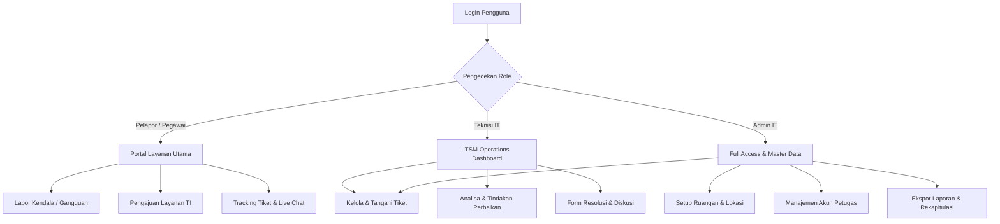

# 🏛️ ITSM BPOM — Sistem Manajemen Layanan Teknologi Informasi

> **Aplikasi IT Service Management (ITSM)** berbasis standar praktik terbaik ITIL untuk pengelolaan gangguan teknis (*Incident Management*) dan permohonan fasilitas TI (*Service Request Management*) di lingkungan **Balai Besar POM**.

---

## 📌 1. Tentang Proyek

**ITSM BPOM** adalah platform berbasis web yang dikembangkan khusus untuk memfasilitasi komunikasi dan tata kelola layanan teknologi informasi antara **seluruh pegawai BPOM (sebagai Pelapor)** dan **Tim IT / Subbagian Tata Usaha (sebagai Teknisi & Administrator)**.

### Masalah yang Diselesaikan:
- ❌ **Pelaporan manual & tercecer**: Sebelumnya pelaporan sering melalui chat personal WhatsApp atau nota fisik sehingga tidak ada rekam jejak formal.
- ❌ **Status tidak terpantau**: Pegawai sulit mengetahui progres perbaikan perangkat atau pembuatan akun.
- ❌ **Tidak ada rekapitulasi data**: Pimpinan dan tim IT kesulitan mengukur beban kerja teknisi dan menyusun evaluasi pemeliharaan berkala.

### Solusi yang Diberikan:
- ✅ **One-Stop Service Portal**: Satu pintu untuk melaporkan insiden kerusakan alat/sistem serta mengajukan layanan TI.
- ✅ **Transparansi Alur & Status**: Alur tiket transparan dari *Diajukan*, *Diproses*, *Selesai*, hingga *Ditolak*.
- ✅ **Audit Trail & Akuntabilitas**: Setiap tindakan tercatat lengkap (analisa akar masalah, tindakan perbaikan, petugas penanggung jawab, hingga waktu resolusi).
- ✅ **Laporan Terstruktur**: Rekapitulasi otomatis yang dapat diekspor langsung ke format Excel/Spreadsheet.

---

## 👥 2. Peran & Hak Akses Pengguna (RBAC)

Sistem membedakan hak akses dan tampilan secara dinamis berdasarkan 3 tingkatan peran (*role*):



| Peran (*Role*) | Akses & Wewenang Utama |
| :--- | :--- |
| **Pegawai (Pelapor)** | • Tampilan khusus portal ramah pengguna (*Choice Portal*).<br>• Membuat laporan gangguan perangkat keras/jaringan/software.<br>• Mengajukan permohonan akun, akun Zoom, atau peminjaman laptop/proyektor.<br>• Melacak tiket pribadi dan berdiskusi dengan teknisi melalui fitur chat interaktif. |
| **Teknisi IT** | • Mengakses Dashboard Operasional dengan metrik & grafik tiket.<br>• Mengelola antrean tiket, mengubah status penanganan, dan memberikan justifikasi penolakan.<br>• Mengisi rincian teknis penanganan (analisa akar masalah, tindakan perbaikan, form resolusi).<br>• Membuka/menutup ruang chat untuk klarifikasi kendala ke pelapor. |
| **Administrator** | • Memiliki seluruh hak akses teknisi.<br>• Manajemen **Master Data Lokasi** (pemetaan ruangan per bidang).<br>• Manajemen **Data Petugas** (tambah/ubah akun teknisi & peran).<br>• Mengakses modul **Laporan & Rekapitulasi** (filter periode & export data ke Excel). |

---

## 🚀 3. Fitur yang Telah Selesai Dibangun (Status Progres)

Proyek ini telah melalui berbagai tahapan pengembangan fitur fungsional inti dan penyesuaian kebutuhan operasional:

### 🔐 A. Autentikasi & Keamanan Lokal
- [x] **Branding Khusus BPOM**: Desain login modern dengan logo resmi dan identitas instansi.
- [x] **Captcha Bahasa Banjar**: Fitur verifikasi bot unik berbasis kearifan lokal menggunakan kamus **>130 kosa kata bahasa Banjar** asli beserta terjemahannya. Mencegah serangan *brute-force* sekaligus memberikan sentuhan budaya lokal.
- [x] **Role Redirection**: Pengguna diarahkan secara otomatis ke portal layanan (untuk pelapor) atau ke dashboard operasional (untuk tim IT).

### 🛠️ B. Manajemen Insiden (Incident Management)
- [x] **Formulir Lapor Kendala**: Input nama kendala, deskripsi, pemilihan aset TI (terhubung database aset), dan foto bukti pendukung.
- [x] **Auto-Detect & Auto-Fill Lokasi**: Lokasi ruangan otomatis terisi cerdas sesuai data bidang pelapor, namun tetap fleksibel jika kendala terjadi di ruangan lain.
- [x] **Pelacakan Siklus Hidup Tiket**: Status `Diajukan` ➔ `Diproses` ➔ `Selesai` / `Ditolak`.
- [x] **Form Tindakan & Resolusi Petugas**: Pencatatan tanggal analisa, analisa akar masalah, tanggal tindak lanjut, langkah perbaikan, dan hasil akhir.
- [x] **Fitur Justifikasi**: Catatan resmi alasan jika ada tiket yang dibatalkan atau ditolak.
- [x] **Pencarian & Filter Cepat**: Filter berdasarkan status dan pencarian kata kunci nomor tiket/deskripsi.

### 📋 C. Permohonan Layanan TI (Service Request Management)
- [x] **3 Kategori Layanan Terintegrasi**:
  1. **Permohonan Akun**: Pengajuan pembuatan/reset akun dinas (Email, SIM, dll.). Dilengkapi form serah-terima kredensial (*generated email & password*) yang aman dari teknisi.
  2. **Permohonan Akun Zoom Meeting**: Pengajuan fasilitas *virtual meeting* dinas beserta tanggal mulai dan selesai.
  3. **Peminjaman Perangkat / Aset TI**: Peminjaman laptop, LCD proyektor, kabel ekstensi, dsb., lengkap dengan tanggal pinjam dan tanggal pengembalian.
- [x] **Live Chat / Diskusi Dua Arah**: Fitur obrolan langsung di dalam halaman tiket permohonan antara pelapor dan teknisi tanpa perlu berpindah aplikasi, dilengkapi tombol kontrol status chat oleh petugas.
- [x] **Fitur Edit Permohonan**: Kemampuan pelapor untuk merevisi data permohonan selama belum selesai diproses.

### 📊 D. Dashboard, Analitik, & Notifikasi
- [x] **Dashboard Metrik Tim IT**: Ringkasan jumlah tiket aktif, insiden selesai, permohonan pending, dan total beban kerja.
- [x] **Grafik Visualisasi Tren**: Statistik tren tiket mingguan/bulanan menggunakan library **ApexCharts**.
- [x] **In-App Notification**: Lonceng notifikasi pada header navbar. Teknisi menerima notifikasi saat ada tiket masuk, dan pelapor menerima notifikasi saat status tiketnya diperbarui.
- [x] **Mark All as Read**: Fitur pembersihan notifikasi yang sudah dibaca dalam satu klik.

### 🏢 E. Master Data & Pelaporan
- [x] **Master Lokasi Ruangan**: Manajemen data ruangan kerja yang terhubung dengan unit kerja / bidang di BPOM.
- [x] **Master Data Petugas**: Tambah dan atur hak akses pegawai IT.
- [x] **Export Laporan Excel**: Filter rentang tanggal awal - akhir serta status untuk mengekspor rekapitulasi data insiden maupun permohonan layanan ke format spreadsheet.

### 🎨 F. Desain & Antarmuka Modern
- [x] **Tailwind CSS v4 & Alpine.js**: Desain ringan, responsif di layar ponsel maupun desktop.
- [x] **Flatpickr Datepicker**: Input tanggal interaktif berupa kalender pop-up (bukan pengetikan manual).
- [x] **Dark Mode & Light Mode**: Dukungan mode gelap bawaan dengan peralihan instan.

---

## 💻 4. Teknologi yang Digunakan (Tech Stack)

| Lapisan (*Layer*) | Teknologi / Pustaka |
| :--- | :--- |
| **Backend Core** | [Laravel 12](https://laravel.com/) (PHP >= 8.2) |
| **Database & ORM** | MySQL / MariaDB via Laravel Eloquent ORM |
| **Frontend Templating**| Blade Components modular (`<x-component />`) |
| **CSS Framework** | [Tailwind CSS v4](https://tailwindcss.com/) JIT Engine |
| **Interaktivitas UI** | [Alpine.js v3](https://alpinejs.dev/) |
| **Pemilihan Tanggal** | [Flatpickr](https://flatpickr.js.org/) |
| **Visualisasi Data** | [ApexCharts](https://apexcharts.com/) |
| **Realtime Engine** | Laravel Reverb & Echo (Broadcast Architecture) |
| **Build & Bundler** | [Vite 7](https://vitejs.dev/) |

---

## 📁 5. Arsitektur & Struktur Folder Utama

```
itsm-bpom/
├── app/
│   ├── Http/
│   │   ├── Controllers/
│   │   │   ├── Auth/              # LoginController, CaptchaController (Kamus Banjar)
│   │   │   ├── IncidentController.php        # Logika siklus hidup penanganan insiden
│   │   │   ├── ServiceRequestController.php  # Logika permohonan layanan & chat
│   │   │   ├── DashboardController.php       # Agregasi data & grafik tim IT
│   │   │   ├── LokasiController.php          # CRUD Master data ruangan
│   │   │   ├── PetugasController.php         # CRUD Akun teknisi & hak akses
│   │   │   └── ReportController.php          # Filter & export rekap data
│   │   └── Requests/              # Validasi form request
│   ├── Models/                    # Ticket, ServiceRequest, User, BanjarCaptcha, Lokasi, dsb.
│   ├── Notifications/             # Notifikasi in-app untuk tiket baru & status update
│   └── Support/                   # Generator gambar captcha
├── database/
│   ├── migrations/                # Struktur skema tabel database
│   └── seeders/                   # Seeder data awal (User, Bidang, Captcha Banjar, Lokasi)
├── resources/
│   ├── css/app.css                # Konfigurasi tema Tailwind v4 (@theme tokens)
│   ├── js/                        # Alpine init, Echo setup, Flatpickr
│   └── views/
│       ├── components/            # Komponen Blade (header, sidebar, date-picker, modal)
│       ├── incidents/             # Halaman Lapor Kendala (index, create, show, edit, all)
│       ├── requests/              # Halaman Permohonan (index, create, show, edit, all)
│       ├── master/                # Halaman manajemen lokasi & petugas
│       ├── reports/               # Halaman export laporan
│       └── pages/                 # Halaman Choice (Pelapor), Dashboard, Profile, Auth
└── routes/
    └── web.php                    # Konfigurasi routing & proteksi middleware RBAC
```

---

## ⚙️ 6. Panduan Instalasi & Menjalankan Proyek

Bagi rekan pengembang atau pengguna yang ingin menjalankan proyek ini di lingkungan lokal:

### Prasyarat Sistem:
- **PHP** >= 8.2 (dengan ekstensi `pdo`, `mbstring`, `openssl`, `gd`)
- **Composer** (Dependency manager PHP)
- **Node.js** (versi 18+) & **NPM**
- **MySQL** / MariaDB (melalui Laragon, XAMPP, atau Docker)

### Langkah-langkah:

1. **Clone atau Buka Direktori Proyek**:
   ```bash
   cd c:/laragon/www/itsm-bpom
   ```

2. **Pasang Dependensi Backend & Frontend**:
   ```bash
   composer install
   npm install
   ```

3. **Konfigurasi Environment (`.env`)**:
   Salin file `.env.example` ke `.env` jika belum ada:
   ```bash
   cp .env.example .env
   php artisan key:generate
   ```
   Pastikan pengaturan basis data pada `.env` sudah sesuai:
   ```env
   DB_CONNECTION=mysql
   DB_HOST=127.0.0.1
   DB_PORT=3306
   DB_DATABASE=itsm_bpom
   DB_USERNAME=root
   DB_PASSWORD=
   ```

4. **Migrasi Database & Seeding Data Awal**:
   Jalankan migrasi untuk membuat tabel beserta data referensi, akun pengujian, dan kamus Captcha:
   ```bash
   php artisan migrate:fresh --seed
   ```

5. **Jalankan Aplikasi**:
   Jalankan server aplikasi dan Vite asset bundler:
   ```bash
   # Terminal 1 (PHP Server)
   php artisan serve

   # Terminal 2 (Vite JIT Bundler)
   npm run dev
   ```
   *Atau langsung gunakan perintah terpadu:*
   ```bash
   composer run dev
   ```

6. **Buka di Peramban Web**:
   Akses `http://127.0.0.1:8000` melalui browser pilihan Anda.

---

## 🔑 7. Akun Pengujian Default (Credentials)

Setelah proses `php artisan migrate:fresh --seed` selesai, akun berikut siap digunakan untuk uji coba:

| Role / Peran | Alamat Email | Password | Kegunaan Uji Coba |
| :--- | :--- | :--- | :--- |
| **Administrator** | `admin@bpom.test` | `password` | Menguji dashboard utama, manajemen petugas, setup lokasi, dan export laporan. |
| **Teknisi IT** | `teknisi@bpom.test` | `password` | Menguji alur penanganan tiket, update analisa/tindakan, dan merespons permohonan. |
| **Pegawai (Pelapor)** | `pelapor@bpom.test` | `password` | Menguji alur portal pelapor, pengajuan kendala, permohonan akun/zoom/alat, dan chat. |

---

## 🗺️ 8. Rencana Pengembangan Selanjutnya (*Next Roadmap*)

- [ ] **SLA Countdown Timer**: Penghitungan otomatis sisa waktu penyelesaian tiket berdasarkan tingkat urgensi insiden.
- [ ] **Survei Kepuasan Layanan (CSAT)**: Formulir penilaian bintang dan ulasan oleh pelapor setelah tiket dinyatakan `Selesai`.
- [ ] **Notifikasi Multi-Channel**: Integrasi pengiriman notifikasi otomatis via WhatsApp Gateway atau Email resmi dinas.
- [ ] **Aplikasi Mobile / PWA**: Kemudahan pelaporan langsung dengan memindai QR Code pada stiker aset perangkat keras.

---

<p align="center">
  <b>Balai Besar Pengawas Obat dan Makanan (BBPOM)</b><br>
  <i>Subbagian Tata Usaha / Tim Teknologi Informasi & Komunikasi</i>
</p>
