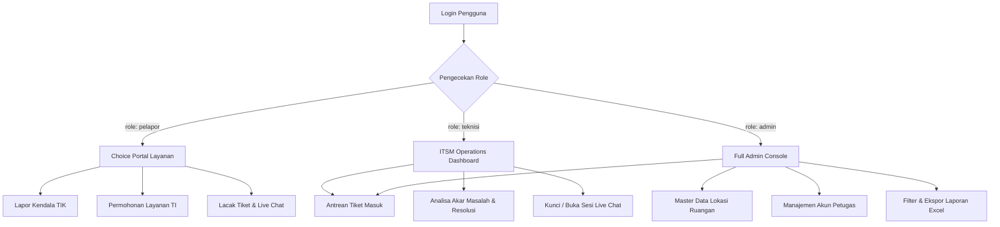
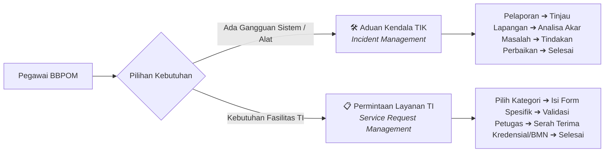
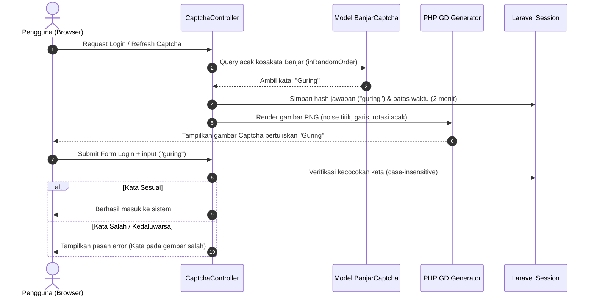
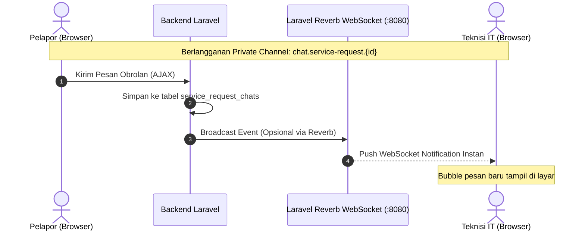
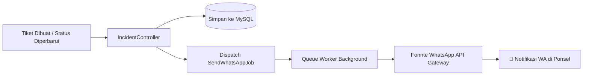
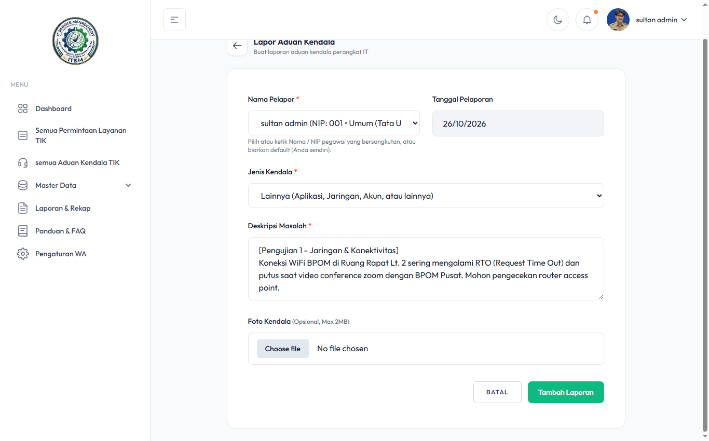
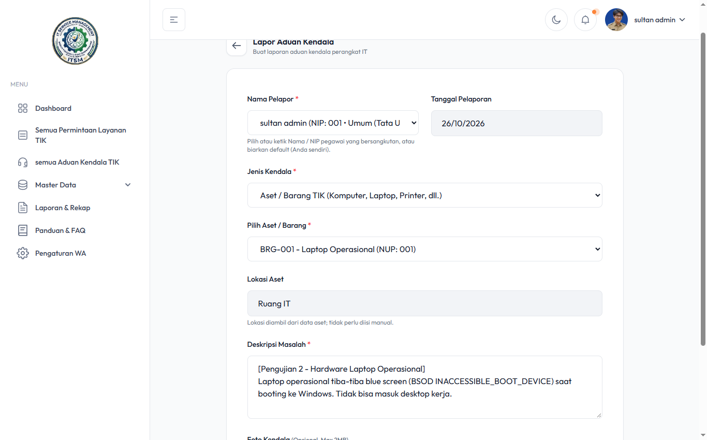
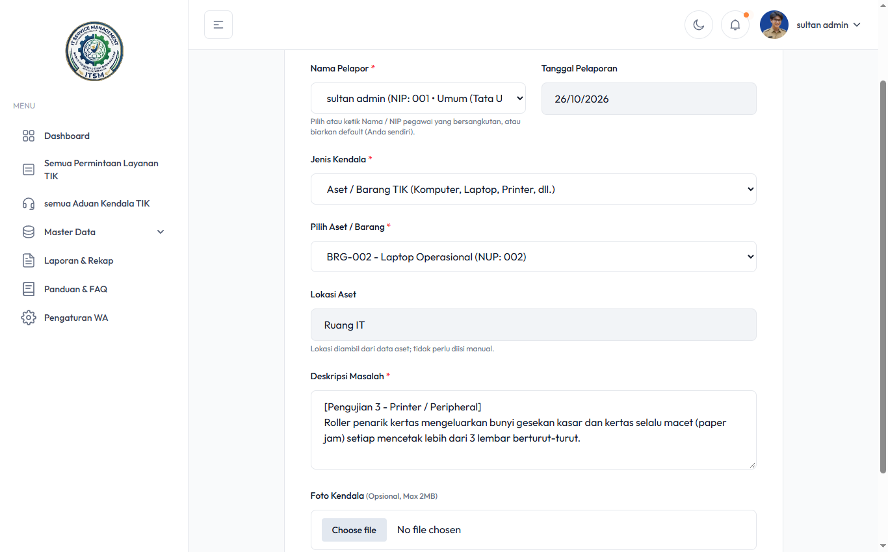
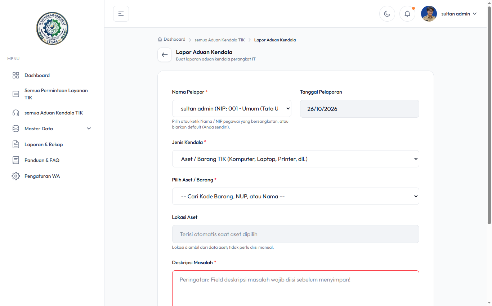
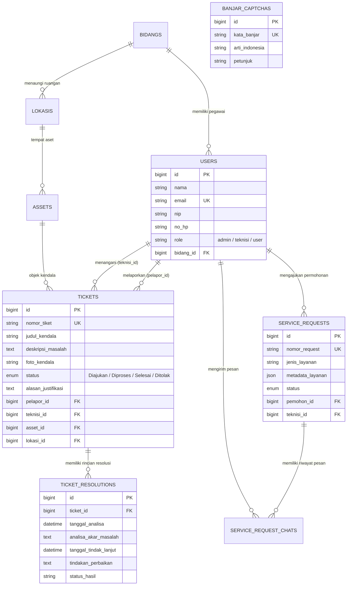

# 🏛️ ITSM BPOM — Sistem Manajemen Layanan Teknologi Informasi

<p align="center">
  
</p>

<p align="center">
  <a href="https://laravel.com"></a>
  <a href="https://tailwindcss.com"></a>
  <a href="https://alpinejs.dev"></a>
  <a href="https://reverb.laravel.com"></a>
  <a href="https://fonnte.com"></a>
  <a href="LICENSE"></a>
</p>

> **ITSM BPOM** adalah aplikasi *IT Service Management* berbasis web yang dikembangkan mengadopsi standar praktik terbaik **ITIL (Information Technology Infrastructure Library)** untuk mengelola aduan gangguan teknis (*Incident Management*) dan permohonan fasilitas TI (*Service Request Management*) di lingkungan **Balai Besar Pengawas Obat dan Makanan (BBPOM)**.

---

## 📑 Daftar Isi

- [📌 1. Latar Belakang & Masalah](#-1-latar-belakang--masalah)
- [👥 2. Peran & Hak Akses Pengguna (RBAC)](#-2-peran--hak-akses-pengguna-rbac)
- [🔄 3. Alur Layanan ITIL](#-3-alur-layanan-itil)
- [🛡️ 4. Fitur & Inovasi Utama](#️-4-fitur--inovasi-utama)
  - [4.1 Captcha Kamus Bahasa Banjar (Anti-Bot Lokal)](#41-captcha-kamus-bahasa-banjar-anti-bot-lokal)
  - [4.2 Realtime Live Chat (Laravel Reverb & Echo)](#42-realtime-live-chat-laravel-reverb--echo)
  - [4.3 Notifikasi Otomatis WhatsApp (Fonnte API)](#43-notifikasi-otomatis-whatsapp-fonnte-api)
  - [4.4 Form Analisa Teknis & Resolusi](#44-form-analisa-teknis--resolusi)
  - [4.5 Ekspor Laporan Rekapitulasi Excel](#45-ekspor-laporan-rekapitulasi-excel)
- [📸 5. Galeri Antarmuka](#-5-galeri-antarmuka)
- [📖 6. Panduan Pengguna (User Manual)](#-6-panduan-pengguna-user-manual)
- [💻 7. Arsitektur Teknis & Skema Database](#-7-arsitektur-teknis--skema-database)
- [⚙️ 8. Panduan Instalasi Lokal](#-8-panduan-instalasi-lokal)
- [🔑 9. Akun Pengujian Default](#-9-akun-pengujian-default)
- [🚀 10. Panduan Deployment Server Produksi (Linux VPS)](#-10-panduan-deployment-server-produksi-linux-vps)
- [❓ 11. FAQ & Pemecahan Masalah](#-11-faq--pemecahan-masalah)
- [🗺️ 12. Roadmap Pengembangan](#️-12-roadmap-pengembangan)

---

## 📌 1. Latar Belakang & Masalah

### Kondisi Sebelum Sistem Dibangun:
- ❌ **Pelaporan Tidak Tercatat (Informal)**: Aduan kerusakan PC, printer, atau jaringan sering disampaikan lewat chat WhatsApp pribadi atau lisan, menyebabkan banyak kendala lupa tertangani atau lambat ditindaklanjuti.
- ❌ **Status Tidak Transparan**: Pegawai yang melapor kesulitan mengetahui apakah kendala sudah ditangani atau sedang menunggu suku cadang.
- ❌ **Beban Kerja IT Tidak Terukur**: Pimpinan dan Subbagian Tata Usaha tidak memiliki rekam jejak kuantitatif mengenai performa teknisi, frekuensi kerusakan alat, dan kebutuhan pemeliharaan berkala.

### Solusi yang Dihadirkan:
- ✅ **One-Stop Service Portal**: Satu pintu digital terpadu untuk pelaporan kerusakan dan permohonan fasilitas TI.
- ✅ **Transparansi Siklus Hidup Tiket**: Alur tiket transparan dari `Diajukan` ➔ `Diproses` ➔ `Selesai` / `Ditolak`.
- ✅ **Audit Trail & Akuntabilitas**: Setiap aksi (tanggal analisa, analisa akar masalah, tindakan perbaikan, petugas penanggung jawab) tersimpan permanen.
- ✅ **Kearifan Lokal**: Perlindungan formulir login dengan **Captcha Bahasa Banjar** (>130 kosakata asli Banjar).
- ✅ **Notifikasi Multi-Channel**: Lonceng notifikasi in-app dan pesan WhatsApp instan ke ponsel teknisi/pelapor.

---

## 👥 2. Peran & Hak Akses Pengguna (RBAC)

Sistem menerapkan pembatasan akses berbasis peran (*Role-Based Access Control*) secara ketat melalui middleware:



| Peran (*Role*) | Kode Role Basis Data | Hak Akses & Wewenang Utama |
| :--- | :---: | :--- |
| **Pegawai (Pelapor)** | `pelapor` | • Mengakses *Choice Portal* yang ramah pengguna.<br>• Melaporkan kendala perangkat/jaringan dengan auto-fill lokasi ruangan & upload bukti foto.<br>• Mengajukan permohonan fasilitas (Akun, Zoom, Peminjaman BMN, Konsultasi, Operator).<br>• Melacak status tiket dan berdiskusi dengan teknisi via *Live Chat*. |
| **Teknisi IT** | `teknisi` | • Mengakses *ITSM Operations Dashboard* dengan statistik antrean dan grafik ApexCharts.<br>• Mengambil tiket, mengubah status menjadi `Diproses`, dan mengisi form resolusi teknis.<br>• Memberikan justifikasi resmi bila tiket ditolak.<br>• Menyerahkan kredensial akun atau mengonfirmasi pengembalian barang pinjaman.<br>• Mengelola ruang diskusi obrolan (*live chat*). |
| **Administrator** | `admin` | • Memiliki seluruh hak akses teknisi (*Super User*).<br>• Manajemen **Master Lokasi Ruangan** (pemetaan ruangan fisik per unit kerja/bidang).<br>• Manajemen **Data Petugas** (menambah, mengubah peran, atau me-reset kredensial staf IT).<br>• Mengakses modul **Laporan & Rekapitulasi** (filter periode tanggal dan ekspor spreadsheet Excel). |

---

## 🔄 3. Alur Layanan ITIL

Sistem membedakan secara tegas dua pilar layanan sesuai kerangka kerja ITIL:



### 1. Aduan Kendala TIK (*Incident Management*)
Pemulihan segera atas gangguan tak terduga yang menghentikan operasional kerja (misal: koneksi LAN putus, printer macet, PC terserang virus, aplikasi internal error).

### 2. Permohonan Layanan TI (*Service Request Management*)
Pengajuan resmi atas fasilitas atau bantuan TI yang telah terstandardisasi:
1. **Permohonan Akun**: Pembuatan akun dinas baru atau *reset password* email/SIM internal BBPOM.
2. **Akun Zoom Meeting**: Penjadwalan rapat daring dinas beserta waktu mulai dan durasi.
3. **Peminjaman Perangkat / Aset**: Peminjaman proyektor LCD, laptop cadangan, atau kabel roll dinas.
4. **Konsultasi TI**: Pendampingan teknis dan konsultasi seputar perangkat lunak instansi.
5. **Operator Kegiatan**: Permintaan staf IT sebagai operator multimedia/sound system kegiatan dinas.

---

## 🛡️ 4. Fitur & Inovasi Utama

### 4.1 Captcha Kamus Bahasa Banjar (Anti-Bot Lokal)
Fitur autentikasi unik berbasis kearifan lokal. Menggunakan kamus lebih dari **130 kosa kata asli bahasa Banjar** beserta terjemahan bahasa Indonesia untuk memvalidasi login manusia.



> [!TIP]
> Bot otomatis global tidak memiliki perbendaharaan kata lokal Kalimantan Selatan, sehingga metode ini efektif menangkal serangan *credential stuffing* sekaligus melestarikan budaya bahasa daerah.

---

### 4.2 Realtime Live Chat (Laravel Reverb & Echo — *Fitur Opsional*)
Komunikasi dua arah langsung antara pelapor dan teknisi penanggung jawab di dalam halaman tiket:

> [!NOTE]
> **Status: Fitur WebSocket Ini Bersifat Opsional (Non-Wajib)**
> - Fitur chat obrolan **tetap berfungsi normal 100%** dan riwayat pesan tetap tersimpan aman di database melalui request HTTP AJAX, meskipun server Reverb tidak dinyalakan.
> - Di lingkungan server produksi / online saat ini, fitur Reverb WebSocket dinonaktifkan sementara (*tidak wajib online*) agar arsitektur server lebih ringan dan tidak memerlukan konfigurasi port WebSocket publik tambahan.
> 
> **Cara Mengaktifkan Jika Ingin Menggunakan Reverb:**
> 1. Pastikan pada berkas `.env`:
>    ```env
>    BROADCAST_CONNECTION=reverb
>    ```
> 2. Jalankan server WebSocket Reverb di terminal terpisah:
>    ```bash
>    php artisan reverb:start
>    ```
> 3. Jika menggunakan domain produksi/HTTPS, arahkan proxy WebSocket port `8080` (lihat contoh konfigurasi Nginx di bagian Deployment).



---

### 4.3 Notifikasi Otomatis WhatsApp (Fonnte API)
Notifikasi instan dikirimkan ke nomor WhatsApp teknisi saat tiket baru masuk, dan ke nomor pelapor saat tiket selesai:



---

### 4.4 Form Analisa Teknis & Resolusi
Teknisi wajib mendokumentasikan proses perbaikan sebelum tiket dapat diselesaikan:
- **Tanggal Analisa & Akar Masalah (*Root Cause*)**: Identifikasi penyebab utama terjadinya gangguan.
- **Tanggal Tindak Lanjut & Tindakan Perbaikan**: Rincian tindakan konkret yang telah dilakukan.
- **Form Justifikasi Penolakan**: Catatan resmi transparan jika tiket berada di luar wewenang TIK.

---

### 4.5 Ekspor Laporan Rekapitulasi Excel
Administrator dapat memfilter periode awal - akhir dan mengekspor seluruh riwayat layanan ke format `.xlsx` dengan pembagian sheet:
- **Sheet Ringkasan**: Rekap total insiden, rasio selesai, rata-rata durasi, dan performa teknisi.
- **Sheet Detail**: Data baris per baris lengkap dengan nomor tiket, nama pelapor, unit kerja, analisa, dan tindakan perbaikan.

---

## 📸 5. Galeri Antarmuka

| Formulir Lapor Kendala Jaringan | Formulir Kendala Perangkat Keras (Laptop) |
| :---: | :---: |
|  |  |

| Kendala Printer & Perangkat BMN | Validasi Keamanan Form Kosong |
| :---: | :---: |
|  |  |

---

## 📖 6. Panduan Pengguna (User Manual)

<details>
<summary><b>👤 Panduan untuk Pegawai (Pelapor) — Klik untuk membuka</b></summary>

1. **Masuk ke Portal**:
   - Buka aplikasi di peramban web.
   - Masukkan email dinas, kata sandi, dan ketik kata yang tertera pada gambar **Captcha Bahasa Banjar** (misal: jika gambar menampilkan kata *"Guring"*, ketikkan *"guring"* — huruf besar/kecil tidak berpengaruh).
   - Terdapat batas waktu pengisian captcha selama 2 menit (jika habis, klik tombol refresh di samping gambar).
2. **Melaporkan Gangguan (Incident)**:
   - Klik menu **Lapor Kendala TIK**.
   - Lokasi ruangan akan terisi otomatis (*auto-detect* sesuai bidang Anda).
   - Pilih perangkat yang bermasalah pada dropdown aset, isi nama kendala, deskripsi kronologi (min. 10 karakter), serta unggah foto bukti jika ada.
   - Klik **Kirim Laporan** untuk memperoleh nomor tiket `TIK-YYYYMMDD-XXXX`.
3. **Mengajukan Permohonan Fasilitas**:
   - Klik menu **Ajukan Permohonan TI**, pilih jenis layanan:
     - *Permohonan Akun*: Email dinas / reset password.
     - *Akun Zoom*: Masukkan judul rapat, tanggal, jam, dan estimasi durasi.
     - *Peminjaman Barang*: Masukkan tanggal pinjam dan rencana pengembalian.
4. **Melacak & Berdiskusi**:
   - Buka menu **Tiket Saya** untuk memantau status (`Diajukan`, `Diproses`, `Selesai`, `Ditolak`).
   - Gunakan fitur **Live Chat** di bagian bawah tiket untuk berdiskusi langsung dengan teknisi yang menangani.
</details>

<details>
<summary><b>🛠️ Panduan untuk Teknisi IT — Klik untuk membuka</b></summary>

1. **Memantau Antrean**:
   - Buka **ITSM Operations Dashboard** untuk memantau tiket masuk berkategori `Diajukan`.
2. **Mengambil & Memproses Tiket**:
   - Buka rincian tiket, klik tombol **Proses Tiket** untuk mengubah status menjadi `Diproses`. Nama Anda otomatis tercatat sebagai teknisi penanggung jawab.
3. **Menyelesaikan Tiket**:
   - Lakukan penanganan teknis di lapangan.
   - Buka formulir resolusi di halaman tiket, isi **Tanggal Analisa**, **Analisa Akar Masalah**, **Tanggal Tindak Lanjut**, dan **Tindakan Perbaikan**.
   - Klik **Simpan Resolusi**. Notifikasi otomatis akan terkirim ke WhatsApp pelapor.
4. **Penyerahan Kredensial & Pengembalian Barang**:
   - Untuk permohonan akun: Isikan username & password yang telah dibuat pada form serah-terima kredensial aman.
   - Untuk peminjaman alat: Klik tombol **Konfirmasi Pengembalian Barang** saat perangkat fisik telah diterima kembali di ruang IT.
</details>

<details>
<summary><b>👑 Panduan untuk Administrator — Klik untuk membuka</b></summary>

1. **Manajemen Master Lokasi Ruangan**:
   - Buka menu **Master Data** ➔ **Lokasi Ruangan**.
   - Tambah ruangan baru beserta unit kerja/bidang penanggung jawab dan lokasi lantainya.
2. **Manajemen Akun Petugas**:
   - Buka menu **Master Data** ➔ **Data Petugas**.
   - Tambah petugas baru, tentukan role (`Teknisi IT` atau `Administrator`), serta masukkan nomor WhatsApp aktif untuk penerimaan notifikasi bot.
3. **Ekspor Laporan Rekapitulasi**:
   - Buka menu **Laporan & Rekapitulasi**.
   - Tentukan rentang tanggal awal dan akhir serta kategori layanan.
   - Klik **Download Excel** untuk mengunduh rekapitulasi data format `.xlsx`.
</details>

---

## 💻 7. Arsitektur Teknis & Skema Database

### Tech Stack Utama:
- **Backend**: Laravel 12 (PHP >= 8.2), Eloquent ORM, Database Transactions.
- **Frontend**: Blade Components modular, Tailwind CSS v4 (`@theme`), Alpine.js v3.
- **Realtime**: Laravel Reverb WebSocket Server & Laravel Echo.
- **Background Tasks**: Laravel Database Queue Worker (`SendWhatsAppJob`).
- **Database**: MySQL / MariaDB dengan relasi foreign key eksplisit.

### Struktur Direktori Proyek:
```
itsm-bpom/
├── app/
│   ├── Events/               # Broadcast event chat (ServiceRequestChatMessageSent)
│   ├── Exports/              # Generator file Excel (Maatwebsite Excel)
│   ├── Http/Controllers/     # IncidentController, ServiceRequestController, dsb.
│   ├── Jobs/                 # Antrean asinkron (SendWhatsAppJob)
│   ├── Models/               # 18 Model Eloquent (Ticket, ServiceRequest, User, dsb.)
│   ├── Notifications/        # Notifikasi in-app
│   ├── Services/             # FonnteService (WA Gateway), PeriodeResolver
│   └── Support/              # CaptchaImage (PHP GD generator)
├── database/
│   ├── migrations/           # Skema tabel database
│   └── seeders/              # Seeder data awal (User, Bidang, Captcha Banjar, Lokasi)
├── public/images/            # Logo dan tangkapan layar antarmuka
├── resources/
│   ├── css/app.css           # Konfigurasi Tailwind CSS v4 (@theme tokens)
│   ├── js/                   # Inisialisasi Alpine.js, Echo, dan chart ApexCharts
│   └── views/                # Template Blade TailAdmin modular
└── routes/
    ├── web.php               # Rute web utama dilindungi auth & role middleware
    ├── channels.php          # Otorisasi private channel Reverb WebSocket
    └── api.php               # Endpoint AJAX
```

### Skema Basis Data (Entity Relationship Diagram):



---

## ⚙️ 8. Panduan Instalasi Lokal

### Prasyarat Sistem:
## ⚙️ 8. Panduan Instalasi & Menjalankan Proyek (Setup Awal)

Panduan ini disusun secara rinci langkah demi langkah agar rekan tim yang melakukan **clone pertama kali** dapat menjalankan aplikasi tanpa kendala error (*zero-error onboarding*).

---

### 📋 A. Prasyarat Sistem & Dependensi Wajib

Pastikan perangkat lokal Anda telah memenuhi prasyarat perangkat lunak berikut:

| Perangkat Lunak | Versi Minimal | Keterangan & Rekomendasi |
| :--- | :--- | :--- |
| **PHP** | `^8.3` (8.3.x / 8.4.x) | Bahasa pemrograman backend utama (Laravel 12). |
| **Composer** | `v2.x` | Manajer dependensi PHP ([Unduh Composer](https://getcomposer.org/)). |
| **Node.js** | `v18.x` / `v20.x` / `v22.x` | Lingkungan runtime JavaScript ([Unduh Node.js LTS](https://nodejs.org/)). |
| **NPM** | `v9.x` / `v10.x` | Manajer paket frontend (termasuk bersama instalasi Node.js). |
| **MySQL / MariaDB** | `v8.0+` / `v10.4+` | Server basis data relasional (via Laragon, XAMPP, atau Docker). |
| **Git** | `v2.x` | Sistem pengontrol versi ([Unduh Git](https://git-scm.com/)). |

#### ⚠️ Ekstensi PHP yang Wajib Aktif di `php.ini`:
Aplikasi menggunakan fitur pemrosesan grafis, ekspor berkas, dan relasi basis data yang memerlukan modul PHP berikut dalam keadaan **aktif**:

- `gd` ➔ **Sangat Penting!** Diperlukan oleh generator gambar **Captcha Bahasa Banjar**, cetak DomPDF, dan styling Excel. (*Jika mati, aplikasi akan mengalami Error 500 `Call to undefined function imagecreatetruecolor()`*).
- `zip` ➔ Diperlukan untuk kompresi dan pembuatan berkas spreadsheet `.xlsx` oleh library `maatwebsite/excel`.
- `pdo_mysql` ➔ Diperlukan untuk komunikasi dengan basis data MySQL.
- `mbstring` ➔ Diperlukan untuk manipulasi teks multibyte dan PDF engine.
- `fileinfo` ➔ Diperlukan untuk validasi format MIME pada upload foto bukti kendala.
- `curl` & `openssl` ➔ Diperlukan untuk koneksi aman HTTP API WhatsApp Fonnte & enkripsi session.

<details>
<summary><b>💡 Cara Mengaktifkan Ekstensi PHP di Laragon / XAMPP / Ubuntu (Klik untuk membuka)</b></summary>

- **Di Laragon (Windows)**:
  1. Klik kanan pada jendela Laragon.
  2. Buka menu **PHP** ➔ **Quick Settings**.
  3. Pastikan opsi `gd`, `zip`, `pdo_mysql`, `fileinfo`, `curl`, `mbstring`, dan `openssl` dalam kondisi **tercentang (aktif)**.
  4. Klik tombol **Reload** atau restart Apache/Nginx di Laragon.

- **Di XAMPP / Standalone PHP (Windows)**:
  1. Buka berkas `php.ini` (biasanya di `C:\xampp\php\php.ini`).
  2. Cari baris berikut dan hilangkan tanda titik koma (`;`) di depannya:
     ```ini
     extension=gd
     extension=zip
     extension=pdo_mysql
     extension=fileinfo
     extension=curl
     extension=mbstring
     extension=openssl
     ```
  3. Simpan berkas dan restart Apache dari XAMPP Control Panel.

- **Di Linux Ubuntu / Debian**:
  Jalankan perintah instalasi paket ekstensi:
  ```bash
  sudo apt update
  sudo apt install -y php8.3-cli php8.3-fpm php8.3-mysql php8.3-gd php8.3-zip php8.3-mbstring php8.3-xml php8.3-curl
  ```
</details>

---

### 🚀 B. Langkah-Langkah Instalasi Lengkap (10 Langkah)

#### 1. Clone Repositori Git
Buka terminal (Git Bash, Command Prompt, atau PowerShell) di direktori kerja lokal Anda (misal `c:/laragon/www`):
```bash
git clone https://github.com/Sultan-ci90/itsm-bpom.git
cd itsm-bpom
```

#### 2. Pasang Dependensi Backend (Composer)
Jalankan perintah Composer untuk mengunduh seluruh pustaka PHP yang diperlukan:
```bash
composer install
```
> [!NOTE]
> Jika sistem lokal Anda menggunakan versi PHP berbeda dan memunculkan peringatan dependensi, Anda dapat menambahkan bendera toleransi: `composer install --ignore-platform-reqs`.

#### 3. Pasang Dependensi Frontend (NPM)
Pasang seluruh modul JavaScript, Tailwind CSS v4, dan pustaka UI:
```bash
npm install
```

#### 4. Siapkan Berkas Konfigurasi Lingkungan (`.env`)
Salin berkas contoh konfigurasi `.env.example` menjadi `.env`:
```bash
# Windows PowerShell / CMD:
copy .env.example .env

# Atau di Git Bash / Linux:
cp .env.example .env
```

#### 5. Generate Application Encryption Key
Buat kunci enkripsi aplikasi Laravel:
```bash
php artisan key:generate
```

#### 6. Buat Database MySQL & Sesuaikan `.env`
Buka aplikasi database manager Anda (HeidiSQL, DBeaver, phpMyAdmin, atau MySQL CLI) dan buat basis data baru bernama `itsm_bpom`:
```sql
CREATE DATABASE itsm_bpom CHARACTER SET utf8mb4 COLLATE utf8mb4_unicode_ci;
```

Buka file `.env` dan pastikan bagian konfigurasi database sesuai dengan server MySQL lokal Anda:
```env
DB_CONNECTION=mysql
DB_HOST=127.0.0.1
DB_PORT=3306
DB_DATABASE=itsm_bpom
DB_USERNAME=root
DB_PASSWORD=
```

Pastikan juga konfigurasi Broadcast dan Reverb sudah terisi:
```env
BROADCAST_CONNECTION=reverb
QUEUE_CONNECTION=database

REVERB_APP_ID=681459
REVERB_APP_KEY=nxviddclkp8ymhxwmfor
REVERB_APP_SECRET=1hypjxft40kymwmvfel4
REVERB_HOST="localhost"
REVERB_PORT=8080
REVERB_SCHEME=http

VITE_REVERB_APP_KEY="${REVERB_APP_KEY}"
VITE_REVERB_HOST="${REVERB_HOST}"
VITE_REVERB_PORT="${REVERB_PORT}"
VITE_REVERB_SCHEME="${REVERB_SCHEME}"
```

#### 7. Jalankan Migrasi Basis Data & Seeding Data Awal
Eksekusi migrasi skema tabel beserta data referensi awal (akun default, master bidang, master lokasi ruangan, dan kamus Captcha Bahasa Banjar):
```bash
php artisan migrate --seed
```
> [!TIP]
> Jika di kemudian hari Anda ingin me-reset ulang database ke kondisi pabrik yang bersih untuk pengujian baru, gunakan: `php artisan migrate:fresh --seed`.

#### 8. Buat Tautan Simbolik Penyimpanan (*Storage Symlink*)
Hubungkan folder berkas unggahan publik (foto kendala, bukti kerusakan BMN) agar dapat diakses oleh browser:
```bash
php artisan storage:link
```

#### 9. Kompilasi Aset Frontend (Vite)
Kompilasi berkas CSS Tailwind v4 dan JavaScript ke folder `public/build`:
```bash
npm run build
```

---

### 💻 C. Cara Menjalankan Aplikasi

Anda dapat memilih salah satu dari dua metode di bawah ini:

#### Opsi 1: Perintah Terpadu Satu Pintu (*Recommended*)
Aplikasi telah dilengkapi skrip otomatis menggunakan pustaka `concurrently` untuk menyalakan komponen utama secara serentak (**Web Server PHP**, **Queue Worker**, **Log Pail**, dan **Vite Bundler**):
```bash
composer run dev
```

#### Opsi 2: Menjalankan Manual di Terminal Terpisah
Jika Anda ingin menjalankan atau memantau komponen secara individual:
```bash
# Terminal 1: Web Server PHP (Wajib)
php artisan serve

# Terminal 2: Vite Hot-Reload / Frontend (Wajib saat pengembangan)
npm run dev

# Terminal 3: Queue Worker (Opsional: untuk pemrosesan pesan WhatsApp Fonnte)
php artisan queue:work

# Terminal 4: WebSocket Server Reverb (Opsional: hanya jika ingin menguji Live Chat realtime)
php artisan reverb:start
```

#### 10. Menjalankan Unit & Feature Test (Opsional)
Untuk memastikan seluruh rute dan logika aplikasi berjalan 100% tanpa error:
```bash
composer test
# atau
php artisan test
```

#### 11. Buka Aplikasi di Peramban Web
Buka browser pilihan Anda dan akses alamat:
👉 **`http://127.0.0.1:8000`** atau domain virtual Laragon Anda (misal `http://itsm-bpom.test`).

---

### 🛠️ D. Checklist Pemecahan Masalah Pertama Kali Clone

| Pesan Kesalahan / Gejala | Penyebab Umum | Solusi Praktis |
| :--- | :--- | :--- |
| `Call to undefined function imagecreatetruecolor()` | Ekstensi `gd` belum aktif di `php.ini`. | Buka `php.ini`, hilangkan tanda `;` pada `;extension=gd`, lalu restart server PHP. |
| `Class "ZipArchive" not found` | Ekstensi `zip` belum aktif di `php.ini`. | Buka `php.ini`, hilangkan tanda `;` pada `;extension=zip`, lalu jalankan kembali `composer install`. |
| `SQLSTATE[HY000] [1049] Unknown database 'itsm_bpom'` | Database belum dibuat di MySQL. | Buka HeidiSQL/phpMyAdmin, jalankan `CREATE DATABASE itsm_bpom;`. |
| `Vite manifest not found at .../manifest.json` | Aset frontend belum dikompilasi. | Jalankan perintah `npm run build` atau `npm run dev`. |
| Foto kendala / avatar tidak tampil (gambar pecah) | Storage symlink belum dibuat. | Jalankan perintah `php artisan storage:link`. |
| Pesan chat tidak bertambah tanpa reload halaman | Server WebSocket Reverb belum hidup. | Jalankan `php artisan reverb:start` di terminal latar belakang. |

---

## 🔑 9. Akun Pengujian Default

Setelah proses seeder selesai, akun berikut siap digunakan:

| Role / Peran | Alamat Email | Password | Tujuan Pengujian |
| :--- | :--- | :--- | :--- |
| **Administrator** | `admin@bpom.test` | `password` | Menguji dashboard utama, manajemen petugas, setup lokasi, dan export laporan. |
| **Teknisi IT** | `teknisi@bpom.test` | `password` | Menguji alur penanganan tiket, input form analisa/tindakan, dan kontrol chat. |
| **Pegawai (Pelapor)** | `pelapor@bpom.test` | `password` | Menguji alur portal pelapor, pengajuan kendala, permohonan fasilitas, dan tracking. |

---

## 🚀 10. Panduan Deployment Server Produksi (Linux VPS)

<details>
<summary><b>🌐 Konfigurasi Nginx Web Server (Termasuk Reverse Proxy WebSocket) — Klik untuk membuka</b></summary>

Simpan konfigurasi berikut pada `/etc/nginx/sites-available/itsm-bpom`:

```nginx
server {
    listen 80;
    server_name itsm.bbpom-banjarmasin.go.id;
    root /var/www/itsm-bpom/public;

    add_header X-Frame-Options "SAMEORIGIN";
    add_header X-Content-Type-Options "nosniff";

    index index.php;
    charset utf-8;

    location / {
        try_files $uri $uri/ /index.php?$query_string;
    }

    # Proxy WebSocket untuk Laravel Reverb
    location /app {
        proxy_http_version 1.1;
        proxy_set_header Upgrade $http_upgrade;
        proxy_set_header Connection "Upgrade";
        proxy_set_header Host $host;
        proxy_set_header X-Real-IP $remote_addr;
        proxy_set_header X-Forwarded-For $proxy_add_x_forwarded_for;
        proxy_pass http://127.0.0.1:8080;
    }

    location = /favicon.ico { access_log off; log_not_found off; }
    location = /robots.txt  { access_log off; log_not_found off; }

    error_page 404 /index.php;

    location ~ \.php$ {
        fastcgi_pass unix:/var/run/php/php8.3-fpm.sock;
        fastcgi_param SCRIPT_FILENAME $realpath_root$fastcgi_script_name;
        include fastcgi_params;
    }

    location ~ /\.(?!well-known).* {
        deny all;
    }
}
```
</details>

<details>
<summary><b>⚙️ Konfigurasi Supervisor (Queue Worker & Reverb Daemon) — Klik untuk membuka</b></summary>

Simpan konfigurasi berikut pada `/etc/supervisor/conf.d/itsm-bpom.conf`:

```ini
[program:itsm-queue-worker]
process_name=%(program_name)s_%(process_num)02d
command=php /var/www/itsm-bpom/artisan queue:work database --sleep=3 --tries=3 --max-time=3600
autostart=true
autorestart=true
stopasgroup=true
killasgroup=true
user=www-data
numprocs=2
redirect_stderr=true
stdout_logfile=/var/www/itsm-bpom/storage/logs/queue-worker.log

[program:itsm-reverb-server]
process_name=%(program_name)s
command=php /var/www/itsm-bpom/artisan reverb:start --host=127.0.0.1 --port=8080
autostart=true
autorestart=true
stopasgroup=true
killasgroup=true
user=www-data
numprocs=1
redirect_stderr=true
stdout_logfile=/var/www/itsm-bpom/storage/logs/reverb.log
```

Jalankan perintah aktivasi:
```bash
sudo supervisorctl reread
sudo supervisorctl update
sudo supervisorctl start all
```
</details>

---

## ❓ 11. FAQ & Pemecahan Masalah

### 1. Gambar Captcha Bahasa Banjar Tidak Muncul (Error 500)
- **Penyebab**: Ekstensi **PHP GD** belum diaktifkan di server atau Laragon.
- **Solusi**: Buka berkas `php.ini`, hapus tanda titik koma pada `;extension=gd` menjadi `extension=gd`, lalu restart server PHP.

### 2. Pesan Live Chat Tidak Muncul Realtime
- **Penyebab**: Server WebSocket Reverb belum dijalankan atau port `8080` terblokir firewall.
- **Solusi**: Jalankan `php artisan reverb:start` di terminal, dan pastikan konfigurasi `REVERB_HOST` di `.env` dapat diakses oleh browser.

### 3. Notifikasi WhatsApp Tidak Masuk
- **Penyebab**: Queue worker belum aktif atau masa berlaku token Fonnte terputus (*disconnected*).
- **Solusi**: Jalankan `php artisan queue:work` dan verifikasi koneksi nomor pada dashboard Fonnte.

### 4. Tampilan CSS Tailwind v4 Berantakan
- **Penyebab**: Berkas bundel Vite pada `public/build` belum diperbarui.
- **Solusi**: Jalankan `npm run build` (produksi) atau `npm run dev` (pengembangan).

---

## 🗺️ 12. Roadmap Pengembangan

- [ ] **SLA Countdown Timer**: Penghitungan otomatis sisa target waktu penyelesaian tiket berdasarkan tingkat urgensi kendala.
- [ ] **Survei Kepuasan Layanan (CSAT)**: Formulir penilaian bintang dan ulasan oleh pelapor setelah tiket dinyatakan `Selesai`.
- [ ] **PWA & QR Code Scanning**: Fitur pelaporan cepat dengan memindai label stiker QR Code pada aset fisik perangkat keras BBPOM.

---

<p align="center">
  <b>Balai Besar Pengawas Obat dan Makanan (BBPOM)</b><br>
  <i>Subbagian Tata Usaha / Tim Teknologi Informasi & Komunikasi</i>
</p>
